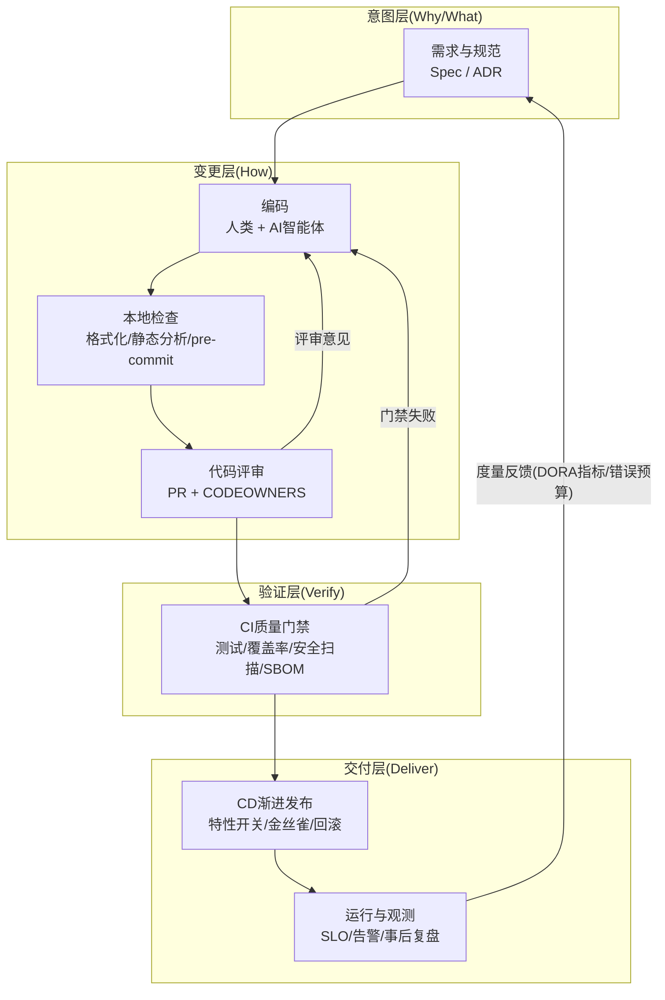
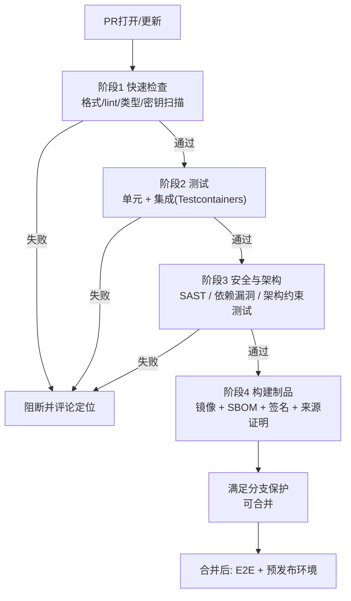
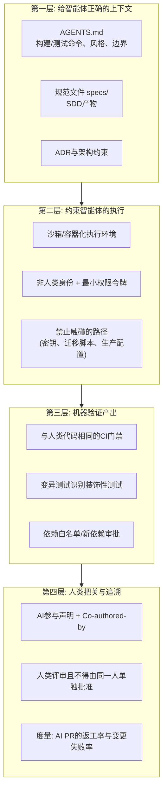
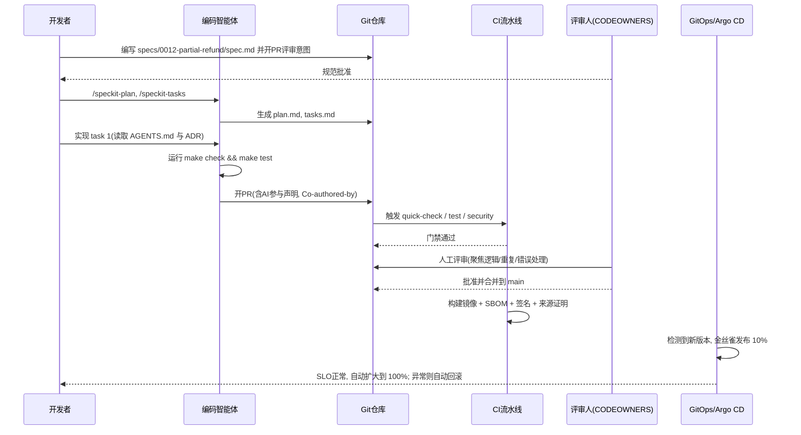

[toc]


## 治理目标与总体框架

中大型项目的治理（governance）不是某一个工具或某一份规范，而是一组**相互咬合的约束与反馈回路**。本文把用户提出的四个目标映射为四条治理主线，并以"一次代码变更的生命周期"为主轴来组织内容：

| 目标                                     | 核心问题                                 | 对应主线                         |
| ---------------------------------------- | ---------------------------------------- | -------------------------------- |
| **规范性（conformance）**                | 代码、提交、文档、接口是否遵循统一约定？ | 仓库治理、编码规范、自动化检查   |
| **可靠性（reliability）**                | 系统在生产环境是否稳定、可恢复？         | 测试策略、渐进式交付、SRE实践    |
| **可持续性/可维护性（maintainability）** | 一年后、换一批人后还能不能改？           | 架构约束、技术债管理、文档即代码 |
| **交付质量（delivery quality）**         | 交付物是否正确、安全、可追溯？           | 质量门禁、供应链安全、度量反馈   |

AI编码并不是独立的第五条主线，而是**对以上每条主线的放大器**。DORA 2025报告的核心论点正是这一点：AI放大你现有的工程文化：加速结构良好的团队，同时放大挣扎中团队的功能失调；成功的采用取决于稳健的系统，而不仅是强大的工具。因此，**治理体系本身越扎实，AI带来的收益越大；治理缺位时，AI只会让问题更快地堆积**。



上图是全文的地图：**左侧定义意图，中间产生变更，右侧验证与交付，底部的反馈回路把生产数据送回意图层**。后续各章依次展开每一层，最后用一个综合示例把它们串起来。

---

## 必须掌握的理论基础

工具会过时，理论不会。以下理论是理解所有实践"为什么这么做"的根基。

### 软件演化与技术债

- **Lehman软件演化定律**：持续使用的软件必须持续变更，否则逐渐失去价值；而变更会让复杂度上升，除非投入专门工作去降低复杂度。这解释了为什么**重构和清理必须是常规预算的一部分**，而非"有空再做"。
- **技术债（technical debt）**：Ward Cunningham的比喻——为了短期速度而做的妥协会像贷款一样产生利息。治理要求把债务**显性化**（登记、分类、定期偿还），而不是靠个人记忆。
- **破窗理论与童子军法则（Boy Scout Rule）**：一处未修的坏代码会降低整个团队的质量标准；每次触碰代码都让它比来时更干净一点。

### 组织与架构的耦合

- **康威定律（Conway's Law）**：系统结构会复制组织的沟通结构。中大型项目划分模块/服务时，必须同时设计团队边界，否则架构图只是一张画。
- **Team Topologies**（Skelton & Pais）提出的**认知负荷（cognitive load）**概念：一个团队能维护的系统复杂度有上限，超出后质量必然下滑。平台团队、赋能团队的存在就是为了给业务流团队"减负"。

### 质量模型

**ISO/IEC 25010**把产品质量分为功能适合性、性能效率、兼容性、可用性、可靠性、安全性、可维护性、可移植性等特性。它的价值在于提供一套**评审和验收时的共同词汇**：当有人说"质量不好"时，可以追问具体是哪一个特性的哪一个子特性退化了。

### 交付效能的科学

*Accelerate*一书及其后的DORA研究用十年数据证明：**吞吐量与稳定性不是此消彼长，而是正相关**——高频小步交付的团队反而更稳定。2025年的变化是指标扩展为五个，增加了"返工率"（rework rate），并重组为两类：三个吞吐量指标（部署频率、变更前置时间、返工率）和两个不稳定性指标（变更失败率、失败部署恢复时间）。同时DORA 2025彻底放弃了低/中/高/精英的聚类，改为基于八项度量（吞吐量、稳定性、团队绩效、产品绩效、个人效能、有价值工作时间、摩擦、倦怠）的七种原型。

对AI编码的治理启示尤其直接：这一年里AI与吞吐量的关系从负转正，与有价值工作时间的关系也发生了逆转，但AI与不稳定性上升的相关性依然存在。换句话说，**AI让你更快，但不会自动让你更稳——稳定性要靠治理体系补上**。

### 左移与纵深防御

- **左移（shift-left）**：问题越早发现成本越低，因此把测试、安全、规范检查尽量推向编码阶段（编辑器、pre-commit）。
- **纵深防御（defense in depth）**：不依赖任何单一关卡。编辑器提示、提交钩子、CI门禁、评审、部署前检查、运行时监控——每一层都可能漏，但叠加后漏网概率极低。这对AI代码尤为重要，后文会反复用到。

---

## 意图层：需求、规范与架构决策

### 规范驱动开发（Spec-Driven Development, SDD）

SDD是AI编码时代最重要的新兴实践。规范驱动开发颠倒了传统工作流，把规范视为事实来源，把代码视为生成或验证的次级产物。其直觉在于：2026年它成为主流，因为AI智能体擅长写代码，却很不擅长猜你想要什么。

arXiv论文2602.00180给出了实用的分级框架：三个规范严格度等级——spec-first、spec-anchored、spec-as-source——并明确指导各自的适用场景。可以这样理解三个等级：

| 等级                             | 含义                                             | 适用场景                                              |
| -------------------------------- | ------------------------------------------------ | ----------------------------------------------------- |
| **spec-first（规范先行）**       | 写代码前先写规范，规范是起点但之后可能与代码分离 | 大多数业务功能开发的最低要求                          |
| **spec-anchored（规范锚定）**    | 规范与代码持续保持同步，变更先改规范再改代码     | 核心领域模型、对外API、多团队协作的接口               |
| **spec-as-source（规范即源码）** | 代码完全由规范生成，人不直接编辑代码             | 目前仍属前沿探索（如Tessl），不建议中大型项目全面采用 |

**推荐方案：GitHub Spec Kit**。理由是免费、MIT许可、与智能体无关。它是一个MIT许可的CLI和模板集，把specify-plan-tasks-implement工作流叠加在你已有的编码智能体之上（GitHub Copilot、Claude Code、Cursor、Gemini CLI等）；你用它的命令在仓库中生成markdown规范文件，再把每个任务交给你选择的智能体。它的成熟度已经到位：Spec Kit于2026年8月21日发布v1.0.0，距首次公开发布几乎正好一年；当前版本是v1.0.13（2026年9月29日）。

Spec Kit的工作流各阶段含义（Constitution：项目原则，设定一次而非每个功能都设；Spec：你在构建什么以及为什么；Plan：方法（什么会变、在哪里、以什么顺序）；Tasks：可执行步骤；Implement：运行智能体执行任务；Converge：对照产物评估实现并补上剩余工作）：

| 阶段/命令      | 产物                                                | 治理意义                                   |
| -------------- | --------------------------------------------------- | ------------------------------------------ |
| `constitution` | 项目级不可妥协原则（如"所有公共API必须有契约测试"） | 相当于团队的"宪法"，只写一次，所有功能继承 |
| `specify`      | 功能规范：用户故事、验收标准、非目标                | 评审的第一道关：**先评审意图，再评审代码** |
| `plan`         | 技术方案：受影响模块、数据变更、顺序                | 对应轻量级设计评审                         |
| `tasks`        | 原子任务清单                                        | 让AI每次只做一件可验证的小事，便于小PR     |
| `implement`    | 代码                                                | 智能体执行                                 |
| `converge`     | 差异报告                                            | 防止"规范漂移"——代码做了，规范没跟上       |

替代方案的选择边界：OpenSpec（半活性，带增量标记）适合存量项目的迭代变更；BMAD-METHOD（21+角色智能体）适合框架繁重的企业级规划；Amazon Kiro把SDD内建到IDE但绑定AWS生态。对国内团队，Spec Kit的纯markdown文件无需额外服务，是最包容的起点。

**避免**：把SDD当成瀑布式的大文档。规范应**与功能同粒度、与代码同仓库、随PR一起评审**。

### 架构决策记录（Architecture Decision Record, ADR）

ADR是记录"为什么这么决定"的轻量文档。中大型项目最常见的维护灾难之一是：半年后没人知道当初为什么选了某个消息队列，于是既不敢改也不敢删。ADR用一页纸解决这个问题。Michael Nygard提出的经典格式字段如下：

| 字段             | 含义                                                         | 常见误区                                         |
| ---------------- | ------------------------------------------------------------ | ------------------------------------------------ |
| **Title**        | 简短的决策名，带编号如`ADR-0007`                             | 编号不复用，废弃也保留                           |
| **Status**       | `Proposed` / `Accepted` / `Deprecated` / `Superseded by ADR-00xx` | 被替代时改状态而不是删文件                       |
| **Context**      | 做决策时面临的约束与现状                                     | 只写结论不写背景，导致后人无法判断前提是否还成立 |
| **Decision**     | 决定了什么，用陈述句                                         | 混入多个决策                                     |
| **Consequences** | 正面与负面后果、引入的新约束                                 | 只写好处                                         |

**推荐**：ADR存放于仓库内（如`docs/adr/`），用markdown，随PR评审；可用开源工具`adr-tools`或`log4brains`生成索引。**AI编码时的额外价值**：把ADR目录列入`AGENTS.md`的"必读"清单，智能体就能遵循既有架构约束，而不是每次都"重新发明"一套。

### 架构可视化与文档体系

- **C4模型**（Simon Brown）：用System Context、Container、Component、Code四个层级描述架构，比随意画框图更可沟通。推荐用**Structurizr DSL**或**Mermaid的C4语法**以代码形式维护，纳入版本控制。
- **arc42**：一套架构文档模板，适合需要正式交付架构文档的项目。
- **Diátaxis**：文档分为教程、操作指南、参考、解释四类，各自写法不同。中大型项目的`docs/`目录按此划分可以显著降低"文档找不到"的问题。
- **文档即代码（docs-as-code）**：文档与代码同仓库、同评审、同CI（可用`markdownlint`、`vale`检查），用MkDocs、Docusaurus或VitePress发布。

---

## 变更层：仓库治理与编码规范

### 分支策略与提交规范

**推荐主干开发（trunk-based development）**：所有人向`main`提交短生命周期分支（一般不超过1–2天），依靠特性开关而非长期分支隔离未完成功能。DORA研究长期支持这一点：长期分支与合并地狱是稳定性的敌人。GitFlow适合有明确版本发布节奏且需要同时维护多个版本的产品（如需长期支持的SDK），对持续部署的服务则过重。

**Conventional Commits**是提交信息的事实标准，格式为`<type>(<scope>)!: <description>`，字段含义：

| 占位符        | 含义                                                         | 示例                     |
| ------------- | ------------------------------------------------------------ | ------------------------ |
| `type`        | 变更类型：`feat`、`fix`、`docs`、`refactor`、`test`、`chore`、`perf`、`ci`、`build` | `feat`                   |
| `scope`       | 可选，受影响模块                                             | `order-service`          |
| `!`           | 可选，标记破坏性变更                                         | `feat(api)!: ...`        |
| `description` | 祈使语气的一句话摘要                                         | `support partial refund` |
| 正文/页脚     | 可选，`BREAKING CHANGE:`、`Refs: #123`、`Co-authored-by:`    | 页脚可用于**标注AI参与** |

它的价值不只是整洁：配合**语义化版本（SemVer）**，`feat`对应次版本号、`fix`对应修订号、`!`对应主版本号，可以用`semantic-release`或`release-please`**自动生成CHANGELOG与版本号**，把"发版"从人工仪式变成流水线产物。用`commitlint`在提交钩子中强制检查。

### 仓库级配置文件：跨平台一致性的基础

这是国内开发者混用Windows与Linux/macOS时最容易踩坑的地方。Git在Windows上的默认`core.autocrlf=true`会在检出时把LF转为CRLF，若有人把CRLF文件提交上去，shell脚本在Linux上会报`bad interpreter: /bin/bash^M`。

**必须**在仓库根目录提交`.gitattributes`，让规则随仓库走而不依赖每个人的本地配置：

```gitattributes
# 默认：文本文件统一按LF入库，检出时也保持LF
* text=auto eol=lf

# Windows专属脚本必须是CRLF
*.bat text eol=crlf
*.cmd text eol=crlf
*.ps1 text eol=crlf

# 二进制文件不做任何转换
*.png binary
*.jpg binary
*.woff2 binary
*.jar binary
```

配套`.editorconfig`统一缩进、编码与末尾换行，主流编辑器与IDE原生或通过插件支持：

```ini
root = true

[*]
charset = utf-8
end_of_line = lf
insert_final_newline = true
indent_style = space
indent_size = 2
trim_trailing_whitespace = true

[*.{py,go}]
indent_size = 4

[Makefile]
indent_style = tab
```

**非ASCII字符注意事项**：所有源码、文档统一UTF-8且**不带BOM**（部分Linux工具对BOM敏感）；Windows终端默认代码页可能导致中文日志乱码，CI在Windows runner上运行Python脚本时应设置环境变量`PYTHONIOENCODING=utf-8`，PowerShell脚本可在开头设置`[Console]::OutputEncoding = [System.Text.Encoding]::UTF8`。国外工具的测试快照（snapshot）文件若包含中文，要确认工具不会做转义导致跨平台差异。

### 代码所有权与分支保护

- **`CODEOWNERS`**文件（GitHub/GitLab/Gitea均支持）把目录映射到负责团队，PR触碰对应目录时自动指派评审人。这是康威定律的工程化落地。
- **分支保护规则**：`main`禁止直接推送、要求PR、要求状态检查通过、要求至少一名代码所有者批准、要求分支为最新。**对AI智能体账号尤其要收紧**——它们应只能开PR，不能合并。

### 编码规范自动化

**原则：凡能由机器判定的规范，一律不靠人工评审。**人应把精力留给设计与逻辑。

| 层次                 | 工具举例（开源）                                             | 执行时机            |
| -------------------- | ------------------------------------------------------------ | ------------------- |
| 格式化               | `prettier`、`black`/`ruff format`、`gofmt`、`rustfmt`、`clang-format` | 保存时 + pre-commit |
| 代码检查（lint）     | `eslint`、`ruff`、`golangci-lint`、`clippy`                  | pre-commit + CI     |
| 类型检查             | `tsc --noEmit`、`mypy`/`pyright`                             | CI                  |
| 静态安全分析（SAST） | `semgrep`、`CodeQL`、`bandit`、`gosec`                       | CI                  |
| 架构约束测试         | `ArchUnit`（Java）、`dependency-cruiser`（JS/TS）、`import-linter`（Python） | CI                  |
| 密钥扫描             | `gitleaks`、`trufflehog`                                     | pre-commit + CI     |

**推荐使用`pre-commit`框架**统一管理钩子（跨语言、跨平台），仓库提交`.pre-commit-config.yaml`，新人执行`pre-commit install`即可。国内网络下钩子仓库从GitHub拉取可能很慢，可以在团队内部镜像这些仓库，或为`git`配置代理（见文末网络环境章节）。

**架构约束测试**值得单独强调。它把"展示层不得直接依赖数据访问层"这样的规则写成可运行的测试，这是Neal Ford在*Building Evolutionary Architectures*中提出的**架构适应度函数（fitness function）**思想。对AI生成代码，它是防止智能体"抄近路"破坏分层的最有效机制之一，因为智能体看不到架构图，但看得到失败的测试。

---

## 变更层：代码评审

### 评审的原则

Google的工程实践文档（*Google Engineering Practices: Code Review*）总结的几条核心原则适用于绝大多数团队：

- **小步变更**：一个PR只做一件事，理想在200–400行以内。大PR评审质量断崖式下降。
- **评审标准是"让代码库整体健康度持续提升"**，而不是"完美"。评审人不应因为个人偏好而阻塞。
- **区分强制与建议**：用`nit:`前缀标注非阻塞意见。
- **评审时间是一等公民**：评审响应应在一个工作日内，否则会迫使作者开更多并行分支，反过来破坏主干开发。

### AI时代的评审规则

实证数据说明为什么不能对AI代码放松评审：Veracode在2026年7月的测试中约44%的AI代码生成任务产生了已知安全缺陷，几乎与2025年首份报告持平；CodeRabbit发现AI合著的PR中的问题数量是纯人工PR的1.7倍。更值得警惕的是可维护性：GitClear分析6.23亿次代码变更后，统计出重复代码块比AI编码工具普及前多了81%。早期的用户研究也发现使用AI助手的参与者写出"明显更不安全的代码"，并表现出"虚假的安全感"，常把不安全的方案评为安全。

因此**推荐**的评审策略：

- **AI代码与人类代码适用同一标准，且评审人不得是生成该代码的同一人仅凭"看过一眼"就批准**。
- **PR必须声明AI参与程度**（模板中的复选框或`Co-authored-by`页脚），这既是透明度也方便事后度量。
- **优先审查AI的典型弱点**：重复逻辑（应抽取而非复制）、缺失的错误处理、过度宽泛的异常捕获、未验证的输入、看起来合理但不存在的API、引入未经批准的新依赖。
- **AI评审助手作为第一道筛子而非最终裁决**：开源的`pr-agent`等工具可以先过一遍常规问题，人再聚焦设计。
- **避免**用"AI写的所以我不太懂"作为批准理由；读不懂的代码不应合并。

### PR模板示例

把治理要求固化到`.github/PULL_REQUEST_TEMPLATE.md`（GitLab为`.gitlab/merge_request_templates/`）：

```markdown
## 变更说明
<!-- 关联规范/任务：specs/0012-partial-refund.md -->

## 变更类型
- [ ] feat  - [ ] fix  - [ ] refactor  - [ ] docs  - [ ] chore

## AI参与声明
- [ ] 无AI参与
- [ ] AI辅助（补全/建议），人工逐行审阅
- [ ] AI智能体生成主要代码，人工审阅并运行全部测试

## 自检清单
- [ ] 新增/修改逻辑有对应测试，CI通过
- [ ] 未引入新依赖，或已在PR说明中列出并给出理由
- [ ] 涉及架构决策的变更已附ADR
- [ ] 对外接口变更已更新契约与文档
```

---

## 验证层：测试策略与质量门禁

### 测试分层

**测试金字塔**（Mike Cohn）仍是基本模型：大量快速的单元测试、适量的集成测试、少量端到端测试。Kent C. Dodds的**测试奖杯（testing trophy）**对前端与业务应用做了修正：把重心放在集成测试上，因为它们在"信心/成本"比上最优。两者不矛盾——**原则是"测试越接近用户使用方式，信心越高；越慢越脆弱，数量越少"**。

| 测试类型   | 验证什么                                 | 推荐工具（开源）                            | 治理要点                       |
| ---------- | ---------------------------------------- | ------------------------------------------- | ------------------------------ |
| 单元测试   | 单个函数/类的逻辑                        | 各语言内置框架、`pytest`、`vitest`、`JUnit` | 快（毫秒级）、无外部依赖       |
| 集成测试   | 模块与真实依赖（数据库、消息队列）的交互 | `Testcontainers`                            | 用容器起真实依赖，避免mock失真 |
| 契约测试   | 服务间接口兼容性                         | `Pact`、基于OpenAPI的schema校验             | 微服务/多团队必备              |
| 端到端测试 | 关键用户旅程                             | `Playwright`、`Cypress`                     | 只覆盖核心路径，避免脆弱       |
| 属性测试   | 不变量在随机输入下成立                   | `Hypothesis`、`fast-check`、`QuickCheck`    | 对解析器、算法类代码极有效     |
| 变异测试   | 测试本身是否有效                         | `mutmut`、`Stryker`、`PIT`                  | 发现"覆盖了但没断言"的伪测试   |

**变异测试对AI代码的特殊意义**：智能体很擅长写出"让覆盖率上升"的测试，但未必能发现缺陷。变异测试通过修改源码（如把`<`改成`<=`）看测试是否失败，能识别这类"装饰性测试"。

### 质量门禁的设计

质量门禁（quality gate）是CI中"不满足则不能合并"的硬性检查。**推荐**的门禁清单与阈值设计原则：

- **必须**：编译/类型检查通过；全部测试通过；lint零错误；密钥扫描零发现；高危漏洞的依赖零容忍。
- **应该**：**变更行覆盖率**（而非全局覆盖率）不低于阈值（如80%），因为全局阈值会被存量代码稀释；SAST无新增高危告警；架构约束测试通过。
- **可以**：性能基准回归不超过阈值；bundle体积不超过预算；文档构建成功。
- **避免**：把全局覆盖率卡在很高的数字（如95%），这会催生无意义测试；把不稳定的E2E测试设为硬门禁，这会让大家习惯于"重跑一次"。



分阶段的意义是**快速失败**：阶段1通常在一分钟内完成，开发者和智能体都能立即得到反馈；昂贵的测试只在廉价检查通过后运行，节省CI资源。这对AI智能体尤其重要——**智能体的迭代循环越短，自我纠错越有效**。

---

## 交付层：持续交付与供应链安全

### 渐进式交付

- **特性开关（feature flag）**：把"部署"与"发布"解耦，未完成功能可以合并到主干但对用户不可见。开源方案有`Unleash`、`Flagsmith`、`OpenFeature`（CNCF标准API，避免厂商锁定）。治理要点：**开关必须有过期日期与负责人**，否则积累成新的技术债。
- **金丝雀/蓝绿发布**：先对小比例流量发布，观察SLO指标后再扩大。Kubernetes环境可用`Argo Rollouts`、`Flagger`。
- **可回滚**：每次发布的制品不可变（immutable）、带版本，回滚就是重新部署上一个版本，而不是"反向修改"。数据库变更需**向前兼容**（expand/contract模式：先加列，迁移数据，再删旧列，分多次发布）。
- **基础设施即代码与GitOps**：`Terraform`/`OpenTofu`、`Pulumi`管理云资源，`Argo CD`/`Flux`让集群状态与Git仓库一致。生产环境在海外服务器时，GitOps的拉取模式（集群主动从Git拉取）比推送模式更不受国内到海外网络波动的影响。

### 软件供应链安全

近年的重大安全事件（SolarWinds、xz-utils后门、npm投毒）让供应链成为治理的必修课。关键概念：

| 概念                     | 含义                                                         | 开源工具                        |
| ------------------------ | ------------------------------------------------------------ | ------------------------------- |
| **SBOM**（软件物料清单） | 制品中包含的所有组件及版本的清单                             | `syft`、`cdxgen`、`cyclonedx-*` |
| **CycloneDX / SPDX**     | 两种主流SBOM格式；CycloneDX由OWASP维护，SPDX由Linux基金会维护并已成为ISO/IEC 5962:2021标准 | 同上                            |
| **VEX**                  | 漏洞可利用性交换，说明某个CVE在你的产品中是否真的可被利用    | `vexctl`                        |
| **SLSA**                 | 定义从L0到L3的一系列安全级别，组织可以逐步采用以提高构建与发布过程的完整性 | GitHub的`slsa-github-generator` |
| **Sigstore / cosign**    | 无密钥签名，为制品与证明签名                                 | `cosign`                        |
| **in-toto**              | SLSA来源证明文档底层的加密证明框架                           | `in-toto`                       |
| **OpenSSF Scorecard**    | 自动评估开源项目的安全实践健康度                             | `scorecard`                     |

SBOM与Scorecard是互补的：SBOM告诉你有哪些依赖以及是否含已知漏洞；Scorecard告诉你这些依赖维护得有多好——这是未来漏洞风险的先行指标。一个没有已知CVE但Scorecard得分2/10（无代码评审、无CI测试、无分支保护）的依赖是SBOM无法标记的风险。

**推荐**的渐进路线：

- **必须**：锁定依赖版本（`package-lock.json`、`poetry.lock`、`go.sum`等）并提交；启用`Dependabot`或`Renovate`自动更新；CI中运行依赖漏洞扫描（`osv-scanner`、`trivy`、`grype`）；密钥扫描。
- **应该**：每次构建生成SBOM并随制品发布；用`cosign`签名容器镜像；达到SLSA Build L1–L2（在托管CI上生成签名的来源证明）。
- **可以**：评估关键依赖的Scorecard得分；达到SLSA Build L3——要求加固的构建平台与不可伪造的来源证明文档，这是当前美国联邦采购的标准；在部署时用策略引擎（`Kyverno`、`OPA/Gatekeeper`）验证签名。
- **AI相关的新维度**：把所有制品与包、容器镜像、AI模型、MCP定义集中到单一受治理的私有仓库，这是大规模执行策略的唯一方式；同时把AI智能体当作一等公民来治理：为每个AI智能体分配非人类身份。实际意义是：**智能体使用独立的服务账号与最小权限令牌，其提交与操作可审计、可撤销**。

对国内团队的注意事项：依赖镜像（如npm的淘宝镜像、PyPI的清华/阿里镜像、Go的`GOPROXY=https://goproxy.cn`）可以加速，但**锁文件中的完整性哈希（integrity hash）必须与官方源一致**，CI（尤其在海外）应能从官方源重新校验；避免把镜像地址硬编码进锁文件。

---

## 交付层：可靠性与可观测性

### SRE的核心概念

Google的*Site Reliability Engineering*提出的三个概念是可靠性治理的骨架：

| 概念                         | 含义                            | 示例                  |
| ---------------------------- | ------------------------------- | --------------------- |
| **SLI**（服务水平指标）      | 可测量的服务行为指标            | 成功请求比例、P99延迟 |
| **SLO**（服务水平目标）      | 对SLI设定的目标值               | 30天内可用性≥99.9%    |
| **错误预算（error budget）** | `1 - SLO`，即允许"不可用"的额度 | 99.9%对应每月约43分钟 |

错误预算的治理价值在于**把"快"与"稳"的争论变成数据决策**：预算充足时可以激进发布；预算耗尽时冻结功能发布、只允许可靠性修复。这比"谁嗓门大听谁的"要健康得多。

### 可观测性

**OpenTelemetry（OTel）**已成为CNCF下的事实标准，统一了追踪（trace）、指标（metric）、日志（log）三类遥测数据的采集与导出，避免厂商锁定。**推荐**：

- 应用从第一天就使用OTel SDK或自动插桩，导出到`Prometheus`+`Grafana`（指标）、`Jaeger`/`Tempo`（追踪）、`Loki`（日志）这套开源组合，或商业后端。
- **结构化日志**（JSON）并携带`trace_id`，让日志可与追踪关联。
- 关键业务指标（如"订单创建成功率"）与技术指标同等重要，应由业务代码主动上报。

### 事件响应与学习

- **Runbook**：每个告警都应链接到一份"收到此告警后做什么"的操作手册，放在仓库里。
- **无责事后复盘（blameless postmortem）**：故障后记录时间线、根因、贡献因素、行动项；重点是改进系统而非追责个人。行动项进入待办并跟踪关闭。
- **混沌工程**：在受控条件下注入故障（`Chaos Mesh`、`Litmus`），验证系统的韧性假设。属于"可以"而非"必须"。

---

## 可维护性：架构约束与技术债管理

### 让架构可演进

- **模块化与依赖方向**：无论采用六边形架构、整洁架构还是简单分层，核心规则是**依赖指向稳定的抽象，业务核心不依赖框架与基础设施**。前文的架构约束测试负责守卫这条规则。
- **模块化单体优先**：中大型项目不等于必须微服务。先用清晰的模块边界（如Java的模块系统、Go的internal包、TypeScript的项目引用）建一个模块化单体，当团队与部署需求真正要求时再拆分。过早微服务化是可维护性的常见杀手。
- **API治理**：对外接口用OpenAPI/AsyncAPI/Protobuf描述，契约先行，破坏性变更走版本化与弃用期。

### 技术债登记与偿还

**推荐**在issue跟踪系统中建立`tech-debt`标签，每条记录包含：位置、问题、影响（阻碍了什么）、建议方案、估算。每个迭代固定分配一定比例（常见10–20%）的容量用于偿还。**避免**只用代码中的`TODO`注释——它们不可见、不可排序、不会被追踪。

### 度量可维护性

- **圈复杂度、认知复杂度**（SonarQube可计算）：对新增代码设阈值。
- **代码所有权与热点分析**：用`code-maat`或`CodeScene`之类工具找出"改动频繁且复杂度高"的热点文件，它们是重构的最高优先级。
- **重复率**：如前所述，AI编码显著推高重复代码，应把重复率纳入质量门禁的观察指标。

---

## AI编码的专项治理

本章把前面散落各处的AI相关要点收拢为一个完整的治理框架。

### 实证背景：为什么需要专项治理

- 采用已普遍：2025年90%的受访者报告在工作中使用AI，中位数使用时长为每天2小时。到2026年初，Google约50%的新代码由AI生成。
- 安全没有随能力提升而改善：Veracode 2026年3月的更新发现整体安全通过率维持在约55%不变，而同期HumanEval等编码基准持续提升；更大的模型在安全性上并未胜过更小的模型。按弱点类型看，弱加密通过率87%、SQL注入83%，但跨站脚本仅15%、日志注入仅12%——**模型对"经典"漏洞防御较好，对上下文相关的注入类漏洞几乎不设防**。
- 真实CVE已经出现：Georgia Tech的Vibe Security Radar项目在2026年3月单月追踪到35个直接归因于AI编码工具的CVE，研究者估计实际数量在更广泛的开源生态中高5到10倍。

结论：**AI编码的治理不是"要不要"，而是把现有治理体系的每一道关卡都明确覆盖到AI产出**。

### 治理分层模型



四层各自解决一类风险：第一层解决"智能体不知道规矩"，第二层解决"智能体越权"，第三层解决"产出质量不可信"，第四层解决"责任不清与无法改进"。

### 第一层：`AGENTS.md`与上下文工程

`AGENTS.md`已成为跨工具标准。AGENTS.md标准于2025年8月由OpenAI牵头、Google、Cursor和Factory参与正式化为开放规范；2025年12月捐赠给Linux基金会的Agentic AI Foundation；截至2025年12月已有超过6万个开源项目采用，二十多种AI编码工具支持。它的定位是README向人类解释项目，AGENTS.md向智能体解释项目：构建命令、测试命令、代码风格约定、测试框架、架构决策，以及智能体在代码库中有效工作所需的其他内容。

工具兼容性方面：OpenAI Codex CLI原生支持（仓库根目录与嵌套目录，还读取AGENTS.override.md做临时覆盖，32 KiB上限）；Cursor原生支持并与.cursor/rules/*.mdc共存，旧的.cursorrules已弃用；GitHub Copilot编码智能体原生支持，也读取.github/copilot-instructions.md，但AGENTS.md是推荐的跨工具路径。Claude Code使用`CLAUDE.md`，可用一行`@AGENTS.md`引用或建立符号链接来复用。

**编写要点**：

- **保持精简**：单体式AGENTS.md会在每次调用时把所有规则载入上下文；从单文件开始，膨胀后拆到子目录；Anthropic对等价文件的目标是200行以内，理由是更长的文件消耗更多上下文并降低遵循度。
- **写可执行的事实而非空泛原则**：给出带精确参数的命令、**明确的禁止事项**（如"不得修改`migrations/`目录""不得提交`.env`"）、与默认值不同的风格规则。
- **单一来源**：构建命令只在`Makefile`或`justfile`里定义一次，`AGENTS.md`引用它，避免漂移。
- **monorepo**：根目录放通用规则，各子项目放自己的`AGENTS.md`，就近的优先。

**Agent Skills / `SKILL.md`**是2026年出现的补充机制：把可复用的操作过程（如"如何添加一个数据库迁移"）打包成带前置说明的技能文件，按需加载而非常驻上下文。这是解决"`AGENTS.md`越写越长"的新方向，Spec Kit也已提供"技能安装模式"给偏好技能而非斜杠命令的智能体。

### 第二层：执行约束

- **沙箱**：智能体在容器或隔离的开发环境（如devcontainer）中运行，无法访问生产凭据；网络出口受控。
- **身份**：智能体使用专用账号，令牌只有开PR权限；每条提交可追溯到"哪个智能体、由谁触发"。
- **路径边界**：在`AGENTS.md`声明之外，用`CODEOWNERS`让敏感目录的变更必须经过安全或平台团队审批，形成双重保险。

### 第三层：机器验证

前文的质量门禁对AI产出全部生效，额外**推荐**：

- **新依赖审批**：智能体倾向于引入它"记得"的库，可能是过时甚至被投毒的包。CI检查锁文件差异，新增依赖需人工确认。
- **变异测试抽样**：对AI生成的测试文件定期跑变异测试，发现无效断言。
- **重复代码检查**：把`jscpd`或SonarQube的重复率纳入观察。

### 第四层：人类把关与度量

- **透明声明**：PR模板中的AI参与度声明 + 提交页脚`Co-authored-by`。这不是形式主义——没有它，第四层的度量无从做起。
- **度量分组**：把DORA五指标按"AI参与/非参与"分组，若AI PR的返工率或变更失败率显著更高，说明前三层有漏洞，需要定向加固（通常是`AGENTS.md`缺少某条规则或某类测试缺失）。
- **避免**把"AI生成代码行数"当作效能指标，它会激励大量低质量产出。

### "Vibe coding"的适用边界

Vibe coding（凭感觉对话式编程、不细看代码）适合一次性脚本、原型验证、个人工具；**不适合**需要长期维护、多人协作、有安全与合规要求的中大型项目。SDD就是光谱的另一端：不是在聊天窗口里描述你想要什么然后接受返回的任何东西，而是在生成任何代码之前写下需求、技术计划和验收标准。中大型项目应以SDD为默认工作方式，把vibe coding限制在探索阶段，且探索产物不直接进入主干。

---

## 综合示例：一个中型"订单服务"项目的治理骨架

以下用一个贴近现实的场景串联全文：一个由两个团队（订单团队、支付团队）共同维护的电商后端，Python + PostgreSQL + Kafka，部署在海外Kubernetes集群，团队成员混用Windows与macOS，日常使用Claude Code和Copilot。

### 仓库结构

```
order-platform/
├── AGENTS.md                 # 智能体入口
├── CLAUDE.md                 # 内容仅一行: @AGENTS.md
├── .gitattributes            # LF统一
├── .editorconfig
├── .pre-commit-config.yaml
├── CODEOWNERS
├── Makefile                  # 构建/测试命令的唯一定义处
├── docs/
│   ├── adr/                  # ADR-0001-use-kafka-for-events.md ...
│   ├── architecture/         # C4模型, Structurizr DSL
│   └── runbooks/
├── specs/                    # SDD产物, 每个功能一个目录
│   └── 0012-partial-refund/
│       ├── spec.md
│       ├── plan.md
│       └── tasks.md
├── services/
│   ├── order/                # 订单团队所有
│   └── payment/              # 支付团队所有
├── libs/
│   └── shared-kernel/        # 共享领域模型, 需两个团队共同审批
├── tests/
│   ├── architecture/         # import-linter规则
│   └── contracts/            # Pact契约
└── .github/
    ├── workflows/ci.yml
    └── PULL_REQUEST_TEMPLATE.md
```

### `AGENTS.md`示例

```markdown
# AGENTS.md — order-platform

## 项目概览
电商订单平台，Python 3.12，服务位于 services/，共享领域模型位于 libs/shared-kernel。
架构约束见 docs/adr/，改动架构前先阅读 ADR-0001 到 ADR-0009。

## 命令（唯一定义在 Makefile）
- 安装依赖: `make install`
- 快速检查: `make check`   （ruff format --check, ruff, pyright, import-linter）
- 单元测试: `make test`
- 集成测试: `make test-integration`   （需要 Docker，使用 Testcontainers）
- 提交前必须通过 `make check && make test`

## 代码风格
- 使用 ruff 的仓库配置，不要修改 pyproject.toml 中的 lint 规则。
- 领域层（services/*/domain）不得导入 sqlalchemy、fastapi、kafka 等基础设施包。
- 禁止使用裸 except；异常必须记录 trace_id。
- 新增公共函数必须有类型标注与 docstring。

## 测试
- 新逻辑必须附带测试，放在同目录 tests/ 下，命名 test_<module>.py。
- 测试断言必须验证行为，不要只断言"不抛异常"。
- 不要修改 tests/contracts/ 下的契约文件；契约变更需人工评审。

## 边界（不得触碰）
- 不得修改 services/*/migrations/ 下已有的迁移文件；新迁移用 `make migration name=...` 生成。
- 不得提交 .env、密钥或任何凭据。
- 不得新增第三方依赖；若确有必要，在 PR 描述中说明理由并停止，等待人工确认。

## 提交与PR
- 提交信息遵循 Conventional Commits，scope 为 order / payment / shared。
- 每个 PR 只对应 specs/ 下一个任务；PR 描述引用对应的 spec 路径。
- 在提交页脚添加 `Co-authored-by: <agent-name>`。
```

这份文件的每一节都对应前文的一个治理机制：命令引用`Makefile`（单一来源）、风格规则与`import-linter`互相印证（机器可验证）、边界条款与`CODEOWNERS`配合（双重保险）、PR规则与模板呼应（透明追溯）。

### `CODEOWNERS`示例

```
# 默认由平台团队兜底
*                           @org/platform-team

services/order/             @org/order-team
services/payment/           @org/payment-team

# 共享内核需两个团队共同审批
libs/shared-kernel/         @org/order-team @org/payment-team

# 敏感目录需安全团队
**/migrations/              @org/order-team @org/security-team
.github/workflows/          @org/platform-team @org/security-team
```

### CI流水线示例（GitHub Actions）

```yaml
name: ci
on:
  pull_request:
  push:
    branches: [main]

permissions:
  contents: read
  id-token: write        # Sigstore无密钥签名需要
  packages: write

jobs:
  quick-check:
    runs-on: ubuntu-latest
    steps:
      - uses: actions/checkout@v4
      - uses: actions/setup-python@v5
        with: { python-version: "3.12" }
      - run: make install
      - run: make check                      # 格式/lint/类型/架构约束
      - uses: gitleaks/gitleaks-action@v2    # 密钥扫描

  test:
    needs: quick-check
    runs-on: ubuntu-latest
    steps:
      - uses: actions/checkout@v4
      - uses: actions/setup-python@v5
        with: { python-version: "3.12" }
      - run: make install
      - run: make test
      - run: make test-integration           # Testcontainers起PostgreSQL/Kafka
      - run: make coverage-diff THRESHOLD=80 # 变更行覆盖率

  security:
    needs: quick-check
    runs-on: ubuntu-latest
    steps:
      - uses: actions/checkout@v4
      - uses: returntocorp/semgrep-action@v1
      - uses: google/osv-scanner-action@v1   # 依赖漏洞
      - run: |
          # 新增依赖检测: 锁文件新增包需人工确认标签
          git diff origin/main -- poetry.lock | grep '^+name' && \
            echo "::warning::检测到新增依赖, 需要 'deps-approved' 标签" || true

  build-and-attest:
    if: github.ref == 'refs/heads/main'
    needs: [test, security]
    runs-on: ubuntu-latest
    steps:
      - uses: actions/checkout@v4
      - uses: docker/build-push-action@v6
        id: build
        with:
          push: true
          tags: ghcr.io/org/order-platform:${{ github.sha }}
      - uses: anchore/sbom-action@v0         # 生成CycloneDX SBOM
        with:
          image: ghcr.io/org/order-platform:${{ github.sha }}
          format: cyclonedx-json
      - uses: sigstore/cosign-installer@v3
      - run: cosign sign --yes ghcr.io/org/order-platform@${{ steps.build.outputs.digest }}
      - uses: actions/attest-build-provenance@v1   # SLSA来源证明
        with:
          subject-name: ghcr.io/org/order-platform
          subject-digest: ${{ steps.build.outputs.digest }}
```

说明：上述Action的版本号以本人训练知识为准，实际使用前请核对各Action仓库的最新主版本；`permissions`块体现最小权限原则；四个作业的依赖关系就是前文"分阶段快速失败"图的实现。

### 一次功能变更的完整流程



流程里有两个关键的治理动作容易被忽略：**第一，规范先于代码被评审**，这样当智能体产出偏离时，评审人有明确的对照物；**第二，合并不等于发布**，金丝雀与SLO把最后一道风险关在生产流量之外。

---

## 跨平台与国内网络环境的实践补充

### Git与开发工具的代理配置

国内访问GitHub、pre-commit钩子仓库、容器镜像等可能受限。本地代理（如mihomo）常见端口为`7890`，配置方式按平台区分：

Linux/macOS（临时，当前shell有效）：

```bash
export HTTPS_PROXY=http://127.0.0.1:7890
export HTTP_PROXY=http://127.0.0.1:7890
export NO_PROXY=localhost,127.0.0.1,.internal.company.com
```

Windows PowerShell（临时）：

```powershell
$env:HTTPS_PROXY = "http://127.0.0.1:7890"
$env:HTTP_PROXY  = "http://127.0.0.1:7890"
$env:NO_PROXY    = "localhost,127.0.0.1"
```

Git本身（跨平台，持久）：

```bash
git config --global http.proxy http://127.0.0.1:7890
git config --global https.proxy http://127.0.0.1:7890
# 取消
git config --global --unset http.proxy
git config --global --unset https.proxy
```

**避免**把代理地址写进仓库内的任何配置文件；代理属于个人环境，应放在用户级配置。

### 无代理条件下的加速

- GitHub Release文件与原始文件可通过`gh-proxy`类服务包裹原链接下载（如`https://gh-proxy.com/https://github.com/...`），此类服务可用性随时间变化，使用前请自行验证，且**不要用于下载需要校验签名的生产制品**——制品应从官方源获取并校验哈希。
- 语言包管理器配置国内镜像：npm（`npm config set registry https://registry.npmmirror.com`）、pip（清华/阿里源）、Go（`GOPROXY=https://goproxy.cn,direct`）、Docker（配置`registry-mirrors`）。
- CI在海外runner运行时**不应**使用国内镜像，保持与生产一致。

### 换行符与编码

前文的`.gitattributes`与`.editorconfig`是基础。补充两点：**Windows上安装Git时选择"Checkout as-is, commit Unix-style"**配合`.gitattributes`最稳妥；PowerShell 5.1默认以UTF-16或带BOM的UTF-8写文件，用`Out-File -Encoding utf8NoBOM`（PowerShell 7+）或在脚本开头设置编码。

---

## 实施路线图与检查清单

中大型项目不可能一次性落实全部内容。按"必须/应该/可以/避免"给出优先级：

### 必须（第一阶段，1–2周内）

- `.gitattributes`、`.editorconfig`、锁文件提交
- 主干开发 + 分支保护 + `CODEOWNERS`
- Conventional Commits + `commitlint`
- `pre-commit`集成格式化、lint、密钥扫描
- CI门禁：编译、测试、lint、依赖漏洞扫描
- `AGENTS.md`（200行以内）+ PR模板含AI参与声明
- 智能体使用独立账号、仅能开PR

### 应该（第二阶段，1–2个月内）

- SDD工作流（Spec Kit或自定义`specs/`目录），规范先于代码评审
- ADR目录与C4架构图纳入仓库
- 架构约束测试、变更行覆盖率门禁、契约测试
- SBOM生成、镜像签名、SLSA L1–L2
- OpenTelemetry接入、核心SLO与错误预算
- 特性开关与金丝雀发布
- 技术债登记与固定偿还配额

### 可以（第三阶段，持续改进）

- 变异测试、属性测试
- SLSA L3、部署时签名验证策略
- 关键依赖的Scorecard评估
- Agent Skills拆分`AGENTS.md`
- DORA指标按AI参与分组的看板
- 混沌工程

### 避免

- 把全局覆盖率设为很高的硬门禁
- 用AI生成代码行数作为效能指标
- 让生成代码的同一人单独批准PR
- 在`AGENTS.md`里堆砌空泛原则而非可执行事实
- 长期分支与"周五大合并"
- 过早微服务化
- 把vibe coding的探索产物直接合入主干

