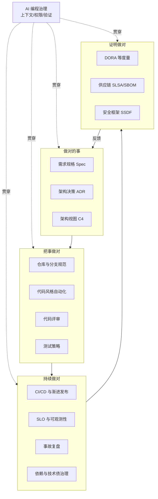
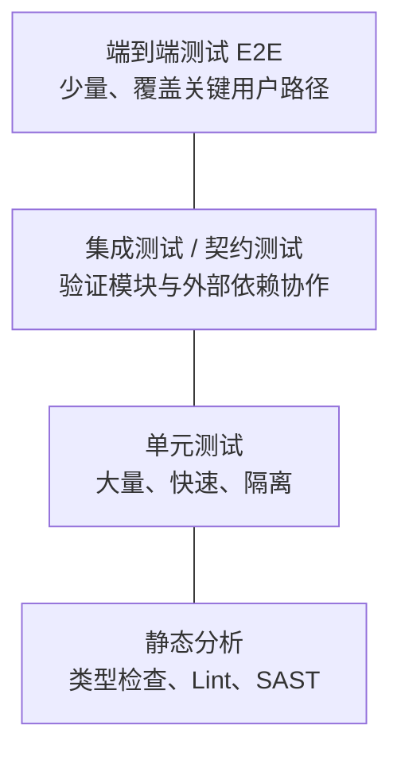
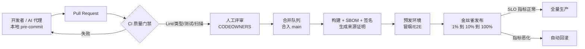
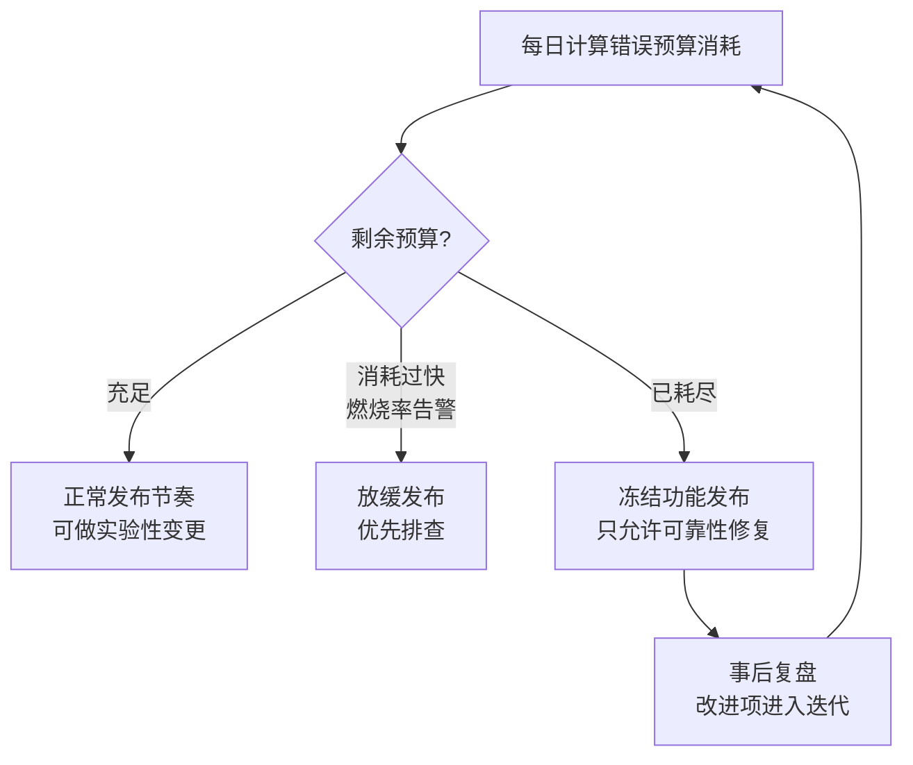
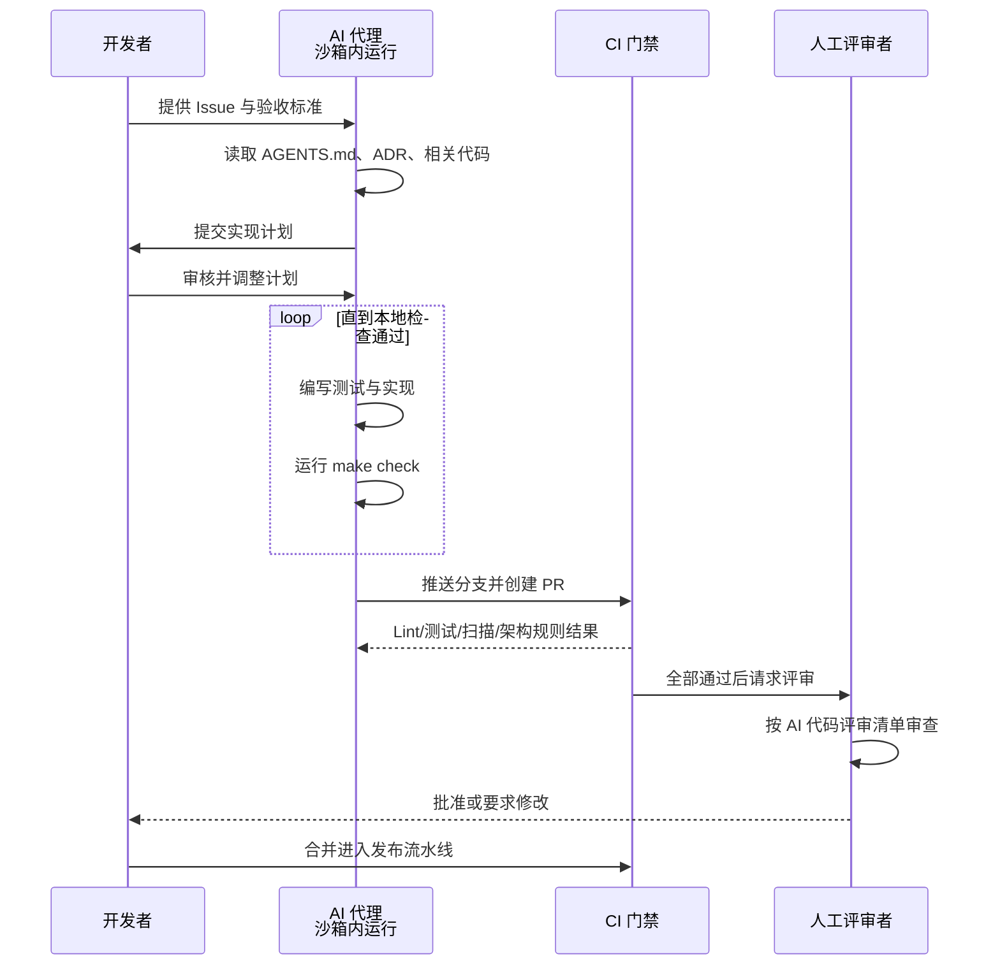

[toc]


## 总览：软件项目治理的全景图

项目治理（Project Governance）本质上是要回答四个问题：**做对的事**（需求与架构）、**把事做对**（规范与质量门禁）、**持续做对**（可靠性与可维护性）、**证明做对**（度量、审计与供应链可信）。AI 编程不会改变这四个问题，它改变的是**速度和风险的分布**：代码生成得更快，验证就成了瓶颈。



**读图**：四个阶段从左到右推进，度量结果再反馈到需求与架构，形成闭环。AI 编程治理不是独立的一环，而是**贯穿所有阶段的横切关注点**：写规格时 AI 可以起草，写代码时 AI 负责生成，评审时 AI 辅助审查，运维时 AI 帮忙分析告警。每个阶段都要回答：AI 能拿到什么上下文、有什么权限、它的产出由谁验证。

**贯穿全文的三条总原则**：

1. **能自动化的规范必须自动化**：靠人记住的规范迟早会失效，要把规范写进工具（格式化器、Lint、CI 门禁、分支保护）。
2. **小批量、快反馈**（Small Batches）：每次变更越小，评审越容易、回滚越便宜、定位问题越快。这条在 AI 时代更加重要。
3. **可追溯**（Traceability）：任何一行线上代码都应能追溯到需求、决策、评审人、构建来源。

---

## 理论基石：需要知道的核心概念

| 理论/模型                                  | 核心观点                                                     | 对项目治理的指导意义                                         |
| ------------------------------------------ | ------------------------------------------------------------ | ------------------------------------------------------------ |
| **康威定律**（Conway's Law）               | 系统结构会映射组织的沟通结构                                 | 模块边界应与团队边界对齐，否则跨团队协作成本会转化为架构腐化 |
| ***Team Topologies***                      | 四类团队（流对齐、平台、赋能、复杂子系统）+ 三种交互模式     | 中大型项目用**平台团队**沉淀 CI 模板、脚手架、AI 规则库，降低流对齐团队的认知负荷 |
| **ISO/IEC 25010:2023 质量模型**            | 产品质量分为功能适合性、性能效率、兼容性、交互能力、可靠性、安全性、可维护性、灵活性、安全保障（Safety）等特性 | 把“质量”拆成可验收的非功能需求，避免“质量好”这类空话（2023 版的特性名称有调整，未经本轮核实，请查阅标准原文） |
| **技术债**（Technical Debt）               | 为求快而做的妥协会持续产生“利息”                             | 技术债要**显式登记**（Issue 标签、ADR 后果段），并预留固定的偿还容量 |
| **DORA 指标**                              | 用交付吞吐和稳定性衡量软件交付效能                           | 团队级效能的事实标准，详见下文                               |
| **SPACE / DevEx**                          | 开发者生产力是多维的：满意度、绩效、活动、协作、效率与心流   | 防止只看“代码行数、PR 数”这类会被 AI 轻易刷高的指标          |
| **SRE**（站点可靠性工程）                  | 用 SLI/SLO/错误预算平衡发布速度和稳定性                      | 让“能不能发布”有客观依据，而不是靠拍脑袋                     |
| **左移与右移**（Shift-left / Shift-right） | 问题越早发现越便宜；有些问题只在生产中暴露                   | 测试、安全前置到开发阶段，同时在生产侧用灰度和可观测性兜底   |

### DORA 指标详解

DORA（DevOps Research and Assessment，现属 Google Cloud）是业界最权威的软件交付效能研究项目。它的核心指标如下（2023 年后的命名，未经本轮核实）：

| 指标                                                    | 含义                                                  | 属于   |
| ------------------------------------------------------- | ----------------------------------------------------- | ------ |
| **部署频率**（Deployment Frequency）                    | 多久向生产环境成功部署一次                            | 吞吐   |
| **变更前置时间**（Lead Time for Changes）               | 从代码提交到在生产运行所需的时间                      | 吞吐   |
| **变更失败率**（Change Failure Rate）                   | 导致故障、需要立即修复或回滚的部署占比                | 稳定性 |
| **失败部署恢复时间**（Failed Deployment Recovery Time） | 部署失败后恢复服务所需的时间                          | 稳定性 |
| **返工率**（Rework Rate）                               | 计划外、为修复线上问题而做的部署占比（2024 年起引入） | 稳定性 |

**关键认知**：DORA 多年研究的一贯结论是**吞吐和稳定性并不矛盾**，高效能团队两者兼得。

**2025 年的新变化**（已检索）：DORA 首次发布了 [*State of AI-assisted Software Development* 报告](https://cloud.google.com/blog/products/ai-machine-learning/announcing-the-2025-dora-report)，数据来自近 5000 名技术从业者的问卷和 100 多小时的定性研究。核心结论是：[AI 的主要角色是放大器](https://dora.dev/research/publications/)，它会放大高效能组织的优势，也会放大困境组织的功能失调。第三方分析 [Faros AI](https://www.faros.ai/blog/key-takeaways-from-the-dora-report-2025) 把类似现象称为 **“AI 生产力悖论”**：个人产出（完成任务数、合并 PR 数）明显上升，但组织层面的交付指标基本持平。

**这对治理的启示**：只引入 AI 工具而不补齐工程基础（测试、小批量、平台、评审容量），收益会被下游瓶颈吃掉。据我所知，DORA 同期还提出了 “AI 能力模型”，列出版本控制实践、小批量工作、高质量内部平台、AI 可访问的内部数据等配套能力（具体条目未经本轮核实，请查阅 dora.dev）。

---

## 需求与设计治理：先把“做对的事”写下来

### 规格先行（Specification First）

中大型项目最昂贵的错误是**做了不该做的东西**。在 AI 编程场景下，这个风险被放大了：AI 会“自信地”填补需求空白。

- **必须**：每个非平凡功能都要有书面规格，至少包括目标、非目标（Non-goals）、验收标准、约束（性能、安全、兼容性）。
- **推荐**：验收标准写成可测试的形式，例如 Given-When-Then，或 EARS 句式（“当 <触发条件> 时，系统应 <响应>”）。这样它可以直接转成测试，也能直接交给 AI 当作完成标准。
- **避免**：“优化用户体验”“提升性能”这类不可验证的描述。

### 架构决策记录（ADR）

**ADR**（Architecture Decision Record）是一份记录“为什么这样设计”的短文档。代码只能告诉你“是什么”，ADR 告诉你“为什么”。对于人员流动和 AI 代理都依赖的长期项目，这是最便宜、收益最高的文档实践之一。

经典的 Michael Nygard 模板如下（MADR 是它的增强版）：

```markdown
# ADR-0007: 订单服务采用 PostgreSQL 而非 MongoDB

- 状态: Accepted
- 日期: 2026-03-02
- 决策者: @alice, @bob
- 取代: 无

## 背景
订单数据有强事务需求(扣库存与创建订单需原子),团队已有 PG 运维经验……

## 决策
采用 PostgreSQL 16,使用 JSONB 存放扩展属性……

## 备选方案
- MongoDB: 文档模型灵活,但多文档事务的运维经验不足……

## 后果
- 正面: 事务语义清晰……
- 负面: 模式变更需迁移脚本,引入 Flyway 管理(登记技术债 #312)
```

| 字段           | 含义与要点                                                   |
| -------------- | ------------------------------------------------------------ |
| **编号与标题** | 单调递增编号，标题直接写出决策本身，而不是写问题             |
| **状态**       | `Proposed`（提议）、`Accepted`（采纳）、`Deprecated`（弃用）、`Superseded`（被取代）。**ADR 不修改，只追加**：推翻旧决策时新建一份 ADR 并标注“取代 ADR-xxxx” |
| **背景**       | 做决策时的约束和动因。几年后的读者最需要的就是这一段         |
| **决策**       | 用肯定句写出选择了什么                                       |
| **备选方案**   | 考虑过但没选的方案及原因，防止后人重复讨论                   |
| **后果**       | 正面和负面影响都要写。负面后果往往就是技术债的登记处         |

- **推荐存放位置**：`docs/adr/NNNN-title.md`，和代码同仓库，走同样的 PR 评审流程（文档即代码，Docs as Code）。
- **AI 场景下的价值**：在 `AGENTS.md` 中写明“修改架构前先阅读 `docs/adr/`”，AI 代理就能遵守历史决策，不会“好心”把 PostgreSQL 换成别的东西。

### 架构可视化：C4 模型

**C4 模型**（Simon Brown 提出）用四个缩放层级描述架构：**Context**（系统上下文，即系统和外部用户、外部系统的关系）、**Container**（容器，指可独立部署运行的单元，如 Web 应用、数据库，不是 Docker 容器）、**Component**（组件，容器内部的模块）、**Code**（代码，一般由 IDE 自动生成，不必手绘）。

- **推荐**：中大型项目至少维护 Context 和 Container 两层，用 Mermaid、PlantUML 或 Structurizr DSL 以文本形式写进仓库，便于 diff 和评审。
- **辨析**：C4 的 Container 和 Docker 容器是两个概念，初学者容易混淆。

### API 优先与契约

跨团队、跨服务的接口应**先定义契约再实现**：HTTP API 用 OpenAPI，异步消息用 AsyncAPI，RPC 用 Protobuf。契约文件进入仓库后，可以生成客户端代码和 Mock，并在 CI 中做破坏性变更检测（例如 `buf breaking`、`oasdiff`）。

---

## 代码与仓库规范：把规范交给工具

### 分支策略

| 策略                                    | 做法                                                         | 适用                                                         | 风险                                         |
| --------------------------------------- | ------------------------------------------------------------ | ------------------------------------------------------------ | -------------------------------------------- |
| **主干开发**（Trunk-Based Development） | 所有人向 `main` 合并短生命周期分支（理想情况不超过 1～2 天），未完成功能用特性开关隐藏 | **推荐用于持续交付的服务端和 Web 项目**，也是 DORA 研究支持的实践 | 依赖完善的自动化测试和特性开关               |
| **GitHub Flow**                         | 从 `main` 拉特性分支，通过 PR 合并后即可部署                 | 中小团队、单一线上版本的项目                                 | 分支容易拖长                                 |
| **GitFlow**                             | `develop`、`release`、`hotfix` 多条长期分支                  | 需要同时维护多个发布版本的产品（如客户端、私有化交付）       | 合并冲突多、反馈慢，**不推荐用于 SaaS 服务** |

**推荐方案**：服务端项目采用**主干开发 + 短分支 PR + 特性开关**；需要维护多个历史版本时，在主干开发的基础上加 `release/x.y` 分支，修复通过 cherry-pick 回移植。

### 提交规范：Conventional Commits

**Conventional Commits 1.0.0** 是使用最广泛的提交信息规范，它让提交历史可以被机器解析，从而自动生成变更日志和版本号。格式如下：

```bash
<type>[optional scope][!]: <description>

[optional body]

[optional footer(s)]
```

| 占位符        | 含义                                                         | 示例                     |
| ------------- | ------------------------------------------------------------ | ------------------------ |
| `type`        | 变更类型：`feat`（新功能）、`fix`（缺陷修复）是规范定义的核心类型；`docs`、`refactor`、`test`、`chore`、`ci`、`perf`、`build` 是社区惯例 | `feat`                   |
| `scope`       | 可选，影响范围（模块名）                                     | `feat(order):`           |
| `!`           | 可选，表示**破坏性变更**（Breaking Change）                  | `feat(api)!:`            |
| `description` | 简短的祈使句摘要                                             | `support partial refund` |
| `body`        | 可选，解释动机和实现要点                                     | 多行文本                 |
| `footer`      | 可选，形如 `Token: value`。`BREAKING CHANGE: ...` 描述破坏性变更；`Refs: #123` 关联 Issue；`Co-authored-by:` 标注合著者 | `Refs: #482`             |

一个完整示例：

```bash
git commit -m "feat(order)!: support partial refund" \
  -m "Refund amount is now validated against captured amount." \
  -m "BREAKING CHANGE: RefundRequest.amount is required." \
  -m "Refs: #482"
```

### 语义化版本（SemVer 2.0.0）

版本号格式为 `MAJOR.MINOR.PATCH`：**MAJOR** 表示不兼容的 API 变更，**MINOR** 表示向后兼容的新功能，**PATCH** 表示向后兼容的缺陷修复。它和 Conventional Commits 一一对应：`fix` 对应 PATCH，`feat` 对应 MINOR，`!` 或 `BREAKING CHANGE` 对应 MAJOR。

- **推荐工具链**：`commitlint`（校验提交信息）+ `release-please` 或 `semantic-release`（自动生成版本号和 `CHANGELOG.md`）。JS monorepo 可以用 `changesets`。

### 自动化代码风格与本地门禁

| 层次       | 工具（开源、跨平台为主）                                     | 作用                   |
| ---------- | ------------------------------------------------------------ | ---------------------- |
| 编辑器统一 | `.editorconfig`                                              | 统一缩进、换行符、编码 |
| 格式化     | Prettier / Biome（JS/TS）、Ruff format（Python）、gofmt、rustfmt、shfmt（Shell） | 消除格式争论           |
| 静态检查   | ESLint / Biome、Ruff、golangci-lint、Clippy、**ShellCheck**  | 发现潜在缺陷           |
| 类型检查   | TypeScript `strict`、mypy / pyright                          | 在编译期拦截一类错误   |
| 提交前钩子 | `pre-commit`（多语言）、`lefthook`、`husky`                  | 把上述检查前置到本地   |
| 密钥扫描   | `gitleaks`、`trufflehog`                                     | 防止密钥进入仓库历史   |

`.pre-commit-config.yaml` 示例（已通过 YAML 解析校验，`rev` 只是示例版本，使用前请执行 `pre-commit autoupdate` 更新到最新）：

```yaml
repos:
  - repo: https://github.com/pre-commit/pre-commit-hooks
    rev: v5.0.0
    hooks:
      - id: trailing-whitespace
      - id: end-of-file-fixer
      - id: mixed-line-ending
        args: ["--fix=lf"]
      - id: check-yaml
      - id: check-added-large-files
        args: ["--maxkb=512"]
  - repo: https://github.com/gitleaks/gitleaks
    rev: v8.21.2
    hooks:
      - id: gitleaks
  - repo: https://github.com/astral-sh/ruff-pre-commit
    rev: v0.8.0
    hooks:
      - id: ruff
        args: ["--fix"]
      - id: ruff-format
  - repo: https://github.com/shellcheck-py/shellcheck-py
    rev: v0.10.0.1
    hooks:
      - id: shellcheck
```

- **必须**：本地钩子只是“快速反馈”，**CI 中必须再跑一遍同样的检查**，因为本地钩子可以被 `--no-verify` 跳过。
- **避免**：本地钩子太慢（超过 10 秒左右）会让开发者绕过它。重型检查放到 CI。

### 跨平台一致性：换行符、编码与可执行权限

Windows 和 *nix 混合协作时，最常见的问题是 `CRLF` 和 `LF` 混用：Shell 脚本被转成 `CRLF` 后会报 `/bin/bash^M: bad interpreter` 错误。**以仓库内的 `.gitattributes` 为准**，不要依赖每个人本机的 `core.autocrlf` 设置：

```bash
# .gitattributes
* text=auto eol=lf
*.sh  text eol=lf
*.ps1 text eol=crlf
*.bat text eol=crlf
*.cmd text eol=crlf
*.png binary
*.jpg binary
```

| 规则                  | 含义                                                         |
| --------------------- | ------------------------------------------------------------ |
| `text=auto`           | 由 Git 自动判断是否为文本文件，文本文件在仓库中统一存为 `LF` |
| `eol=lf` / `eol=crlf` | 检出到工作区时使用的换行符。`.ps1`、`.bat` 在 Windows 工具链中用 `CRLF` 更稳妥 |
| `binary`              | 不做换行转换，也不做文本 diff                                |

配套的 `.editorconfig`：

```ini
root = true

[*]
charset = utf-8
end_of_line = lf
insert_final_newline = true
trim_trailing_whitespace = true
indent_style = space
indent_size = 2

[*.{ps1,bat,cmd}]
end_of_line = crlf

[*.py]
indent_size = 4

[Makefile]
indent_style = tab
```

**其他跨平台注意事项**：

- **可执行权限**：Windows 上提交的脚本没有 `+x` 权限，可以用 `git update-index --chmod=+x scripts/deploy.sh` 修正。
- **文件名大小写**：Windows 和 macOS 默认不区分大小写，Linux 区分。**避免**只靠大小写区分的文件名。
- **中文路径显示**：设置 `git config --global core.quotepath false`，`git status` 才不会把中文路径显示成八进制转义。
- **编码**：统一使用无 BOM 的 UTF-8。Windows PowerShell 5.1 读取无 BOM 文件时可能按系统代码页解析中文，推荐使用 PowerShell 7+。

### 代码所有权与分支保护

- **`CODEOWNERS`**：按路径指定必需的评审人，例如 `/services/payment/ @org/payment-team`。中大型项目用它把评审责任落实到团队。
- **分支保护 / 规则集**（GitHub Rulesets、GitLab Protected Branches）。**必须**开启：禁止直接推送 `main`、PR 至少 1～2 人批准、CI 必须通过、禁止强推。**推荐**：要求分支与 `main` 保持同步（或使用合并队列 Merge Queue）、提交签名。

---

## 代码评审：质量的人工防线

Google 公开的 *Engineering Practices* 文档给出了评审的核心标准（未经本轮核实原文措辞）：**只要变更确实改善了系统整体的代码健康度，即使不完美也应批准**。评审追求的是“持续改进”，不是“完美”。

### 评审关注点优先级

| 优先级 | 关注点           | 说明                                                         |
| ------ | ---------------- | ------------------------------------------------------------ |
| 最高   | **设计与正确性** | 是否解决了正确的问题、边界条件、并发、错误处理               |
| 高     | **安全与数据**   | 输入校验、权限、敏感信息、SQL/命令注入                       |
| 高     | **测试**         | 测试是否覆盖了行为（而非实现细节）、是否真的会在缺陷存在时失败 |
| 中     | **可读性与命名** | 半年后的维护者（或 AI）能否读懂                              |
| 低     | **风格**         | **应该全部交给格式化器和 Lint**，人工评审不应在这上面花时间  |

### 实践要点

- **必须**：PR 要小。经验上几百行以内的 PR 评审质量最高，超过千行基本只能“扫一眼”。
- **推荐**：PR 描述模板包含：动机/关联 Issue、变更摘要、测试方式、风险与回滚方案、是否由 AI 生成或辅助。
- **推荐**：评审意见分级，例如 `nit:`（可改可不改）、`question:`、`blocking:`，减少沟通歧义。
- **推荐**：设定评审时效（例如一个工作日内首次响应），评审等待是前置时间的主要来源之一。
- **避免**：AI 评审机器人代替人工批准。AI 评审适合做“第一遍筛查”，**合并责任必须由人承担**。

---

## 测试策略：让质量可验证

### 测试分层



**读图**：从下往上，测试成本和运行时间递增、数量递减。经典的**测试金字塔**强调单元测试为主。Kent C. Dodds 提出的**测试奖杯**（Testing Trophy）则把静态分析放在底座，并强调集成测试性价比最高，更适合前端和 Web 应用。两者并不冲突，**核心原则是一致的：用最便宜的手段尽早发现最多的问题**。

### 现代测试技术选型

| 技术                                   | 解决什么问题                           | 代表工具                               |
| -------------------------------------- | -------------------------------------- | -------------------------------------- |
| **契约测试**（Contract Testing）       | 微服务之间接口不兼容，又不想跑全量 E2E | Pact                                   |
| **测试容器**                           | 集成测试需要真实的数据库或消息队列     | Testcontainers                         |
| **属性测试**（Property-based Testing） | 人想不到的边界输入                     | Hypothesis（Python）、fast-check（JS） |
| **变异测试**（Mutation Testing）       | 覆盖率高但断言无效（“假测试”）         | Stryker、PIT、mutmut                   |
| **快照/视觉回归**                      | UI 意外变化                            | Playwright 截图对比                    |
| **模糊测试**（Fuzzing）                | 解析器、协议处理中的崩溃和安全缺陷     | Go 原生 fuzz、libFuzzer、OSS-Fuzz      |

- **必须**：缺陷修复先写一个能复现缺陷的失败测试，再修复（回归测试）。
- **应该**：覆盖率作为**下限门禁**（例如新代码不低于 80%），而不是目标。覆盖率高不代表测试有效。
- **AI 场景特别提醒**：AI 很擅长写“让测试通过”的代码，也会写出“永远通过”的测试（断言太弱、Mock 掉了被测逻辑本身，甚至修改测试去迁就实现）。**变异测试是检验 AI 生成测试质量的利器**。同时要规定：AI 不得在未说明理由的情况下修改或删除已有测试。

---

## CI/CD 与发布：让交付可重复、可回滚

### 流水线全景



**读图**：

- **左半段（PR 到合入）**是“左移”的质量门禁，CI 失败会直接打回开发者或 AI 代理。
- **中段**一次构建产出不可变制品（**构建一次，到处部署**），同时生成 SBOM 和签名。
- **右半段**是“右移”的生产验证，通过金丝雀发布小流量试水，用 SLO 指标决定继续放量还是回滚。

### GitHub Actions 示例（已通过 YAML 解析校验）

```yaml
name: ci
on:
  pull_request:
  push:
    branches: [main]
permissions:
  contents: read
concurrency:
  group: ci-${{ github.ref }}
  cancel-in-progress: true
jobs:
  verify:
    runs-on: ubuntu-latest
    timeout-minutes: 20
    steps:
      - uses: actions/checkout@v4
      - uses: actions/setup-python@v5
        with:
          python-version: "3.12"
      - name: Install
        run: pip install -r requirements-dev.txt
      - name: Lint and format check
        run: |
          ruff check .
          ruff format --check .
      - name: Type check
        run: mypy src
      - name: Test with coverage gate
        run: pytest --cov=src --cov-fail-under=80
      - name: Secret scan
        uses: gitleaks/gitleaks-action@v2
        env:
          GITHUB_TOKEN: ${{ secrets.GITHUB_TOKEN }}
      - name: Dependency vulnerability scan
        uses: google/osv-scanner-action/osv-scanner-action@v2
        with:
          scan-args: |-
            --recursive
            ./
```

| 字段                          | 治理意义                                                     |
| ----------------------------- | ------------------------------------------------------------ |
| `permissions: contents: read` | **最小权限**：`GITHUB_TOKEN` 默认只读，需要写权限的 job 单独提升 |
| `concurrency`                 | 同一分支只保留最新一次运行，节省资源                         |
| `timeout-minutes`             | 防止卡死的任务无限占用 Runner                                |
| `--cov-fail-under=80`         | 覆盖率下限门禁                                               |
| `uses: xxx@v4`                | 示例用了标签便于阅读。**生产中推荐固定到完整的 commit SHA**（标签可以被篡改），并用 Renovate 或 Dependabot 自动更新 |

> 注意：`gitleaks-action` 在组织账户下使用可能需要许可证密钥，`osv-scanner-action` 的具体用法也请以各自 README 为准（未经本轮核实）。

### 特性开关与渐进式交付

- **特性开关**（Feature Flag）把“部署”和“发布”解耦：代码可以先合入主干并部署，功能对用户关闭，之后按用户群逐步打开。CNCF 项目 **OpenFeature** 提供了厂商中立的 SDK 标准。开源后端有 Flagd、Unleash 等。
- **必须**：每个开关都要有负责人和清理期限。**过期开关是常见的技术债来源**。
- **渐进式交付**：金丝雀、蓝绿部署。Kubernetes 生态可以用 Argo Rollouts、Flagger，根据指标自动推进或回滚。
- **数据库变更**：采用“扩展、迁移、收缩”（Expand-Migrate-Contract）模式，保证新旧版本代码都能同时工作，回滚时不会因为表结构不兼容而失败。

---

## 可靠性工程：用 SLO 管理风险

### 核心概念辨析

| 术语                         | 含义                                          | 示例                                 |
| ---------------------------- | --------------------------------------------- | ------------------------------------ |
| **SLI**（服务水平指标）      | 被度量的指标本身，通常是“好事件数 / 总事件数” | 返回 2xx 且耗时小于 300ms 的请求占比 |
| **SLO**（服务水平目标）      | 团队内部对 SLI 设定的目标值                   | 28 天滚动窗口内 SLI 不低于 99.9%     |
| **SLA**（服务水平协议）      | 对客户的**合同承诺**，违约要赔偿              | 月可用性低于 99.5% 退还 10% 费用     |
| **错误预算**（Error Budget） | 1 减去 SLO，即允许的“不可靠额度”              | 99.9% 对应 28 天约 40 分钟           |

**辨析**：SLA 一般要比 SLO 宽松，内部目标要严于对外承诺，留出缓冲。

### 错误预算决策流程



**读图**：错误预算把“稳定性和速度之争”变成了数据驱动的规则。预算充足时鼓励快速迭代；预算耗尽时，团队按事先约定的策略冻结功能发布。关键在于**事先约定**，写成书面的错误预算政策，由研发和业务双方签字认可，避免出事后临时争论。

### 可观测性与事故管理

- **推荐**：统一采用 **OpenTelemetry**（OTel，CNCF 项目）采集追踪（Traces）、指标（Metrics）、日志（Logs），避免被单一厂商锁定。后端可以选择 Prometheus、Grafana、Jaeger，或国内云厂商的托管服务。
- **告警原则**：基于 SLO 的**燃烧率告警**（Burn Rate Alert），而不是 CPU 超过 80% 这类原因型告警。只对“需要人立刻行动”的情况发通知。
- **无责复盘**（Blameless Postmortem）。**必须**包含：时间线、影响范围、根因（往往不止一个）、改进项（有负责人和期限）。复盘关注系统和流程的缺陷，不追究个人。

---

## 安全与软件供应链：证明交付物可信

### 框架对照

| 框架                        | 发布方                     | 定位                   | 一句话理解                                                   |
| --------------------------- | -------------------------- | ---------------------- | ------------------------------------------------------------ |
| **SSDF**（NIST SP 800-218） | 美国 NIST                  | 安全开发**流程**框架   | 四组实践：PO（组织准备）、PS（保护软件）、PW（生产安全的软件）、RV（响应漏洞）。另有 SP 800-218A 补充 AI 模型开发 |
| **SLSA**                    | OpenSSF                    | 构建**制品完整性**分级 | 证明“这个制品确实由这份源码、在这个可信构建平台上构建”       |
| **OpenSSF Scorecard**       | OpenSSF                    | 仓库安全**体检**       | 自动检查分支保护、代码评审、依赖固定、Token 权限、危险工作流等十几项 |
| **SBOM**                    | 格式标准为 SPDX、CycloneDX | 软件**物料清单**       | 列出制品中所有组件及版本，漏洞出现时能快速定位受影响范围     |
| **OWASP ASVS / Top 10**     | OWASP                      | 应用安全**验证标准**   | Web 应用安全需求清单                                         |

### SLSA 分级

根据检索结果，[SLSA v1.1 的构建轨道（Build Track）分为 L0 到 L3](https://jfrog.com/learn/grc/slsa-framework/)，[SLSA 社区在 2025 年 11 月 24 日发布了 v1.2](https://slsa.dev/blog)。据我所知 v1.2 新增了**源码轨道**（Source Track），覆盖源码仓库的保护要求（具体级别定义请查阅 slsa.dev，未经本轮核实）。

| 构建级别 | 要求                            | 实践含义                                         |
| -------- | ------------------------------- | ------------------------------------------------ |
| **L0**   | 无                              | 本地手工构建                                     |
| **L1**   | 生成来源证明（Provenance）      | 制品附带“谁、何时、用什么构建”的元数据           |
| **L2**   | 托管构建平台 + 已签名的来源证明 | 在 CI 平台上构建，证明经过签名、不可伪造         |
| **L3**   | 加固的构建平台                  | 构建之间相互隔离，签名密钥不能被用户构建脚本访问 |

**落地建议**：GitHub 用户可以使用 `actions/attest-build-provenance` 生成来源证明（未经本轮核实最新用法），配合 **Sigstore / cosign** 做无密钥签名，用 **Syft** 生成 SBOM，用 **Grype、Trivy 或 OSV-Scanner** 扫描漏洞。这些工具都是开源、跨平台的。

### 合规动向

欧盟 **《网络弹性法案》**（Cyber Resilience Act，CRA）对在欧盟销售的含数字元素的产品提出了漏洞处理和 SBOM 等要求。据我所知，其中的漏洞报告义务从 2026 年 9 月起适用，全面义务从 2027 年 12 月起适用（未经本轮核实）。生产环境在海外、面向欧盟用户的项目需要提前评估。国内项目可以关注**中国信通院**的 DevOps 能力成熟度系列标准，以及开源合规方面的 **OpenChain**（ISO/IEC 5230 许可证合规、ISO/IEC 18974 安全保障）。

### 依赖治理

- **必须**：提交锁文件（`package-lock.json`、`poetry.lock`、`uv.lock`、`go.sum`、`Cargo.lock`），保证构建可复现。
- **必须**：开启自动依赖更新（**Renovate** 功能最丰富，也支持 Gitee、GitLab 等多个平台；GitHub 原生有 **Dependabot**）。
- **推荐**：引入新依赖前做评估：维护活跃度、许可证、Scorecard 分数、传递依赖数量。
- **AI 场景特别提醒**：AI 可能“幻觉”出不存在的包名，攻击者会抢注这些名字投毒（社区称为 **slopsquatting**）。AI 引入的新依赖**必须人工核实**。

---

## 可维护性与可持续性：让项目活得久

1. **文档即代码**：文档放进仓库，和代码一起评审。推荐用 **Diátaxis** 框架把文档分为四类：教程（学习导向）、操作指南（任务导向）、参考（信息导向）、解释（理解导向），避免把四种内容混在一篇里。
2. **必备文件清单**：`README.md`（是什么、怎么跑起来）、`CONTRIBUTING.md`（怎么贡献）、`CHANGELOG.md`、`SECURITY.md`（漏洞报告渠道）、`LICENSE`、`CODEOWNERS`、`docs/adr/`，以及 AI 时代的 **`AGENTS.md`**。
3. **架构适应度函数**（Architecture Fitness Function，出自 *Building Evolutionary Architectures*）：把架构约束写成自动化测试，例如“领域层不得依赖基础设施层”“模块间不得循环依赖”。工具有 ArchUnit（Java）、import-linter（Python）、dependency-cruiser（JS）。**这对约束 AI 生成代码尤其有效**：AI 不一定读懂了架构，但 CI 会拦下违规的代码。
4. **弃用策略**：公开 API 先标记 `@deprecated` 并给出迁移路径，至少保留一个 MINOR 版本周期，再在下一个 MAJOR 版本中移除。
5. **一键开发环境**：用 Dev Container（`.devcontainer/`）、Nix 或 `mise` 固定工具链版本，新成员和 AI 代理都能在几分钟内获得一致的环境。这也是 AI 代理在沙箱中可靠运行测试的前提。
6. **技术债预算**：每个迭代固定预留一部分容量（常见做法是 15% 到 20%）用于重构和升级，定期偿还技术债。

---

## AI 编程治理：重点专题

### 先看证据：AI 带来了什么

- **放大器效应**：DORA 2025 认为，AI 放大的是组织已有的状态，而不是自动带来提升（见前文）。
- **生产力悖论**：个人产出上升，组织交付指标持平（Faros AI 的分析，见前文）。
- **主观感受可能有偏差**：据我所知，METR 在 2025 年做过一项随机对照试验，结论是资深开源开发者在熟悉的大型代码库中使用 AI 工具后反而变慢了约 19%，而他们自己认为变快了（未经本轮核实，结论只适用于该实验条件，不宜外推）。
- **代码质量信号**：GitClear 等机构的代码库分析报告指出，AI 普及后，重复（复制粘贴）代码增多、重构（移动）代码减少（未经本轮核实，请查阅原报告）。

**结论**：AI 编程治理的核心不是“让 AI 写更多代码”，而是**让验证能力跟上生成速度**，并把 AI 纳入原有的工程纪律。

### AI 编程的五条治理原则

1. **人对合并负责**：无论代码谁写的，批准合并的人对它负全责。
2. **上下文工程优于提示词技巧**：把项目约定写进仓库里的机器可读文件，而不是每次在对话里重复。
3. **规格先行**：先让 AI 产出规格和计划，人工审核后再写代码，避免“氛围编程”（Vibe Coding）产出不可维护的代码。
4. **最小权限 + 沙箱**：AI 代理在隔离环境中运行，危险操作需要人工确认。
5. **验证闭环**：AI 必须能自己运行测试、Lint 和类型检查，并把结果作为完成标准。

### 上下文工程：`AGENTS.md`

[`AGENTS.md`](https://github.com/agentsmd/agents.md) 是一种简单、开放的格式，用来指导编码代理，相当于**写给 AI 代理的 README**：在一个固定、可预期的位置提供项目上下文和指令。[官网](https://agents.md/)称已有超过 6 万个开源项目在使用。据 [Harness 博客](https://www.harness.io/blog/the-agent-native-repo-why-agents-md-is-the-new-standard)介绍，它现在已归入 Agentic AI Foundation 的开放代理生态。

各工具的约定文件对照（AGENTS.md 以外的部分未经本轮逐一核实）：

| 文件                              | 适用工具                                           | 说明                                            |
| --------------------------------- | -------------------------------------------------- | ----------------------------------------------- |
| `AGENTS.md`                       | Codex、Cursor、Copilot 代理、Gemini CLI 等众多工具 | **推荐作为单一事实来源**                        |
| `CLAUDE.md`                       | Claude Code                                        | 可以在其中引用 `AGENTS.md` 的内容，避免重复维护 |
| `.github/copilot-instructions.md` | GitHub Copilot                                     | 仓库级指令                                      |
| `.cursor/rules/`                  | Cursor                                             | 支持按路径匹配的规则                            |

**推荐做法**：以 `AGENTS.md` 为主，其他工具专用文件只写差异部分或引用它。Monorepo 可以在子目录放置嵌套的 `AGENTS.md`，就近覆盖。

一个面向中大型项目的 `AGENTS.md` 示例：

```markdown
# AGENTS.md

## 项目概览
订单服务(Python 3.12 + FastAPI + PostgreSQL 16)。架构说明见 docs/architecture.md,
历史决策见 docs/adr/,修改架构相关代码前必须先阅读相关 ADR。

## 环境与命令
- 安装依赖: `uv sync`
- 运行全部检查: `make check`  (包含 ruff、mypy、pytest)
- 只跑单个测试: `uv run pytest tests/test_refund.py -k partial`
- 完成任务的标准: `make check` 全部通过

## 代码约定
- 分层: api -> service -> repository,禁止 api 直接访问 repository(CI 中由 import-linter 检查)
- 金额一律使用 Decimal,禁止 float
- 新增公开函数必须有类型注解与 docstring

## 测试约定
- 修复缺陷先写失败的回归测试
- 禁止为了让测试通过而修改或删除已有测试;确需修改时在 PR 描述中说明理由

## 安全与边界
- 禁止读取或输出 .env、secrets/ 下的任何内容
- 新增第三方依赖前须在 PR 描述中说明理由,并确认包名真实存在
- 不得修改 .github/workflows/ 与 migrations/ 下已合并的文件

## 提交与 PR
- 提交信息遵循 Conventional Commits
- 单个 PR 控制在 400 行变更以内,超出请拆分
- PR 描述需包含: 动机、变更摘要、测试方式、AI 参与说明
```

| 段落           | 为什么要写                                                   |
| -------------- | ------------------------------------------------------------ |
| **项目概览**   | 给 AI 一张“地图”，并指向 ADR，避免它推翻历史决策             |
| **环境与命令** | 最关键的一段。AI 知道怎么验证，才能形成自我修正的闭环        |
| **代码约定**   | 只写 Lint 无法表达的约定。能交给工具的规则交给工具，不要堆在这里 |
| **测试约定**   | 针对 AI 典型的失败模式（篡改测试）做明确约束                 |
| **安全与边界** | 声明禁区。**注意：这只是“软约束”，硬约束还要靠权限配置和 CI 规则** |
| **提交与 PR**  | 让 AI 产出符合团队流程的交付物                               |

- **避免**：`AGENTS.md` 写得过长，或者充满空泛的口号（如“写高质量代码”）。上下文窗口是稀缺资源，**写具体、可执行、可验证的指令**。

### 规格驱动开发（Spec-Driven Development）

[GitHub Spec Kit](https://developer.microsoft.com/blog/spec-driven-development-spec-kit/) 是一个开源工具包，主张在交给 AI 代理之前，先写清楚具体需求、动机和技术方面的内容。[Tessl 的评论文章](https://tessl.io/blog/a-look-at-spec-kit-githubs-spec-driven-software-development-toolkit)把它看作对氛围编程问题的结构化纠正，同时也指出这种理念并非全新。同类方案还有 **AWS Kiro**、**BMAD Method**（见 [Medium 综述](https://medium.com/@dilsh7/spec-driven-development-github-spec-kit-dd5227b7abe3)），以及社区的 OpenSpec 等（未经本轮核实）。

它们的共同流程可以概括为四步：

1. **宪章 / 原则**（Constitution）：项目级不可违背的原则，例如“所有功能必须先有测试”。
2. **规格**（Specify）：描述做什么、为什么做，不涉及技术实现。
3. **计划**（Plan）：技术方案、数据模型、接口契约。
4. **任务**（Tasks）：拆成小的、可独立验证的任务，再由 AI 逐个实现。

**每一步都有人工审核关口**，这是它和直接让 AI 写代码的本质区别。

**适用边界**：规格驱动适合需求明确的新功能和中大型改动。小缺陷修复或探索性原型使用这套流程反而偏重，可以简化为“Issue 描述 + 验收标准”。

### AI 代理参与一次变更的标准流程



**读图**：

- **计划审核点**：在 AI 写代码之前拦截方向性错误，这是成本最低的干预时机。
- **本地验证循环**：`AGENTS.md` 中的命令让 AI 能自我修正，减少无效的 PR。
- **CI 门禁**：AI 无法绕过的硬约束。
- **人工评审**：最终责任人。

### AI 代理的权限与安全

[OWASP LLM 应用 Top 10（2025 版）](https://www.gravitee.io/blog/owasp-top-10-for-llm-applications-2025-a-practical-guide)记录了 LLM 系统特有的风险。此外，[OWASP 智能体应用 Top 10](https://www.promptfoo.dev/docs/red-team/owasp-agentic-ai/) 于 Black Hat Europe 2025 期间发布，其中 ASI03“身份与权限滥用”对应 LLM Top 10 中的 LLM06“过度代理”（Excessive Agency）。对 AI 编程影响最大的风险如下：

| 风险                               | 在 AI 编程中的表现                                           | 治理措施                                                     |
| ---------------------------------- | ------------------------------------------------------------ | ------------------------------------------------------------ |
| **提示词注入**（Prompt Injection） | 依赖包 README、Issue 评论、网页中藏有恶意指令，诱导代理执行命令或泄露密钥 | 代理在容器或沙箱中运行；网络出口白名单；不处理不可信 Issue 的自动化流程 |
| **过度代理**（Excessive Agency）   | 代理有生产凭据、能强推分支、能改 CI 配置                     | 最小权限 Token；危险命令需人工确认；CI 配置和迁移文件由 CODEOWNERS 保护 |
| **供应链**                         | 幻觉包名、引入未审查的 MCP 服务器或插件                      | 依赖白名单、人工核实新依赖、MCP 服务器纳入准入审查           |
| **敏感信息泄露**                   | 代理把 `.env` 内容写进日志或提交                             | 密钥不放进工作目录（用密钥管理服务注入）；gitleaks 门禁      |
| **不当输出处理**                   | 生成的代码直接拼接 SQL 或 Shell 命令                         | SAST（Semgrep、CodeQL）进入 CI                               |

**MCP**（Model Context Protocol，模型上下文协议）让代理能连接外部工具和数据源，也同时扩大了攻击面。**推荐**：维护团队级的 MCP 服务器白名单，只授予只读权限，凭据按服务器隔离。

### AI 生成代码的评审清单

1. **需求一致性**：是否只做了要求的事？AI 常常“顺手”重构无关代码，扩大了变更范围。
2. **真实性**：调用的 API、配置项、依赖包是否真实存在？版本是否匹配？
3. **测试有效性**：测试是否会在缺陷存在时失败？有没有被修改的已有测试？
4. **重复与抽象**：是否复制了已有的工具函数，而不是复用它？
5. **错误处理**：有没有吞掉异常、加了空的 `catch`、或者只覆盖了正常路径？
6. **安全**：输入校验、权限检查、密钥处理。
7. **可维护性**：半年后不借助 AI 的人能否看懂？

### AI 时代的度量

- **避免**：用代码行数、PR 数量、AI 代码采纳率衡量效能。这些指标很容易被 AI 推高，却和价值无关。
- **推荐**：继续看 **DORA 指标**（尤其是变更失败率和返工率，它们能反映 AI 代码的质量代价），配合开发者体验调研（SPACE/DevEx），并追踪**评审等待时间**。AI 提高生成速度后，评审往往成为新的瓶颈。
- **可以**：在 PR 模板或提交 trailer（如 `Co-authored-by` 或自定义的 `AI-Assisted: yes`）中标记 AI 参与程度，用于事后分析 AI 代码的缺陷率。

### 国内工具生态

国内主流的 AI 编程工具包括：阿里的**通义灵码**（Lingma）和 **Qwen Code**、字节的 **Trae**、腾讯的 **CodeBuddy**、百度的**文心快码**（Comate），以及 Kimi、智谱 GLM 等模型厂商提供的编码模型和 CLI 工具。代码托管和 DevOps 方面有 **Gitee**、**极狐 GitLab**、**阿里云云效**、腾讯的 **CNB**（云原生构建）等。（以上产品信息未经本轮核实，产品更新很快，请以官网为准。）

**选型提醒**：

- 企业代码涉及数据合规时，优先选择支持私有化部署或明确数据不用于训练的方案。
- 跨工具协作时，坚持用 `AGENTS.md` 这类开放格式，避免规则被锁定在单一工具里。
- 部分海外工具对中文路径和中文提交信息的显示支持不完善，可以统一用英文提交信息，PR 描述再用中文。

---

## 综合示例：一次“部分退款”功能的完整交付

**场景**：一家跨境电商的订单服务团队（8 人，Python 技术栈，代码托管在 GitHub，生产部署在海外 Kubernetes 集群），需要支持“部分退款”。下面这个例子把前文的知识点串成一条线：

1. **需求与规格**：产品经理创建 Issue #482。开发者小王用 Spec Kit 风格的流程，让 AI 起草 `specs/partial-refund/spec.md`，验收标准用 EARS 句式写成“当退款金额大于已扣款金额时，系统应拒绝请求并返回 422”。团队评审后定稿。
2. **架构决策**：退款需要调用第三方支付网关的异步回调，团队决定引入 Outbox 模式保证一致性，写下 `docs/adr/0012-outbox-for-refund.md`，在后果段登记“需要新增后台投递进程（运维成本）”。
3. **AI 实现**：AI 代理在 Dev Container 沙箱中读取 `AGENTS.md` 和 ADR-0012，先提交实现计划（小王审核时去掉了 AI 擅自加上的“顺便重构支付模块”），然后先写失败的测试，再写实现，循环运行 `make check` 直到全部通过。
4. **规范与门禁**：提交信息是 `feat(order)!: support partial refund`，`!` 表示 `RefundRequest.amount` 变为必填字段。本地 pre-commit 拦下了一次行尾空格问题。CI 中 import-linter 发现 AI 在 api 层直接调用了 repository，PR 被打回，AI 根据错误信息修正。
5. **评审**：`CODEOWNERS` 自动请求支付团队评审。评审者按 AI 代码评审清单发现：AI 对金额比较用了 `float`（违反 `AGENTS.md` 的约定），且有一个 Mock 把被测逻辑本身 Mock 掉了。变异测试 mutmut 也报告了存活的变异体。修正后批准合并。
6. **构建与供应链**：合入 `main` 后，构建流水线产出容器镜像，生成 SBOM，用 cosign 签名并附上 SLSA 来源证明。`release-please` 因为有 `!`，自动建议把版本号升为 `3.0.0` 并更新 `CHANGELOG.md`。
7. **发布**：功能默认由 OpenFeature 开关关闭。部署后先对 1% 的商户开启，观察退款接口的 SLO（成功率 99.9%、P95 延迟小于 300ms）。燃烧率正常，三天后全量开启。
8. **运维与复盘**：一周后支付网关回调超时，导致少量退款状态卡住，消耗了 30% 的月度错误预算。团队做了无责复盘，改进项是“回调超时增加对账任务”，同时补充到 `AGENTS.md`：“外部回调必须配套对账机制”。**治理闭环就此完成：一次事故的经验沉淀为人和 AI 都会遵守的规则。**

---

## 国内网络与多平台环境配置

开发机在国内、生产在海外是很常见的组合。下面的脚本统一配置 Git 设置、可选代理和国内镜像，适用于 Linux、macOS、WSL 和 Git Bash（已通过 `bash -n` 语法检查；沙箱里没有 shellcheck，建议你在本地补跑一次 `shellcheck dev-setup.sh`）：

```bash
#!/usr/bin/env bash
# dev-setup.sh: 统一开发机 Git 与网络配置（Linux/macOS/WSL/Git Bash）
# 用法: ./dev-setup.sh [-p http://127.0.0.1:7890] [-m] [-h]
#   -p URL  为 Git 与当前 shell 设置代理（例如本地 mihomo 的 mixed-port）
#   -m      为 pip/npm/Go 切换国内镜像
set -euo pipefail

proxy=""
use_mirror=0

usage() { sed -n '2,5p' "$0"; }

while getopts ":p:mh" opt; do
  case "$opt" in
    p) proxy="$OPTARG" ;;
    m) use_mirror=1 ;;
    h) usage; exit 0 ;;
    *) usage; exit 1 ;;
  esac
done

# 换行与中文路径：仓库内以 .gitattributes 为准，这里只做本机兜底
git config --global core.autocrlf input
git config --global core.quotepath false
git config --global init.defaultBranch main
git config --global pull.rebase true

if [[ -n "$proxy" ]]; then
  git config --global http.https://github.com.proxy "$proxy"
  echo "已为 github.com 设置 Git 代理: $proxy"
  echo "当前 shell 可执行: export HTTPS_PROXY=$proxy HTTP_PROXY=$proxy"
fi

if [[ "$use_mirror" -eq 1 ]]; then
  if command -v pip >/dev/null 2>&1; then
    pip config set global.index-url https://mirrors.tuna.tsinghua.edu.cn/pypi/web/simple
  fi
  if command -v npm >/dev/null 2>&1; then
    npm config set registry https://registry.npmmirror.com
  fi
  if command -v go >/dev/null 2>&1; then
    go env -w GOPROXY=https://goproxy.cn,direct
  fi
  echo "镜像配置完成"
fi
```

| 参数或配置                      | 说明                                                         |
| ------------------------------- | ------------------------------------------------------------ |
| `-p URL`                        | 代理地址。mihomo 默认的 mixed-port 一般是 `7890`，以你的实际配置为准 |
| `-m`                            | 切换为清华 PyPI 镜像、npmmirror、goproxy.cn                  |
| `http.https://github.com.proxy` | **只对 github.com 走代理**，Gitee 等国内仓库仍然直连         |
| `core.autocrlf input`           | 提交时把 `CRLF` 转成 `LF`，检出时不转换。Windows 原生 Git 用户如果用的是 CRLF 编辑器，也可以设为 `true`，但**仓库内的 `.gitattributes` 优先级更高** |

**Windows 原生 PowerShell 的等价写法**：

```powershell
# 当前会话临时代理
$env:HTTPS_PROXY = "http://127.0.0.1:7890"
$env:HTTP_PROXY  = "http://127.0.0.1:7890"
# Git 设置（与 bash 版一致）
git config --global core.autocrlf true
git config --global core.quotepath false
git config --global http.https://github.com.proxy "http://127.0.0.1:7890"
```

- Windows 上推荐 `core.autocrlf true`（检出为 `CRLF`、提交转 `LF`），再配合仓库的 `.gitattributes`（其中 `*.sh eol=lf`），保证脚本始终是 `LF`。
- **没有代理时**：可以使用 GitHub 文件加速类镜像（例如 gh-proxy 这类“前缀包裹原链接”的服务）。这类服务的可用性经常变化，本轮没有核实，**只建议用于下载公开的 Release 文件，不要用于推送代码或传递凭据**。
- **CI 侧**：生产在海外时，CI Runner 也放在海外（例如 GitHub 托管 Runner），就不存在网络问题。只有自建的国内 Runner 才需要配置镜像。

---

## 落地路线图：分阶段推进

| 阶段                               | 目标                 | 必做事项                                                     |
| ---------------------------------- | -------------------- | ------------------------------------------------------------ |
| **第一阶段：基线**（约 2 周）      | 让规范自动化         | `.gitattributes`、`.editorconfig`、格式化和 Lint、pre-commit、CI 基础门禁、分支保护、`CODEOWNERS`、PR 模板 |
| **第二阶段：质量**（约 1～2 个月） | 让质量可验证         | 测试分层和覆盖率门禁、Conventional Commits 加自动发版、ADR 制度、Renovate、密钥和漏洞扫描 |
| **第三阶段：AI 就绪**              | 让 AI 安全可控地参与 | `AGENTS.md`、Dev Container、架构适应度函数、AI 代码评审清单、代理权限和沙箱策略、规格驱动流程 |
| **第四阶段：可靠与可信**           | 让交付可度量可证明   | SLO 和错误预算政策、OpenTelemetry、无责复盘、DORA 度量、SBOM、签名、SLSA L2 及以上、Scorecard |

**说明**：第三阶段放在第一、二阶段之后，**是刻意的顺序**。根据 DORA 的放大器结论，在工程基础不牢的项目里铺开 AI 代理，放大的是混乱。

---

## 速查：必须、推荐、避免

**必须**：

- 所有规范尽量通过工具和 CI 强制执行；`main` 分支开启保护，合并前必须通过 CI 和人工评审。
- 提交锁文件；仓库内维护 `.gitattributes`；密钥永远不进仓库。
- 缺陷修复附带回归测试；人对 AI 代码的合并负全责。
- AI 代理在最小权限的隔离环境中运行。

**推荐**：

- 主干开发 + 小 PR + 特性开关；Conventional Commits + SemVer + 自动发版。
- ADR 记录关键决策；C4 图以文本形式放在仓库里。
- 以 `AGENTS.md` 作为 AI 上下文的单一事实来源；中大型功能采用规格驱动开发。
- 用 SLO 和错误预算管理发布节奏；用 OpenTelemetry 统一可观测性。
- 构建产出 SBOM、签名和来源证明。

**避免**：

- 长期存在的分支和巨型 PR；人工评审纠结代码风格。
- 把覆盖率当目标；用代码行数或 AI 采纳率衡量效能。
- 让 AI 在没有测试和规格的情况下大面积改代码；AI 引入的依赖不经核实就合并。
- CI Action 只固定到可变标签；给代理生产凭据。

---

## 主要参考来源

- DORA：[2025 报告发布公告（Google Cloud）](https://cloud.google.com/blog/products/ai-machine-learning/announcing-the-2025-dora-report)、[DORA 出版物页](https://dora.dev/research/publications/)、[Google Research 条目](https://research.google/pubs/dora-2025-state-of-ai-assisted-software-development-report/)、[Faros AI 解读](https://www.faros.ai/blog/key-takeaways-from-the-dora-report-2025)
- AGENTS.md：[GitHub 仓库](https://github.com/agentsmd/agents.md)、[官网](https://agents.md/)、[Harness 博客](https://www.harness.io/blog/the-agent-native-repo-why-agents-md-is-the-new-standard)
- 规格驱动开发：[Microsoft for Developers](https://developer.microsoft.com/blog/spec-driven-development-spec-kit/)、[Tessl](https://tessl.io/blog/a-look-at-spec-kit-githubs-spec-driven-software-development-toolkit)、[Medium 综述](https://medium.com/@dilsh7/spec-driven-development-github-spec-kit-dd5227b7abe3)
- SLSA：[slsa.dev 博客](https://slsa.dev/blog)、[JFrog 介绍](https://jfrog.com/learn/grc/slsa-framework/)
- OWASP：[LLM Top 10 2025 实践指南（Gravitee）](https://www.gravitee.io/blog/owasp-top-10-for-llm-applications-2025-a-practical-guide)、[智能体应用 Top 10（Promptfoo）](https://www.promptfoo.dev/docs/red-team/owasp-agentic-ai/)

**知识截止说明**：从检索结果推算，检索时间点大约在 2026 年下半年；我的训练知识截止早于这个时间点。Conventional Commits、SemVer、SRE、ADR、C4、Team Topologies、测试策略等方法论比较稳定；工具版本、AI 产品功能和合规时间表变化较快，使用前请再查官方文档确认。