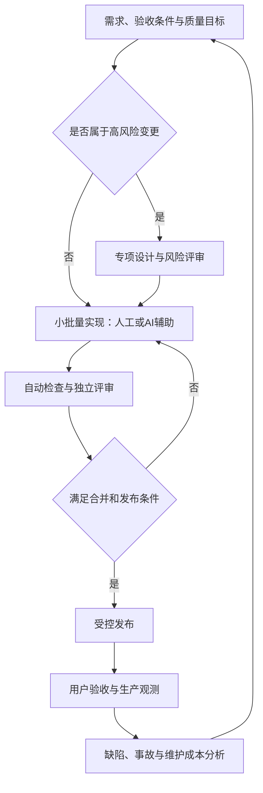

[toc]

## abstract

**中大型项目治理的核心，是让重要变更做到：目标明确、责任明确、约束可执行、结果可验证、故障可恢复、后续可维护。**

AI辅助编码应纳入这套体系，而不是另开一条“生成后直接上线”的通道。DORA的2025年研究将AI描述为组织既有能力的“放大器”：工具收益取决于测试、流程、平台和协作等基础能力，不能只看代码生成速度。

以下面向通用业务软件，按“理论地图—工程基线—AI专项—综合案例—落地顺序”展开。文中的“必须”表示**建议设为项目底线或门禁**，不代表所有行业统一的法定义务；医疗、航空等安全关键软件还需要专项规范。

## 理论知识地图：开发者应该理解什么

不必先记住所有方法论名称，但需要理解它们解决的问题。

| 理论或原则                         | 核心含义                                                     | 应转化成的实践                                   |
| ---------------------------------- | ------------------------------------------------------------ | ------------------------------------------------ |
| **软件工程与生命周期**             | 不只是把程序写出来，还要考虑长期修改、规模和协作成本         | 构建、测试、文档、升级、运行和退役都纳入交付范围 |
| **需求工程与质量属性**             | “功能正确”只是质量的一部分；性能、可靠性、安全性、可维护性也要明确 | 可验收需求、质量目标、风险清单                   |
| **模块化、信息隐藏、高内聚低耦合** | 把容易变化的实现封装起来，减少一次修改波及的范围             | 模块边界、稳定接口、依赖方向、架构检查           |
| **精益与小批量工作**               | 优化整个交付过程，而不是让每个人同时开工更多任务             | 限制在制品、缩小变更、缩短反馈周期               |
| **社会技术系统与康威定律**         | 系统结构与团队沟通结构有关，组织问题不能只靠技术解决         | 清晰的组件负责人、跨团队契约、端到端责任         |
| **分布式系统与局部失败**           | 超时不等于操作没成功；重试可能产生重复副作用                 | 幂等、超时、有限重试、去重、补偿与一致性设计     |
| **风险驱动与纵深防御**             | 不同风险需要不同强度的控制，任何一道防线都可能失效           | 风险分级、最小权限、多层验证、例外管理           |
| **可靠性反馈与技术债管理**         | 用运行结果调整投入，并显式管理短期选择带来的长期成本         | 服务目标、错误预算、事故复盘、技术债清单         |

这张表是本文的综合组织方式。其知识基础分别来自软件工程生命周期、质量模型、交付流动、组织设计、分布式系统和风险治理等资料，而不是某一个框架能够全部替代。

其中尤其需要建立三个认识：

- **规范性不等于格式统一。**还包括需求、接口、权限、发布和责任的一致性。
- **可靠性不等于测试通过。**还需要运行观测、故障处理和恢复能力。
- **可维护性不等于代码看起来漂亮。**应关注修改影响范围、理解成本、测试成本和人员交接成本。

## 治理机制：形成闭环，而不是堆积审批

下面是建议采用的治理闭环。它应随着每个小批量变更运行，而不是项目结束时才集中检查。

图中的关键不是“每个阶段都有人签字”，而是**每个重要判断都有责任人，每项重要约束都有执行机制，每个结果都有证据**。

### 按风险配置控制强度

建议采用下面这样的分级，而不是所有变更走相同流程：

| 风险级别 | 典型变更                                                   | 建议控制                                               |
| -------- | ---------------------------------------------------------- | ------------------------------------------------------ |
| 低       | 普通说明文档、文案调整                                     | 自动检查与简化评审                                     |
| 中       | 不改变安全边界的常规业务功能                               | 验收条件、相关测试、独立代码评审                       |
| 高       | 鉴权、租户隔离、数据迁移、并发一致性、构建发布与AI权限配置 | 专项设计、领域负责人评审、故障场景测试、发布与恢复预案 |

**风险看影响和可逆性，不看修改了多少行。**一行权限判断可能比几百行界面代码更重要。

NIST SSDF本身强调按业务、风险、资源和适用性裁剪实践，而不是机械执行统一清单。

还应建立**例外机制**：任何绕过门禁的决定，都记录原因、影响、补偿措施、批准人和到期时间。紧急修复可以有快速通道，但事后应补齐评审，不能让“紧急”成为常态。

## 全项目应该建立的工程基线

### 责任、需求与完成定义

**先明确谁对结果负责，再明确怎样实现。**

建议为每个重要服务、模块和交付项指定负责人及替补；产品验收、技术决策、安全风险接受和生产发布的权限应清楚。一个人可以兼任多个角色，但不能出现“大家都参与，因此没人负责”。

需求至少说明：

- **目标与非目标**：解决什么问题，明确暂时不解决什么。
- **业务规则**：状态变化、权限边界、异常情况。
- **质量要求**：负载、数据规模、延迟、可用性、恢复要求等。
- **验收条件**：通过什么观察或测试判定完成。
- **约束与风险**：兼容性、外部依赖、预算和交付限制。

质量模型的作用，是帮助团队把质量转化为可规定、可测量、可评价的属性，而不是把“高性能、易维护”留作口号。

建议制定统一的**完成定义（Definition of Done，DoD）**，例如：

> 功能满足验收条件；相关测试通过；评审完成；接口和必要文档同步；安全问题已处置；发布、观测和恢复方案具备。

**“代码写完”“AI说完成”“在我电脑上能运行”都不应单独作为完成标准。**

追踪关系可以很轻量：把需求记录、变更请求、测试报告和发布记录相互关联，不必为每个小任务维护冗长文档。

### 架构、模块边界与兼容演进

**架构治理首先是控制变更传播范围，而不是选择最复杂的技术栈。**

建议重点落实：

- **围绕业务能力划分模块**，明确公开接口和内部实现。
- **规定依赖方向**，对循环依赖、越层调用等建立自动检查。
- **明确数据所有权**，避免多个模块随意修改彼此的数据。
- **记录重要决策的理由**，而不只是记录最终结构。
- **把接口、消息和数据库结构的兼容性纳入评审。**

领域驱动设计（Domain-Driven Design，DDD）可以帮助统一业务语言和划分模型边界，但不必一开始采用全部模式，更不能把DDD直接等同于微服务。

**没有明确的独立部署、扩缩容或团队自治需求时，应优先评估模块化单体，而不是默认微服务。**微服务会引入服务间通信、运行和管理成本；这是一项需要权衡的架构选择，不是“大项目认证”。

重要决策建议采用**架构决策记录（Architecture Decision Record，ADR）**，简要记录：

| 内容     | 应说明什么               |
| -------- | ------------------------ |
| 背景     | 当前问题、约束和冲突     |
| 候选方案 | 考虑过哪些路径           |
| 决策     | 选择什么                 |
| 后果     | 收益、代价、新风险       |
| 状态     | 提议、接受、废弃或被替代 |

ADR的价值是保留“为什么这样做”，避免后来者只能盲目接受或推翻旧设计。

对于不兼容变更，推荐使用**扩展—迁移—收缩（Expand–Migrate–Contract）**：先支持新旧方式，再迁移使用方，最后移除旧方式；不要假设所有客户端和服务能同时升级。

### 代码规范、版本控制与代码评审

**能交给工具检查的，不要长期依赖人的记忆。**

建议自动化：

- 格式化、静态检查、类型检查。
- 依赖和秘密信息检查。
- 模块依赖规则、接口兼容性检查。
- 构建与自动测试。

人的评审精力应主要投入**设计合理性、业务语义、边界情况、并发、安全与长期维护成本**，而不是反复讨论缩进。Google的代码评审指南也把设计、功能和复杂度列为重点。

版本控制方面建议：

- **小而完整的变更**：一个变更聚焦一个主要目的，包含相关测试。
- **短生命周期分支、频繁集成**：不要长期积累到“集成周”才处理冲突。
- **主分支保护**：要求必要检查和评审通过。
- **优先修复破坏构建的问题**：避免团队长期在不可信的主干上工作。
- **检查最终合并结果**：多人高并发提交时，可使用合并队列等机制。

小变更更容易理解和评审；持续集成强调频繁集成与快速反馈，而不只是配置了一台自动构建服务器。

特别注意：**`CODEOWNERS`文件本身不等于强制门禁**，还要配合必需评审、分支保护或规则集，并限制绕过权限。

### 测试：验证业务行为，而不是只追求覆盖率

建议根据风险建立分层验证，而不是所有问题都用端到端测试解决。

| 验证层次       | 主要验证什么                                   |
| -------------- | ---------------------------------------------- |
| **单元测试**   | 业务规则、边界条件、状态转换                   |
| **集成测试**   | 数据库、缓存、消息系统等真实协作行为           |
| **契约测试**   | 接口提供方与使用方对输入输出、错误和版本的约定 |
| **端到端测试** | 少量关键用户流程是否贯通                       |
| **专项验证**   | 性能、安全、迁移、故障处理和恢复能力           |

这类组合应按系统性质裁剪，重点是建立可靠、可维护的反馈，而不是机械照搬测试比例。

重点建议：

- **修复缺陷时补充能暴露该缺陷的回归测试。**
- **优先覆盖失败路径**：越权、超时、重试、重复消息、部分成功、并发冲突。
- **不要只断言“没有报错”**：还应验证数据和副作用是否正确。
- **治理不稳定测试**：记录责任人、原因和处理期限，不要靠反复重跑直到变绿。

**覆盖率说明哪些代码执行过，不证明业务判断正确。**不要把某个统一百分比当作质量保证；Google的相关指导也明确指出不存在适用于所有系统的理想覆盖率。

对于关键逻辑，可以增加**变异测试（Mutation Testing）**：故意把条件或运算改错，观察测试能否发现。它帮助识别“代码执行了，但断言没有真正约束行为”的问题。

### 安全开发与软件供应链

**安全不是上线前扫描一次，而是覆盖整个生命周期。**SSDF将相关实践组织为组织准备、软件保护、安全开发和漏洞响应。

建议至少建立以下控制：

| 控制面     | 建议基线                                                     |
| ---------- | ------------------------------------------------------------ |
| 身份与权限 | 最小权限，开发、测试、生产权限分离，重要操作可审计           |
| 数据与秘密 | 不把密码、令牌和生产敏感数据放进仓库、提示词或普通日志       |
| 应用安全   | 明确鉴权、输入处理、会话、租户隔离等安全要求，并验证         |
| 第三方依赖 | 核对来源、版本、维护状态和许可证，维护锁定信息与升级机制     |
| 构建发布   | 保护流水线和发布凭据，记录源码、工具链、依赖与制品之间的关系 |
| 漏洞响应   | 有接收入口、分级、修复时限、例外审批和回归机制               |

应用安全检查项可以参考**OWASP ASVS**；组织安全实践的成熟度改进可以参考**OWASP SAMM**。两者用途不同，不能互相替代。

还要区分三个概念：

- **软件物料清单（Software Bill of Materials，SBOM）**：包含哪些组件和依赖。
- **来源证明（Provenance）**：制品从哪些源码、通过什么过程产生。
- **签名与验证**：确认声明或制品来自受信任主体，并检查完整性。

**SBOM不等于没有漏洞，来源证明和签名也不等于业务代码正确。**它们提供的是不同维度的证据。

### 发布、运行与恢复

建议把交付要求概括为：**可部署、可观察、可止损、可恢复。**

具体落实：

- **自动化部署并留存发布记录**，明确发布了什么版本和配置。
- **尽可能让同一已验证制品晋级各环境**，减少环境间重新构建带来的差异。
- **按风险渐进发布**，提前定义继续、暂停和回退条件。
- **把数据库迁移作为独立风险处理**，不能假设回退代码就能恢复数据。
- **提供可操作的运行手册**，说明如何定位、止损和恢复，而不只是画架构图。

可重复、受控、可审计的部署过程，是OWASP SAMM安全部署实践的重要内容。

可靠性治理应理解：

| 概念                         | 含义                                   |
| ---------------------------- | -------------------------------------- |
| **服务级别指标（SLI）**      | 实际测量值，例如符合成功条件的请求占比 |
| **服务级别目标（SLO）**      | 在指定统计窗口内，SLI需要达到的目标    |
| **错误预算（Error Budget）** | 在目标允许范围内可以消耗的不可靠性额度 |

例如，若以请求成功率衡量可用性，四周内有100万次纳入统计的请求，SLO为99.9%，则对应1000次失败请求的预算。**必须先定义分母、成功条件和窗口，不能事后改变口径。**

但要注意：**可用性的错误预算，不应被解释为允许一定比例的越权、串租户或数据损坏。**数据完整性需要独立要求。

另外，**有备份不等于能够恢复，数据复制也不等于备份**。应实际演练恢复，并验证恢复耗时和数据损失是否满足业务要求。

### 文档、技术债与持续维护

**文档应保存难以从代码直接推导的信息，尤其是背景、约束和操作方法。**

建议保留以下最小集合，文件路径可以按项目调整：

| 文档或目录                        | 主要内容                       |
| --------------------------------- | ------------------------------ |
| `README.md`、`CONTRIBUTING.md`    | 启动、构建、测试、提交流程     |
| `docs/architecture/`、`docs/adr/` | 系统边界和重要决策理由         |
| 接口与数据契约文件                | 输入输出、错误、版本和兼容规则 |
| 组件负责人清单                    | 谁负责、如何联系、谁能替补     |
| `docs/runbooks/`                  | 故障定位、发布、回退与恢复     |
| `AGENTS.md`或工具对应规则文件     | AI任务上下文与操作约定         |

这是建议的信息组织方式；关键是**跟随变更更新、减少重复副本，并验证文档中的操作真的可用**。

技术债也应具体化：记录问题、影响、负责人、处理条件和复查时间，而不是笼统写“以后重构”。技术债隐喻的重点，是短期选择可能增加未来修改成本。

维护计划还应覆盖依赖升级、废弃接口、无用代码和配置清理，以及系统退役。事故复盘则要形成有负责人和期限的改进行动；**无责复盘不是没有责任，而是不把分析停留在责怪某个人。**

## AI辅助开发需要增加哪些治理

### 基本定位：AI提供候选结果，工程系统提供验证

**AI可以生成代码、测试、文档和分析，但不能用它自己的“完成声明”替代执行证据。**

官方编码代理文档也明确提示：生成代码可能不正确，代理接触代码和敏感信息会带来泄露风险，外部输入可能造成提示注入，执行命令还可能产生破坏性后果。

建议增加以下控制：

| 风险                     | 建议措施                                                     |
| ------------------------ | ------------------------------------------------------------ |
| **任务范围失控**         | 明确目标、非目标、允许修改范围，以及新增依赖和接口变更的审批条件 |
| **不了解项目约束**       | 提供相关模块说明、契约和验收条件，不把整个仓库无差别塞入上下文 |
| **权限过大**             | 使用隔离环境，限制文件、命令、网络和凭据；默认不给生产写权限 |
| **提示注入**             | 把Issue、网页、代码注释和工具输出视为待分析内容，而不是授予权限的指令 |
| **虚构接口或依赖**       | 对照实际版本和官方资料核验，不直接安装AI随口推荐的包         |
| **实现与测试共同犯错**   | 人先明确关键验收条件，独立检查断言，并在可信CI中实际运行     |
| **削弱门禁以“修好测试”** | 对测试删除、质量阈值、流水线和权限配置的修改单独审查         |
| **成本与并行失控**       | 设置运行时间、资源和费用预算，隔离并行任务的分支与工作区     |

上表是结合代理风险与通用工程控制形成的建议，不意味着每种工具都内置了这些能力。

### `AGENTS.md`有用，但不是安全边界

`AGENTS.md`是面向编码代理提供上下文和指令的开放格式，可以写入构建步骤、测试入口和代码约定；实际支持情况、读取范围和优先级仍需按工具验证。

**关键规则必须转化为工具层控制：**

- “必须运行测试”应对应**必需CI检查**。
- “不得绕过评审”应对应**受保护分支和权限设置**。
- “不得访问生产数据”应对应**凭据和网络访问限制**。
- “不得跨模块访问内部实现”应对应**依赖检查或架构测试**。

**不要让AI既修改验收条件、又生成实现、再独立批准合并。**另一个模型的审查可以补充人工工作，但不能替代真实测试与责任人的判断。

AI任务结束时，建议要求提交：

> 变更摘要、影响范围、实际执行的验证及结果、未完成验证、剩余风险。

这里强调的是**实际执行**；“建议运行某测试”与“该测试已经通过”必须区分。

## 综合案例：让订单接口能够安全重试

假设一个多租户订单系统中，**订单与库存保存在同一关系型数据库**。现在需要允许客户端在网络超时后重试创建订单，AI参与实现和测试编写。

### 先确定契约，而不是先让AI写代码

验收条件应包括：

- 同一租户、同一业务请求重试，不重复创建订单和扣减库存。
- 相同幂等键配合不同请求内容，明确拒绝。
- 并发请求也满足这些约束。
- 不同租户之间不能读取或复用彼此的结果。
- 明确幂等键的保留窗口和过期行为。

这里的**幂等（Idempotency）**是指重试不会产生额外的业务副作用；“客户端收到超时”不能作为服务端未完成操作的证据。

可以使用以下数据：

| 字段              | 含义与约束                                           |
| ----------------- | ---------------------------------------------------- |
| `tenant_id`       | 租户标识，来自可信认证上下文，不能直接相信客户端声明 |
| `idempotency_key` | 客户端为一次业务意图生成、重试时保持不变的键         |
| `request_hash`    | 按约定规范化后的请求内容摘要，用来识别“同键不同内容” |
| `order_id`        | 已创建订单的标识，用来复用已完成结果                 |

### 设计需要约束真正的副作用

在本例假设下，建议：

- 对`tenant_id`和`idempotency_key`的组合建立数据库唯一约束。
- 在同一事务内完成幂等记录、订单创建和库存变更。
- 库存扣减采用能够处理并发的数据库操作，不能只“先查询，再无条件扣减”。
- 并发撞键时，不再次执行业务；等待已提交结果，或返回契约约定的处理中状态。
- **不能只依靠进程内缓存去重。**

如果还需要发送订单事件，可以把事件记录与订单写入同一事务，再异步投递，即**事务发件箱（Transactional Outbox）**。它处理数据库写入与消息发送之间的双写问题，但消费者仍应能够处理重复投递。

**适用边界：如果订单与库存跨数据库，上述本地事务方案不能直接照搬，需要另外设计一致性或补偿方案。**

### 测试必须覆盖最危险的情况

| 场景                 | 应验证的结果                   |
| -------------------- | ------------------------------ |
| 相同键和内容连续重试 | 一个订单，一次库存扣减         |
| 相同键、不同内容     | 拒绝，不改变已有结果           |
| 多个并发相同请求     | 不重复产生业务副作用           |
| 不同租户使用相同键   | 相互隔离，不返回其他租户的数据 |
| 写入过程中失败       | 事务结果保持一致               |
| 事件投递后处理器重启 | 重复投递不造成重复下游操作     |

AI可以生成候选实现和测试，但**负责人应审核事务边界、唯一约束、租户来源和测试断言**，CI负责提供实际运行结果。

发布还要考虑新旧版本共存：**不能让同一次幂等重试落到不支持该契约的旧处理器上**。出现问题时，应按预案停用入口或止损，而不是直接删除新表、假定数据会自动恢复。

这个例子体现的是：**可靠结果来自契约、架构约束、测试和发布控制的配合，而不只是更好的提示词。**

## 跨平台、国内开发与海外部署的注意事项

针对你给出的环境，建议补充以下基线：

| 方面           | 建议                                                         |
| -------------- | ------------------------------------------------------------ |
| **换行与编码** | 用仓库级`.gitattributes`明确换行策略；源码和文档优先统一UTF-8，在实际Windows终端和脚本环境中验证中文 |
| **开发环境**   | 固定工具链和依赖版本，提供自动化初始化；不要把“作者电脑上的状态”作为隐含依赖 |
| **跨平台验证** | 至少覆盖生产目标系统；若承诺Windows支持，也测试路径大小写、空格、中文路径和脚本差异 |
| **网络与依赖** | 使用受控依赖代理、缓存和制品仓库，不让CI依赖某个开发者的个人代理 |
| **跨地域交付** | 传递可识别、可校验的制品；访问加速不能取代来源与完整性验证   |

Git官方文档明确区分仓库中的文本规范化与工作区的换行形式，因此应通过仓库规则协调，而不是依赖每个人不同的全局配置。

工具方面，不必为了治理立即采购完整平台：开源自建CI可评估**Jenkins**；集成式流程可评估**GitLab CI/CD**；国内也有**云效Codeup/Flow**提供代码检测和流水线卡点。它们只是能力示例，不是本次测评排名，具体权限、审计、功能版本和迁移成本仍需验证。

**优先确定需要哪些控制，再选择承载它们的工具。**

## 如何衡量治理是否有效

### 交付绩效：不要继续机械照搬旧“四指标”

本次核对的DORA官方指南采用以下**五项指标**：

| 指标                                                    | 含义                                           |
| ------------------------------------------------------- | ---------------------------------------------- |
| **变更前置时间（Change Lead Time）**                    | 从代码提交到生产部署的时间，不是从需求提出开始 |
| **部署频率（Deployment Frequency）**                    | 一定期间内的部署次数或部署间隔                 |
| **失败部署恢复时间（Failed Deployment Recovery Time）** | 从需要干预的失败部署中恢复所需时间             |
| **变更失败率（Change Fail Rate）**                      | 部署后需要立即干预的部署占比                   |
| **部署返工率（Deployment Rework Rate）**                | 因生产事故而发生的非计划部署占比               |

这些指标应主要用于**同一应用或服务的持续改进**，不要直接作为个人排名，也不要脱离上下文横向比较完全不同的系统。

还应同时关注：

- **业务结果**：交付是否真的解决用户问题。
- **质量与可靠性**：线上缺陷、SLO、数据正确性、恢复表现。
- **可维护性**：修改影响范围、评审等待、新人接手难度。
- **开发体验**：反馈速度、协作、认知负担和工作状态。
- **AI实际收益**：包括评审、返工、运行费用在内的端到端成本。

SPACE研究强调，开发者生产力不能被一个活动指标概括。**代码行数、PR数量、AI生成比例都不应单独充当绩效结论。**

也不要套用一个固定“AI提效百分比”。METR在2026年2月24日的后续研究说明中指出，参与者选择和时间测量等问题使其难以可靠估计当时的提效幅度。更稳妥的做法，是在自己的任务类型和质量标准下建立基线与对照。

## 推荐的落地顺序

下面是一个可裁剪的实施顺序，不是固定工期承诺。

| 阶段                     | 优先工作                                                     | 应得到的结果                 |
| ------------------------ | ------------------------------------------------------------ | ---------------------------- |
| **先建立可信基线**       | 明确负责人、统一构建测试入口、保护主分支、控制AI权限         | 能说明变更由谁负责，如何验证 |
| **补齐高风险路径**       | 核心业务回归、鉴权与数据隔离测试、依赖与秘密检查、迁移和恢复预案 | 最危险的失败模式有防线       |
| **形成运行反馈**         | SLO、发布观测、事故复盘、恢复演练                            | 线上问题能推动工程改进       |
| **降低长期成本**         | ADR、依赖升级、技术债清理、模板和自动化检查                  | 维护不再依赖少数人的记忆     |
| **再扩大AI与平台化应用** | 评估端到端收益，复用成熟流程，持续裁剪低价值控制             | 扩大产出而不放大失控风险     |

我的优先建议是：

**先把“构建可信、测试可信、评审有效、发布可控、问题可恢复”做好，再追求更高的自动化程度和AI自主性。**

## 主要资料依据与阅读建议

| 资料                                 | 最适合解决的问题                                             |
| ------------------------------------ | ------------------------------------------------------------ |
| **IEEE SWEBOK**                      | 建立软件工程整体知识地图；官方资源页说明了v4.0a修订。        |
| ***Software Engineering at Google*** | 理解长期维护、规模、协作及工程实践。                         |
| **NIST SSDF**                        | 建立风险驱动的安全开发框架；本次核对中1.1为正式版，1.2仍标为公开草案。 |
| **OWASP ASVS与SAMM**                 | 分别用于应用安全验证要求和组织安全实践改进。                 |
| **SLSA**                             | 理解供应链安全与来源证明；本次核对的v1.2状态为Approved。     |
| ***The Site Reliability Workbook***  | 把可靠性目标、监控、发布和事故处理落地。                     |
| **DORA与SPACE**                      | 用多维结果衡量交付和开发体验，而不是只统计活动量。           |

**资料边界：**本次为正常分组检索，不是系统性文献综述或工具竞品测评；ISO/IEC 25010:2023仅核对了官方公开摘要，未声称逐条审阅付费全文。

最后可用一句话检查治理是否有效：

> **当原作者离开、AI输出有误、依赖出现漏洞或生产发生故障时，团队是否仍能理解系统、验证变更、控制影响并继续交付？**