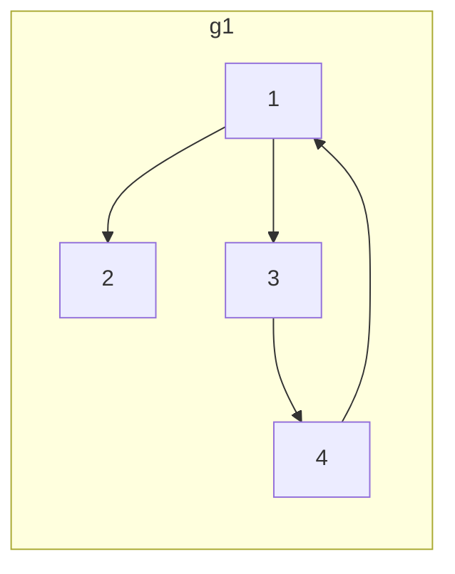
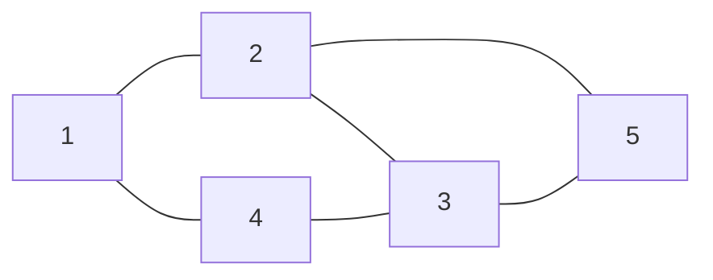
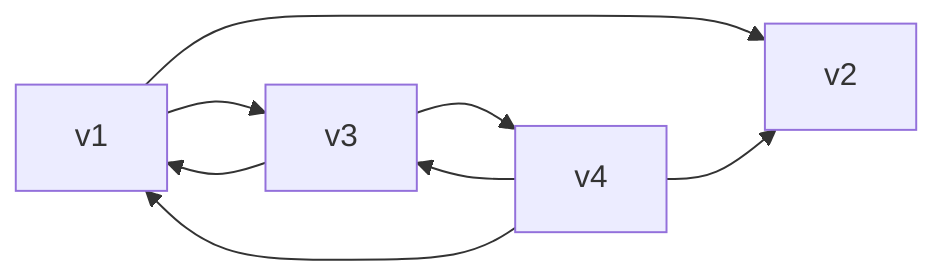

[toc]


## 图的存储结构

由于图的结构比较复杂，任意两个顶点之间都可能存在联系，因此无法以数据元素在存储区中的物理位置来表示元素之间的关系，即**图没有顺序(一维)存储结构**，但可以借助**二维数组来表示元素之间的关系**，即**邻接矩阵**表示法。

图的**链式存储**有多种，有邻接表、十字链表和邻接多重表，应根据实际需要的不同选择不同的存储结构。

## 邻接矩阵法

邻接矩阵（Adjacency Matrix）是表示顶点之间相邻关系的矩阵。设 $G(V, E)$ 是具有 $n$ 个顶点的图，则 $G$ 的邻接矩阵是具有如下性质的 $n$ 阶方阵：

$$A[i][j] = \begin{cases} 
1 & \text{若 } \langle v_i, v_j \rangle \text{ 或 } (v_i, v_j) \in E \\
0 & \text{反之}
\end{cases}$$

某两个图 $G_1$ 和 $G_2$ 的邻接矩阵





$$
G_{1,\text{arcs}} = \begin{bmatrix}
0 & 1 & 1 & 0   \\
0 & 0 & 0 & 0   \\
0 & 0 & 0 & 1   \\
1 & 0 & 0 & 0  
\end{bmatrix}
$$


$$
G_{2,\text{arcs}} = \begin{bmatrix}
0 & 1 & 0 & 1 & 0   \\
1 & 0 & 1 & 0 & 1  \\
0 & 1 & 0 & 1 & 1  \\
1 & 0 & 1 & 0 & 0  \\
0 & 1 & 1 & 0 & 0  
\end{bmatrix}
$$


若 $G$ 是网，则邻接矩阵可以定义为：

$$
A[i][j] = \begin{cases} 
w_{i,j} & \text{若 } \langle v_i, v_j \rangle \text{ 或 } (v_i, v_j) \in E \\
\infty & \text{反之}
\end{cases}
$$


其中

- $w_{i,j}$ 表示边上的权值；

- $\infty$ 表示计算机允许的、大于所有边上权值的数。

这张图片详细介绍了如何使用邻接矩阵表示图，并提供了一个结构体定义。以下是图片中的内容识别：

### 邻接矩阵结构代码描述

除了一个用于存储邻接矩阵的二维数组外，还需要用一个一维数组来存储顶点信息。其形式说明如下：

```c
 
#define MaxInt 32767       // 表示极大值，即∞
#define MVNum 100          // 最大顶点数
typedef char VerTexType;   // 假设顶点的数据类型为字符型
typedef int ArcType;       // 假设边的权值类型为整型
typedef struct {
    VerTexType vexs[MVNum]; // 顶点表(对于简单应用不需可以不用此数组)
    ArcType arcs[MVNum][MVNum]; // 邻接矩阵
    int vexnum, arcnum; // 图的当前点数和边数
} AMGraph;
```

 这张图片详细介绍了邻接矩阵表示法的优缺点。以下是图片中的内容识别：

###  邻接矩阵表示法的优缺点

####  优点

1. **便于判断两个顶点之间是否有边**：即根据 $A[i][j] = 0$ 或 $1$ 来判断。
2. **便于计算各个顶点的度**(时间复杂度为$O(n)$)
   - 对于无向图，邻接矩阵第 $i$ 行元素之和就是顶点 $i$ 的度；
   - 对于有向图，第 $i$ 行元素之和就是顶点 $i$ 的出度，第 $i$ 列元素之和就是顶点 $i$ 的入度。

####  缺点

1. **不便于增加和删除顶点**。(矩阵的行数和列数取决于顶点数,顶点数发生变化,矩阵规模也会发生变化)
2. **不便于统计边的数目**，需要扫描邻接矩阵所有元素才能统计完毕，时间复杂度为 $O(n^2)$。
3. **空间复杂度高**：
   - 如果是有向图，$n$ 个顶点需要 $n^2$ 个单元存储边。
   - 如果是无向图，因其邻接矩阵是对称的，所以对规模较大的邻接矩阵可以采用压缩存储的方法，仅存储下三角（或上三角）的元素，这样需要 $\frac{n(n-1)}{2}$ 个单元即可。
   - 但无论以何种方式存储，邻接矩阵表示法的空间复杂度均为 $O(n^2)$，这对于稀疏图而言尤其浪费空间。

## 邻接表法

邻接表（Adjacency List）是图的一种**链式存储结构**。

在邻接表中，对图中每个顶点 $v_i$ 建立一个单链表，把与 $v_i$ 相邻接的顶点放在这个链表中。

邻接表中每个单链表的第一个结点存放有关顶点的信息，把这个结点看成链表的表头，其余结点存放有关边的信息，这样邻接表便由两部分组成：**表头结点表**(顶点表)和**边表**。

### 表头结点表

由所有表头结点以**顺序结构的形式存储**，以便可以**随机访问任一顶点的边链表**(时间复杂度仅为$O(1)$)。

表头结点包括**数据域（data）和链域（firstarc）**两部分，

其中，数据域用于存储顶点 $v_i$ 的名称或其他有关信息；

链域用于指向链表中第一个结点（即与顶点 $v_i$ 相邻的第一个邻接点）。

###  边表

由表示图中顶点间关系的 $2n$ 个边链表组成。边链表中边结点包括 **邻接点域（adjvex）、数据域（info）和链域（nextarc）**三部分;

其中，邻接点域指示与顶点 $v_i$ 邻接的点在图中的位置；数据域存储和边相关的信息，如权值等；

链域指示与顶点 $v_i$ 邻接的下一条边的结点。

### 邻接表存储结构代码描述

 根据上述讨论，要定义一个邻接表，需要先定义其存放顶点的**头结点和表示边的边结点**。

```c
// ----- 图的邻接表存储表示 -----
#define MVNum 100          // 最大顶点数
typedef struct ArcNode      // 边结点(边表结点)
{
    int adjvex;             // 该边所指向的顶点的位置
    struct ArcNode *nextarc;// 指向下一条边的指针
    //OtherInfo info;         // 和边相关的信息(不一定有)
} ArcNode;

typedef struct VNode        // 顶点信息(顶点表结点,引用了边表结点,所以要在边表结点之后定义)
{
    VerTexType data;
    ArcNode *firstarc;      // 指向第一条依附该顶点的边的指针
} VNode, AdjList[MVNum];    // AdjList 表示邻接表类型

typedef struct              // 邻接表
{
    AdjList vertices;       // 顶点数组
    int vexnum, arcnum;     // 图的当前顶点数和边数
} ALGraph;
```

### 邻接表表示法的优缺点

#### 优点

1. **便于增加和删除顶点**。
2. **便于统计边的数目**，按**顶点表**顺序**扫描所有边表**可得到边的数目，时间复杂度为 $O(n + e)$。
   - 虽然访问顶点表中的任意顶点时间复杂度仅为$O(1)$,但是如果要遍历顶点表,则需要$O(n)$

3. **空间效率高**。
   - 对于一个具有 $n$ 个顶点 $e$ 条边的图 $G$，若 $G$ 是无向图，则在其邻接表表示中有 $n$ 个顶点表结点和 $2e$ 个边表结点；
   - 若 $G$ 是有向图，则在它的邻接表表示或逆邻接表表示中均有 $n$ 个顶点表结点和 $e$ 个边表结点。
   - 因此，邻接表或逆邻接表表示的空间复杂度为 $O(n + e)$，**适合表示稀疏图**。
   - 对于稠密图，考虑到邻接表中要附加链域，因此常采取邻接矩阵表示法。

#### 缺点

1. **不便于判断顶点之间是否有边**，要判定 $v_i$ 和 $v_j$ 之间是否有边，就需扫描第 $i$ 个边表，最坏情况下要耗费 $O(n)$ 时间。
2. **不便于计算有向图各个顶点的度**。对于无向图，在邻接表表示中顶点 $v_i$ 的度是第 $i$ 个边表中的结点个数。在有向图的邻接表中，第 $i$ 个边表上的结点个数是顶点 $v_i$ 的出度，但求 $v_i$ 的入度较困难，需遍历各顶点的边表。若有向图采用逆邻接表表示，则**与邻接表表示相反，求顶点的入度容易，而求顶点的出度较难**。

## 十字链表法

- 用于存储`有向图`的一种**链式存储结构**

- 有向图的十字链表存储表示的形式说明如下所示：

  ```c
  // ----- 有向图的十字链表存储表示 -----
  #define MAX_VERTEX_NUM 20
  
  typedef struct ArcBox {
      int tailvext, headvex; // 该弧的尾和头顶点的位置
      struct ArcBox *hlink, *tlink; // 分别为弧头相同和弧尾相同的弧的链域
      InfoType *info; // 该弧相关信息的指针
  } ArcBox;
  
  typedef struct VexNode {
      VertexType data;
      ArcBox *firstin, *firstout; // 分别指向该顶点第一条入弧和出弧
  } VexNode;
  
  typedef struct {
      VexNode xlist[MAX_VERTEX_NUM]; // 表头向量
      int vexnum, arcnum; // 有向图的当前顶点数和弧数
  } OLGGraph;
  ```

  只要输入 $n$ 个顶点的信息和 $e$ 条弧的信息，便可建立该有向图的十字链表。

  建立十字链表的时间复杂度和建立邻接表是相同的。

  在十字链表中既容易找到以 $v_i$ 为尾的弧，也容易找到以 $v_i$ 为头的弧，因而容易求得顶点的出度和入度（或需要，可在建立十字链表的同时求出）。在某些有向图的应用中，十字链表是很有效的工具。

   

### 弧的两要素两要素

- 尾起点(Tail=Start)

- 头终点(Head=End)

- ```mermaid
  flowchart LR
  	tailvex-->headvex
  	s[start]-->e[end]
  ```

  

  

  

- 每条弧有一个结点AN(ArchNode)

  - | tailvex                                             | headvex                                         | hlink                                    | tlink                      | info         |
    | --------------------------------------------------- | ----------------------------------------------- | ---------------------------------------- | -------------------------- | ------------ |
    | 尾域(指示弧尾<u>(**弧起点**)</u>在图中的位置(编号)) | 头域(弧头<u>**(弧终点)**</u>在图中的位置(编号)) | 指向**弧头**相同的下一条弧结点(ArchNode) | 指向**弧尾**相同的下一条弧 | 弧的相关信息 |

  - 后面三个字段是附加信息

  - 由于与结点ArchNode中同时包含了弧头(AH)结点和弧尾(AT)结点相同的下一个弧结点(ArchNode)

    - 所以在十字链表中,能够同时方便的找到
      - $V_i$为弧尾的弧,因为有域`hlink`
      - $V_i$为弧头的弧,因为有域`tlink`

    每个顶点也有一个结点VN(VertexNode)


  - - | data               | firstin                                             | firstout                                          |
      | ------------------ | --------------------------------------------------- | ------------------------------------------------- |
      | 顶点相关的数据信息 | 以该顶点为弧头(终点)(入度)的第一个弧头结点ArchNode* | 以该顶点为弧尾(起点)(出度)的第一个弧结点ArchNode* |

    - 顶点结点(VertexNode)之间是顺序存储的




- 从上面的图可以清楚的看到,横向的顶点及其出边AN链
- 而顶点的入边以容易看出,例如,v1的入边分别有来自v3和v4的,根据遍历的算法不同,可能是
  - $<v3,v1>被作为v1的第一条入边弧结点$
  - 也可能是$<v4,v1>作为第一条$
  - 总之谁是第一条不影响十字链表的正确性,但是这些同终点入边必然是相连的(通过AN的hlink域串在一起构成纵向链)
  - $弧尾起点的firstIn域指针可以在<v3,v1>\to<v4,v1>链建立完成后再指向链的第一个AN结点$
    - 也可以一开始就接入第一个结点
- 整个构建十字链表的过程基本都是依照图中的结点
  - 可以先考察每个结点的出度,完了以后回过头来考察每个点的入度!
  - 如果处理一个弧结点AN的时候顺便把出入度都处理,容易混

## 邻接多重表

- **邻接多重表**是`无向图`的另一种<u>链式存储结构</u>
  - 另一种是`邻接表`
  - 同一条边在邻接多重表中只用一个结点表示
    - 在邻接表中,用两个结点表示
    - 注意是结点而不是顶点
  

EN(EdgeNode)

| mark                 | ivex             | ilink                        | jvex               | jlink                        | info               |
| -------------------- | ---------------- | ---------------------------- | ------------------ | ---------------------------- | ------------------ |
| 标记该边是否被搜索过 | 边依附的结点之一 | 指向下一依附于ivex的边结点EN | 边依附的另一个结点 | 指向下一依附于jvex的边结点EN | 边结点EN的相关信息 |

VN(VertexNode)

| data           | firstEdge     |
| -------------- | ------------- |
| 结点的相关信息 | 第一条边(EN*) |

### 邻接多重表存储结构代码描述

在邻接多重表上，各种基本操作的实现亦和邻接表相似。

邻接多重表的类型说明如下：

```c
// ----- 无向图的邻接多重表存储表示 -----
#define MAX_VERTEX_NUM 20

typedef enum {unvisited, visited} VisitIf;

typedef struct EBox {
    VisitIf mark; // 访问标记
    int ivex, jvex; // 该边依附的两个顶点的位置
    struct EBox *ilink, *jlink; // 分别指向依附这两个顶点的下一条边
    InfoType *info; // 该边信息指针
} EBox;

typedef struct VexBox {
    VertexType data;
    EBox *firstedge; // 指向第一条依附该顶点的边
} VexBox;

typedef struct {
    VexBox adjmulist[MAX_VERTEX_NUM]; // 表头向量
    int vexnum, edgenum; // 无向图的当前顶点数和边数
} AMLGraph;
```

 

- 邻接多重表提高删除性能和判断边的存在性能

- ```mermaid
  flowchart LR
  	a(a0)---b & d(d3) 
  	c(c2)----d & e(e4)
  	b(b1)---c & e
  
  ```

- 上图中的数字是顶点在数组中顺序存储是的下标,标在图上结点旁边,便于连线

  

- 按边分析:
  - ad
  - ab
  - bc
  - be
  - cd
  - ce
- 我们可以填充ivex和jvex两个域
  - 这会得到和边一样多的(相应数量的边结点EN)
  - 在这些边结点EN(为元素)的基础上,完成它们的链接
    - 先链接ilink
    - 再链接jlink


