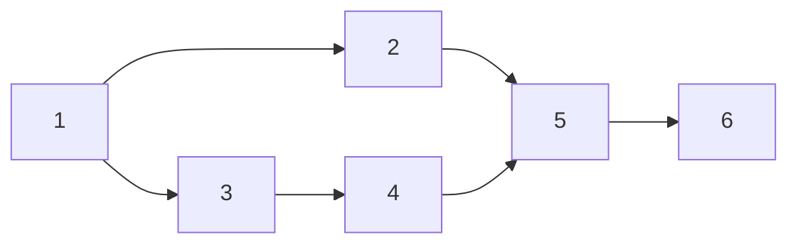

[toc]

## abstract

AOV网和拓扑排序

## AOV网

用顶点表示活动，用弧表示活动间的优先关系的有向图为**顶点表示活动的网**（Activity On Vertex Network），简称AOV网。

在网中，若从顶点$v_i$到顶点$v_j$有一条有向路径，则$v_i$是$v_j$的前驱；$v_j$是$v_i$的后继。若$<v_i, v_j>$是网中一条弧，则$v_i$是$v_j$的直接前驱，$v_j$是$v_i$的直接后继。

### AOV环检测

在AOV网中，不应该出现有向环，因为存在环意味着某项活动应以自己为先决条件。

若设计出这样的流程图，工程便无法进行。而对程序的数据流图来说，则表明存在一个死循环。因此，对给定的AOV-网应首先判定网中是否存在环。

### 拓扑排序

检测有向图是否有环的办法是对有向图的顶点进行拓扑排序，若网中所有顶点都在它的拓扑有序序列中，则该AOV-网中必定不存在环。

**拓扑排序**:将AOV-网中所有顶点排成一个**线性序列**，该序列满足：若在AOV-网中由顶点$v_i$到顶点$v_j$**有一条有向路径**，则在线性序列中的顶点$v_i$必定在顶点$v_j$之前。

(如果两个顶点之间没有路径存在,则认为两个顶点没有前后关系)



其中结点`2`和`3`没有前后关系,因为2,3之间没有可达路径;在拓扑排序中,2不一定在3前面(2,3相互独立,同理,2,4也相互独立,除此之外的任意两个结点组合都有先后关系)

而3,4之间有可达路径,所以存在前后关系,在拓扑排序中移动是3在4前面

本例的拓扑排序有:

- 123456
- 132456
- 134256

### 拓扑排序的过程

1. 在有向图中选一个无前驱的顶点且输出它。
2. 从图中删除该顶点和所有以它为尾的弧。
3. 重复步骤1,2直至不存在无前驱的顶点。
4. 若此时输出的顶点数小于有向图中的顶点数，则说明有向图中存在环，否则输出的顶点序列即为一个拓扑序列。

## 拓扑排序算法

针对上述拓扑排序的过程，可采用邻接表做有向图的存储结构。

### 辅助的数据结构

1. 一维数组 $indegree[i]$：存放各顶点入度，没有前驱的顶点就是入度为零的顶点。删除顶点及以它为尾的弧的操作，可不必真正对图的存储结构进行改变，可用弧头顶点的人度减 1 的办法来实现。
2. 栈 $S$：暂存所有人度为零的顶点，这样可以避免重复扫描数组 $indegree$ 检测人度为 0 的顶点，提高算法的效率。
3. 一维数组 $topo[i]$：记录拓扑序列的顶点序号。

### 算法步骤

1. 求出各顶点的入度存入数组 $indegree[i]$ 中，并将人度为 0 的顶点入栈。
   - 在这一步可以发现,如果使用邻接矩阵存储图,时间复杂度为$O(n^{2})$
   - 如果使用邻接表存储图,时间复杂度为$O(n+e)$

2. 只要栈不空，则重复以下操作：
   - 将栈顶顶点 $v_i$ 出栈并保存在拓扑序列数组 $topo$ 中；
   - 对顶点 $v_i$ 的每个邻接点 $v_k$ 的人度减 1，如果 $v_k$ 的人度变为 0，则将 $v_k$ 入栈。
3. 如果输出顶点个数少于 AOV-网的顶点个数，则网中存在有向环，无法进行拓扑排序，否则拓扑排序成功。

### 拓扑排序算法

C语言风格的伪代码

#### 一般描述

存储结构无关性代码

```c
bool TopologicalSort(Graph G) {
    InitStack(S); // 初始化栈，存储入度为 0 的顶点
    int i;
    for (i = 0; i < G.vexnum; i++) {
        if (indegree[i] == 0)
            Push(S, i); // 将所有入度为 0 的顶点进栈
    }
    int count = 0; // 计数，记录当前已经输出的顶点数
    while (!IsEmpty(S)) { // 栈不空，则存在入度为 0 的顶点
        Pop(S, i); // 栈顶元素出栈
        print[count++] = i; // 输出顶点 i
        for (p = G.vertices[i].firstarc; p; p = p->nextarc) {
            // 将所有 i 指向的顶点的入度减 1，并且将入度减为 0 的顶点压入栈 S
            v = p->adjvex;
            if (!(--indegree[v])) // 入度为 0，则入栈
                Push(S, v);
        }//for
    }//while
    if (count < G.vexnum)
        return false; // 排序失败，有向图中有回路
    else
        return true; // 拓扑排序成功
}
```


#### 邻接表存储的算法描述

```c
Status TopologicalSort(ALGraph G, int topo[])
{
    // 有向图 G 采用邻接表存储结构
    // 若 G 无回路，则生成 G 的一个拓扑序列 topo[] 并返回 OK，否则 ERROR
    
    FindInDegree(G, indegree); // 求出各顶点的人度存入数组 indegree 中
    InitStack(S);              // 栈 S 初始化为空
    for (i = 0; i < G.vexnum; ++i)
        if (!indegree[i]) Push(S, i); // 人度为 0 者进栈
    
    m = 0;                     // 对输出顶点计数，初始为 0
    while (!StackEmpty(S))
    {
        Pop(S, i);             // 将栈顶顶点 v_i 出栈
        topo[m] = i;           // 将 v_i 保存在拓扑序列数组 topo 中
        ++m;
        p = G.vertices[i].firstarc; // p 指向 v_i 的第一个邻接点
        while (p != NULL)
        {
            k = p->adjvex;     // v_k 为 v_i 的邻接点
            --indegree[k];     // v_i 的每个邻接点的人度减 1
            if (!indegree[k]) Push(S, k); // 若人度减为 0，则入栈
            p = p->nextarc;    // p 指向顶点 v_i 下一个邻接结点
        }//while
    }//while
    if (m < G.vexnum) return ERROR; // 该有向图有回路
    else return OK;
}
```


### 算法分析

对有 $n$ 个顶点和 $e$ 条边的有向图而言

对于以邻接表存储的情况,求单个顶点入度的时间复杂度为 $O(e)$,求所有顶点的入度时间复杂度为$O(n+e)$；建立零入度顶点栈的时间复杂度为 $O(n)$；

在拓扑排序过程中，若有向图无环，则每个顶点进一次栈，出一次栈，入度减 1 的操作在循环中总共执行 $e$ 次

所以，总的时间复杂度为 $O(n + e)$。

拓扑排序的算法是求关键路径算法的基础。

小结:

1.  如果图采用**邻接表存储**,那么时间复杂度为$O(n+e)$,其中
   - $n$是因为要遍历每个顶点(输出全部顶点)
   - $e$是要访问0度点的邻接边,最终全图的所有边被访问一遍
2. 如果是**邻接矩阵**,统计所有0度顶点访问所有边的时间复杂度为$O(n^2)$,所以算法的时间复杂度为$O(n^2)$

### DFS实现拓扑排序

利用深度优先遍历也可以实现拓扑排序， 对于有向无环图 $G$ 中的任意结点 $u, v$，它们之间的关系必然是下列三种之一：

1. 若 $u$ 是 $v$ 的祖先，则在调用 DFS 访问 $u$ 之前，必然已对 $v$ 进行了 DFS 访问，即 $v$ 的 DFS 结束时间先于 $u$ 的 DFS 结束时间。从而可考虑在 DFS 函数中设置一个时间标记，在 DFS 调用结束时，对各项点计时。因此，祖先的结束时间必然大于子孙的结束时间。
2. 若 $u$ 是 $v$ 的子孙，则 $v$ 为 $u$ 的祖先，按上述思路，$v$ 的结束时间大于 $u$ 的结束时间。
3. 若 $u$ 和 $v$ 没有路径关系，则 $u$ 和 $v$ 在拓扑序列的关系任意。

于是，按结束时间从大到小排列，就可以得到一个拓扑排序序列。


利用 DFS 求各项点结束时间的代码（在 DFS 的基础上加入了 time 变量）。将结束时间从大到小排序，即可得到拓扑序列。

```c
bool visited[MAX_VERTEX_NUM]; // 访问标记数组

void DFSTraverse(Graph G) {
    for (v = 0; v < G.vexnum; ++v)
        visited[v] = FALSE; // 初始化访问标记数组
    time = 0;
    for (v = 0; v < G.vexnum; ++v) // 本代码从 v=0 开始遍历
        if (!visited[v])
            DFS(G, v);
}

void DFS(Graph G, int v) {
    visited[v] = TRUE;
    visit(v);
    for (w = FirstNeighbor(G, v); w >= 0; w = NextNeighbor(G, v, w))
        if (!visited[w]) { // w 为 v 的尚未访问的邻接点
            DFS(G, w);
        }
    time = time + 1;
    finishTime[v] = time;
}
```


### 逆拓扑排序

- 逆拓扑排序定义和拓扑排序和相似,入度为0改为了出度为0

- 对一个AOV网采用如下步骤进行排序,则称为逆拓扑排序

  - 从AOV网中选择一个没有后继的(出度为0)的顶点,并输出
  - 从网中删除被输出的元素以及以该元素为终点的有向边
  - 重复上述步骤知道AOV网为空

- 在求解AOE的事件发生最迟时间时,会用到逆拓扑排序

  


按照逆拓扑序列排序方法,这个例子中逆拓扑序列为:

- 652431
- 654231
- 654321

和正拓扑序列的三种可能刚好逆序
