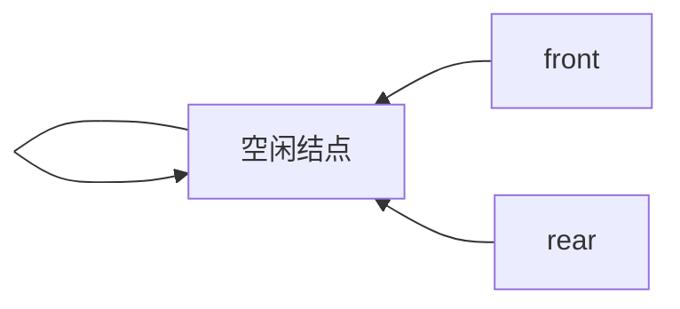
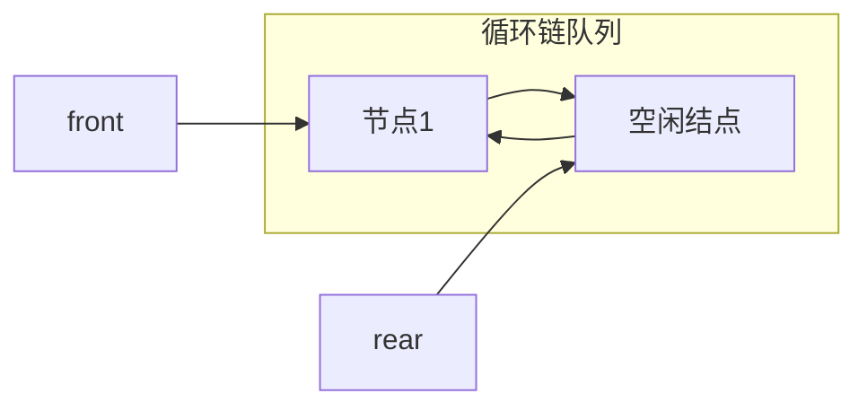
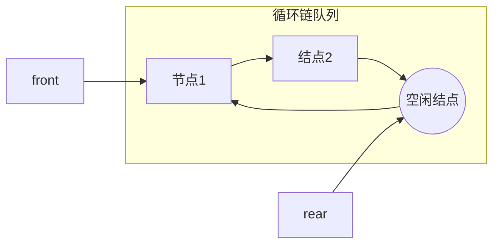
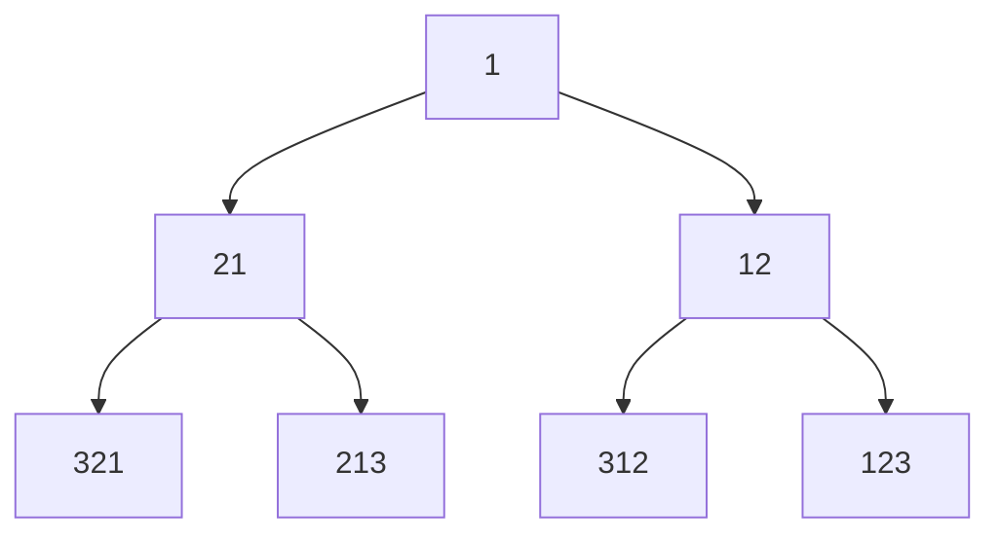

[toc]

## 队列的基本问题

- 选择合适的存储结构(数据/链表),是否循环
- 队头指针,队尾指针的含义
- 出队和入队操作指针如何变换
- 给定存储结构和头尾指针的含义下,判断队列空和满的条件

## 队列的头指针和尾指针

- 一般令队列的头指针`front`指向队列的首元,让尾指针指`rear`向队列尾元的**下一个位置**
  - 新元素入队先入队在自增队尾指针
  - 计算队列长度时,若队尾指针索引大于队头指针的索引,那么队列长度为`rear-front`(如果让`rear`指向当前队尾元素,则队列长度为`rear-front+1`)
  - 如果以数组作为基本存储结构,当数组的长度为$n$时,`rear`取值从0到$n$
  - 这种情况下,若队列初始化为`rear=front=0`,队列的判空条件可以用`rear==front`;判断队满可以检查`rear==n && front==0`,此外如果只有`rear==n`是非满的(具体说是伪满或伪上溢),队列数组还可以空间存储元素,但是如果限制`rear`不能变小,那么队列也是无法再存储新元素
  - 上述情况下`front<=rear`,此时求队列长度只需要计算`rear-front`,但是这种方式很容易出现空间浪费,实用性差

### 循环队列

- 为了改进空间利用率,可以允许`rear`达到`n`后回到`0`,`front`同样允许回到`0`
  - 队列的容量是有限的(设容量为`MaxSize=n`)
  - 如果让顺序队列首尾相连,那么可以更充分利用存储空间
  - 设以**数组**为循环队列的存储结构(**从逻辑上视为一个环**),`rear,front`到达各自最大值后回到索引0进入循环,这种队列称为循环队列
    - 如果入队次数超过`n`次,那么`rear`会累加而超过`n`,为了将`rear`控制在不超过`n`,可以对`rear`取模`n`

- 除了基于顺序存储的循环队列,还有基于链表的循环链式队列(不过非循环链式队列已经具有很灵活的空间利用能力,可以根据需要分配新结点空间,出队后也可以删除队头结点)

### 根据第一个入队元素位置确定头指针

- 从语义上看,`front`指向队列的首元,在第一个元素进入到队列之前,`front`的位置是不确定的,因为队列为空,首元自然无从确定
- 以数组A[0...n-1]作为循环队列存储结构,如果已知或约定第一个入队元素的位置,比如首元位置为A[i],那么队首指针就是`front=i`,无论首元入队前还是入队后都是如此(为什么入队前也是如此?因为首元素入队,判断队列非满,只改变尾指针`rear`,`front`保持不变;
  - 如果队尾指针指向队尾后继位置,那么`rear`在首元入队后是`i`,入队前是多少?根据循环队列中指针更新公式,元素入队操作引发`rear`指针更新,本例中`rear`要指向尾元的下一个位置,说明`rear`是将元素插入到`rear`位置,然后再更新`rear`,因此`rear`在元素入队前就是`i`,入队后更新到`(i+1)%n`
  - 如果队尾指针指向队尾元素本身,那么`rear`要在新元素入队的时候将指针调整到下一个位置,否则会覆盖掉当前的表尾元素;要将元素入队到A[i],需要将`rear`从原来的位置更新到`i`;设原来的位置为`x`,更新公式为`(x+1)%n`,要求该式等于`i`,解除不超过`n-1`的非负整数就是`rear`入队首元素之前的取值(当`i!=0`时,`x=i-1`;当`i==0`时,`x=n-1`)

### 元素入队和出队时指针的更新公式👺

- 当一个元素入队,`rear=(rear+1)%n`
- 对于队列元素出队,`front=(front+1)%n`

有些地方将`rear`设置为指向尾元素,有的则是指向尾元素的下一个位置(带入队元素的位置)

无论哪一种尾指针情况,差别主要在于入队时,是先调整更新位置`rear`值还是先将元素入队后更新`rear`值;而更新公式是同一个

## 判空和判满

分析队列判空判满条件时,根据给定的头尾指针的含义(比如尾指针指向尾元素的下一个位置);我们可以从非空队列入手,模拟队列出队直到最后一个元素出队,此时队空,看看队列中的状态来得出判空条件;于此同时要考虑判满条件

### 队列判空

- 对于一个非空队列,约定`front,rear`分别指向首元和尾元的后继
- 队列元素出队时,先将队首元素移除,然后`front`前进一步指向新的队首结点
- 那么当队列所有元素出队,那么`front`最后删除元素的位置是尾元的位置,删除完毕后要将指针移到下一个位置,这就和`rear`指向同一个位置`rear==front`
- 无论是非循环队列还是循环队列，都是如此,因此通常将队列为空的判断条件设置为`rear==front`但是具体都等于多少没有要求
- 事实上,`rear==front`作为判空条件是对队列的初始化有要求,如果初化空队列时将`rear,front`设置为相等(习惯上设置`rear=front=0`,但不一定),那么任何事时候都可以用`rear==front`来判空;
- 同时还要注意`rear,front`的含义,尤其是`rear`到底是指向尾元还是尾元后继
  - `rear==front`用来判断`rear`是尾元后继位置的空队列,
  - 如果`rear`指向尾元,那结果就不同,删除掉最后一个元素后`front`指向尾元的后继,此时判空条件变为`(rear+1)%n==front`
    - 例如`rear,front`初始化设定`front=0;rear=n-1`,那么满足上述判空条件

### 循环队列判断队满问题

- 此时又遇到一个问题:循环队列判断队列满(每个存储单元都有元素)的条件难以用`rear,front`两个指针判断出来,因为`rear==front`在队列为空和为满的情况在都成立
  - 为了能够区分出队空和队满,需要作一些改动或引入辅助变量,其中**最普遍的做法是牺牲掉一个存储单元**,不要将存储空间全部存放入队数据,把最后一个存储空间空出来,只在`a[0]~a[n-1]`这些位置存放数据;这时候还能保证`rear`不会超过`n-1`
  - 这样由于`rear`指向队尾的下一个位置(不存放元素)就不会和队首位置重合,而是`rear`的下一个位置和`head`重合,判断队满的条件为`rear+1=head`,更准确来说是`(rear+1)%n==head`

### 循环队列的长度

- 以顺时针作为`rear,front`的前进方向(索引增加的方向),空队的时候不可能执行出队,所以`rear`在顺时针方向上一定在`front`前面(有元素入队,`rear`就增加1,有元素出队,`front`就加1)

- 假设采用牺牲一个存储单元的方案来判断队列满的情况,那么受限于队列的容量`n`,满队列时元素数量为`n-1`,`rear`在顺时针方向上领先`front`的存储单元数量不会超过`n-1`(队满装不下了)

  - 循环队列长度用`rear-front`表示就不能涵盖所有情况,`rear`的值可能小于`front`(当入队/出队操作序列中入队次数超过`n`时会发生`rear<front`)

- 如果有两个计数变量`r,f`分被计数`rear,front`的前进次数,最后将他们做差,就可以得出队列长度,显然,我们可以通过`r`和队列长度`n`计算出`rear`对应的数组索引,即`rear=r%n`;同理`front=f%n`;事实上,用带余除法表示`f,n,front`之间的关系为`f=k*n+front`;那么对于领先`front`在$(0\sim{n-1})$个位置的`rear`来说,`rear=k*n+rear`(当`rear>=front`时)或`rear=k*n+n+rear`(当`rear<front`时);由此可见,`len=r-f=rear-front`或`n+rear-front`
  $$
  \rm{size=r-f}=
  \begin{cases}
  \rm rear-front &\rm rear\geqslant{front}\\
  \rm rear-front+n & \rm rear<front
  \end{cases}
  $$
  显然无论是哪种情况,都有$\rm 0\leqslant len\leqslant{n-1}$,$\rm{len\%n=len}$
  
  > 根据初等数论整除和同余知识,$\rm{rear-front\equiv{rear-front+n}\pmod{n}}$
  
  我们可以借助取模运算(求余运算)将算式统一:`len=(r-f)%n=(rear-front+n)%n`
  
- 从而循环队列的长度就可以用`rear,front,n`的式子表示:`len=(rear-front+n)%n`

- 将`rear,front`的取值控制在`MaxSize`的好处是访问队列队尾和队首时表达式比较简单,可以类似地写`s.data[s.rear],s.data[s.front]`,而不需要写`s.data[s.rear%MaxSize]`或`s.data[s.front%MaxSize]`

## 循环队列满/空判断小结👺

判断队列满的方案有多种

1. 牺牲掉一个位置来判断**队满**,此时

     - 判空条件仍然为`rear==front`
       - 一般将`rear`指定为尾元素的下一个位置的指针,而有些地方是直接让rear指向尾元素
       - 对于`front`可能有类似的情况,也要注意`front`指定为队首元素还是队首的前一个位置,不过主要会在`rear`上作文章
       - 队列为空的时候,`front`所指的存储单元理解为空(或者无效数据)
       - 当`rear`指向尾元素的下一个位置时(`rear`所指的位置是空的),判空条件为`rear==front`,表明
     - 判满条件为`(rear+1)%MaxSize==front`
     - 队列长度`(rear-front+Maxsize)%MaxSize`(当然用队列长度也可以判断队列是否满队,但是判断满队可以写得更简单)
2. 在队列的数据类型中设置`len`成员来表示队列元素个数(直接粗暴),不需要牺牲队列的一个位置,因此长度为`MaxSize`的数组可以全部用来存放队列元素

     - 队列为空时,`len==0`

     - 队列满时,`len==MaxSize`

     - 无论队空还是队满,都有`rear==front`

3. 或者设置`tag`成员来区分`front==rear`是队满还是队空
     - 导致`front==rear`的可能有队空或队满,如果是队满,其前一个操作一定输入队,如果是队空,则前一个操作(如果有的话)一定是出队

第一类是重点,作为问题考察角度也比较灵活

### 例

已知循环队列存储在一维数组A[0..n-1]中(长度为$n$)，且**队列非空时front和rear分别指向队头元素和队尾元素**。(注意这里rear指向尾元素而不是尾元素的下一个位置)

若初始时队列为空，且要求第一个进入队列的元素存储在A[0]处，则初始时front和rear的值分别是0,n-1

分析:

第一个元素进入队列后元素存在A[0]处,说明队列中的首元素索引为0,即`front=0`

由于rear指向尾元素,第一个元素入队后`rear`指向该元素(A[0]),`rear=0`

本例中,对于元素入队操作,需要先将rear移动到下一个位置以存放新元素,因此要执行位置更新操作`rear=(rear+1)%n`;而本例要求入队位置在A[0]处,所以`(rear+1)%n=0`所以第一个元素入队之前`rear+1=n`,即`rear=n-1`;

而入队操作只改变`rear`而不改变`front`,所以根据首元素入队后`front=0`可以得出首元素入队前`front=0`;

所以初始状态下,`front=0,rear=n-1`

可见,如果表尾指针的含义设定不同,队列为空时的条件也不同

## 链队列👺

- 以单链表为基础,设置头指针和尾指针即可构成链队列的存储结构
  - 和顺序存储队列不同,链队列一般队尾指针设置为链表尾元素(队尾),而不是队尾的后继位置
  - 带上**头结点**会让队列的基础操作更加统一和方便
  - **链表尾适合做队列尾,链表头适合作为队列头**(队列头如果放在链表尾,在出队删除元素时,需要遍历找到链表尾元前驱,算法时间复杂度达到O(n))
  
- 链队列的代码描述
  - 除了单链表的结点(数据域和指针域)类型,还需要两个指针做为表头和表尾指针
  - 一个链队列由指向队列结点(也就是单链表结点)的头指针和尾指针所确定,所以链队列类型可以定义两个指针,都指向链表结点类型;

### 循环链式队列

- 和顺序存储的循环队列不同，循环链式队列通过单链表尾指针后继指向单链表头结点(或首元)来构成真实的循环
- 为循环单链表设置头指针和尾指针后,链队列的入队和出队操作的时间复杂度都为O(1)
- 链式队列无论是否循环,增加新结点空间都是比顺序存储的数组更方便,特别是带有尾指针的情况下,入队操作的时间复杂度只有O(1)
- 而循环队列的另一个优点在于已经申请的空间可以不释放,直接移动队头指针,当需要入队新元素时,尾指针检查其后继是否为空(这里的空是指空指针NULL,而不是空闲结点(地址非空)结点中的数据域无效数据);如果非空(或者把非空(非NULL)说是空结点,这里空和空结点不同,后者是结点类型的空间,前者没有分配空间),就可以直接将新元素写入当前尾结点的后继结点的数据域中;如果尾结点后继为NULL,才需要再次分配空间;这种机制可以让入队操作在某些时候速度更快,但是也造成了一定空间的闲置

循环链式队列判空和判满的条件可以参考普顺序存储通循环队列的方案

和普通链队列(基于单链表)的情况不同,普通链队列一般没有满的时候,只有判空(`rear==front`);如果要求循环链队列出队后不释放结点内存,当有新数据入队时检查是否有空闲结点,就有判满的需要 

可以采用**牺牲掉一个结点的存储空间**来方便区分判空和判满条件(通常让链队列尾指针指向队列的最后一个元素(而不是队尾元素后继位置))

注意,尾指针指向队列的最后一个元素,这个元素不一定要用来填充数据,在保留出的空闲结点作以便判满的情况下,队尾指针可以前进到这个空闲结点;这样一来效果就是循环链队列中最后一个数据结点并非是尾指针所指,而是最后一个数据结点的后继结点(空闲结点才是尾指针所指的结点)

对于一个非空的循环链队列连续出队列直到队列空,头指针从队首移动到和尾结点位置,和尾指针重合,**判空条件**可以设置为`rear==front`

这样循环链表初始时可以设置一个空闲结点,让两个指针`rear,front`都指向该空闲结点,并且该空结点的后继指向其自身,构成单元素循环单链表

而**判满条件**参考顺序存储循环队列的方案,`rear->next==front`(索引+1变成指针取next,不需要取模)

插入第一个结点时,数据填入`rear`指针所指的空闲结点,然后新建一个空闲结点,接入队列尾部,让`rear`指针指向这个新结点（这个过程中,新建的结点并不是用来存储入队元数据的,而是供下次入队元素存储和判满用途;同时`front`指针从初始空闲结点移动到队首结点

循环链队列初始状态

### 入队操作：

1. 若（`front==rear->next`）//队满
   - 则在rear后面插入一个**新的空闲结点**；
2. 入队元素保存到rear所指结点中；
3. `rear=rear->next`；
4. 返回。

### 出队操作：

1. 若（`front==rear`）//队空
   - 则出队失败，返回；
2. 取front所指结点中的元素e；
3. `front=front->next`；返回e。

### 补充说明

如果我们不牺牲循环队列中的存储单元,全部结点存储入队元素,那么队列为空时,`rear->next==front`;队列满时`rear->next==front`,此时难以分辨队满和队空

## 双端队列

### 普通双端队列

| 左端          | 右端          |
| ------------- | ------------- |
| $\rightarrow$ | $\leftarrow$  |
| $\leftarrow$  | $\rightarrow$ |

### 受限双端队列

将普通双端队列中的某一端的入队或出队封禁

即上表中的4个箭头封禁一个,剩下三个出入口,有两种类型

- 输出受限双端队列(封禁一个出队口)
  - 左输出受限
  - 右输出受限
- 输入受限双端队列(封禁一个入队口)
  - 左输入受限
  - 右输入受限

那么封禁2个如何?

- 如果封禁的两个同一侧,变成栈
- 如果封禁的两个一边一个,又分为两种情况:
  - 都封禁入队(无法存入数据)
  - 都封禁出队(无法弹出数据)
  - 入队和出队各封禁一个(退化为普通队列)

通常讨论输出受限和输入受限双端队列的问题比较多(把双端队列封禁一个口),比如讨论给定某个入队序列情况下,哪个(或哪些)出队序列是不可能的

分析时可以选定一种具体的受限双端队列,比如讨论输出受限双端队列,那么就可以举左输出受限双端队列来演练入队和出队操作,排除不可能的出队序列

### 双端队列入队结果序列

双端队列入队可以从左右两段入队

对于入队于序列$\set{1,\cdots,n}$,当$n=1$时,入队结果序列只有一种(1)

当$n=2$时,入队结果序列有2种(21,12)

当$n=3$时,入队结果序列有4种,可以画二叉树状图枚举出来

类似的当$n=k$时,入队结果序列有$2^{k-1}$种

以队首元素为起点的两侧序列的元素序号各自从起点向(两端)外侧递增

## 应用

### 多队列问题

设有$n$条队列,供$8,4,2,5,3,9,1,6,7$这9个数组入队,要求出队的时候序列依次为$1\cdots{9}$;那么至少序列多少个队列(n的最小值m?)

分析:既然对出队序列做了要求,先出队的元素一定不能被后出队的元素挡在前面,抓住这个条就可以求解问题

第1个入队元素是8,设其入队第一个队列

第2个入队元素是4,出队序列要求其在8之前出队,所以不能入第一个队列,让其入第二个队列

第3个入队元素是2,出队要求它在4,8之前出队,因此必须新开队列入队第三个队列

第4个入队元素是5,观察已入队的8,4,2;出队要求它在2,4之后,8之前,因此可以入队到4所在的队列(第2个队列)

第5个入队元素是3,观察已入队元素8,4,2,5;出队要求它在2之后,在4,5,8之前,所以可以入队到2所在队列,即队列3中

类似的可以分析完后续的入队元素应该要入队到某个已有队列或者新开队列

最后统计开的队列数量,就是$n$的最小值$m$

结果如下:

1. 98
2. 7654
3. 32
4. 1

总共开了4个队列,因此$m=4$

### 例

设输出受限双端队列(双入单出)的入队序列为$abcde$(依次入队$abcde$)那么以下出队序列可能吗?

- bacde
- dbace
- dbcae

判断此类问题,找到给定输出序列的第一个入队元素`a`,其旁边的元素一定有第二个入队元素`b`,`b`旁边一定有一个第三个入队元素`c`,...以此类推

那么可以验证,bacde,dbace都是可能的,并且他们的逆序列也是可能的,而dbcae不符合

例如bacde在右端输出受限双端队列中,入队操作序列为$L(L)RRR$(其中$L,R$分别表示左端入队和右端入队,括号中的$(L/R)$表示任意$L,R$二选一都可一样的效果)

如果是左端输出受限双端队列,将bacde逆序为edcab,则序列为$(R)RLLL$得到的入队结果序列就是edcab,从右端输出队列,即得bacde

### 队列和栈综合问题

现有队列Q与栈S,初始时Q中的元素依次是1,2,3,4,5,6(1在队头)，S为空。若仅允许下列3种操作：①出队并输出出队元素；②出队并将出队元素入栈；③出栈并输出出栈元素，则不能得到的输出序列是()。

- A:1,2,5,6,4,3 
- B:2,3,4,5,6,1
- C:3,4,5,6,1,2 
- D:6,5,4,3,2,1

分析:问题中输出元素的机会有2个,一个队列元素出队,一个是栈中元素出栈

出队元素是确定的,依次是1,2,3,4,5,6;如果最终的输出序列不是1,2,3,4,5,6,那么一定是入栈了暂存了,对于A:1,2直接出队输出,3,4,入栈,5,6直接出队输出,接下出栈,4,3依次出栈,所以A可能,类似的B,D都可能

C:1,2入栈,3,4,5,6出队直接输出,接下来出栈顺序是2,1而不是1,2,所以C不可能

