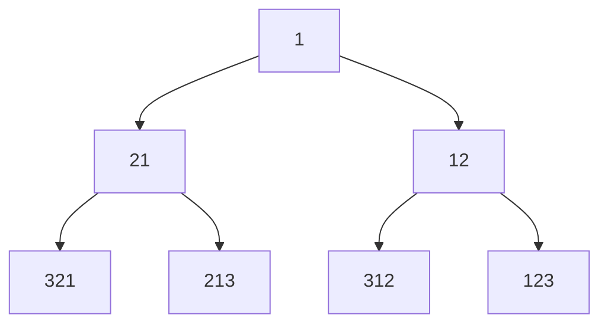

[toc]

## 队列的头指针和尾指针

- 一般令队列的头指针`front`指向队列的首元,让尾指针指`rear`向队列尾元的**下一个位置**
  - 新元素入队先入队在自增队尾指针
  - 计算队列长度时,若队尾指针索引大于队头指针的索引,那么队列长度为`rear-front`(如果让`rear`指向当前队尾元素,则队列长度为`rear-front+1`)
  - 如果以数组作为基本存储结构,当数组的长度为$n$时,`rear`取值从0到$n$
  - 这种情况下,队列的判空条件可以用`rear==front`;判断队满可以检查`rear==n && front==0`,此外如果只有`rear==n`是非满的(具体说是伪满或伪上溢),队列数组还可以空间存储元素,但是如果限制`rear`不能变小,那么队列也是无法再存储新元素
  - 上述情况下`front<=rear`,此时求队列长度只需要计算`rear-front`,但是这种方式很容易出现空间浪费,实用性差
- 为了改进空间利用率,可以允许`rear`达到`n`后回到`0`,`front`同样允许回到`0`
  - 队列的容量是有限的(设容量为`MaxSize=n`)
  - 如果让顺序队列首尾相连,那么可以更充分利用存储空间
  - 设以**数组**为循环队列的存储结构(**从逻辑上视为一个环**),`rear,front`到达各自最大值后回到索引0进入循环,这种队列称为循环队列
    - 如果入队次数超过`n`次,那么`rear`会累加而超过`n`,为了将`rear`控制在不超过`n`,可以对`rear`取模`n`

### 元素入队和出队时指针的更新公式

- 当一个元素入队,`rear=(rear+1)%n`
- 对于队列元素出队,`front=(front+1)%n`

有些地方将rear设置为指向尾元素,有的则是指向尾元素的下一个位置(带入队元素的位置)

无论哪一种尾指针情况,差别主要在于入队时,是先调整更新位置rear值还是先将元素入队后更新rear值;而更新公式是同一个

### 循环队列判断队满问题

- 此时又遇到一个问题:循环队列判断队列满(每个存储单元都有元素)的条件难以用`rear,front`两个指针判断出来,因为`rear==front`在队列为空和为满的情况在都成立
  - 为了能够区分出队空和队满,需要作一些改动或引入辅助变量,其中**最普遍的做法是牺牲掉一个存储单元**,不要将存储空间全部存放入队数据,把最后一个存储空间空出来,只在`a[0]~a[n-1]`这些位置存放数据;这时候还能保证`rear`不会超过`n-1`
  - 这样由于`rear`指向队尾的下一个位置(不存放元素)就不会和队首位置重合,而是`rear`的下一个位置和`head`重合,判断队满的条件为`rear+1=head`,更准确来说是`(rear+1)%n==head`

### 循环队列的长度

- 以顺时针作为`rear,front`的前进方向(索引增加的方向),空队的时候不可能执行出队,所以`rear`在顺时针方向上一定在`front`前面(有元素入队,`rear`就增加1,有元素出队,`front`就加1)

- 假设采用牺牲一个存储单元的方案来判断队列满的情况,那么受限于队列的容量`n`,满队列时元素数量为`n-1`,`rear`在顺时针方向上领先`front`的存储单元数量不会超过`n-1`(队满装不下了)

  - 循环队列长度用`rear-front`表示就不能涵盖所有情况,`rear`的值可能小于`front`(当入队/出队操作序列中入队次数超过`n`时会发生`rear<front`)

- 如果有两个计数变量`r,f`分被计数`rear,front`的前进次数,最后将他们做差,就可以得出队列长度,显然,我们可以通过`r`和队列长度`n`计算出`rear`对应的数组索引,即`rear=r%n`;同理`front=f%n`;事实上,用带余除法表示`f,n,front`之间的关系为`f=k*n+front`;那么对于领先`front`在$(0\sim{n-1})$个位置的`rear`来说,`rear=k*n+rear`(当`rear>=front`时)或`rear=k*n+n+rear`(当`rear<front`时);由此可见,`len=r-f=rear-front`或`n+rear-front`
  $$
  \rm{size=r-f}=
  \begin{cases}
  \rm rear-front &\rm rear\geqslant{front}\\
  \rm rear-front+n & \rm rear<front
  \end{cases}
  $$
  显然无论是哪种情况,都有$\rm 0\leqslant len\leqslant{n-1}$,$\rm{len\%n=len}$
  
  > 根据初等数论整除和同余知识,$\rm{rear-front\equiv{rear-front+n}\pmod{n}}$
  
  我们可以借助取模运算(求余运算)将算式统一:`len=(r-f)%n=(rear-front+n)%n`
  
- 从而循环队列的长度就可以用`rear,front,n`的式子表示:`len=(rear-front+n)%n`

- 将`rear,front`的取值控制在`MaxSize`的好处是访问队列队尾和队首时表达式比较简单,可以类似地写`s.data[s.rear],s.data[s.front]`,而不需要写`s.data[s.rear%MaxSize]`或`s.data[s.front%MaxSize]`

## 循环队列满/空判断

判断队列满的方案有多种

1. 牺牲掉一个位置来判断**队满**,此时
  - 判空条件仍然为`rear==front`
    - 一般将`rear`指定为尾元素的下一个位置的指针,而有些地方是直接让rear指向尾元素
    - 对于`front`可能有类似的情况,也要注意`front`指定为队首元素还是队首的前一个位置,不过主要会在`rear`上作文章
    - 当`rear`指向尾元素的下一个位置时(`rear`所指的位置是空的),判空条件为`rear==front`,表明
  - 判满条件为`(rear+1)%MaxSize==front`
  - 队列长度`(rear-front+Maxsize)%MaxSize`(当然用队列长度也可以判断队列是否满队,但是判断满队可以写得更简单)
2. 在队列的数据类型中设置`len`成员来表示队列元素个数(直接粗暴),不需要牺牲队列的一个位置,因此长度为`MaxSize`的数组可以全部用来存放队列元素
  - 队列为空时,`len==0`
  - 队列满时,`len==MaxSize`
  - 无论队空还是队满,都有`rear==front`

3. 或者设置`tag`成员来区分`front==rear`是队满还是队空
  - 导致`front==rear`的可能有队空或队满,如果是队满,其前一个操作一定输入队,如果是队空,则前一个操作(如果有的话)一定是出队

第一类是重点,作为问题考察角度也比较灵活

对于判空条件,通常是`rear=front`(如果是双端队列)

### 例

已知循环队列存储在一维数组A[0..n-1]中(长度为$n$)，且**队列非空时front和rear分别指向队头元素和队尾元素**。(注意这里rear指向尾元素而不是尾元素的下一个位置)

若初始时队列为空，且要求第一个进入队列的元素存储在A[0]处，则初始时front和rear的值分别是0,n-1

分析:

第一个元素进入队列后元素存在A[0]处,说明队列中的首元素索引为0,即`front=0`

由于rear指向尾元素,第一个元素入队后`rear`指向该元素(A[0]),`rear=0`

本例中,对于元素入队操作,需要先将rear移动到下一个位置以存放新元素,因此要执行位置更新操作`rear=(rear+1)%n`;而本例要求入队位置在A[0]处,所以`(rear+1)%n=0`所以第一个元素入队之前`rear+1=n`,即`rear=n-1`;

而入队操作只改变`rear`而不改变`front`,所以根据首元素入队后`front=0`可以得出首元素入队前`front=0`;

所以初始状态下,`front=0,rear=n-1`

可见,如果表尾指针的含义设定不同,队列为空时的条件也不同

## 链队列

- 以单链表为基础,设置头指针和尾指针即可构成链队列的存储结构
  - 带上头结点会让队列的基础操作更加统一和方便
  - **链表尾适合做队列尾,链表头适合作为队列头**(队列头如果放在链表尾,在出队删除元素时,需要遍历找到链表尾元前驱,算法时间复杂度达到O(n))
- 链队列的代码描述
  - 除了单链表的结点(数据域和指针域)类型,还需要两个指针做为表头和表尾指针
  - 一个链队列由指向队列结点(也就是单链表结点)的头指针和尾指针所确定,所以链队列类型可以定义两个指针,都指向链表结点类型;

## 循环队列入队

- `front=(front+1)%MaxSize`

## 双端队列

### 普通双端队列

| 左端          | 右端          |
| ------------- | ------------- |
| $\rightarrow$ | $\leftarrow$  |
| $\leftarrow$  | $\rightarrow$ |

### 受限双端队列

将普通双端队列中的某一端的入队或出队封禁

即上表中的4个箭头封禁一个,剩下三个出入口,有两种类型

- 输出受限双端队列(封禁一个出队口)
  - 左输出受限
  - 右输出受限
- 输入受限双端队列(封禁一个入队口)
  - 左输入受限
  - 右输入受限

那么封禁2个如何?

- 如果封禁的两个同一侧,变成栈
- 如果封禁的两个一边一个,又分为两种情况:
  - 都封禁入队(无法存入数据)
  - 都封禁出队(无法弹出数据)
  - 入队和出队各封禁一个(退化为普通队列)

通常讨论输出受限和输入受限双端队列的问题比较多(把双端队列封禁一个口),比如讨论给定某个入队序列情况下,哪个(或哪些)出队序列是不可能的

分析时可以选定一种具体的受限双端队列,比如讨论输出受限双端队列,那么就可以举左输出受限双端队列来演练入队和出队操作,排除不可能的出队序列

### 双端队列入队结果序列

双端队列入队可以从左右两段入队

对于入队于序列$\set{1,\cdots,n}$,当$n=1$时,入队结果序列只有一种(1)

当$n=2$时,入队结果序列有2种(21,12)

当$n=3$时,入队结果序列有4种,可以画二叉树状图枚举出来

类似的当$n=k$时,入队结果序列有$2^{k-1}$种

### 例

设输出受限双端队列(双入单出)的入队序列为$abcde$(依次入队$abcde$)那么以下出队序列可能吗?

- bacde
- dbace
- dbcae

判断此类问题,找到给定输出序列的第一个入队元素`a`,其旁边的元素一定有第二个入队元素`b`,`b`旁边一定有一个第三个入队元素`c`,...以此类推

那么可以验证,bacde,dbace都是可能的,并且他们的逆序列也是可能的,而dbcae不符合

例如bacde在右端输出受限双端队列中,入队操作序列为$L(L)RRR$(其中$L,R$分别表示左端入队和右端入队,括号中的$(L/R)$表示任意$L,R$二选一都可一样的效果)

如果是左端输出受限双端队列,将bacde逆序为edcab,则序列为$(R)RLLL$得到的入队结果序列就是edcab,从右端输出队列,即得bacde

##### 3从左侧入队

1. 4<u>321</u>(4从左侧入队)
2. <u>321</u>4(4从右侧入队)

##### 3从右侧入队

1. 4<u>213</u>(4从左入队侧)
2. <u>213</u>4(4从右侧入队)

#### 2从右边入队

##### 3从左侧入队

1. 43`12`
2. 3`12`4

##### 3从右侧入队

1. 4`12`3
2. `12`34

#### 小结:

- 对于单出双端队列,其入队序列,一个鲜明的特点在于入队序列的(第一个入队的元素)`起点`是1(或者是第一个进入队列的元素)

- 起点的两侧序列的元素序号各自从起点向外侧递增(类似于抛物线)

  

## 双出单入

- 单入双处在进入序列是唯一的,但是在出队列上的可能性是很多的
- 甚至于,当入队序列的长度n不超过3,即$n\leqslant 3$的时候,任意的出队列都有可能(覆盖n的全排列$A_n^n=n!$)
- 而当队列长度达到4的时候($n>3$),那么会有一些出队列的序列是无法做到的,例如:
  - 42xx打头的出队序列就无法实现
    - 4213
    - 4231
    - 这是因为:
      - 最后一个入队列的元素4作为第一个出队元素,那么可以确定,4出队的时候,所有其他元素(1,2,3)都还在队列中
      - 导致2被加载1与3之间,无法在作为跟在4后面紧接着出列
      - 但是同时我们发现,41xx和43xx都是可以实现的出度序列

