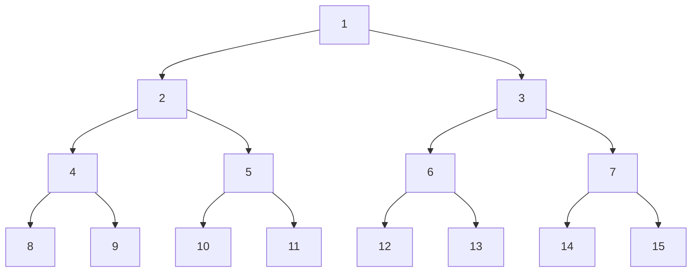
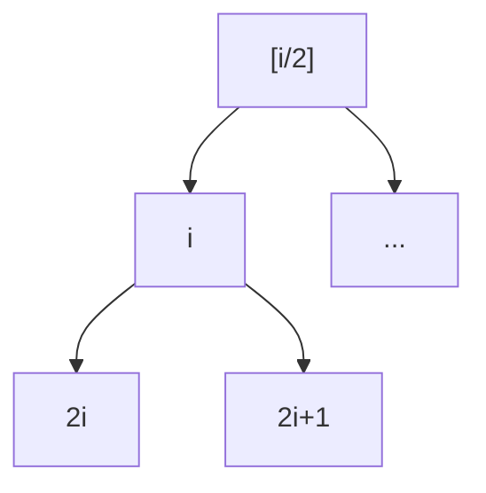
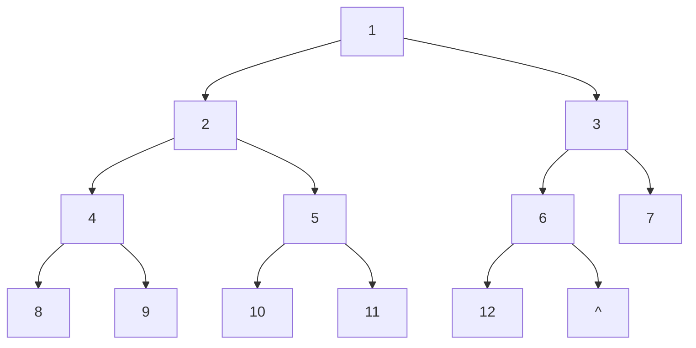
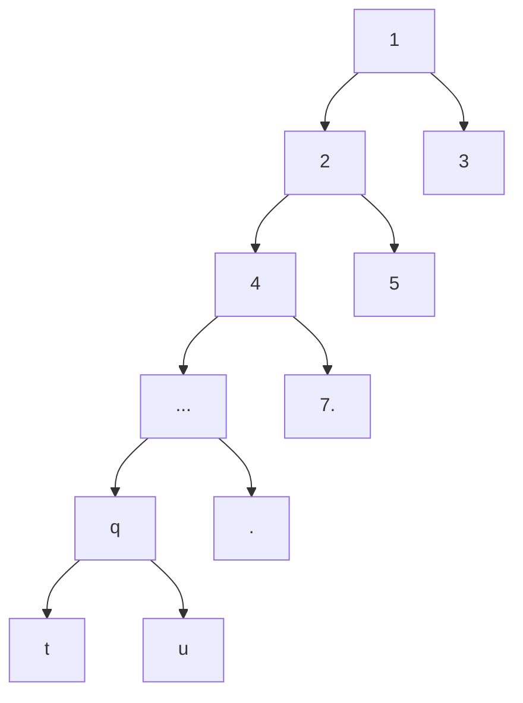

[toc]


## 二叉树


### 二叉树的定义

二叉树是一种特殊的树形结构，其特点是**每个结点至多只有两棵子树**（即二叉树中**不存在度大于 2 的结点**），并且二叉树的子树有**左右之分**，其**次序不能任意颠倒**。

与树相似，二叉树也以递归的形式定义。二叉树是 $n$ ($n \geq 0$) 个结点的有限集合：

1. 或者为空二叉树，即 $n = 0$。
2. 或者由一个根结点和两个互不相交的被称为根的左子树和右子树组成。左子树和右子树又分别是一棵二叉树。

虽然二叉树名字上看会有分叉,但是二叉树允许只有单子树,甚至空树都满足二叉树的定义

### 二叉树始终区分左右子树

二叉树是有序树，若将其左、右子树颠倒，则成为另一棵不同的二叉树。**即使树中结点只有一棵子树，也要区分它是左子树还是右子树。**

### 二叉树有 5 种基本形态

1. 空树
2. 只有根节点的树
3. 只有左子树
4. 只有有子树
5. 左右子树都有

 这5种情况会让一些算法需要判断的情况比较多

### 二叉树与度为2的有序树的区别

- 度为2的树**至少有3个结点**，而**二叉树可以为空**。

- 二叉树无论其孩子数是否为2，均需确定其左右次序，即二叉树的结点次序是绝对的,**不是相对于另一结点而言的，而是确定的**。

- 度为2的有序树的孩子的左右次序是相对于另一个孩子而言的，**若某个结点只有一个孩子，则这个孩子就无须区分其左右次序**

  

## 特殊二叉树

本节着重于满二叉树和完全二叉树,满二叉树可以视为完全二叉树的一种特殊情况

## 满二叉树👺

一颗高度为$h$的二叉树$T$,其结点数量为$2^{h}-1$,则该二叉树为满二叉树

- 所有层的结点数都是满的(尽可能多的)
- 所有的叶子结点都在底层

满二叉树有许多特有的性质,尤其是结点编号



### 基本性质

设任意非根结点序号为$c$和它的双亲结点序号$p$

二叉树的第$i$行元素最多为$L(i)=2^{i-1}$,第$i-1$行元素就最多是$2^{i-2}$;

前$i$行元素最多为$S(i)=2^i-1$,第$i$行第1个元素编号为$F(i)$=$S(i-1)+1$=$2^{i-1}-1+1$=$2^{i-1}$,显然第$i$行第一个元素的编号是第$i-1$行是元素的编号的两倍

### 结点的双亲和孩子的序号关系👺

根据双亲结点求孩子结点序号,或根据孩子结点求双亲结点序号

对满二叉树结点进行层次编号，从根节点（根节点的编号为1）开始，**自上而下、自左向右**地分配每个节点的编号。

对于编号为 $i$ 的节点，有以下性质:

1. 如果有父亲，则其父亲的编号为 $\lfloor i/2 \rfloor$(或者$\lceil(i-1)/2\rceil$);前者更简洁,通常用第一个表达式
2. 如果有左孩子，则左孩子的编号为 $2i$；
3. 如果有右孩子，则右孩子的编号为 $2i + 1$

这些表达式对于二叉树(尤其是完全二叉树)的顺序存储很重要,通过计算$2i,2i+1$来计算第$i$个结点的孩子结点应该放到数组的那个位置(通常从1开始计数)



我们可以通过观察和归纳容易得到次规律,也可以通过推理的方式来验证

### 推导1

设树中的第$p$个结点是满二叉树第$i$行的元素,并且设$p$=$S(i-2)+t$,则$p$的左孩子序号为$l=S(i-1)+2(t-1)+1$

分被化简两个表达式$p=2^{i-2}-1+t$,$l=2^{i-1}-2+2t$,可见$l=2p$;类似的$r=l+1=2p+1$

这就证明了第2,3条性质

对于第一条,利用现有2,3两条性质

若$c$表示树中某个结点,求其双亲结点$p$,由上述讨论可知$c=2p$或$c=2p+1$,分被对应于$c$是$p$的左孩子和右孩子的情况;可以看出,若结点$c$是偶数时,一定是其双亲结点$p$的左孩子,若$c$为奇数,则$c$是$p$的右孩子

可以用映射关系
$$
p=\begin{cases}
c/2,&c\mod{2}=0\\
(c-1)/2,&c\mod{2}=1
\end{cases}
$$
由于$p,c$都是整数,我们可以试图找到某个统一的映射$f$,使得$p=f(2c)=f(2c+1)=c$

这样的映射不是唯一的,比如可以取$f(x)=\lfloor{\frac{x}{2}}\rfloor$;也可以取$f(x)=\lceil\frac{x-1}{2}\rceil$

所以$c$的双亲结点$p=\lfloor\frac{1}{2}c\rfloor$=$\lceil \frac{c-1}{2}\rceil$,这就得到了第1条性质

### 推导2


- 假设结点p具有孩子结点(非叶子结点)

- $p$的左孩子:$c_l=2p$前面讨论过，完全二叉树的按层编号来看每一层的第一个结点的序号为$2^{i-1} $
  我们设双亲结点$p$所在的层为$h$层,那么在$h$层位于结点$p$之前的结点数为$p-2^{h-1}$
  而$p$的孩子结点位于第$h+1$层，该层的第一个元素编号为$2^h$
  那么在$h+1$层，结点$p$的左孩子结点$l$之前的结点数量为$l-2^h$个

- 根据满二叉树的特点,$l-2^{h}$=$2(p-2^{h-1})$

- 容易知道结点数量关系：$l-2^h=2(p-2^{h-1})$
  从而得到 $l = 2p$

- 则$i$的右孩子$r=l+1=2p+1$


## 完全二叉树

高度为 $h$、有 $n$ 个结点的二叉树，当且仅当其每个结点都与高度为 $h$ 的满二叉树中编号为 $1 \sim n$ 的结点一一对应时，称为完全二叉树,



完全二义树可视为从满二叉树中删去若干最底层、最右边的一些连续叶结点后所得到的二叉树。

满二叉树的元素编号规律在完全二叉树中也适用,例如指定结点的双亲结点或孩子结点的编号计算,由于最后一层和倒数第二层的部分结点和满二叉树有差异,因此有更多性质需要讨论,比如1度结点,叶结点分布,倒数第二层有叶结点,且至少有一个叶结点;还要讨论**分支结点**(非叶结点)的孩子情况

当完全二叉树中的最后一个分支结点只有2个孩子,那么是正则完全二叉树,否是非正则的

和满二叉树不同,仅完全二叉树在第$t$层有$k$个结点无法确定该完全二叉树的唯一形状;因为除非指明完全二叉树的层数$h=t$,否则叶子结点还可能分布在$t+1$层

例如:已知一棵完全二叉树的第6层有8个叶子结点,则该树的结点数最大值$M$?

- 满足条件的完全二叉树有第7层，第6层是满的,共有$2^{5}=32$个结点,由于第6层有8个叶子结点,所以分支结点有$32-8=24$个,最后一个分支结点编号是$2^{5}-1+24=55$
- 根据完全二叉树的编号性质,此时最后一个结点编号为$55$号结点的右孩子,即$2\times{55}+1=111$,所以$M=111$
- 或者:计算出第7层的叶子结点然后和前6层的结点数量$2^{6}-1=63$相加;第7层的叶子结点数量最大值取决于第6层分支结点数量:$2^{5}-8=24$,所以第7层最多有$48$个结点,所以$M=111$

### 完全二叉树的性质特点👺

其特点如下：

1. 若 $i \leq \lfloor n/2 \rfloor$，则结点 $i$ 为分支结点，否则为叶结点。

   - 可用来计算结点数为$n$的完全二叉树的叶结点数量:$n_{0}$=$n-\lfloor{n/2}\rfloor$
   - 若已知某完全二叉树的叶结点数为$n_{0}$,那么该树的结点数$n$最多:$2n_{0}$
     - $\frac{n}{2}\leqslant{n-\lfloor{n/2}\rfloor}=n_{0}$
     - 可以得$n\leqslant{2n_{0}}$

2. **叶结点**只可能在层次最大的两层上出现。对于最大层次中的叶结点，都依次排列在该层最左边的位置上。
3. 若有度为 1 的结点，则最多只可能有一个(位于倒数第二层)，且该结点只有左孩子而无右孩子。
4. 按层序编号后，一旦出现某结点（编号为 $i$）为**叶结点**(没有孩子)或**只有左孩子**，则编号大于 $i$ 的结点均为叶结点。(例如上例中多结点6只有左孩子,大于6的结点都是叶结点;从$i=7$号结点开始都是叶子结点
5. 结点总数的奇偶性和分支结点规律:

   1. 若 $n$ 为奇数，则每个**分支结点**都有左孩子和右孩子；
   2. 若 $n$ 为偶数，则编号**最大的分支结点**（编号为 $n/2$）只有左孩子，没有右孩子，其余分支结点左、右孩子都有。

6. 对于编号为$p$的结点

   1. 若$2p\leqslant n$时,则$p$号结点有左孩子,否则没有左孩子(也不可能有右孩子)
   2. 当$2p+1\leqslant n$,结点p有右孩子(也必有左孩子),否则没有右孩子

7. 完全二叉树的各行首结点编号

   - 第$i$行的首个元素的编号是$2^{i-1}$ ($2^{i-1}$也是第$i$行元素的最大数量)

     - 由于前$i$行的结点数为$2^i-1$
     - 则前$i-1$行结点数为$2^{i-1}-1$
     - 因此,第$i$行的第一个元素结点为$2^{i-1}-1+1=2^{i-1}$

     - 完全$m$叉树的第$i$行首结点编号:$\frac{1}{m-1}(m^{i-1}-1)+1$

8. 完全二叉树最后一个**分支结点**编号$\lfloor\frac{n}{2}\rfloor$
9. 结点 $i$ 所在层次（深度）为 $\lfloor \log_2 i \rfloor + 1$或$\lceil \log_2 (i + 1) \rceil$

   - 推导过程和具有$n$个结点的完全二叉树的高度一样

10. 具有 $n$ 个 ($n > 0$) 结点的完全二叉树的高度为 $\lceil \log_2 (n + 1) \rceil$ 或 $\lfloor \log_2 n \rfloor + 1$

    设高度为 $h$，根据二叉树的性质

    $2^{h-1} - 1 < n \leq 2^h - 1$ `(1)`或$2^{h-1} \leq n < 2^h$`(2)`

    > 第一个不等式意思是$n$在第$h$层,所以结点序号要在第$h-1$层最后一个结点之后,但是不会超过第$h$层最后一个结点
    >
    > 第二个不等式意思是$n$的取值范围是第$h$层第一个元素(序号为$2^{h-1}$)到第$h+1$层第一个元素(编号为$2^{h}$)之前

    对于(1),不等式各段都做加1变形得: $2^{h-1} < n + 1 \leq 2^h$，即 $h - 1 < \log_2 (n + 1) \leq h$，因为 $h$ 为正整数，所以 $h = \lceil \log_2 (n + 1) \rceil$，

    或者对于(2)两边取2为底数的对数,得 $h - 1 \leq \log_2 n < h$,即$h \leq (\log_2 n)+1 < h+1$，因为$h$为正整数,可以对不等式进行适当的放缩,得到 $h = \lfloor \log_2 n \rfloor + 1$。

    求出的两个值相等,因为$h$是唯一确定的

### 例

高度为$h$的完全二叉树在最后一层有$k$个叶子结点,则该树有多少个叶子结点?

第$h-1$层的结点数为$2^{h-2}$,该层的分支结点有$\lceil{k/2}\rceil$

综上树的叶子结点有$2^{h-2}-\lceil{k/2}\rceil+k$`(1)`

或者利用树的分支结点和叶结点性质计算:

树的总结点数为$n=2^{h-1}-1+k$,最后一个分支结点为$\lfloor{n/2}\rfloor$,叶结点数就是$n-\lfloor{n/2}\rfloor$`(2)`

例

方法1:$h=6,k=3$,则该数叶子结点有$16-2+3=17$

方法2:$n=2^{5}-1+3$=$34$,$34-17=17$

例:

方法1:一棵完全二叉树有1001个结点,则该树有多少个叶子结点:$h=[\log_{2}1001]+1=10$;第$10$层之前有$2^{9}-1=511$个结点,第10层有1001-511=490个结点,第$9$层的叶子结点树为$2^{8}-[490/2]$=$256-245=11$

综上,第9,10层共有叶子结点501个

方法2:利用结点编号的性质:完全二叉树的最后一个分支结点为$[n/2]=500$,之后的结点都是叶子结点,共有1001-500=501个

## 其他二叉树

---

###  二叉排序树

左子树上所有结点的关键字均小于根结点的关键字；右子树上所有结点的关键字均大于根结点的关键字；

左子树和右子树又各是一棵二叉排序树。

---

### 平衡二叉树

树中任意一个结点的**左子树和右子树的高度之差**的绝对值不超过 1。

### 正则二叉树👺

树中每个分支结点都有2个孩子，即树中只有度为0或2的结点。



高度为$h$的正则二叉树至少有$2(h-1)+1$=$2h-1$个结点

含有$n$个结点的正则二叉树的高度范围:

- 最小值$\lfloor{\log_{2}n}\rfloor+1$(这和完全二叉树相同)
- 最大值$(n+1)/2$

若正则二叉树的叶子结点数为$n_{0}$,则$n_{0}+n_{1}+n_{2}=n_{0}+n_{2}=n$,而$n_{2}=n_{0}-1$,得$n=2n_{0}-1$

按照使树达到最高的方式排列,那么每层仅有两个结点,而且它们是兄弟结点

- 按照使树有最低高度的方式排列,那么每层拥有最多结点(完全二叉树)

- 如果结点数n为偶数,那么不可能实现没有1度的结点,也就是不可能是正则二叉树
  - (正则二叉树的结点数量$n$为奇数)
  - 满二叉树的结点数量$2^{h}-1$也是奇数
  - $n_0=n_2+1$
    $n_0+n_1+n_2=n=2k$(表示偶数)
    $n_0$用$n_2+1$表示,得$2n_2+1+n_1=2k$
    显然$n_1$必须是个奇数,等式两边的奇偶性才能够一致
    如果$n_1=0$(没有1度的结点),那么左边是奇数,右边是偶数,矛盾
    因此$n_1$至少为1

## 二叉树的存储

### 顺序存储

- 二叉树的顺序存储是指用一组连续的存储单元依次自上而下、自左至右存储完全二叉树上的结点元素，即将完全二义树上编号为1的结点元素存储在一维数组下标为$i$的分量中。

- 依据二叉树的性质，**完全二叉树和满二叉树**采用顺序存储比较合适，树中结点的序号可以唯一地反映结点之间的逻辑关系，这样既能最大可能地节省存储空间，又能利用数组元素的下标值确定结点在二叉树中的位置，以及结点之间的关系。

- 一般的二叉树，为了让数组下标能反映二叉树中结点之间的逻辑关系，只能添加一些并不存在的空结点，让其每个结点与完全二叉树上的结点相对照，再存储到一维数组的相应分量中。
- 在最坏情况下，一个高度为 $h$ 且只有 $h$ 个结点的单支树却需要占据近 $2^h - 1$ 个存储单元。

### 存储方法

- 填充满二叉树时,从根结点(1号)开始操作;设当前处理的结点是第$i$号结点,将其左孩子填充到到数组$2i$处,右孩子填充到$2i+1$处;按照层次遍历的顺序,依次处理$i=1,2,\cdots,n$;最终数组中的编号为$1,2,3,\cdots,n$
- 将任意二叉树用相同层数的满二叉树来套,对于缺失的结点填值到数组中时使用0

### 链式存储


由于顺序存储的空间利用率较低，因此二叉树一般都采用链式存储结构，用链表结点来存储二叉树中的每个结点。在二叉树中，结点结构通常包括若干数据域和若干指针域，

二叉链表至少包含 3 个域：数据域 `data`、左指针域 `lchild` 和右指针域 `rchild`， 

而实际上在不同的应用中，还可以增加某些指针域，如增加指向父结点的指针后，变为三叉链表的存储结构。 

二叉树的链式存储结构描述如下：

```c
typedef struct BiTNode{
    ElemType data; // 数据域
    struct BiTNode *lchild, *rchild; // 左、右孩子指针
}BiTNode, *BiTree;
```

使用不同的存储结构时，实现二叉树操作的算法也会不同，因此要根据实际应用场合（二叉树的形态和需要进行的运算）来选择合适的存储结构。

 

## 二叉树的一般性质👺

[树基本概念和性质-CSDN博客](https://cxxu1375.blog.csdn.net/article/details/144394670)

这里介绍$m$叉树的特例$(m=2)$

### 二叉树结点和边的关系

- 二叉树$T$的结点数为$n=\sum\limits_{i=0}^{2}n_i$
  - 二叉树的边数$E(T)=\sum\limits_{i=1}^{2}i\times n_i$
  - 而$n=E(T)+1$,即$n$=$n_0+n_1+n_2$=$0n_0+1n_1+2n_2+1$
  - $n_2=n_0-1;或者n_0=n_2+1$,可见,**0度结点比2度结点多1** 
- $n_{1}=n-2n_{0}+1$
  - 由$n=n_{0}+n_{1}+n_{2}$带入$n_{2}=n_{0}-1$,整理得$n_{1}=n-2n_{0}+1$
  - 等式右边的$-2n_{0}+1$的奇偶性是确定的(偶数+奇数,一定是个奇数),因此$n_{1}=n-2n_{0}+1$的奇偶性在$n$为偶数时$n_{1}$奇数,$n$为奇数时$n_{1}$为偶数


### 树的高度和结点数性质

- 非空二叉树第$i$层结点数最多为$2^{i-1}$
  - 非空$m$叉树第$i$层结点数最多为$m^{i-1}$

- 满二叉树前$i$层的结点总数为:$2^{i}-1$
  - 满$m$叉树前$i$层的结点总数$\frac{1}{m-1}(m^{i}-1)$
- 高度为$h$的二叉树的结点数量最多为$2^{h}-1$

### 二叉树和2度树的高度范围

设二叉树和2度数的结点数为$n$

度为$2$的树的高度取值范围

- $\lfloor{\log_{2}{n}}\rfloor+1\leqslant{h}\leqslant{n-1}$

二叉树的高度范围和2度树类似,但是最高值要大1

- $\lfloor{\log_{2}{n}}\rfloor+1\leqslant{h}\leqslant{n}$

例如,对于二叉树$n=1025$时,$11\leqslant{1025}$

### 二叉树的链式存储空指针数量

- 一棵有$n$个结点二叉树采用二叉链存储结点,(每个结点有两个指针域(用来指向左右孩子)),那么空指针数为$2n-(n-1)$=$n+1$
