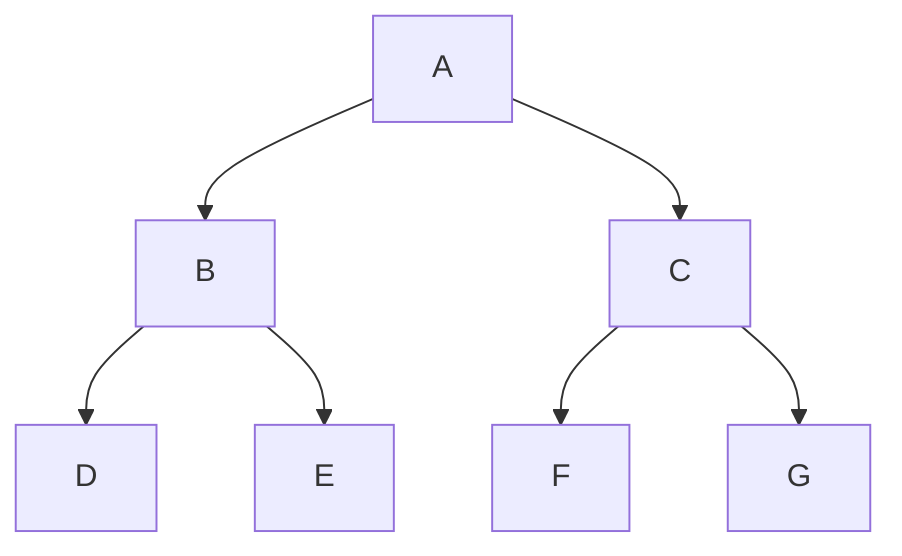
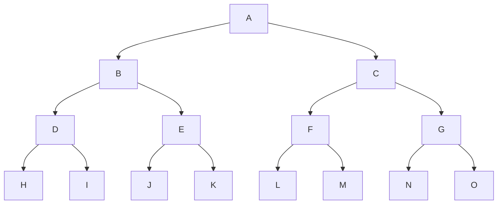

[toc]


## 二叉树的遍历算法

二叉树的遍历(traversing binary tree)是指以某种规则访问二叉树中的每一个节点。

主要分为 **深度优先遍历** 和 **广度优先遍历** 两大类

其中**深度优先遍历**进一步细分为**前序、中序和后序**三种方式。

------

## 深度优先遍历

深度优先遍历通过递归或栈的方式沿树的深度依次访问每个节点，直到遍历完所有分支。

遍历二叉树（traversing binary tree）是指按某条搜索路径遍访树中每个结点，**使得每个结点均被访问一次，而且仅被访问一次**。

**访问**的含义很广，可以是对结点做各种处理，包括输出结点的信息，对结点进行运算和修改等。

遍历二叉树是二叉树**最基本的操作**，也是二叉树**其他各种操作的基础**。

**遍历的实质是对二叉树进行线性化的过程，即遍历的结果是将非线性结构的树中结点排成一个线性序列**。

由于二叉树的每个结点都可能有两棵子树，因而需要寻找一种规律，以便使二叉树上的结点能排列在一个线性队列上，从而便于遍历。

由二叉树的递归定义可知，二叉树是由3个基本单元组成：根结点、左子树和右子树。

因此，若能依次遍历这三部分，便是遍历了整个二叉树。

假如从L、D、R分别表示遍历左子树、访问根结点和遍历右子树，则可有DLR、LDR、LDR、DRL、RDL、RLD这6种遍历($A_{3}^{3}$=6)二叉树的方案。

若限定遍历子树的时候**先左后右**，则只有前3种情况，分别称之为**先（根）序遍历、中（根）序遍历和后（根）序遍历**。

基于二叉树的递归定义，可得下述遍历二叉树的递归算法定义。

先序遍历二叉树的操作定义如下：

若二叉树为空，则空操作；否则

1. 访问根结点；
2. 先序遍历左子树；
3. 先序遍历右子树。

中序遍历二叉树的操作定义如下：

若二叉树为空，则空操作；否则

1. 中序遍历左子树；
2. 访问根结点；
3. 中序遍历右子树。

后序遍历二叉树的操作定义如下：

若二叉树为空，则空操作；否则

1. 后序遍历左子树；
2. 后序遍历右子树；
3. 访问根结点。

### 小结

上述三种遍历算法中，递归遍历左、右子树的顺序都是固定的，只是访问根结点的顺不管采用哪种遍历算法，每个结点都访问一次且仅访问一次，所以时间复杂度都是$O(n)$.

遍历中，**递归工作栈的栈深恰好为树的深度**，所以在**最坏情况**下，二叉树是有$n$个结点且深度为$n$的单支树，遍历算法的**空间复杂度**为$O(n)$。

### 例



- NLR:`ABDECFG`
- LNR:`DBEAFCG`
- LRN:`DEBFGCA`




- `pre (NLR)=A{B(DHI)(EJK)}{C(FLM)(GNO)}`:$\angle$

- `in (LNR)={(HDI)B(JEK)}A{(LFM)C(NGO)}`:$\wedge$

- `post(LRN)={(HID)(JKE)B}{(LMF)(NOG)C}A`:⦣

  - | 先序遍历                                                     | 中序遍历                                                     | 后序遍历                                                     |
    | ------------------------------------------------------------ | ------------------------------------------------------------ | ------------------------------------------------------------ |
    |  |  |  |

## 广度优先遍历

借助对列来实现

### 算法总结与比较

| **遍历方法** | **访问顺序**         | **实现难度** | **典型应用**                                        |
| ------------ | -------------------- | ------------ | --------------------------------------------------- |
| 前序遍历     | 根 -> 左 -> 右       | 简单         | 用于表达式树的前缀表达式（Polish Notation）         |
| 中序遍历     | 左 -> 根 -> 右       | 简单         | 二叉搜索树的中序遍历得到有序序列                    |
| 后序遍历     | 左 -> 右 -> 根       | 简单         | 用于表达式树的后缀表达式（Reverse Polish Notation） |
| 广度优先遍历 | 按层从左到右逐层访问 | 中等         | 求最短路径、层次关系等问题                          |

------

### 示例

假设二叉树如下：


| 遍历方式 | 访问顺序      |
| -------- | ------------- |
| 前序遍历 | A B D E C F G |
| 中序遍历 | D B E A F C G |
| 后序遍历 | D E B F G C A |
| 层序遍历 | A B C D E F G |

## C语言描述二叉树的遍历算法

### 定义二叉树节点结构

```c
#include <stdio.h>
#include <stdlib.h>

// 定义二叉树节点结构
typedef struct TreeNode {
    char value;                 // 节点值
    struct TreeNode *left;      // 左子节点
    struct TreeNode *right;     // 右子节点
} TreeNode;

// 创建新节点
TreeNode* createNode(char value) {
    TreeNode *node = (TreeNode *)malloc(sizeof(TreeNode));
    node->value = value;
    node->left = NULL;
    node->right = NULL;
    return node;
}
```

### 遍历访问

- 访问函数,比如打印结点

  ```c
  void visit(int a){
  	printf("%d",a);
  }
  ```

  

### 深度遍历

本节仅讨论经典的递归遍历法

#### 前序遍历

```c
void preorder(TreeNode *root) {
    if (root) {
        visit(root->value);  // 访问根节点
        preorder(root->left);       // 遍历左子树
        preorder(root->right);      // 遍历右子树
    }
}
```

#### 中序遍历

```c
void inorder(TreeNode *root) {
    if (root) {
        inorder(root->left);        // 遍历左子树
        visit(root->value); // 访问根节点
        inorder(root->right);       // 遍历右子树
    }
}
```

#### 后序遍历

```c
void postorder(TreeNode *root) {
    if (root) {
        postorder(root->left);      // 遍历左子树
        postorder(root->right);     // 遍历右子树
        visit(root->value); // 访问根节点
    }
}
```

### 层序遍历

层序遍历需要借助队列：

```c
#define MAX_QUEUE_SIZE 100

typedef struct {
    TreeNode *data[MAX_QUEUE_SIZE];
    int front, rear;
} Queue;

void initQueue(Queue *q) {
    q->front = q->rear = 0;
}

int isQueueEmpty(Queue *q) {
    return q->front == q->rear;
}

void enqueue(Queue *q, TreeNode *node) {
    if ((q->rear + 1) % MAX_QUEUE_SIZE != q->front) { // 判断队列未满
        q->data[q->rear] = node;
        q->rear = (q->rear + 1) % MAX_QUEUE_SIZE;
    }
}

TreeNode* dequeue(Queue *q) {
    if (!isQueueEmpty(q)) {
        TreeNode *node = q->data[q->front];
        q->front = (q->front + 1) % MAX_QUEUE_SIZE;
        return node;
    }
    return NULL;
}

void levelOrder(TreeNode *root) {
    if (!root) return;
    Queue q;
    initQueue(&q);
    enqueue(&q, root);
    while (!isQueueEmpty(&q)) {
        TreeNode *node = dequeue(&q);
        printf("%c ", node->value);  // 访问节点
        if (node->left) enqueue(&q, node->left);
        if (node->right) enqueue(&q, node->right);
    }
}
```

## 示例代码

```c
int main() {
    // 构建示例二叉树
    TreeNode *root = createNode('A');
    root->left = createNode('B');
    root->right = createNode('C');
    root->left->left = createNode('D');
    root->left->right = createNode('E');
    root->right->left = createNode('F');
    root->right->right = createNode('G');

    printf("Preorder Traversal: ");
    preorder(root);
    printf("\n");

    printf("Inorder Traversal: ");
    inorder(root);
    printf("\n");

    printf("Postorder Traversal: ");
    postorder(root);
    printf("\n");

    printf("Level Order Traversal: ");
    levelOrder(root);
    printf("\n");

    return 0;
}
```

