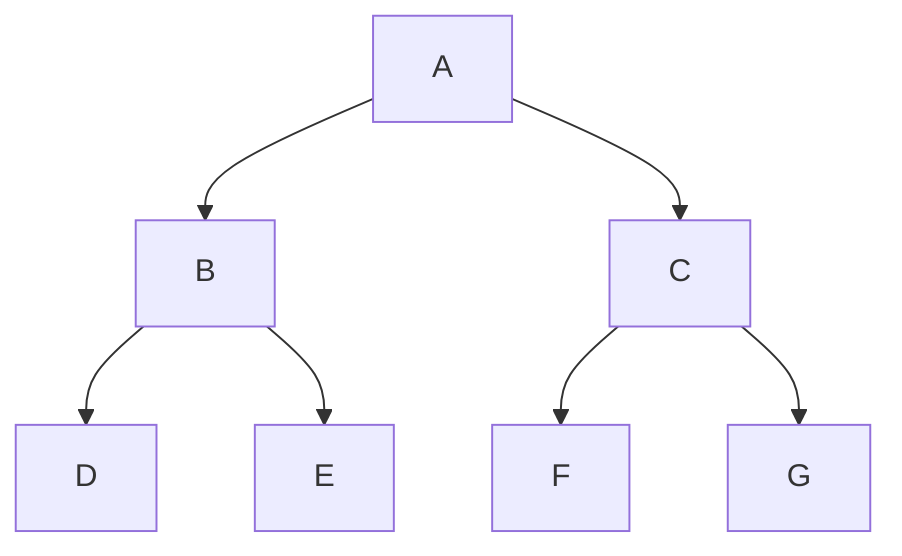
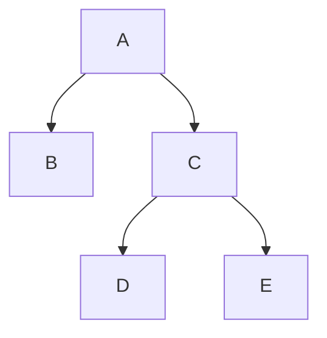
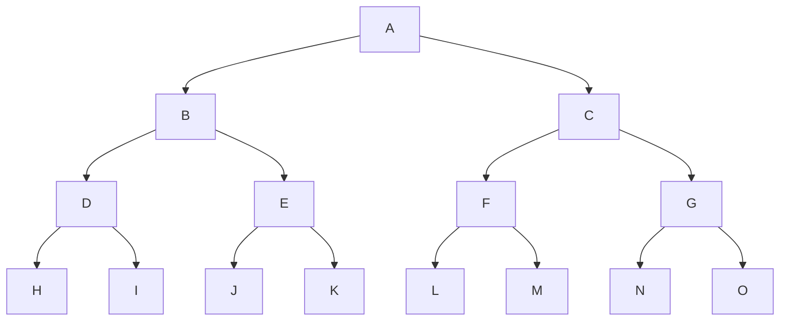
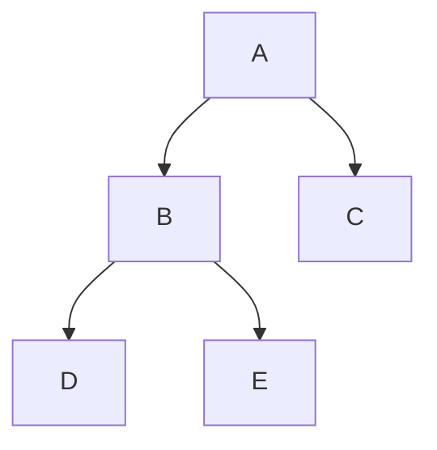
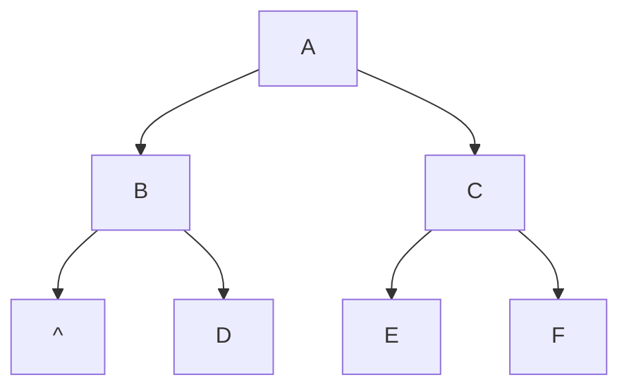
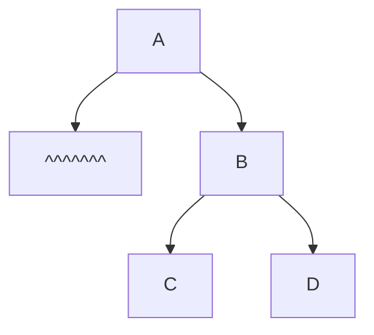

[toc]


## 二叉树的遍历算法

二叉树的遍历(traversing binary tree)是指以某种规则访问二叉树中的每一个节点。

主要分为 **深度优先遍历** 和 **广度优先遍历** 两大类

其中**深度优先遍历**进一步细分为**前序、中序和后序**三种方式。

------

### 树的遍历的意义和实质

遍历二叉树是二叉树**最基本的操作**，也是二叉树**其他各种操作的基础**。

**遍历的实质是对二叉树进行线性化的过程，即遍历的结果是将非线性结构的树中结点排成一个线性序列**。

树本身是一种非线性结构,本身是没有前驱和后继的概念,只有左右孩子及其衍伸概念;

### 树的存储结构和表示方式

不过树的存储结构或表示方式比较灵活多样,比如双亲表示法,孩子表示法,兄弟孩子表示法,存储结构可以是基于链表存储,也可以基于顺序表(数组)存储;不同的存储结构有不同优缺点

最常用的是链式存储树(有两个指针域指向孩子结点的二叉链表),找孩子方便,但是找双亲结点麻烦;双亲表示法则是找双亲容易,找孩子结点难(需要遍历树)

在顺序存储中，值得注意的是,二叉树有自己的顺序存储方式,和一般的树的顺序存储有一定区别,二叉树的使用占用的顺序存储,可以做更多的事

二叉树是树的一种,因此二叉树可用一般的树的存储结构存储,但是反之则不行

在指定遍历规则后,结点数据可以被线性化,此时得出的遍历序列中就产生了前驱和后继的概念

## 深度优先遍历

深度优先遍历通过递归或栈的方式沿树的深度依次访问每个节点，直到遍历完所有分支。

遍历二叉树（traversing binary tree）是指按某条搜索路径遍访树中每个结点，**使得每个结点均被访问一次，而且仅被访问一次**。

**访问**的含义很广，可以是对结点做各种处理，包括输出结点的信息，对结点进行运算和修改等。


由于二叉树的每个结点都可能有两棵子树，因而需要寻找一种规律，以便使二叉树上的结点能排列在一个线性队列上，从而便于遍历。

由二叉树的递归定义可知，二叉树是由3个基本单元组成：根结点、左子树和右子树。

因此，若能依次遍历这三部分，便是遍历了整个二叉树。

### 记号说明

假如**L、D(N)、R分别表示遍历左子树、访问根结点和遍历右子树**，则可有DLR、LDR、LDR、DRL、RDL、RLD这6种遍历($A_{3}^{3}$=6)二叉树的方案。

若限定遍历子树的时候**先左后右**，则只有前3种情况，分别称之为**先（根）序遍历、中（根）序遍历和后（根）序遍历**。

基于二叉树的递归定义，可得下述遍历二叉树的递归算法定义。

### 递归遍历算法

先序遍历二叉树的操作定义如下：

若二叉树为空，则空操作；否则

1. 访问根结点；
2. 先序遍历左子树；
3. 先序遍历右子树。

中序遍历二叉树的操作定义如下：

若二叉树为空，则空操作；否则

1. 中序遍历左子树；
2. 访问根结点；
3. 中序遍历右子树。

后序遍历二叉树的操作定义如下：

若二叉树为空，则空操作；否则

1. 后序遍历左子树；
2. 后序遍历右子树；
3. 访问根结点。

#### 小结

三种基本的递归遍历法中,对序列`LR`插入`D`的方法有3种,分别为`DLR`,`LDR`,`LRD`,分别对应先序遍历,中序遍历和后序遍历;

如果将三种算法中的**访问根节点**操作移除,那么三个算法变得一模一样;

三种遍历方式中,访问左右子树的先后顺序是不变的,只是访问根结点的顺序不同,树的所有叶子结点在三种遍历方式的序列中访问顺序是一致的(移除三个序列的所有分支结点后,结果一样)

上述三种遍历算法中，递归遍历左、右子树的顺序都是固定的，只是访问根结点的顺不管采用哪种遍历算法，每个结点都访问一次且仅访问一次，所以时间复杂度都是$O(n)$.

遍历中，**递归工作栈的栈深恰好为树的深度**，所以在**最坏情况**下，二叉树是有$n$个结点且深度为$n$的单支树，遍历算法的**空间复杂度**为$O(n)$。

#### 例



- NLR:`ABDECFG`
- LNR:`DBEAFCG`
- LRN:`DEBFGCA`



可以发现将三种序列的分支结点移除后,剩下的结点序列顺序一样:DEFG,只是不同层级的根节点(分支结点)插入位置不一样




- `pre (NLR)=A{B(DHI)(EJK)}{C(FLM)(GNO)}`:$\angle$

- `in (LNR)={(HDI)B(JEK)}A{(LFM)C(NGO)}`:$\wedge$

- `post(LRN)={(HID)(JKE)B}{(LMF)(NOG)C}A`:⦣

  - | 先序遍历                                                     | 中序遍历                                                     | 后序遍历                                                     |
    | ------------------------------------------------------------ | ------------------------------------------------------------ | ------------------------------------------------------------ |
    |  |  |  |

### 非递归遍历算法



以中序遍历为例,借助栈分析

1. 沿着根的左孩子，依次入栈，直到左孩子为空，说明已找到可以输出的结点，此时栈内元素依次为 $ABD$。
2. 栈顶元素出栈并访问：
   - 若其右孩子为空，继续执行2；
   - 若其右孩子不空，将右子树转执行1。

3. 栈顶 $D$ 出栈并访问，它是中序序列的第一个结点；$D$ 右孩子为空，栈顶 $B$ 出栈并访问；$B$ 右孩子不空，将其右孩子 $E$ 入栈，$E$ 左孩子为空，栈顶 $E$ 出栈并访问；$E$ 右孩子为空，栈顶 $A$ 出栈并访问；$A$ 右孩子不空，将其右孩子 $C$ 入栈，$C$ 左孩子为空，栈顶 $C$ 出栈并访问。由此得到中序序列 $DBEAC$。读者可根据上述分析画出遍历过程的出入栈示意图。

### 中序遍历的非递归算法

```cpp
void InOrder2(BiTree T) {
    InitStack(S); BiTree p = T;
    while (p || !IsEmpty(S)) {
        if (p) {
            Push(S, p);
            p = p->lchild;
        } else {
            Pop(S, p);
            visit(p);
            p = p->rchild;
        }
    }
}
```

先序遍历和中序遍历的基本思想是类似的，只需把访问结点操作放在入栈操作的前面

### 先序遍历的非递归算法

```cpp
void PreOrder2(BiTree T) {
    InitStack(S); BiTree p = T;
    while (p || !IsEmpty(S)) {
        if (p) {
            visit(p); 
            Push(S, p);
            p = p->lchild;
        } else {
            Pop(S, p);
            p = p->rchild;
        }
    }
}
```


### 后序遍历的非递归算法


后序遍历的非递归实现是三种遍历方法中最难的。

因为在后序遍历中，要保证左孩子和右孩子都已被访问并且左孩子在右孩子前访问才能访问根结点

后序非递归遍历算法的思路分析：

- 从根结点开始，将其入栈，然后沿其左子树一直往下搜索，**直到搜索到没有左孩子的结点**
  - 但是此时不能出栈并访问，若其有右子树，则还需**按相同的规则对其右子树进行处理**。
- 直至上述操作进行不下去，**若栈顶元素想要出栈被访问，要么右子树为空，要么右子树刚被访问完**（此时左子树早已访问完），这样就保证了正确的访问顺序。

#### 例

后序非递归遍历二叉树先访问左子树，再访问右子树，最后访问根结点。
1. 沿着根的左孩子，依次入栈，直到左孩子为空。此时栈内元素依次为 $ABD$。
2. 读栈顶元素：若其右孩子不空且未被访问过，将右子树转执行①；否则，栈顶元素出栈并访问。
   - 栈顶 $D$ 的右孩子为空，出栈并访问，它是后序序列的第一个结点；
   - 栈顶 $B$ 的右孩子不空且未被访问过，$E$ 入栈，栈顶 $E$ 的左右孩子均为空，出栈并访问；
   - 栈顶 $B$ 的右孩子不空但已被访问，$B$ 出栈并访问；
   - 栈顶 $A$ 的右孩子不空且未被访问过，$C$ 入栈，栈顶 $C$ 的左右孩子均为空，出栈并访问；
   - 栈顶 $A$ 的右孩子不空但已被访问，$A$ 出栈并访问。
   由此得到后序序列 $DEBCA$。

#### 代码实现

```cpp
void PostOrder(BiTree T) {
    InitStack(S);
    BiTreeNode *p = T;
    BiTreeNode *r = NULL;
    while (p || !IsEmpty(S)) {
        if (p) {
            push(S, p);
            p = p->lchild; // 走到最左边
        } else {
            GetTop(S, p);
            if (p->rchild && p->rchild != r) // 若右子树存在，且未被访问过
                p = p->rchild; // 转向右
            else {
                pop(S, p);
                visit(p->data); // 访问该结点
                r = p; // 记录最近访问过的结点
                p = NULL; // 结点访问完后，重置 p 指针
            }
        }
    }
}
```

每次出栈访问完一个结点就相当于遍历完以该结点为根的子树，需将 $p$ 置 NULL。


## 小结👺

设对二叉树$T$进行遍历操作,为了便于讨论,约定规范的二叉树结点分布如下:任意一级树(子树)的左子树所有结点位于根结点左侧,而对应的右子树所有结点位于根结点右侧

- 对于先序遍历,$T$的根节点出现在序列的第一个位置
  - 先序遍历的第二个结点一定是第一个结点的孩子(和根节点直接相连);但是后面的结点是否和根节点直接相连,无法单靠先序序列确定

- 对于中序遍历,$T$的根节点将中序序列分为左右子树两部分
  - 第一个结点是二叉树从左往右第一个结点(左孩子为空),这个结点可能落在任意一层中
  - 比如第一层的根节点(无左孩子时)
- 对于后序遍历,$T$的根节点出现在后序序列的最后一个位置
  - 后续遍历的第一个结点的情况比较多;
  - 如果树的左子树非空,那么后序遍历的第一个结点是左子树底层的第一个结点;
    - 例如下面的示例1,2的后序序列第一个结点分别为D,D
  - 如果树的左子树空,右子树非空,那么后序遍历的第一个结点落在右子树的底层第一个结点
    - 例如示例3中的结点C
  - 综上:**多结点二叉树的后序遍历序列第一个结点是树的第一个子树底层第一个结点**;如果树只有一个结点,那么后序遍历序列就是根结点本身一个

此外,不那么发现先序遍历和后续遍历序列的最后一个结点是一致的,从遍历顺序就可以看出:NLR,LNR,


### 示例1

假设二叉树如下：


| 遍历方式 | 访问顺序      |
| -------- | ------------- |
| 前序遍历 | A B D E C F G |
| 中序遍历 | D B E A F C G |
| 后序遍历 | D E B F G C A |
| 层序遍历 | A B C D E F G |

### 示例2



其中`^`表示空子树

先序序列:`(A)BDCEF`

中序序列:`BD(A)ECF`

后序序列:`DBEFC(A)`

### 示例3



先序序列:`(A)BCD`

中序序列:`(A)CBD`

后序序列:`CDB(A)`

## 相关问题

### 通过遍历找到树中的结点简路径

设$m,n$是二叉树中的两个结点,$m$是$n$的祖先;则使用后序遍历可以找到$m\to n$的路径


按后序非递归算法遍历图中的二叉树，当访问到 $E$ 时，$A$, $B$, $D$ 都已入过栈，对于后序非递归遍历，当一个结点的左右子树都被访问后才会出栈，图中 $D$ 已出栈，此时栈内还有 $A$ 和 $B$，这是 $E$ 的全部祖先。

实际上，访问一个结点 $p$ 时，栈中结点恰好是结点 $p$ 的所有祖先，从栈底到栈顶结点再加上结点 $p$，刚好构成从根结点到结点 $p$ 的一条路径。

在很多算法设计中都可以利用这一思路来求解，如求根到某结点的路径、求两个结点的最近公共祖先等。

### 前序和后序序列相反

若二叉树的先序序列和后序序列相反,考虑到NLR,LRN,要让两个序列相反,例如NLR=NRL,只有当L为空或者R为空;

所以这种树**只有根节点,或者只有左子树或右子树**;

各级子树都有同样的特点;因此所有分支结点的度数为1;叶子结点也只有1个

或者说,这种数的高度等于结点数

#### 其他情况

若二叉树的先序序列为$\cdots{a}\cdots{b}\cdots$,后序序列为$\cdots{b}\cdots{a}\cdots$,则$a,b$显然不是兄弟结点或堂兄弟结点

而先序遍历中$a$在$b$之前(NL,NR,LR),

若$a,b$直接联系,可能是 NLR,中的NL,NR,$b$是$a$的左孩子或右孩子;

若序列中$a,b$还有其他元素,则$b$在$a$的左子树或右子树中

总之,无论$a,b$之间是否有间隔其他结点,总是可以确定$a$是$b$的祖先

如果中序遍历是$\cdots{b}\cdots{a}\cdots$,那么$b$是$a$的左子树

### 例

前序序列和后序序列不能唯一确定一棵二叉树，但可以确定二叉树中结点的祖先关系：当两个结点的前序序列为XY与后序序列为YX时，则X为Y的祖先。

考虑前序序列a,e,b,d,c、后序序列b,c,d,e,a，可知a为根结点，e为a的孩子结点；此外，由a的孩子结点的前序序列e,b,d,c、后序序列b,c,d,e，可知e是bcd的祖先，所以根结点的孩子结点只有e。

### 先序序列和中序序列相等

欲使NLR=LNR,只有当L不存在时,有NR=NR;也就是树的每个(分支结点)结点只有右孩子(每级子树只有右子树)时,先序序列和中序序列相等

- 当树的所有结点都只有右孩子时,该树的先序和中序序列相等
- 如果所有结点都只有左孩子,那么该树的先序序列和中序序列相反


### 结点在序列中的前后关系和树中的相对位置

- 设A,B是树T的两个结点,树的任何两个结点位置有左右之分,**若A在B的左边**,可能的情况如下
  - A,B在同一层:AB可能是同一个结点的两个孩子,也可能是堂兄弟结点
  - A,B不在同一层:A高于B,或B高于A;
    - A,B层数差等于1(B是A的右孩子)
    - A,B所在层数差大于1,设P是A,B的共同祖先结点,那么则A,B分别位于P的左子树和右子树


### 先序遍历序列对应的二叉树的可能数

先序序列为abcd的不同二叉树个数为多少?

根据二叉树**前序遍历和中序遍历**的递归算法中**递归工作栈的状态变化**得出：前序序列和中序序列的关系相当于以前序序列为入栈次序，以中序序列为出栈次序。

因为前序序列和中序序列可以唯一地确定一棵二叉树，所以问题相当于“以序列 $a, b, c, d$ 为入栈次序，则出栈序列的个数为？”

对于 $n$ 个不同元素进栈，出栈序列的个数为 $\frac{1}{n+1}C_{2n}^n = 14$(n=4)。

对于先序序列为abc的不同二叉树个数为$5$

 

## 广度优先遍历

借助对列来实现

### 算法总结与比较

| **遍历方法** | **访问顺序**         | **典型应用**                                        |
| ------------ | -------------------- | --------------------------------------------------- |
| 前序遍历     | 根 -> 左 -> 右       | 用于表达式树的前缀表达式（Polish Notation）         |
| 中序遍历     | 左 -> 根 -> 右       | 二叉搜索树的中序遍历得到有序序列                    |
| 后序遍历     | 左 -> 右 -> 根       | 用于表达式树的后缀表达式（Reverse Polish Notation） |
| 广度优先遍历 | 按层从左到右逐层访问 | 求最短路径、层次关系等问题                          |


## C语言描述二叉树的遍历算法

### 定义二叉树节点结构

```c
#include <stdio.h>
#include <stdlib.h>

// 定义二叉树节点结构
typedef struct TreeNode {
    char value;                 // 节点值
    struct TreeNode *left;      // 左子节点
    struct TreeNode *right;     // 右子节点
} TreeNode;

// 创建新节点
TreeNode* createNode(char value) {
    TreeNode *node = (TreeNode *)malloc(sizeof(TreeNode));
    node->value = value;
    node->left = NULL;
    node->right = NULL;
    return node;
}
```

### 遍历访问

- 访问函数,比如打印结点

  ```c
  void visit(int a){
  	printf("%d",a);
  }
  ```

  

### 深度遍历

本节仅讨论经典的递归遍历法

#### 前序遍历

```c
void preorder(TreeNode *root) {
    if (root) {
        visit(root->value);  // 访问根节点
        preorder(root->left);       // 遍历左子树
        preorder(root->right);      // 遍历右子树
    }
}
```

#### 中序遍历

```c
void inorder(TreeNode *root) {
    if (root) {
        inorder(root->left);        // 遍历左子树
        visit(root->value); // 访问根节点
        inorder(root->right);       // 遍历右子树
    }
}
```

#### 后序遍历

```c
void postorder(TreeNode *root) {
    if (root) {
        postorder(root->left);      // 遍历左子树
        postorder(root->right);     // 遍历右子树
        visit(root->value); // 访问根节点
    }
}
```

### 层序遍历

层序遍历需要借助队列：

```c
#define MAX_QUEUE_SIZE 100

typedef struct {
    TreeNode *data[MAX_QUEUE_SIZE];
    int front, rear;
} Queue;

void initQueue(Queue *q) {
    q->front = q->rear = 0;
}

int isQueueEmpty(Queue *q) {
    return q->front == q->rear;
}

void enqueue(Queue *q, TreeNode *node) {
    if ((q->rear + 1) % MAX_QUEUE_SIZE != q->front) { // 判断队列未满
        q->data[q->rear] = node;
        q->rear = (q->rear + 1) % MAX_QUEUE_SIZE;
    }
}

TreeNode* dequeue(Queue *q) {
    if (!isQueueEmpty(q)) {
        TreeNode *node = q->data[q->front];
        q->front = (q->front + 1) % MAX_QUEUE_SIZE;
        return node;
    }
    return NULL;
}

void levelOrder(TreeNode *root) {
    if (!root) return;
    Queue q;
    initQueue(&q);
    enqueue(&q, root);
    while (!isQueueEmpty(&q)) {
        TreeNode *node = dequeue(&q);
        printf("%c ", node->value);  // 访问节点
        if (node->left) enqueue(&q, node->left);
        if (node->right) enqueue(&q, node->right);
    }
}
```

## 示例代码

```c
int main() {
    // 构建示例二叉树
    TreeNode *root = createNode('A');
    root->left = createNode('B');
    root->right = createNode('C');
    root->left->left = createNode('D');
    root->left->right = createNode('E');
    root->right->left = createNode('F');
    root->right->right = createNode('G');

    printf("Preorder Traversal: ");
    preorder(root);
    printf("\n");

    printf("Inorder Traversal: ");
    inorder(root);
    printf("\n");

    printf("Postorder Traversal: ");
    postorder(root);
    printf("\n");

    printf("Level Order Traversal: ");
    levelOrder(root);
    printf("\n");

    return 0;
}
```

