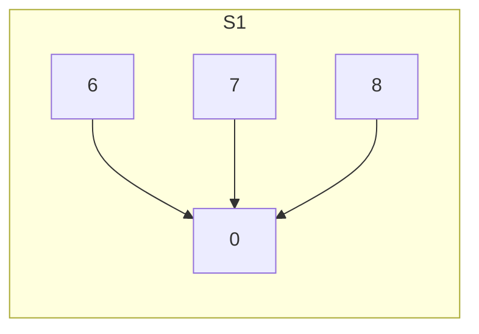
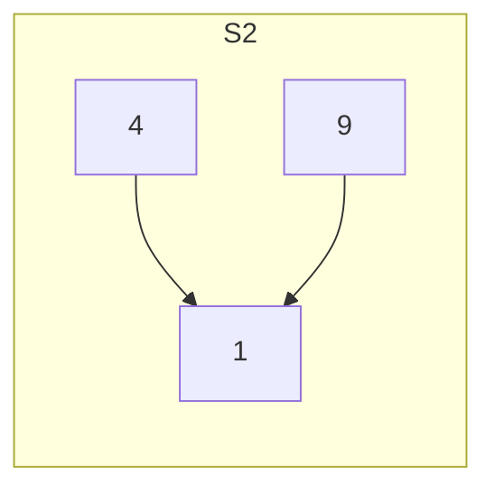
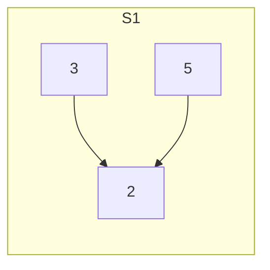
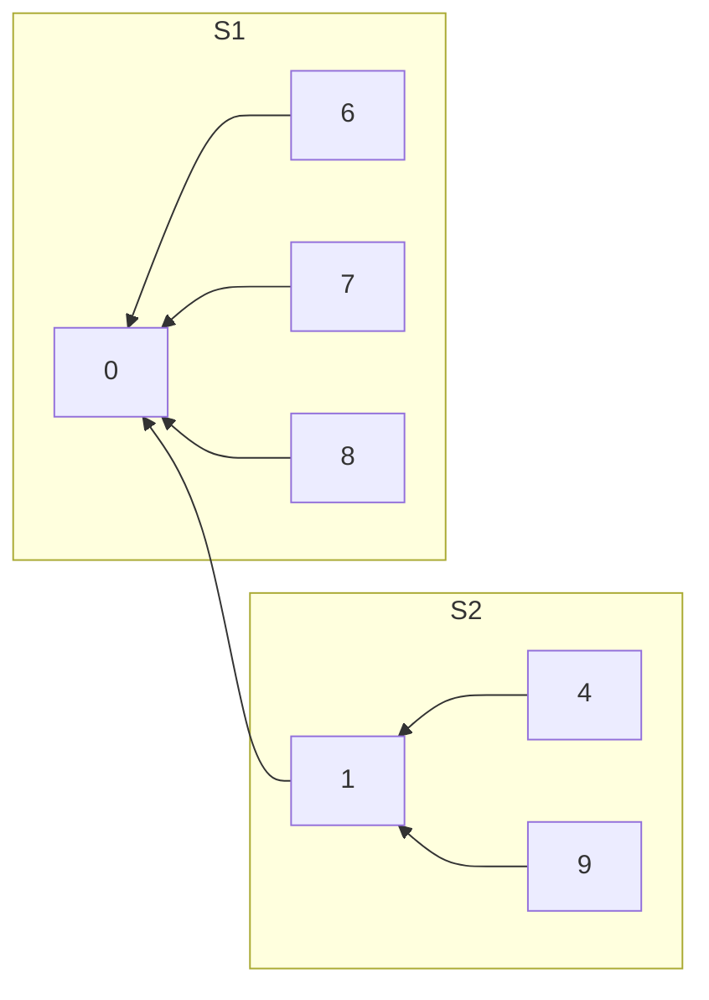

## abstract


并查集（Union-Find Set）是一种数据结构，主要用于处理**动态连通性问题（Dynamic Connectivity Problem）**，例如在图论中判断两点是否属于同一个连通分量，以及动态地合并集合。

它广泛应用于解决**最小生成树**（Minimum Spanning Tree）、网络连接问题等领域。

## 并查集的概念

并查集是一种**简单的集合表示**，它支持以下3种操作：

1. **Initial(S)**：将集合S中的每个元素都初始化为只有一个单元素的**子集合**。
2. **Union(S, Root1, Root2)**：把集合S中的子集合Root2并入子集合Root1。要求Root1和Root2不相交，否则不执行合并。
3. **Find(S, x)**：找到集合S中单元x所在的子集合，并返回该子集合的**根结点**。

### 集合和动态连通性

并查集维护的是一些**不相交的集合**（Disjoint Sets）

例如，有元素集合 `{1, 2, 3, 4, 5}`，可以有如下集合划分：

- 初始状态：`{ {1}, {2}, {3}, {4}, {5} }`
- 合并 `{1}` 和 `{2}`：`{ {1, 2}, {3}, {4}, {5} }`
- 再合并 `{3}` 和 `{4}`：`{ {1, 2}, {3, 4}, {5} }`
- 判断 `1` 和 `2` 是否属于同一集合：否

### 并查集的存储结构

通常用**树的双亲表示法**作为并查集的存储结构，**每个子集合**是一棵树表示。

所有表示子集合的树，构成一个**森林**。存放在**双亲表示数组**内

通常使用**数组元素的下标**代表集合中的元素(名字),用**根节点的下标**代表**子集合**名字

树中每个结点的**双亲指针**指向父节点，根结点的**双亲指针为负数**（可设置为**该集合元素数量的相反数**）。

在采用树的双亲指针数组表示作为并查集的存储表示时，集合元素的编号从0到`SIZE-1`。
其中`SIZE`是最大元素的个数。

------

### **初始化示例**

集合 $S=\set{0,1,2,3,4,5,6,7,8,9}$,初始时每个元素自成一个单元素子集合。

数组表示：

| 下标   | 0    | 1    | 2    | 3    | 4    | 5    | 6    | 7    | 8    | 9    |
| ------ | ---- | ---- | ---- | ---- | ---- | ---- | ---- | ---- | ---- | ---- |
| 父节点 | -1   | -1   | -1   | -1   | -1   | -1   | -1   | -1   | -1   | -1   |

------

### 子集合的合并示例

例如,经过一定计算，子集合并为**3个更大的子集合**：

-  $S_1 = \set{0, 6, 7, 8}$
-  $S_2 = \set{1, 4, 9}$
-  $S_3 = \set{2, 3, 5}$

#### 树状表示：







三个子集的名字分别用根节点$0,1,2$表示

例如,在存储结构(双亲表示)中,元素(结点)$6,7,8$的双亲结点为结点$0$;于是在双亲表示数组中,下标为$6,7,8$的数组分量中的值都指示$0$,表明结点$6,7,8$处在结点$0$所表示的子集中(子集名为0),而结点0本身对应的数组分量存放的是子集0中包含的元素数量的相反数(是个负数)

其余两个子集类似

#### 数组表示：

| 下标   | 0    | 1    | 2    | 3    | 4    | 5    | 6    | 7    | 8    | 9    |
| ------ | ---- | ---- | ---- | ---- | ---- | ---- | ---- | ---- | ---- | ---- |
| 父节点 | -4   | -3   | -3   | 2    | 1    | 2    | 0    | 0    | 0    | 1    |

说明：

- 负数表示根结点，数值是集合中元素的数量（取反）。
- 例如下标 `0` 的值 `-4` 表示集合 $S_1$ 包含4个元素。

------

### **集合的合并操作**

为将**两个子集合合并**，需将其中一个集合的根结点的双亲指针指向另一个集合的根结点。

例如合并 $S_{12}=S_1\cup S_2$ ，结果如下：

#### 树状表示：



| 下标   | 0    | 1    | 2    | 3    | 4    | 5    | 6    | 7    | 8    | 9    |
| ------ | ---- | ---- | ---- | ---- | ---- | ---- | ---- | ---- | ---- | ---- |
| 父节点 | -7   | 0    | -3   | 2    | 1    | 2    | 0    | 0    | 0    | 1    |

说明：

可以看到,在这类合并操作执行后,双亲表示数组中,如果要找到元素4所在集合$S_{12}$的根节点,就不能保证`S[4]`是所需要的答案(本例中`S[4]=1`不是$S_{12}$的根节点;需要继续向上跟踪,再次访问`S[S[4]]=S[1]=0`,0还不是负数,所以要再次跟踪,`S[0]`,发现`S[0]=-7`,由此可知`0`就是最初元素4所在子集合的根节点

这种改变让查询变得不够直接,可以通过路径压缩操作来改进

## 并查集的基本实现

并查集的结构定义如下：

```cpp
#define SIZE 100
int UFSets[SIZE]; //集合元素数组 (双亲指针数组)
```
下面是并查集主要运算的实现。
（1）并查集的初始化操作(双亲表示数组中对应分量设置为-1,表示初始每个子集仅有一个元素)

```cpp
void Initial(int S[]) {
    for(int i=0; i<SIZE; i++)//每个元素自成单元素集合
        S[i] = -1;
}
```
（2）并查集的Find操作
在并查集S中查找并返回包含元素x的树的根。
```cpp
int Find(int S[], int x) {
    while(S[x] >= 0)//循环寻找x,直到S[x]是负数为止(离开循环时,x是非负的,S[x]是负数)
        x = S[x];//更新x(这里保证x是非负的)
    return x;//返回非负的值,表示元素x所在子集的根节点
}
```
判断两个元素是否属于同一集合，只需分别找到它们的根，再比较根是否相同即可。
（3）并查集的Union操作
求两个不相交子集合的并集。

若将两个元素所在的集合合并为一个集合，则需要**先找到两个元素的根**，再**令一棵子集树的根指向另一棵子集树的根**。

```cpp
void Union(int S[], int Root1, int Root2) {
    if(Root1 == Root2) return;//两个根相同不合并
    S[Root2] = Root1;//根不同,将用其中一个根Root2的双亲结点指向另一个根Root1
}
```
### 小结

Find操作和Union操作的时间复杂度分别为O(d)和O(1)，其中d为树的深度。

### 并查集实现的优化

在极端情况下，$n$个元素构成的集合树的深度为n，则`Find`操作的最坏时间复杂度为O(n)。

改进的办法是：在做`Union`操作之前，首先判别**子集中的成员数量**，然后令成员少的根指向成员多的根，即把小树合并到大树，为此可令**根结点的绝对值保存集合树中的成员数量**。
（1）改进的Union操作

```cpp
void Union(int S[], int Root1, int Root2) {
    if(Root1 == Root2) return;
    //(负数的绝对值越小,值越大abs(S[Root2])<abs(S[Root1],则S[Root2] > S[Root1])
    if(S[Root2] > S[Root1]) { // Root2 结点数更少)
        S[Root1] += S[Root2]; // 累加集合树的结点总数
        S[Root2] = Root1;      // 小树合并到大树
    } else {
        S[Root2] += S[Root1]; // 累加结点总数
        S[Root1] = Root2;     // 小树合并到大树
    }
}
```
采用这种方法构造得到的集合树，其深度不超过$\log_2 n + 1$(这里$n$为元素数量)

随着子集逐对合并，集合树的深度越来越大，为了**进一步减少确定元素所在集合的时间**，还可进一步对上述**Find操作进行优化**，当所查元素$x$不在树的第二层时，在算法中增加一个“**压缩路径**”的功能，即将**从根到元素x路径上的所有元素都变成根的孩子**。

例如${root,p_1,p_2,...,p_m,x,...}$,通过压缩操作,比如依次将${x,p_{m},\cdots,p_{2},p_{1}}$挂到$root$结点下;

而挂到root结点下这个操作对于双亲表示法,就是将对应的结点的数组分量(父节点)设置为root;

(2)改进find操作

```c
int Find(int S[], int x) {
    int root=x;//根节点编号初始化为x
    //找到x所在子集根节点
    while(s[root]>=0)
        root=s[root];
    //这时候已经找到root了,但是为了之后的新查找更快,做路径压缩
    while(x!=root){//压缩路径(将树的高于第2层的结点进行压缩)
        int t=S[x];//t指向x的父节点(以便于处理完x沿着路径往祖先结点继续处理)
        S[x]=root;//x直接挂到根节点下面
        x=t;//更新下一个需要处理的目标
    }
    return root;//返回根节点编号
}

```

通过 Find 操作的“压缩路径”优化后，可使集合树的深度不超过 $O(\alpha(n))$，其中 $\alpha(n)$ 是一个增长极其缓慢的函数，对于常见的正整数 $n$，通常 $\alpha(n) \leq 4$。

