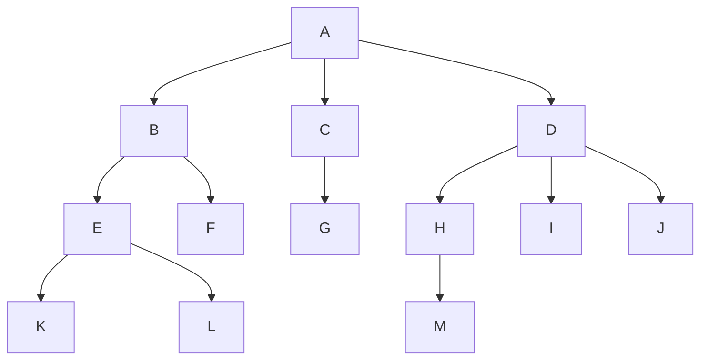

[toc]

## 任意树的通用性质

### 树的定义

- 树的定义是一种递归定义,树适用于表示具有层次结构的数据。

  - 树是n个结点的有限集合(可空)

  - 对于非空树而言,它的定义是:
    - 结点集合中,有且只有一个特定的点被**选做根结点**
    - **其余结点**再次划分为若干个有限集
    - 这些有限集各自被作为一棵树(称为根结点的子树:再次运用树的已有定义继续选定自己集合内的根节点,再划分下去(每一次划分都会产生一批第一级的子树)
    - 直到所有集合为空集为止

### 结点数和边数

- 树中的某个结点（除根结点外）最多只和上一层的一个结点（即其父结点）有**直接关系**，根结点没有直接上层结点，因此在$n$个结点的树中有$n-1$条边。(树的每个非空结点都有一个前驱,链接到前驱贡献一条边,根节点没有前驱,不贡献边)
- 而树中每个结点与其下一层的零个或多个结点（即其孩子结点）都有直接关系。

## 树相关的基本概念和术语👺

1. **祖先、子孙、双亲、孩子、兄弟和堂兄弟**

   考虑结点 $K$，从根 $A$ 到结点 $K$ 的唯一路径上的所有其他结点，称为结点 $K$ 的**祖先**。如结点 $B$ 是结点 $K$ 的祖先，而 $K$ 是 $B$ 的**子孙**，结点 $B$ 的子孙包括 $E, F, K, L$。路径上最接近结点 $K$ 的结点 $E$ 称为 $K$ 的**双亲**，而 $K$ 为 $E$ 的**孩子**。

   根 $A$ 是树中唯一没有双亲的结点。有相同双亲的结点称为兄弟，如结点 $K$ 和结点 $L$ 有相同的双亲 $E$，即 $K$ 和 $L$ 为兄弟。双亲在同一层的结点互为**堂兄弟**，结点 $G$ 与 $E, F, H, I, J$ 互为堂兄弟。

2. **结点的度和树的度**

   树中一个结点的孩子个数称为该结点的度，**树中结点的最大度数称为树的度**。树的度数要和树中所有结点的度数之和做区分.

   然而,度数为$m$的树是不一定是$m$叉树(度为2的树不一定是二叉树),这要考虑有序树和无序树的区别

   总之树的度为$m$不是说树中所有结点度数之和为$m $

   如结点 $B$ 的度为 $2$，结点 $D$ 的度为 $3$，树的度为 $3$。

3. **分支结点和叶结点**

   度大于 $0$ 的结点称为分支结点（又称非终端结点）；度为 $0$ （没有孩子结点）的结点称为叶结点（又称终端结点）。在分支结点中，每个结点的分支数就是该结点的度。

4. **结点的深度、高度和层次**

   结点的层次**从树根开始定义**，根结点为第 $1$ 层，它的孩子为第 $2$ 层，以此类推。

   结点的**深度**就是结点所在的层次。

   树的**高度**（或深度）是树中结点的最大层数。

   结点的高度是以该结点为根的子树的高度。上图中树的高度为4。

5. 有序树和无序树

   树中结点的各子树从左到右是有次序的，不能互换，称该树为有序树，否则称为无序树。

   假设图中为有序树，若将子结点位置互换，则变成一棵不同的树。

6. 路径和路径长度

   树中两个结点之间的路径是由这两个结点之间所经过的结点序列构成的，而路径长度是路径上所经过的边的个数。

   因为树中的分支是有向的，即从双亲指向孩子，所以**树中的路径是从上向下的，同一双亲的两个孩子之间不存在路径**。

   **树的路径长度**是指树根到每个结点的路径长的总和，根到每个结点的路径长度的最大值应是树的高度减1。

7. 森林

   森林是$m(m\geqslant 0)$棵互不相交的树的集合。森林的概念与树的概念十分相近，因为只要把树的根结点删去就成了森林。

   反之，只要给m棵独立的树加上一个结点，并把这m棵树作为该结点的子树，则森林就变成了树。

### 常见等价说法

- 树$T$的"**边数,分支数,所有结点度数之和**"三个概念是等价的,它们都等于树的结点数$n$减1,即$n-1$
- 不妨树$T$的边数(分支数,所有结点度数之和)为$E(T)$

## 树的性质

1. **树的结点数 $n$ 等于所有结点的度数之和加 1。**
   结点的度是指该结点的孩子数量，每个结点与其每个孩子都由唯一的边相连，因此树中所有结点的度数之和等于树中的边数之和。树中的结点（除根外）都有唯一的双亲，因此结点数 $n$ 等于边数之和加 1，即所有结点的度数之和加 1。

2. **度为 $m$ 的树中第 $i$ 层上至多有 $m^{i-1}$ 个结点 ($i \geq 1$)。**
   第 1 层至多有 1 个结点（即根结点），第 2 层至多有 $m$ 个结点，第 3 层至多有 $m^2$ 个结点，以此类推。使用数学归纳法可推出第 $i$ 层至多有 $m^{i-1}$ 个结点。

3. **高度为 $h$ 的 $m$ 叉树至多有 $(m^h - 1)/(m - 1)$ 个结点。**
   当各层结点数达到最大时，树中至多有 $1 + m + m^2 + \cdots + m^{h-1}$ = $(m^h - 1)/(m - 1)$ 个结点。

4. **度为 $m$、具有 $n$ 个结点的树的最小高度 $h$ 为 $\lceil \log_m(n(m-1)+1)\rceil$。**
   为使树的高度最小，在前 $h-1$ 层中，每层的结点数都要达到最大，前 $h-1$ 层最多有 $(m^{h-1} - 1)/(m - 1)$ 个结点，前 $h$ 层最多有 $(m^h - 1)/(m - 1)$ 个结点。

   因此 $(m^{h-1} - 1)/(m - 1) < n \leq (m^h - 1)/(m - 1)$，即 $h-1 < \log_m(n(m-1) + 1) \leq h$，解得 $h_{\min}$ = $\lceil \log_m(n(m-1)+1)\rceil$`(1)`

   另一方面,$(m^{h-1}-1)/(m-1)+1\leqslant{n}<(m^{h}-1)/(m-1)+1$,这个不等式也是可以的,变形可得$h-1\leqslant{\log_{m}((n-1)(m-1)+1)}<h$,所以$h\leqslant{\lfloor\log_{m}((n-1)(m-1)+1)\rfloor+1}$`(2)`,但是这个公式形式上不如前一种简洁,所以不常用

   或者,高度为$h$的$m$叉树的最大结点数为$(m^h - 1)/(m - 1)$,若高为$h$的结点数为$n$的$m$叉树,一定满足$n\leqslant{(m^h - 1)/(m - 1)}$,可解出$\log_m(n(m-1)+1)\leqslant{h}$,而$h$是个整数,所以不等式左边可以适当放大到整数(如果本身不是的话),也就是$h\geqslant{\lceil \log_m(n(m-1)+1)\rceil}$

   特别的,当$m=2$时,$h_{\rm{min}}$=$\lfloor{\log_{2}(n+1)}\rfloor$或$\lfloor{\log_{2}{n}}\rfloor+1$

5. **度为 $m$、具有 $n$ 个结点的树的最大高度 $h$ 为 $n - m + 1$。**
   由于树的度为 $m$，因此至少有一个结点有 $m$ 个孩子，它们处于同一层。

   为使树的高度最大，其他层可仅有一个结点，因此最大高度（层数）为 $n - m + 1$。(单结点层的层数为$n-m$,有$m$个结点的层数为1层,所有共有$n-m+1$层

   由此，也可逆推出高度为 $h$、度为 $m$ 的树至少有 $h + m - 1$ 个结点。

6. 结点数和边数

   - 设度为$m$的树$T$中度为 $i$ ($i=0, 1, 2,\cdots,m$) 的结点数分别为 $n_i$，树中结点总数为 $n$，则 $n = E(T) + 1$，而分支数$E(T)$又等于树中各结点的度之和，即：

   - $$
     n=E(T)+1=(\sum_{i=0}^{m}i\times n_{i})+1=(\sum_{i=1}^{m}in_{i})+1
     $$

   - 显然$n=\sum_{i=0}^{m}n_{i}$

   - 可得等式$n$=$(\sum_{i=1}^{m}in_{i})+1$=$\sum_{i=0}^{m}n_{i}$;如果给出$n_{i},(i=1,2,\cdots,m)$,就可以求出$n_{0}$

     - 先算出$n$,然后利用$n_{0}$=$n-\sum_{i=1}^{m}n_{i}$求得0度结点(叶结点数量)

7. 树的高度问题

   - 度为$m$,具有$n$个结点的树的高度取值范围:$\lceil \log_m(n(m-1)+1)\rceil=\lfloor\log_{m}((n-1)(m-1)+1)\rfloor+1\leqslant{h}\leqslant{n-m+1}$
     - 当$m=2$时,$\lfloor{\log_{2}{n}}\rfloor+1\leqslant{h}\leqslant{n-1}$
     - 注意,度为2的树不一定是二叉树,二叉树可能是度为1的树,此时达到最高$h=n$
   - $m$叉树有$n$个结点时,树的高度取值范围:
     - 最小值:和$m$度树的最小值相同
     - 最大值:$n$

