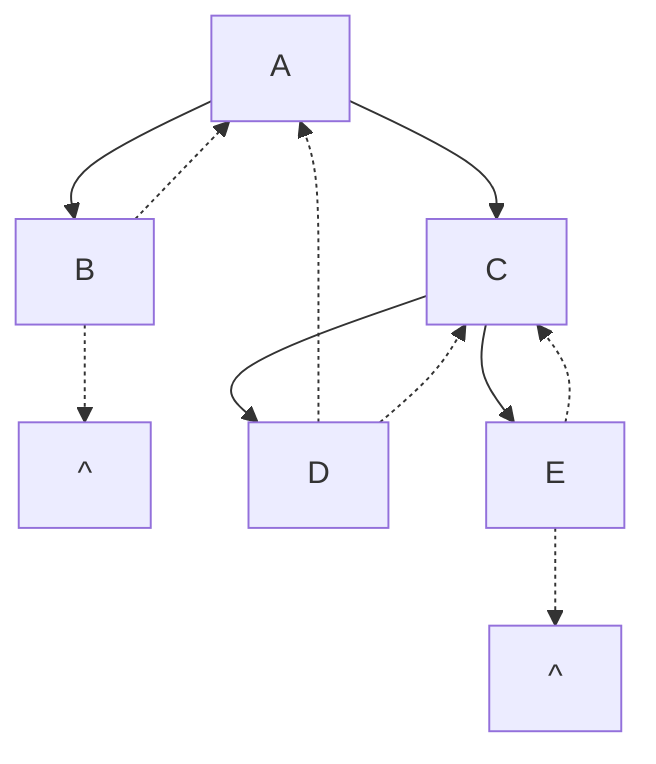

[toc]

## 线索二叉树的基本概念

遍历二叉树是以一定的规则将二叉树中的结点排列成一个线性序列，从而得到几种遍历序列，使得该序列中的每个结点（第一个和最后一个除外）都有一个直接前驱和直接后继。

### 后序线索二叉树的定义

传统的二叉链表存储仅能体现一种父子关系，不能直接得到结点在遍历中的前驱或后继。前面提到，在含 $n$ 个结点的二叉树中，有 $n + 1$ 个空指针。

设想能否利用这些空指针来存放指向其前驱或后继的指针？这样就可以像遍历单链表那样方便地遍历二叉树。引入线索二叉树正是为了加快查找结点前驱和后继的速度。

规定：若无左子树，令 $lchild$ 指向前驱结点；若无右子树，令 $rchild$ 指向其后继结点。

还需增加两个标志域，以标识指针域指向左（右）孩子或前驱（后继）。

#### 线索二叉树的结点结构

| $lchild$ | $ltag$ | data | $rtag$ | $rchild$ |
| -------- | ------ | ---- | ------ | -------- |

其中，标志域的含义如下：

- $ltag = \begin{cases} 
0, & lchild \text{域指示结点的左孩子} \\
1, & lchild \text{域指示结点的前驱} 
\end{cases}$
- $rtag = \begin{cases} 
0, & rchild \text{域指示结点的右孩子} \\
1, & rchild \text{域指示结点的后继} 
\end{cases}$

### 线索二叉树的存储结构

线索二叉树的存储结构描述如下：

```cpp
typedef struct ThreadNode {
    ElemType data; // 数据元素
    struct ThreadNode *lchild, *rchild; // 左、右孩子指针
    int ltag, rtag; // 左、右线索标志
} ThreadNode, *ThreadTree;
```

### 二叉树线索化相关概念

以这种结点结构构成的二叉链表作为二叉树的存储结构，称为**线索链表**，其中指向结点前驱和后继的指针称为**线索**。加上线索的二叉树称为**线索二叉树**(TreadTree)。

**二叉树的线索化**是将二叉链表中的**空指针改为指向前驱或后继的线索**。

而前驱或后继的信息只有在遍历时才能得到，因此**线索化的实质就是遍历一次二叉树**。

### 线索二叉树示例图


## 线索二叉树的构造👺

### 程序算法

以**中序线索二叉树**的建立为例。

附设指针 `pre` 指向刚刚访问过的结点，指针 `p` 指向正在访问的结点，即 `pre` 指向 `p` 的前驱。

在中序遍历的过程中

- 检查 `p` 的左指针是否为空，若为空就将它指向 `pre`；

- 检查 `pre` 的右指针是否为空，若为空就将它指向 `p`

这就是说,遍历过程中,当前结点的指针至多修改左指针,而右指针修改的是前驱结点

例如上图中,**中序**遍历序列为:BDAEC;

当`p`指向结点A时,`pre`指向其前驱结点D

先检查结点A的左指针(`p->lchild`)是否为空,发现其非空,不修改,

再检查其前驱D的右指针是否为空,发现为空,那么令D(`pre->rchild`)指向A(`p`),即`pre->rchild=p`

#### 算法代码描述

通过中序遍历对二叉树**线索化**的递归算法如下：

```cpp
void InThread(ThreadTree &p, ThreadTree &pre) {//参数是指向当前结点的指针和前驱结点的指针
    if (p != NULL) {//检查p是否为空,非空则p->lchild,p->rchild的访问才是合法的;   但是pre是否为空需要额外判断
        //第一部分
        InThread(p->lchild, pre); // 递归，线索化左子树
        //第二部分(线索化当前结点)
        if (p->lchild == NULL) { // 当前结点的左子树为空
            p->lchild = pre; // 建立当前结点的前驱线索
            p->ltag = 1;//左孩子指针线索化标记置为1
        }
        if (pre != NULL && pre->rchild == NULL) { // 前驱结点非空且其右子树为空
            pre->rchild = p; // 建立前驱结点的后继线索
            pre->rtag = 1;//右孩子指针线索化标记置为1
        }
        pre = p; // 标记当前结点成为刚刚访问过的结点
        //第三部分
        InThread(p->rchild, pre); // 递归，线索化右子树
    }
}
```

通过中序遍历建立中序线索二叉树的主过程算法`CreateInThread`如下:

- 初始化`pre`指针
- 调用上述`InThread`操作做线索化

```cpp
void CreateInThread(ThreadTree T) {
    ThreadTree pre = NULL;//初始pre指针为NULL;
    if (T != NULL) {
        InThread(T, pre); // 非空二叉树，线索化
        pre->rchild = NULL; // 处理遍历的最后一个结点
        pre->rtag = 1;
    }
}
```

### 优化说明

为了方便，可以在二叉树的线索链表上也添加一个头结点，令其 `lchild` 域的指针指向二叉树的根结点，其 `rchild` 域的指针指向中序遍历时访问的最后一个结点；

令二叉树中序序列中的第一个结点的 `lchild` 域指针和最后一个结点的 `rchild` 域指针均指向头结点。这好比为二叉树建立了一个双向线索链表，方便从前往后或从后往前对线索二叉树进行遍历 

### 手动线索化

- 手动线索化的流程可以更灵活一些
- 例如要进行中序线索化,先将给定的二叉树的所有结点的遍历顺序编号,然后依次检查有空指针域的结点,对于左孩子为空的结点,画出前驱线索,对于右孩子为空的,画出后继线索,直到所有结点空指针处理完毕
- 对于先序线索化和中序线索化也是类似的

## 线索二叉树的遍历👺

以最常用的中序线索二叉树为例

### 中序线索二叉树的遍历

中序线索二叉树的结点中隐含了线索二叉树的前驱和后继信息。

在对其进行遍历时，只要先**找到序列中的第一个结点**，然后依次找结点的后继，直至其后继为空。

在中序线索二叉树中找结点**后继**的规律是：

- 若其右标志为“1”，则右链为线索，指示其后继，
- 否则遍历**右子树**中第一个访问的结点（右子树中最左下的结点）为其后继。

不含头结点的线索二叉树的遍历算法如下。

1. 求中序线索二叉树的中序序列下的第一个结点:

   跟踪所有有左孩子的结点,直到出现没有左孩子的结点,就是最左节点,它就是中序序列的第一个结点;在线索二叉树中,判断结点是否有左孩子是通过检查其前驱线索是否为0,如果是0则表明该结点有左孩子,否则没有左孩子,对应的左孩子指针被用来指向前驱

```cpp
ThreadNode *Firstnode(ThreadNode *p) {
    while (p->ltag == 0) p = p->lchild; // 最左下结点（不一定是叶结点）
    return p;
}
```

2. 求中序线索二叉树中结点 $p$ 在中序序列下的后继:

   本函数利用了第一个函数`Firstnode`
   
   由于是线索化的二叉树,检查后继是通过判断后继线索标记`p->rtag`的取值来决定后继的:如果后继标记为0,表明该结点没有后继线索,通过访问**右子树**的第一个中序结点`Firstnode(p->rchild)`作为后继;否则该结点有后继线索,直接访问右孩子指针即可;

```cpp
ThreadNode *Nextnode(ThreadNode *p) {
    if (p->rtag == 0) return Firstnode(p->rchild); // 右子树中最左下结点(比如p为2度结点)
    else return p->rchild; // 若 rtag == 1 则直接返回后继线索(比如p为叶子结点或只有左孩子)
}
```

3) 利用上面两个算法，不含头结点的中序线索二叉树的中序遍历的算法:

```cpp
void Inorder(ThreadNode *T) {
    for (ThreadNode *p = Firstnode(T); p != NULL; p = Nextnode(p))
        visit(p);
}
```


关于中序线索二叉树后继计算举例



中序遍历序列`BADCE`;

对于中序遍历,遇到A,其后继A的右子树的最左结点D

#### 求最后一个结点和前驱结点

- 将函数1中的 `ltag` 和`child` 换成`rtag` 和`rchild`， 即为求中序线索二叉树的**最后一个结点**。
- 将函数2中的`rtag` 和`rchild` 换成`ltag` 和 `child`，此外调用函数改为求左子树的中序线索二叉树的最后一个结点，即为求中序线索二叉树中结点p的**前驱**。 

###  先序线索二叉树和后序线索二叉树

了解了建立中序线索二叉树的代码，建立先序线索二叉树和建立后序线索二叉树的代码类似，只需变动线索化改造的代码段与调用线索化左右子树递归函数的位置。

| 类型     | 先序线索二叉树                                               | 中序遍历                                                     | 后序线索二叉树                                               |
| -------- | ------------------------------------------------------------ | ------------------------------------------------------------ | ------------------------------------------------------------ |
| 示意图   |  |  |  |
| 遍历序列 | ABCDF                                                        | CBDAF                                                        | CDBFA                                                        |
| 特点     | 找后继简单,找前驱可能会遇到难                                | 找前驱和后继都简单                                           | 找前驱容易,找后继可能会遇到困难                              |
| 遍历要点 | 可以从第一个结点开始访问后继结点完成树的遍历                 | 可以从第一个结点开始访问后继结点完成树的遍历                 | 有些情况需要栈的支持才能完成遍历,2度结点的后继线索不可用     |

叶子结点由于有两个线索(前驱线索和后继线索,无论是哪种顺序线索二叉树都可以方便的找到前驱和后继)

通常考察一个线索二叉树在找前驱和后继的时候选择没有线索的2度结点来考察,只有中序遍历2度结点在找前驱和后继时比较容易(分别找左孩子和右孩子)

但是其他情况,

- 先序线索二叉树,比如2度结点,找后继简单(访问左孩子),找前驱就难了

- 后序线索二叉树,2度结点找前驱简单(找右孩子),找后继就难了

对于中序二叉树找前驱后继都简单,因此是线索二叉树中应用较为广泛的一种

- 以前驱为例,2度结点(比如上述例图中的A)的前驱在左子树最右的结点(而不能简单说是左孩子)

### 举例说明

上例的表格中,每个图的结点分布一样,分被考察2度结点B的前驱和后继

### 前驱或后继查找说明

- 线索化二叉树找后继比普通二叉树要容易,但是不同序遍历序列中
- 线索化二叉树可以看做是三叉链表存储的二叉树的一个弱化版本
  - 不是每个结点通过线索都可以直接找到它的前驱和后继。
  - 在**先序线索二叉树**中查找一个结点的先序**后继**很简单，而查找先序**前驱**必须知道该结点的双亲结点。
  - 同样，在**后序线索二叉树**中查找一个结点的后序**前驱**也很简单，而查找后序**后继**也必须知道该结点的双亲结点，二叉链表中没有存放双亲的指针。
- 后续遍历线索二叉树的后继查找相对复杂,需要考虑3种情况
  - 树的根节点后继为空
  - 作为双亲结点唯一孩子而且是左孩子的结点,或者作为双亲结点的右孩子,其后继都是双亲结点
  - 作为有两个孩子的双亲结点(2度结点)的左孩子,其后继为双亲的右子树的第一个后序遍历结点
  - 当后续遍历序列中,遇到一个度为2的结点N,要找到其后继结点,需要先找到其双亲结点P,然后才能找到P的右孩子中的第一个后序遍历序列的第一个结点Q,作为N的后继;总之这种情况下需要采用带标志域的三叉链表作为存储结构

## 线索二叉树常见问题

- 线索二叉树将普通二叉链表二叉树的空指针都利用起来,判断结点是否有孩子的条件发生了变化
  - 原来二叉树中的判断结点有孩子通过检查指针域是否为NULL来判断的;
  - 但是线索化后,这些原本为NULL的指针都指向了前驱或者后继,这就导致原来的判断条件需要变更
  - 例如判断左孩子是否存在从`p->lchild!=NULL`变成了`p->ltag==0`;对于右孩子也类似

- 线索二叉树成为线索的指针域数量和原二叉树的空指针数量$n+1$相同,即$n$个结点的线索二叉树的**线索**数量是$n+1$,这相当于统计所有线索二叉树结点的`ltag+rtag`
- 线索化后二叉树空指针被尽可能利用了起来,但是不表示他们都指向非空结点,当没有设立头指针时
  - 例如只有右子树的先序线索二叉树具有的2个空指针,序列的头结点和尾结点各有一个空指针

