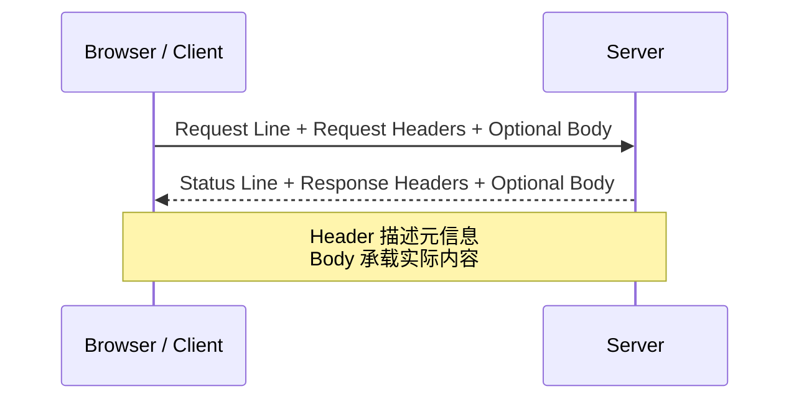
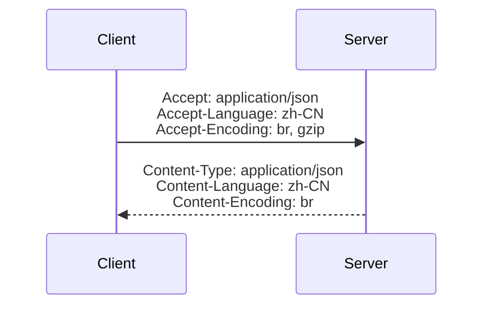
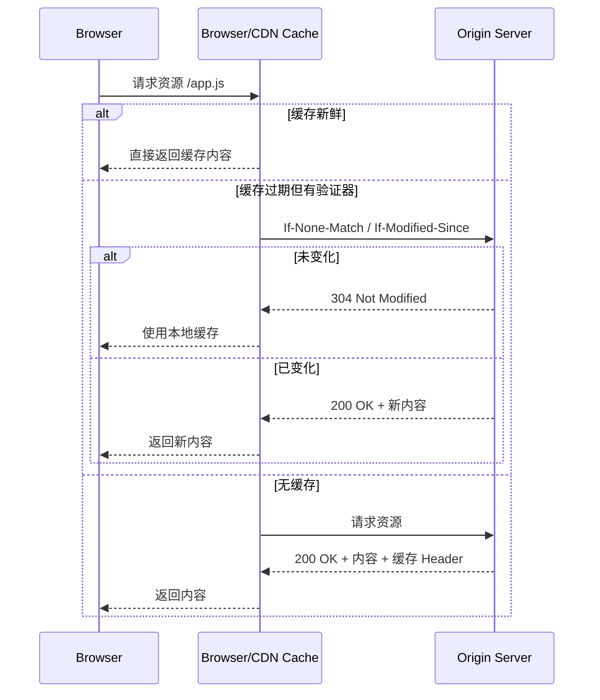
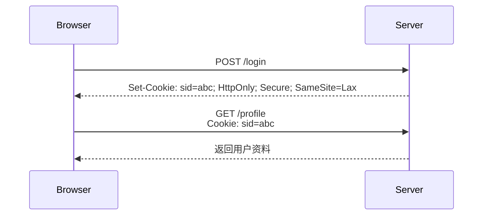
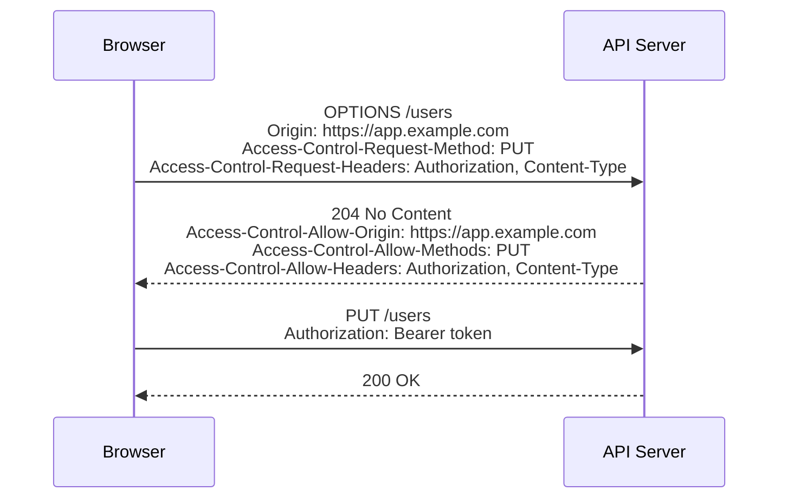
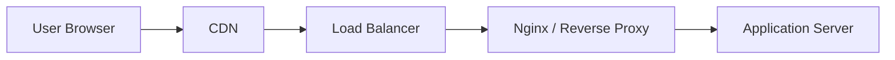

[toc]


## HTTP Header 是什么

HTTP Header，也叫 HTTP 首部字段，是 HTTP **请求和响应**中的“元信息”。

它不直接代表页面正文、JSON 数据或图片内容，而是**描述这次通信该如何理解、处理、缓存、认证、压缩、跨域或保护**。

HTTP 本身是**无状态的应用层协议**；现代 HTTP 语义由 RFC 9110 统一定义，缓存语义由 RFC 9111 定义。

也就是说，不管底层是 HTTP/1.1、HTTP/2 还是 HTTP/3，很多 Header 的语义是共享的。([rfc-editor.org](https://www.rfc-editor.org/rfc/rfc9110.html?utm_source=chatgpt.com))

一个典型 HTTP 交换可以这样理解：



例如一次请求：

```http
GET /api/users HTTP/1.1
Host: example.com
Accept: application/json
Authorization: Bearer eyJ...
User-Agent: curl/8.5.0
```

一次响应：

```http
HTTP/1.1 200 OK
Content-Type: application/json; charset=utf-8
Cache-Control: private, max-age=60
ETag: "user-list-v3"
Content-Encoding: br

{"users":[]}
```

这里 `Content-Type` 告诉客户端正文是 JSON，`Cache-Control` 说明缓存策略，`ETag` 用于缓存校验，`Content-Encoding` 表示正文经过 Brotli 压缩。

------

## Header 在 HTTP 报文中的位置

HTTP 报文通常由三部分组成：

| 部分   | 请求中示例                 | 响应中示例                       | 作用                             |
| ------ | -------------------------- | -------------------------------- | -------------------------------- |
| 起始行 | `GET / HTTP/1.1`           | `HTTP/1.1 200 OK`                | 表示方法、路径、协议版本或状态码 |
| Header | `Accept: application/json` | `Content-Type: application/json` | 描述请求或响应的元信息           |
| Body   | JSON、表单、文件           | HTML、JSON、图片、文件           | 实际传输的数据                   |

Header 与 Body 之间用一个空行分隔：

```http
POST /login HTTP/1.1
Host: example.com
Content-Type: application/json
Content-Length: 39

{"username":"alice","password":"xxx"}
```

注意：Header 名大小写不敏感，`Content-Type`、`content-type`、`CONTENT-TYPE` 在语义上等价。但实践中建议使用常见写法，便于阅读和排查。

------

## Header 的分类

HTTP Header 可以按用途粗略分为几类：

| 类型       | 常见 Header                                                  | 说明                                |
| ---------- | ------------------------------------------------------------ | ----------------------------------- |
| 请求协商   | `Accept`、`Accept-Language`、`Accept-Encoding`               | 客户端告诉服务端自己能接受什么      |
| 响应描述   | `Content-Type`、`Content-Length`、`Content-Encoding`         | 服务端描述响应正文                  |
| 缓存控制   | `Cache-Control`、`ETag`、`Last-Modified`、`Expires`          | 控制浏览器、代理、CDN 缓存          |
| 认证授权   | `Authorization`、`WWW-Authenticate`、`Cookie`                | 登录、身份验证、会话维持            |
| 跨域       | `Origin`、`Access-Control-Allow-Origin`、`Access-Control-Allow-Headers` | 浏览器 CORS 机制                    |
| 安全       | `Content-Security-Policy`、`Strict-Transport-Security`、`X-Content-Type-Options` | 降低 XSS、点击劫持、MIME 嗅探等风险 |
| 代理/CDN   | `Forwarded`、`X-Forwarded-For`、`Via`、`CF-Connecting-IP`    | 记录转发链路和真实客户端信息        |
| 连接与传输 | `Connection`、`Transfer-Encoding`、`Upgrade`                 | 连接管理，主要与 HTTP/1.1 相关      |

------

## 请求 Header 与响应 Header

### 请求 Header

请求 Header 由客户端发送给服务端，用来表达“我是谁、我想要什么、我能接受什么、我带了哪些凭证”。

| Header            | 示例                                       | 作用                                       |
| ----------------- | ------------------------------------------ | ------------------------------------------ |
| `Host`            | `Host: example.com`                        | 指定目标主机；HTTP/1.1 请求中非常关键      |
| `User-Agent`      | `User-Agent: curl/8.5.0`                   | 标识客户端软件                             |
| `Accept`          | `Accept: application/json`                 | 告诉服务端希望获得的媒体类型               |
| `Accept-Language` | `Accept-Language: zh-CN,zh;q=0.9,en;q=0.8` | 语言偏好                                   |
| `Accept-Encoding` | `Accept-Encoding: gzip, br, zstd`          | 可接受的压缩编码                           |
| `Authorization`   | `Authorization: Bearer <token>`            | 身份认证信息                               |
| `Cookie`          | `Cookie: sessionid=abc`                    | 浏览器携带 Cookie                          |
| `Origin`          | `Origin: https://app.example.com`          | 跨域请求来源                               |
| `Referer`         | `Referer: https://example.com/page`        | 当前请求来源页面，拼写历史原因是 `Referer` |
| `Content-Type`    | `Content-Type: application/json`           | 请求体格式                                 |
| `Content-Length`  | `Content-Length: 39`                       | 请求体字节长度                             |

### 响应 Header

响应 Header 由服务端返回给客户端，用来表达“我返回了什么、怎么缓存、是否安全、是否允许跨域、是否设置 Cookie”。

| Header                        | 示例                                                         | 作用                                                         |
| ----------------------------- | ------------------------------------------------------------ | ------------------------------------------------------------ |
| `Content-Type`                | `Content-Type: text/html; charset=utf-8`                     | 响应体类型和字符集                                           |
| `Content-Length`              | `Content-Length: 1024`                                       | 响应体长度                                                   |
| `Content-Encoding`            | `Content-Encoding: br`                                       | 响应体压缩方式                                               |
| `Cache-Control`               | `Cache-Control: public, max-age=31536000, immutable`         | 缓存策略                                                     |
| `ETag`                        | `ETag: "abc123"`                                             | 资源版本标识                                                 |
| `Last-Modified`               | `Last-Modified: Wed, 21 Oct 2015 07:28:00 GMT`               | 资源最后修改时间                                             |
| `Set-Cookie`                  | `Set-Cookie: sid=abc; HttpOnly; Secure; SameSite=Lax`        | 设置 Cookie                                                  |
| `Location`                    | `Location: /login`                                           | 重定向目标                                                   |
| `WWW-Authenticate`            | `WWW-Authenticate: Basic realm="admin"`                      | 告诉客户端如何认证                                           |
| `Access-Control-Allow-Origin` | `Access-Control-Allow-Origin: https://app.example.com`       | CORS 允许的来源                                              |
| `Content-Security-Policy`     | `Content-Security-Policy: default-src 'self'`                | 内容安全策略                                                 |
| `Strict-Transport-Security`   | `Strict-Transport-Security: max-age=31536000; includeSubDomains` | 强制 HTTPS，浏览器后续访问会自动使用 HTTPS。([developer.mozilla.org](https://developer.mozilla.org/en-US/docs/Web/HTTP/Reference/Headers/Strict-Transport-Security?utm_source=chatgpt.com)) |

------

## 用 curl 查看和调试 Header

`curl` 是学习 HTTP Header 最实用的工具之一。

### 只看响应 Header

```bash
curl -I https://example.com
```

`-I` 会发起 `HEAD` 请求，只获取响应头，不下载响应体。

### 看完整请求与响应过程

```bash
curl -v https://example.com
```

`-v` 会显示 TLS、请求 Header、响应 Header 等调试信息。输出中：

```text
> GET / HTTP/2
> Host: example.com
> User-Agent: curl/8.5.0
> Accept: */*

< HTTP/2 200
< content-type: text/html
< cache-control: max-age=604800
```

`>` 表示客户端发出的请求，`<` 表示服务端返回的响应。

### 自定义请求 Header

```bash
curl https://api.example.com/users \
  -H "Accept: application/json" \
  -H "Authorization: Bearer <token>"
```

### 发送 JSON 请求体

```bash
curl https://api.example.com/login \
  -X POST \
  -H "Content-Type: application/json" \
  -d '{"username":"alice","password":"secret"}'
```

`-d` 会自动使用 `POST`，所以很多时候 `-X POST` 可以省略：

```bash
curl https://api.example.com/login \
  -H "Content-Type: application/json" \
  -d '{"username":"alice","password":"secret"}'
```

### 保存响应 Header 和 Body

```bash
curl https://example.com \
  -D headers.txt \
  -o body.html
```

| 参数             | 作用                     |
| ---------------- | ------------------------ |
| `-D headers.txt` | 把响应 Header 保存到文件 |
| `-o body.html`   | 把响应 Body 保存到文件   |

### 查看重定向链路

```bash
curl -IL https://example.com
```

| 参数 | 作用        |
| ---- | ----------- |
| `-I` | 只看 Header |
| `-L` | 跟随重定向  |

### 模拟浏览器 User-Agent

```bash
curl https://example.com \
  -H "User-Agent: Mozilla/5.0"
```

### 带 Cookie 请求

```bash
curl https://example.com/profile \
  -H "Cookie: sessionid=abc123"
```

或者让 curl 自动保存和携带 Cookie：

```bash
curl -c cookies.txt https://example.com/login
curl -b cookies.txt https://example.com/profile
```

| 参数             | 作用                     |
| ---------------- | ------------------------ |
| `-c cookies.txt` | 保存服务端设置的 Cookie  |
| `-b cookies.txt` | 从文件读取 Cookie 并发送 |

------

## 内容协商 Header

内容协商就是客户端和服务端协商“返回什么格式、什么语言、什么压缩方式”。



### Accept

`Accept` 表示客户端希望接收的媒体类型。

```http
Accept: application/json
```

常见写法：

| Header 值                                 | 含义                 |
| ----------------------------------------- | -------------------- |
| `application/json`                        | 希望返回 JSON        |
| `text/html`                               | 希望返回 HTML        |
| `image/avif,image/webp,image/*,*/*;q=0.8` | 浏览器请求图片时常见 |
| `*/*`                                     | 什么都可以接受       |

`q` 表示优先级，范围通常是 `0` 到 `1`：

```http
Accept: application/json;q=1.0, text/html;q=0.8, */*;q=0.1
```

### Content-Type

`Content-Type` 描述请求体或响应体的格式。

| 场景       | 推荐值                              |
| ---------- | ----------------------------------- |
| JSON API   | `application/json; charset=utf-8`   |
| HTML 页面  | `text/html; charset=utf-8`          |
| 普通文本   | `text/plain; charset=utf-8`         |
| 表单提交   | `application/x-www-form-urlencoded` |
| 文件上传   | `multipart/form-data; boundary=...` |
| JavaScript | `text/javascript`                   |
| CSS        | `text/css`                          |
| SVG        | `image/svg+xml`                     |

请求中：

```http
Content-Type: application/json
```

响应中：

```http
Content-Type: application/json; charset=utf-8
```

常见错误是：发送 JSON 数据却忘了设置 `Content-Type: application/json`，导致服务端无法正确解析请求体。

### Accept-Encoding 与 Content-Encoding

客户端通过 `Accept-Encoding` 告诉服务端支持哪些压缩方式：

```http
Accept-Encoding: gzip, deflate, br, zstd
```

服务端返回：

```http
Content-Encoding: br
```

| 编码       | 说明                                      |
| ---------- | ----------------------------------------- |
| `gzip`     | 兼容性好，广泛使用                        |
| `br`       | Brotli，常用于 HTTPS 下的静态资源压缩     |
| `zstd`     | Zstandard，现代压缩算法，支持情况逐步扩大 |
| `identity` | 不压缩                                    |

注意：`Content-Encoding` 是对响应体进行了编码，客户端需要解码后才能得到原始内容。

### Accept-Language 与 Content-Language

```http
Accept-Language: zh-CN,zh;q=0.9,en;q=0.8
```

服务端可以返回：

```http
Content-Language: zh-CN
```

多语言站点、文档站、国际化 API 常用它。

------

## 缓存 Header

HTTP 缓存是 Header 中最重要、也最容易误解的部分之一。RFC 9111 定义了 HTTP 缓存及相关字段的行为，`Cache-Control` 是现代缓存控制的核心 Header。([rfc-editor.org](https://www.rfc-editor.org/rfc/rfc9111.html?utm_source=chatgpt.com))

### 缓存的基本流程



### Cache-Control 常见指令

| 指令                     | 示例                          | 含义                                           |
| ------------------------ | ----------------------------- | ---------------------------------------------- |
| `max-age`                | `max-age=3600`                | 响应在 3600 秒内新鲜                           |
| `s-maxage`               | `s-maxage=86400`              | 共享缓存使用，如 CDN，优先于 `max-age`         |
| `public`                 | `public, max-age=3600`        | 浏览器和共享缓存都可以存                       |
| `private`                | `private, max-age=60`         | 只能被浏览器私有缓存存储                       |
| `no-cache`               | `no-cache`                    | 可以存，但每次使用前必须向服务端重新验证       |
| `no-store`               | `no-store`                    | 不允许存储，适合高度敏感内容                   |
| `must-revalidate`        | `must-revalidate`             | 过期后必须重新验证                             |
| `immutable`              | `max-age=31536000, immutable` | 有效期内认为资源不会变，适合带 hash 的静态资源 |
| `stale-while-revalidate` | `stale-while-revalidate=60`   | 允许先用短暂过期缓存，同时后台更新             |
| `stale-if-error`         | `stale-if-error=86400`        | 源站错误时可使用过期缓存                       |

`no-cache` 不是“不缓存”，而是“缓存前必须重新验证”。真正不存储是 `no-store`。这是新手最常见的误解之一。

### ETag 与 If-None-Match

`ETag` 是资源版本标识。MDN 也强调它可以让缓存更高效：资源未变化时无需重新下载完整内容。([developer.mozilla.org](https://developer.mozilla.org/de/docs/Web/HTTP/Reference/Headers/ETag?utm_source=chatgpt.com))

响应：

```http
ETag: "abc123"
Cache-Control: no-cache
```

下次请求：

```http
If-None-Match: "abc123"
```

如果资源未变化，服务端返回：

```http
HTTP/1.1 304 Not Modified
```

`304` 没有新的响应体，客户端继续使用本地缓存。

### Last-Modified 与 If-Modified-Since

响应：

```http
Last-Modified: Wed, 21 Oct 2015 07:28:00 GMT
```

下次请求：

```http
If-Modified-Since: Wed, 21 Oct 2015 07:28:00 GMT
```

如果未修改，返回 `304 Not Modified`。

### ETag 与 Last-Modified 对比

| 对比项      | ETag                         | Last-Modified              |
| ----------- | ---------------------------- | -------------------------- |
| 精度        | 可精确到内容版本             | 通常精确到秒               |
| 适合        | 动态内容、构建产物、API 响应 | 文件修改时间稳定的静态资源 |
| 弱点        | 集群环境需保证生成一致       | 秒级精度可能不够           |
| 请求 Header | `If-None-Match`              | `If-Modified-Since`        |
| 响应未变    | `304 Not Modified`           | `304 Not Modified`         |

实践建议：可以同时返回 `ETag` 和 `Last-Modified`，但要确保 `ETag` 在多实例、多 CDN、多压缩版本下不会混乱。

### 典型缓存策略

| 资源类型                               | 推荐 Header                                          | 说明                                         |
| -------------------------------------- | ---------------------------------------------------- | -------------------------------------------- |
| 带 hash 的静态资源，如 `app.a1b2c3.js` | `Cache-Control: public, max-age=31536000, immutable` | 文件名变即内容变，可长期缓存                 |
| HTML 首页                              | `Cache-Control: no-cache`                            | 可缓存，但每次使用前验证，避免入口 HTML 过旧 |
| 用户私有 API                           | `Cache-Control: private, no-cache`                   | 浏览器可存，但需验证；避免 CDN 存用户数据    |
| 敏感页面，如账单、后台、隐私数据       | `Cache-Control: no-store`                            | 不应存储                                     |
| CDN API 公共数据                       | `Cache-Control: public, max-age=60, s-maxage=300`    | 浏览器短缓存，CDN 稍长缓存                   |

------

## Cookie 与 Set-Cookie

Cookie 是 HTTP 在无状态协议上维持状态的一种机制。服务端通过 `Set-Cookie` 设置 Cookie，浏览器后续请求通过 `Cookie` 自动携带。当前 Cookie 规范演进集中在 RFC6265bis；该草案定义 `Cookie` 和 `Set-Cookie` 字段，并计划取代旧的 RFC 6265。([IETF HTTP Working Group](https://httpwg.org/http-extensions/draft-ietf-httpbis-rfc6265bis.html?utm_source=chatgpt.com))

### 基本流程



注意 mermaid 中 `;` 需要写成 `#59;`，上面的图中已经处理。

### Set-Cookie 常见属性

| 属性          | 示例                                    | 作用                                                         |
| ------------- | --------------------------------------- | ------------------------------------------------------------ |
| `HttpOnly`    | `HttpOnly`                              | 禁止 JavaScript 通过 `document.cookie` 读取，降低 XSS 后的 Cookie 窃取风险 |
| `Secure`      | `Secure`                                | 仅通过 HTTPS 发送                                            |
| `SameSite`    | `SameSite=Lax`                          | 限制跨站请求携带 Cookie，缓解 CSRF                           |
| `Domain`      | `Domain=example.com`                    | 指定 Cookie 作用域                                           |
| `Path`        | `Path=/admin`                           | 指定路径作用域                                               |
| `Max-Age`     | `Max-Age=3600`                          | Cookie 有效秒数                                              |
| `Expires`     | `Expires=Wed, 21 Oct 2026 07:28:00 GMT` | 过期时间                                                     |
| `Partitioned` | `Partitioned`                           | 分区 Cookie，用于第三方上下文隔离，现代浏览器隐私模型相关    |

### SameSite 的常用选择

| 值       | 行为                                            | 适用场景                                    |
| -------- | ----------------------------------------------- | ------------------------------------------- |
| `Strict` | 跨站导航也不发送                                | 高安全性后台、敏感操作                      |
| `Lax`    | 大多数跨站子请求不发送，顶级导航 GET 通常可发送 | 普通登录会话的常见选择                      |
| `None`   | 允许跨站发送                                    | 第三方嵌入、跨站 SSO；通常必须配合 `Secure` |

实践中，现代浏览器普遍要求 `SameSite=None` 搭配 `Secure`，否则跨站 Cookie 可能被拒绝；RFC6265bis 也在强化这些现代 Cookie 行为。([datatracker.ietf.org](https://datatracker.ietf.org/doc/html/draft-ietf-httpbis-rfc6265bis-22?utm_source=chatgpt.com))

### Cookie 最佳实践

| 场景            | 推荐做法                                       |
| --------------- | ---------------------------------------------- |
| 登录会话 Cookie | `HttpOnly; Secure; SameSite=Lax`               |
| 高敏感系统      | 考虑 `SameSite=Strict`                         |
| HTTPS 站点      | 总是加 `Secure`                                |
| 不希望 JS 读取  | 总是加 `HttpOnly`                              |
| 不要长期有效    | 设置合理 `Max-Age`                             |
| 删除 Cookie     | 返回同名 Cookie，设置 `Max-Age=0`              |
| 多子域共享      | 谨慎设置 `Domain=.example.com`，避免扩大攻击面 |

示例：

```http
Set-Cookie: sid=abc123; Path=/; Max-Age=3600; HttpOnly; Secure; SameSite=Lax
```

删除：

```http
Set-Cookie: sid=; Path=/; Max-Age=0; HttpOnly; Secure; SameSite=Lax
```

------

## 认证与授权 Header

### Authorization

`Authorization` 用于客户端向服务端提交认证凭证。

| 类型           | 示例                                             | 说明                       |
| -------------- | ------------------------------------------------ | -------------------------- |
| Basic          | `Authorization: Basic base64(username:password)` | 简单但敏感，必须配合 HTTPS |
| Bearer         | `Authorization: Bearer <access_token>`           | OAuth2、JWT 常见           |
| Digest         | `Authorization: Digest ...`                      | 较少见                     |
| API Key 自定义 | `Authorization: ApiKey xxx`                      | 非标准风格，需看服务端约定 |

Bearer Token 示例：

```bash
curl https://api.example.com/me \
  -H "Authorization: Bearer <access_token>" \
  -H "Accept: application/json"
```

### WWW-Authenticate

当服务端返回 `401 Unauthorized`，通常会带上 `WWW-Authenticate`，告诉客户端需要哪种认证方式：

```http
HTTP/1.1 401 Unauthorized
WWW-Authenticate: Bearer realm="api"
```

### Cookie Session 与 Bearer Token 对比

| 方案           | 优点                                  | 风险                         | 典型场景                |
| -------------- | ------------------------------------- | ---------------------------- | ----------------------- |
| Cookie Session | 浏览器自动携带，服务端易控制会话      | 需防 CSRF，Cookie 配置要正确 | 传统 Web 登录           |
| Bearer Token   | 适合 API、移动端、跨服务调用          | Token 泄露后可被直接使用     | SPA、移动 App、开放 API |
| 双 Token       | Access Token 短期，Refresh Token 长期 | 实现复杂                     | OAuth2、现代认证系统    |

------

## CORS 跨域 Header

CORS 是浏览器的安全机制，不是服务端之间请求的限制。`curl`、后端服务请求另一个后端，通常不受浏览器 CORS 限制。

### 简单跨域请求

浏览器请求：

```http
Origin: https://app.example.com
```

服务端响应：

```http
Access-Control-Allow-Origin: https://app.example.com
```

浏览器看到响应允许该来源，才把响应交给前端 JavaScript。

### 预检请求

某些跨域请求会先发 `OPTIONS` 预检。例如使用非简单方法、非简单 Header 或特殊 `Content-Type` 时。



### CORS 常见 Header

| Header                             | 方向     | 作用                              |
| ---------------------------------- | -------- | --------------------------------- |
| `Origin`                           | 请求     | 浏览器声明当前页面来源            |
| `Access-Control-Allow-Origin`      | 响应     | 服务端允许的来源                  |
| `Access-Control-Allow-Methods`     | 响应     | 允许的方法                        |
| `Access-Control-Allow-Headers`     | 响应     | 允许的请求 Header                 |
| `Access-Control-Allow-Credentials` | 响应     | 是否允许携带 Cookie、认证信息     |
| `Access-Control-Expose-Headers`    | 响应     | 允许前端 JS 读取的响应 Header     |
| `Access-Control-Max-Age`           | 响应     | 预检结果缓存时间                  |
| `Access-Control-Request-Method`    | 预检请求 | 告诉服务端实际请求方法            |
| `Access-Control-Request-Headers`   | 预检请求 | 告诉服务端实际请求会带哪些 Header |

默认情况下，前端 JavaScript 只能读取一小部分 CORS 安全响应 Header，例如 `Cache-Control`、`Content-Language`、`Content-Length`、`Content-Type`、`Expires`、`Last-Modified`、`Pragma`；其他响应 Header 需要通过 `Access-Control-Expose-Headers` 暴露。([developer.mozilla.org](https://developer.mozilla.org/en-US/docs/Glossary/CORS-safelisted_response_header?utm_source=chatgpt.com))

### CORS 最佳实践

| 场景                      | 推荐                                                         |
| ------------------------- | ------------------------------------------------------------ |
| 公开只读 API              | 可以使用 `Access-Control-Allow-Origin: *`                    |
| 需要 Cookie 或凭证        | 不要用 `*`，应返回明确 Origin，并设置 `Access-Control-Allow-Credentials: true` |
| 多来源白名单              | 服务端校验 `Origin`，匹配后原样返回                          |
| 需要前端读取自定义 Header | 设置 `Access-Control-Expose-Headers`                         |
| 避免过度开放              | 不要无脑允许所有 Methods 和 Headers                          |

错误示例：

```http
Access-Control-Allow-Origin: *
Access-Control-Allow-Credentials: true
```

凭证请求不能这样开放。应改成：

```http
Access-Control-Allow-Origin: https://app.example.com
Access-Control-Allow-Credentials: true
Vary: Origin
```

`Vary: Origin` 对 CDN 和代理缓存很重要，表示不同 `Origin` 的响应可能不同。

------

## 安全 Header

安全 Header 是 Web 安全中的低成本高收益措施。OWASP 的 HTTP Headers Cheat Sheet 专门总结了常见安全响应头及推荐配置，指出正确的响应头可以帮助降低 XSS、点击劫持、信息泄露等风险。([cheatsheetseries.owasp.org](https://cheatsheetseries.owasp.org/cheatsheets/HTTP_Headers_Cheat_Sheet.html?utm_source=chatgpt.com))

### 常见安全 Header 总览

| Header                         | 推荐示例                                                 | 主要作用                          |
| ------------------------------ | -------------------------------------------------------- | --------------------------------- |
| `Content-Security-Policy`      | `default-src 'self'; object-src 'none'; base-uri 'self'` | 限制页面可加载资源，降低 XSS 风险 |
| `Strict-Transport-Security`    | `max-age=31536000; includeSubDomains`                    | 强制 HTTPS                        |
| `X-Content-Type-Options`       | `nosniff`                                                | 禁止 MIME 嗅探                    |
| `X-Frame-Options`              | `DENY` 或 `SAMEORIGIN`                                   | 降低点击劫持风险                  |
| `Referrer-Policy`              | `strict-origin-when-cross-origin`                        | 控制 Referer 泄露                 |
| `Permissions-Policy`           | `geolocation=(), camera=(), microphone=()`               | 限制浏览器能力                    |
| `Cross-Origin-Opener-Policy`   | `same-origin`                                            | 跨源窗口隔离                      |
| `Cross-Origin-Resource-Policy` | `same-origin` 或 `same-site`                             | 限制资源被跨源加载                |
| `Cross-Origin-Embedder-Policy` | `require-corp`                                           | 与 COOP 配合实现跨源隔离          |

### Content-Security-Policy

`Content-Security-Policy`，简称 CSP，用来控制页面能加载哪些脚本、样式、图片、字体、连接地址等资源。MDN 说明 CSP 主要用于指定允许加载资源的来源，并帮助防御 XSS。([developer.mozilla.org](https://developer.mozilla.org/en-US/docs/Web/HTTP/Reference/Headers/Content-Security-Policy?utm_source=chatgpt.com))

基础示例：

```http
Content-Security-Policy: default-src 'self'; object-src 'none'; base-uri 'self'
```

更完整示例：

```http
Content-Security-Policy: default-src 'self'; script-src 'self' 'nonce-random123'; style-src 'self' 'unsafe-inline'; img-src 'self' data: https:; object-src 'none'; base-uri 'self'; frame-ancestors 'none'
```

| 指令              | 作用                                      |
| ----------------- | ----------------------------------------- |
| `default-src`     | 默认资源来源                              |
| `script-src`      | JavaScript 来源                           |
| `style-src`       | CSS 来源                                  |
| `img-src`         | 图片来源                                  |
| `connect-src`     | `fetch`、XHR、WebSocket 连接目标          |
| `font-src`        | 字体来源                                  |
| `frame-ancestors` | 控制哪些页面可以嵌入当前页面              |
| `object-src`      | 控制 `<object>`、`<embed>` 等老式插件资源 |
| `base-uri`        | 限制 `<base>` 标签                        |

新手建议先用 `Content-Security-Policy-Report-Only` 观察报告，再逐步收紧：

```http
Content-Security-Policy-Report-Only: default-src 'self'; report-to csp-endpoint
```

### Strict-Transport-Security

HSTS 告诉浏览器以后访问该站点只能用 HTTPS，并且浏览器不会允许用户绕过证书错误。([developer.mozilla.org](https://developer.mozilla.org/en-US/docs/Web/HTTP/Reference/Headers/Strict-Transport-Security?utm_source=chatgpt.com))

```http
Strict-Transport-Security: max-age=31536000; includeSubDomains
```

| 指令                | 说明                                       |
| ------------------- | ------------------------------------------ |
| `max-age=31536000`  | 有效期一年                                 |
| `includeSubDomains` | 包含所有子域                               |
| `preload`           | 可申请加入浏览器 HSTS preload 列表，需谨慎 |

上线 HSTS 前要确认所有子域都支持 HTTPS，否则可能导致子域无法访问。

### X-Content-Type-Options

```http
X-Content-Type-Options: nosniff
```

作用是告诉浏览器不要猜测 MIME 类型。例如服务端声明是 CSS，就按 CSS 处理；声明是 JSON，就不要当脚本执行。

### X-Frame-Options 与 frame-ancestors

```http
X-Frame-Options: DENY
```

或：

```http
Content-Security-Policy: frame-ancestors 'none'
```

现代项目更推荐 CSP 的 `frame-ancestors`，但 `X-Frame-Options` 兼容性仍有价值。

### Referrer-Policy

```http
Referrer-Policy: strict-origin-when-cross-origin
```

| 值                                | 行为                                           |
| --------------------------------- | ---------------------------------------------- |
| `no-referrer`                     | 完全不发送 Referer                             |
| `same-origin`                     | 只在同源请求发送                               |
| `strict-origin`                   | 跨源只发送源，不发送完整路径                   |
| `strict-origin-when-cross-origin` | 同源发完整 URL，跨源只发源，HTTPS 到 HTTP 不发 |

### Permissions-Policy

```http
Permissions-Policy: geolocation=(), camera=(), microphone=()
```

表示禁止页面使用定位、摄像头、麦克风能力。适合默认关闭不需要的浏览器能力。

------

## 代理、负载均衡与真实 IP Header

在真实线上环境中，请求通常经过 CDN、负载均衡器、反向代理，再到应用服务器。



### 常见代理 Header

| Header              | 示例                                                      | 说明              |
| ------------------- | --------------------------------------------------------- | ----------------- |
| `Forwarded`         | `Forwarded: for=203.0.113.1;proto=https;host=example.com` | 标准化代理信息    |
| `X-Forwarded-For`   | `X-Forwarded-For: 203.0.113.1, 10.0.0.1`                  | 客户端与代理链 IP |
| `X-Forwarded-Proto` | `X-Forwarded-Proto: https`                                | 原始协议          |
| `X-Forwarded-Host`  | `X-Forwarded-Host: example.com`                           | 原始 Host         |
| `X-Real-IP`         | `X-Real-IP: 203.0.113.1`                                  | 常见于 Nginx      |
| `Via`               | `Via: 1.1 proxy`                                          | 代理经过信息      |

### 安全注意

不要直接信任客户端传来的 `X-Forwarded-For`。攻击者也可以自己构造：

```bash
curl https://example.com \
  -H "X-Forwarded-For: 1.2.3.4"
```

正确做法是：只信任来自你控制的 CDN、负载均衡器、反向代理写入的代理 Header，并在应用框架中配置可信代理列表。

------

## Range 与大文件下载 Header

HTTP 支持范围请求，适合视频拖动、大文件断点续传。

客户端请求：

```http
Range: bytes=0-1023
```

服务端响应：

```http
HTTP/1.1 206 Partial Content
Content-Range: bytes 0-1023/100000
Accept-Ranges: bytes
Content-Length: 1024
```

| Header          | 作用                                       |
| --------------- | ------------------------------------------ |
| `Range`         | 客户端请求某一部分                         |
| `Accept-Ranges` | 服务端声明支持范围请求                     |
| `Content-Range` | 服务端说明返回的是哪一段                   |
| `If-Range`      | 如果资源未变，返回范围；变了则返回完整资源 |

用 curl 测试：

```bash
curl https://example.com/video.mp4 \
  -H "Range: bytes=0-1023" \
  -o part.bin
```

------

## 下载、文件名与 Content-Disposition

`Content-Disposition` 用来控制响应内容是内联展示还是作为附件下载。

```http
Content-Disposition: attachment; filename="report.pdf"
```

支持 UTF-8 文件名时常见写法：

```http
Content-Disposition: attachment; filename="report.pdf"; filename*=UTF-8''%E6%8A%A5%E5%91%8A.pdf
```

| 值           | 作用               |
| ------------ | ------------------ |
| `inline`     | 尽量在浏览器中展示 |
| `attachment` | 作为附件下载       |
| `filename`   | 传统文件名         |
| `filename*`  | 支持编码的文件名   |

------

## Vary Header

`Vary` 告诉缓存系统：哪些请求 Header 会影响响应内容。

例如服务端根据压缩方式返回不同响应：

```http
Vary: Accept-Encoding
```

根据语言返回不同内容：

```http
Vary: Accept-Language
```

根据跨域 Origin 返回不同 CORS 响应：

```http
Vary: Origin
```

### 为什么 Vary 很重要

假设服务端给不同语言返回不同 HTML，但没有设置：

```http
Vary: Accept-Language
```

CDN 可能把中文用户的页面缓存后返回给英文用户，或者反过来。

### 常见 Vary 使用场景

| 响应差异依据               | 应设置                  |
| -------------------------- | ----------------------- |
| gzip/br/zstd 压缩          | `Vary: Accept-Encoding` |
| 多语言                     | `Vary: Accept-Language` |
| CORS 动态 Origin           | `Vary: Origin`          |
| 根据 Accept 返回 JSON/HTML | `Vary: Accept`          |

避免滥用：

```http
Vary: *
```

这会让缓存几乎无法有效复用。

------

## HTTP/1.1、HTTP/2、HTTP/3 中 Header 的差异

Header 的语义大体一致，但传输方式不同。

| 协议     | Header 传输特点                   |
| -------- | --------------------------------- |
| HTTP/1.1 | 文本格式，Header 明文可读         |
| HTTP/2   | 二进制帧，Header 使用 HPACK 压缩  |
| HTTP/3   | 基于 QUIC，Header 使用 QPACK 压缩 |

对开发者来说，`Content-Type`、`Cache-Control`、`Authorization` 等 Header 的语义基本不因 HTTP/2 或 HTTP/3 改变。但一些连接级 Header 在 HTTP/2/3 中不再适用或受到限制，例如：

| Header              | 说明                                             |
| ------------------- | ------------------------------------------------ |
| `Connection`        | HTTP/1.1 连接级 Header，不应在 HTTP/2 中使用     |
| `Keep-Alive`        | HTTP/1.1 时代常见，HTTP/2/3 不按这种方式管理连接 |
| `Transfer-Encoding` | HTTP/2/3 不使用 HTTP/1.1 的 chunked 传输方式     |
| `Upgrade`           | 常用于 HTTP/1.1 升级，如 WebSocket               |

------

## 常见 Header 速查表

### 内容相关

| Header                | 请求/响应 | 示例                           | 说明          |
| --------------------- | --------- | ------------------------------ | ------------- |
| `Content-Type`        | 请求/响应 | `application/json`             | Body 类型     |
| `Content-Length`      | 请求/响应 | `1024`                         | Body 字节数   |
| `Content-Encoding`    | 响应      | `br`                           | Body 压缩编码 |
| `Content-Language`    | 响应      | `zh-CN`                        | 内容语言      |
| `Content-Disposition` | 响应      | `attachment; filename="a.pdf"` | 下载或展示    |

### 协商相关

| Header            | 请求/响应 | 示例               | 说明                 |
| ----------------- | --------- | ------------------ | -------------------- |
| `Accept`          | 请求      | `application/json` | 可接受媒体类型       |
| `Accept-Encoding` | 请求      | `gzip, br`         | 可接受压缩           |
| `Accept-Language` | 请求      | `zh-CN,en;q=0.8`   | 语言偏好             |
| `Vary`            | 响应      | `Accept-Encoding`  | 响应随哪些请求头变化 |

### 缓存相关

| Header              | 请求/响应 | 示例           | 说明                   |
| ------------------- | --------- | -------------- | ---------------------- |
| `Cache-Control`     | 请求/响应 | `max-age=3600` | 缓存控制               |
| `ETag`              | 响应      | `"abc123"`     | 资源版本               |
| `If-None-Match`     | 请求      | `"abc123"`     | ETag 条件请求          |
| `Last-Modified`     | 响应      | HTTP 日期      | 最后修改时间           |
| `If-Modified-Since` | 请求      | HTTP 日期      | 时间条件请求           |
| `Expires`           | 响应      | HTTP 日期      | 旧式过期时间           |
| `Age`               | 响应      | `120`          | 响应在缓存中已存在秒数 |

### 安全相关

| Header                      | 推荐值                                | 说明                   |
| --------------------------- | ------------------------------------- | ---------------------- |
| `Strict-Transport-Security` | `max-age=31536000; includeSubDomains` | 强制 HTTPS             |
| `Content-Security-Policy`   | `default-src 'self'`                  | 限制资源加载           |
| `X-Content-Type-Options`    | `nosniff`                             | 禁止 MIME 嗅探         |
| `Referrer-Policy`           | `strict-origin-when-cross-origin`     | 控制 Referer           |
| `Permissions-Policy`        | `camera=(), microphone=()`            | 限制浏览器能力         |
| `X-Frame-Options`           | `DENY`                                | 防点击劫持，旧但仍常见 |

### CORS 相关

| Header                             | 请求/响应 | 说明                      |
| ---------------------------------- | --------- | ------------------------- |
| `Origin`                           | 请求      | 页面来源                  |
| `Access-Control-Allow-Origin`      | 响应      | 允许的来源                |
| `Access-Control-Allow-Methods`     | 响应      | 允许的方法                |
| `Access-Control-Allow-Headers`     | 响应      | 允许的请求 Header         |
| `Access-Control-Allow-Credentials` | 响应      | 是否允许凭证              |
| `Access-Control-Expose-Headers`    | 响应      | 允许 JS 读取的响应 Header |
| `Access-Control-Max-Age`           | 响应      | 预检缓存时间              |

------

## 实战排查思路

### 页面打不开或跳转异常

用：

```bash
curl -IL https://example.com
```

重点看：

| Header / 状态                 | 排查点           |
| ----------------------------- | ---------------- |
| `301` / `302` / `307` / `308` | 是否重定向循环   |
| `Location`                    | 跳转目标是否正确 |
| `Strict-Transport-Security`   | 是否强制 HTTPS   |
| `Set-Cookie`                  | 登录态是否丢失   |

### API 返回格式不对

用：

```bash
curl -v https://api.example.com/data \
  -H "Accept: application/json"
```

重点看：

| Header         | 排查点                  |
| -------------- | ----------------------- |
| `Accept`       | 客户端是否请求 JSON     |
| `Content-Type` | 服务端是否返回 JSON     |
| `Vary: Accept` | 缓存是否区分不同 Accept |

### 前端跨域失败

浏览器控制台通常会报 CORS 错误。用 curl 复现预检：

```bash
curl -i -X OPTIONS https://api.example.com/users \
  -H "Origin: https://app.example.com" \
  -H "Access-Control-Request-Method: PUT" \
  -H "Access-Control-Request-Headers: Authorization, Content-Type"
```

重点看：

| Header                             | 正确性                      |
| ---------------------------------- | --------------------------- |
| `Access-Control-Allow-Origin`      | 是否匹配前端 Origin         |
| `Access-Control-Allow-Methods`     | 是否包含实际方法            |
| `Access-Control-Allow-Headers`     | 是否包含实际 Header         |
| `Access-Control-Allow-Credentials` | 需要 Cookie 时是否为 `true` |
| `Vary: Origin`                     | 动态 Origin 场景是否设置    |

### 缓存不生效或资源过旧

用：

```bash
curl -I https://example.com/app.js
```

重点看：

| Header          | 排查点               |
| --------------- | -------------------- |
| `Cache-Control` | 是否设置合理         |
| `ETag`          | 是否存在、是否稳定   |
| `Last-Modified` | 是否存在             |
| `Age`           | 是否命中 CDN 缓存    |
| `Vary`          | 是否导致缓存碎片过多 |

再验证条件请求：

```bash
curl -i https://example.com/app.js \
  -H 'If-None-Match: "abc123"'
```

如果资源没变，理想情况下返回 `304 Not Modified`。

### Cookie 没有被发送

重点检查：

| 原因                | 说明                                                        |
| ------------------- | ----------------------------------------------------------- |
| 没有 `Secure`       | HTTPS 场景建议必须有；`SameSite=None` 通常也要求 `Secure`   |
| `SameSite` 不合适   | 跨站场景可能被拦截                                          |
| `Domain` 不匹配     | Cookie 不属于当前域                                         |
| `Path` 不匹配       | 请求路径不在 Cookie 作用域                                  |
| 过期                | `Max-Age` 或 `Expires` 已失效                               |
| 前端 fetch 没开凭证 | 需要 `credentials: "include"`                               |
| CORS 不允许凭证     | 需要明确 Origin 和 `Access-Control-Allow-Credentials: true` |

------

## 最佳实践清单

### API 响应

推荐：

```http
Content-Type: application/json; charset=utf-8
Cache-Control: no-store
X-Content-Type-Options: nosniff
```

如果是公共可缓存 API：

```http
Content-Type: application/json; charset=utf-8
Cache-Control: public, max-age=60, s-maxage=300
ETag: "resource-version"
Vary: Accept-Encoding
```

### 静态资源

带 hash 文件名：

```http
Cache-Control: public, max-age=31536000, immutable
Content-Encoding: br
Vary: Accept-Encoding
```

HTML 入口：

```http
Cache-Control: no-cache
Content-Type: text/html; charset=utf-8
```

### 登录 Cookie

```http
Set-Cookie: sid=abc123; Path=/; HttpOnly; Secure; SameSite=Lax; Max-Age=3600
```

### 安全响应头基础版

```http
Strict-Transport-Security: max-age=31536000; includeSubDomains
Content-Security-Policy: default-src 'self'; object-src 'none'; base-uri 'self'
X-Content-Type-Options: nosniff
Referrer-Policy: strict-origin-when-cross-origin
Permissions-Policy: camera=(), microphone=(), geolocation=()
```

### CORS 凭证请求

```http
Access-Control-Allow-Origin: https://app.example.com
Access-Control-Allow-Credentials: true
Access-Control-Allow-Headers: Authorization, Content-Type
Access-Control-Allow-Methods: GET, POST, PUT, DELETE, OPTIONS
Vary: Origin
```

------

## 新手最容易踩的坑

| 坑                               | 错误理解                   | 正确理解                                        |
| -------------------------------- | -------------------------- | ----------------------------------------------- |
| `no-cache`                       | 不缓存                     | 可以缓存，但使用前必须验证                      |
| `no-store`                       | 和 `no-cache` 差不多       | 不允许存储，适合敏感数据                        |
| CORS                             | 服务端请求也会被 CORS 拦截 | CORS 是浏览器安全机制                           |
| `Content-Type`                   | 只影响响应                 | 请求体也需要正确设置                            |
| Cookie                           | 设置了就一定发送           | 受 Domain、Path、Secure、SameSite、过期时间影响 |
| `Authorization`                  | 可以随便放在 URL           | 不应放 URL，容易进日志和历史记录                |
| `X-Forwarded-For`                | 一定是真实 IP              | 只有来自可信代理才可信                          |
| `Access-Control-Allow-Origin: *` | 最省事                     | 带凭证请求不能这样用，也可能过度开放            |
| 长缓存静态资源                   | 直接给所有文件一年缓存     | 只有带 hash 的不可变资源适合长期缓存            |
| CSP                              | 一上来写很严               | 建议先 Report-Only，再逐步收紧                  |

------

## 推荐学习路线

先掌握这几个 Header，足够应对大多数日常开发：

| 阶段     | 应掌握 Header                                                |
| -------- | ------------------------------------------------------------ |
| 入门     | `Content-Type`、`Accept`、`Authorization`、`Cookie`、`Set-Cookie` |
| 调试     | `curl -I`、`curl -v`、`Location`、`Content-Length`、`Content-Encoding` |
| 缓存     | `Cache-Control`、`ETag`、`Last-Modified`、`Vary`             |
| 跨域     | `Origin`、`Access-Control-Allow-Origin`、`Access-Control-Allow-Headers` |
| 安全     | `CSP`、`HSTS`、`X-Content-Type-Options`、`Referrer-Policy`   |
| 线上排障 | `X-Forwarded-For`、`Forwarded`、`Age`、`Via`、CDN 自定义 Header |

一个非常实用的练习方式是：任选一个常用网站或自己的 API，执行：

```bash
curl -v -I https://example.com
```

然后逐个解释响应中的 Header：哪些控制缓存，哪些控制安全，哪些由 CDN 添加，哪些由应用服务生成。能解释清楚这些 Header，就基本具备 HTTP Header 的实战能力了。