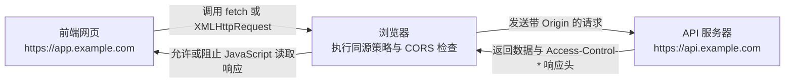
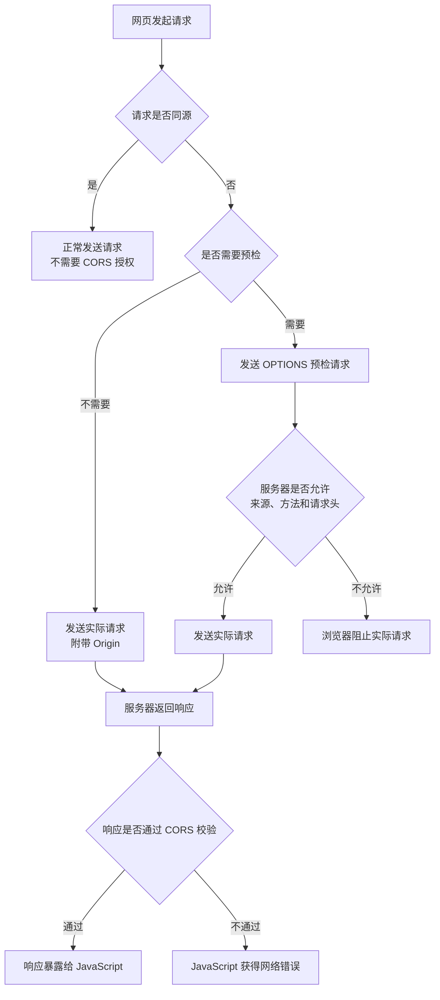
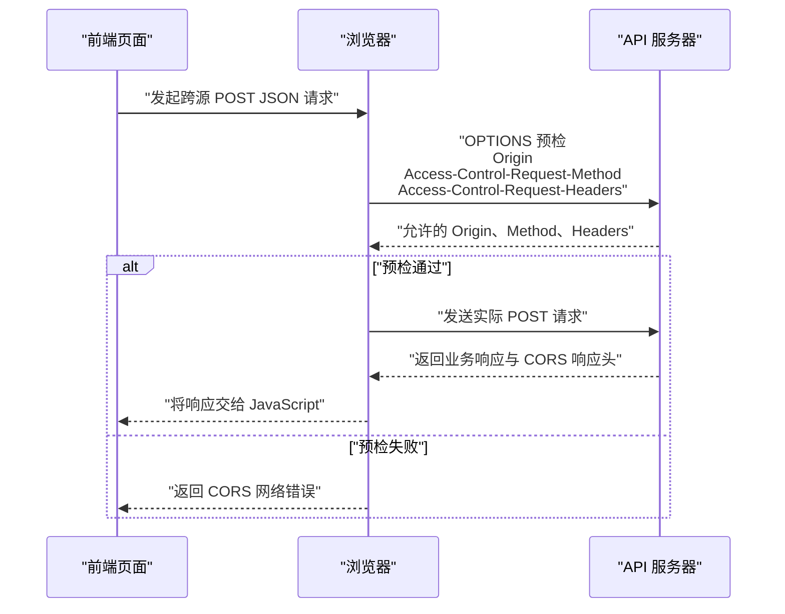
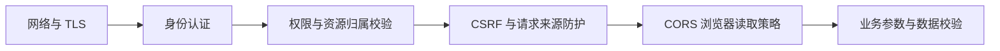
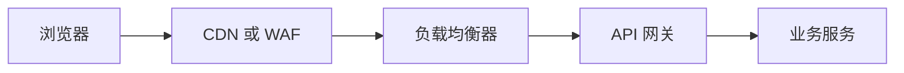
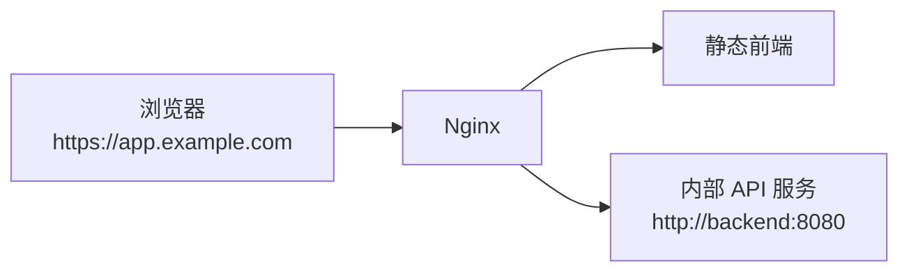

[toc]


下面按 Web 开发领域的 **跨源资源共享（Cross-Origin Resource Sharing）** 展开。现代 CORS 规则已经并入 WHATWG 的 Fetch Living Standard，旧版 W3C CORS 文档主要用于历史参考。([fetch.spec.whatwg.org](https://fetch.spec.whatwg.org/?utm_source=chatgpt.com))

## CORS 技术学习大纲

本文将围绕以下主线展开：

- CORS 解决什么问题
- 同源策略与源的定义
- 跨源、跨站与跨域的区别
- CORS 的完整工作流程
- 简单请求与预检请求
- CORS 请求头和响应头
- Cookie、Authorization 与凭证请求
- 浏览器如何判定请求成功或失败
- 前端 Fetch API 的正确使用
- 服务端 CORS 配置方法
- Express、FastAPI、Spring 和 Nginx 示例
- CORS 与认证、授权、CSRF 的关系
- 常见错误与排查方法
- CDN、缓存、API 网关和微服务中的 CORS
- 安全最佳实践
- 新手学习与实践路线

------

## CORS 是什么

CORS，即 **跨源资源共享（Cross-Origin Resource Sharing）**，是一套基于 HTTP 请求头和响应头的**浏览器安全协商机制**。

它允许服务器声明：

> 哪些来源的网页，可以通过浏览器中的 `JavaScript` 读取本**服务器返回的资源**。

例如：

- 前端页面：`https://app.example.com`
- 后端接口：`https://api.example.com`

虽然两个地址都属于 `example.com`，但主机名不同，因此属于不同源。浏览器不会默认允许前端脚本读取接口响应，除非接口通过 CORS 响应头**明确授权**。([developer.mozilla.org](https://developer.mozilla.org/en-US/docs/Web/Security/Defenses/Same-origin_policy?utm_source=chatgpt.com))

CORS 的核心不是“让请求能够发送”，而是：

> 服务器声明跨源策略，浏览器检查策略，并决定是否把响应暴露给网页中的 `JavaScript`。

因此，下面这句话非常重要：

**CORS 是浏览器实施的响应读取限制，不是服务器防火墙，也不是身份认证机制。**

使用 `curl`、Postman、后端程序或服务器之间直接请求接口时，通常不会受到浏览器同源策略约束。

即使浏览器最后报告 CORS 错误，请求也可能已经到达服务器，甚至已经修改了数据，只是浏览器没有把响应交给前端脚本。浏览器的同源策略主要限制跨源读取，而部分跨源写入行为本来就可能发生。([developer.mozilla.org](https://developer.mozilla.org/ru/docs/Web/Security/Defenses/Same-origin_policy?utm_source=chatgpt.com))

------

## CORS 要解决的问题

假设用户已经登录网上银行：

```text
https://bank.example
```

浏览器中保存着银行的会话 Cookie。

此时用户访问了恶意网站：

```text
https://evil.example
```

恶意网站中的 JavaScript 尝试请求：

```javascript
fetch("https://bank.example/api/account");
```

如果浏览器允许任何**网页随意读取其他网站的响应**，那么恶意网站就可能直接读取用户的账户信息。

因此，浏览器使用 **同源策略（Same-Origin Policy，SOP）** 限制网页脚本访问其他源的数据。CORS 则是在同源策略之上提供一种受控的“放行机制”：服务器可以明确告诉浏览器，哪些源有权读取响应。([developer.mozilla.org](https://developer.mozilla.org/en-US/docs/Glossary/Same-origin_policy?utm_source=chatgpt.com))

------

## 什么是源

一个 Web 源（Origin）通常由三个部分组成：

```text
协议 Scheme + 主机 Host + 端口 Port
```

例如：

```text
https://api.example.com:443
```

可以拆分为：

| 组成部分 | 值                |
| -------- | ----------------- |
| 协议     | `https`           |
| 主机     | `api.example.com` |
| 端口     | `443`             |

两个 URL 只有在**协议、主机和端口**全部相同时，才属于**同源**。URL 的路径、查询参数和片段不参与同源判断。([developer.mozilla.org](https://developer.mozilla.org/en-US/docs/Web/Security/Defenses/Same-origin_policy?utm_source=chatgpt.com))

以 `https://app.example.com/page` 为基准：

| URL                                | 是否同源 | 原因                 |
| ---------------------------------- | -------- | -------------------- |
| `https://app.example.com/user`     | 是       | 仅路径不同           |
| `https://app.example.com:443/api`  | 是       | HTTPS 默认端口为 443 |
| `http://app.example.com/api`       | 否       | 协议不同             |
| `https://api.example.com/api`      | 否       | 主机不同             |
| `https://app.example.com:8443/api` | 否       | 端口不同             |
| `https://example.com/api`          | 否       | 主机不同             |
| `https://sub.app.example.com/api`  | 否       | 子域名不同           |

因此，下面这些常见开发环境也是跨源请求：

```text
前端：http://localhost:3000
后端：http://localhost:8080
```

虽然主机都是 `localhost`，但端口不同。

------

## 跨源、跨域与跨站的区别

日常开发中经常把所有问题都叫“跨域”，但从浏览器安全模型看，至少要区分以下概念。

| 概念       | 英文                       | 判断依据                         | 常见用途                |
| ---------- | -------------------------- | -------------------------------- | ----------------------- |
| 同源或跨源 | Same-origin / Cross-origin | 协议、主机、端口                 | CORS、DOM、Fetch        |
| 同站或跨站 | Same-site / Cross-site     | 通常围绕可注册**域名和协议**判断 | Cookie `SameSite`、CSRF |
| 跨域       | Cross-domain               | 工程口语，不够严格               | 泛指不同域名或源        |

例如：

```text
https://app.example.com
https://api.example.com
```

这两个地址：

- 属于不同源，因为主机不同；
- 通常仍属于同站，因为可注册域名都是 `example.com`。

这解释了一个常见现象：

> 请求可能是跨源的，需要配置 CORS，但仍可能是同站请求，因此 Cookie 行为又与真正的跨站请求不同。

CORS 判断的是 **Origin**，Cookie 的 `SameSite` 判断的是 **Site**，两套规则不能混为一谈。([developer.mozilla.org](https://developer.mozilla.org/en-US/docs/Web/HTTP/Guides/Cookies?utm_source=chatgpt.com))

------

## CORS 的参与者

CORS 主要涉及三个参与者：



职责划分如下：

| 参与者          | 主要职责                            |
| --------------- | ----------------------------------- |
| 前端 JavaScript | 发起请求，决定是否携带凭证          |
| 浏览器          | 添加 `Origin`，执行预检和 CORS 校验 |
| API 服务器      | 根据白名单返回正确的 CORS 响应头    |

前端不能通过自己添加 `Access-Control-Allow-Origin` 解决问题，因为它是服务器响应头。

下面这种写法没有意义：

```javascript
fetch("https://api.example.com/data", {
  headers: {
    "Access-Control-Allow-Origin": "*"
  }
});
```

`Access-Control-Allow-Origin` 必须由 API 服务器返回，而不是由请求方发送。

------

## CORS 的基本工作原理

浏览器遇到跨源请求后，大致会执行以下流程：



跨源请求主要分为：

- 不触发预检的请求
- 触发预检的请求

开发资料通常将前者(不触发预检的请求)称为 **简单请求（Simple Request）**。现代 Fetch 规范更准确地使用“CORS 安全列出方法、请求头和内容类型”等概念来定义这类请求。([developer.mozilla.org](https://developer.mozilla.org/en-US/docs/Glossary/CORS-safelisted_request_header?utm_source=chatgpt.com))

------

## 不触发预检的请求

一个跨源请求要避免预检，通常需要同时满足以下条件。

### HTTP 方法受限

只能使用：

- `GET`
- `HEAD`
- `POST`

### 请求头受限

脚本主动设置的请求头必须属于 CORS 安全列出请求头，例如：

- `Accept`
- `Accept-Language`
- `Content-Language`
- `Content-Type`
- 满足限制条件的 `Range`

### Content-Type 受限

如果设置了 `Content-Type`，其媒体类型通常只能是：

- `application/x-www-form-urlencoded`
- `multipart/form-data`
- `text/plain`

因此，下面的请求通常不需要预检：

```javascript
fetch("https://api.example.com/news");
```

下面的表单提交通常也不需要预检：

```javascript
fetch("https://api.example.com/login", {
  method: "POST",
  headers: {
    "Content-Type": "application/x-www-form-urlencoded"
  },
  body: "username=alice&password=example"
});
```

而常见的 JSON 请求：

```javascript
fetch("https://api.example.com/users", {
  method: "POST",
  headers: {
    "Content-Type": "application/json"
  },
  body: JSON.stringify({
    name: "Alice"
  })
});
```

通常会触发预检，因为 `application/json` 不属于 CORS 安全列出的三种 `Content-Type`。([developer.mozilla.org](https://developer.mozilla.org/en-US/docs/Glossary/CORS-safelisted_request_header?utm_source=chatgpt.com))

需要注意：

**不触发预检不等于不需要 CORS。**

服务器仍然必须在实际响应中返回正确的 `Access-Control-Allow-Origin`，否则浏览器仍不会把响应暴露给 JavaScript。

------

## 预检请求

预检请求（Preflight Request）是浏览器自动发送的 `OPTIONS` 请求。

它用于询问服务器：

- 是否允许当前来源
- 是否允许目标 HTTP 方法
- 是否允许前端准备发送的请求头
- 是否允许凭证请求

浏览器通常会在以下情况下触发预检：

- 使用 `PUT`、`PATCH`、`DELETE` 等方法
- 使用 `Content-Type: application/json`
- 使用 `Authorization`
- 使用自定义请求头，例如 `X-Request-ID`
- 请求不满足 CORS 安全列出条件

预检请求至少会带有：

```http
Origin: https://app.example.com
Access-Control-Request-Method: POST
```

如果实际请求准备携带非安全列出请求头，还会包含：

```http
Access-Control-Request-Headers: authorization, content-type
```

预检请求本身由浏览器管理，前端一般不需要手动发送。([developer.mozilla.org](https://developer.mozilla.org/en-US/docs/Glossary/Preflight_request?utm_source=chatgpt.com))

### 完整预检示例

浏览器准备发送：

```http
POST /api/orders HTTP/1.1
Host: api.example.com
Origin: https://app.example.com
Authorization: Bearer example-token
Content-Type: application/json
```

在实际请求前，浏览器先发送：

```http
OPTIONS /api/orders HTTP/1.1
Host: api.example.com
Origin: https://app.example.com
Access-Control-Request-Method: POST
Access-Control-Request-Headers: authorization, content-type
```

服务器允许后可以返回：

```http
HTTP/1.1 204 No Content
Access-Control-Allow-Origin: https://app.example.com
Access-Control-Allow-Methods: POST
Access-Control-Allow-Headers: Authorization, Content-Type
Access-Control-Max-Age: 600
Vary: Origin
```

浏览器检查通过后，再发送真正的 `POST` 请求。



------

## CORS 请求头

以下请求头通常由浏览器自动生成。

| 请求头                           | 作用                               |
| -------------------------------- | ---------------------------------- |
| `Origin`                         | 表明请求来自哪个源                 |
| `Access-Control-Request-Method`  | 预检中声明实际请求准备使用的方法   |
| `Access-Control-Request-Headers` | 预检中声明实际请求准备携带的请求头 |

### Origin

示例：

```http
Origin: https://app.example.com
```

`Origin` 中只有协议、主机和必要时的端口，不包含路径。该请求头属于浏览器控制的禁止修改请求头，前端 JavaScript 不能可靠地伪造。([developer.mozilla.org](https://developer.mozilla.org/en-US/docs/Web/HTTP/Reference/Headers/Origin?utm_source=chatgpt.com))

服务器不能因为“浏览器不允许 JavaScript 修改 Origin”就把它当作身份凭证。

原因是：

- 非浏览器客户端可以自行构造 HTTP 请求；
- 代理或网关可能改变请求；
- `Origin` 只能说明浏览器所声明的请求上下文；
- 它不能证明用户是谁。

------

## CORS 响应头

### Access-Control-Allow-Origin

用于声明允许哪个源读取响应。

允许任意非凭证来源：

```http
Access-Control-Allow-Origin: *
```

允许指定来源：

```http
Access-Control-Allow-Origin: https://app.example.com
```

需要注意：

- 不能返回逗号分隔的多个源；
- 只能返回一个具体源或 `*`；
- 如果支持多个来源，服务器应检查请求中的 `Origin`，命中白名单后返回对应的单个来源；
- 凭证请求不能使用 `*`。([developer.mozilla.org](https://developer.mozilla.org/en-US/docs/Web/HTTP/Reference/Headers/Access-Control-Allow-Origin?utm_source=chatgpt.com))

错误示例：

```http
Access-Control-Allow-Origin: https://app.example.com, https://admin.example.com
```

正确做法是根据当前请求动态返回其中一个：

```http
Access-Control-Allow-Origin: https://app.example.com
```

### Access-Control-Allow-Methods

用于在预检响应中声明允许的实际请求方法。

```http
Access-Control-Allow-Methods: GET, POST, PUT, DELETE
```

不应为了省事无条件开放所有方法，应根据具体接口开放真正需要的方法。([developer.mozilla.org](https://developer.mozilla.org/en-US/docs/Web/HTTP/Reference/Headers/Access-Control-Allow-Methods?utm_source=chatgpt.com))

### Access-Control-Allow-Headers

用于声明实际请求允许携带哪些请求头。

```http
Access-Control-Allow-Headers: Content-Type, Authorization, X-Request-ID
```

如果预检请求中存在：

```http
Access-Control-Request-Headers: authorization, content-type
```

服务器的响应必须允许这些请求头，否则预检失败。

虽然规范在部分无凭证场景支持通配符，但 `Authorization` 不能依赖通配符，应该明确列出。凭证请求中，`*` 也不具有普通通配符语义。([fetch.spec.whatwg.org](https://fetch.spec.whatwg.org/?utm_source=chatgpt.com))

### Access-Control-Allow-Credentials

用于允许浏览器在跨源请求中携带或接受凭证。

```http
Access-Control-Allow-Credentials: true
```

唯一有效的允许值是大小写敏感的 `true`。不需要凭证时，直接省略该响应头，而不是设置为 `false`。([developer.mozilla.org](https://developer.mozilla.org/en-US/docs/Web/HTTP/Reference/Headers/Access-Control-Allow-Credentials?utm_source=chatgpt.com))

### Access-Control-Expose-Headers

即使响应通过 CORS 检查，JavaScript 默认也只能读取部分安全列出的响应头：

- `Cache-Control`
- `Content-Language`
- `Content-Length`
- `Content-Type`
- `Expires`
- `Last-Modified`
- `Pragma`

如果前端需要读取自定义响应头，例如：

```http
X-Request-ID: 8f6f8f30
X-RateLimit-Remaining: 95
```

服务器应返回：

```http
Access-Control-Expose-Headers: X-Request-ID, X-RateLimit-Remaining
```

否则这些响应头虽然出现在浏览器网络面板中，但 `response.headers.get()` 可能读取不到。([developer.mozilla.org](https://developer.mozilla.org/en-US/docs/Web/HTTP/Reference/Headers/Access-Control-Expose-Headers?utm_source=chatgpt.com))

### Access-Control-Max-Age

用于缓存预检结果：

```http
Access-Control-Max-Age: 600
```

表示浏览器可以在 600 秒内复用预检结果，减少重复的 `OPTIONS` 请求。

浏览器可能对最大缓存时间设置自己的上限，因此服务器返回很大的数字并不意味着浏览器一定会完全采用。([developer.mozilla.org](https://developer.mozilla.org/en-US/docs/Web/HTTP/Reference/Headers/Access-Control-Max-Age?utm_source=chatgpt.com))

### Vary: Origin

当服务器根据请求的 `Origin` 动态返回不同的 `Access-Control-Allow-Origin` 时，应增加：

```http
Vary: Origin
```

它告诉浏览器、CDN 和代理缓存：

> 同一个 URL 的响应可能因为 Origin 不同而不同。

如果缺少 `Vary: Origin`，缓存系统可能把为来源 A 生成的响应错误地提供给来源 B，导致功能错误甚至安全问题。([developer.mozilla.org](https://developer.mozilla.org/en-US/docs/Web/HTTP/Reference/Headers/Access-Control-Allow-Origin?utm_source=chatgpt.com))

------

## 核心响应头速查表

| 响应头                             | 主要用途                         | 常见值                        |
| ---------------------------------- | -------------------------------- | ----------------------------- |
| `Access-Control-Allow-Origin`      | 允许读取响应的来源               | `*` 或一个具体源              |
| `Access-Control-Allow-Methods`     | 允许的实际请求方法               | `GET, POST, PUT`              |
| `Access-Control-Allow-Headers`     | 允许的实际请求头                 | `Content-Type, Authorization` |
| `Access-Control-Allow-Credentials` | 是否允许凭证请求                 | `true`                        |
| `Access-Control-Expose-Headers`    | 允许 JavaScript 读取的额外响应头 | `X-Request-ID`                |
| `Access-Control-Max-Age`           | 预检结果缓存时间                 | `600`                         |
| `Vary`                             | 告诉缓存响应与 Origin 有关       | `Origin`                      |

------

## 带凭证的跨源请求

凭证（Credentials）可能包括：

- Cookie
- HTTP 身份认证信息
- TLS 客户端证书
- 由浏览器凭证模式控制的认证上下文

在 Fetch API 中，可以使用：

```javascript
const response = await fetch(
  "https://api.example.com/profile",
  {
    credentials: "include"
  }
);
```

服务器必须返回：

```http
Access-Control-Allow-Origin: https://app.example.com
Access-Control-Allow-Credentials: true
Vary: Origin
```

不能返回：

```http
Access-Control-Allow-Origin: *
Access-Control-Allow-Credentials: true
```

当请求凭证模式为 `include` 时，`Access-Control-Allow-Origin: *` 不允许共享响应。([fetch.spec.whatwg.org](https://fetch.spec.whatwg.org/?utm_source=chatgpt.com))

### Fetch 的 credentials 取值

| 值            | 含义                   |
| ------------- | ---------------------- |
| `omit`        | 不发送凭证             |
| `same-origin` | 只对同源请求使用凭证   |
| `include`     | 跨源请求也尝试携带凭证 |

### CORS 允许凭证不等于 Cookie 一定会发送

即使前端设置了：

```javascript
credentials: "include"
```

服务器也返回了正确的 CORS 响应头，Cookie 仍可能受到以下规则影响：

- Cookie 的 `SameSite` 属性
- Cookie 的 `Secure` 属性
- Cookie 的 `Domain` 和 `Path`
- 浏览器第三方 Cookie 策略
- 隐私保护或存储分区机制

例如，`SameSite=Lax` 或 `SameSite=Strict` 的 Cookie 通常不会因为 `credentials: "include"` 就被强制用于真正的跨站 Fetch 请求。([developer.mozilla.org](https://developer.mozilla.org/en-US/docs/Web/HTTP/Guides/Cookies?utm_source=chatgpt.com))

### Set-Cookie 的特殊性

`Set-Cookie` 是禁止前端脚本读取的响应头。

即使通过：

```http
Access-Control-Expose-Headers: Set-Cookie
```

JavaScript 也不能直接读取它。

在 CORS Fetch 请求中，如果请求没有使用适当的凭证模式，浏览器还可能忽略跨源响应中的 `Set-Cookie`。([developer.mozilla.org](https://developer.mozilla.org/en-US/docs/Web/HTTP/Reference/Headers/Set-Cookie?utm_source=chatgpt.com))

------

## 预检请求通常不带跨源凭证

CORS 预检请求的凭证模式是 `same-origin`，所以对跨源目标而言，预检一般不会携带实际请求中的 Cookie 或 HTTP 认证凭证。

这会产生一个常见工程问题：

> API 的认证中间件要求所有请求都必须先登录，包括 `OPTIONS`，于是预检请求先被返回 401，真正的请求永远无法发送。

正确处理方式通常是：

- 让 CORS 中间件先于业务认证处理预检；
- 对合法的 `OPTIONS` 预检直接返回 `204` 或合适的成功状态；
- 仍然严格校验 `Origin`、请求方法和请求头；
- 真正的业务请求继续执行认证和授权。

预检不带凭证，不代表实际请求也不带凭证。服务器需要通过预检响应声明是否允许后续凭证请求。([fetch.spec.whatwg.org](https://fetch.spec.whatwg.org/?utm_source=chatgpt.com))

------

## 前端 Fetch API 示例

### 不带凭证的公共接口

```javascript
async function loadArticles() {
  const response = await fetch(
    "https://api.example.com/articles",
    {
      method: "GET",
      mode: "cors"
    }
  );

  if (!response.ok) {
    throw new Error(`HTTP error: ${response.status}`);
  }

  return response.json();
}
```

在正常跨源 HTTP 请求中，浏览器会自动应用 CORS 流程，通常不需要显式设置 `mode: "cors"`。

### 携带 Bearer Token

```javascript
async function loadProfile(token) {
  const response = await fetch(
    "https://api.example.com/profile",
    {
      method: "GET",
      headers: {
        Authorization: `Bearer ${token}`
      }
    }
  );

  if (!response.ok) {
    throw new Error(`Request failed: ${response.status}`);
  }

  return response.json();
}
```

因为使用了 `Authorization`，该请求通常会触发预检。

服务端需要允许：

```http
Access-Control-Allow-Headers: Authorization
```

### 携带 Cookie

```javascript
async function loadSessionProfile() {
  const response = await fetch(
    "https://api.example.com/profile",
    {
      method: "GET",
      credentials: "include"
    }
  );

  if (!response.ok) {
    throw new Error(`Request failed: ${response.status}`);
  }

  return response.json();
}
```

服务端需要返回具体来源和：

```http
Access-Control-Allow-Credentials: true
```

### 不要使用 no-cors 绕过错误

一些开发者遇到 CORS 错误后会写：

```javascript
fetch("https://api.example.com/data", {
  mode: "no-cors"
});
```

这通常不是解决方案。

跨源 `no-cors` 请求得到的往往是 **不透明响应（Opaque Response）**：

- `status` 为 `0`
- 响应体不能读取
- 大部分响应头不能读取

它适用于某些不需要脚本读取响应的资源请求，而不适合普通 JSON API。([developer.mozilla.org](https://developer.mozilla.org/en-US/docs/Web/API/Response/type?utm_source=chatgpt.com))

------

## 服务端的正确决策逻辑

推荐使用明确的来源白名单。

伪代码如下：

```text
读取请求中的 Origin

如果没有 Origin：
    按普通请求处理
否则如果 Origin 在允许列表中：
    返回 Access-Control-Allow-Origin: 当前 Origin
    返回 Vary: Origin
否则：
    不返回 CORS 授权响应头
```

对于预检请求，还要验证：

```text
请求方法是否允许
请求头是否允许
当前接口是否允许跨源访问
当前来源是否允许携带凭证
```

不要简单地把请求中的 `Origin` 原样反射回响应：

```javascript
response.setHeader(
  "Access-Control-Allow-Origin",
  request.headers.origin
);
```

除非已经先完成严格的白名单校验。

否则任何恶意网站都可能把自己的 Origin 放进请求中，而服务器又照单全收，等于把“白名单”做成了“来者不拒”。

------

## 公共 API 与私有 API 的配置策略

### 完全公开且不使用用户凭证的资源

例如：

- 公共字体
- 公共图片
- 开放数据
- 无用户身份信息的公共查询接口

可以考虑：

```http
Access-Control-Allow-Origin: *
```

同时不启用：

```http
Access-Control-Allow-Credentials: true
```

### 需要登录 Cookie 的业务 API

例如：

- 用户中心
- 订单
- 后台管理系统
- 企业内部平台

推荐：

```http
Access-Control-Allow-Origin: https://app.example.com
Access-Control-Allow-Credentials: true
Vary: Origin
```

并配合：

- 精确来源白名单
- CSRF 防护
- 身份认证
- 权限校验
- HTTPS
- Cookie 安全属性

### 使用 Authorization Bearer Token 的 API

需要明确允许：

```http
Access-Control-Allow-Headers: Authorization, Content-Type
```

Bearer Token 是否属于“凭证请求”，还要区分 Fetch 的 credentials mode 与应用层 Authorization 头。工程上不要依赖模糊的通配符行为，直接明确列出 `Authorization` 最稳妥。

------

## Express 配置示例

Express 可以使用 `cors` 中间件设置 CORS 响应头。该中间件的本质仍然是根据配置生成浏览器能够识别的响应头。([Express.js](https://expressjs.com/en/resources/middleware/cors/?utm_source=chatgpt.com))

```javascript
import express from "express";
import cors from "cors";

const app = express();

const allowedOrigins = new Set([
  "https://app.example.com",
  "https://admin.example.com"
]);

app.use(
  cors({
    origin(origin, callback) {
      // 没有 Origin 的请求通常来自同源请求、
      // 服务端调用、健康检查或命令行工具。
      if (!origin) {
        callback(null, true);
        return;
      }

      if (allowedOrigins.has(origin)) {
        callback(null, true);
        return;
      }

      callback(new Error("Origin is not allowed by CORS"));
    },

    credentials: true,

    methods: [
      "GET",
      "POST",
      "PUT",
      "PATCH",
      "DELETE",
      "OPTIONS"
    ],

    allowedHeaders: [
      "Content-Type",
      "Authorization",
      "X-Request-ID"
    ],

    exposedHeaders: [
      "X-Request-ID"
    ],

    maxAge: 600
  })
);

app.use(express.json());

app.get("/api/profile", (request, response) => {
  response.setHeader("X-Request-ID", crypto.randomUUID());

  response.json({
    id: 1,
    name: "Alice"
  });
});

app.listen(8080);
```

生产环境中，白名单通常应来自受控配置，而不是让客户端通过查询参数决定。

------

## FastAPI 配置示例

FastAPI 可以使用 `CORSMiddleware` 配置允许的来源、方法、请求头和凭证。([FastAPI](https://fastapi.tiangolo.com/tutorial/cors/?utm_source=chatgpt.com))

```python
from fastapi import FastAPI
from fastapi.middleware.cors import CORSMiddleware

app = FastAPI()

allowed_origins = [
    "https://app.example.com",
    "https://admin.example.com",
]

app.add_middleware(
    CORSMiddleware,
    allow_origins=allowed_origins,
    allow_credentials=True,
    allow_methods=[
        "GET",
        "POST",
        "PUT",
        "PATCH",
        "DELETE",
        "OPTIONS",
    ],
    allow_headers=[
        "Authorization",
        "Content-Type",
        "X-Request-ID",
    ],
    expose_headers=[
        "X-Request-ID",
    ],
    max_age=600,
)


@app.get("/api/profile")
async def get_profile():
    return {
        "id": 1,
        "name": "Alice",
    }
```

对于使用 Cookie 的接口，不要同时配置：

```python
allow_origins=["*"]
allow_credentials=True
```

应该列出明确来源。

------

## Spring MVC 配置示例

Spring MVC 内置了 CORS 支持，可以通过 `WebMvcConfigurer` 配置全局跨源规则。预检请求可由框架直接处理，实际请求则经过 CORS 校验和响应头处理。([Home](https://docs.spring.io/spring-framework/reference/web/webmvc-cors.html?utm_source=chatgpt.com))

```java
import org.springframework.context.annotation.Configuration;
import org.springframework.web.servlet.config.annotation.CorsRegistry;
import org.springframework.web.servlet.config.annotation.WebMvcConfigurer;

@Configuration
public class WebCorsConfiguration implements WebMvcConfigurer {

    @Override
    public void addCorsMappings(CorsRegistry registry) {
        registry
            .addMapping("/api/**")
            .allowedOrigins(
                "https://app.example.com",
                "https://admin.example.com"
            )
            .allowedMethods(
                "GET",
                "POST",
                "PUT",
                "PATCH",
                "DELETE",
                "OPTIONS"
            )
            .allowedHeaders(
                "Authorization",
                "Content-Type",
                "X-Request-ID"
            )
            .exposedHeaders(
                "X-Request-ID"
            )
            .allowCredentials(true)
            .maxAge(600);
    }
}
```

如果项目使用 Spring Security，还需要确保 CORS 处理顺序正确，避免 `OPTIONS` 请求先被认证过滤器拒绝。

------

## Nginx 配置示例

当 CORS 由 Nginx 统一处理时，可以使用 `map` 建立精确白名单。

```nginx
map $http_origin $cors_origin {
    default "";

    "https://app.example.com"   $http_origin;
    "https://admin.example.com" $http_origin;
}

server {
    listen 443 ssl;
    server_name api.example.com;

    location /api/ {
        if ($request_method = OPTIONS) {
            add_header Access-Control-Allow-Origin $cors_origin always;
            add_header Access-Control-Allow-Credentials "true" always;
            add_header Access-Control-Allow-Methods "GET, POST, PUT, PATCH, DELETE, OPTIONS" always;
            add_header Access-Control-Allow-Headers "Authorization, Content-Type, X-Request-ID" always;
            add_header Access-Control-Max-Age "600" always;
            add_header Vary "Origin" always;

            return 204;
        }

        add_header Access-Control-Allow-Origin $cors_origin always;
        add_header Access-Control-Allow-Credentials "true" always;
        add_header Access-Control-Expose-Headers "X-Request-ID" always;
        add_header Vary "Origin" always;

        proxy_pass http://backend;
    }
}
```

使用反向代理配置 CORS 时，需要确认：

- 上游应用是否也在添加 CORS 头；
- 是否出现两个 `Access-Control-Allow-Origin`；
- 错误响应是否也带有必要的 CORS 头；
- `OPTIONS` 是否被正确转发或直接处理；
- `Vary: Origin` 是否保留；
- CDN 是否按照 `Origin` 区分缓存。

------

## CORS 不负责身份认证和权限控制

CORS 只决定：

> 浏览器是否允许某个网页脚本读取响应。

它不决定：

- 用户是否登录；
- 用户是谁；
- 用户是否有权访问某条数据；
- Token 是否有效；
- 请求参数是否合法；
- 是否允许修改资源；
- 是否存在业务越权。

因此，下面这种设计是错误的：

```text
只要 Origin 是前端域名，就认为请求可信。
```

攻击者可以：

- 直接使用 `curl` 请求 API；
- 编写自己的后端程序请求 API；
- 盗取或重放 Token；
- 利用被允许来源中的 XSS；
- 绕过浏览器直接访问接口。

正确的安全层次应该是：



CORS 是其中一层，而且准确地说，它是在放宽浏览器默认的同源读取限制，而不是给服务器增加一种万能认证。ASP.NET Core 官方文档也明确提醒，CORS 本身并不会让 API 更安全，它是在受控条件下放宽限制。([Microsoft Learn](https://learn.microsoft.com/en-us/aspnet/core/security/cors?view=aspnetcore-10.0&utm_source=chatgpt.com))

------

## CORS 与 CSRF 的关系

CORS 和 CSRF 经常被混淆。

| 对比项       | CORS                          | CSRF                                     |
| ------------ | ----------------------------- | ---------------------------------------- |
| 全称         | Cross-Origin Resource Sharing | Cross-Site Request Forgery               |
| 核心问题     | 跨源网页能否读取响应          | 恶意网站能否借用户身份执行操作           |
| 主要实施方   | 浏览器与服务器共同协商        | 服务器验证请求真实性                     |
| 是否属于认证 | 否                            | 否                                       |
| 主要防护目标 | 跨源数据读取                  | 未经用户意图的状态修改                   |
| 常见措施     | Origin 白名单、CORS 响应头    | CSRF Token、SameSite Cookie、Origin 检查 |

例如，恶意网站提交一个传统 HTML 表单：

```html
<form
  action="https://bank.example/api/transfer"
  method="post"
>
  <input name="amount" value="1000">
</form>
```

这种跨站写入不一定依赖 Fetch，也不一定会触发 CORS 预检。

即使浏览器不能读取转账结果，请求仍可能已经执行。因此：

**CORS 不能替代 CSRF 防护。**

对于使用 Cookie 会话的敏感写操作，应考虑：

- CSRF Token
- `SameSite` Cookie
- 校验 `Origin`
- 必要时校验 `Referer`
- Fetch Metadata 请求头
- 避免使用 GET 修改状态

CSRF 的本质是浏览器可能自动携带用户凭证，让服务器误以为请求由用户主动发起。([developer.mozilla.org](https://developer.mozilla.org/en-US/docs/Web/Security/Attacks/CSRF?utm_source=chatgpt.com))

------

## 常见危险配置

### 无条件反射 Origin

危险代码：

```javascript
res.setHeader(
  "Access-Control-Allow-Origin",
  req.headers.origin
);

res.setHeader(
  "Access-Control-Allow-Credentials",
  "true"
);
```

这意味着任何来源都可以获得授权。

正确方式：

```javascript
if (allowedOrigins.has(origin)) {
  res.setHeader(
    "Access-Control-Allow-Origin",
    origin
  );
}
```

### 宽松的字符串匹配

危险示例：

```javascript
if (origin.endsWith("example.com")) {
  allow(origin);
}
```

它可能错误允许：

```text
https://notexample.com
https://evil-example.com
```

更安全的方式是：

- 精确匹配完整 Origin；
- 确需支持子域名时，使用可靠的 URL 解析；
- 检查协议；
- 检查标准化后的主机；
- 限制端口；
- 维护受控子域名清单。

### 使用 null 作为允许来源

不推荐：

```http
Access-Control-Allow-Origin: null
```

沙箱文档、`file:`、`data:` 以及其他不透明源可能被序列化为 `null`。攻击者也可能构造具有 `null` Origin 的环境，因此不应把它当成可靠的特殊白名单。([developer.mozilla.org](https://developer.mozilla.org/en-US/docs/Web/HTTP/Reference/Headers/Access-Control-Allow-Origin?utm_source=chatgpt.com))

### 凭证与通配符混用

错误：

```http
Access-Control-Allow-Origin: *
Access-Control-Allow-Credentials: true
```

正确：

```http
Access-Control-Allow-Origin: https://app.example.com
Access-Control-Allow-Credentials: true
Vary: Origin
```

### 所有接口统一开放

不推荐对整个网站无差别返回：

```http
Access-Control-Allow-Origin: *
```

更合理的是：

- 只在需要跨源访问的 API 路由启用；
- 登录页、管理页、内部接口保持关闭；
- 公共资源与私有资源采用不同策略。

MDN 的安全实施建议也是只对真正需要跨源访问的资源设置最小范围的允许来源。([developer.mozilla.org](https://developer.mozilla.org/en-US/docs/Web/Security/Practical_implementation_guides/CORS?utm_source=chatgpt.com))

### 重复添加响应头

如果 Nginx、API 网关和业务应用都配置了 CORS，可能出现：

```http
Access-Control-Allow-Origin: https://app.example.com
Access-Control-Allow-Origin: *
```

浏览器会将多个 `Access-Control-Allow-Origin` 视为无效。

建议明确指定唯一责任层：

- API 网关统一处理；或
- 业务应用统一处理。

不要让每一层都“热心地再加一遍”。

### 错误响应缺少 CORS 头

正常响应可能有 CORS 头，但以下响应没有：

- `401 Unauthorized`
- `403 Forbidden`
- `404 Not Found`
- `429 Too Many Requests`
- `500 Internal Server Error`

结果是前端只能看到笼统的 CORS 网络错误，而看不到真正的业务状态。

最佳实践是确保需要跨源暴露的错误响应也经过相同 CORS 处理。Nginx 中通常需要注意 `add_header ... always`，应用中则应保证 CORS 中间件处于合适顺序。

------

## CORS 错误为什么经常难以排查

浏览器会故意限制前端 JavaScript 获取某些 CORS 失败细节。

例如，服务器实际返回了：

```http
HTTP/1.1 500 Internal Server Error
```

但因为缺少：

```http
Access-Control-Allow-Origin
```

前端可能只得到：

```text
TypeError: Failed to fetch
```

因此：

- 前端控制台看到的是 CORS 错误；
- 真正原因可能是后端异常；
- 也可能是网关拒绝了 `OPTIONS`；
- 还可能是 TLS、DNS、重定向或代理错误。

CORS 错误意味着 CORS 校验没有通过，但不必然意味着“只需要加一个响应头”。([developer.mozilla.org](https://developer.mozilla.org/en-US/docs/Web/HTTP/Guides/CORS/Errors?utm_source=chatgpt.com))

------

## 常见错误排查表

| 现象                               | 常见原因                                             | 处理方法                     |
| ---------------------------------- | ---------------------------------------------------- | ---------------------------- |
| 缺少 `Access-Control-Allow-Origin` | 服务端未启用 CORS，或来源不在白名单                  | 检查实际响应和 Origin        |
| 预检返回 401                       | `OPTIONS` 被认证中间件拦截                           | 调整 CORS 与认证中间件顺序   |
| 预检返回 404                       | 服务端或网关没有处理 OPTIONS                         | 增加预检路由或 CORS 中间件   |
| `*` 与凭证冲突                     | 使用 `credentials: include`，服务端返回 `*`          | 返回具体 Origin              |
| 自定义请求头被拒绝                 | 未加入 `Access-Control-Allow-Headers`                | 明确允许该请求头             |
| DELETE 请求失败                    | 未加入 `Access-Control-Allow-Methods`                | 允许 DELETE                  |
| 能看到响应头但 JS 读不到           | 未设置 `Access-Control-Expose-Headers`               | 暴露需要读取的响应头         |
| Cookie 没有发送                    | `credentials`、SameSite、Secure 或第三方 Cookie 限制 | 同时检查 CORS 与 Cookie 属性 |
| Postman 成功、浏览器失败           | Postman 不执行浏览器 CORS 限制                       | 检查浏览器网络面板           |
| 开发环境成功、生产失败             | 生产域名或 HTTPS Origin 未加入白名单                 | 使用完整生产 Origin          |
| 偶尔成功、偶尔失败                 | CDN 缓存未设置 `Vary: Origin`                        | 添加并正确传递 `Vary`        |
| 出现多个允许来源响应头             | 网关和应用重复配置                                   | 只保留一层 CORS 配置         |
| 只有 500 响应报 CORS               | 错误响应没有 CORS 头                                 | 让错误链路也经过 CORS 中间件 |
| 重定向后失败                       | 重定向目标源或响应头不符合规则                       | 检查每一次跳转               |

------

## 浏览器开发者工具排查流程

推荐按照以下顺序检查。

### 检查页面 Origin

在控制台执行：

```javascript
window.location.origin
```

确认真实来源，例如：

```text
https://app.example.com
```

不要凭感觉写成：

```text
https://example.com
```

子域名、端口和协议都不能省略。

### 检查是否出现 OPTIONS

打开浏览器开发者工具：

```text
Network -> Fetch/XHR
```

观察是否先出现：

```text
OPTIONS /api/resource
```

如果有，检查：

- 请求中的 `Origin`
- `Access-Control-Request-Method`
- `Access-Control-Request-Headers`
- OPTIONS 响应状态
- OPTIONS 响应中的允许来源、方法和请求头

### 检查实际响应

预检通过后还要检查实际响应。

预检通过并不代表实际响应一定通过，因为实际响应同样需要正确的 CORS 响应头。

### 检查重定向

确认请求是否经历：

- HTTP 跳 HTTPS
- 无尾斜杠跳有尾斜杠
- 登录页重定向
- 网关重定向
- 域名规范化跳转

最终响应来源和每一步跳转都会影响请求结果。

### 检查代理层

逐层确认：

```text
浏览器
CDN
WAF
负载均衡器
API 网关
Nginx
应用服务器
```

尤其要确认究竟是哪一层负责响应 `OPTIONS`。

------

## 使用 curl 检查响应头

`curl` 不会替你执行浏览器 CORS 校验，但非常适合观察服务器实际返回了什么。

### 模拟普通跨源请求

```bash
curl -i \
  "https://api.example.com/profile" \
  -H "Origin: https://app.example.com"
```

期望响应包含：

```http
Access-Control-Allow-Origin: https://app.example.com
Vary: Origin
```

### 模拟预检请求

```bash
curl -i \
  -X OPTIONS \
  "https://api.example.com/orders" \
  -H "Origin: https://app.example.com" \
  -H "Access-Control-Request-Method: POST" \
  -H "Access-Control-Request-Headers: authorization, content-type"
```

期望响应类似：

```http
HTTP/1.1 204 No Content
Access-Control-Allow-Origin: https://app.example.com
Access-Control-Allow-Methods: POST
Access-Control-Allow-Headers: Authorization, Content-Type
Access-Control-Max-Age: 600
Vary: Origin
```

### 测试恶意来源

```bash
curl -i \
  -X OPTIONS \
  "https://api.example.com/orders" \
  -H "Origin: https://evil.example" \
  -H "Access-Control-Request-Method: POST"
```

服务器不应向该来源返回有效的 CORS 授权。

注意：服务器可以返回普通的 403，也可以不返回 `Access-Control-Allow-Origin`。真正重要的是浏览器不能获得允许该来源读取响应的授权。

------

## CDN、缓存和 API 网关中的 CORS

现代系统中，CORS 往往不是由单一应用独立完成，而是跨越多个基础设施层。



需要重点处理以下问题。

### 确定唯一责任层

可以选择：

- API 网关统一处理 CORS；
- 每个业务服务自行处理；
- 边缘代理处理公共资源，应用处理私有 API。

无论选择哪种方式，都应避免重复注入响应头。

### 保留 Vary

中间代理不能随意删除：

```http
Vary: Origin
```

动态 Origin 响应如果进入共享缓存，必须正确区分来源。

### OPTIONS 不应进入复杂业务链路

如果策略统一且稳定，可以让网关直接处理预检，减少：

- 认证服务调用
- 数据库访问
- 业务日志噪音
- 额外网络延迟

但网关策略必须与实际业务接口保持一致，否则会出现：

- 网关允许，应用拒绝；
- 网关拒绝，应用本来允许；
- 预检通过，实际请求失败。

### 多租户系统

多租户平台可能需要允许客户自己的域名：

```text
https://portal.customer-a.com
https://dashboard.customer-b.com
```

此时不应使用无条件反射，而应：

- 从可信租户配置中查询允许来源；
- 对 Origin 进行标准化解析；
- 绑定到具体租户和 API；
- 缓存白名单时设计失效机制；
- 删除租户域名后及时撤销；
- 记录来源命中与拒绝日志；
- 防止租户接管失效子域名后继续获得授权。

------

## 开发环境中的推荐做法

开发时常见来源包括：

```text
http://localhost:3000
http://localhost:5173
http://127.0.0.1:3000
```

这些来源互不等价。

例如：

```text
http://localhost:3000
http://127.0.0.1:3000
```

主机不同，因此属于不同源。

推荐显式配置开发来源：

```text
CORS_ALLOWED_ORIGINS=
http://localhost:5173,
https://app.example.com
```

不要为了开发方便把生产环境永久改成：

```http
Access-Control-Allow-Origin: *
```

更好的方法是按环境分别配置：

| 环境       | 允许来源     |
| ---------- | ------------ |
| 本地开发   | 本地前端地址 |
| 测试环境   | 测试前端域名 |
| 预发布环境 | 预发布域名   |
| 生产环境   | 正式前端域名 |

------

## 如何减少预检请求

预检并不代表配置错误，它是正常的安全机制。

但预检会增加一次网络往返，对高频接口可能产生性能影响。

可以采用以下方式优化。

### 合理设置 Max-Age

```http
Access-Control-Max-Age: 600
```

避免每次请求都重新预检。

### 减少不必要的自定义请求头

不要给每个请求随意增加：

```http
X-Requested-With
X-Client-Name
X-Debug-Mode
```

每增加一个非安全列出请求头，都可能让原本简单的请求触发预检。

### 合并同源部署

可以通过反向代理将前端和 API 暴露在同一个 Origin 下：

```text
https://app.example.com/
https://app.example.com/api/
```

Nginx 将 `/api/` 转发到后端服务。

对浏览器而言这是同源请求，通常不需要 CORS。



这是很多单体应用、后台管理系统和 BFF 架构中的实用方案。

### 不要为了躲避预检降低安全性

不建议为了避免预检而：

- 把 JSON 强行改成 `text/plain`
- 删除必要的认证头
- 把敏感操作改成 GET
- 关闭安全校验

性能优化不能以破坏协议语义和安全边界为代价。

------

## CORS 与相关安全机制

CORS 只是 Web 跨源安全体系的一部分。

| 技术            | 全称                             | 主要作用                            |
| --------------- | -------------------------------- | ----------------------------------- |
| SOP             | Same-Origin Policy               | 默认限制跨源交互和读取              |
| CORS            | Cross-Origin Resource Sharing    | 受控放宽跨源读取                    |
| CSP             | Content Security Policy          | 控制页面可加载或连接哪些资源        |
| CORP            | Cross-Origin Resource Policy     | 限制资源被哪些源以 no-cors 方式加载 |
| COEP            | Cross-Origin Embedder Policy     | 要求跨源嵌入资源满足隔离条件        |
| COOP            | Cross-Origin Opener Policy       | 隔离浏览上下文组                    |
| CSRF Token      | Cross-Site Request Forgery Token | 防止伪造用户操作                    |
| SameSite Cookie | Cookie SameSite Attribute        | 控制 Cookie 的跨站发送              |
| Fetch Metadata  | Sec-Fetch-* Headers              | 让服务器识别请求上下文              |

### CORS 与 CSP

CORS 是资源服务器表示：

> 我允许哪些来源读取我。

CSP 的 `connect-src` 等指令是页面自己表示：

> 我的 JavaScript 允许连接哪些服务器。

因此，一个请求可能同时需要满足：

- 页面 CSP 允许连接目标 API；
- API CORS 允许当前页面读取响应。

### CORS 与 CORP

CORP 主要限制 `no-cors` 跨源资源加载，常用于保护敏感资源不被其他站点嵌入。CORS 则主要处理显式跨源读取授权。([developer.mozilla.org](https://developer.mozilla.org/en-US/docs/Web/HTTP/Guides/Cross-Origin_Resource_Policy?utm_source=chatgpt.com))

### Fetch Metadata

现代浏览器可以发送：

```http
Sec-Fetch-Site: same-origin
Sec-Fetch-Site: same-site
Sec-Fetch-Site: cross-site
Sec-Fetch-Site: none
```

服务器可以据此实施额外的资源隔离策略，但它仍然不应替代认证、授权和 CSRF Token。`Sec-Fetch-Site` 用于描述请求发起方与目标资源之间的站点关系。([developer.mozilla.org](https://developer.mozilla.org/en-US/docs/Web/HTTP/Reference/Headers/Sec-Fetch-Site?utm_source=chatgpt.com))

------

## 生产环境最佳实践

### 使用最小授权原则

只允许真正需要访问 API 的来源：

```text
https://app.example.com
https://admin.example.com
```

不要直接允许：

```text
*
```

尤其是带用户数据和凭证的 API。

### 精确匹配完整 Origin

白名单项应包含：

- 协议
- 主机
- 必要时的端口

例如：

```text
https://app.example.com
```

而不是只有：

```text
example.com
```

### 公共和私有策略分离

例如：

```text
/public/*
    Access-Control-Allow-Origin: *

/private/*
    只允许受信任前端
    允许凭证
```

### 明确列出方法和请求头

推荐：

```http
Access-Control-Allow-Methods: GET, POST
Access-Control-Allow-Headers: Authorization, Content-Type
```

而不是没有边界地开放所有能力。

### 动态 Origin 必须设置 Vary

```http
Vary: Origin
```

### 仅在需要时允许凭证

不需要 Cookie 的公共 API，不要返回：

```http
Access-Control-Allow-Credentials: true
```

### 对所有响应路径保持一致

包括：

- 正常响应
- 认证失败
- 权限不足
- 参数错误
- 限流
- 服务器异常

### 将 CORS 配置纳入自动化测试

至少测试：

- 白名单来源成功；
- 非白名单来源失败；
- 预检方法限制；
- 预检请求头限制；
- 凭证模式；
- `Vary: Origin`；
- 错误响应；
- CDN 和网关链路；
- 删除白名单后的撤销效果。

### 记录但避免泄露敏感信息

可以记录：

```text
Origin
请求路径
预检方法
预检请求头
允许或拒绝结果
策略版本
```

但不要在日志中泄露：

- 完整访问令牌
- 会话 Cookie
- 用户敏感数据

------

## CORS 配置审查清单

### 来源

- 是否使用精确 Origin 白名单
- 是否同时校验协议、主机和端口
- 是否避免无条件反射 Origin
- 是否避免宽松的后缀匹配
- 是否避免允许 `null`
- 是否及时删除过期域名

### 凭证

- 是否真的需要 `Access-Control-Allow-Credentials`
- 凭证请求是否返回具体 Origin
- Cookie 的 SameSite 和 Secure 是否正确
- 是否配置了 CSRF 防护
- 是否对敏感写操作进行权限校验

### 预检

- OPTIONS 是否能够到达 CORS 处理层
- OPTIONS 是否被认证中间件错误拦截
- 方法是否最小化
- 请求头是否最小化
- 是否明确列出 Authorization
- Max-Age 是否合理

### 响应

- 实际响应是否包含允许来源
- 错误响应是否包含正确 CORS 头
- 是否暴露了前端真正需要的响应头
- 是否避免暴露敏感内部响应头
- 动态 Origin 是否设置 `Vary: Origin`

### 架构

- CDN 是否按照 Origin 区分缓存
- 网关和应用是否重复配置
- 反向代理是否保留 CORS 头
- 重定向链路是否正确
- WebSocket、SSE 和普通 HTTP 是否分别验证

------

## 新手实践项目

可以使用以下项目理解完整流程。

### 项目结构

```text
cors-demo/
├── frontend/
│   └── index.html
└── backend/
    └── server.js
```

### 前端页面

运行地址：

```text
http://localhost:3000
<!DOCTYPE html>
<html lang="zh-CN">
<head>
  <meta charset="UTF-8">
  <title>CORS Demo</title>
</head>
<body>
  <button id="load">加载数据</button>
  <pre id="result"></pre>

  <script>
    const button = document.querySelector("#load");
    const result = document.querySelector("#result");

    button.addEventListener("click", async () => {
      try {
        const response = await fetch(
          "http://localhost:8080/api/profile",
          {
            headers: {
              Authorization: "Bearer demo-token"
            }
          }
        );

        const data = await response.json();
        result.textContent = JSON.stringify(data, null, 2);
      } catch (error) {
        result.textContent = String(error);
      }
    });
  </script>
</body>
</html>
```

### 后端接口

```javascript
import express from "express";
import cors from "cors";

const app = express();

app.use(
  cors({
    origin: "http://localhost:3000",
    methods: ["GET"],
    allowedHeaders: ["Authorization"],
    maxAge: 600
  })
);

app.get("/api/profile", (request, response) => {
  response.json({
    id: 1,
    name: "Alice"
  });
});

app.listen(8080, () => {
  console.log("API running on http://localhost:8080");
});
```

### 建议实验

依次进行以下修改，观察浏览器 Network 面板：

- 删除 CORS 中间件；
- 把允许来源改成错误端口；
- 删除 `Authorization`；
- 删除 `allowedHeaders`；
- 把 GET 改成 DELETE；
- 添加 `credentials: "include"`；
- 把服务端 Origin 改成 `*`；
- 增加一个自定义响应头；
- 不配置 `Access-Control-Expose-Headers`；
- 添加 `Access-Control-Max-Age` 并观察预检数量。

通过这些实验，可以直观看到 CORS 的每个组成部分分别解决什么问题。

------

## 推荐学习顺序

### 基础阶段

掌握：

- URL 结构
- HTTP 方法
- HTTP 请求头和响应头
- 浏览器同源策略
- Origin 的组成

### 机制阶段

掌握：

- 简单请求
- 预检请求
- OPTIONS
- CORS 安全列出请求头
- CORS 响应头

### 工程阶段

掌握：

- Fetch credentials
- Cookie SameSite
- 认证中间件顺序
- Nginx 和 API 网关
- CDN 缓存
- `Vary: Origin`

### 安全阶段

掌握：

- CORS 不是认证
- CORS 不能防止 CSRF
- Origin 白名单漏洞
- 子域名接管风险
- CSP、CORP、COEP、COOP
- Fetch Metadata

------

## 常见问题

### 为什么 Postman 能成功，浏览器却失败

因为 Postman 不受网页同源策略限制。

这说明：

- API 网络上可访问；
- 不代表 CORS 配置正确。

### 为什么请求已经到后端，前端仍显示 CORS 错误

因为浏览器可能先发送了请求，再检查响应是否允许被 JavaScript 读取。

如果响应缺少正确 CORS 头，浏览器会隐藏响应。

### 为什么 JSON POST 会先出现 OPTIONS

因为 `application/json` 不属于 CORS 安全列出的简单 Content-Type，通常需要预检。

### 为什么设置 no-cors 后不报错，却读不到数据

因为得到的是不透明响应，JavaScript 不能读取状态、响应头和响应体。

### 为什么 Access-Control-Allow-Origin 不能写多个域名

因为该响应头要求一个具体 Origin 或通配符。多来源场景需要服务端按请求动态选择一个合法 Origin。

### 为什么 Cookie 还是没有发送

需要同时检查：

- `credentials: "include"`
- 允许凭证响应头
- 具体的允许来源
- Cookie `SameSite`
- Cookie `Secure`
- Cookie 域和路径
- 浏览器第三方 Cookie 策略

### CORS 能保护 API 不被别人调用吗

不能。

它主要限制其他来源的浏览器 JavaScript 读取响应。攻击者仍然可以使用自己的服务器、脚本或命令行工具直接请求 API。

API 必须独立实施：

- 身份认证
- 权限控制
- 限流
- 参数校验
- 防重放
- 审计
- 业务风控

------

## 总结

理解 CORS，可以记住下面这条主线：

```text
同源策略默认限制跨源读取
服务器通过 CORS 声明允许范围
浏览器负责执行规则
复杂请求先执行 OPTIONS 预检
凭证请求必须使用具体 Origin
CORS 不能替代认证、授权和 CSRF 防护
```

一个稳健的生产配置通常具备以下特征：

```http
Access-Control-Allow-Origin: https://app.example.com
Access-Control-Allow-Credentials: true
Access-Control-Allow-Methods: GET, POST
Access-Control-Allow-Headers: Authorization, Content-Type
Access-Control-Expose-Headers: X-Request-ID
Access-Control-Max-Age: 600
Vary: Origin
```

但这并不是可以机械复制到所有系统中的固定模板。

真正正确的 CORS 策略必须回答：

- 哪个网页需要访问
- 访问哪个接口
- 使用哪些方法
- 携带哪些请求头
- 是否使用 Cookie
- 是否暴露自定义响应头
- 是否经过 CDN 或网关
- 是否存在 CSRF 风险

CORS 的配置原则可以归纳为一句话：

> 只向明确可信的来源，开放完成业务所必需的最小跨源能力。

这份内容可以直接作为 CORS 入门教程、内部技术文档或面试复习资料使用。