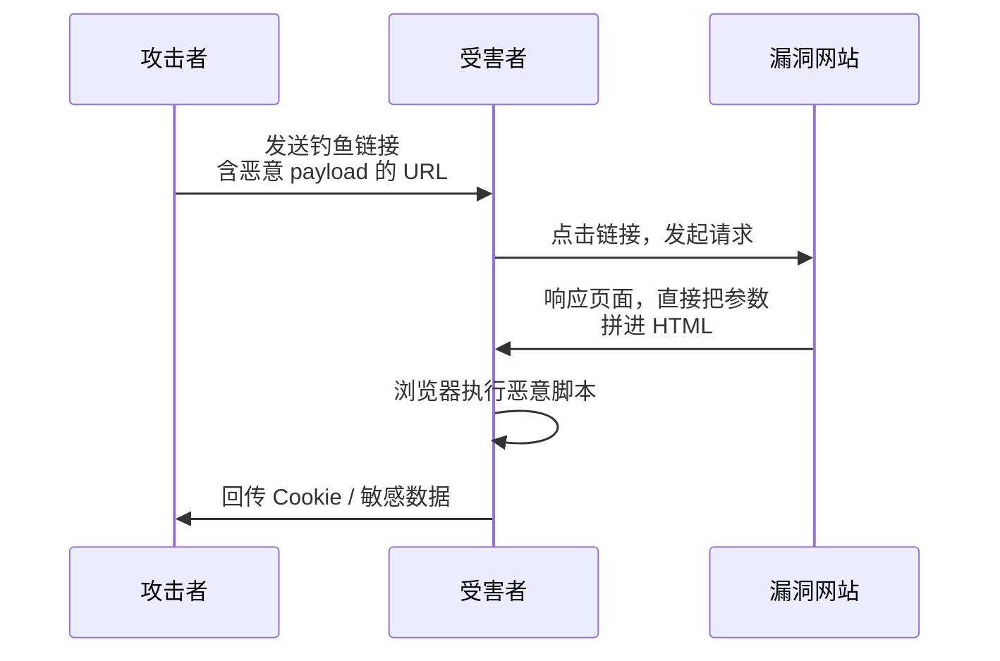
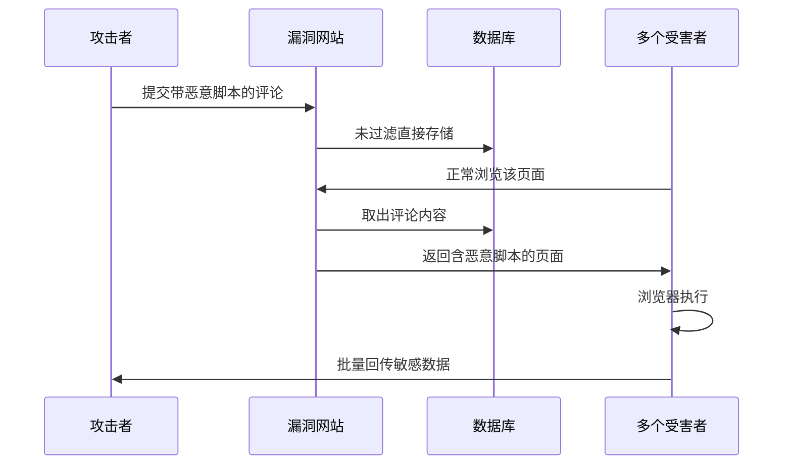
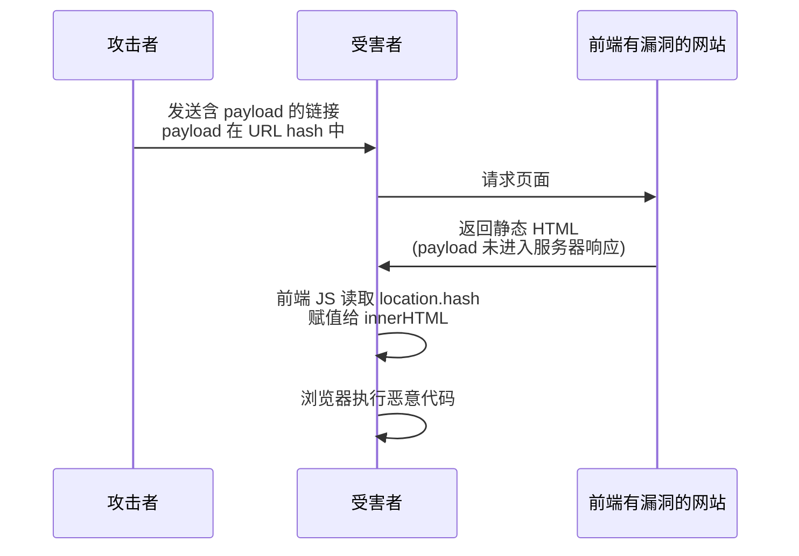
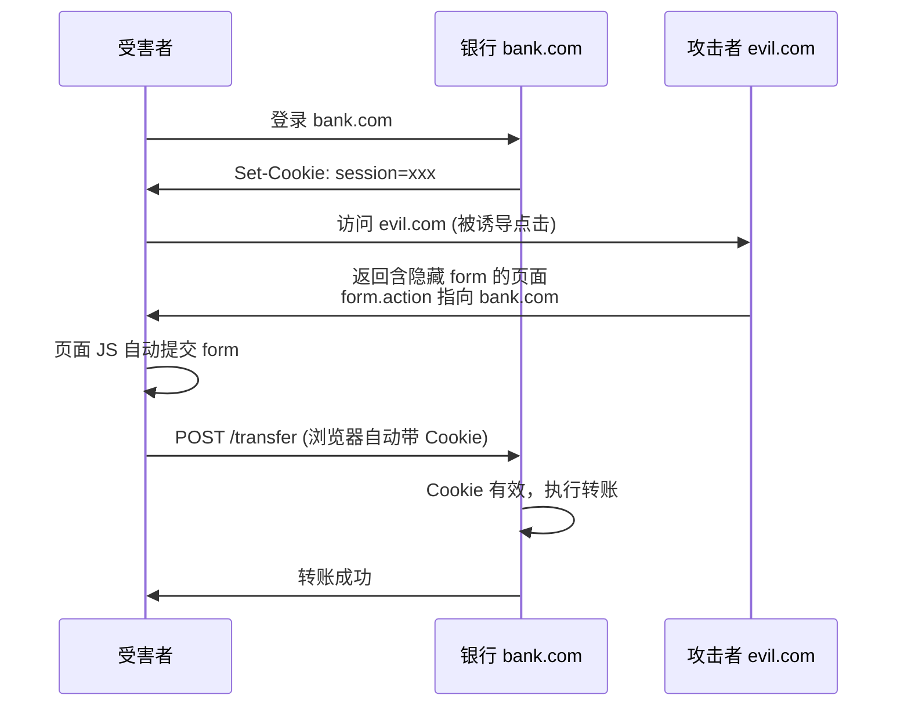
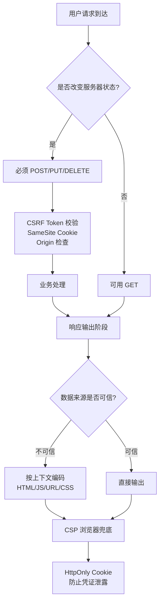

[toc]

# Web 安全基石：XSS 与 CSRF 的系统性认知

## 开宗明义：为什么这两个攻击是必修课

在 Web 安全的庞大家族里，XSS（Cross-Site Scripting，跨站脚本攻击）与 CSRF（Cross-Site Request Forgery，跨站请求伪造）是两位最古老、最"有教育意义"的成员。它们都利用了 Web 的**信任机制**，但利用的方向恰好相反：

- **XSS 骗的是浏览器**："这段脚本来自可信的网站，执行它吧。"
- **CSRF 骗的是服务器**："这个请求来自已经登录的用户，处理它吧。"

理解这一句话，你就抓住了两者的本质差异。

------

## 第一部分 XSS 跨站脚本攻击

### 核心原理：浏览器的信任被滥用

浏览器执行 JavaScript 时，唯一依靠的判断是"这段代码来自哪个来源（Origin）"。若代码写在 `https://bank.com/page.html` 中，浏览器就认为它天然有权访问 `bank.com` 的 Cookie、LocalStorage、DOM……

XSS 的本质就是：**攻击者把恶意脚本"塞"进了合法站点的页面里，让浏览器把它当成该站点自己的代码来执行。**

打个类比：银行保险库认识钥匙，不认识人。XSS 就是让攻击者把自己的指令偷偷写在保安手册里，保安（浏览器）看到这是"我们银行的手册"，就照做了。

### 三种 XSS 类型的本质区别

| 类型                | 恶意代码存放位置             | 触发方式                     | 波及范围         | 典型场景                        |
| ------------------- | ---------------------------- | ---------------------------- | ---------------- | ------------------------------- |
| 反射型（Reflected） | URL 参数等请求数据中         | 受害者点击含 payload 的链接  | 仅点击链接的人   | 搜索结果页、错误提示页          |
| 存储型（Stored）    | 服务器数据库                 | 受害者正常访问页面即触发     | 所有访问者       | 评论区、个人资料、留言板        |
| DOM 型（DOM-based） | 不一定进入服务器，完全在前端 | 前端 JS 处理不可信数据时触发 | 依赖前端代码路径 | SPA 路由、URL hash、postMessage |

三者的核心区别不在"危害大小"，而在**数据在哪里变成可执行代码**：反射型是服务器把参数拼到响应 HTML 里；存储型是服务器把脏数据从数据库取出再拼到 HTML 里；DOM 型是前端 JS 直接把脏数据塞进 `innerHTML` 等危险 API。

### 反射型 XSS 攻击流程



### 存储型 XSS 攻击流程



### DOM 型 XSS 攻击流程



### 数据流思维：Source 与 Sink 模型

XSS 防御的抽象模型是**数据从 Source 到 Sink 的流动**。只要不可信数据没经过安全处理就到达 Sink，就可能产生 XSS。掌握这个模型比背漏洞样例更重要。

**常见 Source（数据入口）**

- URL 相关：`location.href`、`location.search`、`location.hash`、`location.pathname`
- 网络相关：`document.referrer`、`XMLHttpRequest` / `fetch` 的响应体
- 客户端存储：`document.cookie`、`localStorage`、`sessionStorage`
- 跨窗口：`window.name`、`postMessage` 的 `event.data`
- 用户输入：各种表单控件的 `value`

**危险 Sink（危险的赋值或调用点）**

| Sink                                                | 风险说明                        |
| --------------------------------------------------- | ------------------------------- |
| `innerHTML` / `outerHTML`                           | 最经典的 HTML 注入入口          |
| `document.write` / `document.writeln`               | 老式 API，直接写入文档流        |
| `eval` / `Function` 构造器                          | 把字符串当代码执行              |
| `setTimeout` / `setInterval`（字符串参数）          | 内部类似 eval 的逻辑            |
| `location` / `location.href` 赋值                   | 可被利用执行 `javascript:` 协议 |
| `<a href>` 动态赋值                                 | 同上，危险协议注入              |
| jQuery 的 `.html()`、`.append()`                    | 本质调用 innerHTML              |
| `insertAdjacentHTML`                                | 同样是 HTML 级别注入            |
| Vue 的 `v-html`、React 的 `dangerouslySetInnerHTML` | 框架的"逃生舱"，需格外小心      |

### 经典攻击案例

**Samy Worm（MySpace, 2005）**：Samy Kamkar 在 MySpace 个人资料页注入脚本，访问者会自动把 Samy 加为好友，并把同样的脚本复制到自己的资料页。20 小时内感染了 100 万用户，是蠕虫式 XSS 的典范，直接推动了 Web 安全的行业觉醒。

**Twitter onMouseOver（2010）**：一个仅需鼠标悬停就能触发的 XSS 漏洞。推文展示为带 `onmouseover` 的伪装内容，用户的光标扫过就会自动转推垃圾内容，数小时内波及无数账号，包括当时英国首相夫人的账号。

**British Airways 支付页劫持（2018，Magecart 事件）**：攻击者在 BA 的网站注入了一段仅 22 行的恶意脚本，从支付表单静默窃取信用卡信息。泄露 38 万客户数据，BA 最终被 GDPR 罚款超 1.8 亿英镑。这是 XSS 危及真实金钱的典型。

### 危害场景全景

| 危害方向               | 具体行为                                  |
| ---------------------- | ----------------------------------------- |
| 会话劫持               | 窃取 `document.cookie`（若未设 HttpOnly） |
| 凭据窃取               | 伪造登录框、监听键盘事件                  |
| 网页篡改               | 修改 DOM，钓鱼或传播谣言                  |
| 强制操作               | 调用站内 API 模拟用户动作（结合 CSRF）    |
| 浏览器端挖矿           | 注入 WebAssembly 挖矿脚本                 |
| 内网扫描               | 利用 fetch 探测内网 IP 和服务             |
| 浏览器指纹             | 收集设备信息进行追踪                      |
| 窃取第三方 OAuth token | 读取 URL 片段中的 token                   |

### 现代 XSS 防御：纵深防御体系

防御 XSS 不是单点施工，而是多层叠加。下面按优先级与强度排列。

**第一防线：输出编码——根据上下文**

这是最根本的防御。**同一段不可信数据放在不同上下文中需要不同的编码方式**，这是新手最容易犯错的地方。

| 输出上下文              | 编码规则               | 举例               |
| ----------------------- | ---------------------- | ------------------ |
| HTML 元素内容           | 转义 `< > & " '`       | `<` → `<`          |
| HTML 属性值（带引号）   | 转义引号和 `< > &`     | `"` → `"`          |
| HTML 属性值（无引号）   | 所有非字母数字都要转义 | 极度危险，应避免   |
| `<script>` 内 JS 字符串 | 使用 `\uXXXX` 编码     | `<` → `\u003c`     |
| `<style>` 内 CSS        | CSS 十六进制编码       | `<` → `\3c`        |
| URL 参数                | `encodeURIComponent`   | 空格 → `%20`       |
| URL 本身                | 校验协议白名单         | 禁止 `javascript:` |

一个流传甚广的错误：用一套通用"转义函数"处理所有输出。**不同上下文必须使用不同编码**，否则必有漏洞。

**第二防线：输入验证与白名单净化**

对于允许富文本的场景（如富文本编辑器），必须使用**专业 HTML 净化库**，而不是自己写正则。

- 浏览器端：**DOMPurify**（事实标准，持续维护）
- Node.js：sanitize-html、DOMPurify（配合 jsdom）
- Java：OWASP Java HTML Sanitizer
- Python：bleach

**切记**：不要用正则表达式"过滤 `<script>`"，几十年的安全史证明这种思路必然被绕过（编码、换行符、大小写、嵌套等各种 trick）。

**第三防线：内容安全策略（CSP）**

CSP 是浏览器级别的"白名单防火墙"，即使代码被注入，只要不在白名单里的脚本就不会执行。现代推荐写法：

```
Content-Security-Policy:
  default-src 'self';
  script-src 'nonce-{随机值}' 'strict-dynamic';
  object-src 'none';
  base-uri 'none';
  frame-ancestors 'none';
```

关键概念：

- **nonce（一次性随机数）**：每次响应生成随机值，既放在 CSP header 里，也加在合法的 `<script nonce="...">` 上。攻击者注入的 `<script>` 没有正确 nonce，浏览器拒绝执行。
- **strict-dynamic**：允许被 nonce 信任的脚本动态加载其他脚本（现代前端框架的常见需求）。
- **拒绝 `unsafe-inline`、`unsafe-eval`**：这两个让 CSP 形同虚设。

**第四防线：HttpOnly Cookie**

给 Session Cookie 加上 `HttpOnly`，JavaScript 就无法读取它。即使发生 XSS，Cookie 也不会直接被 `document.cookie` 窃走。这是缓解措施，不能阻止 XSS 本身。

**第五防线：Trusted Types（现代浏览器前沿）**

Chrome 等浏览器支持的新机制，强制要求 `innerHTML` 等危险 API 只能接受特殊类型的对象（不能是普通字符串）。配置：

```
Content-Security-Policy: require-trusted-types-for 'script'
```

开启后，`element.innerHTML = someString` 会直接抛错，除非先用 `trustedTypes.createPolicy(...)` 净化。这从根本上消除了大量 DOM XSS，是近年最振奋人心的进展。

**第六防线：前端框架的默认安全**

现代框架默认对插值内容做 HTML 转义：

- React：`{variable}` 安全，`dangerouslySetInnerHTML` 是逃生舱
- Vue：`{{ variable }}` 安全，`v-html` 是逃生舱
- Angular：`{{ variable }}` 安全，`[innerHTML]` 会自动 sanitize（但仍需小心）

用好框架就赢了大半，**真正的 XSS 漏洞多半出现在开发者主动用逃生舱、或处理 URL/postMessage 等场景**。

顺带一提：过时的 `X-XSS-Protection` header 现代浏览器（Chrome、Edge）已不再支持，甚至设为 `0` 更安全。不要依赖它。

### XSS 防御最佳实践清单

- 默认不信任任何来源的数据（URL、用户输入、API 响应、第三方数据）
- **根据上下文选择编码方式**（牢记这一点）
- 富文本必须使用 DOMPurify 等专业库净化
- Session Cookie 始终设置 `HttpOnly`、`Secure`、`SameSite`
- 部署严格 CSP（nonce + strict-dynamic）
- 避免 `innerHTML`、`document.write`、`eval` 等危险 API
- 使用 React/Vue/Angular 时，谨慎使用 `dangerouslySetInnerHTML` / `v-html`
- URL 跳转必须校验协议（禁止 `javascript:`、`data:`）
- 渐进采用 Trusted Types
- 借助静态分析工具（ESLint 的 `no-unsanitized`、Semgrep）

------

## 第二部分 CSRF 跨站请求伪造

### 核心原理：Cookie 自动携带机制被滥用

浏览器有个"贴心"设计：只要请求是发往某个域名的，浏览器就**自动带上**该域名的 Cookie（包括登录态）。无论请求是用户主动发起，还是被别的页面偷偷触发，浏览器一视同仁。

CSRF 的本质就是：**攻击者诱导受害者的浏览器，对目标站点发起一个"看起来像本人操作"的请求。**

三个前提必须同时满足：

1. 受害者已登录目标站点（浏览器持有有效 Cookie）
2. 目标站点依赖 Cookie 识别身份，且没有独立的操作校验
3. 受害者访问了攻击者控制的页面

用类比：你拿着公司门禁卡正常工作，有人在外面喊"把仓库的 100 万给 XXX 转过去"，前台听到了就执行了——因为她只认声音（身份），不关心说话的人是谁。

### CSRF 攻击流程



整个过程受害者可能毫无察觉，页面可用隐藏 iframe 秒级完成。

### 四种典型 CSRF 变种

**GET 型 CSRF**：最简单，只需让受害者加载一个 URL：``。任何位置的图片引用——邮件、论坛帖子、聊天消息——都能触发。这也解释了为什么敏感操作**绝不能用 GET**（同时违反 HTTP 规范对 GET 幂等性的要求）。

**POST 型 CSRF**：构造一个自动提交的隐藏表单。受害者访问攻击页面即触发，视觉上无任何感知。

**JSON/API CSRF**：现代 API 常接受 JSON。正常浏览器发送 `Content-Type: application/json` 会触发 CORS 预检（OPTIONS），阻断跨站请求。但若服务器错误地接受 `text/plain` 或 `x-www-form-urlencoded` 格式的 JSON 体（有些后端很宽松），就可能被绕过。

**Login CSRF（登录型 CSRF）**：攻击者强制受害者登录**攻击者的账号**。后续受害者的操作（搜索记录、输入的付款信息、绑定的第三方账号）都会记录到攻击者名下。这是极易被忽视的变种。

### 经典攻击案例

**Gmail 过滤器 CSRF（2008）**：攻击者构造表单，悄悄在受害者的 Gmail 里添加一条过滤规则——"所有邮件自动转发到攻击者邮箱"。受害者访问钓鱼页面后，账户的全部邮件（含银行、服务验证码）都被静默转发。

**ING 银行 CSRF（2008）**：攻击者链接可以直接在受害者账户间转账，无需二次确认。后紧急修复。

**YouTube 批量 CSRF（2008）**：几乎所有用户敏感操作（分享视频、发送消息、加好友、标记视频）都存在 CSRF，可被用于大规模社交工程。

### 威胁模型的重大转变：SameSite Cookie

2020 年起，Chrome 默认将未显式声明 SameSite 的 Cookie 视为 `SameSite=Lax`，其他主流浏览器相继跟进。这从根本上改变了 CSRF 的威胁面。

| 取值          | 行为                                           | 适用场景                 |
| ------------- | ---------------------------------------------- | ------------------------ |
| `Strict`      | 任何跨站请求都不带 Cookie                      | 金融类、管理后台         |
| `Lax`（默认） | 顶层导航的 GET 请求带 Cookie，其他跨站请求不带 | 大多数场景               |
| `None`        | 跨站请求都带 Cookie（必须同时设 `Secure`）     | 明确需要第三方嵌入的场景 |

影响：在 SameSite=Lax 下，**POST 跨站请求不再携带 Cookie**，传统的 POST 型 CSRF 直接失效。但是：

- GET 型 CSRF 仍可能有效（顶层导航会带 Cookie）
- 子域攻击（`a.example.com` 攻 `b.example.com`）可能不受 SameSite 限制
- 非主流浏览器支持不一致
- 部分浏览器曾有 "Lax+POST 2 分钟缓解期" 等历史行为

所以，**SameSite 是强有力的第一道防线，但不是唯一防线**。

### 现代 CSRF 防御：纵深防御

**第一防线：SameSite Cookie**

默认设置 Session Cookie 为 `SameSite=Lax` 或 `Strict`。Spring Security、Django、Express 等主流框架已默认启用。

**第二防线：CSRF Token（同步器令牌模式）**

经典做法：服务器为每个会话生成随机 token，存入 session；返回表单时把 token 放入隐藏字段；用户提交时 token 随表单一起提交；服务器比对 session 中的 token 和提交值。

攻击者 evil.com 因同源策略无法读取 bank.com 的 token，所以伪造请求里没有正确 token，被服务器拒绝。这是最成熟稳定的方案。

**第三防线：Double Submit Cookie**

无状态的 token 方案：服务器生成随机值，同时放入 Cookie 和响应体；前端从 Cookie 读出该值，放入 `X-CSRF-Token` header；服务器对比 Cookie 值和 header 值。优势是服务器无状态；劣势是假设攻击者无法在目标域写 Cookie，而子域污染等场景可能破坏这个假设。

**第四防线：自定义请求头**

要求所有状态改变请求携带自定义 header（如 `X-Requested-With: XMLHttpRequest`）。浏览器对跨站发送自定义 header 会触发 CORS 预检，攻击者无法简单跨站发起。

**第五防线：Origin / Referer 校验**

服务端检查 `Origin`（现代浏览器对 CORS 请求自动带上）或 `Referer`。若和本站不一致则拒绝。需注意某些隐私策略会剥离 `Referer`，子域场景需小心处理。

**第六防线：重要操作的带外验证**

对于转账、删除账号、修改密码等高危操作，强制要求：密码二次确认、短信/邮件/TOTP 二次验证。这种"带外"验证 CSRF 无法绕过。

### CSRF 防御最佳实践清单

- **第一优先级**：Session Cookie 设置 `SameSite=Lax`（金融类用 `Strict`）
- 所有状态改变操作使用 POST/PUT/DELETE（符合 REST 语义）
- 使用框架内置的 CSRF Token 机制（Spring Security、Django、Laravel、Rails 等）
- SPA 架构下，使用 Double Submit Cookie 或 Header Token
- 验证 `Origin`/`Referer` 作为辅助手段
- 敏感操作要求二次验证（密码、2FA）
- 避免将敏感操作放在 GET 接口
- 登录、登出接口也要防 CSRF（防 Login CSRF、防强制登出）
- CORS 配置严格：当 `Access-Control-Allow-Credentials: true` 时，`Allow-Origin` 禁止用 `*` 且必须是严格白名单

------

## XSS 与 CSRF 的深度对比

| 对比维度         | XSS                             | CSRF                   |
| ---------------- | ------------------------------- | ---------------------- |
| 攻击对象         | 用户的浏览器                    | 服务器的业务逻辑       |
| 利用的信任       | 浏览器信任站点的代码            | 站点信任用户的 Cookie  |
| 是否需要用户登录 | 不一定（也可攻击未登录用户）    | 是（必须登录目标站点） |
| 攻击者能做什么   | 几乎任意事（读/写任意站点数据） | 仅能触发预定义接口     |
| 能否读取响应     | 能（同源环境）                  | 不能（浏览器阻止）     |
| 主要防御         | 输出编码 + CSP + HttpOnly       | CSRF Token + SameSite  |
| 一旦成功         | 可直接吸走一切                  | 只能模拟一次操作       |
| 典型影响面       | 单用户 → 全站用户（存储型）     | 单用户                 |

### 一个关键洞察：XSS 击穿所有 CSRF 防御

如果一个站点存在 XSS，那它所有的 CSRF 防御都形同虚设：

- CSRF Token？XSS 脚本直接从 DOM 读取 token
- SameSite Cookie？XSS 是在同站脚本中运行，根本不算跨站
- 二次密码验证？XSS 可以做键盘记录，等用户自己输入

所以**XSS 的危害实际上大于 CSRF**，修复 XSS 永远是更高优先级。

------

## 现代 Web 架构下的安全考量

### 前后端分离 / SPA 的特殊性

- 前端框架（React/Vue/Angular）默认做 XSS 转义，只要不滥用 `dangerouslySetInnerHTML`/`v-html`，基本安全
- 但 DOM 型 XSS 仍需警惕（处理 URL 参数、路由、postMessage 等场景）
- CSRF 层面：若使用 Cookie 认证，SameSite + Token 仍是标配

### JWT vs Session Cookie 的安全对比

| 维度         | Session Cookie        | JWT（放 Cookie）   | JWT（放 LocalStorage） |
| ------------ | --------------------- | ------------------ | ---------------------- |
| CSRF 风险    | 有（Cookie 自动携带） | 有                 | 无（JS 手动附加）      |
| XSS 下被窃取 | 可缓解（HttpOnly）    | 可缓解（HttpOnly） | 易被窃取               |
| 服务端可注销 | 容易                  | 难（无状态）       | 难                     |
| 适用场景     | 单体、服务端渲染      | 微服务、SPA        | 不推荐                 |

很多人以为"JWT 放 LocalStorage 就没 CSRF 了，更安全"——**这是个经典误区**。它只是把风险从 CSRF 转移到了 XSS，而 XSS 的危害更大。推荐方案仍是 **HttpOnly + Secure + SameSite 的 Cookie**。

### CORS 与 CSRF 的关系

常见误解："有 CORS 就不怕 CSRF 了。" **错**。CORS 是限制**跨站 JS 读取响应**，但不阻止**请求发出**。CSRF 根本不在乎能否读到响应，它只要请求被执行就达到目的。简单请求（simple request）不触发预检，可以直接跨站发出，而 CSRF 利用的正是这类请求。

------

## 综合防御心智模型



### 开发者自检清单

生产上线前，问自己一遍：

**XSS 维度**

- 所有用户输入输出到 HTML 时，是否根据上下文正确编码？
- 富文本是否经过 DOMPurify 等专业库净化？
- 是否避免了 `innerHTML`、`eval`、`document.write` 等危险 API？
- CSP 是否部署？是否避免了 `unsafe-inline`、`unsafe-eval`？
- Cookie 是否设置了 `HttpOnly`、`Secure`、`SameSite`？
- `<a href>`、`location.href` 的赋值是否校验了协议？

**CSRF 维度**

- Session Cookie 是否设置了 `SameSite=Lax` 或 `Strict`？
- 所有状态改变接口是否使用 POST/PUT/DELETE？
- 是否部署了 CSRF Token 或等价机制？
- 高危操作是否有二次验证？
- 是否校验了 `Origin`/`Referer`？
- CORS 的 `Access-Control-Allow-Origin` 是否严格？

### 学习与测试工具

- **静态分析**：ESLint 插件 `no-unsanitized`、Semgrep
- **动态扫描**：OWASP ZAP、Burp Suite
- **浏览器工具**：Chrome DevTools 的 Security 面板
- **CSP 评估**：Google 的 CSP Evaluator
- **系统学习**：**PortSwigger Web Security Academy**（强烈推荐，免费且系统，有完整实验环境）

------

## 总结与升华

XSS 和 CSRF 的学习远不止记住几个防御措施。它们折射出 Web 安全的核心规律：

**浏览器是一个"共享宿主"**。它承载着来自无数站点的代码、Cookie、数据。设计一个 Web 应用，实际上是在一个全网络都在试图利用的沙箱里生存。安全不是"加个 Token"、"转义一下"那么简单，而是**建立清晰的信任边界**：知道数据从哪里来（Source）、要去哪里（Sink）、在边界上做合适的处理（编码、校验、令牌）。

这种"追踪污染数据流"的思维模式，比背具体防御代码更关键。它能让你在面对新型攻击（Prototype Pollution、SSRF 变种、CSS 注入、Mutation XSS 等）时，拥有举一反三的能力。

**最后一句箴言**：安全不是银弹，而是纵深防御。不要指望任何单一技术解决所有问题——CSP 能挡住一些 XSS，但不是全部；SameSite 能挡住大部分 CSRF，但不是全部。把每一层防御都做好，让攻击者即便突破一层也无法得手，这才是工程师应有的心态。