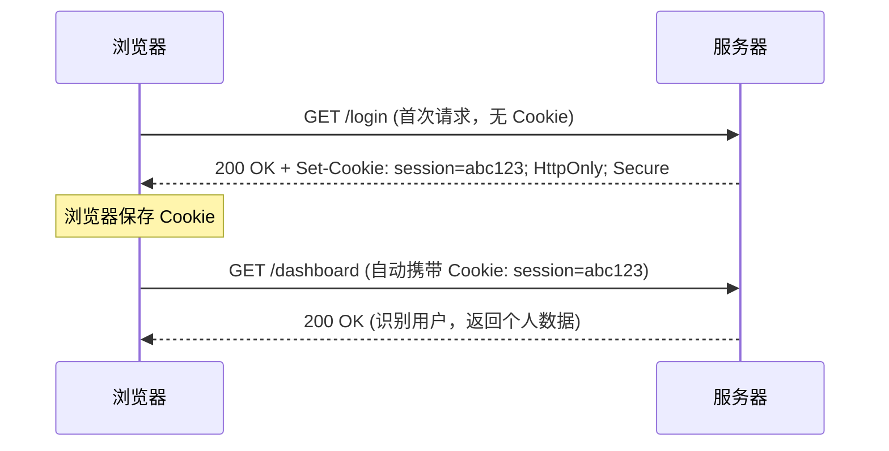
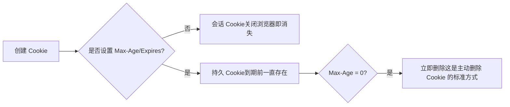
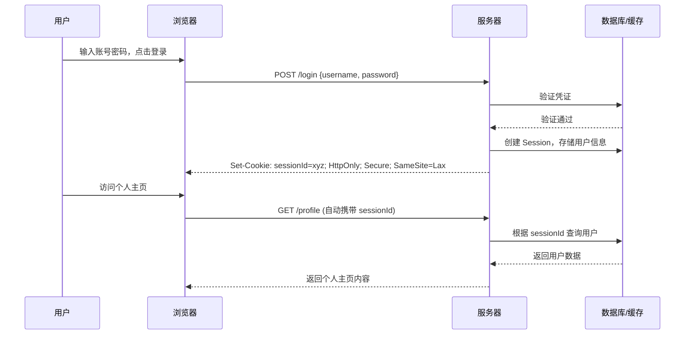
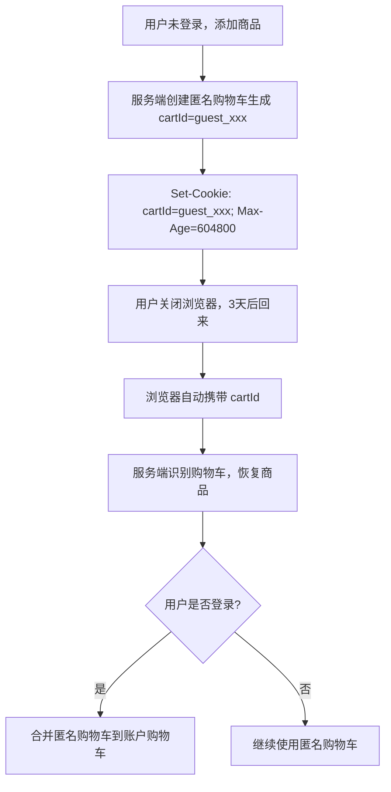
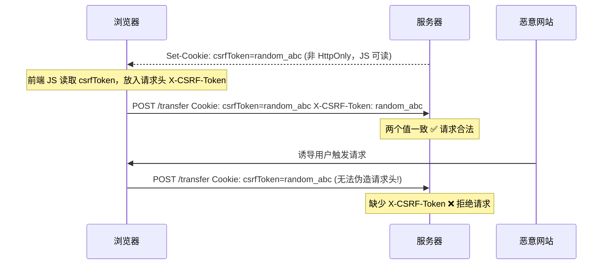
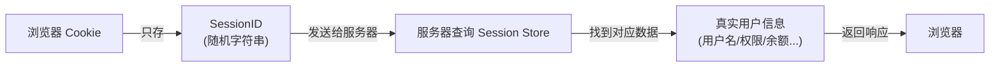
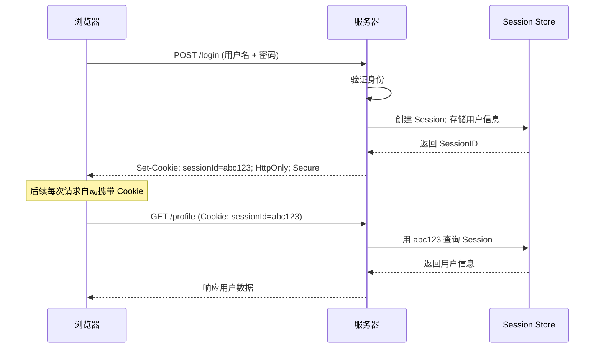

[toc]

# Web Cookie 用途系统详解

## 什么是 Cookie，为什么需要它

HTTP 协议本身是**无状态**的——每次请求对服务器而言都是陌生的，服务器无法区分"这次请求和上次请求是同一个人"。Cookie 就是为了解决这个根本问题而诞生的机制。

它的工作方式非常直接：服务器在响应中通过 `Set-Cookie` 头将数据写入浏览器，浏览器在后续对同一域名的请求中自动将这些数据通过 `Cookie` 头携带回去。这个"自动携带"是 Cookie 区别于 localStorage 等存储方式的最本质特征。




理解这个流程是理解所有 Cookie 用途的基础。

---

## Cookie 的关键属性速览

在讲用途之前，先建立对 Cookie 属性的基本认知，因为不同用途会对应不同的属性配置策略。

| 属性                  | 作用                                 | 典型值                    |
| --------------------- | ------------------------------------ | ------------------------- |
| `Name=Value`          | 存储的核心键值数据                   | `theme=dark`              |
| `Domain`              | 指定哪些子域可访问该 Cookie          | `.example.com`            |
| `Path`                | 限制 Cookie 仅在某路径下发送         | `/api`                    |
| `Max-Age` / `Expires` | 存活时长 / 到期时间点                | `Max-Age=3600`            |
| `HttpOnly`            | 禁止 JavaScript 读取，防 XSS         | 无值，存在即生效          |
| `Secure`              | 仅在 HTTPS 连接中发送                | 无值，存在即生效          |
| `SameSite`            | 控制跨站请求是否携带 Cookie，防 CSRF | `Strict` / `Lax` / `None` |

> **现代最佳实践**：涉及认证的 Cookie，应同时设置 `HttpOnly; Secure; SameSite=Lax`，这是当前行业标准配置。

---

## Cookie 的生命周期

Cookie 按生命周期分为两类，选择哪种取决于具体业务场景。

**会话 Cookie（Session Cookie）**：不设置 `Max-Age` 或 `Expires`，浏览器关闭后自动清除。适合临时状态，如登录会话的短期令牌。

**持久 Cookie（Persistent Cookie）**：设置了明确的存活时间，到期前始终存在，即使重启浏览器。适合长期偏好设置、"记住我"功能。



---

## 核心用途详解

### 身份认证与会话管理

这是 **Cookie 最重要、最不可替代的用途**。用户登录后，服务器创建一个 Session 或签发令牌，将其标识符写入 Cookie。此后每次请求浏览器自动携带，服务器就能持续识别用户身份，而无需用户反复输入密码。



**Session Cookie 与 Token Cookie 的选择**

目前主流有两种方案：

| 方案          | 存储位置                          | 工作原理                          | 适用场景           |
| ------------- | --------------------------------- | --------------------------------- | ------------------ |
| 传统 Session  | 服务端存储，Cookie 只存 SessionID | 服务器用 SessionID 查找用户数据   | 传统服务端渲染应用 |
| JWT in Cookie | Cookie 存储完整 JWT Token         | 服务器直接解密 Token 获取用户信息 | 现代前后端分离应用 |

### JWT的存储安全

**为什么要把 Token 放 Cookie 而非 localStorage？**

很多初学者会把 **JWT** 存放在 **localStorage** 中，但这存在 XSS 风险——一旦页面被注入恶意脚本，token 就会被读取并盗走。

而设置了 `HttpOnly` 的 Cookie，JavaScript 完全无法访问，即使存在 XSS 漏洞，攻击者也拿不到 Cookie 的值。

---

### 用户偏好与个性化设置

Cookie 可以在用户**未登录的情况下记住其操作偏好**，无需账户体系即可实现个性化体验。这类 Cookie 通常是**持久 Cookie**，有效期从数月到一年不等。

典型场景包括：

- **界面主题**：深色/浅色模式的选择，下次访问自动恢复
- **语言与地区**：记住用户选择的语言，避免每次自动跳转到默认语言
- **内容密度**：列表视图还是卡片视图，紧凑布局还是宽松布局
- **分页大小**：表格每页显示 10 条还是 50 条

这类 Cookie 的配置特点是有效期长，不需要 `HttpOnly`（前端 JS 需要读取以便渲染），不涉及敏感数据。

---

### 购物车与未登录状态保持

电商场景中，用户未登录时添加商品到购物车，这些数据需要持久化。Cookie 是实现这一功能的传统方案——将购物车数据（或购物车的服务端标识符）存入 Cookie，用户下次回来时自动恢复。

这个场景也体现了 Cookie 的核心价值：**不依赖用户账号，也能在服务器和客户端之间维持连续的"对话"**。



---

### 行为追踪与数据分析

网站通过 Cookie 为每个访客分配唯一标识符，从而追踪用户在站内的行为路径，支撑数据分析和产品决策。

**站内分析（第一方追踪）**：由网站自身设置，用于统计页面访问量（PV）、独立访客数（UV）、用户转化漏斗等。Google Analytics、百度统计等工具都依赖这类 Cookie。

**跨站追踪（第三方追踪）**：由广告商等第三方域名设置。当用户访问多个嵌入了同一广告商脚本的网站时，广告商能通过 Cookie 识别出"这是同一个用户"，从而构建用户画像、投放精准广告。

> **重要趋势**：第三方 Cookie 正在被主流浏览器逐步淘汰。Safari 和 Firefox 已默认拦截，Chrome 也在推进 Privacy Sandbox 方案作为替代。新项目不应依赖第三方 Cookie 来实现追踪功能。

**A/B 测试分组**是行为追踪的重要应用：将用户随机分入实验组或对照组，并将分组结果存入 Cookie，确保同一用户在多次访问中看到的始终是同一个版本，保证实验结论的可靠性。

---

### CSRF 防护中的双重提交令牌

这是一个特殊的安全用途，Cookie 在这里不是"存储数据"，而是参与**防御机制**。

CSRF（跨站请求伪造）攻击的原理是：恶意网站诱导用户的浏览器向目标网站发起携带合法 Cookie 的请求，从而伪造用户操作。

双重提交令牌（Double Submit Cookie）方案利用了**第三方网站无法读取目标网站 Cookie** 这一特性：



---

### 服务端渲染中的请求上下文传递

在服务端渲染（SSR）架构中，服务器在生成 HTML 页面前需要知道"当前用户是谁"，才能渲染出个性化内容。由于 SSR 的请求直接发往服务器，Cookie 的"自动携带"特性在这里尤为关键——Next.js、Nuxt 等框架的 SSR 请求中，认证 Cookie 会随页面请求一同发送，服务器能直接读取并完成认证，无需额外的客户端 API 请求。

---

## 安全风险与防护策略

Cookie 携带了敏感信息，是攻击者的重要目标。理解常见攻击方式和对应防护手段是正确使用 Cookie 的必要前提。

| 攻击类型             | 攻击原理                                              | 防护措施                        |
| -------------------- | ----------------------------------------------------- | ------------------------------- |
| XSS（跨站脚本）      | 注入恶意 JS，通过 `document.cookie` 读取并盗走 Cookie | 设置 `HttpOnly`，JS 无法读取    |
| CSRF（跨站请求伪造） | 诱导浏览器向目标站发起携带 Cookie 的恶意请求          | 设置 `SameSite=Lax` 或 `Strict` |
| 中间人攻击           | 在不加密的 HTTP 连接中截获 Cookie 明文                | 设置 `Secure`，仅 HTTPS 传输    |
| Cookie 劫持          | 在公共网络中监听并窃取 Cookie                         | `Secure` + 全站 HTTPS           |
| Cookie 范围过宽      | 不必要的路径/域名共享了敏感 Cookie                    | 合理配置 `Path` 和 `Domain`     |

**SameSite 三个取值的行为差异**：

| 取值     | 同站请求 | 跨站导航（点击链接） | 跨站子资源请求（img/iframe）  |
| -------- | -------- | -------------------- | ----------------------------- |
| `Strict` | ✅ 携带   | ❌ 不携带             | ❌ 不携带                      |
| `Lax`    | ✅ 携带   | ✅ 携带               | ❌ 不携带                      |
| `None`   | ✅ 携带   | ✅ 携带               | ✅ 携带（需同时设置 `Secure`） |

> `Lax` 是现代浏览器的默认值，也是大多数场景的推荐选择。`None` 主要用于合法的跨站嵌入场景（如第三方支付组件），必须配合 `Secure` 使用。

---

## Cookie 与其他客户端存储的对比

选择存储方案时，核心问题是："这份数据需要服务器知道吗？"

| 特性           | Cookie             | localStorage       | sessionStorage | IndexedDB        |
| -------------- | ------------------ | ------------------ | -------------- | ---------------- |
| 容量上限       | ~4 KB              | ~5 MB              | ~5 MB          | 无硬性限制       |
| 随请求自动发送 | ✅ 是               | ❌ 否               | ❌ 否           | ❌ 否             |
| 服务端可读写   | ✅ 是               | ❌ 否               | ❌ 否           | ❌ 否             |
| 生命周期       | 可精确控制         | 永久（手动清除）   | 标签页关闭即删 | 永久（手动清除） |
| JS 可访问      | 视 HttpOnly        | ✅ 是               | ✅ 是           | ✅ 是             |
| 适合存储       | 认证令牌、会话标识 | 用户配置、缓存数据 | 临时表单数据   | 离线数据、大文件 |

**决策建议**：

- 需要服务端识别的数据（认证、会话）→ **Cookie**，且配置 `HttpOnly + Secure`
- 仅前端使用的持久化数据（主题、语言）→ **localStorage**，或用不带 `HttpOnly` 的 Cookie（方便服务端 SSR 读取）
- 页面内的临时状态 → **sessionStorage** 或内存变量

---

## 现代应用的最佳实践总结

**认证 Cookie 的标准配置**

所有用于身份认证的 Cookie，都应该同时具备以下属性：`HttpOnly`（防脚本读取）、`Secure`（强制 HTTPS）、`SameSite=Lax`（防 CSRF）。

有效期建议根据业务安全需求设置，高安全场景（如银行）通常不超过 30 分钟，普通应用可以设置 7~30 天并配合刷新机制。

**最小范围原则**

`Domain` 和 `Path` 应配置为业务所需的最小范围，避免把认证 Cookie 的作用域设置得过于宽泛，减少泄露面。

**敏感信息不直接入 Cookie**

Cookie 的值应**存储标识符（如 SessionID）**，而非用户的真实数据（如用户名、余额）。

标识符泄露了还可以在服务端失效，而数据一旦泄露就是直接暴露。

**清退用户时主动删除 Cookie**

用户登出时，服务端应同时：① 使服务端 Session 失效；② 响应中设置 `Max-Age=0` 指示浏览器立即删除对应 Cookie。只做其中一步都是不完整的。

**第三方 Cookie 替代方案**

新项目中需要跨站数据共享的场景，应优先考虑：服务端 API 对接、Privacy Sandbox 提案的相关 API（如 Topics API），而非依赖即将被全面淘汰的第三方 Cookie。

## Cookie 值应存储标识符而非敏感数据本身

Cookie 是浏览器自动随每次请求发送给服务器的小型文本数据。正因为它的"自动发送"特性，它成为维持登录状态的常用手段——但也正因如此，**存什么进去**这个问题至关重要。

一个常见的新手误区是：既然 Cookie 能存东西，就把用户信息直接塞进去，比如用户名、权限、余额。这种做法存在根本性的安全缺陷，因为 **Cookie 的内容完全受客户端控制**，服务器无法阻止用户修改它。

---

核心思路：钥匙 vs 财物

可以用一个现实类比来理解这个设计：

> 你在酒店寄存行李，前台给你一张**存包凭证**（一串编号）。你带走的是凭证，行李锁在后台仓库。就算你伪造凭证上的编号，也取不出别人的行李——因为真实信息在仓库里，凭证只是一把钥匙。

Cookie 中存储的 SessionID，就是这张"存包凭证"。



---

### 两种做法的对比

#### 错误做法：Cookie 直接存储数据

```json
Cookie: user={"id":1, "name":"张三", "role":"admin", "balance":99999}
```

用户只需打开浏览器开发者工具，就能把 `role` 从 `user` 改成 `admin`，或者把 `balance` 改成任意数字。服务器收到这个 Cookie 后，如果直接信任其内容，就会产生严重的安全漏洞。

#### 正确做法：Cookie 只存 SessionID

```
Cookie: sessionId=a3f8k2m9x7q1p5r2
```

这串随机字符本身没有任何意义，用户就算修改它，也只会得到一个无效的 ID，服务器查不到对应的 Session 直接拒绝请求。真实的用户数据全部保存在服务器端。

---

### 完整的会话流程



---

### 标识符方案的优势

| 维度           | 直接存数据 ❌                 | 存 SessionID ✅                     |
| -------------- | ---------------------------- | ---------------------------------- |
| **篡改风险**   | 用户可直接修改任意字段       | 修改 ID 后查不到 Session，请求被拒 |
| **数据容量**   | Cookie 上限约 4KB            | ID 只有几十字节，几乎无限制        |
| **服务端控制** | 一旦发出无法撤回             | 服务器可随时删除 Session 强制下线  |
| **数据一致性** | 客户端缓存可能与数据库不同步 | 每次都从服务器读取最新状态         |
| **隐私暴露**   | 敏感字段在网络中反复传输     | 敏感数据始终留在服务器             |

---

### SessionID 本身的安全要求

SessionID 虽然只是一个"标识符"，但它就是用户身份的凭证，本身也需要被妥善保护：

**生成要求**：必须使用密码学安全的随机数生成器，长度足够（建议 128 位以上），确保无法被猜测或枚举。不要用用户 ID、时间戳等可预测的值来拼凑。

**传输要求**：Cookie 应设置 `Secure` 属性，确保只通过 HTTPS 传输，防止在网络层被窃听。

**访问限制**：设置 `HttpOnly` 属性，禁止 JavaScript 读取 Cookie，抵御 XSS 攻击窃取 SessionID。

**生命周期**：设置合理的过期时间，用户退出登录时服务端要主动销毁对应的 Session，而不只是清除客户端 Cookie。

---

## 现代化补充：Token 方案的对比

现代前后端分离架构中，**JWT**（JSON Web Token）是另一种主流方案，它将信息编码在 Token 中，服务器无需存储 Session。但这引入了新的权衡：

|              | 传统 Session + Cookie      | JWT Token                    |
| ------------ | -------------------------- | ---------------------------- |
| **状态存储** | 服务器端（Session Store）  | 客户端（Token 本身携带信息） |
| **可撤销性** | 随时删除 Session 即可      | Token 未过期前难以强制失效   |
| **适用场景** | 单体应用、需要精确控制会话 | 微服务、分布式、无状态 API   |
| **核心原则** | Cookie 存 SessionID        | Cookie 或 Header 存 Token    |

注意，即使使用 JWT，也仍然遵循"**不在 Cookie 中明文存储可篡改的业务数据**"这一根本原则——JWT 通过签名保证内容不可篡改，而非依赖客户端的自觉性。

