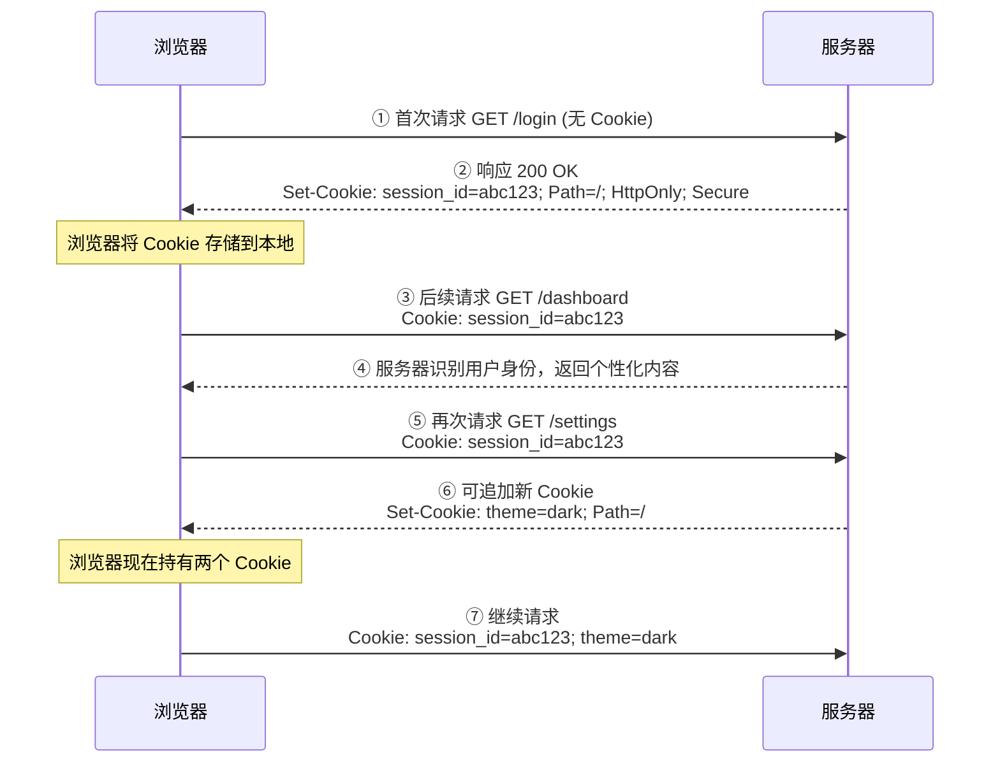
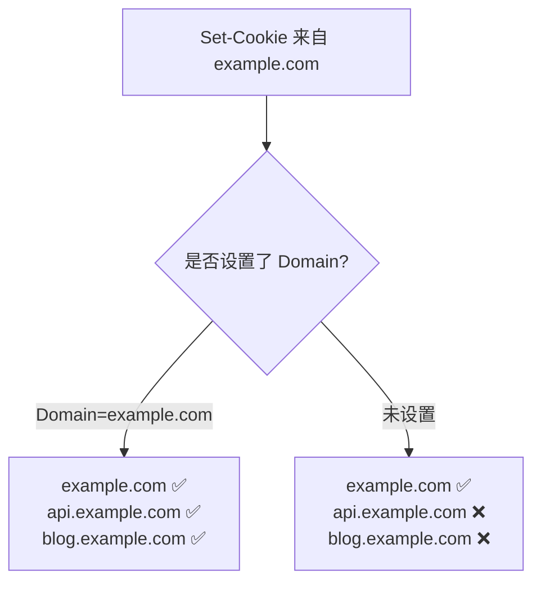
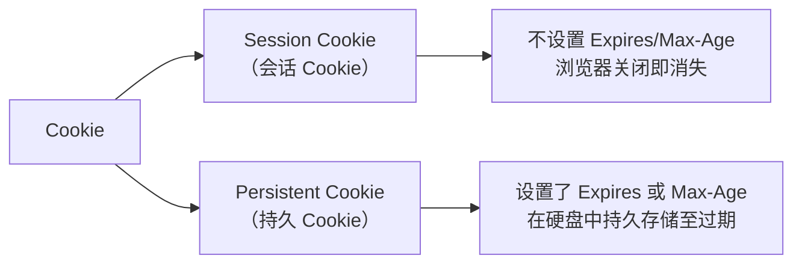
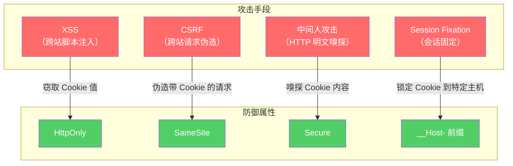
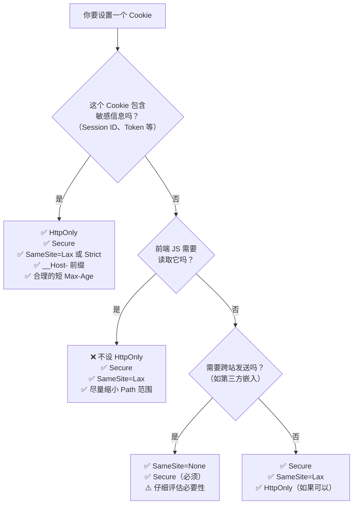
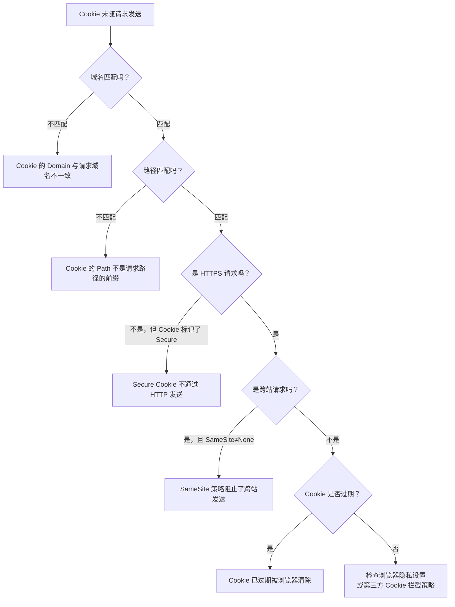

[toc]

# Web Cookie 完全指南

[HTTP Cookie - HTTP | MDN --- HTTP Cookie - HTTP | MDN](https://developer.mozilla.org/zh-CN/docs/Web/HTTP/Guides/Cookies)

------

## Cookie 是什么

Cookie 是服务器发送到用户浏览器、并由浏览器存储的**一小段文本数据**。浏览器在后续对**同一服务器**发起请求时，会自动将这段数据携带在请求头中回传给服务器。

> - Cookie **是文件（或内存数据）**，本质是文本。
> - 可以读写，但前端 JS 受 `HttpOnly` 等安全策略限制，后端无此限制。

**它存在的根本原因**：HTTP 协议是**无状态**的——服务器处理完一个请求后，不会"记住"这个请求的任何信息。Cookie 就是为了在这种无状态协议上**模拟出有状态的会话**而诞生的机制。

> 类比：你去一家咖啡店，店员给你一张会员小卡片（Cookie）。你每次来都出示这张卡片，店员扫一眼就知道你是谁、买过什么、积了多少分——而不需要每次都重新认识你。

------

## 工作机制

### 完整生命周期





**关键要点：**

- **服务器** 通过响应头 `Set-Cookie` **写入** Cookie
- **浏览器** 通过请求头 `Cookie` **回传** Cookie
- 这个过程对用户和前端 JavaScript 代码来说是**自动且透明**的（除非设置了 `HttpOnly`，JS 无法读取）

### 协议层面的真实报文

**服务器响应（写入）：**

```http
HTTP/1.1 200 OK
Set-Cookie: user_id=u_8f3k; Max-Age=86400; Path=/; Secure; HttpOnly; SameSite=Lax
Set-Cookie: theme=dark; Max-Age=31536000; Path=/
Content-Type: text/html
```

**浏览器请求（回传）：**

```http
GET /api/profile HTTP/1.1
Host: example.com
Cookie: user_id=u_8f3k; theme=dark
```

注意：回传(给服务器)时**所有 Cookie 被合并为一行**，且**不携带属性**（Path、HttpOnly 等信息不会回传，它们仅在浏览器端用于决定"该不该发送"）。

## 创建 Cookie

服务器收到 HTTP 请求后，服务器可以在响应标头里面添加一个或多个 [`Set-Cookie`](https://developer.mozilla.org/zh-CN/docs/Web/HTTP/Reference/Headers/Set-Cookie) 选项。

浏览器收到响应后通常会保存下 Cookie，并将其放在 HTTP [`Cookie`](https://developer.mozilla.org/zh-CN/docs/Web/HTTP/Reference/Headers/Cookie) 标头内，向同一服务器发出请求时一起发送。

你可以指定一个**过期日期**或者时间段之后，不能发送 cookie。

你也可以对指定的域和路径设置额外的限制，以**限制 cookie 发送的位置**。

关于下面提到的头部属性的详细信息，请参考 [`Set-Cookie`](https://developer.mozilla.org/zh-CN/docs/Web/HTTP/Reference/Headers/Set-Cookie) 文章。

------

## Cookie 的组成结构

一个 Cookie 由**名称=值**这一核心部分，加上若干**控制属性**组成。

### 属性全览

| 属性           | 语法示例                                | 作用                                        | 默认行为                   |
| -------------- | --------------------------------------- | ------------------------------------------- | -------------------------- |
| **Name=Value** | `session_id=abc123`                     | Cookie 的核心数据，**唯一必需部分**         | —                          |
| **Domain**     | `Domain=example.com`                    | 指定哪些域名可以接收此 Cookie               | 仅当前精确域名（不含子域） |
| **Path**       | `Path=/app`                             | 指定哪些 URL 路径下才发送此 Cookie          | 当前请求的路径             |
| **Expires**    | `Expires=Thu, 01 Jan 2026 00:00:00 GMT` | 绝对过期时间（GMT 格式）                    | 会话结束时删除             |
| **Max-Age**    | `Max-Age=86400`                         | 相对过期时间（秒数），优先级高于 Expires    | 会话结束时删除             |
| **Secure**     | `Secure`                                | 仅在 HTTPS 连接时才发送                     | HTTP/HTTPS 均发送          |
| **HttpOnly**   | `HttpOnly`                              | 禁止 JavaScript 通过 `document.cookie` 访问 | JS 可访问                  |
| **SameSite**   | `SameSite=Lax`                          | 控制跨站请求时是否携带 Cookie               | `Lax`（现代浏览器默认）    |

### 属性详解

#### Domain — 谁能收到这个 Cookie

```
Set-Cookie: token=xxx; Domain=example.com
```

- 设置 `Domain=example.com` 后，`example.com` **及其所有子域**（如 `api.example.com`、`blog.example.com`）都可以接收此 Cookie
- **不设置 Domain** 时，Cookie 仅绑定到**精确的当前域名**，子域名也收不到
- 不可以设置为与当前域毫无关联的域名（浏览器会直接拒绝）



#### Path — 哪些路径下才发送

设置 `Path=/docs` 后：

| 请求 URL                      | 是否携带 Cookie         |
| ----------------------------- | ----------------------- |
| `/docs`                       | ✅                       |
| `/docs/intro`                 | ✅                       |
| `/docs/intro/getting-started` | ✅                       |
| `/dashboard`                  | ❌                       |
| `/documentation`              | ❌（不是前缀匹配子路径） |

#### Expires 与 Max-Age — Cookie 何时死亡

| 场景                                  | 行为                                                |
| ------------------------------------- | --------------------------------------------------- |
| 两者都不设置                          | **Session Cookie**：浏览器关闭（会话结束）即删除    |
| 仅设置 `Expires`                      | 到达指定时间点后删除                                |
| 仅设置 `Max-Age`                      | 从设置时刻起经过指定秒数后删除                      |
| 两者都设置                            | `Max-Age` 优先                                      |
| `Max-Age=0` 或 `Expires` 设为过去时间 | **立即删除**该 Cookie（这是删除 Cookie 的标准手段） |

#### HttpOnly — 对抗 XSS 的第一道墙

```
Set-Cookie: session_id=abc123; HttpOnly
```

设置后，`document.cookie` 完全看不到这个 Cookie。这意味着即使页面存在 XSS（跨站脚本）漏洞，攻击者注入的恶意 JavaScript 也**无法窃取**这个 Cookie 的值。

> ⚠️ **HttpOnly 不是万能的**——它阻止的是"读取"，而不是"发送"。如果攻击者能在受害者浏览器中触发请求，Cookie 仍然会被浏览器自动携带。因此 HttpOnly 需要搭配 SameSite 和 CSRF Token 使用。

#### Secure — 强制 HTTPS

```
Set-Cookie: session_id=abc123; Secure
```

标记为 `Secure` 的 Cookie **只能通过 HTTPS 连接发送**。在 HTTP 明文传输环境下，浏览器不会携带此 Cookie，从而防止中间人攻击嗅探到敏感信息。

现代最佳实践：**所有敏感 Cookie 都必须设置 Secure**。

------

## SameSite 属性 — 现代 Cookie 安全的核心

SameSite 是近年来**最重要的 Cookie 安全演进**，直接影响跨站请求伪造（CSRF）防护和第三方 Cookie 行为。

### 什么是"同站"与"跨站"

先区分两个容易混淆的概念：

| 概念                   | 判断依据                    | 示例                                                         |
| ---------------------- | --------------------------- | ------------------------------------------------------------ |
| **同源 (Same-Origin)** | 协议 + 域名 + 端口 完全相同 | `https://app.example.com:443` 与 `https://app.example.com:443` |
| **同站 (Same-Site)**   | **eTLD+1** 相同即可         | `https://app.example.com` 与 `https://api.example.com`（同站） |

> **eTLD+1** 是"有效顶级域名 + 一级"。对于 `app.example.com`，eTLD 是 `.com`，eTLD+1 是 `example.com`。因此只要 `example.com` 相同，就算同站。

### 三个取值

| 值           | 跨站请求携带 Cookie?          | 典型场景                                          | 安全等级 |
| ------------ | ----------------------------- | ------------------------------------------------- | -------- |
| **`Strict`** | ❌ 完全不携带                  | 银行、支付等高敏感系统                            | 🔒🔒🔒      |
| **`Lax`**    | ✅ 仅限**顶级导航的 GET 请求** | 大多数 Web 应用（现代默认值）                     | 🔒🔒       |
| **`None`**   | ✅ 所有跨站请求都携带          | 需要跨站嵌入的第三方服务（必须同时设置 `Secure`） | 🔒        |

### Lax 的具体行为

"顶级导航的 GET 请求"是指用户**主动点击链接**跳转到目标站点的行为：

| 请求方式                       | SameSite=Lax 是否携带 Cookie |
| ------------------------------ | ---------------------------- |
| 用户点击 `<a href="...">` 链接 | ✅                            |
| 用户在地址栏输入 URL 回车      | ✅                            |
| `<form method="GET">` 提交     | ✅                            |
| `<form method="POST">` 提交    | ❌                            |
| `<iframe src="...">` 加载      | ❌                            |
| `` 加载         | ❌                            |
| `fetch()` / `XMLHttpRequest`   | ❌                            |

这个设计极为精妙：它在**阻断 CSRF 攻击**（通常依赖跨站 POST 或隐藏请求）的同时，**保留了正常的链接跳转体验**（用户从搜索引擎点击链接到你的网站仍然能保持登录态）。

------

## Cookie 的分类

### 按持续时间



### 按来源

| 分类              | 定义                         | 示例                                                         | 当前趋势       |
| ----------------- | ---------------------------- | ------------------------------------------------------------ | -------------- |
| **第一方 Cookie** | 由**当前访问的网站**域名设置 | 你访问 `example.com`，Cookie 的 Domain 也是 `example.com`    | 正常使用       |
| **第三方 Cookie** | 由**非当前网站**的域名设置   | 你访问 `example.com`，但页面中嵌入的 `ad-tracker.com` 的脚本/图片设置了 Cookie | **正在被淘汰** |

#### 第三方 Cookie 的消亡时间线

| 时间  | 事件                                         |
| ----- | -------------------------------------------- |
| 2017  | Safari ITP 开始限制第三方 Cookie             |
| 2019  | Firefox ETP 默认阻止第三方跟踪 Cookie        |
| 2020  | Chrome 宣布计划淘汰第三方 Cookie             |
| 2024  | Chrome 开始逐步推进 Privacy Sandbox 替代方案 |
| 2025+ | 第三方 Cookie 在主流浏览器中基本退场         |

替代技术包括 Google 的 **Topics API**、**Attribution Reporting API** 等 Privacy Sandbox 提案。

------

## Cookie 的大小与数量限制

这些限制由浏览器实现决定，无标准强制规范，但业界普遍遵循：

| 限制维度                       | 典型值                            |
| ------------------------------ | --------------------------------- |
| 单个 Cookie 大小               | **4KB**（包含名称、值和所有属性） |
| 每个域名的 Cookie 数量         | **50 ～ 180 个**（因浏览器而异）  |
| 所有 Cookie 总大小（每个域名） | 通常不建议超过 **80KB**           |

> 实践建议：Cookie 应保持**尽可能小**。它会附加到**每一个**匹配的 HTTP 请求中，过大的 Cookie 会显著增加网络传输开销。

------

## JavaScript 操作 Cookie

### 读取

```js
// 返回当前页面所有可访问的 Cookie（HttpOnly 的除外），格式为一个长字符串
console.log(document.cookie);
// 输出: "theme=dark; lang=zh-CN; _ga=GA1.2.xxx"
```

这个字符串需要自行解析。可以用简单的工具函数：

```js
function getCookie(name) {
  const match = document.cookie.match(new RegExp('(^| )' + name + '=([^;]+)'));
  return match ? decodeURIComponent(match[2]) : null;
}
```

### 写入

```js
// 设置一个持久化 Cookie
document.cookie = "theme=dark; path=/; max-age=31536000; secure; samesite=lax";
```

> 这里的 `document.cookie = ...` 并不是"覆盖所有 Cookie"，而是**追加或更新单个 Cookie**。这是一个有违直觉的 API 设计。

### 删除

```js
// 将 max-age 设为 0 或将 expires 设为过去时间
document.cookie = "theme=; path=/; max-age=0";
```

**删除时必须保证 `Path` 和 `Domain` 与原始设置一致**，否则浏览器会认为这是不同的 Cookie，无法匹配删除。

### 现代推荐：Cookie Store API

传统的 `document.cookie` 是同步阻塞式 API，且接口设计古老。Chrome 87+ 支持新的异步 API：

```js
// 读取
const cookie = await cookieStore.get('theme');
console.log(cookie?.value); // "dark"

// 写入
await cookieStore.set({
  name: 'theme',
  value: 'dark',
  maxAge: 31536000,
  sameSite: 'lax'
});

// 删除
await cookieStore.delete('theme');

// 监听变化
cookieStore.addEventListener('change', (event) => {
  console.log('Changed:', event.changed);
  console.log('Deleted:', event.deleted);
});
```

> ⚠️ 该 API 目前仅 Chromium 系浏览器支持，生产环境使用需做好降级处理。

------

## 客户端对cookie的修改和伪造.

虽然 Cookie 通常由服务器通过 HTTP 响应头中的 `Set-Cookie` 字段发送给浏览器，但一旦数据到了客户端的手里，服务器就失去了对它的绝对控制权。

------

### 1. 客户端修改 Cookie 的两种主要方式

#### **通过浏览器开发者工具 (F12)**

这是最简单的方法。任何用户只需要按下 `F12`，进入 “Application”（应用）或 “Storage”（存储）选项卡，就能直接双击修改 Cookie 的值、过期时间或域名。

#### **通过 JavaScript 脚本**

如果该 Cookie 没有被标记为 `HttpOnly`，网页中的脚本可以通过 `document.cookie` 直接读取并修改它。

> 例如：`document.cookie = "user_role=admin; path=/";`

------

### 2. cookie相关的安全隐患

如果开发者把敏感逻辑直接依赖于 Cookie 的值，就会面临风险：

- **权限提升**：如果 Cookie 里存着 `is_admin=false`，用户手动改为 `true`，若后端不验证，用户就成了管理员。
- **价格篡改**：在一些古老的电商系统中，如果购物车价格存在 Cookie 里，用户可以改成 `0.01` 元。

------

### 3. 服务器如何“防守”

既然客户端是不可信的，开发者通常会采用以下策略来确保安全：

| **防御手段**        | **作用**                                                     |
| ------------------- | ------------------------------------------------------------ |
| **HttpOnly 标志**   | 禁止 JavaScript 访问 Cookie，有效防止 XSS 攻击窃取数据。     |
| **Secure 标志**     | 强制 Cookie 只能通过 HTTPS 协议传输，防止中间人截获。        |
| **签名/加密**       | 服务器对 Cookie 内容进行哈希签名。如果用户修改了值，签名就会失效，服务器会直接丢弃该 Cookie。 |
| **仅存 Session ID** | **最推荐的做法**。Cookie 里不存真实数据，只存一个随机的 ID（如 `session_id=abc123`），真正的数据存在服务器内存或数据库中。 |

------

### 总结

你可以把 Cookie 想象成服务器发给顾客的一张“存折”。虽然存折在顾客手里，顾客可以偷偷改上面的数字，但聪明的银行（服务器）在结账时一定会核对后台系统里的账本，而不是盲目相信那张纸。

## 安全威胁与防御

### 威胁模型



### Cookie 名称前缀 — 被低估的安全机制

Cookie 名称前缀是浏览器提供的一种**约定式安全增强**。当 Cookie 名称以特定前缀开头时，浏览器会**强制要求**该 Cookie 满足对应的安全条件，否则**拒绝接受**。

| 前缀        | 强制要求                                                     | 目的                                               |
| ----------- | ------------------------------------------------------------ | -------------------------------------------------- |
| `__Secure-` | 必须设置 `Secure`；必须通过 HTTPS 设置                       | 确保 Cookie 始终加密传输                           |
| `__Host-`   | 必须设置 `Secure`；**不得**设置 `Domain`；`Path` 必须为 `/`；必须通过 HTTPS 设置 | 将 Cookie 锁定到精确的主机名，阻止子域名访问或覆盖 |

`__Host-` 前缀的价值：假设你的应用部署在 `app.example.com`，如果攻击者控制了 `evil.example.com`（同一主域的另一个子域），他可以设置一个 `Domain=example.com` 的同名 Cookie 来覆盖你的 Cookie。但 `__Host-` 前缀的 Cookie 禁止设置 Domain，因此浏览器会拒绝这种覆盖。

```http
Set-Cookie: __Host-session=abc123; Secure; Path=/; SameSite=Lax; HttpOnly
```

------

## Cookie 与其他 Web 存储的对比

| 特性               | Cookie                           | localStorage             | sessionStorage   | IndexedDB        |
| ------------------ | -------------------------------- | ------------------------ | ---------------- | ---------------- |
| **容量**           | ~4KB                             | ~5–10MB                  | ~5–10MB          | 数百MB+          |
| **生命周期**       | 可配置（会话/持久）              | 永久（手动清除）         | 标签页关闭即清除 | 永久（手动清除） |
| **自动随请求发送** | ✅ **是**                         | ❌                        | ❌                | ❌                |
| **可被服务端设置** | ✅ 通过 `Set-Cookie`              | ❌ 仅客户端               | ❌ 仅客户端       | ❌ 仅客户端       |
| **HttpOnly 支持**  | ✅                                | ❌（JS 始终可访问）       | ❌                | ❌                |
| **可跨标签页共享** | ✅（同域名同路径）                | ✅（同源）                | ❌                | ✅（同源）        |
| **适用场景**       | 身份认证、服务端需读取的少量状态 | 客户端偏好设置、缓存数据 | 单次会话临时数据 | 大量结构化数据   |

**核心区分原则：**

- **服务端需要读取** → Cookie（因为只有它会自动随请求发送）
- **纯客户端使用的大量数据** → localStorage / IndexedDB
- **不要把不需要发送给服务器的数据放在 Cookie 中**（浪费带宽）

------

## 最佳实践清单

### 安全配置

为每个 Cookie 选择合适的属性组合：



### 实践要点总结

**应该做的：**

- **始终使用 HTTPS** 并设置 `Secure` 标志
- 认证相关的 Cookie **必须设置 `HttpOnly`**
- 明确设置 `SameSite`，不要依赖浏览器默认值（虽然现代浏览器默认 Lax，但旧版浏览器默认 None）
- 使用 `__Host-` 前缀保护关键 Cookie
- Cookie 中**只存 ID/Token**，详细数据存在服务端（Session 模式）
- 设置合理的过期时间，敏感 Cookie 用较短的有效期
- 登录成功后**重新生成 Session ID**（防止会话固定攻击）

**不应该做的：**

- ❌ 在 Cookie 中存储密码、个人身份信息（PII）等敏感明文
- ❌ 在 Cookie 中存储大量数据（记住上限 4KB，且每次请求都会发送）
- ❌ 将 JSON 对象直接塞入 Cookie 值（大小膨胀，编码问题多）
- ❌ 信任来自客户端的 Cookie 值而不做服务端验证
- ❌ 忽略 Cookie 的 `Path` 和 `Domain` 导致暴露范围过大

### 一个典型的安全 Cookie 设置示例

```http
Set-Cookie: __Host-sid=s%3Aaf91c8b3e7...signed; 
            Path=/; 
            Secure; 
            HttpOnly; 
            SameSite=Lax; 
            Max-Age=3600
```

这个 Cookie：

- 使用 `__Host-` 前缀锁定到精确主机
- 值经过签名（`s%3A...signed`），防止篡改
- 仅 HTTPS 传输，JS 不可访问
- 跨站 POST 不携带，1 小时后过期

------

## 法律法规与合规

如果你的网站面向特定地区用户，Cookie 的使用受到法律约束：

| 法规                   | 地区     | 核心要求                                         |
| ---------------------- | -------- | ------------------------------------------------ |
| **GDPR**               | 欧盟     | 非必要 Cookie 必须获得用户**明确同意**（opt-in） |
| **ePrivacy Directive** | 欧盟     | 即"Cookie 法"，要求告知并获取同意                |
| **CCPA / CPRA**        | 美国加州 | 用户有权拒绝（opt-out）Cookie 用于数据销售/共享  |
| **PIPL**               | 中国     | 处理个人信息需告知并取得同意                     |

**实践建议：**

- 实现 **Cookie Consent Banner**（同意横幅），在用户同意前**不加载**非必要的分析/广告 Cookie
- 将 Cookie 按功能分类（必要 / 功能性 / 分析 / 营销），让用户可以**分类选择**
- 保留同意记录作为合规证据

------

## 常见问题与陷阱

### 为什么我的 Cookie 没有被发送？

按以下清单逐项排查：



### 为什么删除 Cookie 总是失败？

删除 Cookie 时，你设置的 `Path` 和 `Domain` **必须与创建时完全一致**。这是最常见的坑——创建时指定了 `Path=/app; Domain=example.com`，删除时却只写了名称和 `Max-Age=0`，浏览器会认为这是一个**不同的 Cookie**。

### Cookie 值中的特殊字符

Cookie 的值**不应**包含分号 `;`、逗号 `,`、空格等字符。最稳妥的做法是对值进行 `encodeURIComponent` 编码，读取时用 `decodeURIComponent` 解码。

------

## 总结

Cookie 作为一个诞生于 1994 年的技术，至今仍然是 Web 身份认证和状态管理的**基石**。现代 Cookie 的使用哲学可以归结为：

> **最小化存储、最大化防御、尊重用户隐私。**

- 存储量最小化：只放必要的 ID 或 Token
- 暴露面最小化：`HttpOnly` + `Secure` + `SameSite` + `__Host-` 前缀
- 传输范围最小化：精确设置 `Path` 和 `Domain`
- 生命周期最小化：设置合理的过期时间
- 隐私影响最小化：遵循法规，获取用户同意