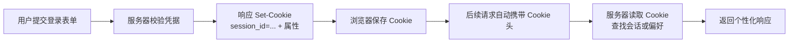
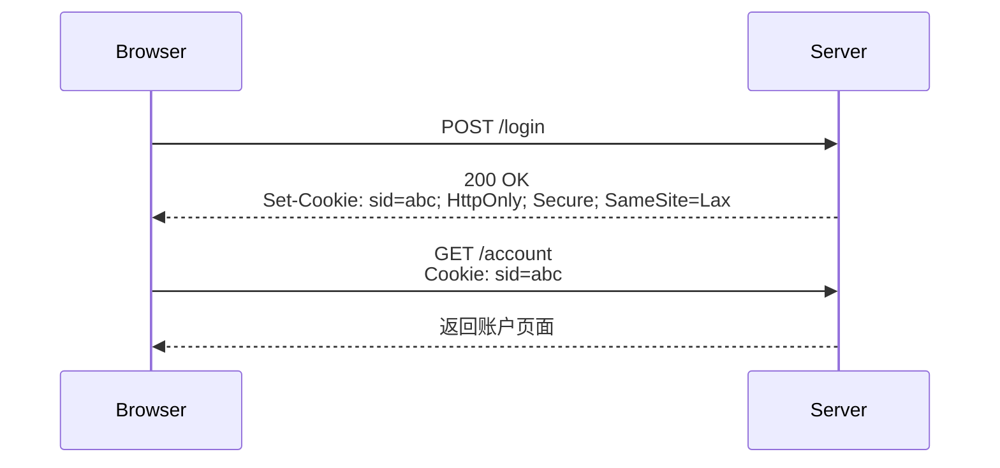
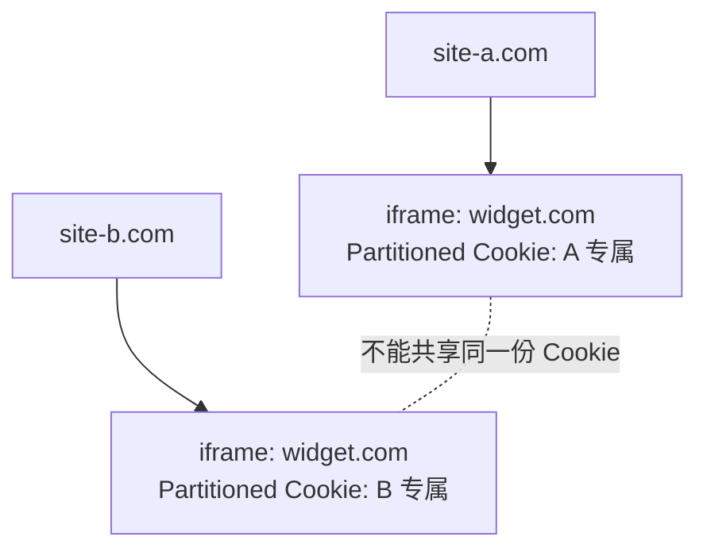
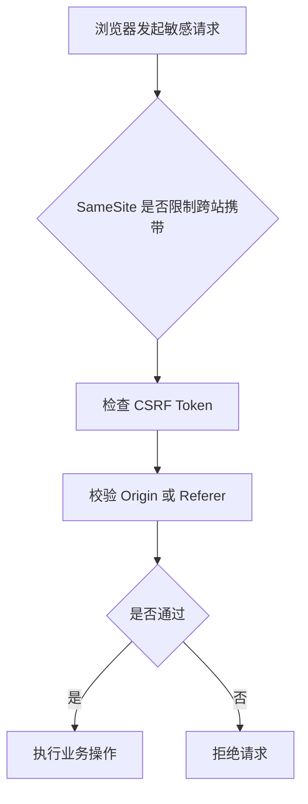

[toc]


# Cookie 技术系统介绍

Cookie 是浏览器保存的一小段数据，通常由服务器通过 HTTP 响应头 `Set-Cookie` 下发，浏览器在后续符合条件的请求中自动通过 `Cookie` 请求头带回服务器。它的核心价值是：在天然“无状态”的 HTTP 协议上，帮助服务器识别“这次请求和上次请求是否来自同一个浏览器/用户”。MDN 对 Cookie 的定义也强调了这一点：服务器发送小数据到浏览器，浏览器保存后在后续请求中返回，从而让 Web 应用记住状态。([MDN Web Docs](https://developer.mozilla.org/en-US/docs/Web/HTTP/Guides/Cookies))



Cookie 不是“前端专用存储”，而是 HTTP 机制的一部分。服务器可以在任意响应中发送 `Set-Cookie`，浏览器也可以在后续请求中自动发送 `Cookie`，规范草案 RFC6265bis 正是围绕 `Cookie` 与 `Set-Cookie` 这两个头字段定义处理模型的。([IETF Datatracker](https://datatracker.ietf.org/doc/draft-ietf-httpbis-rfc6265bis/))

------

# Cookie 主要解决什么问题

| 场景       | Cookie 的作用                      | 典型例子            |
| ---------- | ---------------------------------- | ------------------- |
| 登录会话   | 让服务器知道请求来自哪个已登录用户 | `session_id=abc123` |
| 用户偏好   | 记住用户设置                       | 语言、主题、地区    |
| 购物车     | 关联匿名或登录用户的购物状态       | `cart_id=xxx`       |
| 安全风控   | 辅助识别设备、请求风险             | 防刷、异常登录检测  |
| 分析与广告 | 识别访问行为或跨站跟踪             | 访问统计、广告归因  |

初学者最容易误解的一点是：Cookie 本身不等于“登录状态”。更准确地说，Cookie 通常只保存一个标识符，例如 `session_id`；真正的登录状态、用户权限、过期时间、风控信息，应该主要保存在服务器端。

------

# 基本工作流程



对应的 HTTP 头大致如下：

```http
HTTP/1.1 200 OK
Set-Cookie: __Host-session=abc123; Path=/; Secure; HttpOnly; SameSite=Lax; Max-Age=1800
```

之后浏览器访问同站资源时可能自动携带：

```http
GET /account HTTP/1.1
Host: example.com
Cookie: __Host-session=abc123
```

`Set-Cookie` 是一个特殊响应头：前端 JavaScript 不能直接读取响应里的 `Set-Cookie`，并且跨域 `fetch` 或 XHR 场景下，浏览器只有在请求包含 credentials 时才会处理响应中的 `Set-Cookie`。([MDN Web Docs](https://developer.mozilla.org/en-US/docs/Web/HTTP/Reference/Headers/Set-Cookie))

------

# Cookie 的组成

一个 Cookie 由“键值对 + 属性”组成。

```http
Set-Cookie: name=value; Path=/; Domain=example.com; Max-Age=3600; Secure; HttpOnly; SameSite=Lax
```

其中：

| 部分                  | 说明                          |
| --------------------- | ----------------------------- |
| `name=value`          | Cookie 的名字和值             |
| `Path`                | 限制哪些路径下的请求会携带    |
| `Domain`              | 限制哪些主机或子域可用        |
| `Expires` / `Max-Age` | 控制生命周期                  |
| `Secure`              | 仅通过 HTTPS 发送             |
| `HttpOnly`            | 禁止 JavaScript 读取          |
| `SameSite`            | 控制跨站请求是否携带          |
| `Partitioned`         | 使用分区 Cookie，也就是 CHIPS |

------

# 常见属性详解

| 属性          | 示例                                    | 作用                         | 新手注意点                                                   |
| ------------- | --------------------------------------- | ---------------------------- | ------------------------------------------------------------ |
| `Domain`      | `Domain=example.com`                    | 指定 Cookie 可发送到哪些主机 | 不写 `Domain` 时，通常只发给设置它的主机；写了 `Domain=example.com` 后，子域也可能收到 |
| `Path`        | `Path=/admin`                           | 指定 URL 路径匹配规则        | `Path` 不是安全边界，不能靠它保护敏感 Cookie                 |
| `Max-Age`     | `Max-Age=3600`                          | 多少秒后过期                 | 与 `Expires` 同时存在时，`Max-Age` 优先                      |
| `Expires`     | `Expires=Wed, 09 Jun 2026 10:18:14 GMT` | 指定绝对过期时间             | 受客户端时间、浏览器策略影响                                 |
| `Secure`      | `Secure`                                | 只在 HTTPS 请求中发送        | 仍需配合 `HttpOnly`，否则 JS 仍可能读到                      |
| `HttpOnly`    | `HttpOnly`                              | 阻止 `document.cookie` 访问  | 可降低 XSS 窃取 Cookie 的风险，但请求仍会自动携带            |
| `SameSite`    | `SameSite=Lax`                          | 控制跨站请求携带规则         | 防 CSRF 的重要辅助措施，但不是完整防护                       |
| `Partitioned` | `Partitioned`                           | 启用分区存储                 | 必须配合 `Secure`                                            |

MDN 明确指出：`Path` 只是控制浏览器何时发送 Cookie，不应被当作安全措施；`HttpOnly` 会阻止 JavaScript 通过 `document.cookie` 访问 Cookie；`Secure` 让 Cookie 只通过 HTTPS 发送，但不代表它能防止所有敏感信息泄露。([MDN Web Docs](https://developer.mozilla.org/en-US/docs/Web/HTTP/Reference/Headers/Set-Cookie)) ([MDN Web Docs](https://developer.mozilla.org/en-US/docs/Web/HTTP/Reference/Headers/Set-Cookie)) ([MDN Web Docs](https://developer.mozilla.org/en-US/docs/Web/HTTP/Reference/Headers/Set-Cookie))

------

# 生命周期：会话 Cookie 与持久 Cookie

| 类型        | 如何产生                      | 何时消失                             | 适合场景             |
| ----------- | ----------------------------- | ------------------------------------ | -------------------- |
| 会话 Cookie | 不设置 `Expires` 或 `Max-Age` | 浏览器会话结束时，具体由浏览器定义   | 临时会话、一次性流程 |
| 持久 Cookie | 设置 `Expires` 或 `Max-Age`   | 到期、用户清理、浏览器清理、策略限制 | 记住登录、偏好设置   |

规范草案说明，用户代理可以因为配额、内存压力、隐私策略或用户操作提前删除 Cookie；因此服务端不能假设 Cookie 一定会精确保留到指定过期时间。RFC6265bis 草案还建议浏览器对持久 Cookie 设置最长生命周期限制，推荐上限为 400 天。([IETF Datatracker](https://datatracker.ietf.org/doc/draft-ietf-httpbis-rfc6265bis/))

删除 Cookie 的本质是：用同名、同 `Domain`、同 `Path` 的 `Set-Cookie` 覆盖它，并设置过去的过期时间或 `Max-Age=0`。

```http
Set-Cookie: __Host-session=; Path=/; Secure; HttpOnly; SameSite=Lax; Max-Age=0
```

------

# Domain 与 Path 的作用边界

`Domain` 决定“哪些主机能收到 Cookie”。例如 `Domain=example.com` 通常意味着 `example.com` 和 `www.example.com` 等子域都可能收到；但服务器不能随便给一个完全不属于自己的域设置 Cookie，浏览器应拒绝这种无效域。([MDN Web Docs](https://developer.mozilla.org/en-US/docs/Web/HTTP/Reference/Headers/Set-Cookie))

`Path` 决定“哪些路径请求会带 Cookie”。例如 `Path=/docs` 会匹配 `/docs`、`/docs/intro` 等路径，但不会匹配 `/admin`。不过，`Path` 不应该被视为安全隔离机制；同站其他路径仍可能通过别的方式影响你的应用逻辑。([MDN Web Docs](https://developer.mozilla.org/en-US/docs/Web/HTTP/Reference/Headers/Set-Cookie))

工程建议：

| 目标             | 建议                                                 |
| ---------------- | ---------------------------------------------------- |
| 登录态 Cookie    | 尽量不要设置 `Domain`，使用 host-only Cookie         |
| 全站都要用       | `Path=/`                                             |
| 只给某个子系统用 | 可以缩小 `Path`，但不要把它当安全边界                |
| 多子域共享登录   | 谨慎使用 `Domain=.example.com`，同时做好子域安全治理 |

------

# SameSite：现代 Cookie 的核心属性

`SameSite` 用来控制 Cookie 是否会在“跨站请求”中发送。MDN 说明它可以为某些跨站攻击，尤其是 CSRF，提供一定保护；它有 `Strict`、`Lax`、`None` 三种主要取值。([MDN Web Docs](https://developer.mozilla.org/en-US/docs/Web/HTTP/Reference/Headers/Set-Cookie))

| 值       | 跨站子资源请求 | 跨站顶级导航 GET | 跨站 POST  | 适合场景                         |
| -------- | -------------- | ---------------- | ---------- | -------------------------------- |
| `Strict` | 不发送         | 不发送           | 不发送     | 高敏感操作、后台管理、支付确认   |
| `Lax`    | 不发送         | 通常发送         | 通常不发送 | 大多数登录态 Cookie              |
| `None`   | 发送           | 发送             | 发送       | 第三方嵌入、跨站 SSO、支付跳转等 |

现代浏览器通常把未声明 `SameSite` 的 Cookie 当作 `Lax` 处理；如果使用 `SameSite=None`，必须同时设置 `Secure`，否则浏览器会拒绝或不按预期处理。([web.dev](https://web.dev/articles/samesite-cookies-explained))

推荐写法：

```http
Set-Cookie: __Host-session=abc123; Path=/; Secure; HttpOnly; SameSite=Lax
```

跨站嵌入场景才考虑：

```http
Set-Cookie: widget_session=abc123; Secure; HttpOnly; SameSite=None
```

但要注意：`SameSite=Lax` 或 `Strict` 不是完整的 CSRF 防护方案。web.dev 也提醒，Cookie 会作为用户请求的一部分发送，服务器仍应像处理其他用户输入一样校验和验证请求。([web.dev](https://web.dev/articles/samesite-cookies-explained))

------

# SameSite、Same-Origin、Same-Site 的区别

这是 Cookie 学习中的高频难点。

| 概念        | 判断依据                                 | 示例                                                         |
| ----------- | ---------------------------------------- | ------------------------------------------------------------ |
| Same-Origin | 协议 + 主机 + 端口都相同                 | `https://a.example.com` 和 `https://a.example.com:443`       |
| Same-Site   | 通常看 schemeful site，即协议 + 可注册域 | `https://www.example.com` 和 `https://static.example.com` 通常 same-site |
| Cross-Site  | 可注册域或协议不同                       | `https://example.com` 到 `https://other.com`                 |

web.dev 说明，“site” 与 Public Suffix List 相关，例如不同的 `github.io` 项目可能被视为不同 site；MDN 也强调 `SameSite` 判断跨站时包含 scheme，因此 `http://example.com` 与 `https://example.com` 在现代语义下也要谨慎看待。([web.dev](https://web.dev/articles/samesite-cookies-explained)) ([MDN Web Docs](https://developer.mozilla.org/en-US/docs/Web/HTTP/Reference/Headers/Set-Cookie))

------

# Secure 与 HttpOnly：登录 Cookie 的基础配置

对于认证 Cookie，默认建议：

```http
Set-Cookie: __Host-session=abc123; Path=/; Secure; HttpOnly; SameSite=Lax; Max-Age=1800
```

含义如下：

| 配置           | 为什么重要                             |
| -------------- | -------------------------------------- |
| `Secure`       | 防止 Cookie 在普通 HTTP 明文连接中发送 |
| `HttpOnly`     | 防止 XSS 后直接通过 JS 读取 Cookie     |
| `SameSite=Lax` | 减少常见跨站请求自动携带 Cookie 的风险 |
| `Path=/`       | 明确作用于当前主机全站                 |
| 不写 `Domain`  | 限制为当前 host，减少子域污染风险      |
| `Max-Age` 较短 | 降低长期会话被滥用的风险               |

`HttpOnly` 不是防 XSS 的万能药，因为攻击者虽然读不到 Cookie，但仍可能让浏览器带着 Cookie 发起恶意请求。因此仍然需要 CSP、输入输出转义、CSRF Token、敏感操作二次校验等措施。

------

# Cookie 前缀：现代安全增强

Cookie 名称可以使用特殊前缀，让支持的浏览器强制校验属性。MDN 列出了 `__Secure-`、`__Host-`、`__Http-`、`__Host-Http-` 等前缀，其中 `__Host-` 要求 `Secure`、`Path=/`，且不能设置 `Domain`，这使它更接近以 origin/host 为安全边界。([MDN Web Docs](https://developer.mozilla.org/en-US/docs/Web/HTTP/Reference/Headers/Set-Cookie))

| 前缀           | 主要要求                                       | 推荐用途                  |
| -------------- | ---------------------------------------------- | ------------------------- |
| `__Secure-`    | 必须 HTTPS + `Secure`                          | 一般安全 Cookie           |
| `__Host-`      | 必须 HTTPS + `Secure` + `Path=/` + 无 `Domain` | 登录 Session Cookie       |
| `__Http-`      | 必须 `Secure` + `HttpOnly`                     | 强调只能由 HTTP 响应设置  |
| `__Host-Http-` | 结合 `__Host-` 与 `__Http-` 要求               | 更严格的服务端会话 Cookie |

推荐登录态使用：

```http
Set-Cookie: __Host-session=abc123; Path=/; Secure; HttpOnly; SameSite=Lax
```

------

# 第一方 Cookie 与第三方 Cookie

| 类型          | 谁设置                       | 例子                                     | 现代趋势                 |
| ------------- | ---------------------------- | ---------------------------------------- | ------------------------ |
| 第一方 Cookie | 当前地址栏站点设置           | `shop.com` 给自己设置登录态              | 仍是 Web 应用基础能力    |
| 第三方 Cookie | 被嵌入的其他站点设置         | `ad.com` 在 `news.com` iframe 中设置     | 越来越受限制             |
| 分区 Cookie   | 第三方上下文中按顶级站点隔离 | `cdn.com` 在不同站点中得到不同 Cookie 罐 | 更隐私友好的替代方案之一 |

Chrome 在 2025 年 4 月宣布维持当前让用户在 Chrome 隐私和安全设置中管理第三方 Cookie 的方式，不再推出新的独立第三方 Cookie 提示；但 Chrome 无痕模式已默认阻止第三方 Cookie。([Privacy Sandbox](https://privacysandbox.google.com/blog/privacy-sandbox-next-steps))

这并不意味着第三方 Cookie 可以继续被长期稳定依赖。Safari 早已默认全面阻止跨站资源的 Cookie；Firefox 默认阻止跨站跟踪 Cookie，并启用 Total Cookie Protection 将 Cookie 限制在创建它的网站中；Edge 的跟踪防护也会限制已知跟踪器访问 Cookie、IndexedDB、localStorage 等浏览器存储。([WebKit](https://webkit.org/blog/10218/full-third-party-cookie-blocking-and-more/)) ([support.mozilla.org](https://support.mozilla.org/en-US/kb/enhanced-tracking-protection-firefox-desktop)) ([learn.microsoft.com](https://learn.microsoft.com/en-us/microsoft-edge/web-platform/tracking-prevention))

------

# Partitioned Cookie 与 CHIPS

`Partitioned` 属性表示把 Cookie 放入“分区存储”：同一个第三方服务被嵌入到不同顶级站点时，不再共享同一个 Cookie，而是按顶级站点隔离。Google Privacy Sandbox 文档称这类 Cookie 为 CHIPS，即 Cookies Having Independent Partitioned State，并说明 `Partitioned` Cookie 必须配合 `Secure`。([Privacy Sandbox](https://privacysandbox.google.com/cookies/basics/cookie-attributes))

```http
Set-Cookie: __Host-widget=abc123; Path=/; Secure; HttpOnly; SameSite=None; Partitioned
```

示意：



适合场景：

| 场景                             | 是否适合 `Partitioned`                          |
| -------------------------------- | ----------------------------------------------- |
| 第三方嵌入组件需要保持局部状态   | 适合                                            |
| 跨多个站点追踪同一用户           | 不适合，也越来越不可行                          |
| 嵌入式客服、支付、地图、评论组件 | 可评估                                          |
| 真正需要统一身份的跨站登录       | 可能需要 Storage Access API、FedCM 或服务端重构 |

Chrome 文档建议在创建第三方 Cookie 时尽可能使用 `Partitioned`，除非明确需要跨多个嵌入场景共享同一个 Cookie。([Privacy Sandbox](https://privacysandbox.google.com/cookies/basics/cookie-attributes))

------

# Cookie 与前端存储的区别

| 能力                   | Cookie                | localStorage | sessionStorage | IndexedDB |
| ---------------------- | --------------------- | ------------ | -------------- | --------- |
| 自动随 HTTP 请求发送   | 是                    | 否           | 否             | 否        |
| 服务端可通过响应头设置 | 是                    | 否           | 否             | 否        |
| 可设置 `HttpOnly`      | 是                    | 否           | 否             | 否        |
| 容量                   | 小                    | 较大         | 较大           | 很大      |
| 适合保存登录凭据       | 适合保存 session 标识 | 不推荐       | 不推荐         | 不推荐    |
| 容易受 XSS 读取        | 非 `HttpOnly` 会      | 会           | 会             | 会        |

实践上，认证信息优先使用 `HttpOnly + Secure + SameSite` 的 Cookie，而不是把 access token 长期放在 `localStorage`。原因是：一旦出现 XSS，`localStorage` 中的令牌很容易被脚本直接读取并外传；`HttpOnly` Cookie 至少能降低“直接窃取凭据”的风险。

------

# Cookie 容量与性能限制

Cookie 很小，不适合存大数据。RFC6265bis 草案中的处理算法提到，如果 cookie 名和值长度合计超过 4096 octets，用户代理会忽略该 Cookie；同时，通用用户代理至少应支持每域 50 个 Cookie、总计 3000 个 Cookie，但浏览器可以因为实现限制或用户策略随时驱逐 Cookie。([IETF Datatracker](https://datatracker.ietf.org/doc/draft-ietf-httpbis-rfc6265bis/)) ([IETF Datatracker](https://datatracker.ietf.org/doc/draft-ietf-httpbis-rfc6265bis/))

工程建议：

| 建议                                                | 原因                             |
| --------------------------------------------------- | -------------------------------- |
| 不要把用户资料、权限列表、购物车明细直接塞进 Cookie | 每次请求都会携带，浪费带宽       |
| Cookie 值尽量短                                     | 减少请求头体积                   |
| 服务端保存状态，Cookie 只保存 ID                    | 更安全、可控、易撤销             |
| 避免大量 Cookie                                     | 浏览器可能驱逐，且影响性能       |
| 不要依赖 Cookie 永久存在                            | 用户、浏览器、隐私策略都可能删除 |

------

# 安全风险与防护

| 风险             | 说明                               | 防护                                        |
| ---------------- | ---------------------------------- | ------------------------------------------- |
| XSS 窃取 Cookie  | 恶意脚本读取非 `HttpOnly` Cookie   | `HttpOnly`、CSP、转义、输入校验             |
| CSRF             | 浏览器自动携带 Cookie 发起跨站请求 | `SameSite`、CSRF Token、Origin/Referer 校验 |
| 中间人攻击       | HTTP 明文传输时 Cookie 被截获      | HTTPS、`Secure`、HSTS                       |
| Session Fixation | 攻击者诱导用户使用已知 session     | 登录后旋转 session id                       |
| Cookie Tossing   | 子域设置同名 Cookie 干扰主站       | 使用 `__Host-`、不写 `Domain`、治理子域     |
| 敏感数据泄露     | 把隐私信息直接放 Cookie            | Cookie 只放随机标识，不放明文隐私           |
| 重放攻击         | 被盗 Cookie 可被复用               | 短过期、刷新机制、设备绑定、风险检测        |

登录成功后，应该重新生成 session id，而不是复用登录前的匿名 session id。退出登录时，服务端应使 session 失效，同时让浏览器删除 Cookie；只删除浏览器 Cookie 不够，因为攻击者可能已经复制了旧值。

------

# 隐私与合规

如果网站面向欧盟或英国用户，Cookie 还涉及 ePrivacy、GDPR、PECR 等规则。欧盟 Your Europe 指出，严格必要的 Cookie，例如用户明确请求服务所必需的购物车、登录认证 Cookie，通常不需要同意；但非必要 Cookie，尤其是广告、追踪、某些分析用途，通常需要在设置前取得用户同意。([European Union](https://europa.eu/youreurope/business/dealing-with-customers/data-protection/online-privacy/index_en.htm?utm_source=chatgpt.com))

英国 ICO 对有效同意的描述是：同意必须自由给出、具体、知情，并通过明确的积极动作表达；仅仅继续浏览网站不构成有效同意，用户应能方便地启用或禁用非必要 Cookie。([ICO](https://ico.org.uk/for-organisations/direct-marketing-and-privacy-and-electronic-communications/guide-to-pecr/cookies-and-similar-technologies/?utm_source=chatgpt.com))

实务建议：

| Cookie 类别 | 是否通常需要同意 | 例子                       |
| ----------- | ---------------- | -------------------------- |
| 严格必要    | 通常不需要       | 登录、购物车、安全、防欺诈 |
| 功能偏好    | 视地区和用途而定 | 语言、主题                 |
| 分析统计    | 视实现和地区而定 | 访问统计、A/B 测试         |
| 广告与追踪  | 通常需要         | 广告归因、再营销、跨站画像 |

合规层面不要只做“弹窗样子”，还要做到：未同意前不加载非必要脚本；允许拒绝；允许撤回；记录同意状态；清楚列出用途、第三方、有效期。

------

# 经典实践方案

## 登录 Session Cookie

推荐：

```http
Set-Cookie: __Host-session=RANDOM_SESSION_ID; Path=/; Secure; HttpOnly; SameSite=Lax; Max-Age=1800
```

服务端保存：

| 字段           | 示例            |
| -------------- | --------------- |
| `session_id`   | 随机高熵 ID     |
| `user_id`      | 用户 ID         |
| `created_at`   | 创建时间        |
| `expires_at`   | 过期时间        |
| `last_seen_at` | 最近访问        |
| `csrf_secret`  | CSRF 相关随机值 |
| `risk_flags`   | 风控标记        |

不要这样做：

```http
Set-Cookie: user={"id":1,"role":"admin"}; Path=/
```

原因是用户可以篡改客户端数据；即使加密，也会带来过期、撤销、密钥轮换、体积膨胀等复杂问题。

------

## 记住登录

可以使用“短期 session + 长期 refresh token Cookie”的模型：

| Cookie           | 生命周期            | 属性                                         | 用途     |
| ---------------- | ------------------- | -------------------------------------------- | -------- |
| `__Host-session` | 短，例如 15–30 分钟 | `Secure; HttpOnly; SameSite=Lax`             | 日常请求 |
| `__Host-refresh` | 长，例如 7–30 天    | `Secure; HttpOnly; SameSite=Strict` 或 `Lax` | 静默续期 |

关键点：

| 要点                     | 说明                         |
| ------------------------ | ---------------------------- |
| refresh token 要可撤销   | 服务端保存 token 哈希与状态  |
| 每次刷新最好轮换         | 防止旧 token 长期有效        |
| 发现异常立即作废         | IP、设备、地理位置、频率异常 |
| 用户改密码后清理所有会话 | 降低账号被盗风险             |

------

## CSRF 防护组合

推荐组合：



常见方案：

| 方案                 | 说明                               |
| -------------------- | ---------------------------------- |
| `SameSite=Lax`       | 默认减少跨站自动携带               |
| CSRF Token           | 表单或请求头携带随机 token         |
| Double Submit Cookie | Cookie 与请求参数/头同时提交并比对 |
| Origin/Referer 校验  | 对敏感操作检查来源                 |
| 避免 GET 改状态      | GET 应保持安全、幂等语义           |

------

# 跨域请求与 Cookie

前端跨域请求要携带 Cookie，需要同时满足浏览器、前端、服务端三边配置。

前端：

```js
fetch("https://api.example.com/me", {
  credentials: "include"
})
```

服务端响应：

```http
Access-Control-Allow-Origin: https://app.example.com
Access-Control-Allow-Credentials: true
Set-Cookie: __Host-session=abc; Path=/; Secure; HttpOnly; SameSite=None
```

注意：

| 条件                                     | 说明                                                     |
| ---------------------------------------- | -------------------------------------------------------- |
| `credentials: "include"`                 | 否则浏览器不会带 Cookie，也可能忽略响应里的 `Set-Cookie` |
| `Access-Control-Allow-Credentials: true` | 服务端允许凭据                                           |
| `Access-Control-Allow-Origin` 不能是 `*` | 带 credentials 时必须指定具体 Origin                     |
| 跨站 Cookie 需要 `SameSite=None; Secure` | 现代浏览器要求                                           |
| 第三方 Cookie 可能被用户或浏览器策略阻止 | 要有降级方案                                             |

MDN 明确说明，Fetch/XHR 的 CORS 请求如果不包含 credentials，浏览器会忽略响应中的 `Set-Cookie`。([MDN Web Docs](https://developer.mozilla.org/en-US/docs/Web/HTTP/Reference/Headers/Set-Cookie))

------

# 现代浏览器环境下的设计建议

| 过去的做法                   | 现代问题                                    | 更好的方向                           |
| ---------------------------- | ------------------------------------------- | ------------------------------------ |
| 依赖第三方 Cookie 做跨站识别 | Safari、Firefox、无痕模式、用户设置都会阻断 | 第一方数据、服务端登录、CHIPS、FedCM |
| 把 token 放 localStorage     | XSS 后容易被直接读取                        | `HttpOnly` Cookie                    |
| 默认不写 `SameSite`          | 浏览器默认行为差异、语义不清晰              | 显式写 `SameSite=Lax/Strict/None`    |
| 长期 Cookie 永不过期         | 隐私与安全风险高，浏览器也可能限制          | 短 session + 可撤销 refresh          |
| Cookie 存大对象              | 每次请求都带，性能差                        | Cookie 只存 ID，数据放服务端         |
| 所有子域共享 Cookie          | 子域被攻破会影响主站                        | `__Host-`、不写 `Domain`、最小作用域 |

Google Privacy Sandbox 文档也建议开发者审计 Cookie 使用、测试第三方 Cookie 被阻止时的破损情况，并按用途迁移到 CHIPS、Storage Access API、FedCM 等更合适的方案。([Privacy Sandbox](https://privacysandbox.google.com/cookies))

------

# 新手学习路线

| 阶段     | 重点                                     | 目标                         |
| -------- | ---------------------------------------- | ---------------------------- |
| 入门     | `Set-Cookie`、`Cookie`、会话             | 理解浏览器如何自动保存和发送 |
| 基础工程 | `Path`、`Domain`、`Max-Age`、删除 Cookie | 能正确设置生命周期和作用域   |
| 安全     | `Secure`、`HttpOnly`、`SameSite`、CSRF   | 能写出安全的登录 Cookie      |
| 现代隐私 | 第三方 Cookie、CHIPS、浏览器限制         | 不依赖脆弱的跨站追踪         |
| 合规     | 必要 Cookie、非必要 Cookie、同意管理     | 能设计合规 Cookie 策略       |

------

# 最佳实践清单

| 项目                       | 推荐                                          |
| -------------------------- | --------------------------------------------- |
| 登录 Cookie 名称           | 使用 `__Host-session`                         |
| 登录 Cookie 属性           | `Path=/; Secure; HttpOnly; SameSite=Lax`      |
| 是否设置 `Domain`          | 登录态尽量不设置                              |
| 是否存用户信息             | 不存，Cookie 只存随机 ID                      |
| 是否使用 HTTPS             | 必须                                          |
| 是否依赖 `Path` 做安全隔离 | 不要                                          |
| 是否显式写 `SameSite`      | 是                                            |
| 跨站嵌入 Cookie            | `SameSite=None; Secure`，必要时 `Partitioned` |
| 删除 Cookie                | 同名、同 Path、同 Domain，`Max-Age=0`         |
| 防 CSRF                    | `SameSite` + Token + Origin/Referer           |
| 防 XSS                     | `HttpOnly` + CSP + 转义 + 输入校验            |
| 合规                       | 非必要 Cookie 先同意后设置                    |

------

# 一句话总结

Cookie 是“浏览器自动随请求携带的小型 HTTP 状态机制”。现代开发中，它最适合保存短小、可撤销、服务端可验证的标识符；登录态 Cookie 应默认使用 `Secure + HttpOnly + SameSite + __Host-`；第三方 Cookie 不应再作为稳定基础设施，跨站场景应优先评估 `Partitioned/CHIPS`、Storage Access API、FedCM 或服务端架构调整。