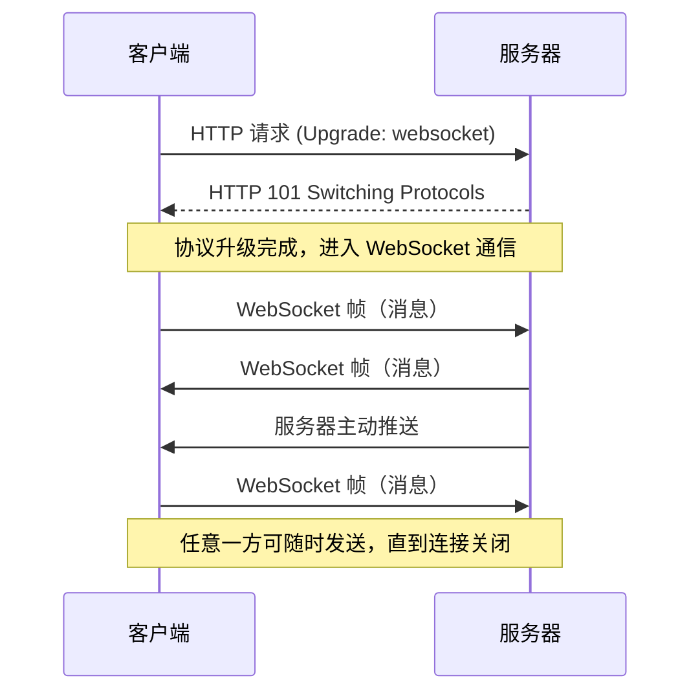
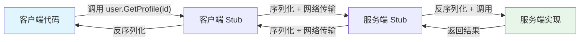
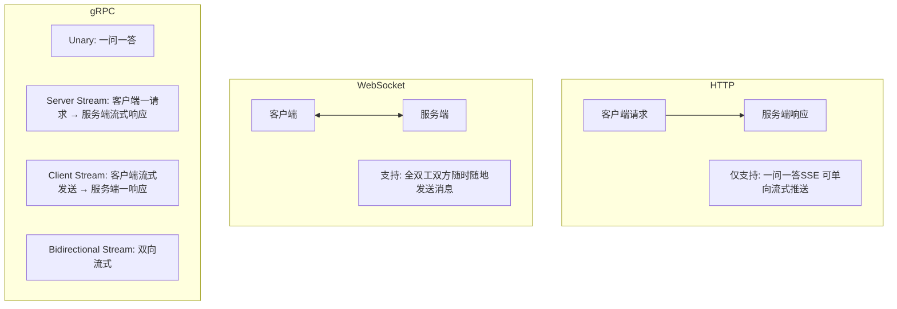
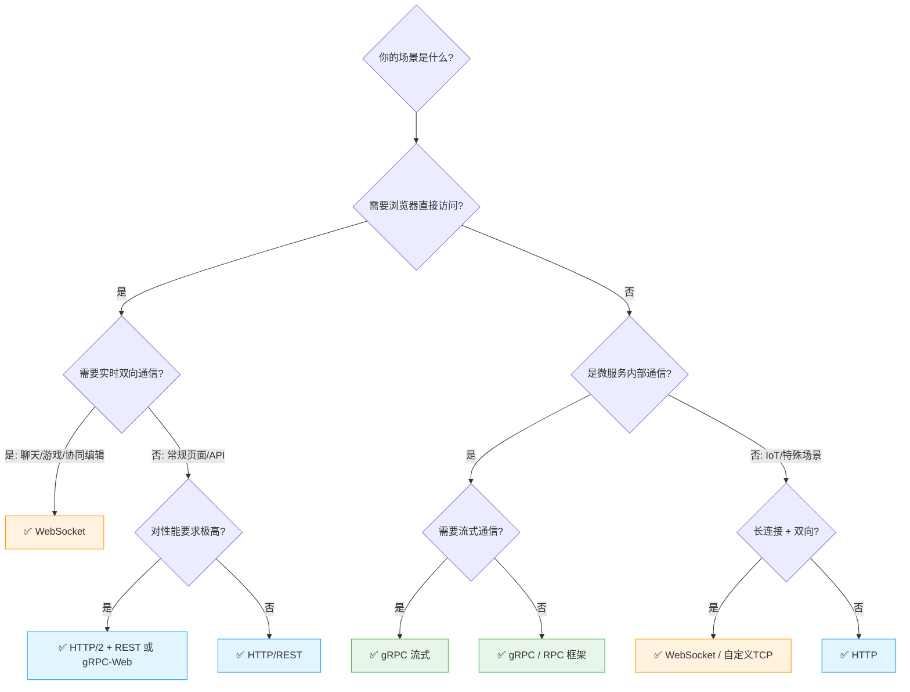
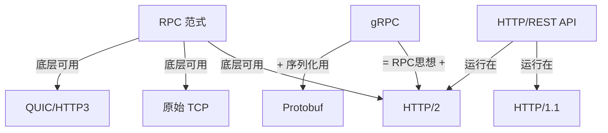
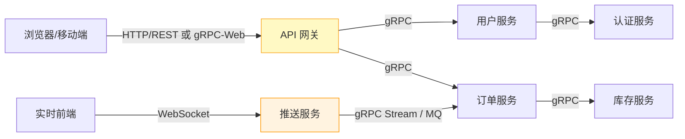

[toc]

# WebSocket、RPC、HTTP 对比详解

## 引言：它们解决的核心问题

在分布式系统和网络通信中，**服务之间如何对话**是最基础的问题。HTTP、WebSocket 和 RPC 是三种最主流的通信方式，但它们处于不同的抽象层次，解决不同场景的问题：

- **HTTP** — 一种**应用层协议**，定义了请求/响应的格式和语义
- **WebSocket** — 一种**应用层协议**，提供全双工持久连接
- **RPC** — 一种**通信范式/架构风格**，让远程调用像本地函数调用一样自然

> 一个常见误区是把三者并列比较。实际上 RPC 是一种抽象思想，它的底层传输可以用 HTTP，也可以用 WebSocket 或原始 TCP。理解这一点是掌握三者关系的关键。

| 概念                              | 诞生/标准化时间 | 主要用途                         |
| :-------------------------------- | :-------------- | :------------------------------- |
| **RPC**(**远程过程调用**)         | 1980s           | 分布式系统、内部微服务通信       |
| **HTTP**(**超文本传输协议**)      | 1991            | 网页浏览、公网 API               |
| **WebSocket**(**套接字通信协议**) | 2011            | 实时聊天、股票行情、多人在线协作 |

**总结：**
**RPC** 最早出现，甚至比 HTTP 早了约 10 年。**WebSocket** 则是最年轻的，它是为了弥补 HTTP 在“全双工实时通信”方面的不足而设计的补丁协议。

---

## 核心概念解析

### HTTP（HyperText Transfer Protocol）

HTTP 是互联网最广泛使用的协议，遵循**请求-响应**模型：

```
客户端发送请求 → 服务器处理 → 服务器返回响应 → 连接结束（或复用）
```

**关键特征：**

- **无状态**：每个请求独立，服务器不记忆之前的请求（需要 Cookie/Token 等机制补充状态）
- **文本/二进制混合**：HTTP/1.1 是文本协议，HTTP/2 引入了二进制帧
- **单向发起**：只能由客户端主动发起请求，服务器无法主动推送（HTTP/2 Server Push 是有限的例外）

**版本演进：**

| 版本     | 关键改进                     | 连接模型                 |
| -------- | ---------------------------- | ------------------------ |
| HTTP/1.0 | 基础请求响应                 | 每次请求新建连接         |
| HTTP/1.1 | Keep-Alive、管线化           | 持久连接，但存在队头阻塞 |
| HTTP/2   | 多路复用、头部压缩、二进制帧 | 单连接多流，大幅提升性能 |
| HTTP/3   | 基于 QUIC（UDP）             | 消除 TCP 层队头阻塞      |

### WebSocket

WebSocket 诞生于一个明确的需求：**服务器需要主动向客户端推送数据**。

它通过一次 HTTP 握手**升级协议**，之后建立持久的全双工通道：



**关键特征：**

- **全双工**：客户端和服务器可以同时、独立地发送消息
- **持久连接**：一次握手，长期保持，避免反复建连的开销
- **低开销**：数据帧头部仅 2-14 字节，远小于 HTTP 头部
- **有状态**：连接本身就承载了状态

### RPC（Remote Procedure Call）

RPC 不是一个具体协议，而是一种**设计思想**：让开发者调用远程服务的方法时，体验和调用本地函数一样。



> 为什么叫“存根 (Stub)”？
>
> 这个词源于现实生活中的支票或票据。当你撕下一张支票时，留在本子上的那一小截叫“存根”。
>
> - **票据本体**（真实的服务实现）在远方服务器上。
> - **存根**（Stub）留在你本地，作为你持有该服务、并能与之通信的凭证和入口。

**客户端代码 (Client App):** 发起者。它并不知道 `user.GetProfile` 实际上运行在千里之外，它只是像往常一样调用一个函数。

**客户端 Stub (Client Proxy):** “代理人”。它负责把函数名、参数等信息打包（序列化），然后通过网络发走。

**服务端 Stub (Server Skeleton):** “监听者”。它在服务器端接收网络包，解包（反序列化）后，发现客户端想调用 `GetProfile`，于是去叫醒真正的服务端实现。

**服务端实现 (Service Implementation):** 真正干活的代码。比如去数据库查用户信息，然后把结果交给服务端 Stub。

**RPC 的核心组件：**

| 组件                | 职责                               | 示例                       |
| ------------------- | ---------------------------------- | -------------------------- |
| IDL（接口定义语言） | 定义服务接口和数据结构，跨语言契约 | Protobuf、Thrift IDL、Avro |
| 序列化/反序列化     | 将数据结构转为字节流（及反向过程） | Protobuf（二进制）、JSON   |
| 传输层              | 在网络上搬运字节                   | HTTP/2、TCP、QUIC          |
| 客户端 Stub/Proxy   | 代理层，封装网络调用细节           | 自动生成的客户端代码       |
| 服务端 Skeleton     | 接收请求，路由到具体实现           | 自动生成的服务端骨架       |
| 服务发现            | 找到目标服务的网络地址             | Consul、Nacos、etcd        |

**主流 RPC 框架对比：**

| 框架   | 开发方      | IDL                     | 序列化                | 传输协议          | 语言支持        |
| ------ | ----------- | ----------------------- | --------------------- | ----------------- | --------------- |
| gRPC   | Google      | Protobuf                | Protobuf（二进制）    | HTTP/2            | 10+ 语言        |
| Thrift | Apache      | Thrift IDL              | Thrift Binary/Compact | TCP               | 20+ 语言        |
| Dubbo  | Apache/阿里 | Java Interface/Protobuf | Hessian2/Protobuf     | Dubbo 协议/HTTP/2 | Java/Go/Rust 等 |
| Kitex  | 字节跳动    | Thrift/Protobuf         | 多种                  | 自研/HTTP/2       | Go              |
| tRPC   | 腾讯        | Protobuf                | Protobuf              | 自研              | Go/C++ 等       |

---

gRPC (Google) —— 现代微服务的标准

gRPC 是目前工业界最流行的 RPC 框架。它由 Google 开发，基于 **HTTP/2** 传输。

- **特点：**
  - 使用 **Protocol Buffers (Protobuf)** 作为接口定义语言（IDL）和序列化格式，速度极快且包体小。
  - 支持**双向流**（类似 WebSocket 的实时性，但更严谨）。
  - 跨语言能力极强（Go, Java, Python, C++, Node.js 等）。
- **适用场景：** 内部微服务通信、低延迟要求的系统、多语言混合开发。

## 全维度对比

### 基础特性对比

| 维度           | HTTP（REST 风格）        | WebSocket            | RPC（以 gRPC 为例）         |
| -------------- | ------------------------ | -------------------- | --------------------------- |
| **本质**       | 应用层协议               | 应用层协议           | 通信范式 / 架构风格         |
| **通信模式**   | 请求-响应（单向发起）    | 全双工（双向实时）   | 请求-响应 / 流式            |
| **连接模型**   | 短连接或 Keep-Alive      | 持久长连接           | 持久连接（HTTP/2 多路复用） |
| **数据格式**   | 通常 JSON/XML（文本）    | 文本帧或二进制帧     | 通常 Protobuf（二进制）     |
| **性能开销**   | 头部较大，JSON 解析开销  | 帧头极小，连接开销低 | 二进制高效，多路复用        |
| **浏览器支持** | ✅ 原生完美支持           | ✅ 原生支持           | ⚠️ 需要 gRPC-Web 中间层      |
| **可读性**     | 高（文本协议，易于调试） | 中                   | 低（二进制，需专用工具）    |
| **状态性**     | 无状态                   | 有状态               | 取决于实现                  |

### 性能与效率对比

| 指标                       | HTTP/1.1 + JSON       | WebSocket                 | gRPC（HTTP/2 + Protobuf）      |
| -------------------------- | --------------------- | ------------------------- | ------------------------------ |
| **序列化大小**（相同数据） | ~100% （基准）        | 取决于载荷格式            | ~20-30%（Protobuf 非常紧凑）   |
| **每次通信头部开销**       | 数百字节到数 KB       | 2-14 字节                 | HTTP/2 头部压缩（HPACK），极小 |
| **延迟（首次）**           | TCP 握手 + TLS + HTTP | TCP + TLS + HTTP 升级握手 | TCP + TLS + HTTP/2             |
| **延迟（后续）**           | Keep-Alive 可复用连接 | 几乎零额外开销            | 多路复用，几乎零额外开销       |
| **吞吐量**                 | 中                    | 高                        | 高                             |
| **适合的消息频率**         | 低频（秒级以上）      | 高频（毫秒级）            | 高频                           |

### 流式通信能力对比



gRPC 提供四种通信模式，这是它在微服务间通信中非常强大的原因之一：

| 模式                    | 说明                 | 典型场景               |
| ----------------------- | -------------------- | ---------------------- |
| Unary                   | 普通一问一答         | 查询用户信息           |
| Server Streaming        | 服务端持续返回数据流 | 实时日志、数据订阅     |
| Client Streaming        | 客户端持续发送数据流 | 文件上传、批量数据采集 |
| Bidirectional Streaming | 双向同时流式         | 实时聊天、协同编辑     |

---

## 典型应用场景



### 场景细分推荐

| 场景                             | 推荐方案                       | 原因                            |
| -------------------------------- | ------------------------------ | ------------------------------- |
| 对外公开 API（面向第三方开发者） | HTTP/REST                      | 生态成熟、文档友好、无门槛      |
| 后台管理系统前后端交互           | HTTP/REST                      | 简单直接，工具链完善            |
| 实时聊天 / IM                    | WebSocket                      | 需要双向实时推送                |
| 多人在线游戏                     | WebSocket                      | 低延迟 + 双向高频通信           |
| 实时行情 / 股票推送              | WebSocket 或 SSE               | 服务端高频推送                  |
| 微服务间同步调用                 | gRPC / RPC 框架                | 高性能、强类型契约、代码生成    |
| 微服务间事件流                   | gRPC 双向流 或 消息队列        | 取决于是否需要可靠投递          |
| 移动端 App API                   | HTTP/REST 或 gRPC              | gRPC 在弱网下优势明显（小体积） |
| 浏览器 + 需要 RPC 体验           | gRPC-Web + Envoy 代理          | 兼顾类型安全和浏览器兼容        |
| LLM/AI 模型流式输出              | HTTP/SSE 或 gRPC Server Stream | 服务端持续输出 token            |

---

## 深入理解：容易混淆的概念

### REST 与 HTTP 的关系

REST（Representational State Transfer）是一种**架构风格**，不是协议。它通常基于 HTTP 实现，但 HTTP ≠ REST：

- REST 强调**资源导向**：用 URL 表示资源，用 HTTP 方法（GET/POST/PUT/DELETE）表示操作
- 你完全可以用 HTTP 做出非 RESTful 的 API（比如 `POST /api/doSomething`）
- GraphQL 也运行在 HTTP 上，但不是 REST

### RPC 与 HTTP 不是对立关系



关键认知：**gRPC 就是跑在 HTTP/2 上的 RPC**。当有人问"用 HTTP 还是 RPC"时，更准确的问题应该是"用 REST 风格还是 RPC 风格"。

### WebSocket 与 SSE 的取舍

当你只需要**服务器向客户端单向推送**时，SSE（Server-Sent Events）往往比 WebSocket 更合适：

| 维度     | WebSocket            | SSE（Server-Sent Events）      |
| -------- | -------------------- | ------------------------------ |
| 方向     | 双向                 | 仅服务器→客户端                |
| 协议     | 独立协议（ws://）    | 普通 HTTP（text/event-stream） |
| 自动重连 | 需手动实现           | 浏览器原生支持                 |
| 跨域     | 需单独处理           | 遵循标准 CORS                  |
| 负载均衡 | 较复杂（有状态连接） | 相对简单                       |
| 典型场景 | 聊天、游戏           | 通知推送、LLM 流式输出         |

---

## 最佳实践指导

### 技术选型原则

**原则一：不要过度设计**

如果你的系统是一个简单的 Web 应用，HTTP/REST 就够了。不要因为"gRPC 性能好"就在所有地方使用它——引入 Protobuf 编译链、处理浏览器兼容等成本可能远超收益。

**原则二：API 网关分层**

现代架构中的常见模式是**对外 REST + 对内 gRPC**：



**原则三：WebSocket 需要额外投入**

WebSocket 引入了**有状态连接**，这意味着：
- 需要心跳机制检测断连
- 需要重连和消息补偿策略
- 负载均衡需要粘性会话（Sticky Session）或共享状态
- 水平扩展比无状态的 HTTP 更复杂

如果你只需要偶尔推送，考虑 SSE 或轮询。

### 安全实践

| 安全措施 | HTTP/REST                       | WebSocket                    | gRPC                                            |
| -------- | ------------------------------- | ---------------------------- | ----------------------------------------------- |
| 传输加密 | HTTPS (TLS)                     | WSS (TLS)                    | TLS（默认推荐开启）                             |
| 认证     | Bearer Token / OAuth2 / API Key | 握手时携带 Token，或首帧认证 | 拦截器 + Token（metadata）                      |
| 限流     | API 网关或中间件                | 连接数限制 + 消息频率限制    | 拦截器实现                                      |
| 输入校验 | 服务端必须校验                  | 服务端必须校验每帧           | Protobuf 提供基本类型约束，业务规则仍需显式校验 |

### 调试与可观测性

| 工具/方法 | HTTP/REST                      | WebSocket                        | gRPC                                      |
| --------- | ------------------------------ | -------------------------------- | ----------------------------------------- |
| 抓包工具  | curl、Postman、浏览器 DevTools | 浏览器 DevTools（Messages 标签） | grpcurl、Postman（已支持 gRPC）、BloomRPC |
| 日志      | 请求/响应日志中间件            | 帧日志（注意高频场景的日志量）   | 拦截器记录方法调用                        |
| 链路追踪  | OpenTelemetry + HTTP 传播      | 需在消息中手动传播 trace context | OpenTelemetry 原生支持 gRPC               |
| 文档      | OpenAPI/Swagger                | 无通用标准（AsyncAPI 正在兴起）  | Protobuf 文件本身即文档 + 可生成          |

---

## 总结：一句话记忆

| 技术               | 一句话定位                                                   |
| ------------------ | ------------------------------------------------------------ |
| **HTTP/REST**      | 互联网的通用语言——简单、通用、生态最成熟，适合对外 API 和常规交互 |
| **WebSocket**      | 实时双向通道——当你需要服务器主动推送或高频双向通信时的首选   |
| **RPC（gRPC 等）** | 微服务间的高效电话线——强类型、高性能、代码生成，适合内部服务通信 |

> **新手建议路径**：先扎实掌握 HTTP/REST（这是基础），然后根据项目需要学习 WebSocket（实时场景）或 gRPC（微服务场景）。不要一上来就追求"最先进"的方案，**适合的才是最好的**。