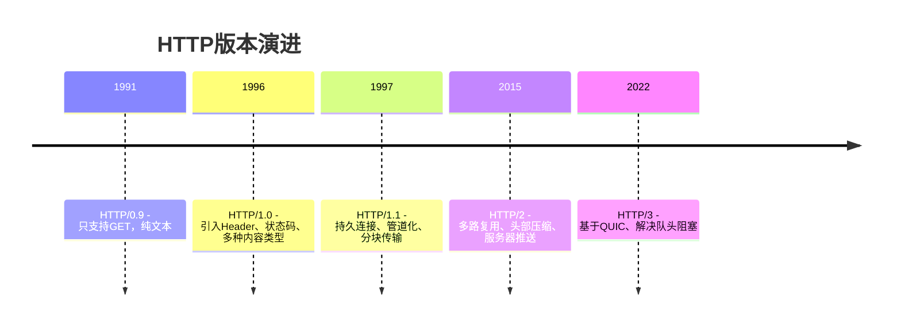
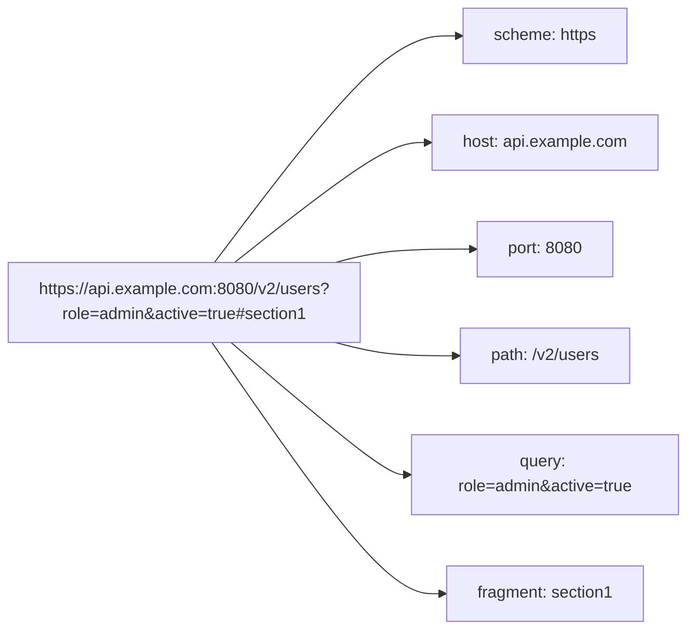
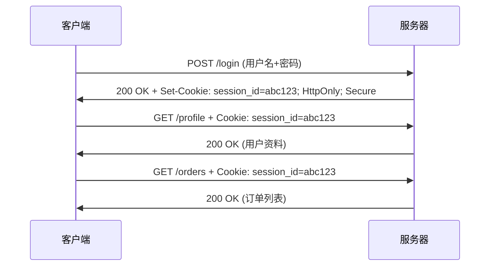
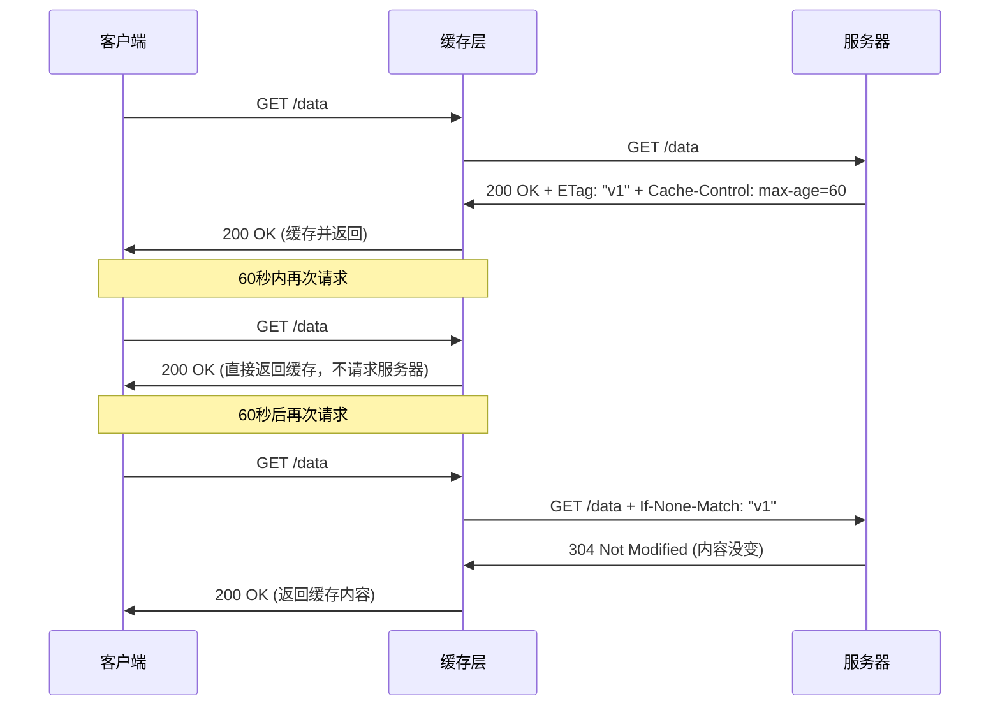
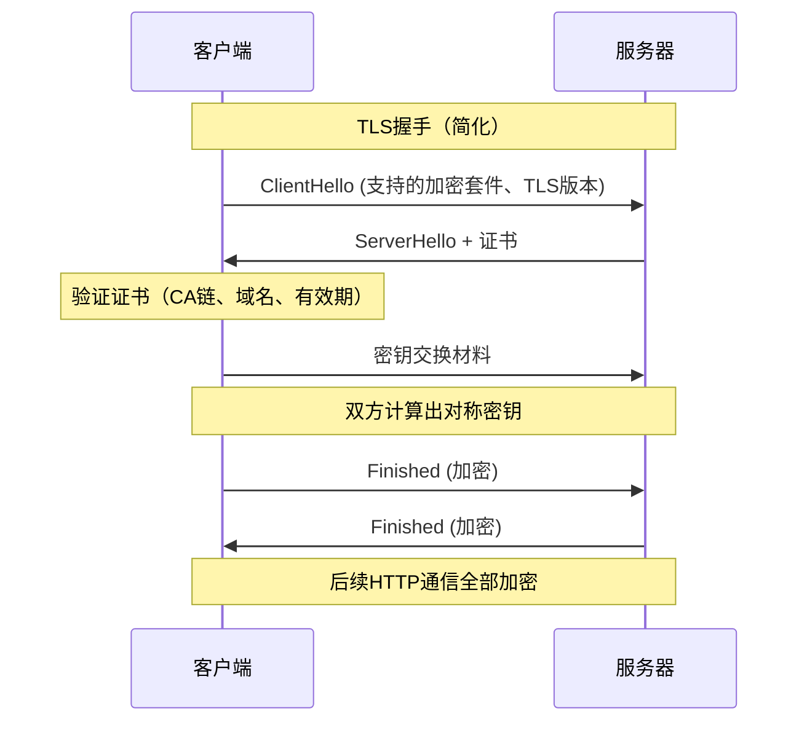
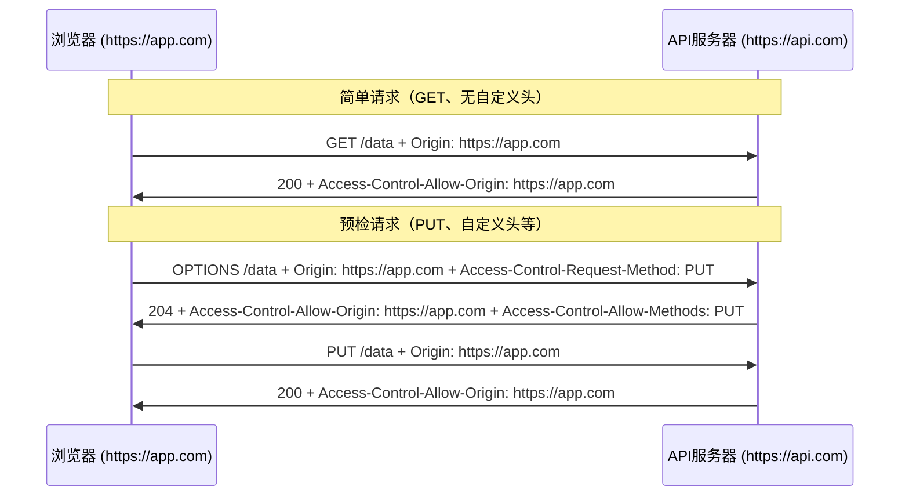
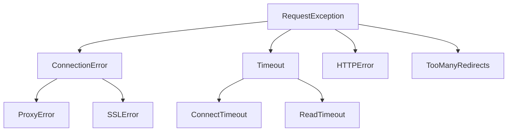
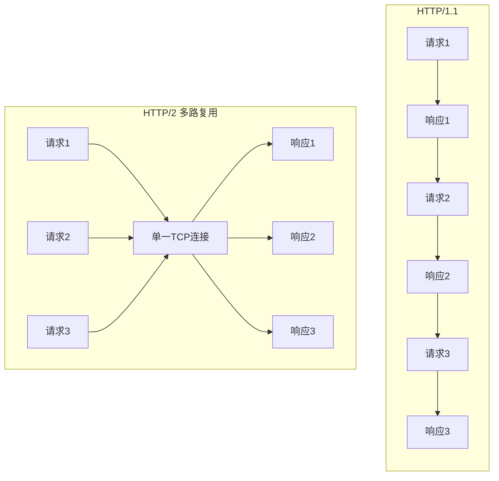
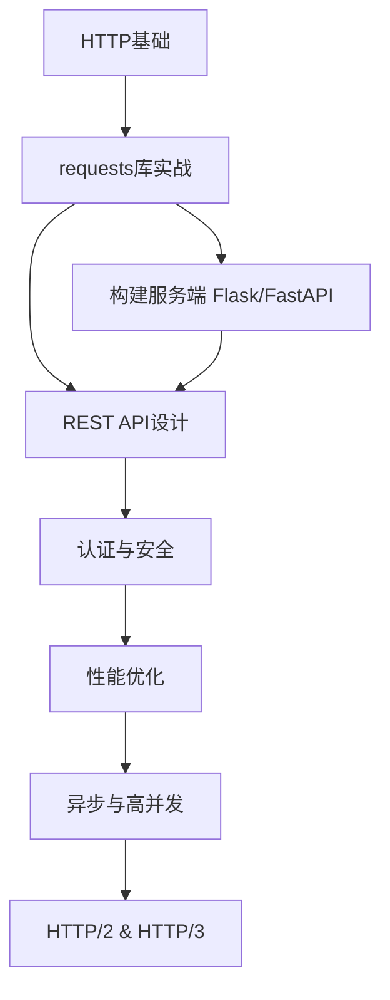

[toc]

# HTTP协议从理论到实战

## 什么是HTTP

HTTP（HyperText Transfer Protocol，超文本传输协议）是互联网上应用最广泛的应用层协议。它定义了客户端（通常是浏览器）与服务器之间如何交换数据。尽管名字里有"超文本"，但现代HTTP传输的内容早已超越文本，涵盖图片、视频、JSON、二进制流等一切数据。

### 核心特征：

- 基于请求-响应模型：客户端发起请求，服务器返回响应
- 无状态协议：每次请求独立，服务器不会自动记住之前的交互（需要Cookie/Session等机制补充）
- 基于TCP（HTTP/1.1和HTTP/2）或QUIC/UDP（HTTP/3）传输
- 默认端口：HTTP用80，HTTPS用443

## HTTP协议的演进



| 版本     | 传输层    | 关键改进                     | 连接模型         |
| -------- | --------- | ---------------------------- | ---------------- |
| HTTP/1.0 | TCP       | Header、Content-Type、状态码 | 每次请求新建连接 |
| HTTP/1.1 | TCP       | 持久连接、Host头、分块编码   | 默认Keep-Alive   |
| HTTP/2   | TCP+TLS   | 二进制帧、多路复用、头部压缩 | 单连接多流       |
| HTTP/3   | QUIC(UDP) | 消除TCP队头阻塞、0-RTT握手   | 基于QUIC流       |

当前实践中，HTTP/1.1仍然是基础，HTTP/2已广泛部署，HTTP/3正在快速普及。理解HTTP/1.1是学习后续版本的前提。

## 请求与响应的结构

HTTP通信的本质是文本协议（HTTP/2之后是二进制帧，但语义不变）。一次完整的交互包含一个请求和一个响应。

### 请求报文结构

```http
GET /api/users?page=1 HTTP/1.1
Host: example.com
Accept: application/json
Authorization: Bearer eyJhbGciOi...
User-Agent: python-requests/2.31.0
```

组成部分：

| 部分   | 说明                               | 示例                             |
| ------ | ---------------------------------- | -------------------------------- |
| 请求行 | 方法 + 路径(含查询参数) + 协议版本 | `GET /api/users?page=1 HTTP/1.1` |
| 请求头 | 键值对形式的元数据                 | `Host: example.com`              |
| 空行   | 分隔头部和正文（CRLF）             |                                  |
| 请求体 | 可选，POST/PUT等方法携带数据       | `{"name": "Alice"}`              |

### 响应报文结构

```http
HTTP/1.1 200 OK
Content-Type: application/json
Content-Length: 42
Date: Mon, 01 Jul 2024 12:00:00 GMT

{"id": 1, "name": "Alice", "role": "admin"}
```

| 部分   | 说明                         | 示例                             |
| ------ | ---------------------------- | -------------------------------- |
| 状态行 | 协议版本 + 状态码 + 原因短语 | `HTTP/1.1 200 OK`                |
| 响应头 | 服务器返回的元数据           | `Content-Type: application/json` |
| 空行   | 分隔头部和正文               |                                  |
| 响应体 | 实际返回的数据               | JSON、HTML、二进制等             |

### 用Python观察原始报文

```python
import socket

# 手动构造HTTP请求，直观感受协议的文本本质
request = (
    "GET / HTTP/1.1\r\n"
    "Host: httpbin.org\r\n"
    "Connection: close\r\n"
    "\r\n"
)

sock = socket.socket(socket.AF_INET, socket.SOCK_STREAM)
sock.connect(("httpbin.org", 80))
sock.sendall(request.encode())

response = b""
while chunk := sock.recv(4096):
    response += chunk
sock.close()

# 分离头部和正文
header, _, body = response.partition(b"\r\n\r\n")
print("=== Response Headers ===")
print(header.decode())
print("\n=== Body (first 200 chars) ===")
print(body.decode()[:200])
```

这段代码展示了HTTP的本质：通过TCP发送格式化的文本。`requests`库等工具只是帮你封装了这些细节。

## HTTP方法

HTTP方法（也叫动词）表达了对资源的操作意图。

| 方法    | 语义              | 幂等 | 安全 | 有请求体 | 典型用途           |
| ------- | ----------------- | ---- | ---- | -------- | ------------------ |
| GET     | 获取资源          | ✓    | ✓    | 否       | 查询数据           |
| POST    | 创建资源/提交数据 | ✗    | ✗    | 是       | 创建记录、提交表单 |
| PUT     | 整体替换资源      | ✓    | ✗    | 是       | 更新完整对象       |
| PATCH   | 部分更新资源      | ✗    | ✗    | 是       | 修改个别字段       |
| DELETE  | 删除资源          | ✓    | ✗    | 可选     | 删除记录           |
| HEAD    | 同GET但只返回头部 | ✓    | ✓    | 否       | 检查资源是否存在   |
| OPTIONS | 查询支持的方法    | ✓    | ✓    | 否       | CORS预检请求       |

关键概念解释：

- 幂等（Idempotent）：同一请求执行多次，效果与执行一次相同。GET获取10次结果一样，DELETE删除10次资源还是被删除。POST不幂等，提交10次可能创建10条记录。
- 安全（Safe）：不会修改服务器状态。GET和HEAD只是"看一看"，不改变数据。

```python
import requests

base = "https://httpbin.org"

# GET - 获取资源
resp = requests.get(f"{base}/get", params={"q": "python", "page": 1})
print(resp.json()["args"])  # {'q': 'python', 'page': '1'}

# POST - 创建资源
resp = requests.post(f"{base}/post", json={"name": "Alice", "age": 30})
print(resp.json()["json"])  # {'name': 'Alice', 'age': 30}

# PUT - 整体替换
resp = requests.put(f"{base}/put", json={"name": "Alice", "age": 31})

# PATCH - 部分更新
resp = requests.patch(f"{base}/patch", json={"age": 32})

# DELETE - 删除
resp = requests.delete(f"{base}/delete")

# HEAD - 只获取头部（检查资源是否存在、获取文件大小等）
resp = requests.head(f"{base}/get")
print(resp.headers["Content-Type"])  # 有头部
print(resp.text)  # 空，没有body
```

## 状态码

状态码是服务器对请求的"回答态度"。三位数字，第一位表示类别。

| 类别 | 范围    | 含义       | 常见场景           |
| ---- | ------- | ---------- | ------------------ |
| 1xx  | 100-199 | 信息性     | 继续发送、协议切换 |
| 2xx  | 200-299 | 成功       | 请求被正确处理     |
| 3xx  | 300-399 | 重定向     | 资源位置变更       |
| 4xx  | 400-499 | 客户端错误 | 请求有问题         |
| 5xx  | 500-599 | 服务器错误 | 服务端处理失败     |

### 必须熟记的状态码

| 状态码 | 名称                  | 说明                                |
| ------ | --------------------- | ----------------------------------- |
| 200    | OK                    | 请求成功                            |
| 201    | Created               | 资源创建成功（POST后常用）          |
| 204    | No Content            | 成功但无返回体（DELETE后常用）      |
| 301    | Moved Permanently     | 永久重定向，搜索引擎会更新索引      |
| 302    | Found                 | 临时重定向                          |
| 304    | Not Modified          | 缓存有效，无需重新传输              |
| 400    | Bad Request           | 请求格式错误、参数校验失败          |
| 401    | Unauthorized          | 未认证（需要登录）                  |
| 403    | Forbidden             | 已认证但无权限                      |
| 404    | Not Found             | 资源不存在                          |
| 405    | Method Not Allowed    | 方法不被允许（对只读资源用DELETE）  |
| 409    | Conflict              | 冲突（如重复创建）                  |
| 422    | Unprocessable Entity  | 格式正确但语义错误（常见于API校验） |
| 429    | Too Many Requests     | 限流，请求过于频繁                  |
| 500    | Internal Server Error | 服务器内部错误                      |
| 502    | Bad Gateway           | 网关/代理收到无效响应               |
| 503    | Service Unavailable   | 服务暂时不可用                      |
| 504    | Gateway Timeout       | 网关超时                            |

### 常见错误说明

**HTTP 502 Bad Gateway（错误网关）** 是一个非常常见的服务器端错误状态码。

简单来说，当你在访问一个网站时，你的浏览器（客户端）发送了一个请求，这个请求会经过一个“网关”或“代理服务器”（比如 Nginx、Apache、Cloudflare），然后由它转发给背后的“源服务器”（真正处理业务、连接数据库的应用服务器，比如 Tomcat、Node.js、Django）。

502 错误意味着：**作为网关或代理的服务器，在尝试执行请求时，从上游的源服务器收到了一个无效（非法）的响应。**

502 通常是**服务器端**的问题，用户的电脑和网络一般是没问题的。常见的原因包括：

- **源服务器崩溃或未启动：** 后台的应用服务（如 PHP-FPM、Node.js 进程）因为内存溢出、代码崩溃而停止运行了，网关找不到人说话。
- **服务器超载（高并发）：** 网站突然迎来了海量访问，源服务器CPU或内存爆满，处理不过来，导致连接断开或超时。
- **配置错误：** 代理服务器（如 Nginx）的配置文件中，指向源服务器的 IP 地址或端口写错了。
- **防火墙拦截：** 安全软件或防火墙（如某些严格的云安全策略）误把代理服务器和源服务器之间的通信给阻断了。

### 请求状态处理代码示例

```python
import requests

resp = requests.get("https://httpbin.org/status/404")
print(resp.status_code)      # 404
print(resp.reason)           # NOT FOUND
print(resp.ok)               # False（status_code < 400 时为 True）

# 主动抛出异常（适合在脚本中快速失败）
resp = requests.get("https://httpbin.org/status/500")
try:
    resp.raise_for_status()
except requests.HTTPError as e:
    print(f"请求失败: {e}")
```

## 请求头与响应头

Header是HTTP的元数据层，控制着缓存、认证、内容协商、连接管理等几乎所有行为。

### 常用请求头

| 头部            | 作用                     | 示例值                        |
| --------------- | ------------------------ | ----------------------------- |
| Host            | 目标主机（HTTP/1.1必须） | `api.example.com`             |
| Content-Type    | 请求体的媒体类型         | `application/json`            |
| Accept          | 期望的响应格式           | `application/json, text/html` |
| Authorization   | 认证凭据                 | `Bearer <token>`              |
| User-Agent      | 客户端标识               | `python-requests/2.31.0`      |
| Cookie          | 携带Cookie               | `session_id=abc123`           |
| Cache-Control   | 缓存指令                 | `no-cache`                    |
| If-None-Match   | 条件请求（配合ETag）     | `"v1.0"`                      |
| Accept-Encoding | 支持的压缩算法           | `gzip, br`                    |

### 常用响应头

| 头部                        | 作用                 | 示例值                                |
| --------------------------- | -------------------- | ------------------------------------- |
| Content-Type                | 响应体的媒体类型     | `application/json; charset=utf-8`     |
| Content-Length              | 响应体字节数         | `1024`                                |
| Set-Cookie                  | 设置Cookie           | `session_id=abc123; HttpOnly; Secure` |
| Cache-Control               | 缓存策略             | `max-age=3600, public`                |
| ETag                        | 资源版本标识         | `"33a64df5"`                          |
| Location                    | 重定向目标URL        | `https://example.com/new-path`        |
| Access-Control-Allow-Origin | CORS允许的源         | `https://frontend.com`                |
| Retry-After                 | 限流后建议的重试时间 | `60`                                  |

```python
import requests

# 自定义请求头
headers = {
    "Accept": "application/json",
    "Authorization": "Bearer my-secret-token",
    "X-Request-ID": "req-abc-123",  # 自定义头部用于链路追踪
}
resp = requests.get("https://httpbin.org/headers", headers=headers)
print(resp.json()["headers"])

# 查看响应头
resp = requests.get("https://httpbin.org/response-headers", params={
    "X-Custom": "hello"
})
print(resp.headers["X-Custom"])         # hello
print(resp.headers["Content-Type"])     # application/json
print(resp.headers.get("X-Missing"))    # None（安全获取）
```

## URL结构与查询参数



| 组成部分 | 说明     | 备注                         |
| -------- | -------- | ---------------------------- |
| scheme   | 协议     | http或https                  |
| host     | 主机名   | 域名或IP                     |
| port     | 端口     | 省略时用默认端口             |
| path     | 资源路径 | 层级结构                     |
| query    | 查询参数 | `?`开始，`&`分隔多个参数     |
| fragment | 片段标识 | 不发送到服务器，仅客户端使用 |

```python
import requests
from urllib.parse import urlencode, quote

# requests自动处理参数编码
params = {
    "q": "python http",       # 空格会被编码为 %20 或 +
    "page": 1,
    "tags": ["web", "api"],   # 列表参数
}
resp = requests.get("https://httpbin.org/get", params=params)
print(resp.url)
# https://httpbin.org/get?q=python+http&page=1&tags=web&tags=api

# 手动编码（了解底层机制）
print(quote("hello world/你好"))  # hello%20world/%E4%BD%A0%E5%A5%BD
print(urlencode({"name": "张三", "city": "北京"}))  # name=%E5%BC%A0%E4%B8%89&city=%E5%8C%97%E4%BA%AC
```

## 请求体与Content-Type

不同的Content-Type决定了请求体的编码方式。这是初学者常见的困惑点。

| Content-Type                        | 用途              | requests写法  |
| ----------------------------------- | ----------------- | ------------- |
| `application/json`                  | API交互（最常用） | `json=data`   |
| `application/x-www-form-urlencoded` | HTML表单默认      | `data=dict`   |
| `multipart/form-data`               | 文件上传          | `files=...`   |
| `text/plain`                        | 纯文本            | `data="text"` |
| `application/octet-stream`          | 二进制流          | `data=bytes`  |

```python
import requests

url = "https://httpbin.org/post"

# 1. JSON（现代API的标准选择）
resp = requests.post(url, json={"name": "Alice", "scores": [95, 87, 92]})
# Content-Type 自动设为 application/json
# 自动序列化Python对象为JSON字符串

# 2. 表单编码
resp = requests.post(url, data={"username": "alice", "password": "secret"})
# Content-Type: application/x-www-form-urlencoded
# 编码为: username=alice&password=secret

# 3. 文件上传
with open("report.pdf", "rb") as f:
    resp = requests.post(url, files={
        "document": ("report.pdf", f, "application/pdf"),
        "description": (None, "Monthly report"),  # 附带文本字段
    })
# Content-Type: multipart/form-data; boundary=...

# 4. 原始二进制
resp = requests.post(url, data=b"\x00\x01\x02\x03",
                     headers={"Content-Type": "application/octet-stream"})
```

关键区别：`json=` 参数会自动设置Content-Type并序列化数据；`data=` 传字典时按表单编码，传字符串/字节时原样发送。

## Cookie与会话管理

HTTP是无状态的，Cookie是最基础的状态保持机制。




```python

import requests

# 手动管理Cookie（不推荐）
resp = requests.get("https://httpbin.org/cookies/set/user/alice")
# 默认不跟踪Cookie，每次请求独立

# 使用Session自动管理Cookie（推荐）
session = requests.Session()

# 设置Cookie
session.get("https://httpbin.org/cookies/set/session_id/abc123")

# 后续请求自动携带Cookie
resp = session.get("https://httpbin.org/cookies")
print(resp.json())  # {'cookies': {'session_id': 'abc123'}}

# Session还能复用TCP连接（性能更好）、保持公共Header
session.headers.update({
    "Authorization": "Bearer my-token",
    "Accept": "application/json",
})

# 所有通过session发出的请求都会带上这些Header
resp = session.get("https://httpbin.org/headers")
```

Session的好处不仅是Cookie管理，还包括TCP连接复用（减少握手开销）和统一配置。

## 认证机制

| 认证方式       | 适用场景           | 安全性             | 说明                |
| -------------- | ------------------ | ------------------ | ------------------- |
| Basic Auth     | 内部服务、简单场景 | 低（仅Base64编码） | 必须配合HTTPS       |
| Bearer Token   | API认证（JWT等）   | 中                 | 无状态，需管理过期  |
| API Key        | 第三方服务调用     | 中                 | 通常放Header或Query |
| OAuth 2.0      | 第三方授权         | 高                 | 标准授权框架        |
| Session Cookie | Web应用            | 中                 | 有状态，需防CSRF    |

```python
import requests
from requests.auth import HTTPBasicAuth

# Basic Auth
resp = requests.get(
    "https://httpbin.org/basic-auth/user/pass",
    auth=HTTPBasicAuth("user", "pass")  # 或简写 auth=("user", "pass")
)
print(resp.status_code)  # 200

# Bearer Token（最常见的API认证方式）
token = "eyJhbGciOiJIUzI1NiIs..."
resp = requests.get(
    "https://api.example.com/me",
    headers={"Authorization": f"Bearer {token}"}
)

# API Key（不同服务放的位置不同）
# 放在Header中
resp = requests.get(
    "https://api.example.com/data",
    headers={"X-API-Key": "your-api-key"}
)
# 放在Query参数中
resp = requests.get(
    "https://api.example.com/data",
    params={"api_key": "your-api-key"}
)
```

最佳实践：永远不要在代码中硬编码密钥。使用环境变量或密钥管理服务。

```python
import os

token = os.environ["API_TOKEN"]  # 从环境变量读取
```

## 重定向

服务器通过3xx状态码告诉客户端"资源在别处"。

```python
import requests

# requests默认自动跟随重定向
resp = requests.get("http://github.com")  # HTTP -> HTTPS重定向
print(resp.status_code)   # 200（最终响应）
print(resp.url)           # https://github.com/（最终URL）
print(resp.history)       # [<Response [301]>]（重定向链）

# 禁止自动重定向（需要手动处理时）
resp = requests.get("http://github.com", allow_redirects=False)
print(resp.status_code)   # 301
print(resp.headers["Location"])  # https://github.com/
```

| 状态码 | 类型                   | 浏览器行为               | 适用场景            |
| ------ | ---------------------- | ------------------------ | ------------------- |
| 301    | 永久重定向             | 缓存，后续直接访问新地址 | 域名迁移、URL规范化 |
| 302    | 临时重定向             | 不缓存，每次仍访问原地址 | 登录后跳转          |
| 307    | 临时重定向（保持方法） | 保持原始HTTP方法         | POST重定向          |
| 308    | 永久重定向（保持方法） | 保持原始HTTP方法         | API版本迁移         |

301/302可能将POST改为GET（历史原因），307/308保证方法不变。

## 超时与重试

网络不可靠，健壮的HTTP客户端必须处理超时和重试。

```python
import requests
from requests.adapters import HTTPAdapter
from urllib3.util.retry import Retry

# 设置超时（秒）
try:
    resp = requests.get("https://httpbin.org/delay/5", timeout=(3, 10))
    # timeout=(connect_timeout, read_timeout)
    # connect_timeout: 建立连接的最大等待时间
    # read_timeout: 等待服务器响应的最大时间
except requests.ConnectTimeout:
    print("连接超时：服务器无法到达")
except requests.ReadTimeout:
    print("读取超时：服务器响应太慢")

# 配置自动重试策略
retry_strategy = Retry(
    total=3,                    # 最多重试3次
    backoff_factor=1,           # 退避因子：1s, 2s, 4s
    status_forcelist=[429, 500, 502, 503, 504],  # 这些状态码触发重试
    allowed_methods=["GET", "HEAD", "OPTIONS"],   # 只对幂等方法重试
)

adapter = HTTPAdapter(max_retries=retry_strategy)
session = requests.Session()
session.mount("https://", adapter)
session.mount("http://", adapter)

# 使用配置好的session发请求
resp = session.get("https://httpbin.org/get", timeout=5)
```

最佳实践：

- 始终设置timeout，永远不要让请求无限等待
- 只对幂等方法自动重试（GET、HEAD等），POST重试可能导致重复创建
- 使用指数退避（backoff），避免重试风暴压垮服务器

## 缓存机制

HTTP缓存减少不必要的网络传输，提升性能。



| 缓存头            | 方向 | 作用                                          |
| ----------------- | ---- | --------------------------------------------- |
| Cache-Control     | 双向 | 控制缓存行为（max-age、no-cache、no-store等） |
| ETag              | 响应 | 资源的版本指纹                                |
| If-None-Match     | 请求 | 携带之前的ETag，询问是否有变化                |
| Last-Modified     | 响应 | 资源最后修改时间                              |
| If-Modified-Since | 请求 | 携带之前的修改时间                            |
| Expires           | 响应 | 过期时间（旧机制，优先级低于Cache-Control）   |

```python
import requests

# 条件请求示例
url = "https://httpbin.org/etag/my-etag-value"

# 首次请求
resp = requests.get(url)
etag = resp.headers.get("ETag")
print(f"ETag: {etag}, Status: {resp.status_code}")  # 200

# 条件请求：如果资源没变，服务器返回304，节省带宽
resp = requests.get(url, headers={"If-None-Match": etag})
print(f"Status: {resp.status_code}")  # 304 Not Modified
```

`requests`库本身不内置缓存，生产环境可使用`requests-cache`或`CacheControl`库：

```python
import requests_cache

# 安装: pip install requests-cache
session = requests_cache.CachedSession(
    "http_cache",           # 缓存文件名
    expire_after=300,       # 默认缓存5分钟
    allowable_methods=["GET"],
)

# 第一次请求走网络
resp = session.get("https://httpbin.org/get")
print(resp.from_cache)  # False

# 第二次请求走缓存
resp = session.get("https://httpbin.org/get")
print(resp.from_cache)  # True
```

## HTTPS与TLS

HTTPS = HTTP + TLS加密。现代互联网中，HTTPS是默认选择，不是可选项。



```python

import requests

# HTTPS请求（默认验证证书）
resp = requests.get("https://example.com")

# 自定义CA证书（企业内网常见）
resp = requests.get("https://internal.corp.com", verify="/path/to/ca-bundle.crt")

# 客户端证书认证（mTLS）
resp = requests.get(
    "https://secure.example.com",
    cert=("/path/to/client.cert", "/path/to/client.key")
)

# 禁用证书验证（仅用于开发调试，生产环境绝不可用）
resp = requests.get("https://self-signed.example.com", verify=False)
# 会产生 InsecureRequestWarning 警告
```


安全要点：

- 生产环境始终验证证书（`verify=True`是默认值）
- 不要在代码中禁用证书验证后忘记恢复
- 使用TLS 1.2+，禁用旧版本

## 连接管理与性能

### 持久连接

HTTP/1.1默认使用持久连接（Keep-Alive），一个TCP连接可以发送多个请求。

```python
import requests

# 不使用Session：每次请求都建立新TCP连接（慢）
for i in range(10):
    requests.get("https://httpbin.org/get")  # 10次TCP握手

# 使用Session：复用TCP连接（快）
session = requests.Session()
for i in range(10):
    session.get("https://httpbin.org/get")  # 1次TCP握手，10次请求复用同一连接
session.close()  # 用完关闭

# 推荐使用上下文管理器
with requests.Session() as session:
    session.headers.update({"Accept": "application/json"})
    for i in range(10):
        resp = session.get("https://httpbin.org/get")
```


### 连接池配置

```python
from requests.adapters import HTTPAdapter

session = requests.Session()
adapter = HTTPAdapter(
    pool_connections=10,    # 连接池中保持的主机数
    pool_maxsize=20,        # 每个主机的最大连接数
    pool_block=True,        # 连接池满时阻塞等待（而非创建新连接）
)
session.mount("https://", adapter)
session.mount("http://", adapter)
```

### 并发请求

```python
import concurrent.futures
import requests

urls = [f"https://httpbin.org/delay/1" for _ in range(5)]

# 串行：约5秒
session = requests.Session()
for url in urls:
    session.get(url)

# 并发：约1秒
def fetch(url):
    return session.get(url)

with concurrent.futures.ThreadPoolExecutor(max_workers=5) as executor:
    futures = [executor.submit(fetch, url) for url in urls]
    results = [f.result() for f in concurrent.futures.as_completed(futures)]
    print(f"完成 {len(results)} 个请求")
```

对于高并发场景，考虑使用异步HTTP客户端：

```python
import asyncio
import aiohttp

async def fetch_all():
    urls = [f"https://httpbin.org/delay/1" for _ in range(5)]
    
    async with aiohttp.ClientSession() as session:
        tasks = [session.get(url) for url in urls]
        responses = await asyncio.gather(*tasks)
        for resp in responses:
            print(resp.status)

asyncio.run(fetch_all())
```

| 方案        | 适用场景           | 并发模型 | 库                            |
| ----------- | ------------------ | -------- | ----------------------------- |
| 串行Session | 少量请求           | 无并发   | requests                      |
| 线程池      | 中等并发（几十个） | 多线程   | requests + ThreadPoolExecutor |
| asyncio     | 高并发（数百上千） | 事件循环 | aiohttp / httpx               |
| httpx       | 需要同步/异步兼容  | 两者皆可 | httpx                         |

## 文件上传与下载

### 文件上传

```python
import requests

# 单文件上传
with open("photo.jpg", "rb") as f:
    resp = requests.post(
        "https://httpbin.org/post",
        files={"image": ("photo.jpg", f, "image/jpeg")}
    )

# 多文件上传
files = [
    ("documents", ("report.pdf", open("report.pdf", "rb"), "application/pdf")),
    ("documents", ("data.csv", open("data.csv", "rb"), "text/csv")),
]
resp = requests.post("https://httpbin.org/post", files=files)

# 大文件流式上传（避免一次性加载到内存）
with open("large_video.mp4", "rb") as f:
    resp = requests.post(
        "https://upload.example.com/video",
        data=f,  # 直接传文件对象，流式发送
        headers={"Content-Type": "video/mp4"}
    )
```

### 文件下载

```python
import requests

# 小文件直接下载
resp = requests.get("https://example.com/small-file.json")
with open("small-file.json", "wb") as f:
    f.write(resp.content)

# 大文件流式下载（关键：stream=True）
url = "https://example.com/large-dataset.zip"
with requests.get(url, stream=True) as resp:
    resp.raise_for_status()
    total = int(resp.headers.get("Content-Length", 0))
    downloaded = 0
    
    with open("dataset.zip", "wb") as f:
        for chunk in resp.iter_content(chunk_size=8192):
            f.write(chunk)
            downloaded += len(chunk)
            if total:
                percent = downloaded / total * 100
                print(f"\r下载进度: {percent:.1f}%", end="")

print("\n下载完成")
```

`stream=True`的意义：不设置时，`requests`会将整个响应体加载到内存；设置后，只下载响应头，正文按需读取，适合大文件。

## 内容协商与编码

### 内容协商

客户端通过Accept系列头部告诉服务器自己能处理什么格式，服务器选择最合适的格式返回。

```python
import requests

# 请求JSON格式
resp = requests.get(
    "https://api.github.com/repos/psf/requests",
    headers={"Accept": "application/vnd.github.v3+json"}
)

# 请求不同语言版本
resp = requests.get(
    "https://example.com",
    headers={"Accept-Language": "zh-CN,zh;q=0.9,en;q=0.8"}
)
# q值表示优先级权重（0-1），越高越优先
```

### 响应编码处理

```python
import requests

resp = requests.get("https://httpbin.org/encoding/utf8")

# 文本编码
print(resp.encoding)        # utf-8（从Content-Type推断）
print(resp.text)            # 自动解码的字符串

# 手动指定编码（服务器未正确声明时）
resp.encoding = "gbk"
print(resp.text)

# 二进制内容
resp = requests.get("https://example.com/image.png")
print(type(resp.content))   # <class 'bytes'>

# JSON解析
resp = requests.get("https://httpbin.org/json")
data = resp.json()          # 自动解析JSON为Python对象
print(type(data))           # <class 'dict'>
```

### 压缩

```python
import requests

# requests自动处理gzip/deflate/br解压
# 默认发送 Accept-Encoding: gzip, deflate, br
resp = requests.get("https://httpbin.org/gzip")
print(resp.json()["gzipped"])  # True
# resp.content 已经是解压后的数据
```

## CORS（跨域资源共享）

CORS是浏览器的安全机制，限制网页脚本访问不同源的资源。Python脚本不受CORS限制（没有浏览器沙箱），但理解CORS对全栈开发至关重要。



"同源"的定义：协议 + 主机 + 端口 三者完全相同。

| 场景                                       | 是否同源         |
| ------------------------------------------ | ---------------- |
| `https://app.com` → `https://app.com/api`  | 同源             |
| `https://app.com` → `http://app.com`       | 跨域（协议不同） |
| `https://app.com` → `https://api.app.com`  | 跨域（主机不同） |
| `https://app.com` → `https://app.com:8080` | 跨域（端口不同） |

用Flask演示服务端CORS配置：

```python
from flask import Flask
from flask_cors import CORS

app = Flask(__name__)

# 全局允许所有源（开发环境）
CORS(app)

# 生产环境：精确控制
CORS(app, resources={
    r"/api/*": {
        "origins": ["https://app.example.com"],
        "methods": ["GET", "POST", "PUT", "DELETE"],
        "allow_headers": ["Authorization", "Content-Type"],
        "max_age": 3600,  # 预检结果缓存1小时
    }
})

@app.route("/api/data")
def get_data():
    return {"message": "hello"}
```

## 构建RESTful API客户端

REST（Representational State Transfer）是基于HTTP的API设计风格。核心思想：用URL标识资源，用HTTP方法表达操作。

### REST设计约定

| 操作         | HTTP方法 | URL       | 请求体       | 响应               |
| ------------ | -------- | --------- | ------------ | ------------------ |
| 列出所有用户 | GET      | /users    | 无           | 200 + 用户列表     |
| 获取单个用户 | GET      | /users/42 | 无           | 200 + 用户详情     |
| 创建用户     | POST     | /users    | 用户数据     | 201 + 新用户       |
| 更新用户     | PUT      | /users/42 | 完整用户数据 | 200 + 更新后的用户 |
| 部分更新     | PATCH    | /users/42 | 部分字段     | 200 + 更新后的用户 |
| 删除用户     | DELETE   | /users/42 | 无           | 204 无内容         |

### 封装API客户端

```python
import requests
from typing import Optional


class APIClient:
    """通用REST API客户端封装"""
    
    def __init__(self, base_url: str, token: Optional[str] = None):
        self.session = requests.Session()
        self.base_url = base_url.rstrip("/")
        self.session.headers.update({
            "Accept": "application/json",
            "Content-Type": "application/json",
        })
        if token:
            self.session.headers["Authorization"] = f"Bearer {token}"
    
    def _url(self, path: str) -> str:
        return f"{self.base_url}/{path.lstrip('/')}"
    
    def _handle_response(self, resp: requests.Response) -> dict:
        """统一响应处理"""
        resp.raise_for_status()
        if resp.status_code == 204:
            return {}
        return resp.json()
    
    def get(self, path: str, params: Optional[dict] = None) -> dict:
        resp = self.session.get(self._url(path), params=params, timeout=10)
        return self._handle_response(resp)
    
    def post(self, path: str, data: dict) -> dict:
        resp = self.session.post(self._url(path), json=data, timeout=10)
        return self._handle_response(resp)
    
    def put(self, path: str, data: dict) -> dict:
        resp = self.session.put(self._url(path), json=data, timeout=10)
        return self._handle_response(resp)
    
    def patch(self, path: str, data: dict) -> dict:
        resp = self.session.patch(self._url(path), json=data, timeout=10)
        return self._handle_response(resp)
    
    def delete(self, path: str) -> dict:
        resp = self.session.delete(self._url(path), timeout=10)
        return self._handle_response(resp)
    
    def close(self):
        self.session.close()
    
    def __enter__(self):
        return self
    
    def __exit__(self, *args):
        self.close()


# 使用示例
with APIClient("https://jsonplaceholder.typicode.com") as api:
    # 获取用户列表
    users = api.get("/users")
    print(f"共 {len(users)} 个用户")
    
    # 创建文章
    post = api.post("/posts", {
        "title": "HTTP协议学习笔记",
        "body": "HTTP是应用层协议...",
        "userId": 1,
    })
    print(f"创建成功，ID: {post['id']}")
    
    # 更新文章
    updated = api.patch(f"/posts/{post['id']}", {"title": "更新后的标题"})
    
    # 删除文章
    api.delete(f"/posts/{post['id']}")
```

## 错误处理最佳实践

```python
import requests
from requests.exceptions import (
    ConnectionError,
    Timeout,
    HTTPError,
    RequestException,
)


def robust_request(url: str, max_retries: int = 3) -> dict:
    """带完善错误处理的请求函数"""
    
    for attempt in range(1, max_retries + 1):
        try:
            resp = requests.get(url, timeout=(5, 30))
            resp.raise_for_status()
            return resp.json()
        
        except ConnectionError:
            # DNS解析失败、拒绝连接、网络不可达
            print(f"[尝试 {attempt}] 连接失败，网络可能有问题")
        
        except Timeout:
            # 连接超时或读取超时
            print(f"[尝试 {attempt}] 请求超时")
        
        except HTTPError as e:
            status = e.response.status_code
            
            if status == 401:
                raise AuthenticationError("认证失败，请检查Token") from e
            elif status == 403:
                raise PermissionError("无权访问此资源") from e
            elif status == 404:
                raise ResourceNotFoundError(f"资源不存在: {url}") from e
            elif status == 429:
                # 限流：读取Retry-After头
                retry_after = int(e.response.headers.get("Retry-After", 60))
                print(f"被限流，{retry_after}秒后重试")
                import time
                time.sleep(retry_after)
                continue
            elif status >= 500:
                # 服务器错误，可以重试
                print(f"[尝试 {attempt}] 服务器错误 {status}")
            else:
                # 其他4xx错误，不重试
                raise
        
        except RequestException as e:
            # 兜底：所有requests异常的基类
            print(f"[尝试 {attempt}] 未知请求错误: {e}")
        
        if attempt < max_retries:
            import time
            wait = 2 ** attempt  # 指数退避
            print(f"等待 {wait}秒后重试...")
            time.sleep(wait)
    
    raise Exception(f"请求失败，已重试 {max_retries} 次: {url}")


# 自定义异常
class AuthenticationError(Exception):
    pass

class ResourceNotFoundError(Exception):
    pass
```

异常层级（从具体到通用）：



## 用Flask构建HTTP服务端

理解HTTP不仅要会发请求，还要能写服务端。

```python
from flask import Flask, request, jsonify, abort
from functools import wraps

app = Flask(__name__)

# 模拟数据库
users_db = {
    1: {"id": 1, "name": "Alice", "email": "alice@example.com"},
    2: {"id": 2, "name": "Bob", "email": "bob@example.com"},
}
next_id = 3


# 认证装饰器
def require_auth(f):
    @wraps(f)
    def decorated(*args, **kwargs):
        token = request.headers.get("Authorization", "").removeprefix("Bearer ")
        if token != "valid-token":
            return jsonify({"error": "Unauthorized"}), 401
        return f(*args, **kwargs)
    return decorated


# GET /users - 列出用户（支持分页和筛选）
@app.route("/users", methods=["GET"])
def list_users():
    page = request.args.get("page", 1, type=int)
    per_page = request.args.get("per_page", 10, type=int)
    name_filter = request.args.get("name")
    
    results = list(users_db.values())
    if name_filter:
        results = [u for u in results if name_filter.lower() in u["name"].lower()]
    
    # 简单分页
    start = (page - 1) * per_page
    end = start + per_page
    paginated = results[start:end]
    
    return jsonify({
        "data": paginated,
        "total": len(results),
        "page": page,
        "per_page": per_page,
    })


# GET /users/<id> - 获取单个用户
@app.route("/users/<int:user_id>", methods=["GET"])
def get_user(user_id):
    user = users_db.get(user_id)
    if not user:
        return jsonify({"error": "User not found"}), 404
    return jsonify(user)


# POST /users - 创建用户
@app.route("/users", methods=["POST"])
@require_auth
def create_user():
    global next_id
    
    data = request.get_json()
    if not data:
        return jsonify({"error": "Request body must be JSON"}), 400
    
    # 输入校验
    if not data.get("name") or not data.get("email"):
        return jsonify({"error": "name and email are required"}), 422
    
    user = {"id": next_id, "name": data["name"], "email": data["email"]}
    users_db[next_id] = user
    next_id += 1
    
    return jsonify(user), 201  # 201 Created


# PUT /users/<id> - 整体更新
@app.route("/users/<int:user_id>", methods=["PUT"])
@require_auth
def update_user(user_id):
    if user_id not in users_db:
        return jsonify({"error": "User not found"}), 404
    
    data = request.get_json()
    if not data.get("name") or not data.get("email"):
        return jsonify({"error": "name and email are required"}), 422
    
    users_db[user_id] = {"id": user_id, "name": data["name"], "email": data["email"]}
    return jsonify(users_db[user_id])


# DELETE /users/<id> - 删除用户
@app.route("/users/<int:user_id>", methods=["DELETE"])
@require_auth
def delete_user(user_id):
    if user_id not in users_db:
        return jsonify({"error": "User not found"}), 404
    
    del users_db[user_id]
    return "", 204  # 204 No Content


if __name__ == "__main__":
    app.run(debug=True, port=5000)
```

配合客户端测试：

```python
import requests

BASE = "http://localhost:5000"
HEADERS = {"Authorization": "Bearer valid-token"}

# 列出用户
resp = requests.get(f"{BASE}/users")
print(resp.json())

# 创建用户
resp = requests.post(f"{BASE}/users", json={
    "name": "Charlie",
    "email": "charlie@example.com"
}, headers=HEADERS)
print(resp.status_code)  # 201
print(resp.json())       # {'id': 3, 'name': 'Charlie', ...}

# 未认证访问
resp = requests.post(f"{BASE}/users", json={"name": "X", "email": "x@x.com"})
print(resp.status_code)  # 401
```

## 代理

```python
import requests

# HTTP/HTTPS代理
proxies = {
    "http": "http://proxy.example.com:8080",
    "https": "http://proxy.example.com:8080",
}
resp = requests.get("https://httpbin.org/ip", proxies=proxies)

# SOCKS代理（需要 pip install requests[socks]）
proxies = {
    "http": "socks5://127.0.0.1:1080",
    "https": "socks5://127.0.0.1:1080",
}
resp = requests.get("https://httpbin.org/ip", proxies=proxies)

# 环境变量方式（不修改代码）
# export HTTP_PROXY=http://proxy:8080
# export HTTPS_PROXY=http://proxy:8080
# export NO_PROXY=localhost,127.0.0.1,.internal.com
```

## Webhook与流式响应

### 接收Webhook

Webhook是"反向API"——不是你去请求别人，而是别人在事件发生时主动请求你。

```python
from flask import Flask, request, jsonify
import hmac
import hashlib

app = Flask(__name__)
WEBHOOK_SECRET = "your-webhook-secret"


@app.route("/webhook/github", methods=["POST"])
def github_webhook():
    # 验证签名（防止伪造请求）
    signature = request.headers.get("X-Hub-Signature-256", "")
    expected = "sha256=" + hmac.new(
        WEBHOOK_SECRET.encode(),
        request.data,
        hashlib.sha256
    ).hexdigest()
    
    if not hmac.compare_digest(signature, expected):
        return jsonify({"error": "Invalid signature"}), 403
    
    event = request.headers.get("X-GitHub-Event")
    payload = request.get_json()
    
    if event == "push":
        branch = payload["ref"].split("/")[-1]
        commits = len(payload["commits"])
        print(f"收到push事件: {branch}分支, {commits}个提交")
    
    return jsonify({"status": "received"}), 200
```

### 流式响应（Server-Sent Events）

```python
# 服务端（Flask）
from flask import Flask, Response
import time
import json

app = Flask(__name__)

@app.route("/stream")
def stream():
    def generate():
        for i in range(10):
            data = json.dumps({"count": i, "time": time.time()})
            yield f"data: {data}\n\n"
            time.sleep(1)
    
    return Response(generate(), mimetype="text/event-stream")


# 客户端消费流式响应
import requests

with requests.get("http://localhost:5000/stream", stream=True) as resp:
    for line in resp.iter_lines(decode_unicode=True):
        if line.startswith("data: "):
            data = json.loads(line[6:])
            print(f"收到: {data}")
```

## httpx：现代Python HTTP客户端

`httpx`是`requests`的现代替代品，支持同步和异步，支持HTTP/2。

```python
import httpx

# 同步用法（与requests几乎相同）
resp = httpx.get("https://httpbin.org/get", params={"key": "value"})
print(resp.json())

# 异步用法
import asyncio

async def main():
    async with httpx.AsyncClient() as client:
        resp = await client.get("https://httpbin.org/get")
        print(resp.json())
        
        # 并发请求
        tasks = [client.get(f"https://httpbin.org/get?i={i}") for i in range(5)]
        responses = await asyncio.gather(*tasks)
        print(f"完成 {len(responses)} 个请求")

asyncio.run(main())

# HTTP/2支持
async def http2_example():
    async with httpx.AsyncClient(http2=True) as client:
        resp = await client.get("https://www.google.com")
        print(resp.http_version)  # HTTP/2

asyncio.run(http2_example())
```

| 特性          | requests | httpx            |
| ------------- | -------- | ---------------- |
| 同步支持      | ✓        | ✓                |
| 异步支持      | ✗        | ✓                |
| HTTP/2        | ✗        | ✓                |
| 类型注解      | 部分     | 完整             |
| API兼容性     | —        | 高度兼容requests |
| 流式请求/响应 | ✓        | ✓                |
| 超时配置      | 简单     | 更精细           |

## 调试与抓包

### 启用日志查看底层通信

```python
import logging
import requests

# 开启urllib3的调试日志，查看实际发送的请求
logging.basicConfig(level=logging.DEBUG)
logging.getLogger("urllib3").setLevel(logging.DEBUG)

resp = requests.get("https://httpbin.org/get")
# 输出中可以看到：连接建立、请求头、响应头等细节
```

### 使用requests_toolbelt查看准备好的请求

```python
from requests import Request, Session
from requests_toolbelt.utils import dump

session = Session()
resp = session.get("https://httpbin.org/get")

# 打印完整的请求和响应报文
data = dump.dump_all(resp)
print(data.decode("utf-8"))
```

### 常用抓包工具

| 工具             | 特点                       | 适用场景             |
| ---------------- | -------------------------- | -------------------- |
| mitmproxy        | 命令行，可编程，Python生态 | 开发调试、自动化测试 |
| Charles/Proxyman | GUI，易用                  | 日常开发调试         |
| Wireshark        | 网络层抓包                 | 底层协议分析         |
| 浏览器DevTools   | 内置，零配置               | 前端开发             |
| curl             | 命令行，万能               | 快速测试             |

```bash
# curl 快速测试（开发中最常用）
curl -v https://httpbin.org/get                    # -v 显示详细信息
curl -X POST -H "Content-Type: application/json" \
     -d '{"name":"Alice"}' https://httpbin.org/post
```

## 安全最佳实践清单

| 实践            | 说明                        |
| --------------- | --------------------------- |
| 始终使用HTTPS   | 防止中间人攻击和数据窃听    |
| 验证TLS证书     | 不要在生产环境禁用`verify`  |
| 不硬编码密钥    | 使用环境变量或密钥管理服务  |
| 设置超时        | 防止请求无限挂起            |
| 验证输入        | 服务端永远不信任客户端数据  |
| 限流            | 保护服务端不被滥用          |
| 使用参数化查询  | 防止注入攻击                |
| 最小权限Token   | Token只授予必要的权限和范围 |
| 验证Webhook签名 | 防止伪造回调                |
| 记录审计日志    | 记录关键操作便于追溯        |

## 完整实战：GitHub API客户端

将前面学到的知识整合为一个生产级的API客户端：

```python
"""
GitHub API客户端 - 综合实战示例
演示：Session管理、认证、分页、错误处理、限流应对
"""
import os
import time
import requests
from requests.adapters import HTTPAdapter
from urllib3.util.retry import Retry
from typing import Iterator


class GitHubClient:
    BASE_URL = "https://api.github.com"
    
    def __init__(self, token: str | None = None):
        self.session = requests.Session()
        
        # 认证
        token = token or os.environ.get("GITHUB_TOKEN")
        if token:
            self.session.headers["Authorization"] = f"Bearer {token}"
        
        # 公共头部
        self.session.headers.update({
            "Accept": "application/vnd.github+json",
            "X-GitHub-Api-Version": "2022-11-28",
            "User-Agent": "python-github-client/1.0",
        })
        
        # 重试策略
        retry = Retry(
            total=3,
            backoff_factor=1,
            status_forcelist=[500, 502, 503],
            allowed_methods=["GET", "HEAD"],
        )
        adapter = HTTPAdapter(max_retries=retry, pool_maxsize=10)
        self.session.mount("https://", adapter)
    
    def _request(self, method: str, path: str, **kwargs) -> requests.Response:
        """统一请求入口，处理限流"""
        kwargs.setdefault("timeout", (5, 30))
        url = f"{self.BASE_URL}/{path.lstrip('/')}"
        
        resp = self.session.request(method, url, **kwargs)
        
        # 处理GitHub限流
        if resp.status_code == 403:
            remaining = int(resp.headers.get("X-RateLimit-Remaining", 1))
            if remaining == 0:
                reset_time = int(resp.headers.get("X-RateLimit-Reset", 0))
                wait = max(reset_time - time.time(), 1)
                print(f"API限流，等待 {wait:.0f}秒...")
                time.sleep(wait)
                resp = self.session.request(method, url, **kwargs)
        
        resp.raise_for_status()
        return resp
    
    def _paginate(self, path: str, **kwargs) -> Iterator[dict]:
        """自动处理分页，逐页yield结果"""
        params = kwargs.pop("params", {})
        params.setdefault("per_page", 100)
        
        url = f"{self.BASE_URL}/{path.lstrip('/')}"
        
        while url:
            resp = self._request("GET", "", params=params)
            # 第一次之后用Link头中的完整URL
            yield from resp.json()
            
            # 解析Link头获取下一页
            link_header = resp.headers.get("Link", "")
            url = None
            for part in link_header.split(","):
                if 'rel="next"' in part:
                    url = part.split(";")[0].strip(" <>")
                    break
            
            # 后续请求直接用完整URL
            if url:
                # 覆盖_request使其使用完整URL
                resp = self.session.get(url, timeout=(5, 30))
                resp.raise_for_status()
                yield from resp.json()
                
                link_header = resp.headers.get("Link", "")
                url = None
                for part in link_header.split(","):
                    if 'rel="next"' in part:
                        url = part.split(";")[0].strip(" <>")
                        break
    
    # ---- 高层API ----
    
    def get_user(self, username: str) -> dict:
        resp = self._request("GET", f"/users/{username}")
        return resp.json()
    
    def get_repo(self, owner: str, repo: str) -> dict:
        resp = self._request("GET", f"/repos/{owner}/{repo}")
        return resp.json()
    
    def list_repos(self, username: str, sort: str = "updated") -> list[dict]:
        """获取用户所有仓库（自动分页）"""
        results = []
        params = {"sort": sort, "per_page": 100, "page": 1}
        
        while True:
            resp = self._request("GET", f"/users/{username}/repos", params=params)
            data = resp.json()
            if not data:
                break
            results.extend(data)
            params["page"] += 1
        
        return results
    
    def create_issue(self, owner: str, repo: str, title: str, body: str = "",
                     labels: list[str] | None = None) -> dict:
        payload = {"title": title, "body": body}
        if labels:
            payload["labels"] = labels
        
        resp = self._request("POST", f"/repos/{owner}/{repo}/issues", json=payload)
        return resp.json()
    
    def get_rate_limit(self) -> dict:
        resp = self._request("GET", "/rate_limit")
        return resp.json()["rate"]
    
    def close(self):
        self.session.close()
    
    def __enter__(self):
        return self
    
    def __exit__(self, *args):
        self.close()


# 使用示例
if __name__ == "__main__":
    with GitHubClient() as gh:
        # 查看限流状态
        rate = gh.get_rate_limit()
        print(f"API配额: {rate['remaining']}/{rate['limit']}, "
              f"重置时间: {time.ctime(rate['reset'])}")
        
        # 获取用户信息
        user = gh.get_user("torvalds")
        print(f"{user['name']} - {user['public_repos']} 个公开仓库")
        
        # 获取仓库信息
        repo = gh.get_repo("psf", "requests")
        print(f"{repo['full_name']}: ⭐{repo['stargazers_count']}")
        
        # 列出仓库
        repos = gh.list_repos("psf")
        print(f"PSF共有 {len(repos)} 个仓库")
        for r in repos[:5]:
            print(f"  - {r['name']}: {r['description'] or '无描述'}")                
```


## HTTP/2与HTTP/3简介

虽然日常开发中HTTP/1.1的语义知识已经够用（方法、状态码、头部在各版本中语义一致），但了解新版本的传输层改进有助于理解性能优化。

### HTTP/2核心改进



| 特性       | HTTP/1.1        | HTTP/2                 |
| ---------- | --------------- | ---------------------- |
| 传输格式   | 文本            | 二进制帧               |
| 并发请求   | 需要多个TCP连接 | 单连接多路复用         |
| 头部大小   | 每次完整发送    | HPACK压缩，增量传输    |
| 服务器推送 | 不支持          | 支持（实践中较少使用） |
| 优先级     | 无              | 流优先级               |

### HTTP/3核心改进

HTTP/3将传输层从TCP换为QUIC（基于UDP），解决了HTTP/2在TCP层面的队头阻塞问题。

| 问题     | HTTP/2 (TCP)      | HTTP/3 (QUIC)                   |
| -------- | ----------------- | ------------------------------- |
| 队头阻塞 | TCP丢包阻塞所有流 | 各流独立，丢包只影响单个流      |
| 连接建立 | TCP握手 + TLS握手 | 0-RTT或1-RTT（合并握手）        |
| 连接迁移 | IP变化需重建连接  | 基于Connection ID，网络切换无感 |

```python
# 使用httpx体验HTTP/2
import httpx

# 需要安装: pip install httpx[http2]
with httpx.Client(http2=True) as client:
    resp = client.get("https://www.google.com")
    print(f"协议版本: {resp.http_version}")  # HTTP/2
```

## 常见问题排查

| 症状                       | 可能原因                         | 排查方法                                             |
| -------------------------- | -------------------------------- | ---------------------------------------------------- |
| ConnectionError            | DNS解析失败、端口未开放、防火墙  | `ping`、`telnet host port`、检查防火墙规则           |
| Timeout                    | 服务器过载、网络延迟高           | 增大timeout、检查服务器负载                          |
| 403 Forbidden              | 缺少认证、IP被封、缺少User-Agent | 检查Token、添加合理的User-Agent                      |
| 405 Method Not Allowed     | 用了错误的HTTP方法               | 查阅API文档确认支持的方法                            |
| 415 Unsupported Media Type | Content-Type不正确               | 确认用`json=`还是`data=`                             |
| SSL错误                    | 证书过期、自签名、系统CA过旧     | 更新certifi包、检查证书链                            |
| 乱码                       | 编码不匹配                       | 检查Content-Type中的charset，手动设置`resp.encoding` |
| 响应体为空                 | 204状态码、HEAD方法、gzip问题    | 检查状态码和方法                                     |

```python
# 快速诊断脚本
import requests

def diagnose(url: str):
    """诊断HTTP请求问题"""
    print(f"目标: {url}")
    
    try:
        resp = requests.get(url, timeout=10, allow_redirects=False)
        print(f"状态码: {resp.status_code}")
        print(f"Content-Type: {resp.headers.get('Content-Type')}")
        print(f"Content-Length: {resp.headers.get('Content-Length')}")
        print(f"Server: {resp.headers.get('Server')}")
        
        if resp.is_redirect:
            print(f"重定向到: {resp.headers.get('Location')}")
        
        if resp.status_code == 200:
            print(f"响应体前100字符: {resp.text[:100]}")
    
    except requests.ConnectionError as e:
        print(f"连接失败: {e}")
    except requests.Timeout:
        print("请求超时")
    except Exception as e:
        print(f"异常: {type(e).__name__}: {e}")

diagnose("https://httpbin.org/get")
```

## 总结与学习路径



核心要点回顾：

- HTTP是文本协议（HTTP/2后是二进制帧），理解报文结构是基础
- 方法表达意图，状态码表达结果，头部控制行为
- 始终设置timeout，使用Session复用连接
- 生产环境必须HTTPS，必须验证证书
- 错误处理要区分可重试（5xx、超时）和不可重试（4xx）
- 对于高并发场景，从requests迁移到httpx或aiohttp

推荐的Python HTTP工具链：

| 用途                 | 推荐工具                            |
| -------------------- | ----------------------------------- |
| 同步HTTP客户端       | requests（成熟稳定）、httpx（现代） |
| 异步HTTP客户端       | httpx、aiohttp                      |
| Web框架（轻量）      | Flask                               |
| Web框架（现代/异步） | FastAPI                             |
| API测试              | pytest + httpx/requests             |
| 抓包调试             | mitmproxy                           |
| HTTP/2客户端         | httpx                               |