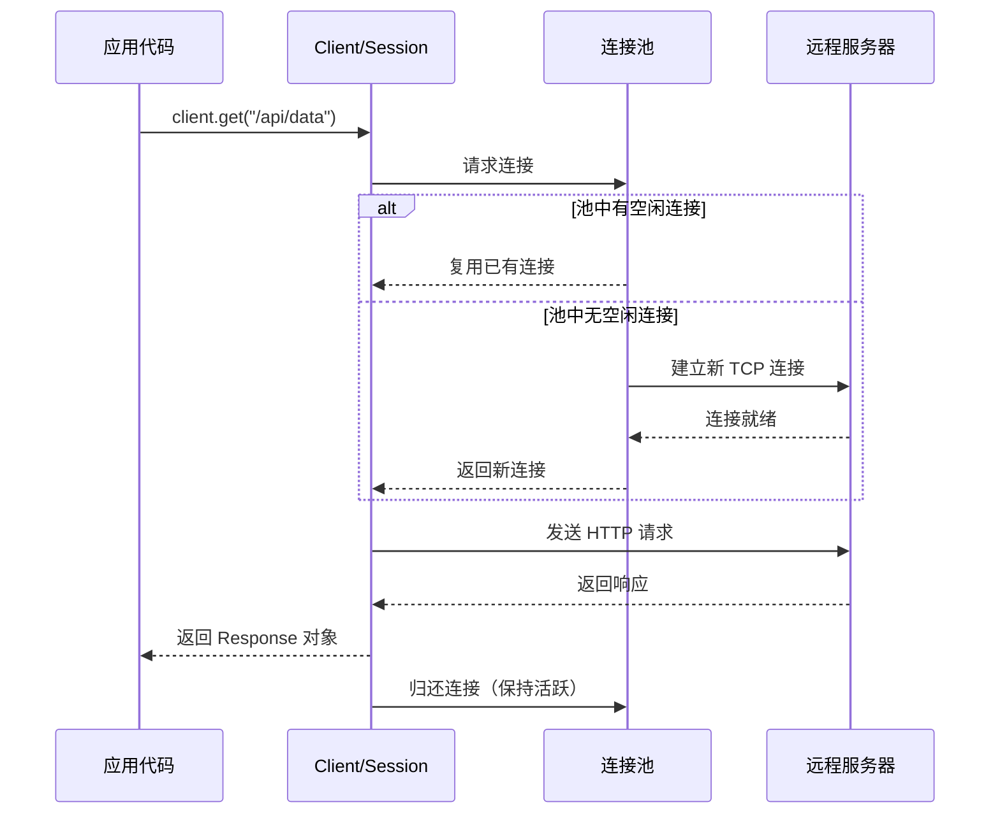
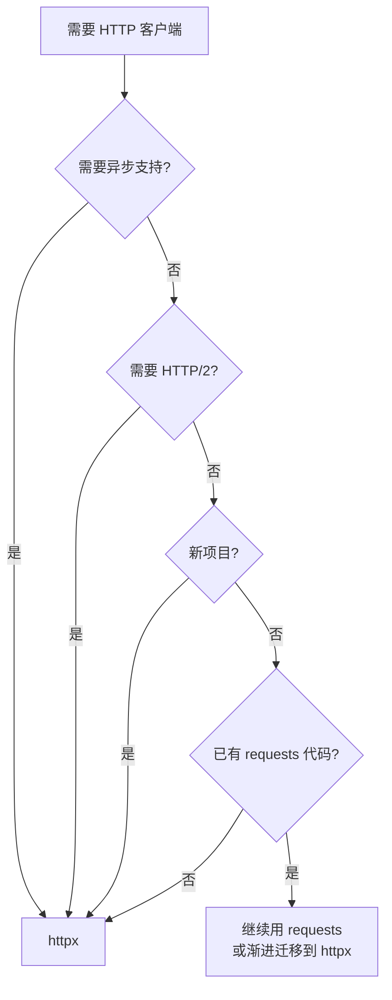

[toc]


# Python HTTP 客户端库：requests 与 httpx

## 概述

requests 和 httpx 是 Python 生态中最主流的两个 HTTP 客户端库。

requests 诞生于 2011 年，以"HTTP for Humans"为理念，长期是 Python HTTP 请求的事实标准。

- [psf/requests: A simple, yet elegant, HTTP library.](https://github.com/psf/requests)
- [快速入门 — Requests  文档 - Requests 中文](https://requests.pythonlang.cn/en/latest/user/quickstart/)

httpx 则是后起之秀，提供与 requests 几乎兼容的 API，同时原生支持异步（async/await）和 HTTP/2，是现代 Python 项目的推荐选择。

- [encode/httpx: A next generation HTTP client for Python. 🦋](https://github.com/encode/httpx/#documentation)
- [HTTPX - 中文文档](https://httpx.doczh.com/)

| 特性            | requests               | httpx                    |
| --------------- | ---------------------- | ------------------------ |
| 同步请求        | ✅                      | ✅                        |
| 异步请求        | ❌                      | ✅（原生）                |
| HTTP/2          | ❌                      | ✅（需安装 `h2`）         |
| 连接池/会话复用 | `Session`              | `Client` / `AsyncClient` |
| 流式响应        | ✅                      | ✅                        |
| 超时默认值      | 无（可能永久挂起）     | 5 秒                     |
| 类型注解        | 部分                   | 完整                     |
| API 兼容性      | 本身是基础的同步请求库 | 高度兼容 requests        |
| 维护状态        | 维护模式（少量更新）   | 活跃开发                 |

## 安装

```shell
# requests
pip install requests
```


```bash


# httpx（基础）
pip install httpx

# httpx 启用 HTTP/2 支持
pip install httpx[http2]

# httpx 启用命令行工具
pip install httpx[cli]
```

------

## 快速上手

### 发起请求

```python
# requests
import requests

resp = requests.get("https://httpbin.org/get")
print(resp.status_code)  # 200
print(resp.json())       # 解析 JSON 响应体

# httpx（同步）
import httpx

resp = httpx.get("https://httpbin.org/get")
print(resp.status_code)
print(resp.json())

# httpx（异步）
import httpx
import asyncio

async def main():
    # 使用异步上下文管理器:先获取异步请求客户端,然后利用异步客户端发送异步请求.
    async with httpx.AsyncClient() as client:
        resp = await client.get("https://httpbin.org/get")
        print(resp.json())

asyncio.run(main())
```

两个库的顶层 API 几乎一致——`get`、`post`、`put`、`patch`、`delete`、`head`、`options` 都可以直接调用。

------

## 请求参数详解

### URL 查询参数

通过 `params` 传递查询字符串，避免手动拼接 URL：

```python

import httpx
# 两个库用法相同
params = {"q": "python", "page": 2}
resp = httpx.get("https://example.com/search", params=params)
# 检查最终访问链接:
url=resp.url
# 实际请求: https://example.com/search?q=python&page=2
```

支持的 `params` 类型：

| 类型     | 示例                             | 说明                         |
| -------- | -------------------------------- | ---------------------------- |
| dict     | `{"key": "value"}`               | 最常用                       |
| 列表元组 | `[("key", "v1"), ("key", "v2")]` | 同名多值参数                 |
| 字符串   | `"key=value&foo=bar"`            | 已编码的查询串（httpx 支持） |

### 请求头

```python
headers = {
    "User-Agent": "MyApp/1.0",
    "Authorization": "Bearer token123",
}
resp = httpx.get(url, headers=headers)
```

### 请求体

| 场景      | 参数                              | Content-Type                      |
| --------- | --------------------------------- | --------------------------------- |
| JSON 数据 | `json={"key": "value"}`           | application/json                  |
| 表单数据  | `data={"field": "value"}`         | application/x-www-form-urlencoded |
| 文件上传  | `files={"file": open(..., "rb")}` | multipart/form-data               |
| 原始字节  | `content=b"raw bytes"`            | 需手动设置（httpx 专用）          |

```python
# POST JSON
resp = httpx.post("https://api.example.com/users", json={
    "name": "Alice",
    "email": "alice@example.com"
})

# POST 表单
resp = httpx.post("https://example.com/login", data={
    "username": "alice",
    "password": "secret"
})

# 文件上传
with open("report.pdf", "rb") as f:
    resp = httpx.post("https://example.com/upload", files={"file": f})
```

多文件上传与附加字段：

```python
files = [
    ("images", ("photo1.png", open("photo1.png", "rb"), "image/png")),
    ("images", ("photo2.png", open("photo2.png", "rb"), "image/png")),
]
data = {"album": "vacation"}
resp = httpx.post(url, files=files, data=data)
```

------

## 响应处理🎈

```python
resp = httpx.get("https://httpbin.org/get")

resp.status_code          # 200
resp.headers              # 响应头（不区分大小写的字典）
resp.headers["content-type"]
resp.text                 # 文本内容（自动解码）
resp.content              # 原始字节
resp.json()              # 解析为 Python 对象
resp.encoding            # 检测到的编码
resp.url                 # 最终 URL（可能经过重定向）
resp.elapsed             # 请求耗时（timedelta）
```

### 状态码判断和异常

#### 基础api

```python
# requests 风格：布尔判断
if resp.is_success:       # httpx: 2xx
    process(resp.json())

# 抛出异常（推荐用于不容忍失败的场景）
resp.raise_for_status()   # 非 2xx 时抛出 HTTPStatusError (httpx) / HTTPError (requests)
```

#### httpx的扩展api

httpx 提供更细粒度的状态码属性：

| 属性                    | 含义 |
| ----------------------- | ---- |
| `resp.is_informational` | 1xx  |
| `resp.is_success`       | 2xx  |
| `resp.is_redirect`      | 3xx  |
| `resp.is_client_error`  | 4xx  |
| `resp.is_server_error`  | 5xx  |

------

## 超时控制

这是 requests 最大的陷阱之一：默认无超时，网络异常时程序会永久挂起。httpx 默认 5 秒超时。

```python
# requests —— 务必显式设置超时
resp = requests.get(url, timeout=10)          # 连接+读取共 10 秒
resp = requests.get(url, timeout=(3.05, 27))  # (连接超时, 读取超时)

# httpx —— 更精细的超时配置
timeout = httpx.Timeout(
    connect=5.0,     # TCP 连接建立
    read=10.0,       # 等待服务器响应数据
    write=5.0,       # 发送请求数据
    pool=5.0         # 等待连接池中可用连接
)
resp = httpx.get(url, timeout=timeout)

# 简写：所有阶段统一超时
resp = httpx.get(url, timeout=10.0)

# 禁用超时（调试用，生产环境不推荐）
resp = httpx.get(url, timeout=None)
```

------

## 会话与连接复用

对同一主机发起多次请求时，使用会话（Session/Client）可以复用 TCP 连接、自动管理 Cookie、共享配置，显著提升性能。

```python
# requests
with requests.Session() as s:
    s.headers.update({"Authorization": "Bearer token"})
    s.get("https://api.example.com/users")
    s.get("https://api.example.com/orders")  # 复用连接

# httpx（同步）
with httpx.Client(
    base_url="https://api.example.com",
    headers={"Authorization": "Bearer token"},
    timeout=10.0,
) as client:
    client.get("/users")
    client.get("/orders")

# httpx（异步）
async with httpx.AsyncClient(base_url="https://api.example.com") as client:
    resp = await client.get("/users")
```

### 连接池配置（httpx）

```python
limits = httpx.Limits(
    max_connections=100,         # 连接池总大小
    max_keepalive_connections=20,  # 保持活跃的连接数
    keepalive_expiry=30,         # 空闲连接存活秒数
)
client = httpx.Client(limits=limits)

```

------




## 重定向与 Cookie

### 重定向

| 行为           | requests                | httpx                    |
| -------------- | ----------------------- | ------------------------ |
| 默认跟随重定向 | ✅（无限制）             | ✅（最多 20 次）          |
| 禁止重定向     | `allow_redirects=False` | `follow_redirects=False` |
| 查看重定向历史 | `resp.history`          | `resp.history`           |

```python
# httpx 默认不跟随重定向（顶层函数），Client 中默认跟随
resp = httpx.get("http://example.com", follow_redirects=True)
print(resp.history)  # 重定向链中的所有响应
```

注意：httpx 的顶层函数（`httpx.get` 等）默认不跟随重定向，需显式传入 `follow_redirects=True`。而 `Client` 实例默认跟随。

### Cookie

```python
# 发送 Cookie
resp = httpx.get(url, cookies={"session_id": "abc123"})

# 从响应读取 Cookie
print(resp.cookies["token"])

# Client 自动管理 Cookie（类似浏览器行为）
with httpx.Client() as client:
    client.post("https://example.com/login", data={"user": "alice", "pass": "secret"})
    # 后续请求自动携带登录后的 Cookie
    resp = client.get("https://example.com/dashboard")
```

------

## 认证

```python
# Basic Auth
resp = httpx.get(url, auth=("username", "password"))

# Bearer Token（通过 headers）
resp = httpx.get(url, headers={"Authorization": "Bearer <token>"})

# Digest Auth（requests 内置，httpx 通过 httpx-auth 等第三方库）
from requests.auth import HTTPDigestAuth
resp = requests.get(url, auth=HTTPDigestAuth("user", "pass"))
```

httpx 支持自定义认证流（实现 `Auth` 接口）：

```python
class BearerAuth(httpx.Auth):
    def __init__(self, token: str):
        self.token = token

    def auth_flow(self, request):
        request.headers["Authorization"] = f"Bearer {self.token}"
        yield request

client = httpx.Client(auth=BearerAuth("my-token"))
```

------

## 代理

```python
# requests
proxies = {
    "http://": "http://proxy.example.com:8080",
    "https://": "http://proxy.example.com:8080",
}
resp = requests.get(url, proxies=proxies)

# httpx
resp = httpx.get(url, proxy="http://proxy.example.com:8080")

# httpx Client 级别代理
client = httpx.Client(proxy="http://proxy.example.com:8080")
```

httpx 还支持 SOCKS 代理（需安装 `httpx[socks]`）：

```python
client = httpx.Client(proxy="socks5://localhost:1080")
```

------

## SSL/TLS 验证

```python
# 禁用验证（仅开发/调试环境）
resp = httpx.get(url, verify=False)

# 指定自定义 CA 证书
resp = httpx.get(url, verify="/path/to/ca-bundle.crt")

# httpx Client 级别配置
client = httpx.Client(verify="/path/to/ca-bundle.crt")
```

生产环境始终保持 `verify=True`（默认值），禁用验证会使连接暴露于中间人攻击。

------

## 流式处理

处理大文件下载或服务器推送事件（SSE）时，流式读取避免将整个响应加载到内存：

```python
# requests
with requests.get(url, stream=True) as resp:
    for chunk in resp.iter_content(chunk_size=8192):
        file.write(chunk)

# httpx（同步）
with httpx.stream("GET", url) as resp:
    for chunk in resp.iter_bytes(chunk_size=8192):
        file.write(chunk)

# httpx（异步）
async with client.stream("GET", url) as resp:
    async for chunk in resp.aiter_bytes(chunk_size=8192):
        await file.write(chunk)
```

流式读取文本行（适合 SSE、NDJSON）：

```python
with httpx.stream("GET", url) as resp:
    for line in resp.iter_lines():
        print(line)
```

------

## HTTP/2 支持（httpx 独有）

HTTP/2 带来多路复用（单连接并发多个请求）、头部压缩、服务器推送等优势：

```python
# 需要安装: pip install httpx[http2]
client = httpx.Client(http2=True)
resp = client.get("https://http2.example.com")
print(resp.http_version)  # "HTTP/2"
```

------

## 异步并发请求（httpx）

httpx 的异步能力是其相对 requests 最大的优势，适合 I/O 密集型场景：

```python
import httpx
import asyncio

async def fetch_all():
    urls = [
        "https://api.example.com/users/1",
        "https://api.example.com/users/2",
        "https://api.example.com/users/3",
    ]
    async with httpx.AsyncClient() as client:
        tasks = [client.get(url) for url in urls]
        responses = await asyncio.gather(*tasks)
        return [r.json() for r in responses]

results = asyncio.run(fetch_all())
sequenceDiagram
    participant App as 应用
    participant AC as AsyncClient
    participant S1 as 服务器 /users/1
    participant S2 as 服务器 /users/2
    participant S3 as 服务器 /users/3

    App->>AC: gather(get /1, get /2, get /3)
    par 并发请求
        AC->>S1: GET /users/1
        AC->>S2: GET /users/2
        AC->>S3: GET /users/3
    end
    S1-->>AC: Response 1
    S2-->>AC: Response 2
    S3-->>AC: Response 3
    AC-->>App: [resp1, resp2, resp3]
```

对比同步顺序请求：3 个各耗时 1 秒的请求，同步需要 3 秒，异步并发约 1 秒。

------

## 重试与错误处理

### 异常体系

| 异常（httpx）            | 触发条件                                      |
| ------------------------ | --------------------------------------------- |
| `httpx.TimeoutException` | 超时（含子类 ConnectTimeout、ReadTimeout 等） |
| `httpx.ConnectError`     | 无法建立连接                                  |
| `httpx.HTTPStatusError`  | `raise_for_status()` 且状态码非 2xx           |
| `httpx.RequestError`     | 所有请求级错误的基类                          |

| 异常（requests）            | 触发条件                            |
| --------------------------- | ----------------------------------- |
| `requests.Timeout`          | 超时                                |
| `requests.ConnectionError`  | 连接失败                            |
| `requests.HTTPError`        | `raise_for_status()` 且状态码非 2xx |
| `requests.RequestException` | 所有异常的基类                      |

### 健壮的请求模式

```python
import httpx
from tenacity import retry, stop_after_attempt, wait_exponential, retry_if_exception_type

@retry(
    stop=stop_after_attempt(3),
    wait=wait_exponential(multiplier=1, min=1, max=10),
    retry=retry_if_exception_type((httpx.TimeoutException, httpx.ConnectError)),
)
def fetch_with_retry(client: httpx.Client, url: str) -> httpx.Response:
    resp = client.get(url)
    resp.raise_for_status()
    return resp
```

requests 生态中常用 `urllib3.util.Retry` 配合 `HTTPAdapter`：

```python
from requests.adapters import HTTPAdapter
from urllib3.util.retry import Retry

retry_strategy = Retry(
    total=3,
    backoff_factor=1,
    status_forcelist=[429, 500, 502, 503, 504],
)
adapter = HTTPAdapter(max_retries=retry_strategy)

session = requests.Session()
session.mount("https://", adapter)
session.mount("http://", adapter)
```

------

## 事件钩子与中间件

### requests 钩子

```python
def log_response(resp, *args, **kwargs):
    print(f"{resp.request.method} {resp.url} -> {resp.status_code}")

session = requests.Session()
session.hooks["response"].append(log_response)
```

### httpx 事件钩子

```python
def log_request(request):
    print(f"-> {request.method} {request.url}")

def log_response(response):
    print(f"<- {response.status_code} {response.url}")

client = httpx.Client(
    event_hooks={
        "request": [log_request],
        "response": [log_response],
    }
)
```

### httpx Transport 自定义（高级中间件模式）

```python
class LoggingTransport(httpx.BaseTransport):
    def __init__(self, transport: httpx.BaseTransport):
        self._transport = transport

    def handle_request(self, request):
        print(f"Sending: {request.method} {request.url}")
        response = self._transport.handle_request(request)
        print(f"Received: {response.status_code}")
        return response

transport = LoggingTransport(httpx.HTTPTransport())
client = httpx.Client(transport=transport)
```

------

## 测试与 Mock

### httpx 内置测试支持

httpx 提供 `MockTransport`，无需第三方库即可 mock 请求：

```python
def mock_handler(request: httpx.Request) -> httpx.Response:
    if request.url.path == "/users":
        return httpx.Response(200, json=[{"id": 1, "name": "Alice"}])
    return httpx.Response(404)

client = httpx.Client(transport=httpx.MockTransport(mock_handler))
resp = client.get("https://api.example.com/users")
assert resp.status_code == 200
```

### requests 测试（使用 responses 库）

```python
import responses
import requests

@responses.activate
def test_get_users():
    responses.add(
        responses.GET,
        "https://api.example.com/users",
        json=[{"id": 1, "name": "Alice"}],
        status=200,
    )
    resp = requests.get("https://api.example.com/users")
    assert resp.json()[0]["name"] == "Alice"
```

------

## 最佳实践

### 通用原则

- 始终设置超时，永远不要让请求无限等待
- 使用 Client/Session 复用连接，避免每次请求都建立新连接
- 用 `raise_for_status()` 显式处理错误状态码
- 大文件使用流式下载，避免内存溢出
- 生产环境保持 SSL 验证开启
- 敏感信息（token、密码）通过环境变量注入，不要硬编码

### 选择建议



### 生产级 Client 配置模板

```python
import httpx

def create_api_client() -> httpx.Client:
    """创建一个配置完善的 HTTP 客户端"""
    return httpx.Client(
        base_url="https://api.example.com",
        timeout=httpx.Timeout(connect=5, read=30, write=10, pool=5),
        limits=httpx.Limits(
            max_connections=100,
            max_keepalive_connections=20,
        ),
        headers={
            "User-Agent": "MyService/1.0",
            "Accept": "application/json",
        },
        http2=True,
        follow_redirects=True,
    )

# 使用
with create_api_client() as client:
    resp = client.get("/data")
    resp.raise_for_status()
    data = resp.json()
```

### 异步生产模板

```python
import httpx

async def create_async_client() -> httpx.AsyncClient:
    return httpx.AsyncClient(
        base_url="https://api.example.com",
        timeout=httpx.Timeout(connect=5, read=30, write=10, pool=5),
        limits=httpx.Limits(max_connections=100, max_keepalive_connections=20),
        http2=True,
        follow_redirects=True,
    )

# 在 FastAPI / Starlette 等框架中作为应用级单例
from contextlib import asynccontextmanager

@asynccontextmanager
async def lifespan(app):
    app.state.http_client = await create_async_client()
    yield
    await app.state.http_client.aclose()
```

------

## 从 requests 迁移到 httpx

大部分代码只需最小改动：

| requests                | httpx                       | 说明                                      |
| ----------------------- | --------------------------- | ----------------------------------------- |
| `requests.get(url)`     | `httpx.get(url)`            | 直接替换                                  |
| `Session()`             | `Client()`                  | 名称变化                                  |
| `resp.ok`               | `resp.is_success`           | 属性名变化（httpx 也支持 `.ok` 作为别名） |
| `allow_redirects=False` | `follow_redirects=False`    | 参数名变化                                |
| `stream=True`           | `httpx.stream(method, url)` | 流式 API 不同                             |
| `resp.content` 自动加载 | 流式时需显式 `resp.read()`  | 流式行为更显式                            |

主要注意点：

- httpx 顶层函数默认不跟随重定向，需传 `follow_redirects=True`
- httpx 默认有 5 秒超时，requests 默认无超时
- httpx 的 `content` 参数替代了 requests 中直接传 `data=bytes` 的用法

------

## 总结

requests 依然是一个可靠、简洁的库，适合简单脚本和已有项目维护。httpx 在保持 API 兼容性的同时，提供了异步支持、HTTP/2、更安全的默认配置（超时）、更好的类型支持和测试工具，是新项目的首选。

两者的核心概念（会话、认证、超时、流式）是相通的，掌握其中一个后切换到另一个几乎没有学习成本。