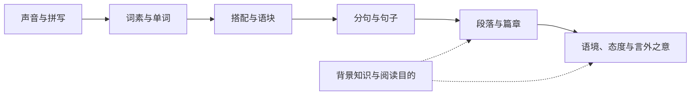

[toc]

## 怎样掌握英语

**不要把英语理解成“英文单词逐个替换成中文”，而要把它理解成一个由声音、词形、搭配、句法、语篇和语境共同构成的系统。**

最有效的总体路线是：

**高频词和高频语块 → 基本句型和动词结构 → 从句与长句拆解 → 段落逻辑和指代 → 大量适级阅读 → 复述、写作和反馈。**

**学习一个语言单位时，始终回答三个问题：它长什么样、表示什么、在什么情况下怎样使用。** 这就是“形式—意义—使用”框架：

| 维度 | 英文术语 | 需要掌握的内容                       |
| ---- | -------- | ------------------------------------ |
| 形式 | form     | 发音、重音、拼写、词形变化、句子结构 |
| 意义 | meaning  | 核心义、上下文义、指代、说话者态度   |
| 使用 | use      | 搭配、语法结构、正式程度、交流场景   |

仅知道 `issue = 问题` 并不等于会用这个词。你还需要知道：

- `a serious issue`：一个严重的问题
- `address an issue`：处理问题
- `raise an issue`：提出问题
- `issue a statement`：发布声明，此时 `issue` 是动词
- `the latest issue of a magazine`：最新一期杂志

**英语学习的真正单位往往不是一个词，而是“词义 + 搭配 + 句型 + 使用场景”。**

---

## 英语有哪些可以把握的规律

英语当然有规律，但规律并不是同一种强度。可以分为三层：

| 规律类型 | 特征                               | 例子                                            | 学习方法                   |
| -------- | ---------------------------------- | ----------------------------------------------- | -------------------------- |
| 语法约束 | 违反后通常明显不合标准英语         | `She likes it.` 不能写成 `She like it.`         | **理解规则并做结构练习**   |
| 搭配惯例 | 语法可能没错，但母语者通常不这样说 | `make a decision`，而不是通常说 `do a decision` | **按语块记忆并查语料**     |
| 语境选择 | 多个表达都正确，但语气或场景不同   | `child` 中性，`kid` 较口语                      | **结合语域和真实例句学习** |

因此，不能只靠两种极端方法：

- 只背规则，会得到“语法可能正确，但很不自然”的英语。
- 只凭语感模仿，初学者又缺少足够输入，容易把错误固化。

**正确做法是：用规则建立骨架，用搭配填充内容，用大量输入形成语感。**

---

## 英语与汉语的主要差异

以下是倾向，不是绝对规则。英语和汉语都能使用主谓宾语序，但英语对结构标记的依赖通常更强。

| 特征           | 英语中的表现                            | 中国学习者容易出现的问题      | 正确做法                                 |
| -------------- | --------------------------------------- | ----------------------------- | ---------------------------------------- |
| 词序相对固定   | 词的位置常决定语法功能                  | 按中文话题顺序排列英文        | **先确定主语、谓语及宾语，再安排修饰语** |
| 显性主语       | 陈述句通常不能随意省略主语              | 写出 `Is important to learn.` | **使用 `It is important to learn.`**     |
| 动词变化       | `works, worked, is working, has worked` | 时间明确却忘记改变动词        | **先确定时间和体，再选择动词结构**       |
| 冠词系统       | `a, an, the` 和零冠词传递可识别性       | 随意省略或到处添加 `the`      | **学习“名词 + 可数性 + 限定词”组合**     |
| 单复数明确     | `book/books`、主谓一致                  | 忘记复数或第三人称单数        | **名词与动词一起检查数量**               |
| 长修饰语常后置 | `the report published yesterday`        | 从左到右逐词翻译后迷失主干    | **先跳过后置修饰语，找到中心词和主句**   |
| 重视连接形式   | `although, therefore, whereas`          | 只看词义，不看句间关系        | **把连接词当作阅读路标**                 |
| 搭配约束强     | `heavy rain, strong evidence`           | 任意替换中文意义相近的词      | **优先记固定搭配，不孤立记单词**         |
| 弱读和连读明显 | 功能词常弱化，如 `to, of, and`          | 单词看得懂，连起来听不懂      | **同时学习音频、重音和弱读**             |

### “英语向右生长”是什么意思

英语并非所有修饰都后置，但**较长的介词短语、分词结构和从句通常放在中心词后面**：

> The report **published by the committee last week** has caused concern.

先忽略粗体修饰语，得到：

> The report has caused concern.

再把修饰语挂回去：

- 中心词：`report`
- `published...`：修饰是哪一份报告
- 主句：这份报告引发了担忧

**阅读长句时，不要试图第一次就把每个词翻译出来；先找到主干，再把修饰语逐层挂回。**

---

## 单词：应该怎样理解和记忆

## 单词不是一个中英文等号

一个完整的词汇知识至少包括：

| 内容       | 要问的问题         | 以 `suggest` 为例                       |
| ---------- | ------------------ | --------------------------------------- |
| 发音和重音 | 会听、会读吗       | `/səˈdʒest/`，重音在后                  |
| 词性       | 在句中能做什么     | 动词                                    |
| 核心意义   | 最常见的含义是什么 | 建议；表明、暗示                        |
| 语法结构   | 后面接什么         | `suggest doing`；`suggest that...`      |
| 搭配       | 常与什么词一起使用 | `strongly suggest`；`evidence suggests` |
| 语气       | 表示多大确定性     | “表明”通常弱于 `prove`                  |
| 限制       | 哪些结构不标准     | 通常不说 `suggest somebody to do`       |

例如：

- `I suggest leaving early.`：我建议早点离开。
- `I suggest that we leave early.`：我建议我们早点离开。
- `The evidence suggests that the treatment may help.`：证据表明这种治疗可能有帮助。

最后一句有两层谨慎：

- `suggests`：证据提示，而非完全证明。
- `may`：可能，而非必然。

**查词时必须看词性、义项、搭配、句型和例句，不能只看第一条中文释义。**

---

## 一词多义不是混乱，而是“核心义在不同场景中的延伸”

很多高频词比生僻词更容易造成误读，因为你“认识”它，却自动套用了错误义项。

| 高频词    | 常见上下文义                   | 例子                                    |
| --------- | ------------------------------ | --------------------------------------- |
| `address` | 地址；发表讲话；处理           | `address the problem` 处理问题          |
| `claim`   | 声称；未经完全证实的主张；索赔 | `The company claims that...` 公司声称…… |
| `case`    | 情况；案例；案件；容器         | `In this case` 在这种情况下             |
| `subject` | 主题；学科；实验对象；使遭受   | `be subject to change` 可能发生变化     |
| `matter`  | 事情；物质；要紧               | `It does not matter.` 这不要紧          |
| `figure`  | 数字；人物；图；认为；计算出   | `figure out the answer` 弄明白答案      |
| `run`     | 跑；运行；经营；延伸           | `run a business` 经营企业               |
| `issue`   | 问题；期号；发行、发布         | `issue a warning` 发布警告              |

**遇到熟词时，也必须服从当前句子的词性、搭配和语法结构，不能让最熟悉的中文意思支配理解。**

例如：

> The paper addresses the limitations of the previous study.

这里：

- `paper` 是论文，不是纸。
- `addresses` 是讨论、处理，不是写地址。
- `limitations` 是局限性，不一定是外部限制。

整句是：**这篇论文讨论了先前研究的局限性。**

---

## 利用构词法猜词，但不能迷信构词法

英语词汇中有大量前缀、词根和后缀。它们能帮助判断大致词义和词性。

| 类型       | 常见形式                    | 作用                   | 例子                           |
| ---------- | --------------------------- | ---------------------- | ------------------------------ |
| 否定前缀   | `un-, in-, im-, dis-`       | 表示否定或相反         | `unfair, impossible, disagree` |
| 重复或返回 | `re-`                       | 再次、返回             | `rewrite, reconsider`          |
| 时间和位置 | `pre-, post-, sub-, inter-` | 之前、之后、下面、之间 | `prewar, international`        |
| 名词后缀   | `-tion, -ment, -ness, -ity` | 经常构成名词           | `decision, development`        |
| 形容词后缀 | `-able, -ive, -al, -ous`    | 经常构成形容词         | `reliable, effective`          |
| 人或工具   | `-er, -or`                  | 执行者或工具           | `teacher, calculator`          |
| 副词后缀   | `-ly`                       | 经常构成副词           | `carefully`                    |

词族示例：

- `decide`：决定
- `decision`：决定
- `decisive`：果断的、决定性的
- `indecisive`：优柔寡断的
- `decisively`：果断地

但构词法只是证据之一：

- `inflammable` 不是“不易燃”，而是“易燃”。
- `department` 不能简单按现代词素随意拆解来获得准确词义。
- `history` 也不能按 `his + story` 理解。

**猜词时依次使用：词性、句法位置、前后逻辑、搭配、构词法和全文主题；构词法不能单独决定词义。**

---

## 生词应该查，还是应该猜

使用这个判断流程：

**不影响主旨的生词先跳过；影响句子主干或反复出现的关键词再查。**

具体步骤：

- **判断重要性**：删掉它以后，句子主旨还能理解吗？
- **判断词性**：它是名词、动词、形容词还是副词？
- **观察搭配**：它和哪个词构成整体？
- **检查逻辑**：前后是转折、因果、解释还是举例？
- **利用词形**：前缀和后缀提供了什么线索？
- **代入暂定词义**：这个含义放回句中是否合理？
- **必要时查词典验证**：尤其是文章关键词和熟词生义。

例如：

> Unlike the temporary decline seen last year, the current reduction appears to be **persistent**.

即使不认识 `persistent`：

- `unlike` 表示对比。
- 前面是 `temporary`，即暂时的。
- 当前下降与它相反。
- 因而可以猜成“持续的、长期存在的”。

**猜词不是猜一个精确中文词，而是先确定大致方向、词性和情感色彩。**

---

## 怎样制作真正有效的单词卡

不要做这种卡：

- 正面：`suggest`
- 背面：建议

建议改成：

- 正面：`The evidence ______ that sleep affects memory.`
- 背面：`suggests`
- 核心义：证据“表明、提示”，并非完全证明
- 结构：`suggest that...`；`suggest doing`
- 搭配：`strongly suggest`
- 发音：使用学习词典音频
- 自造句：`I suggest taking a short break.`

**每张卡只突出一个核心义或一个结构，用完整短句进行提取练习，并采用间隔复习，而不是反复阅读单词表。**

可以从“次日、数日后、一周后、两周后”开始安排复习，再根据实际遗忘情况调整。间隔没有适合所有人的固定数字，关键是：

- 在尚未完全遗忘时尝试回忆。
- 回忆困难的卡更频繁出现。
- 已经熟练的卡逐渐延长间隔。
- 能认出不等于能主动使用，二者要分别测试。

---

## 短语和语块：英语学习中回报最高的部分

语块（chunk）或程式化表达（formulaic sequence）是经常一起出现的多词单位。

| 类型     | 例子                               | 应该怎样学习                             |
| -------- | ---------------------------------- | ---------------------------------------- |
| 搭配     | `make progress`、`strong evidence` | **作为整体记忆，避免任意换同义词**       |
| 动词结构 | `prevent somebody from doing`      | **连同宾语和介词结构一起记**             |
| 短语动词 | `put off`、`carry out`             | **记整体词义、可分性和宾语位置**         |
| 句型框架 | `There is evidence that...`        | **替换其中内容进行造句**                 |
| 话语标记 | `in contrast`、`as a result`       | **学习它们表达的逻辑关系**               |
| 习语     | `break the ice`                    | **按整体理解，但学习优先级低于高频搭配** |

### 高价值搭配

| 不要只记              | 应该记                                                    |
| --------------------- | --------------------------------------------------------- |
| `attention` 注意      | `pay attention to` 注意……                                 |
| `responsibility` 责任 | `take responsibility for` 为……承担责任                    |
| `effect` 效果         | `have an effect on` 对……有影响                            |
| `role` 作用           | `play a role in` 在……中发挥作用                           |
| `evidence` 证据       | `provide strong evidence for` 为……提供有力证据            |
| `decision` 决定       | `make a decision` 作出决定                                |
| `problem` 问题        | `identify, address, solve a problem` 识别、处理、解决问题 |

**背单词时至少带上左邻右舍，例如不要只记 `responsible`，而要记 `be responsible for doing something`。**

### 短语动词还要记“能不能拆”

- `turn off the light`
- `turn the light off`
- 代词必须放中间：`turn it off`，通常不能说 `turn off it`

但：

- `look after the child`
- `look after him`

`look after` 不能像 `turn off` 那样拆开。

再如：

- `look up the word`
- `look the word up`
- `look it up`

**学习短语动词时，要同时记录：含义、及物性、能否拆分、代词放在哪里。**

---

## 介词有没有规律

介词既有空间概念，也有大量固定搭配。

### 可以理解的基本空间规律

- `at`：把位置看成一个点，`at the station`
- `on`：接触表面，`on the table`
- `in`：处于边界或空间内部，`in the room`

时间上的常用对应：

- `at 8:00`
- `on Monday`
- `in July`
- `in 2024`

但抽象用法往往已经词汇化：

- `interested in`
- `good at`
- `responsible for`
- `depend on`
- `prevent somebody from doing`
- `provide somebody with something`

**空间介词可以理解原型，抽象介词必须结合搭配记忆；不要试图为每一个介词硬找中文逻辑。**

---

## 句子：真正的核心是动词及其“配价”

配价（valency）或论元结构（argument structure）指一个动词需要或允许哪些成分。

例如：

- `discuss something`：讨论某事，通常不加 `about`
- `explain something to somebody`：向某人解释某事
- `provide somebody with something`
- `prevent somebody from doing something`
- `suggest doing something`
- `allow somebody to do something`

比较：

- 正确：`We discussed the problem.`
- 不标准：`We discussed about the problem.`

- 正确：`She explained the rule to me.`
- 不标准：`She explained me the rule.`

**学动词时不能只记中文释义，必须记它要求的宾语、介词和补语结构。**

---

## 七种实用基本句型

传统教材常讲五种基本句型。为了覆盖必要的状语补足成分，可以使用以下七种实用模型。不同语法体系对个别成分的名称可能不同，但不影响实际分析。

| 结构 | 名称     | 例句                             |
| ---- | -------- | -------------------------------- |
| SV   | 主谓     | `The child laughed.`             |
| SVC  | 主系表   | `The plan seems reasonable.`     |
| SVA  | 主谓状   | `They stayed outside.`           |
| SVO  | 主谓宾   | `She reads novels.`              |
| SVOO | 主谓双宾 | `He gave me a book.`             |
| SVOC | 主谓宾补 | `They found the task difficult.` |
| SVOA | 主谓宾状 | `She put the key on the desk.`   |

在 `She put the key on the desk` 中，`on the desk` 很重要。只说 `She put the key` 通常不完整，因为 `put` 在这个意义下需要说明放到了哪里。

**所有复杂句都可以看成基本分句加上并列、从属和修饰；复杂不等于没有骨架。**

---

## 找谓语时，必须区分限定动词和非谓语

限定动词（finite verb）能够体现时态或与情态、助动结构共同承担谓语功能。非谓语（non-finite verb）包括不定式、分词等。

比较：

> The report **released yesterday** shows a decline.

- `released yesterday`：过去分词结构，修饰 `report`
- `shows`：主句谓语
- 主干：`The report shows a decline.`

> The report **was released** yesterday and **shows** a decline.

- `was released`：第一个谓语
- `shows`：与之并列的第二个谓语

> The report **that was released yesterday** shows a decline.

- `was released`：定语从句的谓语
- `shows`：主句谓语

还要注意：

> The problem **may have been overlooked**.

`may have been overlooked` 是一个完整的谓语动词链，不是四个不同分句。

**不要简单地“见到动词就切句”；先判断它是限定谓语、助动词链的一部分，还是修饰性的非谓语。**

---

## 名词短语为什么会很长

英语名词短语可以这样扩展：

> the three surprisingly useful books on syntax that I bought yesterday

结构为：

- 限定词：`the`
- 数量：`three`
- 前置修饰：`surprisingly useful`
- 中心词：`books`
- 介词短语：`on syntax`
- 定语从句：`that I bought yesterday`

**阅读名词短语时，先找中心名词，再问其他成分分别修饰谁。**

这也解释了为什么逐词翻译容易混乱：英语把中心词后的多个说明依次展开，中文翻译则可能需要重新排序。

---

## 长难句的可靠拆解法

**使用“边界—谓语—分句—主干—挂接—逻辑—复述”七步法。**

- **看边界**：标出句号、分号、逗号、破折号和括号。
- **找谓语链**：找出每个分句的限定谓语。
- **找连接词**：判断 `that, which, because, although, if` 等引导什么结构。
- **确定主句**：暂时拿掉定语从句、插入语、介词短语和非谓语修饰。
- **挂回修饰语**：明确每个修饰语修饰哪个中心词。
- **检查逻辑与范围**：特别注意否定、比较、情态和转折。
- **自然复述**：用自己的话重述，而不是机械保留英文词序。

例句：

> Although the report that the committee released last week has been criticized for relying on a small sample, its central claim—that early intervention can reduce long-term costs—remains plausible.

限定谓语及其分句：

- `released`：定语从句谓语，主语是 `the committee`
- `has been criticized`：`although` 从句谓语
- `can reduce`：解释 `claim` 内容的从句谓语
- `remains`：主句谓语

先取主干：

> Its central claim remains plausible.

再挂回信息：

- 哪份报告：委员会上周发布的报告
- 报告受到什么批评：样本量太小
- 核心主张是什么：早期干预能够降低长期成本
- 作者最终态度：尽管有方法上的批评，核心主张仍然“看起来合理”，但尚未说它已被完全证明

整句可以理解为：

**尽管委员会上周发布的报告因为依赖小样本而受到批评，但它关于“早期干预可以降低长期成本”的核心主张仍具有一定可信度。**

注意 `plausible` 是“合理、可信”，不是“已经证实”。

---

## 从句：先看它在大句子中承担什么工作

| 从句类型   | 功能                         | 常见标记                      | 例子                           |
| ---------- | ---------------------------- | ----------------------------- | ------------------------------ |
| 名词性从句 | 充当主语、宾语或表语         | `that, whether, what, how`    | `What she said matters.`       |
| 定语从句   | 修饰名词                     | `who, which, that, where`     | `The book that I bought...`    |
| 状语从句   | 表示时间、原因、条件、让步等 | `when, because, if, although` | `Although it rained, we left.` |

判断 `that` 时尤其要看功能：

- `I think **that he is right**.`：宾语从句
- `The fact **that he left** surprised me.`：同位语内容从句，说明 `fact` 的内容
- `The book **that he bought** is expensive.`：定语从句，`that` 在从句中充当宾语

**不要只看连接词的中文意思，要问：它引导的整个从句，在外层句子中是名词、修饰语，还是逻辑状语。**

---

## 时态和体：不要只背“十六种时态表”

从严格语言学角度看，英语动词主要以现在和过去的形态对立表达时态；传统教学中的“将来时”常由 `will`、`be going to`、现在进行时或一般现在时等结构表达。初学时最有用的是区分“时间”和“体”（aspect）。

| 形式       | 核心观察角度               | 例子                              |
| ---------- | -------------------------- | --------------------------------- |
| 一般体     | 事实、习惯、完整事件       | `She works here.`                 |
| 进行体     | 进行中、临时性或内部过程   | `She is working now.`             |
| 完成体     | 先前事件与某个参照时间相关 | `She has finished the report.`    |
| 完成进行体 | 强调活动持续时间或过程     | `She has been working for hours.` |

比较：

- `I visited London in 2022.`：明确的过去时间，使用一般过去时。
- `I have visited London twice.`：从过去到现在的人生经历，没有给出已经结束的具体过去时间。
- `I lived there for five years.`：那五年通常被看作已经结束。
- `I have lived there for five years.`：通常表示一直持续到现在。

表达未来时：

- `I will call you.`：即时决定、承诺或预测等
- `I am going to call her.`：已有计划或根据迹象作出的预测
- `I am meeting her tomorrow.`：已经安排好的个人计划
- `The train leaves at six.`：时间表、日程

**选择动词形式时依次问：事件发生在什么时间、是否仍在进行、是否与当前或另一参照时间相关。**

---

## 冠词和可数性：汉语学习者必须单独突破

冠词的核心不是“第一次一定用 `a`，第二次一定用 `the`”，而是听者能否识别说话者指的是哪一个对象。

| 形式   | 核心功能                     | 例子                                       |
| ------ | ---------------------------- | ------------------------------------------ |
| `a/an` | 某类中的一个，尚未被唯一识别 | `I bought a book.`                         |
| `the`  | 双方能够识别的特定对象       | `The book was expensive.`                  |
| 零冠词 | 复数或不可数名词的泛指等     | `Books are useful.`；`Water is essential.` |

比较：

- `I saw a dog.`：一只尚未具体识别的狗
- `The dog followed me.`：现在是前文那只可以识别的狗
- `Dogs are social animals.`：泛指狗这一类动物

可数性还会随词义变化：

- `experience`：经验，通常不可数
- `an experience`：一次经历，可数
- `paper`：纸，通常不可数
- `a paper`：一篇论文、报纸等，可数

常见不可数名词：

- `information`
- `advice`
- `equipment`
- `furniture`
- `research`
- `progress`

通常说：

- `some information`
- `a piece of advice`
- `some equipment`
- `much research`

**不要只背一个裸名词，要记“名词的具体义项 + 是否可数 + 常见限定词和数量表达”。**

---

## 小词往往决定整句含义

阅读失误经常不是因为大词，而是因为否定、限定、比较和情态没有读准。

| 表达              | 正确理解                     | 常见误读          |
| ----------------- | ---------------------------- | ----------------- |
| `not all`         | 并非所有                     | 所有都不          |
| `not necessarily` | 不一定                       | 一定不            |
| `may`             | 可能                         | 必然              |
| `little`          | 几乎没有                     | 有一点            |
| `a little`        | 有一点                       | 几乎没有          |
| `few`             | 几乎没有几个                 | 有几个            |
| `a few`           | 有几个                       | 几乎没有          |
| `only`            | 只、仅仅，范围取决于位置     | 忽略其限定对象    |
| `rather than`     | 是前者而不是后者             | 把两者并列        |
| `less A than B`   | 与其说是 A，不如说更取决于 B | A 比 B 少一点而已 |
| `hardly`          | 几乎不                       | 努力地            |
| `eventually`      | 最终                         | 可能地            |
| `actually`        | 实际上                       | 当前              |

例如：

> Not all students passed the exam.

意思是**并非所有学生都通过了**，可能有一些通过了。它不等于：

> No students passed the exam.

再如：

> The change may not be permanent.

通常表示：**这种变化可能不是永久性的。**

它不一定等于：

> The change cannot be permanent.

后者更接近“不可能是永久性的”。

**每次阅读都要专门检查否定词、情态动词、比较结构和 `only` 的作用范围。**

---

## 段落和篇章：阅读理解不只是句法分析

读懂每个句子仍可能不懂文章，因为文章还包含论证角色和篇章关系。

一个段落中的句子可能分别承担：

- 提出中心主张
- 解释原因
- 提供数据或例子
- 承认反方观点
- 限定主张的适用范围
- 反驳可能的误解
- 总结或提出建议

**读完一段后，用一句话写出“主题 + 作者对主题的核心判断”，不要只抄原文第一个句子。**

例如：

- 主题：远程办公
- 观点：效果主要取决于组织方式，而非地点本身
- 限定：并不意味着办公室完全没有必要

这比简单写“本段讨论远程办公”更有用，因为后者只有主题，没有观点。

---

## 逻辑词：阅读中的路标

| 逻辑关系   | 常见标记                                     | 阅读动作                         |
| ---------- | -------------------------------------------- | -------------------------------- |
| 转折、对比 | `but, however, yet, whereas, in contrast`    | **比较前后观点发生了什么变化**   |
| 让步       | `although, even though, despite, admittedly` | **作者承认什么，又坚持什么**     |
| 原因       | `because, since, given that, due to`         | **区分原因与结果**               |
| 结果       | `therefore, thus, consequently, as a result` | **确认结果是由什么导致的**       |
| 补充递进   | `moreover, furthermore, in addition`         | **把后文与前文放在同一方向理解** |
| 举例       | `for example, for instance, such as`         | **回到例子所支持的上位观点**     |
| 改述澄清   | `that is, in other words, namely`            | **把后文视为解释或更精确表达**   |
| 修正       | `rather, instead`                            | **检查作者否定了哪种理解**       |
| 条件       | `if, unless, provided that`                  | **确定条件成立或不成立时的结果** |

需要避免一个过度简化的口诀：“转折后永远是重点。”转折后经常承载作者推进的观点，但具体重心仍取决于上下文。

例如：

> Although the method is expensive, it produces reliable results.

作者承认成本问题，重点推进其可靠性。

但：

> The method produces reliable results, although it remains too expensive for routine use.

后面的让步部分限制了实用性，不能忽略。

**正确问题不是“转折前后谁永远重要”，而是“作者先承认什么，又最终把论证推进到哪里”。**

### 同一个词可能表示不同逻辑

`since`：

- `I have lived here since 2020.`：自从
- `Since the road was closed, we took another route.`：因为

`while`：

- `She called while I was working.`：当……时
- `While the plan is promising, it remains expensive.`：虽然、尽管
- `Some prefer tea, while others prefer coffee.`：而、对比

`as`：

- 时间：当……时
- 原因：由于
- 方式：按照、如同
- 身份：作为

**连接词不能孤立翻译，必须根据它连接的两个分句之间的实际关系判断。**

---

## 指代：`it`、`this`、`they` 到底指什么

遇到代词时，不要只找最近的名词。应按以下标准筛选：

- 单复数是否一致
- 人或物是否一致
- 语义是否合理
- 是否是当前段落的焦点
- 代词指的是名词，还是前面整件事情

例如：

> Many cities are experiencing water shortages. This has forced local governments to introduce restrictions.

`This` 指的不是最近一个名词 `water shortages` 的简单重复，而是“许多城市正在经历缺水这一情况”。

再如：

> The company rejected the proposal because it was too costly.

这里 `it` 在语法上可能指 `proposal`，因为“提案成本过高”语义自然。但如果上下文允许，也可能存在歧义。可靠写作会改成：

> The company rejected the proposal because the proposal was too costly.

或者：

> Because implementation would be too costly, the company rejected the proposal.

**代词指代必须同时通过语法一致性、语义合理性和篇章焦点三重检查。**

---

## 作者态度：不要把“可能”读成“证明”

学术和新闻英语经常使用模糊限制语（hedging），这是控制结论强度的重要方法。

| 强度 | 常见表达                                           | 含义                       |
| ---- | -------------------------------------------------- | -------------------------- |
| 较强 | `prove, demonstrate, clearly, undoubtedly`         | 作者表达高度确定           |
| 中等 | `show, indicate, support`                          | 有证据支持，但仍要看上下文 |
| 谨慎 | `suggest, appear, seem, likely, may, might`        | 可能、有迹象，但未完全确定 |
| 限制 | `partly, generally, in some cases, to some extent` | 只在一定范围内成立         |
| 质疑 | `questionable, overstated, limited, fails to`      | 作者持保留或批评态度       |

比较：

- `The study proves that X causes Y.`：声称证明因果。
- `The study suggests that X may be associated with Y.`：只提示可能存在关联。

第二句不能改写成：

- X 一定导致 Y。
- 研究已经证明因果关系。

**阅读题中，原文的“可能、部分、倾向于、与……相关”如果被选项改成“必然、全部、导致、已经证明”，通常就是强度偷换。**

---

## 阅读理解为什么经常把握不准

常见原因不只是词汇量不足。

| 错误来源         | 表现                            | 纠正方法                           |
| ---------------- | ------------------------------- | ---------------------------------- |
| 主干识别错误     | 把定语从句的动词当成主句谓语    | **先找每个分句的谓语，再确定主句** |
| 熟词生义         | 每个词都认识，句意却奇怪        | **根据词性和搭配重新查义项**       |
| 搭配切分错误     | 把 `take into account` 拆开理解 | **以语块为单位划分**               |
| 指代错误         | 不知道 `this` 指前文什么        | **回看候选对象并检查语义**         |
| 逻辑方向错误     | 忽略让步、否定或比较            | **圈出逻辑词和限定词**             |
| 范围扩大         | 原文说“一些”，理解成“全部”      | **保留数量词和适用条件**           |
| 推断过度         | 选了合理但原文不支持的结论      | **要求选项能被文本证据约束**       |
| 背景知识压过文本 | 根据常识选，不根据文章选        | **文本题优先服从文本立场**         |
| 逐词翻译         | 前半句翻完后忘记结构            | **先理解关系，再自然复述**         |

**每次错题都应该归入具体错误类型，而不是笼统地写“粗心”或“词汇量不够”。**

---

## 四种阅读方式不能混为一谈

| 阅读方式 | 英文术语          | 目的                         | 是否查词   |
| -------- | ----------------- | ---------------------------- | ---------- |
| 略读     | skimming          | 快速获得主题、结构和立场     | 通常不查   |
| 扫读     | scanning          | 寻找日期、名称、定义等信息   | 通常不查   |
| 精读     | intensive reading | 分析词义、句法、逻辑和表达   | 有选择地查 |
| 泛读     | extensive reading | 建立流利度、语感和词汇自动化 | 尽量少查   |

**精读是显微镜，泛读是有氧运动；只做精读会读得很累，只做泛读又可能长期绕开薄弱结构。二者必须结合。**

关于材料难度：

- 对独立、流畅的泛读，研究中常把约 **98% 已知词覆盖率**作为较理想参考，即平均约每 50 个连续词有 1 个生词。
- 约 **95% 覆盖率**相当于每 20 个词约有 1 个生词，部分读者可以依靠背景知识理解，但很多人会觉得吃力。
- 这些是经验参考，不是所有文本和学习者都适用的硬性门槛；专业术语密度、句法复杂度和背景知识也很重要。

**泛读材料应大体达到 98% 左右的已知词覆盖率；精读材料可以稍难，但不能每句话都依赖翻译。**

---

## 一套稳定的阅读流程

### 阅读前

**先确定目的，再预览标题、副标题、首段、段首句和图表。**

需要预测：

- 文章讨论什么问题？
- 是说明文、新闻、评论、研究摘要还是故事？
- 作者可能是在解释、比较、说服还是批评？
- 我需要掌握主旨，还是查找具体信息？

预测不是提前决定答案，而是激活背景知识。

### 第一遍阅读

**不停下来查词，只完成三个任务：确定主题、段落功能和作者大致立场。**

每段边上写一个简短标签，例如：

- 提出问题
- 旧观点
- 新证据
- 限制条件
- 作者结论

### 第二遍阅读

**只精读与主旨、问题或逻辑转折直接相关的句子。**

对难句：

- 圈连接词
- 标谓语链
- 找主句
- 划掉插入语
- 标代词指代
- 检查否定与情态
- 用自己的话复述

### 做题或核验理解

**先回到原文定位证据，再比较选项的主语、范围、强度、因果和态度。**

不要只比较关键词是否相同。正确答案常使用同义改写，错误答案反而可能大量照抄原文词汇，却悄悄改变关系。

### 阅读后

**合上文章，用两三句话复述“问题—观点—依据—限定”，再检查遗漏。**

如果只能看着原文觉得“懂了”，合上后无法说出意思，说明理解还没有稳定。

---

## 阅读题常见类型与陷阱

| 题型       | 正确方法                       | 常见干扰                           |
| ---------- | ------------------------------ | ---------------------------------- |
| 主旨题     | 找“主题 + 核心主张 + 适用范围” | 只概括一个例子或一个段落           |
| 事实题     | 回文定位并识别同义改写         | 关键词相同但主客体被调换           |
| 推断题     | 选择被文本强支持的最小结论     | 现实中合理但原文未支持             |
| 词义题     | 代回原句检查词性、搭配和语气   | 选择词典中存在但不适合上下文的义项 |
| 指代题     | 检查单复数、语义和篇章焦点     | 机械选择最近名词                   |
| 态度题     | 观察评价词、情态词和让步结构   | 把谨慎支持读成完全赞同             |
| 目的题     | 问例子或数据在论证中做什么     | 只复述例子内容                     |
| 细节否定题 | 对每个选项分别定位             | 忽略 `NOT`、`EXCEPT`               |

高频干扰项包括：

- 原文说 `some`，选项改成 `all`
- 原文说 `may`，选项改成 `will`
- 原文说“相关”，选项改成“导致”
- 原文说 A 导致 B，选项改成 B 导致 A
- 原文评价的是方法，选项改成评价研究者
- 选项前半句正确，后半句错误
- 使用现实常识补出了原文没有的信息

**判断选项时逐项核对：谁、做什么、对谁、在什么条件下、达到什么强度。任何一处偷换都可能使整项错误。**

---

## 阅读实战示范

阅读下面这段话：

> Although early studies appeared to show that remote work reduced productivity, later research, based on larger samples, suggests that the effect depends less on location itself than on how work is organized. Teams with clear goals and reliable communication often perform well wherever their members are based. This finding does not make offices unnecessary; rather, it shows that no single arrangement is best for every kind of work.

### 先找第一句主干

主句是：

> Later research suggests that...

`Although...` 是让步部分：

> early studies appeared to show...

`based on larger samples` 是插入式修饰，说明后期研究基于更大的样本。

`suggests` 后面的内容是：

> the effect depends less on location itself than on how work is organized

`less on A than on B` 表示：**与其说取决于 A，不如说更多取决于 B。**

因此第一句的准确意思是：

**尽管早期研究似乎表明远程办公会降低生产率，但基于更大样本的后期研究提示，其效果与其说取决于办公地点，不如说取决于工作如何组织。**

### 再看作者用词的强度

- `appeared to show`：早期研究“看起来表明”，不是确定事实。
- `suggests`：后期研究提示，而非最终证明。
- `often`：经常，不是总是。
- `no single arrangement`：没有一种安排适合所有工作，不是否定任何一种安排。

### 处理指代

`This finding` 指的是前面形成的研究发现：

- 团队如果有明确目标和可靠沟通，即使成员在不同地点，也常能表现良好。
- 工作效果很大程度取决于组织方式，而不仅是地点。

### 处理转折修正

> does not make offices unnecessary; rather...

作者主动阻止一种过度推断：

- 错误推断：既然远程团队可以表现良好，办公室就完全没有必要。
- 作者实际观点：没有一种工作安排适合所有类型的任务。

### 文章主旨

**远程办公的效果主要受到组织方式影响，但这不意味着办公室无用；不同任务可能需要不同安排。**

不正确的概括：

- 远程办公总比办公室高效。
- 办公室已经没有必要。
- 早期研究全部错误。
- 地点对工作效果完全没有影响。

**阅读理解的目标不是找到最响亮的结论，而是保留作者原有的限定、强度和边界。**

---

## 同义改写：阅读题为什么不用原文原词

英语阅读题常通过改变词形和句法表达相同意思。

| 原文形式                        | 可能的改写                              |
| ------------------------------- | --------------------------------------- |
| `because the cost increased`    | `because of an increase in cost`        |
| `although it was expensive`     | `despite its high cost`                 |
| `the company rejected the plan` | `the plan was rejected by the company`  |
| `the population declined`       | `there was a decline in the population` |
| `X caused Y`                    | `Y resulted from X`                     |
| `X resulted in Y`               | `Y was a consequence of X`              |
| `few people supported it`       | `it received little public support`     |
| `not until 2020`                | `only in 2020`                          |
| `more important than`           | `of greater importance than`            |

注意因果方向：

- `X results in Y`：X 导致 Y
- `Y results from X`：Y 由 X 导致

**学习同义改写时必须同时保留主客体、因果方向、否定范围和确定程度。**

---

## “英语思维”应该怎样理解

“不要用中文思维”过于模糊，也不现实。初学阶段使用母语帮助理解是正常的。

真正应该发展的能力是：

- 看到 `apple` 时直接联想到实物概念，而不是必须先经过“苹果”两个汉字。
- 看到 `Although A, B` 时直接感受到“承认 A，但主张推进到 B”的关系。
- 看到 `suggest that` 时把它作为一个完整结构处理。
- 阅读时先构建事件和逻辑，再决定是否翻译。

**翻译可以用来核验理解，但不应成为每次阅读都必须经过的唯一通道。所谓英语思维，本质上是建立英文形式与意义之间越来越直接、自动的联系。**

可以分阶段：

- 初级：允许借助中文确认，但先找英文主干。
- 中级：按英文语块和分句理解，再用中文概括。
- 进阶：直接用英文复述英文，仅在精确核验时翻译。

---

## 发音和拼写对阅读也有帮助

英语拼写属于相对“深层”的拼写系统，字母与声音并非一一对应，但仍有大量可学习的规律。

重要原则：

- **每个新词同时学习音频、重音和拼写。**
- 使用学习词典提供的标准音频，不凭汉字谐音标注。
- 可以选择一种主要发音作为输出参考，例如通用美音或标准英音，同时训练理解不同口音。
- 自然拼读（phonics）有助于解码，但不能处理全部词汇，例外词仍需单独学习。
- 注意词重音：`REcord` 常作名词，`reCORD` 常作动词。
- 注意弱读：`to, of, and, for` 在自然语流中经常弱化。

良好的音形联系有三点收益：

- 单词更容易记住。
- 默读时能形成稳定的语音表征。
- 阅读词汇更容易迁移到听力。

**阅读能力不要求完美口音，但“只认拼写、完全不知道词怎样读”会割裂阅读、听力和口语。**

---

## 输入、输出与反馈怎样组合

语言能力包括接受性能力和产出性能力：

- 阅读、听力主要是接受性能力（receptive skills）。
- 口语、写作主要是产出性能力（productive skills）。

一个词“看见能认出”不代表“需要时能说出来”。因此需要两种练习：

- 输入中识别：看到 `take responsibility for` 能理解。
- 输出中提取：给出情境后，能主动说出这个搭配。

**学习应以大量可理解输入为基础，同时安排短小、频繁、能获得反馈的输出。**

推荐闭环：

**阅读或听力输入 → 摘取高价值语块 → 合上材料复述 → 写短段落 → 获取纠正 → 在下一次输出中重新使用。**

---

## 一套十二周的阅读强化计划

这不是唯一方案，可以根据基础调整。CEFR 是能力描述体系，不应简单等同于某个固定词汇量。

| 周期        | 核心目标                   | 每日任务                       | 检验方式                     |
| ----------- | -------------------------- | ------------------------------ | ---------------------------- |
| 第 1—2 周   | 建立主谓宾和谓语链意识     | 拆 3 个句子；泛读 15—20 分钟   | 能划出主句和从句谓语         |
| 第 3—4 周   | 掌握动词结构、冠词和可数性 | 记录 8—12 个高频语块；改写短句 | 能说出动词后接什么结构       |
| 第 5—6 周   | 突破定语从句和非谓语       | 每天精析 1 个长句；做简化复述  | 能先抽主干再挂回修饰         |
| 第 7—8 周   | 掌握段落逻辑和指代         | 每段写一句“主题 + 观点”        | 能说明 `this` 和连接词的作用 |
| 第 9—10 周  | 训练题型和同义改写         | 每两天完成一篇限时阅读         | 错题能归入明确类别           |
| 第 11—12 周 | 综合应用和领域适应         | 阅读目标领域材料并写摘要       | 能脱离原文复述论点和限定     |

### 每日 30 分钟最低方案

- **10 分钟：间隔复习单词和语块**
- **10 分钟：适级泛读，不频繁查词**
- **10 分钟：精析一个难句并口头复述**

### 每日 60 分钟标准方案

- **10 分钟：词汇提取复习**
- **20 分钟：泛读**
- **20 分钟：精读一个段落**
- **10 分钟：合上材料，用英语或中文复述**

### 每日 90 分钟完整方案

在标准方案之外增加：

- **15 分钟：带文本听力，标记重音、弱读和连读**
- **15 分钟：写 80—150 词摘要或观点段，并修改错误**

**如果时间有限，宁可每天稳定学习 30 分钟，也不要周末一次突击数小时后长期中断。**

---

## 怎样选择适合自己的材料

| 大致阶段  | 推荐材料                       | 判断标准                             |
| --------- | ------------------------------ | ------------------------------------ |
| A1—A2     | 分级读物、简短对话、带音频短文 | 能直接理解基本情节，生词很少         |
| B1        | 分级新闻、青少年读物、通识短文 | 能概括每段大意，复杂句可通过分析理解 |
| B2        | 一般新闻、评论、非专业原版书   | 能识别立场、论据、限定和隐含态度     |
| C1 及以上 | 学术论文、专业报告、复杂评论   | 能处理抽象概念、隐含评价和跨段论证   |

选择材料时不要只看 CEFR 标签，还要检查：

- 已知词比例
- 句子长度和嵌套程度
- 主题是否熟悉
- 是否有音频、注释或答案
- 是否愿意持续阅读

**最合适的材料不是“最权威、最难”的材料，而是能够持续理解、略有挑战并愿意反复接触的材料。**

---

## 怎样衡量自己是否进步

不要只记录“今天背了多少词”，还应记录这些指标：

| 指标       | 测量方式                             |
| ---------- | ------------------------------------ |
| 阅读准确率 | 做完题后记录正确率及错因             |
| 阅读速度   | 对相同难度和题材记录用时             |
| 生词密度   | 统计每 100 或 500 词中的关键生词     |
| 主旨复述   | 合上文章后写两三句摘要               |
| 长句分析   | 是否能找到主句、从句和修饰对象       |
| 延迟记忆   | 一周后能否回忆并使用语块             |
| 错误分布   | 词义、句法、逻辑、指代、推断各占多少 |

不要只追求每分钟词数。快速扫过却理解错误没有意义。

**先把同难度材料的理解准确率稳定在约 80%—90% 以上，再逐步压缩时间；速度应该是自动化提高后的结果，而不是牺牲理解换来的表面数字。**

---

## 阅读错题本应该怎样做

不要抄整篇原文。每道错题只记录以下内容：

| 字段           | 示例                                         |
| -------------- | -------------------------------------------- |
| 错误类型       | 把 `not all` 理解成“全部不”                  |
| 原文证据       | `Not all participants completed the survey.` |
| 自己的错误理解 | 没有人完成调查                               |
| 正确理解       | 不是所有人都完成，仍可能有人完成             |
| 触发规则       | 部分否定                                     |
| 新例句         | `Not every change is beneficial.`            |

建议错误分类：

- 主句定位错误
- 非谓语识别错误
- 熟词生义
- 搭配切分错误
- 指代错误
- 逻辑关系错误
- 否定或比较范围错误
- 情态强度错误
- 推断过度
- 背景知识干扰

**错题复盘的目标不是再次记住答案，而是找到可迁移到下一篇文章的判断规则。**

---

## 其他能力的简要训练方案

### 听力

**先听大意，再借助文本查漏，最后脱离文本重听和复述。**

推荐流程：

- 第一遍不看文本，概括主题。
- 第二遍查看文本，标出没听出来的弱读、连读和生词。
- 第三遍逐句模仿。
- 第四遍不看文本重听。
- 最后用自己的话复述。

影子跟读（shadowing）并非只是机械追赶声音。材料太难时，跟读只会变成模糊模仿。应先听懂，再模仿节奏。

### 口语

**优先保证表达清楚、结构完整和容易理解，不必把“像母语者”作为唯一目标。**

使用可替换语块：

- `In my view, ...`
- `The main reason is that...`
- `This may be because...`
- `For example, ...`
- `On the other hand, ...`
- `It depends on...`

先围绕熟悉主题说一分钟，录音后检查：

- 是否有完整主语和谓语
- 时态是否一致
- 是否过度停顿
- 搭配是否自然
- 逻辑是否清楚

### 写作

**先写清楚的短句，再通过从句和语块组合；复杂不等于高级。**

一个实用段落可以采用：

- 观点：`Regular reading is essential for vocabulary growth.`
- 原因：`This is because words are easier to remember when they appear in meaningful contexts.`
- 例子：`For example, a learner may understand different meanings of run through repeated encounters.`
- 限定：`However, reading alone may not develop productive vocabulary.`
- 结论：`Learners should therefore combine reading with retrieval and writing.`

写完后按顺序检查：

- 主语和谓语
- 单复数与冠词
- 动词结构
- 搭配
- 代词指代
- 连接关系
- 是否把可能写成必然

---

## 常见学习误区

### 误区：背完一本词汇书就能读懂

词汇量重要，但文章理解还依赖句法、搭配、背景知识、指代和推理。

**词汇学习必须与实际阅读结合，同一个词需要在不同上下文中反复遇见。**

### 误区：每个生词都必须查

这样会破坏篇章理解，使阅读变成查词典。

**先判断该词是否影响主旨；泛读少查，精读有选择地查。**

### 误区：原版名著一定是最好的教材

经典文学可能包含低频词、旧式句法、方言和文化典故，并不一定适合初学者。

**先读分级材料建立流利度，再过渡到真正感兴趣的原版材料。**

### 误区：语法学得越深，阅读自然越好

记住术语不等于能实时分析句子。

**每学习一个语法点，都要完成“识别—解释—改写—使用”四步。**

### 误区：逐词翻译最准确

逐词对应往往破坏搭配和结构。

**先识别事件关系和句法层级，再用自然中文复述；翻译结果必须服从原文逻辑，而不是原文词序。**

### 误区：背大量生僻习语很地道

大量日常和学术表达依靠普通高频搭配，而不是华丽习语。

**优先学习高频动词结构、搭配和句型框架，习语按实际需要补充。**

### 误区：依赖机器翻译就是读懂了

翻译工具可能直接给出流畅结果，却掩盖你对主干、否定、指代和语气的误解。

**先独立分析并写出自己的理解，再用词典、翻译或 AI 核验差异。**

---

## 推荐工具与正确用法

以下网址本轮没有实时访问，页面可能在知识截止日期后调整。

| 需求           | 推荐资源                                | 用法                               |
| -------------- | --------------------------------------- | ---------------------------------- |
| 学习型词典     | Oxford Learner’s Dictionaries           | 查词性、音频、搭配、语法结构和例句 |
| 英英及双解词典 | Cambridge Dictionary                    | 对比不同义项和正式程度             |
| 英语学习材料   | British Council LearnEnglish            | 按 CEFR 选择阅读、听力和语法材料   |
| 真实搭配       | COCA、BNC、SKELL                        | 比较哪个搭配更常见、出现在哪种语域 |
| 发音实例       | 词典音频、YouGlish                      | 观察同一个词在真实语流中的发音     |
| 间隔复习       | Anki 等 SRS 工具                        | 使用挖空句和主动回忆，而非只看词义 |
| 语法参考       | Cambridge Grammar Today                 | 针对具体疑问查询                   |
| 系统教材       | *English Grammar in Use*                | 学习后立即进行句子识别和输出       |
| 高级用法参考   | Michael Swan, *Practical English Usage* | 查询容易混淆的真实用法问题         |

使用语料库时，例如想知道“有力证据”怎样说，不要只搜索中文翻译，可以比较：

- `strong evidence`
- `powerful evidence`

观察出现频率、上下文和语域。通常 `strong evidence` 更自然、更常见。

**词典回答“这个词可以表示什么”，语料库回答“人们实际上通常怎样使用它”；二者结合效果最好。**

---

## 使用 AI 辅助阅读的正确方式

可以让 AI 做这些工作：

- 标出每个分句的主语和谓语
- 解释从句之间的逻辑
- 比较两个近义词的搭配差异
- 生成难度相近的改写句
- 根据错题生成针对性练习
- 检查摘要是否夸大了原文结论

一个实用提示模板：

> 请把下面句子按分句拆解，标出每个分句的主语、限定谓语、宾语或补语，并说明从句类型、修饰对象、逻辑关系、否定范围和作者确定程度。先给主干，再给自然中文释义，最后给一个同义改写。不要只做逐词翻译。

但要注意：

- AI 可能错误分析歧义句。
- 词义和搭配应以可靠学习词典、语料库和专业上下文复核。
- 专业文献中的术语不能只依赖通用模型解释。
- 不要把 AI 生成的流畅翻译当成自己已经掌握的证据。

**让 AI 展示可核查的结构和依据，而不只是给最终翻译。**

---

## 只看加粗内容的执行清单

- **把英语当作“形式—意义—使用”的系统，而不是中英文逐词替换。**
- **总体路线是：高频词和语块 → 基本句型 → 从句长句 → 段落逻辑 → 大量适级阅读 → 输出与反馈。**
- **新词必须学习发音、词性、核心义、搭配、动词结构和语域。**
- **不要孤立记单词，优先记 `pay attention to`、`play a role in` 这类高频语块。**
- **学动词时必须记它后面接什么，例如 `prevent somebody from doing`。**
- **读长句使用“边界—谓语—分句—主干—挂接—逻辑—复述”七步法。**
- **不要见到动词形式就切句；先区分限定谓语、助动词链和非谓语。**
- **每次阅读都检查否定、情态、比较、数量词和 `only` 的作用范围。**
- **遇到 `it, this, they`，用单复数、语义和篇章焦点三重核验指代。**
- **读完每段写出“主题 + 作者观点”，而不是只摘抄第一个句子。**
- **推断题只选择被文本强支持的最小结论，不使用原文之外的常识扩张。**
- **泛读材料以约 98% 已知词覆盖率为参考；精读材料可以稍难。**
- **每天至少进行 10 分钟语块复习、10 分钟泛读和 10 分钟长句分析。**
- **错题必须归因到词义、句法、逻辑、指代、范围或推断，不能只写“粗心”。**
- **先独立理解，再用词典、语料库、翻译或 AI 核验。**

---

## 内容依据与总体知识截止日期

**本文总体知识截止日期：2024-06；本轮未进行实时联网查询。**

主要依据如下：

| 来源                                                         | 性质             | 本文主要借鉴内容                   |
| ------------------------------------------------------------ | ---------------- | ---------------------------------- |
| Council of Europe, *CEFR Companion Volume*, 2020             | 官方能力框架     | 阅读、语言活动和能力层级的描述     |
| Huddleston & Pullum, *The Cambridge Grammar of the English Language*, 2002 | 权威描述语法     | 分句、限定性、时态、补语和句法结构 |
| Biber et al., *Longman Grammar of Spoken and Written English*, 1999 | 大型语料库语法   | 口语与书面语中的实际使用差异       |
| Paul Nation, *Learning Vocabulary in Another Language*, 2nd ed., 2013 | 二语词汇研究专著 | 词汇知识、词频、输入和学习方法     |
| Nation, “How Large a Vocabulary Is Needed for Reading and Listening?”, 2006 | 同行评审研究     | 词汇覆盖率和阅读需求               |
| Hu & Nation, “Unknown Vocabulary Density and Reading Comprehension”, 2000 | 同行评审研究     | 已知词比例与无辅助阅读理解         |
| Schmitt, Jiang & Grabe, 2011                                 | 同行评审研究     | 词汇覆盖率与阅读理解之间的关系     |
| Grabe & Stoller, *Teaching and Researching Reading*          | 阅读研究专著     | 阅读流利度、理解过程和教学方法     |
| Dunlosky et al., 2013                                        | 学习科学综述     | 提取练习、分散学习等学习技术       |
| Oxford Learner’s Dictionaries、Cambridge Dictionary          | 权威学习词典     | 发音、词义、搭配、语法结构和语域   |
| COCA、BNC 等语料库                                           | 真实语言数据     | 搭配、频率和语域验证               |

可优先复核的入口：

- Council of Europe CEFR：<https://www.coe.int/en/web/common-european-framework-reference-languages>
- Oxford Learner’s Dictionaries：<https://www.oxfordlearnersdictionaries.com/>
- Cambridge Dictionary：<https://dictionary.cambridge.org/>
- British Council LearnEnglish：<https://learnenglish.britishcouncil.org/>
- COCA：<https://www.english-corpora.org/coca/>
- SKELL：<https://skell.sketchengine.eu/>

最值得立即开始的一件事：今天选择一篇大约能直接认识 98% 单词的短文，第一遍只抓主旨，第二遍按七步法分析一个难句，最后合上文章用三句话复述。