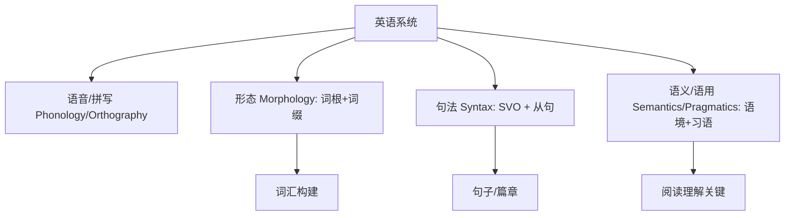
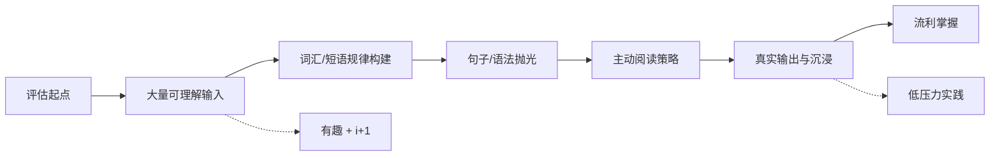

[toc]

## 英语学习思路

英语是当今使用最广泛的语言（约 15 亿使用者，作为全球 lingua franca，尤其在商务、科技、学术、互联网中）。它属于西日耳曼语支（West Germanic），但高度开放、分析性（analytic，依赖词序而非词形变化）。

**核心学习思路（基于第二语言习得 SLA 研究，尤其 Stephen Krashen 的输入假说等）**：
- **大量可理解输入（massive comprehensible input）是引擎**：每天读、听、看你能理解 80-90% 的内容（i+1 原则，略高于当前水平）。大脑自然习得模式，而非死记规则。
- **输出（speaking/writing）巩固，但输入优先**：先吸收，再使用。语法是“抛光工具”，不是起点。
- **降低情感过滤（affective filter）**：选有趣内容，放松，犯错安全。压力会阻断吸收。
- **上下文 + 间隔重复 + 真实使用**：单词不孤立学；用 Anki 等 spaced repetition；与真人/AI 互动。
- **沉浸（immersion）+ 习惯**：把英语变成生活一部分（设备语言改英语、每天固定时间）。
- **评估起点，设 SMART 目标**：用 EF SET 或 Cambridge 在线测试定级（A1-C2）。具体、可测、可达成、相关、有时限。

**推荐完整日常方案（初学者起步，可调整）**：
1. **输入 60-80% 时间**：读/听你喜欢的（新闻、故事、播客、剧），理解大部分。
2. **词汇/短语 10-15 分钟**：上下文 + 间隔复习。
3. **输出 10-20 分钟**：说/写用新内容，shadowing（跟读）或语言交换。
4. **每周回顾**：错误日志 + 总结。
坚持 3-6 个月可见飞跃；全年沉浸可达流利。British Council 等强调 consistency over intensity。

## 英语语言的主要特征（抓住这些就 halve 难度）

英语现代化特征（来源：Britannica、Oxford Research Encyclopedia of Linguistics 等）：
- **分析性（analytic）而非综合（synthetic）**：词形变化少（相比德语/拉丁语）。名词主要变复数/所有格；动词时态/人称有限；形容词几乎不变。依赖 **词序（word order）** 和 **功能词（function words，如 the, of, to）** 表意。
- **基本词序 SVO（Subject-Verb-Object）**：主语-动词-宾语。例如 “The cat chased the mouse.” 改变顺序就改变意思。
- **开放性词汇（open vocabulary）**：大量借用（Latin、French、Greek、其他语言）， freely compounds/derives。词汇多层：日耳曼基础词（日常）+ 拉丁/法语（正式/学术）。
- **语音与拼写复杂**：约 44 音素，辅音簇多，元音丰富；拼写不规则（orthography 难，历史原因）。**重音计时（stress-timed）**：重音节规律，弱读 schwa /ə/ 常见。
- **形态学（morphology）有限但衍生丰富**：屈折（inflection）少（约 8 个主要后缀如 -s, -ed, -ing）；派生（derivation）和复合（compounding）强。
- **多义性与习语丰富**：一词多义（polysemy）、同音异义、大量 phrasal verbs 和 idioms。语境决定含义。
- **灵活性**：词类转换容易（noun 作 verb，如 “Google it”）。

**规律把握重点**：**词序 + 上下文 + 词根/词缀 = 大部分可预测**。不规则主要在高频词（约 200 不规则动词）和拼写。

用 mermaid 示意核心结构层次：

## 单词（Vocabulary）的规律与掌握

英语词汇约 17 万+ 活跃词，但 **掌握 2000-3000 高频 + 词根系统可覆盖 80%+ 日常/阅读**。

**核心规律**：
- **词源分层**：Old English/Germanic（基础：house, eat）；Norman French/Latin（正式：residence, consume）；Greek（科学：biology）。
- **形态构建**：Root（词根）+ Prefix（前缀）+ Suffix（后缀）。Latin/Greek 根覆盖大量学术/高级词（约 50%+ 词族）。
- **常见过程**：Compounding（toothbrush）、Derivation（happy → unhappy/happiness）、Conversion（名词动用）。

**最佳实践**：
- **学词根/词缀，而非孤立单词**：**识别后猜新词含义**。
- **上下文学习 + 例句 + 自己造句**。
- **间隔重复（Anki/Quizlet）+ 主题分组**。
- **注意 collocations（搭配）**：strong coffee 而非 powerful coffee。
- 每日 5-10 新词/短语，复习旧的。

**高频前缀表**（优先学这些，覆盖大量）：

| 前缀            | 核心含义  | 例子                    |
| --------------- | --------- | ----------------------- |
| un-             | 否定/相反 | unhappy, undo           |
| re-             | 再/回     | rewrite, return         |
| in-/im-/il-/ir- | 否定/进入 | impossible, illegal     |
| dis-            | 否定/分开 | disagree, disappear     |
| pre-            | 之前      | preview, prepare        |
| over-           | 过度/上   | overwork, overlook      |
| sub-            | 下/次     | subway, subtitle        |
| mis-            | 错误      | misspell, misunderstand |

**高频后缀**（改变词性）：
- -er/-or：人/物（teacher, actor）
- -tion/-sion/-ation：名词（action, education）
- -ly：副词（quickly）
- -ness：抽象名词（happiness）
- -able/-ible：可...的（readable）
- -ful/-less：充满/无（careful, careless）

**常见词根例子**（Latin/Greek）：
- aud（听）：audience, audible, audio
- dict（说）：dictionary, predict, contradict
- port（携带）：transport, export, portable
- bio（生命）：biology, biography
- scrib/script（写）：describe, manuscript

**实用**：看到 “unpredictable” → un-（不）+ pre-（前）+ dict（说）+ able → 不可预测的。练习拆解生词。Academic Word List (AWL) 优先学术阅读。

## 短语、习语与搭配（Phrases, Idioms, Collocations, Phrasal Verbs）

**英语不“逐词”而是“块状”**：短语比单词更重要。Phrasal verbs（动词+小品词，如 give up）和 idioms（习语，字面≠实际）是难点，但有规律。

**规律**：
- **Phrasal verbs**：常改变意思（look up = 查找；look after = 照顾）。学时记整体 + 例句。
- **Collocations**：自然搭配（make a decision, heavy rain）。
- **Idioms**：固定，文化负载。**学常见 50-100 个覆盖日常**。

**最佳实践**：**整体记忆 + 语境使用**。看剧/读时记下，分类（情感、工作等）。不要直译。

**常见实用习语表**（精选高频，日常/商务）：

| 习语                       | 含义              | 例子                                    |
| -------------------------- | ----------------- | --------------------------------------- |
| break the ice              | 打破僵局/开始交谈 | He told a joke to break the ice.        |
| a piece of cake            | 非常容易          | The test was a piece of cake.           |
| under the weather          | 不舒服/生病       | I'm feeling under the weather today.    |
| hit the nail on the head   | 一针见血/完全正确 | You hit the nail on the head.           |
| bite the bullet            | 硬着头皮做难事    | Just bite the bullet and call him.      |
| let the cat out of the bag | 泄露秘密          | She let the cat out of the bag.         |
| cost an arm and a leg      | 非常贵            | That car costs an arm and a leg.        |
| once in a blue moon        | 极少              | I eat out once in a blue moon.          |
| think outside the box      | 跳出框框思考      | We need to think outside the box.       |
| on the same page           | 意见一致          | Let's make sure we're on the same page. |

更多从 British Council 或常见列表学。**Phrasal 例子**：get up（起床）、put off（推迟）、look forward to（期待，后接 -ing）。

## 句子结构与语法规律（Sentences & Grammar）

**核心：SVO + 扩展**。英语句子相对规则，但细节多（时态、冠词、介词）。

**四种基本句型**：
- **Simple**：一个独立从句。I read books.
- **Compound**：两个+独立从句，用 and/but/or/so 或分号。I read, and she writes.
- **Complex**：独立 + 从属从句（because, if, when, that...）。I read because I love stories.
- **Compound-complex**：混合。

**常见模式**（覆盖大多数）：
- S + V
- S + V + O
- S + V + C（补语，如 be happy）
- S + V + O + A（状语）
- S + V + that-clause / to-infinitive 等。

**关键规则**：
- **主谓一致（subject-verb agreement）**。
- **时态系统**：以时间 + 体（simple/continuous/perfect）组合。先掌握 present/past/future simple + continuous/perfect 基础。
- **冠词 a/an/the**：特指/类指规则。
- **介词**：固定搭配多，学短语而非孤立。
- **从句与连接**：相对从句（who/which/that）、条件句（if）等。

**最佳实践**：**通过输入自然习得顺序**（Krashen Natural Order），再规则抛光。分析句子：找 S V O，再扩展。用 Pattern Grammar（Collins 等）看词的用法模式。写时检查一致性。

**例子对比**：
- 简单：She eats apples.
- 复杂：She eats apples that are fresh because she cares about health.

## 阅读理解：如何准确把握含义（你的重点痛点）

阅读常“把握不准”因：词汇多义、习语、背景知识缺、结构复杂、文化隐含。**策略化 + 主动阅读可大幅提升**。

**三阶段框架（Pre-While-Post，ESL 标准，Reading Rockets/TESOL 支持）**：

**Pre-reading（读前激活）**：
- **看标题、图片、小标题，预测内容**。
- **激活背景知识（prior knowledge）**：关联已知。KWL 表（Know/Want/Learned）。
- **预教关键词**：上下文或简单定义。

**While-reading（读中策略）**：
- **主动提问 + think-aloud**：这句什么意思？为什么？
- **语境猜词（context clues）**：定义、同义/反义、例子、词根。
- **结构分析**：找主旨句（常段首/末）、连接词（however, therefore 示逻辑）。
- **可视化/总结**：脑中电影，或 graphic organizers（思维导图、T-chart）。
- **Fix-up**：不懂就重读、读前后、跳过再回。
- **标注**：理解黄、不懂粉。

**Post-reading（读后巩固）**：
- **总结主旨 + 细节**。
- **推断（inferencing）**：言外之意。
- **关联/评价**：与己相关？同意吗？
- **输出**：写摘要、讨论。

**额外实用技巧**：
- **分级读物（graded readers）起步**，再原版。
- **多读同主题**建 schema（图式）。
- **注意语篇标记（discourse markers）**和修辞。
- 对多义：查 learner’s dictionary（Oxford/Cambridge Learner’s，给例句/搭配）。
- 练习：BBC Learning English、News in Levels、VOA。

**例子**：句子 “He kicked the bucket.” 字面踢桶？习语=去世。语境（葬礼）+ 已知习语 = 准确。或 “The project is up in the air.” → 未定。

**长期**：词汇量 + 背景 + 策略 = 准确率飞升。每天 20-30 分钟主动阅读。

## 最佳实践指导与完整学习路线图

**整体推荐方案（清晰可操作）**：
1. **评估 + 目标**：测试级别，设 3 个月目标（如 B1 阅读）。
2. **每日习惯（30-90 分钟）**：输入为主（有趣内容 80-90% 理解）+ 词汇复习 + 短输出。
3. **工具**：Anki（词汇）、language exchange（Tandem/HelloTalk）、shadowing 音频、learner’s dict、British Council/Cambridge 免费资源。
4. **阶段**：
   - 初：高频词 + 简单输入 + 基础 SVO。
   - 中：词根/短语 + 分级到原版 + 复杂句。
   - 高：学术/习语 + 批判阅读 + 流利输出。
5. **监控**：每周错误日志、录音对比、进度测试。庆祝小赢。
6. **沉浸强化**：英语媒体、日记、社区。

**常见陷阱避免**：只学语法不输入；孤立背词；完美主义（怕错）；无趣材料。

**资源优先权威**：
- British Council LearnEnglish、BBC Learning English。
- Cambridge/Oxford dictionaries & graded readers。
- Krashen 相关或 free input 材料（YouTube 频道、podcasts）。
- Apps：Duolingo 补充，但主输入。
- 书籍：English Vocabulary Elements（词根）；各类 idiom 书。

用 mermaid 示意学习路径：

## 总结与鼓励

英语特征鲜明：**词序主导、词汇开放可拆解、语境为王**。规律在词根词缀、SVO 扩展、短语块、阅读策略中。**坚持 massive input + 上下文 + 主动策略，非母语者也能高效掌握**。阅读不准时，停下来用 pre-while-post + 猜词/重读，准确率会稳升。

