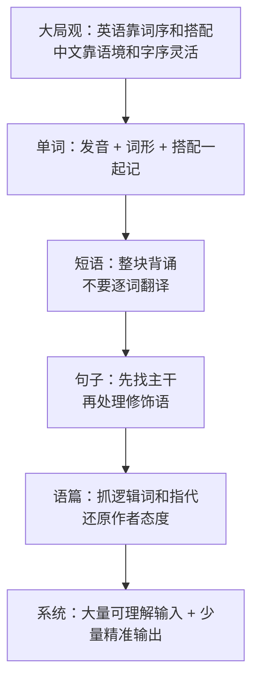

[toc]

## 自报家门与阅读说明

关于工具和环境，我需要如实说明：
- **我当前没有可用的联网搜索工具，也不能执行代码或访问文件系统，只能基于已训练知识做系统讲解和举例。**
- **本次没有做实时联网检索，下文依据的是训练记忆中的权威体系，总体知识截止日期为 2026-01-04。** 如需最新词义、考纲变化，请以官方来源复核。
- 主要内容依据：`The Cambridge Grammar of the English Language` 的句法体系，牛津 `Oxford Learner's Dictionaries` 和剑桥词典的释义体例，欧洲语言共同参考框架 `CEFR Companion Volume (2020)` 的能力分级，Paul Nation 等人的词汇习得研究，以及 `COCA` 等语料库揭示的搭配规律。

> 阅读方法：**只看加粗句，就能拿走大部分行动指南**，正文是解释和例子。关键术语我会标注(英文术语)。

*公开的写作思路：先给大局观，再拆单词、短语、句子、语篇四层规律，最后落到阅读理解实战和每日系统，保證初学者能直接照做。*

## 一张图看懂学习路线

**先建立英语思维，再背单词，先抓句子主干，再抠细节，先保证大量读懂，再追求读快。**

## 英语这门语言的核心特征

英语属于印欧语系日耳曼语族 (Germanic)，现代英语是高度分析化 (analytic) 的语言，**靠词序 (word order) 和功能词 (function words) 表意，而不是靠词形变化**。

| 对比维度     | 中文习惯               | 英语特征                                                | 给你的行动启示                                               |
| ------------ | ---------------------- | ------------------------------------------------------- | ------------------------------------------------------------ |
| 基本语序     | 话题优先，语序较灵活   | **严格 SVO，主语 + 谓语 + 宾语，位置决定功能**          | **读句先找动词，动词前找主语，动词后找宾语**                 |
| 修饰位置     | 修饰语多前置           | **长修饰语多后置，用从句和介词短语向后展开**            | **看到 `that,which,who,with,in` 要意识到后面是修饰，不是主干** |
| 时态与体     | 靠时间词，如昨天、已经 | **靠动词形式，如 `have done, is doing`**                | **动词形式本身就有时间含义，不要只看时间状语**               |
| 主被动与主语 | 常省略主语，重意合     | **句子必须有主语，重形合，常用被动和形式主语 `it`**     | **遇到 `it is...that...` 先找真正主语**                      |
| 语音节奏     | 音节等时，每个字清楚   | **重音计时 (stress-timed)，重读音节清晰，轻读弱化连读** | **听和读都先抓重读实词，轻读虚词可一带而过**                 |
| 词汇来源     | 以单语素字为基础       | **混合词库，日耳曼 + 法语拉丁 + 希腊，日均一词多义**    | **不要一个英文词只记一个中文意思，要记核心义加搭配**         |
| 语篇逻辑     | 意合，逻辑常隐含       | **形合，逻辑靠连接词和指代显性标记**                    | **阅读先圈逻辑词，逻辑词错则全文错**                         |

**最重要的一句：英语是向右生长的语言，主干在左，细节向右堆。**
例如：
- The report `published last year by the team in London` suggests...
- 主干是 `The report suggests...`，后面一长串都是修饰 `report`，初学者常把修饰语当主干，阅读就乱了。

其他三个现代化特征：
- **英语是世界通用语 (English as a Lingua Franca)**，口音和用法多元，考试和工作中美音英音都可接受，**以能被理解 (intelligibility) 为目标，不追求模仿母语者**。
- **词汇量极大但核心词极少**，Nation 研究指出最高频 2000-3000 词族覆盖日常文本约 85-90%，**先牢固掌握高频词的多义和搭配，收益最大**。
- **书面语爱用名词化 (nominalization) 和被动**，如 `implementation of the policy` 实际就是 `implement the policy`，**阅读时要把抽象名词还原成动词来理解**。

## 单词：不是字母堆砌，是有规律的系统

### 发音与拼写 (phonics and spelling)

英语拼写不完全规则，但约 80% 有据可循，**初学者先掌握自然拼读加常见字母组合，不要逐个字母背单词**。

- **重音 (stress) 决定发音和词性**：`REcord` 名词记录，`reCORD` 动词记录；`PHOtograph, phoTOgraphy, photoGRAPHic` 重音移动，元音弱化。
- **看到生词先划分音节再读**：`un-pre-dict-a-ble`，**能读出来就能记住一半**。
- 常见规律：`c` 在 `e,i,y` 前多读 `s` 音，如 `city, face`；`tion` 读 `shen`，如 `nation, action`；哑音 `e` 拉长前元音，如 `cap` 对 `cape`。

**最佳实践：新词必查发音，必跟读三遍，用耳朵帮助记忆，不要只用眼睛背。**

### 词形：前缀词根后缀是最强的杠杆

**英语 60% 以上的学术词可拆解，掌握 30 个前缀加 30 个后缀，就能猜出大量生词。**

| 类型                     | 常见成分举例                                                 | 例子拆解                                                     | 行动启示                                         |
| ------------------------ | ------------------------------------------------------------ | ------------------------------------------------------------ | ------------------------------------------------ |
| 前缀 (prefix) 表方向否定 | `un-, in-, dis-, re-, pre-, de-, co-, sub-`                  | `unpredictable` = `un` 不 + `pre` 提前 + `dict` 说 + `able` 能 | **看到否定前缀先反转含义，再看词根**             |
| 词根 (root) 表核心       | `dict` 说，`port` 拿，`spect` 看，`mit` 送，`pos` 放         | `transport, import, export` 都是 `port` 拿送                 | **用词根串记一家人，不要孤立记一个词**           |
| 后缀 (suffix) 表词性     | `-tion, -ness, -ity` 名词，`-ize, -ify` 动词，`-able, -ive` 形容词 | `develop` 动词发展，`development` 名词，`developmental` 形容词 | **后缀决定词在句中的位置，阅读时靠后缀判断成分** |
| 复合 (compounding)       | 名词加名词，形容词加名词                                     | `textbook, rainfall, high-speed`                             | **重音多在前一个词，含义多偏向后一个词**         |
| 转化 (conversion)        | 不加后缀换词性                                               | `email` 名词邮件，也作动词发邮件，`clean` 形容词干净，也作动词打扫 | **查词时注意词性，同一词形不同词性含义不同**     |

例如 `decentralization`：
- 拆为 `de` 向下分散 + `centr` 中心 + `al` 形容词 + `ize` 动词化 + `ation` 名词，**核心就是把中心分散**，即使没见过也能猜出去中心化。

**最佳实践：用词族 (word family) 一次记一组，如 `produce, product, production, productive, productivity`，写作和阅读都会变轻松。**

### 词义：从核心义到搭配义

初学者阅读把握不准，多半栽在熟词生义 (common words with extended meanings)。

- **一词多义 (polysemy) 是常态**：`run` 核心是快速移动，引申为经营 `run a shop`、运行 `run software`、竞选 `run for president`。
- **含义由搭配 (collocation) 决定**：`heavy` 在 `heavy rain` 是大，在 `heavy smoker` 是重度，在 `heavy heart` 是沉重，**脱离搭配记中文翻译必然误读**。
- **动词加小品词意义大变**：`look after` 照顾，`look into` 调查，`look down on` 轻视，**这是短语动词 (phrasal verbs)，必须整块记**。

| 记忆维度 (Nation 的词汇知识) | 问自己的问题                           | 做法                                                         |
| ---------------------------- | -------------------------------------- | ------------------------------------------------------------ |
| 形式                         | 会拼会读会划分词性吗                   | **跟读加拼写加后缀判断词性**                                 |
| 含义                         | 核心义是什么，常考引申义是什么         | **一词先记 2-3 个高频义，例句必须完整**                      |
| 搭配                         | 常和哪些词一起出现，常接什么介词和句型 | **用 `搭配 + 例句` 记，如 `pay attention to`，不单独记 `attention` 注意** |
| 使用                         | 正式还是口语，褒义还是贬义             | **标注语域 (register)，如 `kid` 口语，`child` 中性**         |

**最佳实践：生词本只记包含搭配的短句，不记孤立的中英对照，7 天内必须在阅读中再见一次。**

## 短语：英语是块状语言，整块记忆才地道

以英语为母语者说话不是逐词组装，而是调用语块 (chunks)。**对非母语者收益最大的就是背高频搭配，而不是背更多生僻单词。**

常见语块类型：

| 类型                         | 例子                                                         | 误读或误用提醒                                              |
| ---------------------------- | ------------------------------------------------------------ | ----------------------------------------------------------- |
| 动宾搭配 (verb + noun)       | `make a decision, take responsibility, do homework, have breakfast` | **不要说 `do a decision`，动词是固定的**                    |
| 形容词加名词                 | `strong tea, heavy traffic, high price`                      | **不要说 `powerful tea`，习惯搭配优先于同义词**             |
| 动词加介词                   | `depend on, insist on, apologize for, belong to`             | **介词不能按中文直译，`depend on` 不是 `depend of`**        |
| 短语动词                     | `put off` 推迟，`bring up` 提出抚养，`take over` 接管        | **小品词决定含义，`put off, put on, put up with` 完全不同** |
| 话语标记 (discourse markers) | `on the other hand, in contrast, as a result, for example`   | **阅读时这是逻辑路标，务必先圈出来**                        |
| 惯用语 (idioms)              | `break the ice` 打破僵局，`under the weather` 不舒服         | **不能字面翻译，阅读时按整体猜，分开理解必错**              |

**最佳实践：阅读时用笔划出 2-4 个词的块，如 `play a key role in`，写作时直接套用，比自己造句更准确。**

关于介词 (prepositions) 的规律：
- **时间介词看精度**：`at` 点时刻 `at 8 o'clock`，`on` 天日期 `on Monday`，`in` 大时段 `in July, in 2024`。
- **空间介词看接触和包围**：`on` 接触面 `on the table`，`in` 包围 `in the box`，`at` 点位置 `at the door`。
- **抽象介词靠搭配**：`interested in, good at, worried about, responsible for`，**只能整句背，没有道理可讲**。

## 句子：位置决定功能，主干加修饰

### 五个基本句型是地基

**所有长难句都是五个基本句型加修饰扩展出来的，先背熟这五种。**

| 句型 (sentence patterns) | 结构                           | 例子                                 |
| ------------------------ | ------------------------------ | ------------------------------------ |
| SV 主谓                  | 主语加不及物动词               | Birds fly. 鸟飞。                    |
| SVC 主系表               | 主语加系动词加表语             | She is a teacher. 她是老师。         |
| SVO 主谓宾               | 主语加及物动词加宾语           | I like tea. 我喜欢茶。               |
| SVOO 主谓双宾            | 主语加动词加间接宾语加直接宾语 | She gave me a book. 她给了我一本书。 |
| SVOC 主谓宾补            | 主语加动词加宾语加宾语补足语   | We call him Jack. 我们叫他杰克。     |

**判断动词是及物 (transitive) 还是不及物 (intransitive)，是写对句子的关键，查词典先看 `VT` 还是 `VI`。**

### 英语修饰语喜欢往后放

中文说红色的放在桌子上的书，英语说 `the book in red on the table`，**定语从句 (relative clause) 和介词短语是后置修饰的主力**。

- 形容词短则前置：`a new book`
- 短语和从句则后置：`the book that I bought yesterday, the man in charge`
- 状语位置较灵活但有偏好：方式地点时间依次后移，如 `She works hard at home every day.`

### 从句和非谓语是长句的来源

| 结构                              | 标记词                                 | 例子与主干                                              |
| --------------------------------- | -------------------------------------- | ------------------------------------------------------- |
| 名词性从句 (noun clause) 作主宾表 | `that, what, whether, if`              | `What he said is true.` 主语是从句，含义他说的是真的    |
| 定语从句作修饰                    | `who, which, that, where`              | `The city where I live is busy.` 主干是城市忙           |
| 状语从句表逻辑                    | `because, although, if, when, so that` | `Although it rained, we went out.` 让步，转折           |
| 非谓语 (non-finite) 压缩从句      | `to do, doing, done`                   | `To save money, he cooks at home.` 为了省钱，他在家做饭 |
| 被动 (passive) 和形式主语         | `be done, it is...`                    | `It is said that he left.` 据说他离开了                 |

**阅读长句的万能切分法：先找谓语动词，再找连词切分，括号法去掉修饰语。**

以实例说明，不要用代码块，直接读：
- 句子：The fact that he failed the exam, which surprised everyone, suggests that he did not prepare well.
- 切分：主语是 `The fact`，后面 `that he failed...` 是同位语从句解释 fact 内容，`which surprised everyone` 是非限制性定语从句补充，谓语是 `suggests`，宾语是 `that he did not...`。
- 主干就是 `The fact suggests that he did not prepare well.` 含义他没准备好。

**最佳实践：每天精析一个长句，用括号标出从句，划出主谓宾，一个月后长句恐惧会大幅下降。**

### 时态体态和语态的实用观

不必死记 16 种时态名称，**抓住三个时间加两个体就够了**。

- 时间：过去、现在、将来
- 体 (aspect)：进行 `be doing` 强调正在持续，完成 `have done` 强调对现在有影响或已完成
- 对比：`I lived in Beijing.` 只说过去住过，`I have lived in Beijing for five years.` 强调到现在已五年，可能还住着。

**写作先保证一般现在和一般过去不出错，再用完成体和被动提升正式度。**

## 阅读理解：为什么总把握不准，以及如何稳准

### 把握不准的六个真因

- **把修饰语当主干**：后置定语太长，跟丢主谓。
- **熟词生义**：如 `address the issue` 不是写地址而是处理问题，`chair the meeting` 是主持会议。
- **指代 (reference) 没跟上**：`this, that, they, it, such` 指代前文哪句没弄清。
- **逻辑词误读**：`while` 有时是虽然，有时是同时，`since` 有时是自从，有时是因为。
- **名词化和省略**：`The rise in prices led to protest.` 实际是价格上涨导致抗议，省略了谁涨谁抗议。
- **作者态度隐含**：英语常用委婉和限定 (hedging)，如 `seems, might, somewhat, arguably`，**有这些词就不是百分百肯定**。

### 逻辑词是阅读的路标，必须整表掌握

| 逻辑关系            | 高频标记                                                     | 阅读动作                                             |
| ------------------- | ------------------------------------------------------------ | ---------------------------------------------------- |
| 转折让步 (contrast) | `but, however, although, despite, while, whereas, yet`       | **转折后是重点，前后方向相反**                       |
| 因果 (cause-effect) | `because, since, as, therefore, thus, hence, lead to, due to` | **问原因找 `because` 前后，问结果找 `therefore` 后** |
| 递进补充            | `moreover, furthermore, in addition, besides`                | **观点加强，态度一致**                               |
| 举例具体化          | `for example, for instance, such as, namely`                 | **例子服务于前一句观点，例子本身不考主旨**           |
| 对比选择            | `instead, rather than, on the other hand, in contrast`       | **注意否定哪一个，肯定哪一个**                       |
| 条件假设            | `if, unless, provided that, in case`                         | **`unless` 等于 `if not`，不要反向理解**             |
| 限定让步            | `even if, even though, admittedly`                           | **先承认小问题，再坚持大观点**                       |

例如：
- `The policy is costly. However, it is necessary.` 含义虽然贵但是必要，态度是支持。
- `Since prices rose, demand fell.` 这里 `since` 是因为，不是自从。

### 指代和省略的还原法

**遇到 `it,this,that,they,such` 必回头找名词，遇到省略必补全主语。**

- `Many cities face water shortages. This has forced rationing.` 这里 `This` 指代前面整件事水短缺，不是单个词。
- `The rich get richer, the poor poorer.` 省略了第二个 `get`，补全是穷人变得更穷。
- 定冠词 `the` 多表示上文提过，`a` 多表示新信息，**这是信息结构 (information structure)，有助于定位**。

### 作者态度和语气 (tone)

学术和新闻英语爱用模糊限制语，**这是严谨，不是啰嗦**。

- 强肯定：`demonstrate, prove, undoubtedly, clearly`
- 谨慎：`suggest, indicate, seem, appear, likely, may, might, tend to`
- 批评保留：`questionable, overstated, limited, arguably, fails to`
- 例如 `The data suggest a link.` 只是提示有关联，**不要读成已证明因果**。

### 阅读实战五步法，初学者照做

**通读抓大意，细读切主干，逻辑定方向，指代还原，选项回文定位。**

- 第一步，用 2 分钟通读，只划逻辑词和每段首末句，**先回答这篇赞成还是反对，问题是什么**。
- 第二步，精读问题句，先找主谓宾，去掉修饰，**把抽象名词还原成动词**，如 `evaluation` 还原为 `evaluate` 评估。
- 第三步，遇到生词先猜，**看前后搭配和逻辑，转折后猜反义，因果后猜结果**，不要立刻查词典打断思路。
- 第四步，做题回文定位，**正确选项多为同义改写 (paraphrase)，与原文词越完全相同越要警惕**。
- 第五步，复盘错因，只记三类：主干找错、生词猜错、逻辑反了，**不要把错归为词汇量不够**。

举一个实战拆解：
- 句子：Despite initial opposition, the proposal, which had been revised twice to address environmental concerns, was eventually adopted.
- 主干还原：`The proposal was adopted.` 提案被采纳了。
- 修饰还原：`Despite initial opposition` 尽管最初反对，`which had been revised twice...` 曾两次修改以回应环保关切，`eventually` 最终。
- 整句含义：尽管最初有人反对，但提案为回应环保关切修改两次后最终通过，**态度偏积极，转折在 `despite`，重点在通过**。

## 为你定制的学习系统，兼顾输入和输出

语言习得核心是可理解输入 (comprehensible input) `i+1`，**读和听的材料要稍高于当前水平，大量泛读加少量精读，听说读写互相带动**。

| 能力     | 初级做法                                                    | 进阶做法                               | 每周最低量                                       |
| -------- | ----------------------------------------------------------- | -------------------------------------- | ------------------------------------------------ |
| 阅读     | 分级读物 `graded readers`，从 CEFR A2 起，每页生词不超 5 个 | bridge 到新闻简写和原版，精泛结合 1比5 | **泛读 5 万词起步，精读每周 3 篇短文**           |
| 听力     | 可理解材料跟读，抓重读词                                    | 影子跟读 `shadowing`，复述大意         | **每天 20 分钟可听懂 70% 的材料**                |
| 单词     | 高频 3000 词族的听说读写                                    | 学术词表 `AWL` 加专业搭配              | **每天 15 个搭配句，用间隔重复 `SRS` 复习**      |
| 语法     | 五句型加时态加从句识别                                      | 写长句加改错                           | **每周写 3 段，每段 5 句，必有人或 AI 批改逻辑** |
| 口语写作 | 背诵语块并替换练习                                          | 观点表达加论证连接词                   | **每周一次输出，录音或写作后对照范文找搭配差距** |

**每日模板 60 分钟：20 分钟泛读加 15 分钟精析长句加 15 分钟听跟读加 10 分钟复习语块。**
**每周模板：5 天输入，1 天输出写作或口语，1 天复盘错句本。**

分级建议按 CEFR：
- **A1-A2 先求读懂短句和常用搭配，不要碰长难句和学术文。**
- **B1 重点突破从句和短语动词，开始读简写新闻。**
- **B2 重点突破逻辑和态度，能读懂观点文大意，这是大多数工作阅读的目标线。**

## 工具与资源推荐，按权威优先

| 需求         | 推荐                                                         | 用法                                                 |
| ------------ | ------------------------------------------------------------ | ---------------------------------------------------- |
| 查词义和搭配 | 牛津高阶 `Oxford Advanced Learner's`，剑桥 `Cambridge Dictionary` | **先看词性再看搭配和例句，必看 `collocations` 栏**   |
| 查真实例句   | `SkELL`, `COCA` 语料库，`Ludwig`                             | **输入搭配看真实例句，判断正式度**                   |
| 查语法       | `Cambridge Grammar`, `Practical English Usage` by Swan       | **写作卡住时查，不通读**                             |
| 分级阅读     | `Oxford Bookworms`, `Penguin Readers`, `News in Levels`      | **选生词率低于 5% 的级别，保证读得下去**             |
| 记忆         | `Anki` 间隔重复                                              | **卡片正面放英文短句挖空，背面放整句加发音**         |
| 辅助理解     | 好的英英加英汉双解                                           | **先看英文解释猜，再看中文验证，摆脱一对一翻译依赖** |

**不要依赖整句机器翻译做阅读，它会掩盖主干和逻辑，考场和工作中没有翻译可用。**

## 常见误区纠偏

- **只背首字母顺序单词表**：孤立背诵遗忘快，**改按主题和词根加搭配成组背**。
- **逐词翻译**：英语和中文词序不同，**改按语块和主干理解，整块转换**。
- **只学语法术语不拆句**：知道名称不会用，**改每天手拆一个长句找主谓宾**。
- **泛读 material 太难**：每页查十个词读不下去，**降一级，保证 95% 认识率才是有效输入**。
- **哑巴英语不敢输出**：怕错不开口，**先背 50 个万能语块如 `in my view, as a result, play a role in`，套用输出**。
- **把阅读慢等同于笨**：初期慢是正常解码过程，**先求准再求快，准确率稳定 80% 后再练速读**。

## 给你的最小行动清单，自查用

- **今天就选一本能读懂 95% 的分级读物开始泛读。**
- **新词必记搭配句，必查发音和词性，不记孤立中文。**
- **长句必找动词定主干，逻辑词必圈，指代必回头。**
- **转折后是重点，例子服务观点，谨慎词代表未定论。**
- **每天 60 分钟输入为主，每周一次输出，每周复盘错因只记三类。**

总体重申：以上为基于权威语法、词典和二语习得共识的系统总结，知识截止 2026-01-04，未做实时联网验证。如用于考试，请以所考考试官方大纲为准，如用于专业领域，请以该领域权威词典和风格指南为准。