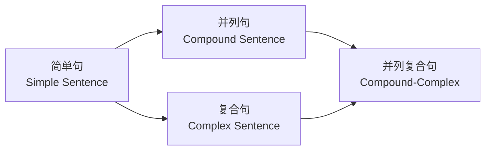
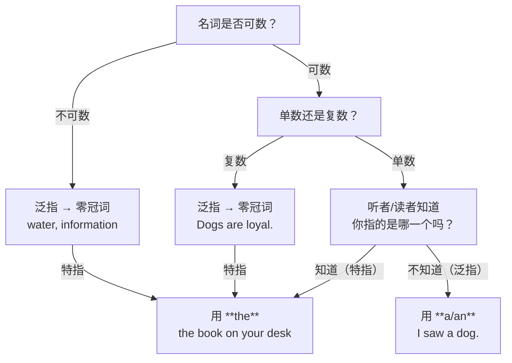
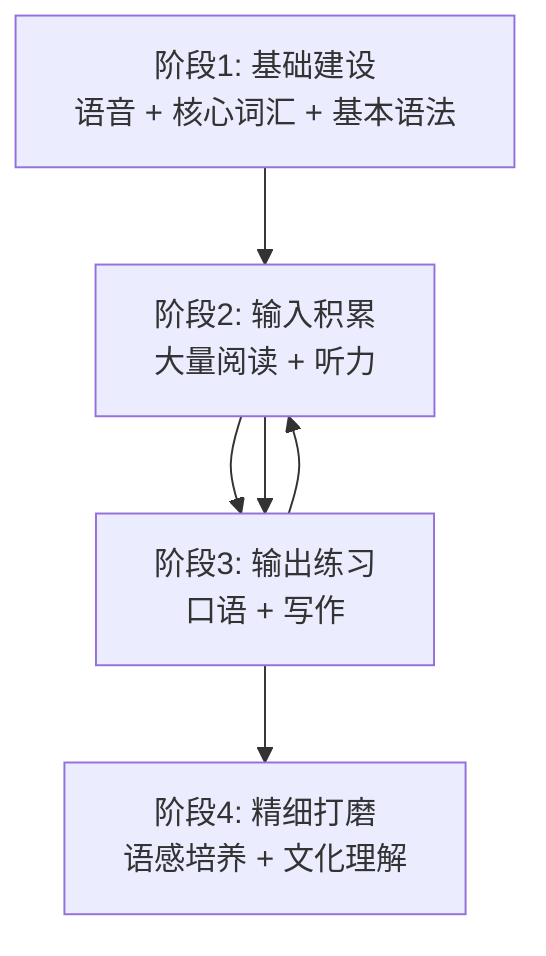

[toc]

## 理解和掌握英语

### 核心学习思路：像"拆机器"一样拆解英语

英语对中文母语者来说，最大的困难不在于"难"，而在于**底层逻辑不同**。中文靠语义和语序表意，而英语更依赖**形态变化 (Morphology) + 严格语序 (Word Order) + 功能词 (Function Words)** 三位一体的体系。

理解英语的思路可以概括为一条主线：

> **单词（砖块）→ 短语（预制件）→ 句子（结构体）→ 段落/篇章（建筑）**

每一层都有规律可循，下面逐层展开。

---

## 第一层：单词 —— 英语词汇的构造规律

### 英语单词不是随机字母组合，而是有"零件"的

形态规则（Morphological Rules）是系统性的语言准则，规定了语素（Morpheme，最小的意义单位）如何组合以创造新词。

理解这一点是中文母语者提升词汇量的**最大杠杆**。

#### 核心概念：语素 (Morpheme)

语素是语言中不可再分的最小意义单位。它可以是一个独立的词（如 mean），也可以是一个有意义的词的组成部分（如 -ing、-ful 等）。

语素分两大类：

| 类型         | 英文术语       | 说明                               | 例子                   |
| ------------ | -------------- | ---------------------------------- | ---------------------- |
| **自由语素** | Free Morpheme  | 可以独立成词                       | book, play, happy      |
| **黏着语素** | Bound Morpheme | 不能独立成词，必须依附在其他语素上 | un-, -ed, -ness, -tion |

#### 两种形态变化：屈折 vs 派生

屈折语素（Inflectional Morphemes）具有句法功能，包括时态（过去时 -ed）、体（进行体 -ing）、人称（第三人称单数 -s）、数（复数 -s）、性（lion → lioness）、格（he vs. him vs. his）等。

派生语素（Derivational Morphemes）如果改变了词的语法类别（词性），被称为"派生的"——例如 derive（动词）→ derivation（名词）→ derivational（形容词）；或者改变词的基本含义——例如 un- + do, re- + do。

**用表格理清这两者的区别：**

| 对比维度             | **屈折变化 (Inflection)** | **派生变化 (Derivation)** |
| -------------------- | ------------------------- | ------------------------- |
| **是否改变词性**     | 不改变                    | **通常改变**              |
| **是否改变核心含义** | 不改变，只调整语法信息    | **改变含义或词性**        |
| **位置**             | 总在词尾                  | 前缀或后缀均可            |
| **例子**             | walks, walked, walking    | walk → walker（名词）     |
| **记忆要点**         | **英语只有 8 个屈折词缀** | 数量庞大，是扩词汇的关键  |

> **英语的 8 个屈折词缀（必须记住）：**
> `-s`（名词复数）、`-'s`（所有格）、`-s`（动词第三人称单数）、`-ed`（过去式）、`-ed/-en`（过去分词）、`-ing`（现在分词）、`-er`（比较级）、`-est`（最高级）

#### 最实用的词缀表（派生类）

掌握以下常见前缀和后缀，你就能**拆解大量生词的含义**。构词法之所以重要，是因为它帮助学习者扩展词汇量、理解词义，并提升阅读和写作能力。了解常见的词缀和模式让你更容易猜测生词。

**高频前缀（改变含义但通常不改变词性）：**

| 前缀       | 含义         | 例子                         | 中文释义             |
| ---------- | ------------ | ---------------------------- | -------------------- |
| **un-**    | 否定/相反    | unhappy, undo, unlock        | 不快乐、撤消、解锁   |
| **re-**    | 再次/重新    | rewrite, rebuild, return     | 重写、重建、返回     |
| **dis-**   | 否定/相反    | disagree, disappear, dislike | 不同意、消失、不喜欢 |
| **pre-**   | 在…之前      | preview, prevent, predict    | 预览、预防、预测     |
| **mis-**   | 错误地       | mistake, misunderstand       | 错误、误解           |
| **over-**  | 过度/超过    | overwork, overlook, overcome | 过劳、忽视、克服     |
| **under-** | 不足/在…之下 | underestimate, understand    | 低估、理解           |
| **inter-** | 在…之间/相互 | international, interact      | 国际的、互动         |
| **trans-** | 跨越/穿过    | transport, transform         | 运输、转变           |
| **sub-**   | 在…之下/次级 | subway, subtitle, submit     | 地铁、字幕、提交     |

**高频后缀（通常改变词性）：**

| 后缀              | 生成词性        | 例子                   | 中文释义           |
| ----------------- | --------------- | ---------------------- | ------------------ |
| **-tion / -sion** | 名词            | education, decision    | 教育、决定         |
| **-ment**         | 名词            | development, agreement | 发展、协议         |
| **-ness**         | 名词            | happiness, darkness    | 幸福、黑暗         |
| **-er / -or**     | 名词(执行者)    | teacher, actor         | 老师、演员         |
| **-able / -ible** | 形容词          | readable, possible     | 可读的、可能的     |
| **-ful**          | 形容词          | beautiful, helpful     | 美丽的、有帮助的   |
| **-less**         | 形容词(无/缺乏) | homeless, careless     | 无家可归的、粗心的 |
| **-ous / -ious**  | 形容词          | dangerous, serious     | 危险的、严肃的     |
| **-ly**           | 副词            | quickly, carefully     | 快速地、小心地     |
| **-ize / -ise**   | 动词            | realize, organize      | 意识到、组织       |
| **-en**           | 动词            | widen, strengthen      | 加宽、加强         |
| **-al**           | 形容词          | national, personal     | 国家的、个人的     |

**拆词实战演练：**

以 unforgettable 为例：基础词是 forget，前缀 un- 表示否定，后缀 -able 将其转为形容词。结构为 un- + forget + -able。含义：难以忘记的。

再看 `denationalization`：de- (去除) + nation (国家) + -al (形容词化) + -ize (动词化) + -ation (名词化) = 非国有化。

> **实用建议：** 遇到生词时，**先拆前缀和后缀，找到词根**，再结合上下文推断含义。这比硬背词典高效得多。

#### 其他构词方式

英语构词的主要方式包括：派生（Derivation）、复合（Compounding）、转化（Conversion）、截短（Clipping）、混合（Blending）、首字母缩写（Acronyms）和逆构词（Back-formation）。

| 构词方式       | 英文术语       | 说明               | 例子                                              |
| -------------- | -------------- | ------------------ | ------------------------------------------------- |
| **复合**       | Compounding    | 两个独立词组合     | bookstore, smartphone, sunlight                   |
| **转化**       | Conversion     | 词性变化但形式不变 | book(名词) → to book(动词); email → to email      |
| **截短**       | Clipping       | 截取词的一部分     | advertisement → ad; mathematics → math            |
| **混合**       | Blending       | 两个词各取一部分   | breakfast + lunch → brunch; smoke + fog → smog    |
| **首字母缩写** | Acronym        | 取每个词首字母     | NATO, laser, FAQ                                  |
| **逆构词**     | Back-formation | 从已有词反推出新词 | babysitter → to babysit; television → to televise |

转化（又称零派生 Zero Derivation）是指在不添加任何词缀的情况下改变词的词性。这在英语中非常普遍，是中文母语者容易忽略的现象——**同一个词形在不同位置可能是不同词性**：

- **run**：I run every day（动词，跑步）→ a morning run（名词，一次跑步）
- **work**：I work here（动词，工作）→ hard work（名词，工作）
- **light**：light a candle（动词，点燃）→ a bright light（名词，光）→ a light bag（形容词，轻的）

---

### 一词多义 (Polysemy) —— 阅读理解的第一道坎

英语中大量常见词有**多个差异巨大的含义**，这是阅读理解出错的首要原因。

以 `get` 为例：

| 用法           | 含义          | 例句                         |
| -------------- | ------------- | ---------------------------- |
| get + 名词     | **得到/获取** | I got a letter.              |
| get + 形容词   | **变得**      | It's getting dark.           |
| get to + 地点  | **到达**      | How do I get to the station? |
| get + 过去分词 | **被动含义**  | He got fired. (他被解雇了)   |
| get + to do    | **有机会做**  | I got to meet the CEO.       |

类似的"超级多义词"还有 `take`, `make`, `come`, `go`, `turn`, `run`, `set`, `put` 等。

> **实用建议：** 遇到简单词但句子读不通时，**不要用你最熟悉的那个含义去套**，而是根据上下文重新判断它在当前句子里的角色。

---

## 第二层：短语 —— 英语中"预制件"的力量

英语中大量的表达不是逐词组装的，而是以**固定或半固定的短语块 (Chunk)** 形式存在的。掌握短语比单独背单词的效率高得多。

### 动词短语 / 短语动词 (Phrasal Verbs)

这是中文母语者最头疼、也是最必须攻克的板块。

短语动词是由两个或多个词组成的、共同充当一个全新动词的结构，其含义与原始单词的含义是分离的。

短语动词由动词与介词或副词组合而成，产生与原始动词不同的新含义。附加的词改变了原始动词的意思，使短语动词具有习语性——其含义不容易从组成词中推断出来。

**最高频短语动词精选（按基础动词分组）：**

| 基础动词   | 短语动词         | 含义             | 例句                                              |
| ---------- | ---------------- | ---------------- | ------------------------------------------------- |
| **get**    | get up           | 起床             | I get up at 7 every morning.                      |
|            | get over         | 从…中恢复        | She got over the flu quickly.                     |
|            | get along (with) | 和…相处融洽      | Do you get along with your colleagues?            |
|            | get rid of       | 摆脱/丢弃        | I need to get rid of these old files.             |
| **take**   | take off         | 起飞；脱下       | The plane took off on time. / Take off your coat. |
|            | take on          | 承担；接受       | She took on a new project.                        |
|            | take over        | 接管             | The new manager took over last week.              |
| **turn**   | turn on / off    | 打开/关闭        | Turn off the lights before you leave.             |
|            | turn out         | 结果是           | It turned out to be a great idea.                 |
|            | turn down        | 拒绝；调低       | He turned down the offer.                         |
| **look**   | look up          | 查阅；抬头看     | Look up this word in the dictionary.              |
|            | look into        | 调查             | The police are looking into the case.             |
|            | look forward to  | 期待             | I look forward to hearing from you.               |
| **give**   | give up          | 放弃             | Don't give up!                                    |
|            | give away        | 赠送；泄露       | She gave away all her old clothes.                |
| **put**    | put off          | 推迟             | Let's put off the meeting until Friday.           |
|            | put up with      | 忍受             | I can't put up with this noise.                   |
| **come**   | come up with     | 想出(主意)       | She came up with a brilliant solution.            |
|            | come across      | 偶然发现         | I came across an old photo yesterday.             |
| **break**  | break down       | 分解；崩溃；抛锚 | My car broke down on the highway.                 |
|            | break out        | 爆发             | A fire broke out in the building.                 |
| **figure** | figure out       | 弄清楚/搞明白    | I can't figure out this problem.                  |
| **run**    | run out of       | 用完/耗尽        | We ran out of milk.                               |
|            | run into         | 偶遇；撞上       | I ran into my old teacher at the mall.            |
| **carry**  | carry out        | 执行/实施        | They carried out the experiment carefully.        |
| **bring**  | bring up         | 提出(话题)；抚养 | She brought up an interesting point.              |
| **call**   | call off         | 取消             | The game was called off due to rain.              |
| **make**   | make up          | 编造；化妆；和解 | Don't make up excuses.                            |

#### 短语动词的关键语法规则

短语动词分四种类型，两两配对：及物与不及物、可分与不可分。

代词使用有一条特殊规则：如果宾语是代词，它**必须**放在可分短语动词的中间。代词宾语不能放在短语动词之后。

实例对比：

- **Pick up the box.** ✅ / **Pick the box up.** ✅ （名词宾语两种都行）
- **Pick it up.** ✅ / ~~**Pick up it.**~~ ❌ （**代词必须放中间！**）

> **实用建议：** 不要试图从字面翻译短语动词。`take off` 可以表示飞机起飞，也可以表示脱衣服——意义完全取决于语境。**按语境记忆、按主题分组学习**是最有效的方式。按主题分组（如情感、工作、旅行、学校），可以更容易记忆。

### 习语 (Idioms)

习语是一种短语或表达，其含义与所包含的单词的字面含义不同。

大多数英语学习者犯的错误就是把习语理解为字面含义。

**常用习语精选：**

| 习语                       | 字面意思             | **实际含义**            | 用法场景  |
| -------------------------- | -------------------- | ----------------------- | --------- |
| break the ice              | 打碎冰               | **打破僵局/开启话题**   | 社交场合  |
| a piece of cake            | 一块蛋糕             | **非常容易的事**        | 描述难度  |
| once in a blue moon        | 蓝月亮出现时         | **极少发生**            | 频率      |
| hit the nail on the head   | 锤子打中钉头         | **说得完全正确**        | 评价发言  |
| let the cat out of the bag | 把猫放出袋子         | **泄露秘密**            | 秘密曝光  |
| burn the midnight oil      | 烧午夜的油           | **熬夜工作/学习**       | 描述努力  |
| the ball is in your court  | 球在你的场地         | **轮到你做决定了**      | 责任转移  |
| under the weather          | 在天气之下           | **身体不舒服**          | 生病/不适 |
| cost an arm and a leg      | 花费一条胳膊和一条腿 | **非常昂贵**            | 价格      |
| get cold feet              | 脚变冷               | **临阵退缩/紧张犹豫**   | 决策时刻  |
| bite the bullet            | 咬子弹               | **咬牙忍受/硬着头皮做** | 面对困难  |
| on the same page           | 在同一页上           | **意见一致/达成共识**   | 团队协作  |

### 介词搭配 (Prepositional Collocations)

英语中很多**动词/形容词/名词与特定介词的搭配是固定的**，没有逻辑可推，必须作为整体记忆：

| 搭配类型          | 例子                                                         | 易错点                                 |
| ----------------- | ------------------------------------------------------------ | -------------------------------------- |
| **动词 + 介词**   | depend **on**, consist **of**, listen **to**, apologize **for**, believe **in** | 中文里没有对应关系，不能翻译后套用     |
| **形容词 + 介词** | good **at**, interested **in**, afraid **of**, responsible **for**, different **from** | `good at` 不是 `good in`               |
| **名词 + 介词**   | a solution **to**, an increase **in**, a reason **for**, access **to** | `the answer to the question` 不是 `of` |

> **实用建议：** 每次学一个新动词/形容词时，**连同它最常搭配的介词一起记**。比如不是只记 "depend"，而是记 "depend on"。

---

## 第三层：句子 —— 英语句式的骨架

### 基本语序：SVO 是一切的起点

英语遵循**主语-动词-宾语（Subject-Verb-Object, SVO）**的语序。这意味着主语排在第一位，动词排在第二位，宾语排在第三位。这是英语中最常见的句型，在简单句和复杂句中都有使用。

英语是一种**语序语言 (Word-order Language)**，词的位置决定了句子的含义。

与一些语序灵活的语言不同，英语要求 SVO 结构才能表达清楚正确。改变语序可能会完全改变含义或使句子听起来不自然。

#### 英语的五种基本句型

在英语中，每个主动句的核心都属于以下结构之一。当句子符合这些模式时，它在语法上是完整且有意义的。

| 句型     | 结构                              | 例句                                        | 说明                       |
| -------- | --------------------------------- | ------------------------------------------- | -------------------------- |
| **SV**   | 主语 + 动词                       | The baby **cried**.                         | 不及物动词，不需要宾语     |
| **SVO**  | 主语 + 动词 + 宾语                | She **reads** books.                        | 最基本、最常见的句型       |
| **SVC**  | 主语 + 动词 + 补语                | He **is** a teacher. / She **looks** happy. | 系动词 + 描述主语的补语    |
| **SVOO** | 主语 + 动词 + 间接宾语 + 直接宾语 | She **gave** me a gift.                     | "给某人某物"结构           |
| **SVOC** | 主语 + 动词 + 宾语 + 宾补         | They **elected** him president.             | 宾语后面有对宾语的补充说明 |

> **核心要点：** 不管句子多长多复杂，**先找到主语 (S)、谓语动词 (V)、宾语 (O) 这个骨架**，其他成分都是修饰和补充。这是阅读理解的第一步。

### 句子从简单到复杂的扩展机制

英语通过以下方式把简单骨架扩展成复杂句子：

| 句子类型       | 组成方式                        | 连接词/标志                                          | 例句                                                       |
| -------------- | ------------------------------- | ---------------------------------------------------- | ---------------------------------------------------------- |
| **简单句**     | 一个独立子句                    | —                                                    | I like coffee.                                             |
| **并列句**     | 两个独立子句                    | **and, but, or, so, yet, for, nor** (FANBOYS)        | I like coffee, **but** she prefers tea.                    |
| **复合句**     | 独立子句 + 从属子句             | **because, although, when, if, that, which, who...** | I stayed home **because** it was raining.                  |
| **并列复合句** | 两个独立子句 + 至少一个从属子句 | 上述两类连接词结合使用                               | I stayed home **because** it rained, **but** she went out. |

#### 三大从句类型（阅读理解的关键）

英语的复杂句几乎都是通过从句（Clause）来嵌套信息的。**读懂从句=读懂复杂英语**。

**名词性从句 (Noun Clause)**
- 充当句子中**名词的角色**（主语、宾语、表语）
- 标志词：**that, what, whether, how, why, who...**
- 例：**What he said** surprised me.（他说的话让我很惊讶）
- 例：I don't know **whether she will come**.（我不知道她是否会来）

**定语从句 / 关系从句 (Relative Clause / Adjective Clause)**
- 充当**形容词的角色**，修饰名词
- 标志词：**who, whom, whose, which, that, where, when**
- 例：The book **that I bought yesterday** is excellent.（我昨天买的那本书很棒）
- 例：She is the teacher **who inspired me**.（她就是启发我的那位老师）

**副词性从句 (Adverbial Clause)**
- 充当**副词的角色**，修饰动词/整个句子，表示时间、原因、条件、让步等
- 标志词和含义：

| 类型 | 连接词                                                   | 例句                                           |
| ---- | -------------------------------------------------------- | ---------------------------------------------- |
| 时间 | **when, while, before, after, until, since, as soon as** | Call me **when** you arrive.                   |
| 原因 | **because, since, as**                                   | I stayed home **because** I was sick.          |
| 条件 | **if, unless, as long as, provided that**                | **If** it rains, we'll cancel the trip.        |
| 让步 | **although, though, even though, while**                 | **Although** he is young, he is very mature.   |
| 目的 | **so that, in order that**                               | She studied hard **so that** she could pass.   |
| 结果 | **so...that, such...that**                               | It was **so** cold **that** we stayed indoors. |

### 长难句的拆解策略（阅读核心技能）

面对一个读不懂的长句，按以下步骤操作：

1. **找谓语动词**：找到句子的核心动词（注意区分主句动词和从句动词）
2. **找主语**：谓语动词前面就是主语（可能很长，包含修饰成分）
3. **去掉插入成分**：用逗号、破折号、括号隔开的部分通常是补充信息，先跳过
4. **识别从句**：看到 that/which/who/when/because/if/although 等词时，它们引导的部分是从句，先理解主句再看从句
5. **还原倒装**：如果主语动词顺序不正常（如疑问句、倒装句），在脑中还原为 SVO 顺序

**实战示例：**

原句：
> *The report, **which was published by the WHO last month**, suggests **that air pollution in major cities has decreased significantly since the implementation of new environmental policies**.*

拆解：

| 成分               | 内容                                                   | 角色                           |
| ------------------ | ------------------------------------------------------ | ------------------------------ |
| **主语**           | The report                                             | 报告                           |
| **插入的定语从句** | which was published by the WHO last month              | 修饰 "report"（上月WHO发布的） |
| **谓语**           | suggests                                               | 表明                           |
| **宾语从句**       | that air pollution... has decreased...                 | "表明"什么内容                 |
| **从句内的状语**   | since the implementation of new environmental policies | 时间/原因                      |

骨架：**The report suggests that air pollution has decreased.** → 报告表明空气污染已经减少了。

---

## 第四层：阅读理解 —— 把握含义的实战技巧

你提到"经常把握不准含义"，这可能涉及以下几个层面的问题。我逐一对症下药。

### 问题一：生词障碍 —— 上下文线索 (Context Clues)

在阅读中，上下文线索是句子或段落中帮助你理解困难或陌生单词含义的词语或短语。

上下文线索的类型包括：定义式、同义词式、反义词式、举例式和因果式。

| 线索类型     | 英文术语     | 识别方式                                                     | 例句                                                         |
| ------------ | ------------ | ------------------------------------------------------------ | ------------------------------------------------------------ |
| **定义式**   | Definition   | 直接给出定义，常用 "is", "means", "refers to"                | *Photosynthesis **is** the process by which plants convert sunlight into energy.* |
| **同义词式** | Synonym      | 用已知词解释生词，常用 "or", "also known as"                 | *She felt **elated**, or extremely happy, after the news.*   |
| **反义词式** | Antonym      | 用反义词暗示含义，常用 "but", "however", "unlike", "instead of" | *Unlike her **gregarious** sister, she was shy and quiet.* (gregarious = 爱社交的) |
| **举例式**   | Example      | 举例帮助理解，常用 "such as", "for example", "including"     | *Citrus fruits, **such as** oranges and lemons, are rich in vitamin C.* |
| **因果式**   | Cause-Effect | 通过因果关系推断，常用 "because", "since", "therefore"       | *The road was **treacherous** because of the ice and heavy fog.* (treacherous = 危险的) |

信号词如 such as、unlike、which means、but、or、in other words 通常是句子提供澄清或对比信息的线索。学会快速识别这些词并停下来评估它们所揭示的内容。

### 问题二：句子读完了，但不确定"到底在说什么" —— 推断 (Inference)

简单来说，推断就是通过将上下文线索与已有知识相结合，对文本中未直接陈述的内容做出的结论。

推断——从文本中隐含信息得出结论的能力——对于深入理解阅读材料至关重要。

**推断的核心公式：**

> **文本中的线索 + 你的已有知识 = 推断出的含义**

举例：
- 文本：*When Sarah saw the envelope on her desk, her hands trembled. She recognized the handwriting immediately.*
- 线索：hands trembled（颤抖）、recognized the handwriting（认出字迹）
- 推断：Sarah对这封信感到紧张或激动，写信人对她有特殊意义（可能是重要的人或带来重要消息）

**推断能力的培养方法：**

有效的教学策略包括教导学生：(1) 识别和关联线索词，(2) 激活和整合背景知识，(3) 生成推断性问题。

实用操作：
- 读完一段话后问自己：**"作者没有直接说，但暗示了什么？"**
- 注意**情感色彩词**（tone words）：作者用的词是积极的还是消极的？
- 注意**转折词**：but, however, nevertheless, yet, on the other hand —— 转折后面通常才是作者真正想强调的观点

### 问题三：长文章读完记不住重点 —— 篇章结构识别

英语文章通常遵循以下几种组织模式：

| 篇章结构      | 英文术语            | 标志词                                         | 识读技巧                   |
| ------------- | ------------------- | ---------------------------------------------- | -------------------------- |
| **总-分**     | General to Specific | 开头给出总论点，后面展开                       | **第一段和每段首句是关键** |
| **问题-解决** | Problem-Solution    | problem, issue, challenge → solution, resolve  | 先找问题，再找答案         |
| **因果**      | Cause-Effect        | because, as a result, lead to, consequently    | 理清因果链                 |
| **比较对比**  | Compare-Contrast    | similarly, on the other hand, whereas, however | 列表格对比双方             |
| **时间顺序**  | Chronological       | first, then, next, finally, in 1990            | 按时间线梳理               |
| **列举**      | Listing             | first, second, additionally, moreover, also    | 数清有几个要点             |

> **核心技巧：英语论说文的"倒金字塔"原则** —— 最重要的信息通常在**段首（Topic Sentence）**。因此快速阅读时，**只读每段第一句就能抓住约 70% 的信息**。这与中文行文习惯（有时先铺垫再点题）有很大不同。

### 问题四：文化隐含义 —— 你知道每个词但还是读不懂

这类理解障碍通常来自以下几个方面：

**委婉语 (Euphemism)**
- "He **passed away**." = 他去世了（不说 died）
- "She is **between jobs**." = 她失业了（不说 unemployed）
- "He is **economical with the truth**." = 他在撒谎

**反语/讽刺 (Irony / Sarcasm)**
- "Oh, **great**, another meeting." = 说话者实际上**不**认为这很好
- 识别方式：语气与字面含义矛盾，结合上下文判断

**understatement (轻描淡写) —— 英语文化的典型特征**
- "It's **not bad**." = 实际上相当好
- "I'm **not entirely sure** that's correct." = 我认为那是错的
- "It's **a bit** of a problem." = 这是个很大的问题

**含蓄否定**
- "I **could** do that." ≠ 我能做 → 通常表示**我不太想做**或**有条件才做**
- "That's **interesting**." = 有时候意思是"我不同意但不想直说"

---

## 第五层：英语的时态系统 —— 一张表理清

英语时态是中文母语者的另一大难点，因为中文没有形态上的时态变化。英语有 **12 种主要时态**（3 个时间 × 4 个体态），但实际高频使用的约 8 种。

|          | **一般 (Simple)** | **进行 (Continuous)** | **完成 (Perfect)**     | **完成进行 (Perfect Continuous)** |
| -------- | ----------------- | --------------------- | ---------------------- | --------------------------------- |
| **现在** | I **work**        | I **am working**      | I **have worked**      | I **have been working**           |
| **过去** | I **worked**      | I **was working**     | I **had worked**       | I had been working                |
| **将来** | I **will work**   | I will be working     | I **will have worked** | I will have been working          |

加粗的 8 种是最常用的。核心区别：

- **一般时**：事实、习惯、一般性陈述
- **进行时**：正在发生的、暂时的
- **完成时**：已完成的、对当前有影响的、到某个时间点为止的经验
- **完成进行时**：持续到某个时间点的动作，强调**持续性**

**中文母语者最易混淆的对比：**

| 对比                     | 区别                                                     | 例句                                                         |
| ------------------------ | -------------------------------------------------------- | ------------------------------------------------------------ |
| **一般过去 vs 现在完成** | 过去时聚焦"过去的事"(finished)；完成时聚焦"对现在的影响" | I **lost** my key.（陈述过去事实）vs I **have lost** my key.（所以现在进不了门） |
| **一般现在 vs 现在进行** | 一般现在表示习惯/事实；进行时表示此刻/暂时               | I **live** in Beijing.（长期居住）vs I **am living** in Beijing.（暂住） |
| **过去进行 vs 一般过去** | 过去进行是"背景动作"；一般过去是"事件"                   | I **was reading** when the phone **rang**.                   |

---

## 第六层：英语特有的语言特征总结

| 特征             | 说明                                     | 对中文母语者的影响                     |
| ---------------- | ---------------------------------------- | -------------------------------------- |
| **语序刚性**     | SVO 语序不可随意调整                     | 中文语序也较刚性，这方面相对容易适应   |
| **形态变化丰富** | 动词有时态、语态、语气变化；名词有单复数 | 中文没有形态变化，需要刻意训练         |
| **冠词系统**     | a/an/the 三个冠词使用规则复杂            | 中文没有冠词，这是最难掌握的语法点之一 |
| **介词系统**     | 介词搭配高度固定化                       | 不能从中文直接翻译                     |
| **从句嵌套**     | 英语喜欢用从句层层嵌套表达复杂信息       | 需要训练拆解能力                       |
| **被动语态常用** | 学术和正式文本大量使用被动语态           | 中文被动语态使用频率低得多             |
| **虚拟语气**     | 表达假设、愿望、建议时使用特殊动词形式   | 中文靠语义而非形式表达虚拟             |

### 冠词 (Articles) 速查决策

冠词是小词但影响巨大。以下是快速判断流程：

**a vs an 的规则：** 看**发音**而非拼写。元音**音素**开头用 an，辅音**音素**开头用 a：
- **a** university（u 发 /juː/，辅音音素开头）
- **an** hour（h 不发音，元音音素开头）
- **an** MBA（M 发 /em/，元音音素开头）

---

## 第七层：学习方法论 —— 最佳实践

研究表明，有效的策略包括沉浸式语言环境、任务式学习和技术辅助方法，并建议将传统的语法和词汇教学与数字语言工具、社会互动式学习等创新实践相结合。

### 推荐的学习路线图

### 各阶段具体建议

**阶段 1：基础建设**
- **音标必学**：掌握国际音标 (IPA)，这是自学发音的基础
- **核心词汇**：优先学最高频的 2000-3000 词（覆盖日常英语约 85% 的内容）
- **基本语法**：五种句型 + 八种时态 + 冠词/介词基本规则

**阶段 2：大量输入（最关键的阶段）**
- 用真实英语内容包围自己：看电视节目、读新闻文章、听播客。这将帮助你提升听力技能、扩展词汇量，并适应不同的口音和说话风格。
- 阅读时**不要每个生词都查字典**，先用上下文线索猜测，实在猜不出再查
- **分级阅读**：从略低于自己水平的材料开始，逐步提升

**阶段 3：输出练习**
- 写作：从短句、日记开始，逐步过渡到段落和文章
- 口语：社区式学习利用社交互动的力量来促进语言习得。在线论坛、语言交换项目和协作项目将学习者与同伴和母语者联系起来，促进真实的交流练习。

**阶段 4：精细打磨**
- 关注语用学（Pragmatics）：同样的话在不同场合怎么说
- 理解文化隐含义：委婉语、幽默、讽刺
- 学习连接词和过渡词来提升表达的逻辑性和流畅度

### 实用工具推荐

| 用途     | 工具                                                         | 说明                                     |
| -------- | ------------------------------------------------------------ | ---------------------------------------- |
| 词典     | **Longman Dictionary (LDOCE)**、**Oxford Learner's Dictionary** | 学习者词典，释义用简单英语，附搭配和例句 |
| 语法查错 | **Grammarly**                                                | 写作时实时检查语法和拼写                 |
| 词汇学习 | **Anki** (间隔重复)                                          | 用科学的记忆曲线复习单词                 |
| 阅读     | **News in Levels**、**Breaking News English**                | 同一篇新闻有不同难度级别                 |
| 听力     | **BBC Learning English**、**VOA Learning English**           | 权威且有分级                             |
| 语言交换 | **HelloTalk**、**Tandem**                                    | 与母语者互相学习                         |
| 语料库   | **COCA (Corpus of Contemporary American English)**           | 查看真实语境中的词汇用法和搭配           |

---

## 总结：英语学习的核心原则

1. **规律先行**：英语有大量可总结的规律（词缀、句型、时态），先掌握规律再处理例外
2. **语块优先**：以短语/搭配（而非孤立单词）为基本学习单位
3. **语境为王**：任何词、短语在脱离语境后都可能产生误解；阅读理解的本质是**语境解码**
4. **输入先于输出**：大量阅读和听力是提升语感最有效的方式
5. **容忍模糊**：不需要理解每个词才能理解全文；学会抓骨架、跳细节、用线索推断

> 最后一条特别重要：很多学习者之所以"把握不准含义"，往往不是因为知道的太少，而是因为**太执着于逐词翻译**。英语阅读的正确姿势是——**先整体感知句子/段落的大意，再细化关键词的精确含义**。这和中文阅读的习惯其实是一致的：你读中文时也不是每个字都在脑中"处理"的，而是在快速扫描中抓取关键信息。用同样的方式对待英语，你的阅读理解能力会有质的飞跃。