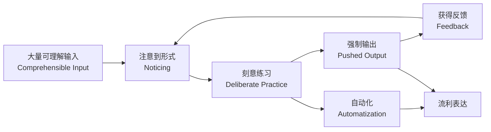
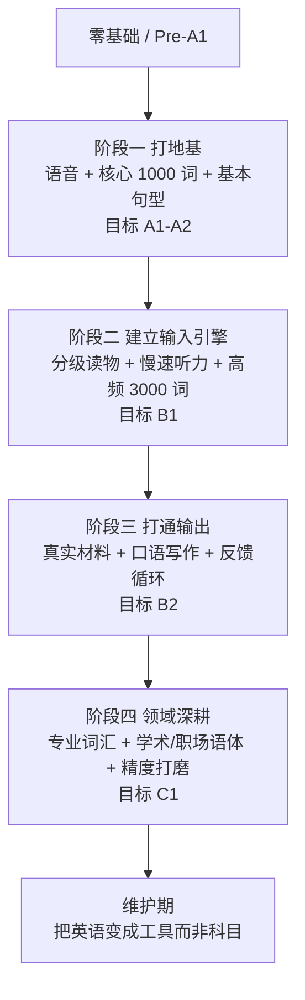
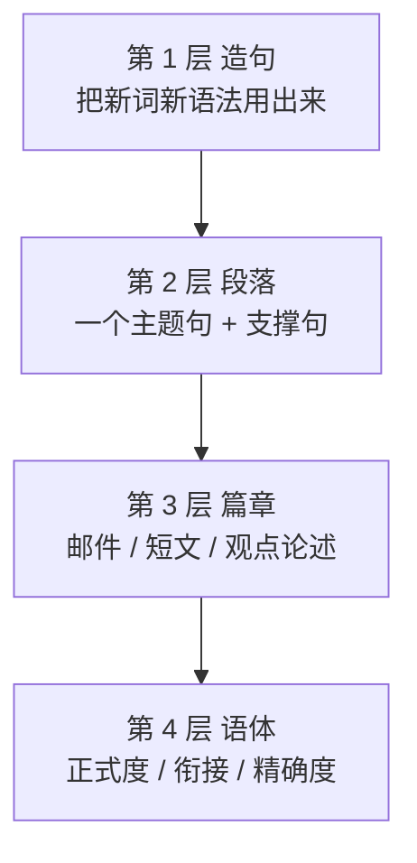

[toc]

## 掌握英语

初学者最大的浪费，是**目标模糊**——"我想学好英语"这句话无法转化为任何一天的行动。

### 用 CEFR 把"好"变成可测量的坐标

**CEFR（Common European Framework of Reference for Languages，欧洲语言共同参考框架）是目前全球最通用的语言能力标尺**，雅思、托福、剑桥考试都会对齐它。

| 等级          | 通俗描述                  | 典型能力锚点                               | 常见对标                                          |
| ------------- | ------------------------- | ------------------------------------------ | ------------------------------------------------- |
| Pre-A1        | 破冰                      | 认识字母、少量固定短语                     | —                                                 |
| A1 入门       | 生存                      | 自我介绍、点餐、问路                       | —                                                 |
| A2 初级       | 简单交流                  | 描述日常、写简短信息                       | 剑桥 A2 Key                                       |
| B1 中级       | **独立用户起点**          | 应付旅行、讲清经历与打算                   | 雅思 4.0–5.0 / 剑桥 B1 Preliminary                |
| **B2 中高级** | **实用分水岭**            | 看懂原版剧集大意、参与专业讨论、写清晰论述 | **雅思 5.5–6.5 / 托福 72–94 / 剑桥 B2 First**     |
| **C1 高级**   | **职业级**                | 流畅表达、理解隐含意义、写复杂文本         | **雅思 7.0–8.0 / 托福 95–120 / 剑桥 C1 Advanced** |
| C2 精通       | 接近母语者的学术/专业水准 | 几乎无障碍，能精确把握细微差别             | 雅思 8.5–9.0 / 剑桥 C2 Proficiency                |

> 分数对应关系为**近似映射**，各考试官方对照表偶有调整，请以官网为准。

### 关键判断：你真的需要 C2 吗？

**对 95% 的学习者，B2 是"改变人生"的临界点，C1 是天花板级性价比目标，C2 通常不必追求。**

- **B2** = 能用英语工作、看懂技术文档与英美剧、出国生活无障碍。
- **C1** = 能用英语开会主导、写正式报告、读学术文献。
- **C2** = 边际收益急剧下降，除非你做翻译、语言教学或英语文学研究。

### CEFR 2020 增补版的现代化视角（很多老教材还没跟上）

传统的"听说读写四技能"已被官方框架升级为**四种交际模式（modes of communication）**：

| 模式                 | 含义                             | 现实例子                                 |
| -------------------- | -------------------------------- | ---------------------------------------- |
| 接收 Reception       | 听、读                           | 看文档、听会议                           |
| 产出 Production      | 说、写                           | 做演讲、写邮件                           |
| **互动 Interaction** | 实时双向来回                     | 开会讨论、闲聊、在线聊天                 |
| **中介 Mediation**   | 在人/文本/语言之间传递与转述信息 | 把英文资料讲给同事听、总结、协作解决问题 |

**实践含义：只练"听读写"而不练"互动"，是很多人英语"哑巴化"的结构性原因。** 你的训练计划里必须有**实时来回**的成分。

### 大致时间成本：先接受这个事实

剑桥英语给出的**指导学时（guided learning hours）**估算，从零基础累计：

| 目标等级 | 累计指导学时（估算） | 每天 1 小时约需 |
| -------- | -------------------- | --------------- |
| A2       | 180–200              | 约 6 个月       |
| B1       | 350–400              | 约 1 年         |
| **B2**   | **500–600**          | **约 1.5–2 年** |
| C1       | 700–800              | 约 2–2.5 年     |
| C2       | 1000–1200            | 3 年以上        |

**重要修正：** 这是"课堂指导学时"，不含自学练习时间；而且对**中文母语者**而言，英语与汉语在语系、书写系统、语音结构上距离极远，**实际耗时通常高于欧洲语言母语者的估算，达到专业工作水平常需 2000+ 小时的总投入**（可参照美国外交学院 FSI 的语言难度分级思路——对英语母语者而言中文属最难的第 IV 类，反之亦然）。

**结论一句话：这是一个以"千小时"为单位的工程，任何承诺"30 天流利"的产品都在撒谎。但也别被吓到——每天 1 小时高质量投入，2 年到 B2 是完全现实的。**

---

## 第二步：理解语言习得的底层机制

不理解机制，就会把时间花在"看起来努力"的事情上（比如反复抄写单词表）。

### 五条被反复验证的原理

**原理 1：可理解输入是地基（Krashen, i+1）**
语言能力主要在"理解略高于当前水平的材料"时增长。**判断标准：生词率控制在 2%–5%（每 100 词有 2–5 个生词）时，是学习效率最高的区间。**

**原理 2：光输入不够，必须"注意到"（Schmidt 的 Noticing Hypothesis）**
无意识地泡在英语环境里，进步会停滞（所谓"石化 fossilization"）。**你必须主动注意到"母语者这样说，而我会那样说"的差异。** 这就是为什么"看剧学英语"对多数人无效——因为只在追剧情。

**原理 3：输出制造学习需求（Swain 的 Output Hypothesis）**
只有当你被迫开口/动笔，才会发现"我不知道这个怎么说"。**这个"卡壳时刻"是最高价值的学习信号，要记录下来。**

**原理 4：知识 ≠ 技能，中间隔着"自动化"（DeKeyser）**
你"知道"第三人称单数加 -s，和你在语速正常的对话中"自动"加上 -s，是两种完全不同的东西。**从陈述性知识（declarative）到程序性知识（procedural）只有一条路：大量重复的、有意义的使用。**

**原理 5：间隔重复 + 提取练习（Ebbinghaus / Cepeda / Roediger）**
- **间隔效应**：分散在 10 天里的 10 次复习，远胜于 1 天里的 10 次。
- **提取练习**：**"努力回忆"比"重复阅读"的记忆效果高出一倍以上**，这是认知心理学最稳固的结论之一。

### 需要打破的六个迷思

| 常见迷思               | 事实                                                         |
| ---------------------- | ------------------------------------------------------------ |
| "成年人学不好外语"     | 关键期假说主要影响**口音**；成年人在**词汇、语法、阅读、学习策略**上反而有优势，可以达到 C1/C2 |
| "先背完单词再开始"     | 词汇必须在**语境**中习得，孤立词表迁移率低。**边输入边扩词** |
| "语法不重要，语感就够" | 纯自然习得会导致**石化**。适量显性语法（explicit grammar）显著加速成人学习 |
| "必须消灭口音"         | 目标是**可懂度（intelligibility）**而非"像母语者"。**能被听懂 + 不引起误解 = 达标** |
| "看美剧就能学会"       | 只有**有策略**地看（暂停、查词、复述、精看片段）才有效       |
| "沉浸在国外自然就会"   | 大量华人在英语国家生活十年仍停在 A2/B1，因为**社交圈闭合 + 没有刻意练习** |

---

## 第三步：分阶段学习路线图

### 阶段一：打地基（0 → A2，约 150–250 小时）

这一阶段的**唯一战略目标：建立正确的语音系统 + 掌握最高频的语言骨架**。

**必须优先做的三件事：**

**1. 先学语音，而且要在开口说错太多之前学。**

- **先选定一个参照口音**：**通用美音（General American, GA）** 或 **英式标准音（Received Pronunciation / SSB）**。**推荐初学者选 GA**，因为可获取的学习资源和影视材料最多（这是资源可得性的判断，不是优劣判断）。
- **学习国际音标（IPA）**：不需要背全表，只需能读懂词典里的音标。**Cambridge Dictionary、Longman Dictionary of Contemporary English (LDOCE)、Merriam-Webster 都提供发音音频**。
- **重点攻克中文母语者的系统性难点**（见后文专章）。

**2. 掌握最高频的 1000 词。**

**推荐词表：Oxford 3000 / Oxford 5000（按 CEFR 分级标注，牛津官方免费公开）** 或 **NGSL（New General Service List，约 2800 词，覆盖一般英语文本约 90%+）**。

**3. 掌握 7 个核心句型骨架，而不是"背语法书"。**

| 骨架                  | 例句                    | 覆盖的功能       |
| --------------------- | ----------------------- | ---------------- |
| 主 + 系 + 表          | She **is** a teacher.   | 定义、描述       |
| 主 + 谓               | It **rained**.          | 陈述事件         |
| 主 + 谓 + 宾          | I **like** coffee.      | 绝大多数陈述     |
| 主 + 谓 + 间宾 + 直宾 | He **gave me** a book.  | 给予类           |
| 主 + 谓 + 宾 + 宾补   | We **call him** Tom.    | 命名、使动       |
| There + be            | **There is** a problem. | 存在             |
| 情态动词 + 动词原形   | You **should go**.      | 建议、可能、义务 |

**阶段一的最佳实践：**

- **每天 20 分钟朗读 + 30 分钟输入**，比每周末突击 4 小时有效得多。
- **不要用"英译中"记单词**，用**图片、例句、场景**记。
- **允许自己说错。** 这个阶段追求"敢说"和"发音方向正确"，不追求语法完美。

### 阶段二：建立输入引擎（A2 → B1，约 200–300 小时）

**战略目标：把英语从"学习对象"变成"信息来源"，建立可持续的自动化输入习惯。**

**核心方法：泛读（Extensive Reading）+ 泛听。**

Day & Bamford 的泛读原则，是被大量实证支持的高效路径：

**泛读五条铁律：**
1. **材料要简单到不用查词典**（每页生词 ≤ 1–2 个）
2. **读大量的、多样的材料**
3. **自己选感兴趣的内容**
4. **读不下去就换一本**，绝不硬撑
5. **为理解和享受而读，不为学习而读**

**推荐资源类型：**

| 类型                        | 具体建议                                                     | 适用等级 |
| --------------------------- | ------------------------------------------------------------ | -------- |
| **分级读物 Graded Readers** | **Oxford Bookworms、Penguin Readers、Cambridge English Readers、Macmillan Readers** | A1–B2    |
| 免费在线分级                | **ER Central / Xreading**（部分免费）、**Newsela**、**BBC Learning English** | A2–B2    |
| 儿童/青少年原版             | *Magic Tree House*、*Diary of a Wimpy Kid*、*Charlotte's Web* | A2–B1    |
| **慢速新闻**                | **VOA Learning English、News in Levels、BBC Learning English 的 "6 Minute English"** | A2–B1    |
| 播客                        | **"Culips"、"All Ears English"、"ESL Pod"** 等为学习者设计的节目 | B1       |

**这一阶段最重要的心态转变：接受"听不懂 30%"是正常的。** 大脑需要在模糊中提取模式。

**词汇量目标：3000 词族（word families）。**
Nation 的研究显示：**3000 词族约覆盖日常口语的 95%，2000 词族约覆盖一般书面语的 80%。** 这是"能用起来"的门槛。

### 阶段三：打通输出（B1 → B2，约 200–300 小时）——最难也最关键的一跃

**很多人一辈子卡在 B1，原因几乎总是：输入尚可，但从不输出、也从不接受反馈。**

**核心机制：建立"输出—反馈—修正"的闭环。**

**三个高效输出训练法：**

**方法 A：影子跟读（Shadowing）——练流利度与语音的最高性价比方法**

1. 选一段 30–60 秒、你**已经完全听懂**的音频（有文本更好）
2. **不看文本**，落后原声 0.5–1 秒同步跟读，模仿语调、节奏、连读
3. 重复 5–10 遍，直到能与原声几乎重合
4. **每天 10–15 分钟，坚持 3 个月，语音与语速会有明显变化**

> 提示：**必须选难度略低于你听力上限的材料**，否则会退化成"看着念"。

**方法 B：自由写作 + 精修（Free Writing + Editing）**

- **每天写 100–150 词**，主题随意（今天做了什么、对某新闻的看法）
- **第一遍写作时不查词典、不修改**，只求写完
- **第二遍再用工具修正**，并把每个修改点记入错误日志

**方法 C：结构化口语——三分钟独白法**

1. 抽一个话题（可用雅思 Part 2 题库，公开可查）
2. **准备 1 分钟 → 说 2 分钟 → 录音**
3. **回听自己的录音**（这一步痛苦但极其有效），标出：卡顿处、明显语法错误、重复用词
4. 针对性改进后**再说一遍**

**方法 D：现代化选项——AI 语言伙伴**

**这是近几年最实质性的变化：过去"找不到人练口语"的问题，现在已被大语言模型基本解决。**

可行的用法（**这是通用做法，不是特定产品推荐；具体产品功能与定价请自行核实**）：

- **让 AI 扮演特定角色做角色扮演**（面试官、房东、客户），并要求它**在对话结束后给出错误清单与更地道的表达**
- **粘贴你的写作，要求：① 指出语法错误 ② 指出"不地道但语法正确"的表达 ③ 给出 B2/C1 级别的改写版本 ④ 解释每处修改的原因**
- **要求 AI 只用你当前等级的词汇（如 B1）与你对话**
- **使用具备实时语音对话能力的助手做口语练习**

**关键警告：AI 会犯错，也会过度迎合。对于重要的用法判断，务必用真实语料交叉验证**——推荐 **COCA（Corpus of Contemporary American English）**、**Ludwig.guru**（在真实出版物中检索例句）、**Google Books Ngram**，以及**学习者词典的用法说明**。

### 阶段四：领域深耕（B2 → C1，约 200–300 小时）

**战略目标：从"能沟通"到"能胜任专业场景"。**

**四个重点：**

1. **窄化输入（Narrow Reading/Listening）**：**集中读/听同一领域、同一作者、同一节目的大量材料**。重复的术语和句式会大幅加速习得，这比"什么都看一点"高效得多。
2. **学术/职场词汇**：**Coxhead 的 AWL（Academic Word List，570 词族）** 覆盖学术文本约 10%；理工科可加 **NAWL / 专业术语表**。
3. **语体意识（register）**：学会区分口语/书面、正式/非正式。**同样意思，"get" 与 "obtain"、"a lot of" 与 "a substantial amount of" 用在不同场合。**
4. **搭配（collocation）而非单词**：C1 的标志是**搭配自然**。推荐 **Oxford Collocations Dictionary**、**Cambridge 的 English Collocations in Use** 系列。

---

## 第四步：五大模块的具体训练法

### 语音（Pronunciation）——被严重低估的模块

**为什么优先级高：发音系统不仅影响别人听你，更影响你听别人。** 你的大脑用自己的发音模型去解码听到的声音；如果你的模型里没有 /θ/，你就很难在语流中辨认它。

**中文母语者的系统性难点清单（按优先级）：**

| 难点                         | 问题描述                                                     | 最小对立对练习（minimal pairs） |
| ---------------------------- | ------------------------------------------------------------ | ------------------------------- |
| **词尾辅音丢失**             | 中文音节以元音/鼻音结尾，易丢掉 /t/ /d/ /k/ /s/              | *lie / light*, *bay / bake*     |
| **/θ/ 与 /ð/**               | 中文无此音，常替换为 /s/ /z/                                 | *think / sink*, *they / day*    |
| **/v/ 与 /w/**               | 常混淆                                                       | *vest / west*, *vine / wine*    |
| **/l/ 与 /n/**（部分方言区） | 声母混淆                                                     | *light / night*                 |
| **/r/ 与 /l/**               | 尾音 /r/ 尤其困难                                            | *right / light*, *fry / fly*    |
| **短元音 /ɪ/ 与长元音 /iː/** | 中文无此长短对立                                             | *ship / sheep*, *bit / beat*    |
| **/æ/ 与 /e/**               |                                                              | *bad / bed*, *man / men*        |
| **节奏（最重要）**           | **中文是音节等时（syllable-timed），英语是重音等时（stress-timed）** | 见下                            |

**节奏问题是"听起来像中式英语"的头号原因，也是最少被教的内容。**

英语中：**实词（名/动/形/副）重读且拉长，虚词（冠词、介词、助动词、代词）弱读并缩短成 /ə/**。

例：*I want to **go** to the **store**.*
真实语流接近 "I wanna **go** to the **store**"，其中 *to* 弱读为 /tə/。

**语音训练最佳实践（每天 10–15 分钟即可）：**

1. **用最小对立对做辨音练习**（先能听出区别，再练发出）
2. **学习连读规则**：连音（linking）、失爆（unreleased stops）、同化（assimilation）、弱读（weak forms）
3. **录音对比法**：录自己 → 对比原声 → 找差距 → 重录。**这是唯一可靠的自我纠音手段**
4. **善用 YouGlish**：输入一个词，看真实视频中母语者如何在语境中发音（免费）
5. **可选工具**：**ELSA Speak** 等 AI 发音评分应用（**功能与定价请自行核实**）

### 词汇（Vocabulary）

**核心数据（Nation 的研究，务必理解）：**

| 词族数量      | 文本覆盖率           | 实际含义                    |
| ------------- | -------------------- | --------------------------- |
| 1000          | 口语 ~85%，书面 ~72% | 极简生存                    |
| 2000          | 口语 ~90%，书面 ~80% | 基本日常                    |
| **3000**      | **口语 ~95%**        | **日常对话舒适线**          |
| 5000          | 书面 ~95%            | 能读简化新闻                |
| **8000–9000** | **书面 ~98%**        | **无障碍读小说/报纸的门槛** |
| 6000–7000     | 口语 ~98%            | 无障碍看影视                |

> **98% 是关键阈值**（Hu & Nation, 2000）：低于此，读者需频繁猜词，理解率与阅读乐趣急剧下降。

**背单词的五条最佳实践：**

1. **只背你在真实材料中遇到过的词**（有语境锚点，记忆强度高数倍）
2. **卡片正面放"含空格的例句"，而非孤立单词**
   - 差：`abandon` → 抛弃
   - 好：`They had to ______ the car and walk.` → `abandon`（并附中文/英文释义）
3. **使用间隔重复系统（SRS, Spaced Repetition System）**
   - **首推 Anki**（免费、开源、跨平台，iOS 版收费）。**Anki 自 23.10 版本起内置 FSRS 调度算法，相比传统 SM-2 能显著减少复习量，建议在设置中启用**（具体版本的默认设置请以当前版本为准）
   - 替代品：**Quizlet**、**Memrise**、**SuperMemo**
4. **每天新卡控制在 10–20 张**。**贪多的唯一后果是复习债务雪崩后彻底放弃**——这是初学者最常见的失败模式
5. **词汇要"多面"掌握**：不只是意思，还包括**发音、搭配、语体、常见错误**

**主动词汇 vs 被动词汇：** 你"认得"的词（被动）通常是"会用"的词（主动）的 2–3 倍。**要把词转为主动，必须在输出中用它至少 3–5 次。**

### 语法（Grammar）

**现代语法教学的共识：语法应该"够用就好、按需学习"，而不是从头到尾啃完一本语法书。**

**推荐路径：**

| 阶段  | 语法重点                                                     | 推荐资源                                                     |
| ----- | ------------------------------------------------------------ | ------------------------------------------------------------ |
| A1–A2 | 一般现在/过去/将来、be 动词、情态动词、疑问句、可数不可数    | **《English Grammar in Use》Essential（红色，初级）**        |
| B1–B2 | 现在完成 vs 一般过去、被动语态、条件句、关系从句、动名词 vs 不定式、冠词 | **《English Grammar in Use》Intermediate（蓝色）** ——**全球公认的自学语法书标杆（Raymond Murphy, Cambridge）** |
| C1    | 倒装、虚拟、分词结构、名词化、衔接手段                       | **《Advanced Grammar in Use》（绿色）**                      |

**中文母语者的高频语法陷阱：**

| 陷阱                        | 典型错误                                    | 正确形式                                   | 原因                     |
| --------------------------- | ------------------------------------------- | ------------------------------------------ | ------------------------ |
| **冠词**                    | ~~I am student.~~                           | I am **a** student.                        | 中文无冠词系统           |
| **单复数**                  | ~~two book~~                                | two book**s**                              | 中文名词不变形           |
| **第三人称单数**            | ~~He go to work.~~                          | He go**es** to work.                       | 中文动词不变形           |
| **时态一致**                | ~~Yesterday I go there.~~                   | Yesterday I **went** there.                | 中文靠时间词而非动词变形 |
| **现在完成 vs 过去**        | ~~I have gone there last year.~~            | I **went** there last year.                | 中文无完成体对应         |
| **主语省略**                | ~~Is very hot today.~~                      | **It** is very hot today.                  | 中文可省主语             |
| **because / although 连用** | ~~Because it rained, so we stayed.~~        | Because it rained, we stayed.              | 中文"因为…所以…"成对     |
| **there be 与 have 混用**   | ~~Our school has many students.~~（视语境） | **There are** many students in our school. | 存现句结构差异           |

**语法学习最佳实践：**

- **不要追求"学完再用"，要"用了发现错再学"**
- **建立个人错误日志（Error Log）**：一张表，三列——**我写的 / 正确的 / 为什么错**。每周复习一次。**这一个动作的收益超过做 100 道语法选择题**
- **语法规则要转化为"产出练习"**：学完现在完成时，立刻写 10 个关于自己生活的句子

### 听力（Listening）

**听力是多数中国学习者最薄弱的环节，根因是"输入量不足"和"语音模型不准"。**

**双轨制训练（两者都要，不可偏废）：**

| 类型     | 精听（Intensive）                    | 泛听（Extensive）             |
| -------- | ------------------------------------ | ----------------------------- |
| 时长占比 | 20%                                  | **80%**                       |
| 材料难度 | 略高于当前水平                       | **略低于当前水平**            |
| 方法     | 逐句听写、对照文本、分析没听懂的原因 | 大量、放松地听，不查不停      |
| 每次时长 | 10–20 分钟                           | 30–60 分钟（可通勤/做家务时） |

**精听的标准流程（"三遍法"）：**

1. **第一遍**：整体听，抓大意，不看文本
2. **第二遍**：逐句听，尝试听写（**允许反复回放**）
3. **第三遍**：对照文本，**用不同颜色标出三类问题**：
   - **不认识的词**（词汇问题 → 加入 Anki）
   - **认识但没听出来的词**（**语音问题 → 这是最有价值的发现**，通常是连读/弱读导致）
   - **听清了但不理解的结构**（语法/文化问题）

**听力材料推荐阶梯：**

| 等级  | 材料                                                         |
| ----- | ------------------------------------------------------------ |
| A1–A2 | VOA Learning English、儿童动画（*Peppa Pig* 等）、BBC Learning English |
| B1    | *6 Minute English*、为学习者制作的播客、慢速有声书           |
| B2    | TED Talks（有字幕与文本）、纪录片、情景喜剧（*Friends*, *The Office*） |
| C1    | 新闻直播（BBC/NPR/CNN）、无字幕电影、专业播客、真实会议录音  |

**看剧学英语的正确方式（关键）：**

- **禁止中文字幕**（有中文字幕时，大脑会 100% 走中文通道，英语输入形同虚设）
- **路径：中英双语 → 纯英文字幕 → 无字幕**，逐步过渡
- **推荐工具：Language Reactor**（浏览器扩展，支持 Netflix/YouTube 双字幕、逐句循环、生词保存；**功能与定价请自行核实**）
- **"精看 + 泛看"结合**：整集泛看一遍娱乐，再挑 3–5 分钟精看

### 阅读（Reading）与写作（Writing）

**阅读：** 前文的泛读原则即为核心。补充两点：

- **主动放弃"每个词都查"的执念**。**遇到生词先猜（look at context）→ 影响理解才查**
- **建立"每天读英文"的默认设置**：把手机/浏览器语言改为英语、订阅 1–2 个英文 newsletter、技术问题优先查英文原文

**写作的四层训练：**

**写作最佳实践：**

- **模仿优于原创**：找一封优秀的英文邮件/一段好的论述，**分析其结构 → 换个主题仿写**
- **掌握英文的"直线型"思维**：英文说明文/议论文强调 **主题句前置（topic sentence first）** 与**显性衔接词**（however, therefore, in contrast），与中文的螺旋式铺陈不同。**这是中式英语在篇章层面的主要表现**
- **实用工具**：**Grammarly**（语法与风格）、**DeepL Write**（改写）、**LLM 深度反馈**（要求解释每处修改原因）。**但工具修完后必须自己理解，否则永远不会进步**

---

## 第五步：把方法装进日常——可执行的时间表

### 每日 60 分钟方案（推荐给大多数在职/在校学习者）

| 时段       | 时长       | 内容                                       | 备注                           |
| ---------- | ---------- | ------------------------------------------ | ------------------------------ |
| 早晨       | 10 分钟    | **Anki 复习**（间隔重复）                  | 雷打不动，通勤/排队都可做      |
| 早晨或午休 | 15 分钟    | **影子跟读 / 朗读**                        | 需要出声，选安静处             |
| 通勤/家务  | 20–30 分钟 | **泛听**（播客/有声书）                    | 零成本时间，不算入 60 分钟也可 |
| 晚间       | 25 分钟    | **泛读 或 精听 或 输出练习**（三选一轮换） | 见下方周计划                   |
| 睡前       | 10 分钟    | **写 100 词日记 或 与 AI 对话 10 分钟**    | 输出闭环                       |

### 每周节奏建议

| 周几 | 晚间 25 分钟主项                                         |
| ---- | -------------------------------------------------------- |
| 周一 | 精听（三遍法）                                           |
| 周二 | 泛读                                                     |
| 周三 | 口语（AI 对话 / 语伴 / 三分钟独白录音）                  |
| 周四 | 精听                                                     |
| 周五 | 泛读（轻松材料）                                         |
| 周六 | **深度输出**：写一篇 250 词短文 + 求反馈                 |
| 周日 | **复盘**：整理错误日志、更新 Anki 卡片、看一集剧（泛看） |

### 每 90 天的复盘清单

- 词汇量测试（**推荐 Vocabulary Size Test / Lextutor 的 Vocabulary Levels Test**，免费在线）
- 录一段 2 分钟自我介绍，**与 3 个月前的录音对比**
- 做一套完整的雅思/托福模考（即使不考试，也是最好的量化标尺）
- **回答一个问题：这 3 个月里，我用英语做过什么"真实的事"？**（读了什么、和谁聊过、写了什么）

---

## 第六步：资源与工具地图

> **提醒：下列产品的功能、定价、可用性变动频繁，且我无法联网核实。请以官网为准。** 我按"用途"而非"品牌"组织，便于你在某个产品不可用时替换。

### 词典（**这是最重要的工具，务必用对**）

| 类型                   | 推荐                                                         | 为什么                                                       |
| ---------------------- | ------------------------------------------------------------ | ------------------------------------------------------------ |
| **学习者词典（首选）** | **Longman LDOCE、Cambridge Dictionary、Oxford Learner's Dictionaries、Collins COBUILD** | **用 2000–3000 高频词解释所有词条**，例句真实，标注搭配与语体，专为非母语者设计 |
| 母语者词典             | Merriam-Webster、Oxford English Dictionary                   | C1 以上、需要精确词源与细微差别时用                          |
| **搭配词典**           | **Oxford Collocations Dictionary**                           | 解决"知道词但不会用"的问题                                   |
| 语料库                 | **COCA、BNC、Ludwig.guru、Google Ngram**                     | 验证"母语者到底怎么说"                                       |
| 可视化                 | **Just the Word、Netspeak**                                  | 查搭配频率                                                   |

**最佳实践：从 A2 开始就强制自己使用"英英学习者词典"，只在完全看不懂时才回退到英汉词典。这一个习惯的长期收益极大。**

### 按功能分类的工具

| 需求              | 工具                                                         |
| ----------------- | ------------------------------------------------------------ |
| **间隔重复**      | **Anki（首选，启用 FSRS）**、Quizlet、Memrise                |
| **发音查证**      | **YouGlish**（真实视频语境）、Forvo、词典内置音频            |
| **发音评分**      | ELSA Speak、Speechling                                       |
| 影视辅助          | **Language Reactor**、Lingopie、Trancy                       |
| **语法/写作反馈** | **Grammarly**、LanguageTool（开源）、DeepL Write             |
| **口语陪练**      | **大语言模型语音对话**、italki / Preply（**真人外教，付费**）、Tandem / HelloTalk（**免费语伴交换**） |
| 分级读物          | Oxford Bookworms、Penguin Readers、Xreading、ER Central      |
| 综合课程          | Duolingo（**适合入门与维持习惯，不足以到 B2**）、Busuu、Babbel |
| 免费权威课程      | **BBC Learning English**、**VOA Learning English**、British Council LearnEnglish |
| 词汇量测试        | Lextutor Vocabulary Levels Test、Test Your Vocab             |

**关于 Duolingo 的诚实评价：它在"建立每日习惯"和"零基础破冰"上很出色，但其练习形式（大量翻译与选择）无法培养 B2 所需的真实交际能力。把它当"热身"，不要当"主食"。**

---

## 第七步：考试——要不要考、考什么

**建议：即使没有留学移民需求，也在到达 B1/B2 时考一次。** 理由：**外部截止日期是最强的学习动力，且分数是唯一客观的进度证据。**

| 考试                                 | 主办方                            | 主要用途                       | 有效期       | 特点                                   |
| ------------------------------------ | --------------------------------- | ------------------------------ | ------------ | -------------------------------------- |
| **IELTS Academic / General**         | British Council / IDP / Cambridge | 英联邦留学、移民、部分美国院校 | 2 年         | **口语为真人面对面**；General 用于移民 |
| **TOEFL iBT**                        | ETS                               | 北美留学为主                   | 2 年         | 全机考、学术化、学科阅读密集           |
| **Cambridge B2 First / C1 Advanced** | Cambridge English                 | 证明能力、部分院校与雇主       | **终身有效** | **按 CEFR 等级设计，最贴合本文框架**   |
| **Duolingo English Test (DET)**      | Duolingo                          | 部分院校接受，在家考           | 2 年         | 便宜、快速出分；**接受度需逐校核实**   |
| PTE Academic                         | Pearson                           | 留学、澳洲移民                 | 2 年         | 全机评分，出分快                       |
| TOEIC                                | ETS                               | 职场英语（东亚企业常用）       | 2 年         | 偏商务、偏听读                         |

**必须自行核实的信息（变动频繁）：报名费、考试形式（机考/纸笔）、成绩接受政策、IELTS One Skill Retake 等新机制的适用范围。**

**备考最佳实践：**

- **不要用"备考"代替"学英语"。** 应试技巧只能提升 0.5–1 分；真实能力才是主体。
- **备考期建议 8–12 周**，前 6 周补能力短板，后 4–6 周做真题与技巧。
- **只用官方真题**（Cambridge IELTS 系列、ETS Official Guide），市面模拟题质量参差。

---

## 第八步：常见失败模式与对策

| 失败模式               | 症状                      | 对策                                                         |
| ---------------------- | ------------------------- | ------------------------------------------------------------ |
| **完美主义瘫痪**       | 怕说错所以不说            | **设定"每天必须说错 5 次"的目标**，把错误重新定义为进度指标  |
| **收集癖（资源囤积）** | 买了 10 门课，都没上完    | **一次只用一套主教材 + 一个 App**，学完再换                  |
| **虚假努力**           | 抄单词、看视频不动脑      | **判断标准：这个动作有没有"提取"或"产出"？** 没有就是低效    |
| **计划过载**           | 第一周 3 小时，第三周放弃 | **从每天 20 分钟开始**，连续 30 天不断，再加量               |
| **只输入不输出**       | 能看懂但张不开嘴          | 强制每周 ≥ 2 次输出（口语或写作）并获得反馈                  |
| **进入平台期就放弃**   | B1 附近停滞很久           | **平台期是正常的**（尤其 B1→B2）。此时应**换材料类型**、**提高输出比例**、**引入外部反馈** |
| **母语社交圈闭合**     | 人在国外仍不进步          | **主动创造英语的"必须使用场景"**：加入英语兴趣社群、用英语记工作笔记 |

**关于动机（Dörnyei 的研究）：短期动机（考试、面试）启动快但衰减快；长期可持续的是"理想自我（Ideal L2 Self）"——你能否清晰想象"一个说流利英语的自己在做什么"。**

**因此最强的建议是：不要"学英语"，要"用英语做一件你本来就想做的事"。**
- 喜欢游戏 → 玩英文原版、看英文攻略、加入英文 Discord
- 做程序员 → 只读英文文档、用英文写 commit message、在 Stack Overflow 提问
- 喜欢做饭 → 看英文菜谱频道
- 喜欢历史 → 听英文历史播客

**这是把 2000 小时从"苦役"变成"副产品"的唯一可靠办法。**

---

## 浓缩版行动清单（如果你只想要结论）

**第一个月：**
1. **测出当前 CEFR 水平**（做一份免费在线分级测试或雅思模考）
2. **选定目标口音（建议 GA）并花 2 周专攻音标 + 中文母语者难点音**
3. **装好 Anki，启用 FSRS，每天新卡 10 张、复习 10 分钟**
4. **找到一套匹配等级的分级读物，每天读 15 分钟**
5. **每天影子跟读 10 分钟**

**第二至第六个月：**
6. **把输入量堆上去**：每天泛听 30 分钟 + 泛读 15 分钟（**生词率 2–5%**）
7. **每周 2 次输出 + 反馈**（写 150 词 或 AI/语伴对话 20 分钟）
8. **建立错误日志，每周复盘一次**
9. **《English Grammar in Use》按需查用，不通读**
10. **只用英英学习者词典**

**长期：**
11. **在 B1 或 B2 时考一次正式考试，拿到客观坐标**
12. **窄化输入到你的专业/兴趣领域**
13. **把英语变成工具，而不是科目**

---

## 最后的诚实提醒

- **本文的方法论部分（CEFR、词汇覆盖率、间隔重复、泛读原则、输入输出假说）基于稳定的学术共识，可放心依赖。**
- **本文的工具与考试部分基于我截至 2024 年末/2025 年初的知识，且本次对话中我无法联网核实，请务必以官方网站为准。**
- **没有任何方法能绕过时间投入。** 这套方案能做的，是让你的每一小时比别人的三小时更有效——这已经是学习方法能提供的全部价值。

