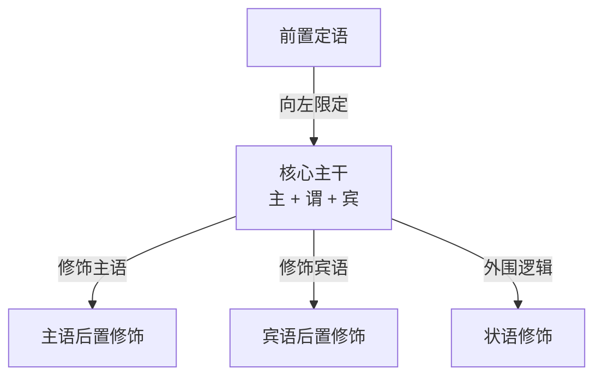
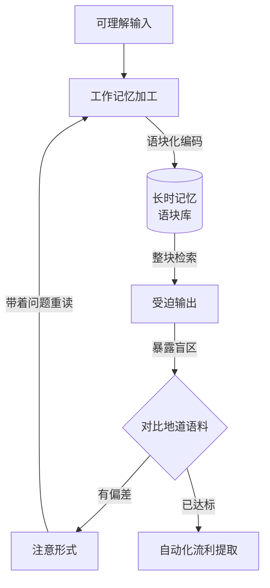
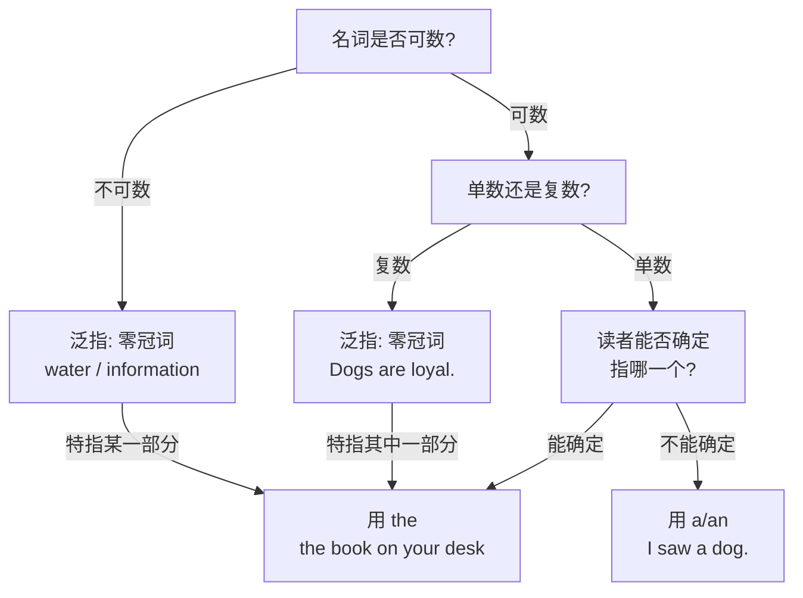

[toc]

## 怎样使用本文

本文面向中文母语的英语学习者，回答两个问题：英语为什么长成这样，以及据此应当怎样安排学习与训练。它不替代词典、语法书与语料库，只提供选择的依据和判断的标准。

全文按"看语言—定方法—练能力"三段展开：

- **看语言**：底层语言学特征与英汉差异，解释"单词都认识，句子却读拧巴"的成因。
- **定方法**：习得机制、目标坐标、时间预算与分阶段路线，把"学好英语"换算成可执行的小时数。
- **练能力**：语音、词汇、语块、句子、阅读、听力、口语与写作的具体做法与验收标准。

三条使用路径：

- **系统学**：按顺序通读。每章的表格即操作标准，加粗句即结论。
- **带问题查**：先看「常见误区与失败模式」里的诊断矩阵，按症状定位章节。
- **只看结论**：读加粗句与表格，最后看「执行清单」。

术语约定：首次出现的术语给中英对照。**限定动词**(finite verb) 指能体现时态、并与主语保持一致的谓语动词；**语块**(chunk) 指经常共现、可整块调用的多词单位；**形合**(hypotaxis) 与**意合**(parataxis) 指句子成分靠形式标记还是靠语义衔接。

> 本文由多份平行草稿合并而成，取舍标准是权威性、准确性与可执行性，而非篇幅。涉及产品版本、考纲与价格的内容会随年份变动，均以官网为准。

---

## 英语的底层语言学特征

许多中文母语者学了十几年英语，仍觉得英语"语序拧巴、规则琐碎、读不懂也写不对"。根本原因不在难度，而在于用**汉语的底层操作系统**去运行**英语的语言程序**。从语言类型学(Linguistic Typology)看，英汉之间存在几组决定性的底层差异。

### 形合与意合的对立

语言学家尤金·奈达(Eugene Nida)在 *Toward a Science of Translating* 中指出，西方语言与汉语最显著的差异之一，是**形合**与**意合**的对立。

- **英语是典型的形合语言**：词与分句之间**必须通过显性的形式标记**建立语法与逻辑关系。这些标记包括并列连词(*and*、*but*)、从属连词(*although*、*because*)、关系词(*which*、*where*)、介词(*in*、*of*、*with*)以及动词的屈折形态(*-ing*、*-ed*、*to do*)。没有形式连接词，两个分句不能只靠逗号粘在一起。
- **汉语是典型的意合语言**：词与分句之间不依赖严格的形式标记，而依靠语义逻辑、时间顺序与语境自然粘合。中文说"下雨了，我不去了"，中间不需要连词，读者自动补出因果；写成英文 *It is raining, I will not go.* 则是严重的逗号粘连错误，必须显性补全，写成 *Because it is raining, I will not go.*，或用分词结构 *It being rainy, I will not go.*

这条差异的后果是：**中文的省略在英语里往往是语法错误，而不是风格选择。**

### 树状右分支与竹节流水

在句法信息的组织上，英语呈**树状结构**(tree structure)，汉语呈**竹节结构**(bamboo structure)。

- **英语遵循"重心前置、右向分支扩展"**：先亮出核心主干(主语 + 限定动词)，把"谁做了什么"定下来，再像树干长枝一样，用介词短语、非谓语短语、定语从句向右侧层层挂载修饰成分。
- **汉语遵循"铺垫在前、重心在后"**：按时间或事理顺序一节节推进，最后才给结论。

下图把英语句子的主干与挂载关系画成树：核心骨架居中，前置定语向左限定，主语与宾语各自向右挂载后置修饰，外围再挂状语。

主语位与宾语位的后置修饰可挂介词短语、分词短语与定语从句；状语位可挂时间、原因、条件、让步等成分。具体槽位见「句子」一章的扩展接口。

读句子时要优先锁定顶层的**核心主干**，把挂载的分支视为插件；汉英转换时则要把原本线性铺开的多个竹节合并、降级，重组为"一主多从"的层级。

### 静态名物化与动态动词

- **英语有强烈的静态倾向**(static / nominal style)：一个分句只允许一个限定动词。需要表达多个动作时，英语很少把动词排成一排，而把次要动作转为**抽象名词**(nominalization)、介词短语或非谓语形式，把真正的谓语弱化为表关系或状态的虚化动词(*be*、*have*、*make*、*undergo*、*witness*、*lead to*)。
- **汉语有强烈的动态倾向**(dynamic / verbal style)：连动式、兼语式发达，一句话里连用四五个动词而不显突兀。

这一条直接解释了学术与新闻英语为什么"名词多、动词少"：*The implementation of the policy led to a reduction in costs.* 还原成动作就是 *They implemented the policy, so costs fell.*

### 形态强制绑定

汉语属孤立语(isolating language)，汉字不随语法功能改变外形。英语虽已从综合语演变为以分析语为主，仍在三个维度上保留严格的**形态强制**：

- **名词的可数性与限定词绑定**：单数可数名词在语法上不能"裸奔"，前面必须有限定词(*a*、*the*、*this*、*my*、*each*)，或词尾加复数 *-s*。
- **动词的时空坐标绑定**：汉语说"我吃过饭了""我昨天吃饭""我明天吃饭"，"吃"字不变；英语只要写出谓语动词，就必须交代时(tense)与体(aspect)。
- **主谓一致绑定**：主语的单复数直接决定谓语形式。

### 语序、词汇分层与语体

除上述四组差异，还有三条特征决定了英语的"手感"。

- **分析性**(analytic)：词形变化少，靠**词序**(word order)与**功能词**(function words)表意。现代英语的全部屈折词缀只有八个：复数 *-s*、所有格 *-'s*、第三人称单数 *-s*、过去式 *-ed*、过去分词 *-ed/-en*、现在分词 *-ing*、比较级 *-er*、最高级 *-est*。屈折少而派生与复合极强，这意味着"记词形变化"的负担远小于"记构词与搭配"。
- **词汇分层**：5 至 11 世纪的日耳曼基础词(*water*、*house*、*eat*、*go*)承担日常表达；1066 年诺曼征服后的法语词(*government*、*justice*、*beef*)进入法律、政务与烹饪；14 世纪起的拉丁语与希腊语词(*analysis*、*hypothesis*、*biology*)承担学术与抽象概念；近代又吸收全球借词(*tea*、*coffee*、*tsunami*)。结果是同一概念常有 2 至 3 个语体不同的同义词。
- **词类转换自由**(conversion)：*email* 既是名词也是动词，*Google it* 已进入通用语。判断词性不能只看词形，必须看它在句中的位置。

词汇分层对阅读有直接收益：*commence* 与 *begin*、*purchase* 与 *buy*、*terminate* 与 *end* 不是两组无关的词，而是同一意义的正式与日常两种说法。识别语体差异，词汇量的"感知规模"会立刻扩大。

| 概念 | 日耳曼层（口语、日常） | 法语层（正式、书面） | 拉丁希腊层（学术、抽象） |
| :--- | :--- | :--- | :--- |
| 开始 | *begin* | *commence* | *initiate* |
| 买 | *buy* | *purchase* | *acquire* |
| 结束 | *end* | *terminate* | *conclude* |
| 重要 | *important* | *significant* | *substantial*、*material* |
| 问 | *ask* | *inquire* | *interrogate* |
| 错误 | *mistake* | *error* | *fallacy* |

### 英汉差异总表

下表把上述差异压缩为可直接对照的五组，右两列是学习者最常见的错误与目标形式。

| 对比维度 | 英语特征 | 汉语特征 | 典型中式英语 | 地道表达 |
| :--- | :--- | :--- | :--- | :--- |
| **连接机制** | 形合：用连词、介词、关系词显性标记逻辑 | 意合：靠语序与语境隐含逻辑 | *Have many people think this plan will fail.* | *Many people believe **that** this plan will fail.* |
| **句法重心** | 重心前置、右向分支，修饰语后置 | 重心后置、左向铺垫 | *Because of yesterday heavy rain caused the road blocked, so he was late.* | *He was late **because** the heavy rain **had blocked** the road.* |
| **动静偏好** | 静态名物化，用"名词 + 介词"承载动作 | 动态连动式，连续使用动词 | *If you eat too much sugar, it will damage your teeth.*（书面偏松散） | ***Excessive consumption of** sugar **leads to** dental damage.* |
| **主语选择** | 主语显著，偏好抽象概念、无灵主语与形式主语 *it* | 主题显著，偏好以"人"作主语或无主句 | *In recent years, we saw great changes in our city.* | *Recent years **have witnessed** dramatic changes in our city.* |
| **形态约束** | 强制屈折：可数名词必带限定词，动词必标时态 | 零形态变化，无性、数、格、时态词尾 | *Student should cultivate good habit in daily life.* | ***A student** should cultivate **good habits** in daily life.* |

以上均为**倾向而非绝对规则**：英语和汉语都能使用主谓宾顺序，差别在于英语对结构标记的依赖更强。把它当概率，而非当铁律。

---

## 学习思路：机制、坐标与路线

理解机制，是为了避免把时间花在"看起来努力"的事情上，例如反复抄写词表、把语法书从第一页读到最后一页。

### 二语习得有效进阶的形式化模型

综合克拉申(Stephen Krashen)的输入假说、施密特(Richard Schmidt)的注意假说、刘易斯(Michael Lewis)的语块理论、斯温(Merrill Swain)的输出假说，可以把高效的英语习得过程写成一个认知函数：

*SLA_Efficiency = f(I(i+1), N(form), C(chunk), O(pushed), F(loop))*

各变量的定义、操作标准与常见误区如下表。

| 变量 | 名称 | 作用机制 | 操作标准 | 常见误区 |
| :--- | :--- | :--- | :--- | :--- |
| *I(i+1)* | **可理解性输入** | *i* 是当前水平，*+1* 是略高的新知。完全读不懂的材料是噪音(*i+10*)，不产生习得 | 阅读材料生词率控制在 **2% 至 5%**；听力在不看字幕时能懂 **70% 至 80%** 的大意 | 一上手就硬啃生词率超过 20% 的外刊或无字幕剧集，把"痛苦查词"当有效输入 |
| *N(form)* | **对形式的注意** | 只关注大意而完全忽略词尾、介词与句型，会出现**石化**(fossilization) | 理解大意后做二次扫描：作者为何用这个介词、为何用过去完成时、这个形容词为何修饰这个名词 | 把输入等同于流利度，忽略精准度与写作规范 |
| *C(chunk)* | **语块化存储** | 工作记忆容量约 7±2 个组块，母语者提取的是预制多词组合 | 不只记 *commit = 承诺/犯罪*，而要记 *commit a crime*、*be committed to doing sth.* | 孤立背中文释义，造句时按中文逐词拼凑 |
| *O(pushed)* | **受迫输出** | 输出时大脑被迫进入句法加工，暴露盲区 | 读完或听完后用刚学的语块与句型改写、造句、复述 | 用简单句随意打发，不算受迫输出 |
| *F(loop)* | **纠错反馈闭环** | 无反馈的练习只会巩固错误 | 用回译法或搭配词典核验主谓、动宾搭配是否成立 | 只顾低头写日记，从不核验句子是否合规 |

### 认知内化与语块调用闭环

五个变量在大脑中的协作关系如下图所示：输入经工作记忆加工与形式注意，语块化编码后进入长时记忆；输出调用这些语块，暴露的差距再回流到注意机制，形成螺旋上升；若无差距，则进入自动化。

关键在打通**注意形式**与**对比反馈**这两环。当输出卡壳或写出病句时，这个痛感会反向激活注意机制，使下一次阅读与听力带着问题去捕获地道表达。

### 两条补充机制

上述模型之外，认知心理学还有两条稳固结论，决定了复习怎么安排。

- **陈述性知识不等于程序性知识**：你"知道"第三人称单数加 *-s*，与在正常语速下"自动"加上 *-s*，是两回事。从知道到自动化只有一条路：大量有意义的重复使用。
- **间隔与提取优于集中与重读**：分散在十天里的十次复习，远胜一天的十次；"努力回忆"的记忆效果比"重复阅读"高出一倍以上。这是间隔重复系统(SRS)的理论依据。

### 需要打破的六个迷思

| 迷思 | 事实 |
| :--- | :--- |
| 成年人学不好外语 | 关键期假说主要影响**口音**；成年人在词汇、语法、阅读与学习策略上有优势，可以达到 C1 甚至 C2 |
| 先背完单词再开始 | 词汇必须在语境中习得，孤立词表的迁移率低。边输入边扩词 |
| 语法不重要，语感就够 | 纯自然习得容易石化。适量显性语法显著加速成人学习 |
| 必须消灭口音 | 目标是**可懂度**(intelligibility)，不是"像母语者"。能被听懂且不引起误解即达标 |
| 看美剧就能学会 | 只有带策略地看（暂停、查词、复述、精看片段）才有效，追剧情等于娱乐 |
| 在国外自然就会 | 大量学习者在英语国家生活十年仍停在 A2 至 B1，原因是社交圈闭合且没有刻意练习 |

### 用 CEFR 把"好"变成可测量的坐标

**CEFR**(Common European Framework of Reference for Languages，欧洲语言共同参考框架)是全球最通用的语言能力标尺，雅思、托福与剑桥考试都与它对齐。

| 等级 | 通俗描述 | 能力锚点 | 常见对标 |
| :--- | :--- | :--- | :--- |
| Pre-A1 | 破冰 | 认识字母与少量固定短语 | — |
| A1 入门 | 生存 | 自我介绍、点餐、问路 | — |
| A2 初级 | 简单交流 | 描述日常、写简短信息 | 剑桥 A2 Key |
| B1 中级 | 独立用户起点 | 应付旅行、讲清经历与打算 | 雅思 4.0–5.0 |
| **B2 中高级** | **实用分水岭** | 看懂原版剧集大意、参与专业讨论、写清晰论述 | 雅思 5.5–6.5、托福 72–94、剑桥 B2 First |
| **C1 高级** | **职业级** | 流畅表达、理解隐含意义、写复杂文本 | 雅思 7.0–8.0、托福 95–120、剑桥 C1 Advanced |
| C2 精通 | 接近母语的学术水准 | 几乎无障碍，能把握细微差别 | 雅思 8.5–9.0 |

分数对应是**近似映射**，各考试官方对照表会调整，以官网为准。对多数学习者，**B2 是"改变人生"的临界点，C1 是性价比天花板，C2 的边际收益急剧下降**，除非从事翻译、语言教学或文学研究。

CEFR 2020 增补版把传统"听说读写四技能"升级为四种交际模式：接收(reception，听与读)、产出(production，说与写)、**互动**(interaction，实时双向)、**中介**(mediation，在人与文本之间转述)。**只练听读写而不练互动，是很多人"哑巴英语"的结构性原因。**

### 时间成本

剑桥英语给出的**指导学时**(guided learning hours)估算，从零基础累计如下表。它是课堂指导学时，不含自学练习。

| 目标 | 累计指导学时 | 每天 1 小时约需 |
| :--- | :--- | :--- |
| A2 | 180–200 | 约 6 个月 |
| B1 | 350–400 | 约 1 年 |
| **B2** | **500–600** | **约 1.5–2 年** |
| C1 | 700–800 | 约 2–2.5 年 |
| C2 | 1000–1200 | 3 年以上 |

对中文母语者还应上修：英语与汉语在语系、书写系统与语音结构上距离极远，达到专业工作水平通常需要 2000 小时以上的总投入（可参照美国外交学院 FSI 的语言难度分级思路：对英语母语者而言，中文属最难的一档，反之亦然）。

结论是一句话：**这是以千小时为单位的工程，任何"30 天流利"的承诺都不成立；但每天一小时高质量投入，两年到 B2 完全现实。**

### 分阶段路线图

四个阶段，每个阶段只有一个战略目标。

| 阶段 | 目标等级 | 战略目标 | 主要内容 | 学时 |
| :--- | :--- | :--- | :--- | :--- |
| 打地基 | 0 → A2 | 建立正确的语音系统与最高频骨架 | 音标与难点音、核心 1000 词、基本句型 | 150–250 |
| 建立输入引擎 | A2 → B1 | 把英语从"学习对象"变成"信息来源" | 分级读物、慢速听力、3000 词族 | 200–300 |
| 打通输出 | B1 → B2 | 建立输出—反馈—修正闭环 | 真实材料、口语与写作、反馈 | 200–300 |
| 领域深耕 | B2 → C1 | 从"能沟通"到"能胜任专业场景" | 窄化输入、学术与职场词汇、语体意识 | 200–300 |

阶段三是最难也最关键的一跃。**多数人一辈子卡在 B1，原因几乎总是：输入尚可，但从不输出，也从不接受反馈。**

阶段四的四个重点：

- **窄化输入**(narrow reading / listening)：集中读同一领域、同一作者、同一节目的大量材料，重复的术语与句式会加速习得，效率高于"什么都看一点"。
- **学术与职场词汇**：*Academic Word List*(AWL，570 个词族)覆盖学术文本约 10%；理工科可加 *NAWL* 或专业术语表。
- **语体意识**(register)：区分口语与书面、正式与非正式。*get* 与 *obtain*、*a lot of* 与 *a substantial amount of* 用在不同场合。
- **搭配优先于单词**：C1 的标志是搭配自然，而非词量大。

### 所谓"英语思维"

"不要用中文思维"过于模糊，也不现实。初学阶段借助母语理解是正常的。真正要发展的是四件事：

- 看到 *apple* 直接联想到实物，而非先经过"苹果"两个汉字。
- 看到 *Although A, B* 直接感受到"承认 A，但把主张推进到 B"。
- 看到 *suggest that* 直接把它当一个完整结构处理。
- 阅读时先构建事件与逻辑，再决定是否翻译。

可以分阶段推进：初级允许借助中文确认，但先找英文主干；中级按英文语块与分句理解，再用中文概括；进阶直接用英文复述英文，仅在精确核验时翻译。**翻译可用于核验，但不应成为每次阅读的必经通道。**

### 最佳实践行动准则

结合 Paul Nation 的"四大支柱"(The Four Strands)——把时间均衡分配给重在意义的输入、重在形式的学习、重在意义的输出与流利度训练——给出可直接执行的准则。

- **必须做**：
  - 以**句子与语块**为最小学习单位。查生词时同步看语法属性（可数/不可数、及物/不及物）与一到两个高频搭配例句。
  - 使用**英英释义或双解词典的英文解释**。中文翻译多为近似词，只有英文释义能划清词义边界。
  - 严格区分**精读精听**与**泛读泛听**：前者解剖结构与提取语块，后者培养速度与语境浸润。
- **推荐做**：
  - 按词频梯度推进：先彻底吃透最高频的 3000 个词族（Oxford 3000 或 NGSL），其熟词僻义与搭配的收益远大于背生僻词。
  - 使用搭配词典。写作拿不准"承担责任"用什么动词配 *responsibility* 时，查 *Oxford Collocations Dictionary* 会立刻看到 *assume*、*bear*、*shoulder*、*take on*。
- **可以做**：
  - 用双向回译训练句法精准度：看着中文译文翻回英文，再逐词对比原文在冠词、介词、时态与从句上的差异。
  - 用间隔重复软件管理自建语块卡，正面是挖空句，背面是完整原句与发音。
- **避免做**：
  - 拿按字母排序的词表死背"一词一义"：*abandon* 背了五十遍，却不知道 *abandon oneself to despair*。
  - 在主干还没写对之前追求"高级长难句"。把简单句写得准确、紧凑，永远优于语法百出、逻辑混乱的从句套从句。

---

## 语音：被严重低估的地基

### 为什么语音优先

发音系统不只影响别人能否听懂你，更影响你能否听懂别人。大脑用**自己的发音模型**去解码听到的声音：如果模型里没有 /θ/，就难以在语流中辨认它；如果不知道 *record* 作名词时重音在前，听到 *REcord* 时会当成陌生词。

语音还有两项连带收益：音形联系稳定的词更容易记住；阅读词汇也更容易迁移到听力。反之，"只认拼写、完全不知道词怎么读"会把阅读、听力与口语割成三块。

### 中文母语者的系统性难点

按优先级排列如下表。最小对立对(minimal pairs)的用法是：先能听出区别，再练发出区别。

| 难点 | 问题描述 | 最小对立对 |
| :--- | :--- | :--- |
| **词尾辅音丢失** | 中文音节多以元音或鼻音收尾，易丢 /t/ /d/ /k/ /s/ | *lie / light*、*bay / bake* |
| **/θ/ 与 /ð/** | 中文无此音，常替换为 /s/ /z/ | *think / sink*、*they / day* |
| **/v/ 与 /w/** | 常混淆 | *vest / west*、*vine / wine* |
| **/l/ 与 /n/** | 部分方言区声母混淆 | *light / night* |
| **/r/ 与 /l/** | 尾音 /r/ 尤其困难 | *right / light*、*fry / fly* |
| **/ɪ/ 与 /iː/** | 中文无长短元音对立 | *ship / sheep*、*bit / beat* |
| **/æ/ 与 /e/** | 开口度与舌位接近 | *bad / bed*、*man / men* |
| **节奏** | 中文音节等时，英语重音等时 | 见下节 |

### 节奏：听起来像中式英语的头号原因

汉语普通话里每个字所占时长大致相等，字字清晰；英语是**重音计时语言**(stress-timed language)，**实词**（名词、核心动词、形容词、副词、否定词）重读、拉长、发音饱满，夹在中间的**虚词**（介词、冠词、代词、助动词、连词）被压缩，元音几乎坍缩为中央元音 /ə/(schwa)。

例：*I want to **go** to the **store**.* 真实语流接近 "I wanna **go** to the **store**"，*to* 弱读为 /tə/。

这条规律同时解释了听力问题：你记住的是字典音(citation form)，母语者说的是连续语流(connected speech)，脑中的声音指纹与声波对不上。具体音变规则见「听力」一章。

### 拼读与重音规则

英语拼写属"深层"拼写系统，字母与声音并非一一对应，但多数拼写有规律可循，例外词单独记即可。

- **重音决定发音与词性**：*REcord* 是名词"记录"，*reCORD* 是动词"记录"；*PHOtograph*、*phoTOgraphy*、*photoGRAPHic* 重音逐级后移，非重读元音随之弱化。
- **看到生词先分音节再读**：*un-pre-dict-a-ble*，能读出来就记住一半。
- **常见字母组合**：*c* 在 *e*、*i*、*y* 前多读 /s/（*city*、*face*）；*-tion* 读 /ʃən/（*nation*、*action*）；词尾哑音 *e* 拉长前一元音（*cap* 与 *cape*）。
- **重音位置影响理解**：英语靠重音区分信息焦点，同一句话重音落在不同词上，含义不同。

### 训练方法

每天十到十五分钟即可，按以下顺序执行：

1. 用**最小对立对**做辨音练习，先听后说。
2. 学习连读、失爆、同化、弱读四类规则（详见「听力」中的音变表）。
3. 用**录音对比法**自查：录自己 → 对比原声 → 找出差距 → 重录。这是唯一可靠的自我纠音手段。
4. 用 YouGlish 一类工具查同一个词在真实视频中的发音，观察语境中的重音与弱读。
5. 跟读与影子跟读，但材料必须已经听懂。听不懂就模仿，只会得到模糊模仿。

### 国际音标与自然拼读的取舍

两条路线各有适用场景，可以并用：

- **国际音标**(IPA) 的优势是精确、可查证。不必背全表，只需能读懂词典音标，用它确认自己拿不准的音。成人学习者、以自学为主者优先采用。
- **自然拼读**(phonics) 的优势是快、可直接从拼写推出读音，适合入门期建立音形直觉，但无法覆盖全部词汇，例外词仍需单独记。

推荐组合：**用 IPA 定位与核对，用拼读规则加速首读**。同时选定一种输出参照口音（通用美音 GA 或标准英音），但听力训练要覆盖多种口音。

---

## 单词：从词形到词义的系统

### 单词不是一个中英文等号

一个完整的词汇知识至少包含六个方面。只会第一条，就是"认识但不会用"的根源。

| 维度 | 要问的问题 | 以 *suggest* 为例 |
| :--- | :--- | :--- |
| 发音与重音 | 会听、会读吗 | /səˈdʒest/，重音在后 |
| 词性 | 在句中能做什么 | 动词 |
| 核心意义 | 最常见的含义是什么 | 建议；表明、暗示 |
| 语法结构 | 后面接什么 | *suggest doing*；*suggest that...* |
| 搭配 | 常与什么词一起用 | *strongly suggest*；*evidence suggests* |
| 语气与语域 | 确定性多强，正式还是口语 | "表明"通常弱于 *prove* |

例：

- *I suggest leaving early.*（建议早点离开）
- *I suggest that we leave early.*（建议我们早点离开）
- *The evidence suggests that the treatment may help.*（证据表明这种治疗可能有帮助）

最后一句有两层谨慎：*suggests* 表示证据提示而非证明，*may* 表示可能而非必然。**查词时必须看词性、义项、搭配、句型与例句，不能只看第一条中文释义。**

同一框架也适用于"知道但用不出"的困境：一个词"看见能认出"（被动词汇）通常是"需要时能说出"（主动词汇）的两到三倍。要把词转为主动，必须在输出中使用三到五次。

### 构词三要素

英语中大量中高级词汇（尤其拉丁与希腊语源）遵循可拆解的拼装结构：

*Word = [前缀 prefix：定方向或极性] + 词根 root：承载核心语义 + [后缀 suffix：定词性]*

- **前缀**通常不改变词性，只改变词义方向或极性：*con-* 表共同，*de-* 表向下或去除，*ex-* 表向外，*in-* 表向内或否定，*sub-* 表在下，*trans-* 表跨越。
- **词根**承载核心动作或概念意象：*spect* 看，*duct* 引导，*tract* 拉，*press* 压，*pos/pon* 放置。
- **后缀**决定该词能填哪个语法槽位：*-tion*、*-ment*、*-ity*、*-ness* 构成名词；*-ive*、*-ous*、*-able*、*-al* 构成形容词；*-ize*、*-ify*、*-ate*、*-en* 构成动词。

以词根 *tract*（拉、拽、抽）为例，掌握前缀方向即可串起十几个高频词。

| 派生词 | 拆解 | 字面意象 | 核心词义与高频搭配 |
| :--- | :--- | :--- | :--- |
| *attract* | *ad-*(朝向) + *tract* | 把目光朝自己拉过来 | 吸引：*attract attention* |
| *distract* | *dis-*(分散) + *tract* | 把注意力拉离中心 | 使分心：*distract sb. from work* |
| *extract* | *ex-*(向外) + *tract* | 从内部往外拉 | 提取、拔出：*extract data from a report* |
| *contract* | *con-*(往一起) + *tract* | 往一起拉紧；把双方拉到一起签字 | 收缩、感染；合同：*muscles contract*、*sign a contract* |
| *subtract* | *sub-*(在下) + *tract* | 从底下抽走一部分 | 减去：*subtract 5 from 10* |
| *abstract* | *abs-*(离开) + *tract* | 把概念从具体事物中抽离 | 抽象的；摘要：*abstract concepts* |
| *intractable* | *in-*(否定) + *tract* + *-able* | 怎么拉都拉不动 | 棘手的：*an intractable problem* |

构词法只是证据之一，不能单独决定词义。反例必须记住：

- *inflammable* 不是"不易燃"，而是"易燃"。
- *department* 不能按现代词素随意拆解得到准确词义。
- *history* 与 *his + story* 无关。

**猜词时的证据优先级是：词性 → 句法位置 → 前后逻辑 → 搭配 → 构词 → 全文主题。**

### 屈折与派生

屈折(inflection)与派生(derivation)是两种性质不同的形态变化，混为一谈会导致"背了词缀却不会用"。

| 对比项 | 屈折变化 | 派生变化 |
| :--- | :--- | :--- |
| 是否改变词性 | 不改变 | 通常改变 |
| 是否改变核心含义 | 不改变，只加语法信息 | 改变含义或词性 |
| 位置 | 总在词尾 | 前缀或后缀均可 |
| 例子 | *walks*、*walked*、*walking* | *walk* → *walker* |
| 数量 | 仅八个 | 数量庞大，是扩词主战场 |

此外还有复合(*bookstore*、*smartphone*)、转化(*book* 名词转动词)、截短(*advertisement* → *ad*)、混合(*breakfast* + *lunch* → *brunch*)、首字母缩写(*NATO*、*FAQ*)与逆构词(*babysitter* → *babysit*)。其中**转化**最易被中文母语者忽略：同一词形在不同位置可能是不同词性，判断依据只能是句法位置。

### 高频词缀与词根速查

先掌握下表这些，再按需扩展。词根不求背全，求"见到能联想"。

| 类型 | 高频成分 | 作用 |
| :--- | :--- | :--- |
| 否定前缀 | *un-*、*in-/im-/il-/ir-*、*dis-*、*mis-*、*non-* | 否定或相反 |
| 方向前缀 | *re-*、*pre-*、*post-*、*sub-*、*inter-*、*trans-*、*co-/con-*、*de-*、*over-*、*under-* | 时间、位置、程度 |
| 名词后缀 | *-tion/-sion*、*-ment*、*-ness*、*-ity*、*-er/-or*、*-ist* | 动作、状态、性质、执行者 |
| 形容词后缀 | *-able/-ible*、*-ful*、*-less*、*-ous*、*-ive*、*-al* | 能力、充满、缺乏、性质 |
| 动词后缀 | *-ize/-ise*、*-ify*、*-en* | 使……化、使…… |
| 副词后缀 | *-ly* | 方式、程度 |

| 词根 | 含义 | 例词 |
| :--- | :--- | :--- |
| *spect* | 看 | *inspect*、*respect*、*perspective* |
| *port* | 携带 | *transport*、*export*、*portable* |
| *dict* | 说 | *predict*、*contradict*、*dictionary* |
| *scrib/script* | 写 | *describe*、*manuscript*、*subscribe* |
| *duc/duct* | 引导 | *conduct*、*produce*、*introduce* |
| *cap/cept* | 拿、抓 | *capture*、*accept*、*concept* |
| *pos/pon* | 放置 | *compose*、*expose*、*propose* |
| *struct* | 建造 | *construct*、*structure*、*instruct* |
| *log* | 话语、学科 | *biology*、*psychology*、*logic* |
| *graph* | 写、画 | *photograph*、*autograph* |
| *phon* | 声音 | *microphone*、*phonetics* |
| *chron* | 时间 | *chronology*、*synchronize* |

### 一词多义：核心义在不同场景中的延伸

阅读理解中最头疼的往往不是长单词，而是 *address*、*compromise*、*check*、*run*、*hold*、*deliver*、*observe* 这类"每个字母都认识、放句子里讲不通"的多义词。

认知语言学的研究结论是：**一个词的十几个义项并非随机堆砌，而是由一个最基础的物理空间核心意象，通过隐喻（具体到抽象）或转喻（局部代整体、过程代结果）派生出来。**

以下六例是阅读中最常造成误读的高价值词。

| 词 | 核心意象 | 辐射路径 |
| :--- | :--- | :--- |
| *address* | *ad-*(朝向) + *dress*(弄直、对准)：把方向对准某物 | 对准某地 → 地址；对准听众 → 演讲(*address the conference*)；对准问题 → **处理、解决**(*address the issue*) |
| *compromise* | *com-*(共同) + *promise*(承诺)：双方各让一步达成约定 | 谈判让步 → 妥协；在原则、安全、健康上让步 → **危及、损害**(*The leak compromised national security.*) |
| *check* | 国际象棋的"将军"：拦住对方去路、迫其停步核查 | 迫使停步 → **遏制、控制**(*keep inflation in check*)；停下来核对 → 检查；核对用的凭证 → 支票 |
| *observe* | *ob-*(在面前) + *servare*(守护、留心)：目光紧盯不放 | 盯自然现象 → 观察；观察后开口 → 评论说；盯规则执行 → **遵守**(*observe the traffic rules*)、奉行(*observe a custom*) |
| *informed* | *in-*(进入) + *form*(赋予形状)：内部装满了信息 | 人装满信息 → 见多识广；判断建立在信息之上 → **有充分根据的**(*an informed decision*) |
| *deliver* | *de-*(解除) + *liber*(自由)：把某物从束缚中解放并送到 | 送包裹 → 投递；接生 → 分娩(*deliver a baby*)；把话送到听众 → 发表演讲；把承诺兑现 → **履行**(*deliver on one's promise*) |

其他高频多义词的典型上下文义，可先建立"警惕清单"：*claim*（声称/索赔）、*case*（情况/案例/案件）、*subject*（主题/对象/使遭受，*be subject to change*）、*matter*（事情/要紧）、*figure*（数字/人物/认为，*figure out*）、*run*（跑/经营/运行）、*issue*（问题/期号/发布）、*fine*（罚款/精细的）、*weather*（作动词表"渡过难关"）、*tell*（作不及物动词表"见分晓"）。

判断流程只有一条：**遇到熟词，先服从当前句子的词性与搭配，再选义项，绝不让最熟悉的中文意思支配理解。**

例：*The paper addresses the limitations of the previous study.* 这里 *paper* 是论文，*addresses* 是"讨论、处理"，*limitations* 是"局限性"，整句是"这篇论文讨论了先前研究的局限性"。

### 搭配锁定义项

词义在很大程度上由搭配决定。同一个动词换一个宾语，意思随之改变。

| 动词 | 搭配 A | 含义 A | 搭配 B | 含义 B |
| :--- | :--- | :--- | :--- | :--- |
| *make* | *make a decision* | 作出决定 | *make sense* | 有道理 |
| *take* | *take a risk* | 冒风险 | *take for granted* | 视为理所当然 |
| *give* | *give up* | 放弃 | *give rise to* | 引起 |
| *bring* | *bring up* | 提出、抚养 | *bring about* | 导致 |
| *look* | *look into* | 调查 | *look forward to* | 期待 |
| *come* | *come up with* | 想出 | *come across* | 偶然遇到 |
| *set* | *set a goal* | 设定目标 | *be set to do* | 即将、准备 |

遇到高频词义项不确定时，不要纠结"它到底什么意思"，而要问"它在这个句子里与谁构成搭配"。

### 生词该查还是该猜

判断标准一句话：**不影响主旨的先跳过，影响主干或反复出现的关键词再查。**

操作顺序：

1. 判断重要性：删掉它，句子主旨还成立吗？
2. 判断词性：名词、动词、形容词还是副词？
3. 观察搭配：它和哪个词构成整体？
4. 检查逻辑：前后是转折、因果、解释还是举例？
5. 利用词形：前缀与后缀提供了什么线索？
6. 代入暂定词义：放回句中是否合理？
7. 必要时查词典验证，尤其是关键词与熟词生义。

例：*Unlike the temporary decline seen last year, the current reduction appears to be **persistent**.* 即使不认识 *persistent*，也能从 *unlike*（对比）、*temporary*（暂时）推出它是"持续的、长期存在的"。**猜词不是猜一个精确中文词，而是先定方向、词性与情感色彩。**

### 单词卡与间隔重复

不要做这种卡：正面 *suggest*，背面"建议"。要做的是挖空句加结构化信息：

- 正面：*The evidence ______ that sleep affects memory.*
- 背面：*suggests*
- 核心义：证据"表明、提示"，并非完全证明
- 结构：*suggest that...*、*suggest doing*
- 搭配：*strongly suggest*
- 发音：用学习词典音频
- 自造句：*I suggest taking a short break.*

每张卡只突出一个核心义或一个结构，用完整短句做提取练习。

复习间隔可以从"次日、数日后、一周后、两周后"起步，再按遗忘情况调整。间隔没有适合所有人的固定数字，原则是：

- 在尚未完全遗忘时尝试回忆。
- 回忆困难的卡出现更频繁。
- 熟练的卡逐步延长间隔。
- "能认出"与"能主动使用"要分别测试。

工具层面，Anki 是主流选择（免费、开源、跨平台，iOS 版收费），自 23.10 版起内置 **FSRS** 调度算法，相比传统 SM-2 可显著减少复习量，建议在设置中启用；具体默认值以当前版本为准。替代品有 Quizlet、Memrise、SuperMemo。**每天新卡控制在 10 至 20 张**，贪多的唯一后果是复习债务雪崩后彻底放弃。

### 词汇量阈值与覆盖率

词族(word family)数量与文本覆盖率的关系，是决定"该背多少词"的客观依据。

| 词族数量 | 文本覆盖率 | 实际含义 |
| :--- | :--- | :--- |
| 1000 | 口语约 85%，书面约 72% | 极简生存 |
| 2000 | 口语约 90%，书面约 80% | 基本日常 |
| **3000** | **口语约 95%，书面约 85%** | **日常对话舒适线** |
| 5000 | 书面约 95% | 能读简化新闻 |
| 6000–7000 | 口语约 98% | 无障碍看影视 |
| **8000–9000** | **书面约 98%** | **无障碍读小说与报纸的门槛** |

数字来自 Nation 等人的研究估算，不同研究的统计口径略有差异，**应关注数量级与关键阈值，而非小数点**。

**98% 是关键的阅读阈值**（Hu & Nation, 2000）：低于此，读者需要频繁猜词，理解率与阅读乐趣急剧下降。95% 相当于每 20 个词有 1 个生词，部分读者可靠背景知识支撑，多数人会觉得吃力。

选词表的优先级：Oxford 3000/5000（按 CEFR 分级、免费公开）或 NGSL（约 2800 词，覆盖一般文本约 90%）；学术场景加 AWL（570 词族）；专业场景加领域术语表。**先把高频词族的熟词僻义与搭配吃透，收益远大于背生僻词。**

---

## 短语与语块：回报最高的部分

母语者说话不是逐词组装，而是调用预制好的语块(chunk)或程式化表达(formulaic sequence)。对非母语者而言，**背高频搭配的收益高于背更多生僻单词**。

### 语块的四类

按 Lewis 的语块理论，日常阅读中值得收集的预制语块有四类，写作时整块调用。

| 类型 | 例子 | 学习要点 |
| :--- | :--- | :--- |
| **聚合词**(polywords) | *by the way*、*for good*、*in a nutshell*、*as a matter of fact* | 不可拆分，功能相当于单个词 |
| **高频强搭配**(collocations) | *pose a threat*、*conduct research*、*deeply rooted*、*widely accepted* | 不能靠中文自由替换，要记整体 |
| **制度化惯用表达** | *Wait a second.*、*If I were you, I would...*、*There is no denying that...* | 口语与特定语境的固定功能句 |
| **语篇框架**(sentence frames) | *When it comes to [X], views vary.*、*The reason why [A] is that [B].*、*Not only does [S] [V], but it also...* | 带可替换槽位的书面骨架 |

### 高频强搭配

背单词时至少带上左邻右舍，不要只记单个词。

| 不要只记 | 应该记 |
| :--- | :--- |
| *attention* 注意 | *pay attention to* |
| *responsibility* 责任 | *take responsibility for* |
| *effect* 效果 | *have an effect on* |
| *role* 作用 | *play a role in* |
| *evidence* 证据 | *provide strong evidence for* |
| *decision* 决定 | *make a decision*（不是 *do a decision*） |
| *problem* 问题 | *identify*、*address*、*solve a problem* |

程度与强度类搭配同样固定：*heavy rain*、*strong evidence*、*deeply rooted*、*highly likely*、*bitterly cold*。中文里"大"可以修饰一切，英语不行。

### 小品词的空间图式

短语动词(*phrasal verbs*)组合看起来无穷无尽，但核心秘密不在前面的动词，而在后面的**方位小品词**。掌握小品词从物理位移到抽象状态的映射，可以推导大部分陌生短语的含义。

| 小品词 | 空间本义 | 三类高频引申 | 推导示例 |
| :--- | :--- | :--- | :--- |
| *up* | 向上、位置升高 | 完全彻底；显现建立；靠近 | *eat up*、*use up*；*show up*、*set up*；*walk up to sb.* |
| *down* | 向下、位置降低 | 减弱平息；坍塌瓦解；记录在案 | *turn down*、*calm down*；*break down*；*write down*、*narrow down* |
| *out* | 由内向外 | 弄清显现；彻底耗尽；向外分发 | *figure out*、*work out*；*run out of*、*die out*；*hand out*、*rule out* |
| *off* | 脱离表面 | 切断中断；出发离开；取消偏离 | *cut off*、*lay off*；*set off*、*take off*；*call off*、*put off* |
| *over* | 越过、覆盖 | 从头审视一遍；控制权转移；跨过关完结 | *go over*、*think over*；*take over*、*hand over*；*get over* |
| *through* | 穿过三维空间 | 经历挺过；彻底完成；接通或看穿 | *go through*、*pull through*；*carry through*；*get through*、*see through* |

### 短语动词的可分性

学短语动词必须同时记录四项：含义、及物性、能否拆分、代词放哪里。代词规则是最容易出错的一条。

- 可分：*turn off the light* / *turn the light off* / ***turn it off***（代词必须放中间，不能说 *turn off it*）。
- 可分：*look up the word* / *look the word up* / *look it up*。
- 不可分：*look after the child* / *look after him*（不能说 *look him after*）。

**判断不了就先按不可分处理，遇到反例再改**。宁可说得笨一点，不要造出母语者不说的结构。

### 介词

介词既有可理解的空间原型，也有大量已经词汇化的固定搭配。

- 空间原型：*at* 把位置看成一个点(*at the station*)；*on* 接触表面(*on the table*)；*in* 处于边界或空间内部(*in the room*)。
- 时间对应：*at 8:00*（点）→ *on Monday*（天）→ *in July*（月）→ *in 2024*（年）。
- 抽象用法多已固定：*interested in*、*good at*、*responsible for*、*depend on*、*prevent sb. from doing*、*provide sb. with sth.*、*a solution to*、*an increase in*、*access to*。

**结论：空间介词可以理解原型，抽象介词必须整块记忆，不要为每个介词硬找中文逻辑。** 同一个动词换介词往往意思全变：*look into*（调查）不是"看进里面"，*come across*（偶然遇到）不是"来穿过"。

### 习语

习语是含义不能从字面推导的固定表达。正式与学术文本中习语较少，新闻、商业写作与日常对话中大量出现。

| 习语 | 字面 | 实际含义 |
| :--- | :--- | :--- |
| *break the ice* | 打碎冰 | 打破僵局、开启话题 |
| *a piece of cake* | 一块蛋糕 | 非常容易 |
| *once in a blue moon* | 蓝月亮出现时 | 极少发生 |
| *hit the nail on the head* | 锤子打中钉头 | 说得完全正确 |
| *let the cat out of the bag* | 把猫放出袋子 | 泄露秘密 |
| *burn the midnight oil* | 烧午夜的油 | 熬夜工作 |
| *under the weather* | 在天气之下 | 身体不舒服 |
| *cost an arm and a leg* | 花费一条胳膊一条腿 | 非常昂贵 |
| *get cold feet* | 脚变冷 | 临阵退缩 |
| *bite the bullet* | 咬子弹 | 咬牙硬撑 |
| *on the same page* | 在同一页 | 意见一致 |
| *the ball is in your court* | 球在你的场地 | 轮到你决定 |

遇到"字面完全不通"的短语，大概率是习语，直接查，不要试图推导。但**习语的学习优先级低于高频搭配**：日常与学术表达的体面程度，靠的是搭配与句型，不是华丽习语。

---

## 句子：骨架、扩展与信息包装

### 五种基本骨架与七种实用模型

无论句子多长，剥去修饰后，核心主干必然属于下面五种之一。骨架由**谓语动词的及物性与配价**唯一决定。

| 代号 | 结构 | 动词属性 | 槽位关系 | 例句 |
| :--- | :--- | :--- | :--- | :--- |
| **SV** | 主语 + 不及物动词 | 不及物 | 动作由主语独立完成 | *Great changes **have taken place**.*（*take place* 无被动） |
| **SVO** | 主语 + 及物动词 + 宾语 | 单及物 | 动作必须落到承受者身上 | *The committee **rejected** the proposal.* |
| **SVC** | 主语 + 系动词 + 表语 | 系动词 | 说明主语的身份、属性或状态 | *The evidence **remains** inconclusive.* |
| **SVOO** | 主语 + 双及物动词 + 间宾 + 直宾 | 双及物 | 涉及"给谁"与"给什么" | *The policy **offers** small businesses tax incentives.* |
| **SVOC** | 主语 + 复杂及物动词 + 宾语 + 宾补 | 复杂及物 | 宾补说明宾语的身份、状态或动作 | *Digital technology **renders** traditional methods obsolete.* |

若把必选状语也算进来，五种会细分为七种实用模型：SV、SVC、SVA(*They stayed outside.*)、SVO、SVOO、SVOC、SVOA(*She put the key on the desk.*)。*put* 这类动词只给宾语不给去向，句子是不完整的。**不同语法体系对成分的命名可能不同，不影响分析结论。**

### 动词配价：句子的真正核心

配价(valency)或论元结构(argument structure)指一个动词要求或允许哪些成分。学动词时只记中文释义，必然写不出合规句子。

- *discuss something*——不加 *about*：正确 *We discussed the problem.*；不标准 *We discussed about the problem.*
- *explain something to somebody*——不能说 *explain me the rule*。
- *provide sb. with sth.*、*prevent sb. from doing sth.*、*suggest doing sth.*、*allow sb. to do sth.*

**记动词就是记它后面接什么。** 词典标注 *vt.*/*vi.* 与句型代码（如 *V + that*、*V + obj + to do*）比中文释义更重要。

### 句子的扩展接口

五个词的简单句如何变成五十个词的长句？答案只有一个：**在不破坏骨架的前提下，通过名词性槽位替换与修饰挂载扩展。**

*[句首状语] + [前置定语] + 主语槽 + [后置定语] + 谓语 + 宾语或表语槽 + [后置定语] + [句尾状语]*

各槽位可填入的组件如下：

- **名词性槽位**（主语、宾语、表语）可整体塞入四类模块：动名词短语(*[Reading original papers] requires patience.*)、不定式短语(*Their goal is [to cut emissions by 30%].*)、*that* 从句(*[That the market is recovering] is obvious.*，常用形式主语后置)、*wh-* 或 *whether* 从句(*We must figure out [how the system works].*)。
- **前置定语槽**只放短成分：限定词、数词、形容词、单个分词(*a rapidly growing economy*)。
- **后置定语槽**放长成分：**凡是超过两个词的修饰语，英语一律后置**。可挂介词短语(*the solution to this problem*)、现在分词(*students participating in the program*)、过去分词(*data collected from sensors*)、不定式(*measures to be implemented next month*)、定语从句(*companies whose revenue depends on exports*)。
- **状语槽**交代时间、地点、原因、条件、目的、结果、让步、伴随，可填副词、介词短语、分词状语、独立主格(*Noun + doing/done*)与各类状语从句。

### 名词短语为什么很长

名词短语的扩展结构是"限定词 + 数量 + 前置修饰 + 中心词 + 后置修饰"：

*the three surprisingly useful books on syntax that I bought yesterday*

其中 *the* 是限定词，*three* 是数量，*surprisingly useful* 是前置修饰，*books* 是中心词，*on syntax* 与 *that I bought yesterday* 是后置修饰。

**读名词短语的第一步永远是找中心名词，第二步问每个成分修饰谁。** 这也解释了逐词翻译为何混乱：英语在中心词后依次展开说明，中文译文往往需要重排。

### 从句：先看它在大句中承担什么工作

| 类型 | 功能 | 常见标记 | 例子 |
| :--- | :--- | :--- | :--- |
| 名词性从句 | 充当主语、宾语或表语 | *that*、*whether*、*what*、*how* | *What she said matters.* |
| 定语从句 | 修饰名词 | *who*、*which*、*that*、*where* | *The book that I bought...* |
| 状语从句 | 表时间、原因、条件、让步等 | *when*、*because*、*if*、*although* | *Although it rained, we left.* |

*that* 的功能要特别分辨：

- *I think **that he is right**.*——宾语从句。
- *The fact **that he left** surprised me.*——同位语从句，说明 *fact* 的内容。
- *The book **that he bought** is expensive.*——定语从句，*that* 在从句中作宾语。

**判断标准不是连接词的中文意思，而是它引导的整个从句在外层句中充当名词、修饰语还是逻辑状语。**

### 限定动词与非谓语

阅读与写作的分水岭都在这条上：句子必须有且仅有一个限定谓语（每个分句各一个），其余动词形式都是非谓语。

> *The report **released yesterday** shows a decline.*

*released yesterday* 是过去分词短语修饰 *report*，主句谓语是 *shows*，主干为 *The report shows a decline.*

对比三种易混情形：

- *The report **was released** yesterday and **shows** a decline.*——两个并列谓语。
- *The report **that was released yesterday** shows a decline.*——*was released* 是从句谓语，*shows* 是主句谓语。
- *The problem **may have been overlooked**.*——*may have been overlooked* 是一条完整谓语链，不是四个分句。

**不要见动词就切句**，先判断它是限定谓语、助动词链的一部分，还是修饰性非谓语。

### 时与体

从语言学角度看，英语动词主要以现在与过去的形态对立表达时；传统的"将来时"多由 *will*、*be going to*、现在进行或一般现在承担。初学阶段最有用的框架是把**时间**与**体**分开。

| 形式 | 观察角度 | 例子 |
| :--- | :--- | :--- |
| 一般体 | 事实、习惯、完整事件 | *She works here.* |
| 进行体 | 进行中、临时、内部过程 | *She is working now.* |
| 完成体 | 先前事件与某参照时间相关 | *She has finished the report.* |
| 完成进行体 | 强调持续时间或过程 | *She has been working for hours.* |

三组最易混的对比：

| 对比 | 区别 | 例句 |
| :--- | :--- | :--- |
| 一般过去 vs 现在完成 | 前者聚焦已完成的具体过去，后者聚焦对现在的影响 | *I **lost** my key.*（陈述事实）vs *I **have lost** my key.*（所以现在进不了门） |
| 一般现在 vs 现在进行 | 前者是习惯或长期事实，后者是此刻或暂时 | *I **live** in Beijing.* vs *I **am living** in Beijing.* |
| 过去进行 vs 一般过去 | 前者是背景动作，后者是插入的事件 | *I **was reading** when the phone **rang**.* |

表达将来时，*I will call you.*（即时决定或承诺）、*I am going to call her.*（已有计划或迹象预测）、*I am meeting her tomorrow.*（已安排）、*The train leaves at six.*（时刻表）四者不可互换。

**选择动词形式时依次问：事件发生在什么时间、是否仍在进行、是否与当前或另一参照时间相关。** 十六种时态表只是四体乘三时间的教学打包，不必逐格背诵。

### 冠词与可数性

冠词的核心不是"第一次用 *a*、第二次用 *the*"，而是**听者能否识别说话者指的是哪一个对象**。

| 形式 | 功能 | 例子 |
| :--- | :--- | :--- |
| *a/an* | 某类中的一个，尚未被唯一识别 | *I bought a book.* |
| *the* | 双方能识别的特定对象 | *The book was expensive.* |
| 零冠词 | 复数或不可数名词的泛指 | *Books are useful.* / *Water is essential.* |

下图是判断顺序：先看可数性，再看单复数，最后看听者能否确定所指。

可数性会随词义变化，这是最容易漏判的一层：

- *experience* 表"经验"不可数；*an experience* 表"一次经历"可数。
- *paper* 表"纸"不可数；*a paper* 表"一篇论文、一份报纸"可数。

常见不可数名词：*information*、*advice*、*equipment*、*furniture*、*research*、*progress*。数量表达用 *some information*、*a piece of advice*、*some equipment*、*much research*。

*a* 与 *an* 看发音而不看拼写：*a university*（/juː/ 起首，辅音音素）、*an hour*（*h* 不发音）、*an MBA*（/em/ 起首，元音音素）。

### 小词决定整句含义

阅读失误常出在否定、限定、比较与情态这类小词上，而不是大词。

| 表达 | 正确理解 | 常见误读 |
| :--- | :--- | :--- |
| *not all* | 并非所有 | 所有都不 |
| *not necessarily* | 不一定 | 一定不 |
| *may* | 可能 | 必然 |
| *little* / *a little* | 几乎没有 / 有一点 | 互为反义 |
| *few* / *a few* | 几乎没有几个 / 有几个 | 互为反义 |
| *only* | 只、仅仅，范围取决于位置 | 忽略其限定对象 |
| *rather than* | 是前者而不是后者 | 把两者并列 |
| *less A than B* | 与其说 A，不如说更取决于 B | A 比 B 少一点 |
| *hardly* | 几乎不 | 努力地 |
| *eventually* | 最终 | 可能地 |
| *actually* | 实际上 | 当前 |

例：*Not all students passed the exam.* 意为"并非所有学生都通过了"，可能有部分通过，不等于 *No students passed the exam.*

例：*The change may not be permanent.* 意为"这种变化可能不是永久性的"，不等于 *cannot be permanent*（不可能是永久性的）。

**每次阅读都要专门检查否定词、情态动词、比较结构与 *only* 的作用范围。**

### 信息包装与尾重

为什么英语要额外发展被动语态、形式主语 *it*、存在句 *There be* 与倒装？奎克(Randolph Quirk)等人在 *A Comprehensive Grammar of the English Language* 中的解释是：为了服从两条语篇信息组织规律。

- **旧信息在前，新信息在后**(given-before-new)：句首（主位）承接上一句已知的概念，句尾（述位）引出新的核心信息，上下句因此像锁链一样咬合。
- **尾重原则**(end-weight)：英语厌恶"头重脚轻"。主语过长过重时，用 *It* 在句首占位，把真正的主语甩到句末。

对比：

- 头重脚轻：*[To master a foreign language without abundant input and consistent practice] is impossible.*（主语 12 词，谓语部分 2 词）
- 遵循尾重：***It** is impossible [to master a foreign language without abundant input and consistent practice].*

同理，学术文本偏爱被动，是因为"研究者"通常不是信息焦点：*The experiment was conducted* 比 *Researchers conducted the experiment* 更符合信息结构。

这两条原则的实战价值在写作里：句间衔接靠"上一句的结尾做下一句的开头"，而不是靠堆砌连接词。具体做法见「口语与写作」。

---

## 阅读理解：从猜走向推导

"单词都认识，含义却把握不准"不是一个笼统的问题，而是若干类可分辨、可归因的错误。先把错因分类，方法才有落点。

### 九类错误来源

每次做错题，先归入下表某一类。**归因不到具体类别，就等于没有复盘。**

| 错误来源 | 表现 | 纠正方法 |
| :--- | :--- | :--- |
| 主干识别错误 | 把定语从句的动词当成主句谓语 | 先找每个分句的谓语，再确定主句 |
| 熟词生义 | 每个词都认识，句意却奇怪 | 按词性与搭配重新查义项 |
| 搭配切分错误 | 把 *take into account* 拆开理解 | 以语块为单位划分 |
| 指代错误 | 不知道 *this* 指前文什么 | 回看候选对象并做三重检查 |
| 逻辑方向错误 | 忽略让步、否定或比较 | 圈出逻辑词与限定词 |
| 范围扩大 | 原文说"一些"，理解成"全部" | 保留数量词与适用条件 |
| 推断过度 | 选了合理但原文不支持的结论 | 要求选项能被文本证据约束 |
| 背景知识压过文本 | 按常识选，不按文章选 | 文本题优先服从文本立场 |
| 逐词翻译 | 前半句翻完，忘了结构 | 先理解关系，再自然复述 |

### 四类深层成因

上表的症状背后有四类机制值得单独说明。

**熟词僻义与语境激活错误。** 脑中只绑定"初中第一释义"，遇到 *compromise*(危及)、*address*(解决)、*check*(遏制)、*fine*(罚款)、*weather*(渡过难关)、*tell*(见分晓) 时，强行用错误义项硬凑句意。破解办法在「单词」一章的多义辐射部分。

**主干误判与修饰越界。** 长句中常有多个动词形态（*focused*、*caused*、*launched*），分不清哪个是**过去式谓语**、哪个是**过去分词后置定语**，就会把修饰语当成主句谓语，把"谁对谁做了什么"彻底搞反。判别方法见本章长句拆解。

**分隔结构与远距离指代。** 主语与谓语之间被十几词的同位语或定语从句隔开，读到后半句已忘了主语是谁；或定语从句跨过较短的谓语去修饰前面的名词。同时忽略了 *it*、*they*、*such*、*this*、*the latter*、*do so* 的精准回指。

**让步与极性反转。** 在 *Although A, B* 或 *A, but B* 结构中，作者通常用 A 退让、在 B 上推进立场，读者被 A 的长篇描述吸引而抓错重点。但**"转折后永远是重点"是过度简化的口诀**：当后置的让步部分在限制实用性时，它同样不能忽略。

> *Although the method is expensive, it produces reliable results.*——重点在可靠性。
>
> *The method produces reliable results, although it remains too expensive for routine use.*——让步部分限制了结论的适用范围。

正确的提问不是"转折前后谁更重要"，而是"作者先承认什么，又把论证推进到哪里"。

### 另外两类：名词化与语体

**名词化与省略。** 学术英语把动作压成名词：*The rise in prices led to protest.* 还原成动作就是"价格上涨，人们抗议"。*the implementation of the policy* 就是 *they implemented the policy*。**看到 *the analysis of*、*the significance of*，先还原成动词句。** 省略同理：*The rich get richer, the poor poorer.* 省略了第二个 *get*。

**语体与领域差异。** 同一个词在新闻、法律、学术中含义不同；新闻偏客观与被动，学术偏名词化与长从句，评论偏态度鲜明与修辞，法律偏极长句与精确限定。**先判断文本类型，再调整对句子长度与态度的预期。**

### 四种阅读方式不能混用

| 方式 | 术语 | 目的 | 查词 |
| :--- | :--- | :--- | :--- |
| 略读 | *skimming* | 快速获得主题、结构与立场 | 通常不查 |
| 扫读 | *scanning* | 定位日期、名称、定义等具体信息 | 通常不查 |
| 精读 | *intensive reading* | 分析词义、句法、逻辑与表达 | 有选择地查 |
| 泛读 | *extensive reading* | 建立流利度、语感与词汇自动化 | 尽量少查 |

**精读是显微镜，泛读是有氧运动。** 只做精读会读得很累，只做泛读会长期绕开薄弱结构，两者必须搭配。

材料难度分两档：

- **泛读**：以约 **98% 已知词覆盖率**为参考，即平均每 50 个连续词 1 个生词。
- **精读**：可以更陡，生词率 2% 至 5% 是最有学习效率的区间，但不能每句都依赖翻译。

这些是经验参考而非硬门槛，专业术语密度、句法复杂度与背景知识同样影响难度。

### 一套稳定的阅读流程

#### 阅读前

先确定目的，再预览标题、副标题、首段、段首句与图表。需要预测四件事：文章讨论什么问题；是说明文、新闻、评论、研究摘要还是故事；作者可能在解释、比较、说服还是批评；我需要掌握主旨还是查找信息。

预测不是提前定答案，而是激活背景知识。可以借助 KWL 表：已知道什么(Know)、想知道什么(Want)、读后学到什么(Learned)。

#### 第一遍

不停下来查词，只完成三件事：确定主题、标出每段功能、判断作者大致立场。段边写一个短标签即可：提出问题、旧观点、新证据、限制条件、作者结论。

#### 第二遍

只精读与主旨、问题或逻辑转折直接相关的句子。遇到难句按本章长句拆解处理：圈连接词、标谓语链、找主句、划掉插入语、标指代、检查否定与情态、用自己的话复述。

#### 做题或核验

**先回原文定位证据，再比较选项的主语、范围、强度、因果与态度。** 不要只比较关键词是否相同：正确答案常用同义改写，错误答案反而可能大量照抄原文词汇，却悄悄改变关系。

#### 读后

合上文章，用两三句话复述"问题—观点—依据—限定"。如果只能看着原文觉得"懂了"，合上后说不出意思，说明理解还不稳定。

### 长句拆解：七步流程

面对三行以上的句子，按以下顺序操作。前三步是"剥离噪音"的核心，后四步负责还原。

1. **看边界**：标出句号、分号、逗号、破折号与括号，把句子切成可见的块。
2. **括掉噪音**：凡见介词（*in*、*on*、*of*、*at*、*for*、*with*、*by*、*from*、*through*、*despite*），从介词起到其后名词止，整体括起。**介词短语不可能充当主语或谓语。** 成对的双逗号或双破折号内容也先整体跳过。
3. **找谓语链**：找出所有从句引导词（*that*、*which*、*who*、*what*、*when*、*while*、*because*、*although*）。**有 N 个引导词通常意味着 N 个从句谓语；剩下的那个没有引导词管辖、又带时态标记的动词，就是主句谓语。**
4. **锁定主干**：暂时拿掉从句、插入语、介词短语与非谓语修饰，只读主语的"谁做了什么"。
5. **挂回修饰**：明确每个修饰语修饰哪个中心词，尤其是后置修饰的归属。
6. **检查逻辑与范围**：专门看否定、比较、情态、转折与让步，这些位置最容易翻错。
7. **自然复述**：用自己的话重述，而不是机械保留英文词序。

**区分过去式谓语与过去分词后置定语，用及物性一条判据即可**：若该动词是典型单及物动词（*publish*、*propose*、*conduct*、*build*），而它后面**没有直接跟宾语名词**、紧接着是介词短语（*published in 2024*、*proposed by the team*），那么它一定是表被动的过去分词后置定语，不是谓语。

另有两种情况需要补一步：

- **倒装与疑问语序**：主谓顺序异常时，先在脑中还原为 SVO 再分析。
- **名词化**：*the reduction of costs* 先读成 *costs were reduced*，再判断它在句中作主语还是宾语。

### 极性反转：十个高频陷阱

下表是考试与外刊阅读中"把意思读反"的高发结构。

| 结构 | 字面诱惑 | 真实含义 | 例句与译文 |
| :--- | :--- | :--- | :--- |
| *more A than B* | 比 B 更多的 A | **与其说是 B，不如说是 A**（肯定 A，弱化 B） | *He is **more** a politician **than** a scholar.* 与其说他是学者，不如说他是政客 |
| *not so much A as B* | 没有像 B 那么多 A | **与其说是 A，不如说是 B**（否定 A，肯定 B） | *Success lies **not so much** in luck **as** in perseverance.* 成功与其说在于运气，不如说在于毅力 |
| *nothing less than* | 比什么都少 | **简直就是、不亚于**（极度强调） | *The transformation was **nothing less than** a miracle.* 这场变革简直是个奇迹 |
| *anything but* | 除了什么都可以 | **绝不、根本不** | *The negotiation was **anything but** smooth.* 谈判绝非一帆风顺 |
| *nothing but* | 没有什么但是 | **仅仅、只不过** | *It is **nothing but** a temporary expedient.* 这只不过是权宜之计 |
| *cannot...too / over-* | 不能太…… | **再怎么……也不为过** | *You **cannot** be **too** cautious when signing contracts.* 签合同时再谨慎也不为过 |
| *fail to do*、*elude*、*escape* | 字面没有 *not*，像肯定句 | **未能做到、使某人无法理解**（全盘否定） | *The true motive **eluded** most analysts.* 多数分析师都没能看懂真正动机 |
| *be the last to do* | 最后一个去做的人 | **最不可能做、绝不会做** | *He is **the last man to** betray his principles.* 他绝不会背叛原则 |
| *for all / with all + 名词* | 为了所有的…… | **尽管有……**（让步） | ***For all** its flaws, the model remains useful.* 尽管有缺陷，模型依然有用 |
| *other than* vs *rather than* | 二者易混 | *other than* 常表"除了"；*rather than* 表"而不是" | *no choice **other than** to resign*（除了辞职别无选择）；*prevent crises **rather than** react*（预防而非被动反应） |

陷阱表之外，还要单独扫描否定与情态的**作用范围**（见「句子」中的小词表）：*not all* 是部分否定，*may not* 是"可能不"而不是"不可能"。

### 指代：不看最近，看三重一致

遇到代词，不要只找最近的名词，按三重检查筛选：

- **语法一致**：单复数、人称是否匹配。
- **语义合理**：代入后句意是否自然。
- **篇章焦点**：它是否本段正在讨论的对象。

还要区分代词指代的是**名词**，还是**前面整件事**。

> *Many cities are experiencing water shortages. **This** has forced local governments to introduce restrictions.*

*This* 指的不是 *water shortages* 这个词，而是"许多城市正在经历缺水"这一情况。

> *The company rejected the proposal because **it** was too costly.*

*it* 在语法上可能指 *proposal*，语义上也通，但仍可能存在歧义。可靠的写法是不用歧义代词：*because the proposal was too costly*，或改成 *Because implementation would be too costly, the company rejected the proposal.*

一条经验规律：**英文指代多回指前一句的句末成分**（旧信息在前、新信息在后），所以"回看上一句句末的核心名词或核心事件"命中率最高。省略则要补全：*The rich get richer, the poor (get) poorer.*

### 作者态度：不要把"可能"读成"证明"

学术与新闻英语大量使用模糊限制语(hedging)，这是控制结论强度的手段，不是啰嗦。

| 强度 | 常见表达 | 含义 |
| :--- | :--- | :--- |
| 较强 | *prove*、*demonstrate*、*clearly*、*undoubtedly* | 高度确定 |
| 中等 | *show*、*indicate*、*support* | 有证据支持，仍看上下文 |
| 谨慎 | *suggest*、*appear*、*seem*、*likely*、*may*、*might* | 可能、有迹象，未确定 |
| 限制 | *partly*、*generally*、*in some cases*、*to some extent* | 只在一定范围内成立 |
| 质疑 | *questionable*、*overstated*、*limited*、*fails to* | 保留或批评 |

对比：*The study **proves** that X causes Y.* 与 *The study **suggests** that X **may be associated with** Y.* 后者不能改写成"X 一定导致 Y"或"研究已证明因果"。

**阅读题中，原文的"可能、部分、倾向于、与……相关"若被选项改成"必然、全部、导致、已经证明"，通常就是强度偷换。**

除强度词，还有一类词直接暴露态度，值得单独建表：

| 词 | 暗示 |
| :--- | :--- |
| *arguably* | 可以说，作者留有余地 |
| *notably*、*significantly* | 强调其重要 |
| *merely*、*just*、*only* | 暗示"这还不够" |
| *in fact*、*actually* | 纠正前文的误解 |
| *unfortunately*、*regrettably* | 负面评价 |
| *interestingly*、*remarkably* | 正面或惊讶评价 |
| *so-called* | 暗含质疑（"所谓的"） |
| *allegedly* | 暗含"未经证实" |

### 篇章：结构与信息流

读懂每个句子仍可能不懂文章，因为文章还有论证角色与篇章关系。常见组织模式如下。

| 结构 | 术语 | 标志 | 识读动作 |
| :--- | :--- | :--- | :--- |
| 总—分 | *general to specific* | 首段给总论点，后文展开 | 首段与每段首句是关键 |
| 问题—解决 | *problem-solution* | *problem*、*issue* → *solution*、*resolve* | 先找问题，再找对策 |
| 因果 | *cause-effect* | *because*、*as a result*、*lead to* | 理清因果链，别把因果读反 |
| 比较对比 | *compare-contrast* | *similarly*、*on the other hand*、*whereas* | 列两栏对照 |
| 时间顺序 | *chronological* | *first*、*then*、*finally* | 按时间线梳理 |
| 列举 | *listing* | *first*、*second*、*additionally* | 数清要点数量 |

英文论说文多遵循"倒金字塔"：**主题句前置**，最重要的信息在段首。快速阅读时，段首句往往承载主题，但不能只读首句就下结论——限定条件与态度常在段末。

**读完每段写一句"主题 + 作者判断"，而不是抄第一句。** 例如"本段讨论远程办公"只有主题；"远程办公的效果主要取决于组织方式而非地点"才有观点。

段落扫描可以固定为三步：第一句找主题；扫连接词画逻辑链；读末句找结论或态度。

另有两条底层规则值得记住：

- **旧信息在前、新信息在后**：句子开头的名词多为上文已知，句末为新信息。**问"作者想强调什么"时，答案常在句末。**
- **下一句的开头常接上一句的结尾**，这是英文段落"一环扣一环"的原因；若某句开头突然出现一个全新的、无边界的名词，往往是话题切换信号。

这两条叠加出一条重要差异：**英语是直线展开（结论在前，细节在后），汉语常是螺旋铺陈（背景在前，结论在后）。** 读英文时应预期"重点在前面"，不要像读中文那样等后文点题。

### 语体与文化隐含

知道每个词却读不懂，常出在文化编码上。

| 类型 | 例子 | 实际含义 |
| :--- | :--- | :--- |
| 委婉语 | *He **passed away**.* / *She is **between jobs**.* | 去世 / 失业 |
| 反讽 | *Oh, **great**, another meeting.* | 说话者并不认为好 |
| 轻描淡写 | *It's **not bad**.* / *I'm **not entirely sure** that's correct.* | 相当好 / 我认为那是错的 |
| 含蓄否定 | *I **could** do that.* / *That's **interesting**.* | 我不太想做 / 我不同意但不想直说 |

识别方法只有一个：把语气与字面含义对比，再结合上下文。这也是「口语与写作」中语体意识的来源。

### 题型与干扰项

| 题型 | 正确方法 | 常见干扰 |
| :--- | :--- | :--- |
| 主旨题 | 找"主题 + 核心主张 + 适用范围" | 只概括一个例子或一个段落 |
| 事实题 | 回文定位并识别同义改写 | 关键词相同但主客体被调换 |
| 推断题 | 选择被文本强支持的最小结论 | 现实中合理但原文未支持 |
| 词义题 | 代回原句检查词性、搭配与语气 | 选词典中存在但不合上下文的义项 |
| 指代题 | 检查单复数、语义与篇章焦点 | 机械选择最近名词 |
| 态度题 | 观察评价词、情态词与让步结构 | 把谨慎支持读成完全赞同 |
| 目的题 | 问例子或数据在论证中做什么 | 只复述例子内容 |
| 细节否定题 | 每个选项分别定位 | 忽略 *NOT*、*EXCEPT* |

高频干扰项有固定套路：

- 原文说 *some*，选项改成 *all*。
- 原文说 *may*，选项改成 *will*。
- 原文说"相关"，选项改成"导致"。
- 原文说 A 导致 B，选项改成 B 导致 A。
- 原文评价方法，选项改成评价研究者。
- 选项前半句正确、后半句错误。
- 用现实常识补出原文没有的信息。

**判断选项时逐项核对：谁、做什么、对谁、在什么条件下、达到什么强度。任何一处偷换都足以使整项错误。**

### 同义改写

阅读题之所以不照抄原文，是因为它考的是意义而非字面。常见改写方式如下。

| 原文形式 | 可能的改写 |
| :--- | :--- |
| *because the cost increased* | *because of an increase in cost* |
| *although it was expensive* | *despite its high cost* |
| *the company rejected the plan* | *the plan was rejected by the company* |
| *the population declined* | *there was a decline in the population* |
| *X caused Y* | *Y resulted from X* |
| *few people supported it* | *it received little public support* |
| *not until 2020* | *only in 2020* |
| *more important than* | *of greater importance than* |

注意因果方向：*X results in Y* 是 X 导致 Y，*Y results from X* 是 Y 由 X 导致。**学习同义改写时必须同时保留主客体、因果方向、否定范围与确定程度。**

### 实战示范一：长难句

> *While the regulatory framework proposed by the commission to check the expansion of tech giants, which have long compromised user privacy for commercial gains, appears comprehensive on paper, its actual enforcement remains anything but straightforward.*

初读的错误心路是：委员会提出框架去 *check*（检查？）巨头扩张，巨头 *compromised*（妥协？）隐私，然后冒出 *appears comprehensive*，最后被 *anything but* 卡住。

按七步拆：

- **边界与噪音**：句首 *While* 后没有"当……时"的连续动作，判定为 *Although*（尽管），一直管到 *on paper* 后的逗号，整块是让步从句。双逗号内的 *which have long compromised user privacy for commercial gains* 是修饰 *tech giants* 的非限制性定语从句，先跳过。
- **谓语链**：*propose* 是及物动词，后面没有宾语而是紧跟 *by the commission*，所以 *proposed...* 是过去分词短语作后置定语，修饰 *the regulatory framework*；让步从句的真正谓语是系动词 *appears*；主句谓语是 *remains*。
- **主干**：让步从句主干 *While the framework appears comprehensive on paper*；主句主干 *its actual enforcement remains anything but straightforward*。
- **词义激活**：*commission* 指官方机构"委员会"；*check* 后接 *the expansion*，激活"拦住去路"的意象，意为**遏制**；*compromise* 后接 *user privacy*，激活"底线退让受损"，意为**损害**；*anything but* = 绝不。
- **合成**：尽管委员会提出的、旨在遏制那些长期为商业利益而损害用户隐私的科技巨头扩张的监管框架在纸面上显得全面，但其实际执行绝非易事。

核心结论一句话：**框架看似全面，实则极难落地。**

### 实战示范二：段落级

> *Although early studies appeared to show that remote work reduced productivity, later research, based on larger samples, suggests that the effect depends less on location itself than on how work is organized. Teams with clear goals and reliable communication often perform well wherever their members are based. This finding does not make offices unnecessary; rather, it shows that no single arrangement is best for every kind of work.*

逐层处理：

- 主句是 *Later research suggests that...*，*Although* 引导让步，*based on larger samples* 是插入式修饰。
- *less on A than on B* 意为"与其说取决于 A，不如说更多取决于 B"。
- 强度词逐个记录：*appeared to show*（看起来表明）、*suggests*（提示而非证明）、*often*（经常而非总是）、*no single arrangement*（没有一种适合所有，而非否定任何安排）。
- *This finding* 指前面整条发现：目标清晰、沟通可靠的团队在任何地点都能表现良好。
- *does not make offices unnecessary; rather...* 是作者主动阻止过度推断：正确观点不是"办公室无用"，而是"没有一种安排适合所有任务"。

主旨：**远程办公的效果主要受组织方式影响，但这不意味着办公室无用；不同任务需要不同安排。** 四个错误概括可作对照：远程总比办公室高效、办公室已无必要、早期研究全错、地点完全无影响。

### 错题本

不要抄整篇原文，每道错题只记六个字段。

| 字段 | 示例 |
| :--- | :--- |
| 错误类型 | 把 *not all* 理解成"全部不" |
| 原文证据 | *Not all participants completed the survey.* |
| 自己的错误理解 | 没有人完成调查 |
| 正确理解 | 不是所有人都完成，仍可能有人完成 |
| 触发规则 | 部分否定 |
| 新例句 | *Not every change is beneficial.* |

错误分类沿用本章开头的九类：主句定位、非谓语识别、熟词生义、搭配切分、指代、逻辑关系、否定或比较范围、情态强度、推断过度、背景知识干扰。**复盘的目标不是记住答案，而是提炼出可迁移到下一篇的判断规则。**

---

## 听力：从"看原文全懂"到"听声音就懂"

听力障碍多数不是词汇量问题，而是**自下而上的语音解码失灵**(bottom-up decoding failure)：脑中存的是孤立字典音，母语者给的是连续音变语流，两者匹配不上。

### 三大成因

- **字典音与连续语流的落差**：背单词时记的是 *not at all* 三个词一板一眼的 /nɒt æt ɔːl/，母语者为了省力会连读并弱化为 /nɒ-tə-tɔːl/（听感接近 *no-ta-tall*）。声音指纹库与声波对不上，就出现了"每个词都认识、连起来听不懂"。
- **重音计时与音节计时的落差**：汉语字字清晰、时长大致相等；英语只有实词被重读拉长，虚词被压成 /ə/ 一闪而过。**听不懂虚词是正常的，指望听清每一个词本身就是错误目标。**
- **听觉工作记忆被心理翻译挤爆**：声音稍纵即逝。若每句都要先转成中文再理解，卡顿半秒就会丢掉后面三五个词。

### 五类必须攻克的音变

| 音变 | 机制 | 孤立发音 vs 真实听感 | 应对 |
| :--- | :--- | :--- | :--- |
| **弱读与缩读** | 虚词（*to*、*for*、*of*、*have*、*can*、*them*）不被强调时元音弱化为 /ə/，甚至省去 *h*、*th* | *a cup of tea* → *a cuppa tea*；*I should have told him* → *I shoulda told'im*；*Tell them* → *Tell'em* | 不追求听清虚词，抓重读实词，再靠语法结构把弱化成分补回来 |
| **辅元连读** | 前词辅音结尾、后词元音开头时，尾辅音跳到后词开头 | *pick it up* → *pi-ki-tup*；*an apple* → *a-napple*；*hold on* → *hol-don* | 把高频短语当一个"声音长词"整块存 |
| **元元连读** | 前词元音结尾、后词元音开头时，插入极轻的 /w/ 或 /j/ | *go out* → *go-(w)out*；*do it* → *do-(w)it*；*see it* → *see-(y)it* | 听到多出的 /w/ 或 /j/，不要当成新单词 |
| **失爆与不完全爆破** | 爆破音后紧跟另一辅音时，前一个只做口型、憋住气流 | *sit down* → *si(t)-down*；*good morning* → *goo(d)-morning*；*kept quiet* → *ke(pt)-quiet* | 用词间那段"极短的憋气空白"判断词尾爆破音或 *-ed* 是否存在 |
| **同化与颚化** | 相邻音素融合成新音，典型是 /t/、/d/、/s/、/z/ 遇 /j/ | *meet you* → *mee-chu*；*did you* → *di-ju*；*in Paris* 中 /n/ 同化为 /m/ | 熟记含 *you* 及 *want to*、*going to*、*got to*、*have to* 的固定同化读音 |

### 四阶精听

泛听对突破解码期几乎无效。每天抽 20 至 30 分钟，选一段 **2 至 3 分钟、带准确文稿、生词率低于 5%** 的真实语料（如 BBC 6 Minute English、VOA 常速、TED-Ed、雅思真题听力），严格按四步执行。

1. **盲听抓主干**（1 至 2 遍）：不看字幕，只记重读实词（主语名词、动作动词、转折词、数字、核心形容词），训练"抓大放小"的全局理解。
2. **逐句精听与盲区定位**（核心步骤）：逐句播放，每句最多听 3 至 5 遍，标记听不懂的位置。不必整篇默写，**只攻克没听出来的那 20%**。打开文稿后给每个卡点做归因：
   - **A 类词汇盲区**：压根不认识，或认得拼写但自己原来的发音是错的。
   - **B 类音变盲区**：词都认识，因为连读、弱读或失爆没反应过来（如 *must have been* 听成 /mʌstəv bɪn/）。
   - **C 类句法与语速盲区**：单词都听清，但句子太长，听到后面忘了前面。
3. **语音标记与慢速摹仿**：在文稿上标出连读符号、弱读 /ə/ 与重读词，模仿语调起伏、重音节奏与连读方式朗读三遍。**自己能发出的连读与弱读，耳朵下次一定听得出。**
4. **滞后半秒影子跟读**：脱稿或半看稿，滞后原声约 0.5 至 1 秒紧跟复述。这个动作会占满语音回路，让人没有余力在脑中做中英转换，从而建立"声音到语义"的直连通道。

三类归因的价值不同：**B 类音变盲区是最有价值的发现**，因为它指向可修复的系统性缺陷；A 类进词卡；C 类回到长句拆解。

### 精听与泛听的分工

两种方式比例约 **20% 比 80%**，材料难度相反。

| 项目 | 精听 | 泛听 |
| :--- | :--- | :--- |
| 占比 | 20% | 80% |
| 材料难度 | 略高于当前水平 | 略低于当前水平 |
| 方法 | 逐句听写、对照文稿、分析原因 | 大量放松地听，不查不停 |
| 时长 | 每次 10 至 20 分钟 | 30 至 60 分钟，可通勤或做家务时进行 |

**阶段的差别必须说清**：解码期（听不出连读弱读）以精听为主，泛听几乎无效；进入流利期后比例反转，泛听承担主要输入量。把"每天背景音放英语"当成解码训练，是最常见的无效努力。

材料阶梯：

| 等级 | 材料 |
| :--- | :--- |
| A1–A2 | VOA Learning English、儿童动画、BBC Learning English |
| B1 | *6 Minute English*、学习者播客、慢速有声书 |
| B2 | TED Talks（有字幕与文稿）、纪录片、情景喜剧 |
| C1 | 新闻直播、无字幕电影、专业播客、真实会议录音 |

这一阶段最重要的心态是：**接受"听不懂 30%"是正常的**，大脑需要在模糊中提取模式。

### 看剧的正确方式

- **禁止中文字幕**。有中文字幕时大脑会走中文通道，英语输入形同虚设。
- **路径**：中英双语 → 纯英文字幕 → 无字幕，逐步过渡。
- **精看与泛看结合**：整集泛看一遍娱乐，再挑 3 至 5 分钟精看。
- 可用支持双字幕、逐句循环与生词保存的工具辅助，但工具只是脚手架，撤掉后仍要能跟上。

---

## 口语：可懂度优先

口语的目标不是"像母语者"，而是**表达清楚、结构完整、可被理解**。口音只要不引起误解即可，追求无口音是性价比最低的投入。

### 三条训练路径

- **影子跟读**：练流利度与语音的最高性价比方法。具体操作见「听力」第四阶，口语侧额外要求两点：材料必须**已经完全听懂**（否则会退化成看着念）；每段重复 5 至 10 遍，直到与原声几乎重合。每天 10 至 15 分钟，坚持三个月，语音与语速会有明显变化。
- **三分钟独白**：抽一个话题（雅思 Part 2 题库公开可查），准备 1 分钟、说 2 分钟、录音；回听并标出卡顿处、明显语法错误、重复用词；针对性改进后再录一遍。回听自己的录音痛苦但有效，是唯一能暴露"自以为说对了"的环节。
- **实时对话**：语言交换（Tandem、HelloTalk 一类）或 AI 语音对话。前者练真实互动，后者解决"找不到人练"的供给问题。

### 语块脚手架

开口前的最大障碍不是词汇量，而是没有可调用的句式。先背熟一组功能语块，输出时直接替换内容。

- 表达观点：*In my view, ...*、*The main reason is that...*
- 解释原因：*This may be because...*
- 举例：*For example, ...*、*A case in point is...*
- 转折与比较：*On the other hand, ...*、*It depends on...*
- 限定：*To some extent, ...*、*This is not to say that...*

**先围绕熟悉主题说满一分钟，再谈流利度。** 录音后逐项检查五项：是否有完整主语与谓语、时态是否一致、停顿是否过多、搭配是否自然、逻辑是否清楚。

### 用 AI 陪练的边界

AI 已经实质解决了"没人陪练"的问题，但用法决定收益。

可行的用法：

- 让 AI 扮演特定角色做角色扮演（面试官、房东、客户），并要求对话结束后给出错误清单与更地道的表达。
- 粘贴自己的写作或口语转写，要求四件事：指出语法错误；指出"语法正确但不地道"的表达；给出更高一级的改写；解释每处修改的原因。
- 要求 AI 只用当前等级的词汇对话（如限定在 B1 词表内）。

**三条风险必须记住**：AI 会出错，也会过度迎合；重要的用法判断必须用真实语料交叉验证（COCA、Ludwig、Google Books Ngram、学习者词典）；不要把 AI 生成的流畅输出当成自己已经掌握的证据。

---

## 写作：先合法，再清晰

写作的第一生命线是**语法准确性**，第二才是复杂度。所有国际测评（IELTS、TOEFL、考研、商务写作）的评分顺序都如此。

### 五大致命句法错误

在动笔追求高级表达之前，先确保每句都符合英语的形合与形态契约。

#### 流水句与逗号粘连

- **病因**：受意合思维影响，认为意思连贯就可以用逗号连接两个完整主谓结构。
- **铁律**：**逗号只是句内停顿，没有任何语法连接力。** 若句中有 N 个完整分句，必须有 N-1 个连词或分号。
- **病句**：*The company invested heavily in AI, its productivity increased significantly.*
- **四种合法修复**：
  - 加并列连词(*for*、*and*、*nor*、*but*、*or*、*yet*、*so*)：*..., **and** its productivity increased significantly.*
  - 改分号或句号配逻辑副词：*...**; consequently,** its productivity increased significantly.*（**注意**：*however*、*therefore*、*moreover* 是副词不是连词，前面必须是句号或分号，不能只打逗号）
  - 把其中一句降级为状语从句：***Because** the company invested heavily in AI, its productivity increased.*
  - 把其中一句降级为分词结构：***Having invested** heavily in AI, the company increased its productivity.*

#### 残句与从句独立成句

- **病因**：把带从属连词(*because*、*although*、*when*、*if*、*which*)的从句，或只有分词而无限定谓语的短语，首字母大写、句尾打句号当成独立句。
- **病句**：*Many graduates choose to work in big cities. Because there are more career opportunities.*
- **修复**：从句像挂车，不能脱离主句单独上路。把句号改为逗号并入主句，或补出主句。

#### 多动词碰撞与 *There be* 嫁接

- **病因**：按中文"有……人做……事"逐字直译，把多个谓语塞进一句。
- **病句**：*There are many students like reading digital books.*（*are* 与 *like* 两个平级谓语）
- **修复**：砍掉冗余的 *There be*，让实义名词作主语：*Many students **like** reading digital books.*；或把第二个动词降级为后置定语：*There **are** many students **who like** reading digital books.*

#### 垂悬修饰语

- **病因**：句首用分词或不定式作状语时，**其隐含逻辑主语必须与主句主语一致**。中文常在逗号后临时换主语。
- **病句**：*Looking out of the window, the mountains were covered with snow.*（按规则成了"群山往窗外看"）
- **修复**：校准主句主语(*Looking out of the window, **I saw** that...*)，或把分词展开为带主语的状语从句(*When I looked out of the window, ...*)。

#### 单数可数名词裸奔

- **病因**：汉语名词无单复数与冠词，写作时易写出孤零零的单数可数名词。
- **病句**：*Government should pass law to protect environment.*
- **修复**：每写一个名词，过一遍"可数吗？可数就加限定词或复数"：***The** government should pass **laws** to protect **the** environment.*

### 其余高频形态错误

以下六类不属于句法结构，而属于屈折与搭配，单独列表备查。

| 错误类型 | 典型错误 | 正确形式 | 原因 |
| :--- | :--- | :--- | :--- |
| 第三人称单数 | *He go to work.* | *He go**es** to work.* | 中文动词不变形 |
| 时态一致 | *Yesterday I go there.* | *Yesterday I **went** there.* | 中文靠时间词而非动词变形 |
| 现在完成 vs 一般过去 | *I have gone there last year.* | *I **went** there last year.* | 中文无完成体对应 |
| 主语省略 | *Is very hot today.* | ***It** is very hot today.* | 中文可省主语 |
| *because* 与 *so* 连用 | *Because it rained, so we stayed.* | *Because it rained, we stayed.* | 中文"因为……所以……"成对 |
| *there be* 与 *have* 混用 | *Our school has many students.*（视语境） | ***There are** many students in our school.* | 存现句结构差异 |

### 句法压缩：用最低成本升级句式

当简单句与基础复合句已能稳定写对，让文章显得干练的秘诀不是套三层从句，而是**压缩**：把分句降为短语、把动词压成名词。

紧凑度由高到低大致是：**介词短语或形容词短语 > 非谓语短语 > 从句 > 并列简单句**。

| 松散表达 | 压缩方法 | 紧凑表达 |
| :--- | :--- | :--- |
| *Because the technology develops rapidly, our lifestyle has changed a lot.* | 原因从句压为 *with* 结构加名词化 | ***With the rapid development of technology**, our lifestyle has changed dramatically.* |
| *Steve Jobs, who was the co-founder of Apple, revolutionized the smartphone industry.* | 定语从句压为同位语 | *Steve Jobs, **the co-founder of Apple**, revolutionized the smartphone industry.* |
| *The policies which were implemented last year have yielded positive results.* | 定语从句压为过去分词后置定语 | *The policies **implemented last year** have yielded positive results.* |
| *When you compare this method with traditional ones, it is much more efficient.* | 状语从句压为过去分词状语 | ***Compared with traditional methods**, this approach is far more efficient.* |

### 无灵主语与主位推进

中文习惯用 *I think*、*We should*、*People always* 开头，满篇人称代词，显得主观且口语化。英语书面语偏爱**无灵主语**：用时间、地点、抽象概念或动作名词作主语。

- 中式：*When I heard the good news, I felt very excited.*
- 英语：***The good news** thrilled me.* / ***A wave of excitement** swept over me.*
- 中式：*Because he was ill, he could not attend the meeting.*
- 英语：***Illness prevented him from** attending the meeting.*

句间衔接靠"旧信息接新信息"，即用上一句结尾的概念做下一句的开头：

- 断裂：*Many enterprises are adopting remote work models. However, employee communication efficiency often declines under such arrangements.*（第二句突然换新主语）
- 咬合：*Many enterprises are adopting **remote work models**. **This flexible arrangement**, however, often undermines **employee communication efficiency**.*

### 直线型篇章与段落骨架

英文说明文与议论文强调**主题句前置**与**显性衔接**，与中文的螺旋铺陈相反。这是中式英语在篇章层面的主要表现。

一个可复用的段落骨架是"观点—原因—例子—限定—结论"：

- 观点：*Regular reading is essential for vocabulary growth.*
- 原因：*This is because words are easier to remember in meaningful contexts.*
- 例子：*For example, a learner may grasp the different meanings of run through repeated encounters.*
- 限定：*However, reading alone may not develop productive vocabulary.*
- 结论：*Learners should therefore combine reading with retrieval and writing.*

写作能力可分四层推进：**造句**（把新词新语法用出来）→ **段落**（一个主题句加支撑句）→ **篇章**（邮件、短文、观点论述）→ **语体**（正式度、衔接、精确度）。多数人卡在第一层就跳去写"高分作文"，结果每层都不牢。

### 造句校验与润色决策

写一句话分两条通道，且顺序不可颠倒：先走**合法性通道**，即骨架、谓语与连词配比、分词逻辑主语、冠词与一致关系；全部通过后才进入**润色通道**，即压缩从句、换无灵主语、调整语序。在主干还没写对时追求高级句式，只会把错误放大。

写完按固定顺序扫一遍，比通读十遍有效：

1. 主语与谓语是否齐全，谓语是否只有一个（每分句）。
2. 单复数、冠词、时态、主谓一致是否对齐。
3. 动词后接的宾语、介词、补语是否符合配价。
4. 搭配是否自然（拿不准就查搭配词典或语料库）。
5. 代词指代是否明确。
6. 连接关系是否显式且正确（尤其 *however* 之类副词未被当连词用）。
7. 是否把"可能"写成了"必然"（强度是否如实）。

**写完每句话执行"三查"：查谓语与连词配比、查分词逻辑主语、查单数可数名词的限定词。** 这三条能消掉大部分中式英语硬伤。

---

## 输入输出、时间表与进度

### 输出—反馈闭环

语言能力分接受性（读、听）与产出性（说、写）。"看见能认出"不等于"需要时能说出来"，因此必须同时安排两种练习：输入中识别，输出中提取。

推荐闭环固定为六步，循环执行：

1. 读或听一段材料，摘取三到五个高价值语块。
2. 合上材料复述内容。
3. 用新语块写一段或说一段。
4. 获取纠正（语料库、词典、AI、语伴）。
5. 把纠正结果记入错误日志。
6. 在下一次输出中重新使用同一语块。

**卡壳时刻是最高价值的学习信号**，要当场记下来：*我今天想说"这个说法站不住脚"，但不知道怎么说。* 这类缺口(Gap Log)比任何词表都精准。

### 材料选择

| 阶段 | 推荐材料 | 判断标准 |
| :--- | :--- | :--- |
| A1–A2 | 分级读物、简短对话、带音频短文 | 能直接理解情节，生词很少 |
| B1 | 分级新闻、青少年读物、通识短文 | 能概括段意，复杂句可通过分析理解 |
| B2 | 一般新闻、评论、非专业原版书 | 能识别立场、论据、限定与隐含态度 |
| C1 及以上 | 学术论文、专业报告、复杂评论 | 能处理抽象概念、隐含评价与跨段论证 |

不要只看 CEFR 标签，还要检查四项：已知词比例、句子长度与嵌套程度、主题是否熟悉、是否有音频与注释。**最合适的材料不是最权威或最难的，而是能持续理解、略有挑战、并且愿意反复接触的。**

分级读物可按 Oxford Bookworms、Penguin Readers、Cambridge English Readers、Macmillan Readers 的级别递进；免费资源有 ER Central、Xreading、Newsela、BBC Learning English。泛读原则可以压成五条铁律：材料简单到不用查词典（每页生词不超过一两个）、读大量且多样的材料、自己选感兴趣的内容、读不下去就换一本、为理解与享受而读。

### 每日方案

按可支配时间选一档，**宁可每天稳定 30 分钟，也不要周末突击数小时后长期中断**。

| 档位 | 内容 |
| :--- | :--- |
| **30 分钟（最低）** | 10 分钟语块与单词复习；10 分钟适级泛读；10 分钟精析一个难句并口头复述 |
| **60 分钟（标准）** | 10 分钟词汇提取复习；20 分钟泛读；20 分钟精读一段；10 分钟合上材料复述 |
| **90 分钟（完整）** | 在标准方案上增加 15 分钟带文本听力（标重音、弱读、连读）与 15 分钟写 80 至 150 词摘要并改错 |

在职或在校学习者的 60 分钟方案可以按时间段分配：早晨 10 分钟间隔复习（通勤也能做），午间 15 分钟朗读或影子跟读（需出声），通勤 20 至 30 分钟泛听（零成本时间），晚间 25 分钟在泛读、精听、输出之间轮换，睡前 10 分钟写 100 词或与 AI 对话十分钟。

每周节奏建议：

| 时间 | 主项 |
| :--- | :--- |
| 周一、周四 | 精听（四阶流程） |
| 周二、周五 | 泛读 |
| 周三 | 口语（AI 对话、语伴或三分钟独白录音） |
| 周六 | 深度输出：写一篇 250 词短文并求反馈 |
| 周日 | 复盘：整理错误日志、更新词卡、泛看一集剧 |

### 十二周阅读强化

如果当前的目标是阅读理解，按下列安排推进，每两周只练一个能力点。CEFR 是能力描述体系，不宜简单等同于某个固定词汇量。

| 周期 | 核心目标 | 每日任务 | 检验方式 |
| :--- | :--- | :--- | :--- |
| 1–2 周 | 建立主谓语与谓语链意识 | 拆 3 句；泛读 15 至 20 分钟 | 能划出主句与从句谓语 |
| 3–4 周 | 掌握动词结构、冠词与可数性 | 记录 8 至 12 个高频语块；改写短句 | 能说出动词后接什么结构 |
| 5–6 周 | 突破定语从句与非谓语 | 每天精析 1 个长句并简化复述 | 能先抽主干再挂回修饰 |
| 7–8 周 | 掌握段落逻辑与指代 | 每段写一句"主题 + 观点" | 能说明 *this* 与连接词的作用 |
| 9–10 周 | 训练题型与同义改写 | 每两天一篇限时阅读 | 错题能归入明确类别 |
| 11–12 周 | 综合应用与领域适应 | 读目标领域材料并写摘要 | 能脱离原文复述论点和限定 |

### 进步指标

不要只记录"今天背了多少词"。以下七项才有诊断价值。

| 指标 | 测量方式 |
| :--- | :--- |
| 阅读准确率 | 记录正确率与错因分布 |
| 阅读速度 | 对同难度同题材记录用时 |
| 生词密度 | 统计每 100 或 500 词的关键生词数 |
| 主旨复述 | 合上文章写两三句摘要 |
| 长句分析 | 能否找出主句、从句与修饰对象 |
| 延迟记忆 | 一周后能否回忆并使用语块 |
| 错误分布 | 词义、句法、逻辑、指代、推断各占多少 |

**先把同难度材料的理解准确率稳定在 80% 至 90% 以上，再压缩时间。** 速度是自动化提高后的结果，不是牺牲理解换来的表面数字；"读得快但理解错"没有任何价值。

### 九十天复盘

- 词汇量测试（Vocabulary Size Test 或 Lextutor 的 Vocabulary Levels Test，免费在线）。
- 录一段两分钟自我介绍，与三个月前的录音对比。
- 做一套完整的雅思或托福模考，即使不考试，它也是最好的量化标尺。
- 回答一个问题：**这三个月里，我用英语做过什么"真实的事"？** 读了什么、和谁聊过、写了什么，都算。

### 把英语变成工具

动机研究（Dörnyei）的结论很实用：短期动机（考试、面试）启动快但衰减快；长期可持续的是"理想自我"(Ideal L2 Self)——你能否清晰想象"一个说流利英语的自己在做什么"。

因此最有效的建议不是"学英语"，而是**用英语做一件你本来就想做的事**：

- 喜欢游戏：玩英文原版、看英文攻略、加入英文社区。
- 做技术：只读英文文档、用英文写提交信息、在英文论坛提问。
- 喜欢做饭：看英文菜谱频道。
- 喜欢历史：听英文历史播客。

这是把两千小时从"苦役"变成"副产品"的唯一可靠办法。

---

## 资源、工具与考试

> 产品的功能、定价与可用性变动频繁，且本文未做实时核验，一律以官网为准。下表按**用途**而非品牌组织，便于在某个产品不可用时替换。

### 词典：最重要的工具

| 类型 | 推荐 | 为什么 |
| :--- | :--- | :--- |
| **学习者词典（首选）** | Longman LDOCE、Cambridge Dictionary、Oxford Learner's Dictionaries、Collins COBUILD | 用两三千高频词解释所有词条，例句真实，标注搭配与语域，为非母语者设计 |
| 母语者词典 | Merriam-Webster、Oxford English Dictionary | C1 以上，需要精确词源与细微差别时用 |
| **搭配词典** | Oxford Collocations Dictionary | 解决"知道词但不会用" |
| 语料库 | COCA、BNC、SKELL、Ludwig、Google Books Ngram | 验证"母语者到底怎么说" |
| 可视化搭配 | Just the Word、Netspeak | 查搭配频率 |

**最佳实践：从 A2 起强制使用英英学习者词典，只在完全看不懂时回退到英汉词典。** 这一个习惯的长期收益极大。

词典回答"这个词可以表示什么"，语料库回答"人们实际上通常怎样使用它"。例如比较 *strong evidence* 与 *powerful evidence*，看频率、上下文与语域，会发现前者更自然。

### 按功能分类

| 需求 | 工具 |
| :--- | :--- |
| 间隔重复 | Anki（首选，启用 FSRS）、Quizlet、Memrise |
| 发音查证 | YouGlish、Forvo、词典内置音频 |
| 发音评分 | ELSA Speak、Speechling |
| 影视辅助 | Language Reactor、Lingopie、Trancy |
| 语法与写作反馈 | Grammarly、LanguageTool（开源）、DeepL Write、大模型深度反馈 |
| 口语陪练 | 大模型语音对话、italki / Preply（真人付费）、Tandem / HelloTalk（语伴交换） |
| 分级阅读 | Oxford Bookworms、Penguin Readers、Xreading、ER Central |
| 语法参考 | *English Grammar in Use* 系列、*Practical English Usage*(Michael Swan)、Cambridge Grammar Today |
| 免费权威课程 | BBC Learning English、VOA Learning English、British Council LearnEnglish |
| 词汇量测试 | Lextutor Vocabulary Levels Test、Test Your Vocab |

关于 Duolingo 的诚实评价：它在建立每日习惯与零基础破冰上很出色，但练习形式以翻译和选择为主，无法培养 B2 所需的真实交际能力。**把它当热身，不要当主食。**

### 要不要考试

即使没有留学移民需求，也建议在到达 B1 或 B2 时考一次：**外部截止日期是最强的学习动力，分数是唯一客观的进度证据。**

| 考试 | 主办方 | 主要用途 | 有效期 | 特点 |
| :--- | :--- | :--- | :--- | :--- |
| IELTS Academic / General | British Council、IDP、Cambridge | 英联邦留学、移民、部分美国院校 | 2 年 | 口语为真人对谈；General 用于移民 |
| TOEFL iBT | ETS | 北美留学为主 | 2 年 | 全机考、学术化、学科阅读密集 |
| Cambridge B2 First / C1 Advanced | Cambridge English | 证明能力、部分院校与雇主 | **终身有效** | 按 CEFR 设计，与本文框架最贴合 |
| Duolingo English Test | Duolingo | 部分院校接受，在家考 | 2 年 | 出分快；接受度需逐校核实 |
| PTE Academic | Pearson | 留学、澳洲移民 | 2 年 | 全机评分，出分快 |
| TOEIC | ETS | 职场英语（东亚企业常用） | 2 年 | 偏商务、偏听读 |

报名费、考试形式、成绩接受政策与各类重考机制变动频繁，必须查官网。

备考的三条原则：

- **不要用"备考"代替"学英语"**。应试技巧通常只能提升 0.5 至 1 分，真实能力才是主体。
- **备考期以 8 至 12 周为宜**，前六周补能力短板，后四到六周做真题与技巧。
- **只用官方真题**（Cambridge IELTS 系列、ETS Official Guide），市面模拟题质量参差。

---

## 常见误区与失败模式

### 全景诊断矩阵

先按症状定位，再跳到对应章节。

| 模块 | 症状 | 病灶 | 必须停止 | 高收益做法 |
| :--- | :--- | :--- | :--- | :--- |
| **词汇** | 背了大量单词，阅读认不出，写作更用不出 | 孤立记忆中英一词一义，缺语块与多义词的空间意象 | 按字母刷词表；不看例句与词性标注 | 吃透前 3000 词族的熟词僻义与小品词短语；以"动词+名词""形容词+介词"为单位摘进间隔重复卡 |
| **语法** | 术语背了一堆，选择题尚可，写句子全错 | 把语法当条文，未理解"骨架 + 修饰槽"的生成逻辑 | 钻偏僻例外；忽视对主句限定动词的识别 | 牢记"一主一谓"，多出的动词加连词或变非谓语；从信息包装视角理解被动、形式主语与从句后置 |
| **阅读** | 词都认识，超过三行就抓不住重心，甚至读反态度 | 分不清过去式谓语与过去分词后置定语；被让步带偏；误读极性反转结构 | 按中文语序逐词硬译；介词短语与插入语不切分 | 执行七步拆句；紧盯 *Although*、*While* 后的主句与 *but*、*yet* 后的结论 |
| **听力** | 看原文全懂，听音频觉得含糊又快 | 不熟悉弱读、连读、失爆与同化；脑中逐词转译导致工作记忆溢出 | 只放背景音、不做复盘的"无效泛听"；用错误发音背单词 | 攻克虚词弱读，只抓重读实词；每天 20 分钟四阶精听加影子跟读 |
| **写作** | 满篇流水句、连动句，或为凑高级感写出逻辑不通的句子 | 忽视形合契约与形态强制（冠词、单复数、时态） | 先用中文写好再逐字翻译；把 *however* 当连词 | 每句执行三查；用同位语、分词后置定语与名词化做压缩 |

### 认知误区

| 误区 | 事实 |
| :--- | :--- |
| 背完一本词汇书就能读懂 | 理解还依赖句法、搭配、背景知识、指代与推理；同一个词需在不同语境中反复遇见 |
| 每个生词都必须查 | 这会破坏篇章理解，把阅读变成查词典。先判断是否影响主旨，泛读少查、精读有选择地查 |
| 原版名著一定是最好的教材 | 经典文学含低频词、旧式句法、方言与文化典故，不适合起步。先读分级材料建立流利度 |
| 语法学得越深，阅读自然越好 | 记住术语不等于能实时分析。每个语法点都要走过"识别—解释—改写—使用"四步 |
| 逐词翻译最准确 | 逐词对应会破坏搭配与结构。先识别事件关系与句法层级，再用自然中文复述 |
| 背大量生僻习语很地道 | 日常与学术表达主要靠普通高频搭配，而非常见度低的习语 |
| 依赖机器翻译就是读懂了 | 流畅译文会掩盖你对主干、否定、指代与语气的误解。先独立理解，再用工具核验差异 |
| 泛读材料越难进步越快 | 每页查十个词会读不下去。降一级，保证 95% 以上认识率（理想是 98%）才是有效输入 |
| 读得慢就是笨 | 初期慢是正常解码过程。先求准，准确率稳定 80% 后再练速读 |
| 只学语法不输入 | 规则只提供骨架，语感与搭配必须从大量输入中来 |

### 执行失败模式

| 失败模式 | 症状 | 对策 |
| :--- | :--- | :--- |
| 完美主义瘫痪 | 怕说错所以不说 | 设定"每天必须说错五次"的目标，把错误重新定义为进度指标 |
| 收集癖 | 买了十门课，一门没上完 | 一次只用一套主教材加一个工具，学完再换 |
| 虚假努力 | 抄单词、看视频不动脑 | 判断标准只有一个：这个动作有没有提取或产出 |
| 计划过载 | 第一周每天三小时，第三周放弃 | 从每天 20 分钟起步，连续 30 天不断再加量 |
| 只输入不输出 | 能看懂但张不开嘴 | 强制每周至少两次输出并获取反馈 |
| 平台期就放弃 | 在 B1 附近停滞很久 | 平台期正常，尤其 B1 到 B2。换材料类型、提高输出比例、引入外部反馈 |
| 母语社交圈闭合 | 人在国外仍不进步 | 主动创造"必须使用"的场景：英语社群、用英语记工作笔记 |

---

## 执行清单

- **把英语当"形式—意义—使用"的系统，而不是中英文逐词替换。**
- **总体路线是：高频词与语块 → 基本句型 → 从句长句 → 段落逻辑 → 大量适级阅读 → 输出与反馈。**
- **新词必须同时学发音、词性、核心义、搭配、动词结构与语域。**
- **不孤立记单词，优先记 *pay attention to*、*play a role in* 这类高频语块。**
- **学动词就是学它后面接什么，例如 *prevent sb. from doing*。**
- **读长句用"边界—噪音—谓语链—主干—挂接—逻辑—复述"七步，先跳插入语再挂回修饰。**
- **不见动词就切句；先区分限定谓语、助动词链与非谓语，用及物性判据辨认后置分词。**
- **每次阅读都检查否定、情态、比较、数量词与 *only* 的作用范围。**
- **遇到 *it*、*this*、*they*，用单复数、语义与篇章焦点三重核验，并优先回看上一句句末。**
- **读完每段写"主题 + 作者观点"，不只摘抄第一句；段末句常是态度句。**
- **推断题只选被文本强支持的最小结论，不用原文之外的常识扩张。**
- **泛读以约 98% 已知词覆盖率为参考，精读可更陡但不能每句依赖翻译。**
- **每天至少 10 分钟语块复习、10 分钟泛读、10 分钟长句分析；时间少就守住这一档。**
- **错题必须归因到词义、句法、逻辑、指代、范围或推断，不能写"粗心"。**
- **先独立理解，再用词典、语料库、翻译或 AI 核验；AI 的流畅输出不等于你已掌握。**
- **写作每句过三查：谓语与连词配比、分词逻辑主语、可数名词限定词。**
- **把英语绑到一件你本来就想做的事上，让两千小时变成副产品。**

---

## 依据与知识截止日期

本文合并自多份平行草稿，各稿所声明的知识截止时间在 2024 年中至 2026 年初之间，**本轮未做实时联网核验**。涉及版本号、价格、考纲与产品功能的描述，一律以官网为准。

主要依据：

| 来源 | 性质 | 主要借鉴内容 |
| :--- | :--- | :--- |
| Council of Europe, *CEFR Companion Volume*, 2020 | 官方能力框架 | 能力分级、四种交际模式 |
| Quirk et al., *A Comprehensive Grammar of the English Language* | 权威描述语法 | 基本句型、信息包装与尾重原则 |
| Huddleston & Pullum, *The Cambridge Grammar of the English Language*, 2002 | 权威描述语法 | 分句、限定性、时态、补语 |
| Biber et al., *Longman Grammar of Spoken and Written English*, 1999 | 语料库语法 | 口语与书面语的实际差异 |
| Nida, *Toward a Science of Translating* | 翻译理论 | 形合与意合的对立 |
| Michael Lewis, *The Lexical Approach* | 语块理论 | 语块分类与教学 |
| Krashen（输入假说）、Schmidt（注意假说）、Swain（输出假说） | 二语习得 | 习得机制的五个变量 |
| Paul Nation, *Learning Vocabulary in Another Language*；Nation 2006；Hu & Nation 2000 | 词汇研究 | 词族覆盖率与 98% 阈值 |
| Nation, *The Four Strands* | 教学原则 | 时间分配的四个支柱 |
| Day & Bamford | 泛读研究 | 泛读五条原则 |
| Dunlosky et al., 2013 | 学习科学综述 | 提取练习与分散学习 |
| Oxford Learner's Dictionaries、Cambridge Dictionary、COCA、BNC | 权威词典与语料库 | 词义、搭配、发音与语域 |

可优先复核的入口：

- [Council of Europe CEFR](https://www.coe.int/en/web/common-european-framework-reference-languages)
- [Oxford Learner's Dictionaries](https://www.oxfordlearnersdictionaries.com/)
- [Cambridge Dictionary](https://dictionary.cambridge.org/)
- [British Council LearnEnglish](https://learnenglish.britishcouncil.org/)
- [COCA](https://www.english-corpora.org/coca/)
- [SKELL](https://skell.sketchengine.eu/)

## 本文的边界与待核实项

- **词汇覆盖率数字**为不同研究的估算区间，各研究口径不一；可信的是数量级与 98% 这一阈值，不是具体百分比。
- **CEFR 与雅思、托福的分数对应**是近似映射，官方对照表会调整。
- **剑桥指导学时**只统计课堂指导时间，不含自学；对中文母语者应上修。
- **工具版本与功能**（Anki 的 FSRS、发音评分应用、影视辅助插件）会随版本变化，设置项与定价需自行核对。
- **个人目标未知**：若你有明确的考试、移民或职业需求，应先按目标倒推等级与时间预算，再裁剪本文的训练模块。
