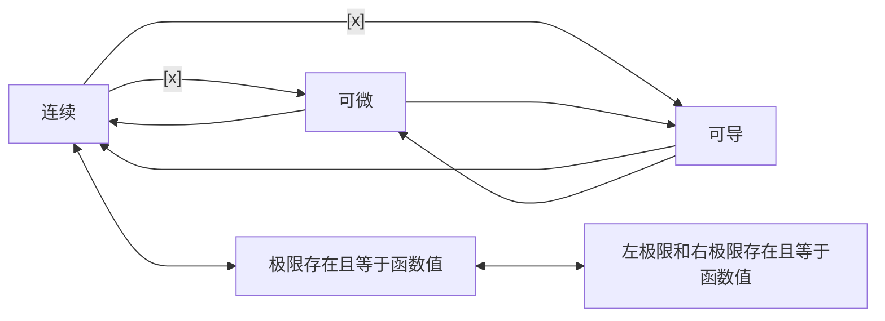

[toc]

## abstract

- 一元函数和二元函数的连续@可导@可微关系


## 一元函数可导和连续的关系👺

- 若函数$y=f(x)$在$x$处**可导**,则函数在该点处必**连续**
- 反之则不成立,即连续不一定可导(连续是可导的必要不充分条件)
  - 例如$y=f(x)=\sqrt[3]{x}$,其在$(-\infin,+\infin)$连续,但在$x=0$处却不可导,因为$\lim\limits_{h\to{0}}\frac{\sqrt[3]{h}-0}{h}$=$\lim\limits_{h\to{0}}1/h^{\frac{2}{3}}$=$+\infin$,即不可导,即$y=\sqrt[3]{x}$在$(0,0)$处有垂直于$x$轴的切线$x=0$

### 推论

- 导数存在的点一定有定义,即:$f'(x_0)$存在,则$f(x_0)$有定义
  - 因为可导一定连续,若$f(x)$在$x_0$处无定义,则一定是不连续的,这和可导必连续矛盾

### 证明

- 设函数$y=f(x)$在点$x$处可导,即$\lim\limits_{\Delta{x}\to{0}}\frac{\Delta{y}}{\Delta{x}}$=$f'(x)$存在,并由极限和无穷小的关系可知$\frac{\Delta{y}}{\Delta{x}}$=$f'(x)+\alpha$`(1)`(其中$\alpha\to{0(\Delta{x}\to{0})}$)

- 将式(1)变形(两边同时乘以$\Delta{x}$)得$\Delta{y}=f'(x)\Delta{x+\alpha\Delta{x}}$

- 从而$\Delta{y}\to{0}(\Delta{x}\to{0})$,因此$y=f(x)$在点$x$处连续

- 因此有$\lim\limits_{x\to{x_0}}f(x)=f(x_0)$,$f(x_0)$一定有定义(存在)


### 小结



- 一元函数中
  - 可导可以推出连续和可微
  - 可微可以推出连续和可导
  - 连续推不出可导,也推不出可微
- 点$P_0(x_0,y_0)$处连续推出点$P_0$处左右极限存在且都等于$f(x_0)$,即$f(x_0^{-})=f(x_0^{+})=f(x_0)$
- 典型的函数为$y=|x|$,在$(0,0)$处连续(极限存在且等于函数值),但却不可导(左右导数不相等)


## 多元函数情形

- ```mermaid
  flowchart LR
  	Differentiable[可微] --> Derivable["可导(可偏导)"] & Continue[连续]
  	Continue --"[x]"---> Differentiable & Derivable
  	Derivable--"[x]"---> Continue & Differentiable
  	d1c[一阶偏导存在且连续]-->Differentiable
  ```

### 多元微分相关理论

- [AM@二元函数全微分函数可导@可微@连续的关系](https://blog.csdn.net/xuchaoxin1375/article/details/128380947)


## 可导与可微在一元和多元函数情形下比较


- 对于一元函数**,可导**与**可微**互为**充要条件**

- 对于多元函数,**可偏导**(对各个自变量的偏导数都存在,有时简称**可导**)是可微的**必要不充分**条件;

  - 反之,**可微**是**可偏导**的**充分条件**

    

### 不同点

- 多元情形下可导与可微差异分析

- 可导推不出连续也推不出可微

  - 因为多元函数$z=f(x,y)$可导是指,一阶偏导存在,偏导数是利用**一元函数极限**定义的

    - $$
      f'_{x}(x_0,y_0)=\lim\limits_{x\to{x_0}}\frac{f(x,y_0)-f(x_0,y_0)}{x-x_0}
      \\
      f'_{y}(x_0,y_0)=\lim\limits_{y\to{y_0}}\frac{f(x_0,y)-f(x_0,y_0)}{y-y_0}
      $$

    - 其动点$(x,y_0),(x_0,y)$是沿着$x$轴或$y$轴方向趋近于$P_0(x_0,y_0)$,它只与点$(x_0,y_0)$邻域内的过$P_0$点且平行于两坐标轴的**十字方向**(仅两个方向)函数值有关

  - 多元函数的**连续**和**可微**都是用**重极限**定义的,以二元函数$z=f(x,y)$为例,

    - 二元函数连续定义:$\lim\limits_{(x,y)\to{(x_0,y_0)}}f(x,y)=f(x_0,y_0)$

    - 二元函数可微定义$f(x,y)-f(x_0,y_0)=A(x-x_0)+B(y-y_0)+o(\rho)$,即$\Delta{z}$=$A\Delta{x}+B\Delta{y}+o(\rho)$或$\mathrm{d}z|_{(x_0,y_0)}$=$A\Delta{x}+B\Delta{y}$

    - 都是动点$(x,y)$是以**任意方向**趋近于$(x_0,y_0)$,它与点$(x_0,y_0)$领域内函数值(所有方向)有关

### 共同点

- 无论是一元还是多元函数,可微是可以推出可导和连续的

### 小结

- 可微是很强的条件,无论是一元函数还是多元函数,都可以同时推出连续和可导
- 二元函数中,可微的**充分(不必要)**条件是**一阶偏导**都**存在且连续**
  - 但是可微无法推出二元函数的两个一阶偏导都存在且**连续**

### 例

- 已知$z(x,y)=\sqrt{|xy|}$,讨论其在$O(0,0)$处的来连续性,可偏导性,可微性

  - 连续性:由于$\lim\limits_{(x,y)\to{(0,0)}}\sqrt{|xy|}$=$0$=$z(0,0)$,所以$z(x,y)$在$O(0,0)$处连续
  - 偏导性:由于$\lim\limits_{\Delta{x}\to{0}}\frac{z(0+\Delta{x},0)-z(0,0)}{\Delta{x}}$=$\lim\limits_{\Delta{x}\to{0}}\frac{0}{\Delta{x}}=0$;所以$z_{x}(0,0)=0$;类似的可得$z_{y}(0,0)=0$
  - 可微性:这里采用定义法和发证法
    - 设$z(x,y)$在$O$点可微,又由$f_{x}(0,0)$=$f_{y}(0,0)$=$0$,可知$\Delta{z}=f_{x}(0,0)\Delta{x}$+$f_{y}(0,0)\Delta{y}$+$o(\rho)$ $(\rho\to{0})$,
      - 其中$\rho=\sqrt{(\Delta{x})^2+(\Delta{y})^2}$;此时$\lim\limits_{\rho\to{0}}\frac{\Delta{z}}{\rho}$=0`(1)`
      - $\rho\to{0}$和$(\Delta{x},\Delta{y})\to{(0,0)}$相当
    - 另一方面,考虑**路径1**:点$P'(\Delta{x},\Delta{y})$沿着直线$y=x$区域$(0,0)$
      - 此时$z_{x}(0,0)$处的极限$\lim\limits_{\rho\to{0}}\frac{\Delta{z}}{\rho}$=$\lim\limits_{\rho\to{0}}\frac{z(0+\Delta{x},0+\Delta{y})-z(0,0)}{\rho}$=$\lim\limits_{\rho\to{0}}\frac{\sqrt{|\Delta{x}\Delta{y}|}}{\rho}$=$\lim\limits_{\rho\to{0}}\frac{\sqrt{|\Delta{x}\Delta{y}|}}{\sqrt{(\Delta{x})^2+(\Delta{y})^2}}$=$\lim\limits_{\Delta{x}\to{0};\Delta{y}=\Delta{x}}\frac{\sqrt{|\Delta{x}\Delta{y}|}}{\sqrt{(\Delta{x})^2+(\Delta{y})^2}}$=$\lim\limits_{\Delta{x}\to{0}}\frac{\sqrt{(\Delta{x})^2}}{\sqrt{2(\Delta{x})^2}}$=$\frac{1}{\sqrt{2}}\neq{0}$`(2)`
    - (1)与(2)矛盾,这说明(1)不成立,假设也相应不成立,即$z(x,y)$在点$O$处不可微

  - 或者用公式(5-1)来说明不可微

