[toc]

本文是 Mermaid（mermaid.js）的综合参考，覆盖工作原理、通用语法、各图型语法、配置与主题、中文与特殊字符、导出工具链与排错流程，并附实战案例。

## Mermaid 是什么、如何工作

**Mermaid** 是一个基于 JavaScript/TypeScript 的开源（MIT 许可）图表库：用类 Markdown 的**纯文本**描述图，再渲染成 SVG。它于 2014 年由 Knut Sveidqvist 创建，核心价值是**图即代码**（Diagram as Code）：图表随文档一起进入 Git 做版本控制、可 diff、可评审、可由程序生成，避免截图类工具带来的**文档腐烂**（doc-rot，指文档与实际脱节后逐渐失效）。

渲染管线如下，理解它有助于排查"同一段代码在 A 平台能渲染、在 B 平台报错"：

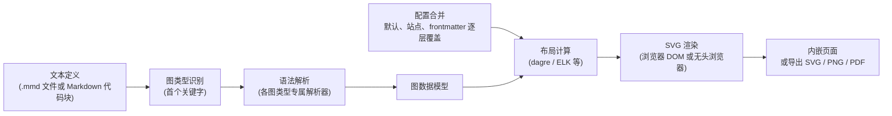

图解：

- **图类型识别**：代码块第一个有效关键字（frontmatter 之后）决定用哪个解析器，比如 `flowchart`、`sequenceDiagram`。**关键字拼错，整张图都会报错**。
- **布局计算**：自动布局，引擎可选。**v11.x 默认 dagre**；**v12.0.0 起默认 ELK 并内置于主包**（11.x 用 ELK 需额外加载 `@mermaid-js/layout-elk`），官方明确说这**改变了既有图的观感**，想保留旧排布要显式写 `layout: dagre`。你只能影响布局，**不能精确控制坐标**，这是 Mermaid 最大的取舍：省心，代价是可控性。
- **渲染依赖浏览器**：Mermaid 要靠浏览器 DOM 测量文字宽度。命令行工具 `mmdc` 实际上会驱动一个无头 Chrome（Puppeteer），**字体缺失会直接影响中文显示**（后文详述）。

此外还有三点贯穿全文的前提：

- **语法由内核决定，能力由宿主决定**。每个宿主（GitHub、Typora、Obsidian、VS Code 插件等）内置的 mermaid.js **版本不同**，新语法（如 v11 的新形状、`architecture-beta`）在旧宿主上会报错。
- **布局是自动的**。你描述的是"节点和关系"，不是坐标。
- **输出是 SVG**，文字默认以 HTML 标签（`foreignObject`，SVG 内嵌 HTML 的元素）嵌入，导出到不支持该特性的工具时会有兼容问题（见"配置、主题与外观"）。

## 在 Markdown 中书写的基本约定

**必须**用围栏代码块，语言标识符写**小写的 `mermaid`**。某些编辑器会自动把它首字母大写成 `Mermaid`，可能导致不被识别。

**推荐**一个代码块只放一张图；图的**第一行声明图类型**（如 `flowchart TD`）；可选地在最前面加 **frontmatter**（YAML 前置元数据块）设置标题与配置：

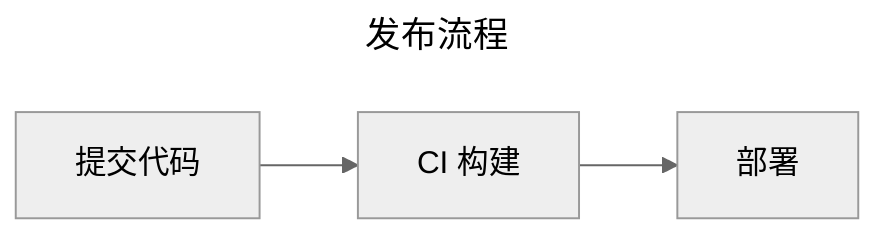

各占位符的含义：

| 位置                | 含义                  | 说明                                                         |
| ------------------- | --------------------- | ------------------------------------------------------------ |
| `---` 包裹的块      | **frontmatter**       | YAML 格式，必须在代码块最开头；`title` 是图标题，`config` 下为配置项 |
| `flowchart LR`      | **图类型声明 + 方向** | 第一个非 frontmatter、非注释的行                             |
| `%% 文本`           | **注释**              | 独占一行，以 `%%` 开头                                       |
| `%%{init: {...}}%%` | **指令**（directive） | 旧式单图配置方式，JSON 格式；**自 v10.5.0 起已弃用**，详见"配置、主题与外观" |

### 注释

- 注释以 `%%` 开头，**必须独占一行**；注释行与节点语句写在同一行会解析出错。
- **避免**在注释里写 `{}`，它可能被误识别成旧式指令。
- `%%{init ...}%%` 是指令，不是注释。

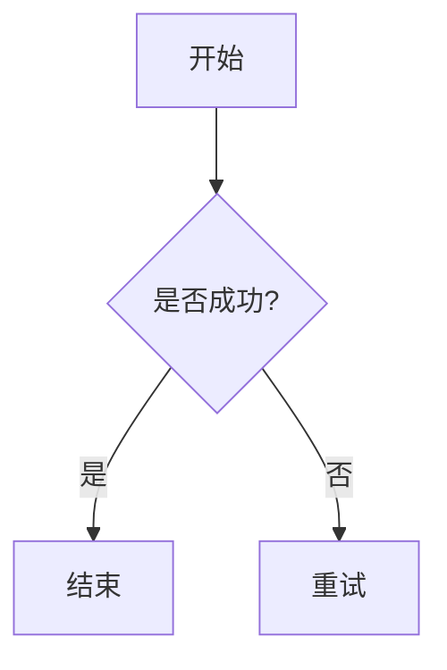

## 渲染环境与版本兼容

同一段 Mermaid 代码在不同平台上可能效果不同，甚至报错，原因是各平台内置的 Mermaid 版本不一样。

**必须**：用新语法前，先确认目标平台的版本。官方帮助中心给出的方法是**在代码块里单独写一行 `info` 并渲染**，就能看到当前版本：

```mermaid
info
```

| 平台                             | 支持方式                                       | 注意事项                                                     |
| -------------------------------- | ---------------------------------------------- | ------------------------------------------------------------ |
| **GitHub**                       | 原生（README、Issue、PR、Discussion、Wiki），2022-02 起 | 版本由 GitHub 决定且滞后；**交互（点击、提示框）不可用**；主题不可改（跟随用户亮暗模式）；单块代码约 50KB 上限；部分图标（如 `fa:fa-ban`）、超链接可能不可用；某些 emoji 与扩展 ASCII 字符会导致报错；beta 图型多不可用 |
| **GitLab**                       | 原生                                           | 通常比 GitHub 更接近最新版                                   |
| **Gitee**                        | 原生 Markdown 支持                             | 版本以实际渲染为准，建议只用稳定图型                         |
| **VS Code**                      | 内置预览**不**渲染，需扩展                     | 常用：*Markdown Preview Mermaid Support*、官方 *Mermaid Chart* 扩展（支持 `.mmd` 识别、语法高亮与预览）、*Markdown Preview Enhanced* |
| **Typora**                       | 内置（偏好设置中开启"图表"）                   | 随 Typora 版本更新内核；导出 PDF/HTML 会包含图；**付费软件** |
| **Obsidian**                     | 内置                                           | 随版本更新；社区插件可扩展编辑体验                           |
| **MkDocs（Material）**           | `pymdownx.superfences` 自定义 fence            | 官方文档有现成配置片段                                       |
| **Docusaurus**                   | `@docusaurus/theme-mermaid`                    | 需在配置中 `markdown.mermaid: true`                          |
| **VitePress**                    | 社区插件（如 `vitepress-plugin-mermaid`）      | 版本由项目依赖控制，**最可控**                               |
| **Hugo**                         | 需手动在模板引入 mermaid 脚本                  |                                                              |
| **Notion**                       | 代码块选择 Mermaid 语言                        |                                                              |
| **语雀 / 飞书 / CSDN 等国内平台** | 多数在编辑器中提供 Mermaid 或"文本绘图"入口    | 内核版本和支持的图型差异较大，**先用稳定图型试渲染**         |
| **mermaid.live**                 | 官方在线编辑器                                 | 始终是较新版本，**排错与验证语法的首选**，可导出 SVG/PNG     |

**推荐策略**：

- 以**目标宿主中最旧的那个**为基准选择语法。需要跨平台展示的文档（如 GitHub README）只用经典稳定语法。
- 自建文档站可以固定版本，放心用新特性。
- 对外交付的 PDF 或 PPT，用 `mmdc` 预渲染成 SVG/PNG，彻底消除版本差异。

## 图类型总览与选型

| 图类型        | 声明关键字                       | 典型用途                         | 成熟度 / 建议            |
| ------------- | -------------------------------- | -------------------------------- | ------------------------ |
| 流程图        | `flowchart`（`graph` 为旧同义词） | 业务流程、判断分支、系统结构框图 | **最常用**，优先掌握     |
| 时序图        | `sequenceDiagram`                | 接口调用、多服务交互、协议握手   | **常用**，语法稳定       |
| 状态图        | `stateDiagram-v2`                | 订单/工单/任务的状态机           | 常用，**用 `-v2` 不要用旧版** |
| 类图          | `classDiagram`                   | 面向对象设计、领域模型           | 常用                     |
| ER 图         | `erDiagram`                      | 数据库表关系                     | 常用                     |
| 甘特图        | `gantt`                          | 项目排期                         | 稳定                     |
| 饼图          | `pie`                            | 占比展示                         | 稳定，功能简单           |
| Git 图        | `gitGraph`                       | 分支策略说明                     | 稳定                     |
| 思维导图      | `mindmap`                        | 知识结构、头脑风暴               | 稳定                     |
| 时间线        | `timeline`                       | 里程碑叙事                       | 稳定                     |
| 用户旅程      | `journey`                        | 体验地图                         | 稳定，样式固定           |
| 象限图        | `quadrantChart`                  | 优先级矩阵、定位分析             | 稳定（v10+）             |
| 需求图        | `requirementDiagram`             | 需求追溯                         | 小众                     |
| C4            | `C4Context` 等                   | C4 架构模型                      | 实验性，语法较繁琐       |
| XY 图         | `xychart-beta`                   | 柱状/折线                        | beta                     |
| 桑基图        | `sankey-beta`                    | 流量/资金流向                    | beta                     |
| 块图          | `block-beta`                     | 手工控制布局的框图               | beta                     |
| 架构图        | `architecture-beta`              | 云服务/基础设施                  | beta（v11）              |
| 报文图        | `packet-beta`                    | 网络协议头字段                   | beta（v11）              |
| 看板          | `kanban`                         | 任务板                           | v11 新增                 |
| 雷达图 / 树图 | `radar-beta` / `treemap-beta`    | 多维对比 / 层级占比              | 较新，宿主支持少         |

带 `-beta` 的关键字表示语法**可能变化**；部分图在新版本里可能已去掉 beta 后缀并兼容旧写法，以所用版本的官方文档为准。**避免**在需要长期维护的跨平台文档里大量使用 beta 图。

日常文档中绝大多数需求集中在前五种。选型思路（判断链用图表示）：

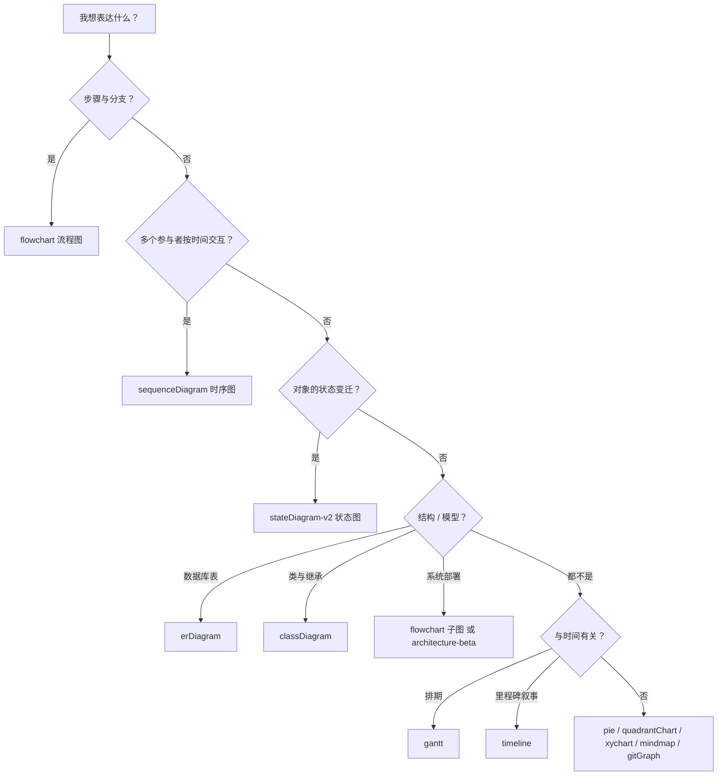

图解：先问"要表达什么"。**动态过程**看是"步骤与分支"还是"多方交互"；**静态结构**看是"数据库表""类与继承"还是"部署拓扑"——部署拓扑在兼容性优先时**推荐用 `flowchart` 加 `subgraph` 模拟**，而不是 `architecture-beta`。

## 通用语法规则与高频易错点

本节是**所有图型共享的规则**，也是绝大多数"渲染失败"的根源。

### ID 与标签分离、文本加引号

- `A["显示文本"]` 中，`A` 是**节点 ID**（用于连线引用），引号里的是**标签**（用于显示）。**推荐 ID 用简短的 ASCII 英文，标签写中文**。
- 标签中只要含有 `( ) [ ] { } / \ : ; # @ ! ? < > ' "` 之一，**就必须用双引号包裹**，如 `A["调用 f(x)"]`。
- 中文**全角标点**（如"（）""："）没有语法含义，不需要转义，这是中文用户的天然优势；善用全角标点可以减少转义。
- 同一个节点的形状和标签**只需定义一次**，之后用 ID 引用即可；多次定义时后面的覆盖前面的。

### 实体编码

Mermaid 有自己的转义写法 `#编码;`。编码是**十进制**数字，也支持 HTML 字符名称；**注意与 HTML 的 `&#35;` 写法不同**，Mermaid 不需要 `&` 前缀。

| 要显示的字符 | 实体码写法         | 说明                                     |
| ------------ | ------------------ | ---------------------------------------- |
| `"`          | `#quot;` 或 `#34;` | 引号内的引号                             |
| `;`          | `#59;`             | 时序图中 `;` 是语句分隔符，**必须**转义  |
| `#`          | `#35;`             | 实体码本身的前缀                         |
| `%`          | `#37;`             |                                          |
| `<` / `>`    | `#60;` / `#62;`    | 避免被当作 HTML 标签                     |
| `&`          | `#38;`             | 部分宿主会把 `&` 当成实体前缀            |
| `(` / `)`    | `#40;` / `#41;`    | 一般加引号即可，极端情况用实体码         |
| `♥`          | `#9829;`           | 任意 Unicode 字符均可按十进制编码，如 `#infin;` 显示 `∞` |

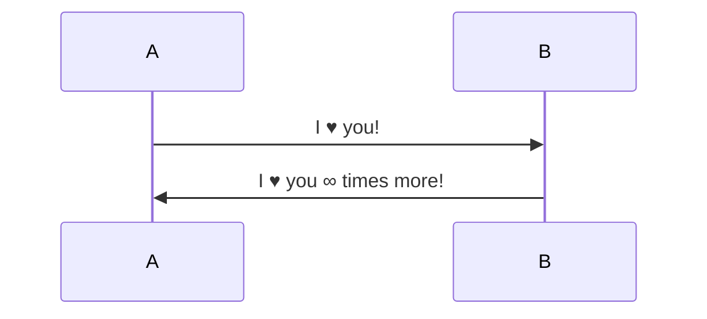

### 保留字与 ID 命名

- **禁止**用小写 `end` 作为节点 ID，它与 `subgraph ... end`、时序图 `alt ... end` 等分组结束关键字冲突。写成 `End`、`END`，或换 ID 并用引号标签：`stop_node["end"]`。若不得不在文本中使用 "end" 一词，用括号、引号或花括号封装，如 `（结束）`、`["end"]`。
- **避免**节点 ID 以小写 `o` 或 `x` 开头并紧跟在连线之后：`A---oB` 会被解析为圆头连线，`A---xB` 为叉头连线。用完整单词作 ID（`orderNode`），或在连线与 ID 之间加空格（`A --- oB`）。
- **避免**用 `default`、`class`、`style`、`click`、`graph`、`subgraph`、`direction` 等关键字作 ID。
- **推荐** ID 用 ASCII 字母数字下划线并语义化（`createOrder`），显示文本用中文放标签：`pay["创建支付单"]`。ID 直接用中文在多数新版本可行，但个别图类型或旧版本解析异常，且不利于后续 `class`/`click` 引用。

### 换行与 Markdown 字符串

- **换行推荐用 `<br>`**（`<br/>` 也可以），这是跨宿主最稳的方式；`\n` 仅在 Markdown 字符串里有效，普通标签里会原样显示。
- **Markdown 字符串**（v10.1.0+）：把文本写成反引号套在双引号内（`` "`...`" ``），可用 `**加粗**`、`*斜体*`，源码里的真实换行会保留，并支持自动换行。GitHub 内置版本曾因过旧而不支持，使用前确认宿主版本。

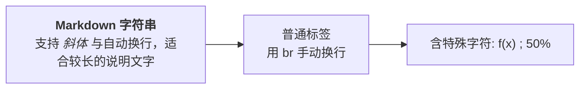

图解：节点"Markdown 字符串"用 Markdown 字符串写法，源码换行被保留；中间节点用 `<br>` 手动换行；右侧节点用引号包裹括号，并用 `#59;`、`#37;` 显示分号和百分号。

### 其他书写规则

- 一个语句一行；流程图允许用 `;` 在一行写多条语句，但不推荐。
- 节点名字边缘不要有多余的空格，**尤其是名字末尾的空格**（尤其 `subgraph` 子图名字），否则会导致节点引用不正确。
- 文件编码推荐 **UTF-8 无 BOM**；带 BOM 时首行关键字可能识别失败（经验性）。

### 规模上限

- 内核默认有**文本大小上限**（`maxTextSize`，默认约 5 万字符）和**边数上限**（`maxEdges`）；GitHub 对单个代码块另有约 50KB 上限。超大图请拆分。

## 流程图 flowchart（重点）

流程图最常用，规则也最多。

### 方向

`flowchart <方向>`：

| 方向值      | 含义                                       |
| ----------- | ------------------------------------------ |
| `TB` / `TD` | 从上到下（二者等价），默认                 |
| `BT`        | 从下到上                                   |
| `LR`        | 从左到右，**适合横向较宽的流程**           |
| `RL`        | 从右到左                                   |

**宽屏文档用 `LR`，长流程用 `TD`**。`graph` 是 `flowchart` 的同义旧关键字，**推荐用 `flowchart`**，新特性主要围绕它开发。

不同图型对同一段语法的解释不同：在同一种图中有效且正确的写法，换一种图型可能含义不同甚至渲染失败，跨图型复用代码前先确认语法归属。

### 经典节点形状

| 写法             | 形状           | 常规语义         |
| ---------------- | -------------- | ---------------- |
| `id["文本"]`     | 矩形           | 处理步骤         |
| `id("文本")`     | 圆角矩形       | 处理步骤（柔和） |
| `id(["文本"])`   | 体育场形       | 开始/结束        |
| `id[["文本"]]`   | 双边框矩形     | 子程序/子流程    |
| `id[("文本")]`   | 圆柱           | 数据库/存储      |
| `id(("文本"))`   | 圆形           | 连接点/事件      |
| `id((("文本")))` | 双圆           | 结束事件         |
| `id>"文本"]`     | 旗帜/不对称形  | 备注、输出       |
| `id{"文本"}`     | 菱形           | 判断             |
| `id{{"文本"}}`   | 六边形         | 准备/条件        |
| `id[/"文本"/]`   | 平行四边形     | 输入输出         |
| `id[\"文本"\]`   | 反向平行四边形 | 输入输出         |
| `id[/"文本"\]`   | 梯形           | 手工操作         |
| `id[\"文本"/]`   | 倒梯形         | 手工操作         |

### v11.3+ 扩展形状语法

v11.3.0 起新增通用形状语法，提供 30 余种形状（`cyl` 圆柱、`doc` 文档、`lin-cyl` 磁盘、`hourglass` 沙漏、`bolt` 闪电、`delay` 延迟、`manual-input` 手工输入等）：

形式：`ID@{ shape: 形状名, label: "标签" }`

| 字段    | 含义           | 说明                                                         |
| ------- | -------------- | ------------------------------------------------------------ |
| `ID`    | 节点 ID        | 和经典语法一样，用于连线引用                                 |
| `shape` | 形状短名或别名 | 比如 `rect`、`diamond`、`cyl`、`doc`、`cloud`、`hourglass`、`bolt`、`dbl-circ` |
| `label` | 显示文本       | 可选，省略时显示 ID                                          |

另有两种**特殊形状**：`icon`（使用已注册的图标包，参数包括 `icon`、`form`、`label`、`pos`、`h`）和 `image`（参数包括 `img`、`w`、`h` 等），也支持 `@{ img: "图片URL", w: 宽, h: 高 }`。

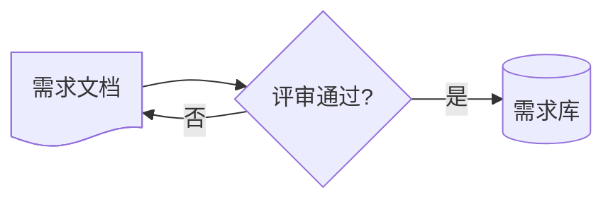

注意事项：

- 社区实践发现，**冒号后要加空格**：`{shape: cyl}` 能解析，`{shape:cyl}` 在部分版本会失败。
- 这套语法在 v11.3 以下的渲染器里**会直接报错**，用于 GitHub README 前先用 `info` 确认版本；面向公开仓库的 README **优先使用传统语法**。
- **推荐**先单独声明节点，再写连线，可读性更好。

### 连线

| 写法                                   | 效果                                              |
| -------------------------------------- | ------------------------------------------------- |
| `A --> B`                              | 实线箭头                                          |
| `A --- B`                              | 实线无箭头                                        |
| `A -.-> B`                             | 虚线箭头                                          |
| `A ==> B`                              | 粗线箭头                                          |
| `A ~~~ B`                              | **不可见连线**，仅用于影响布局（强制对齐）        |
| `A --o B` / `A --x B`                  | 圆头 / 叉头                                       |
| `A <--> B`                             | 双向箭头                                          |
| `A ---> B`（多一个 `-`）               | 更长的边（跨更多"层级"），用于微调布局            |
| `A -->\|文本\| B` 或 `A -- 文本 --> B` | 带标签的箭头（标签含特殊字符时用引号）            |
| `A --> B --> C`                        | 链式写法                                          |
| `A & B --> C` / `A --> B & C`          | 多对一 / 一对多                                   |

连线标签有两种等价写法：**管道写法** `A -->|标签| B` 更清晰、**推荐**；内联写法 `A -- 标签 --> B` 次之。

v11.4 前后可为边命名并做动画：`A e1@--> B` 然后 `e1@{ animate: true }`（具体版本待确认），跨平台文档**避免**使用。

### 子图 subgraph

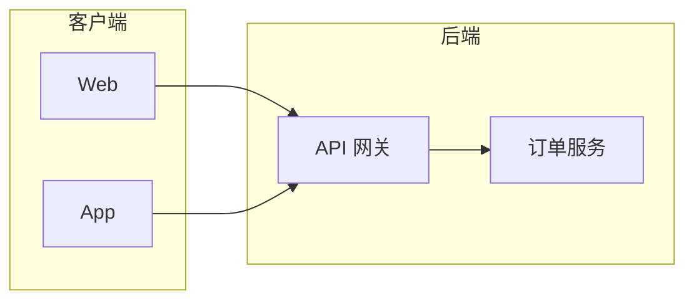

- `subgraph 子图ID ["显示标题"]` 开始，`end` 结束；子图可以嵌套。
- 可以把**子图 ID 当作节点**连线（`client --> backend`），实现子图之间的依赖：

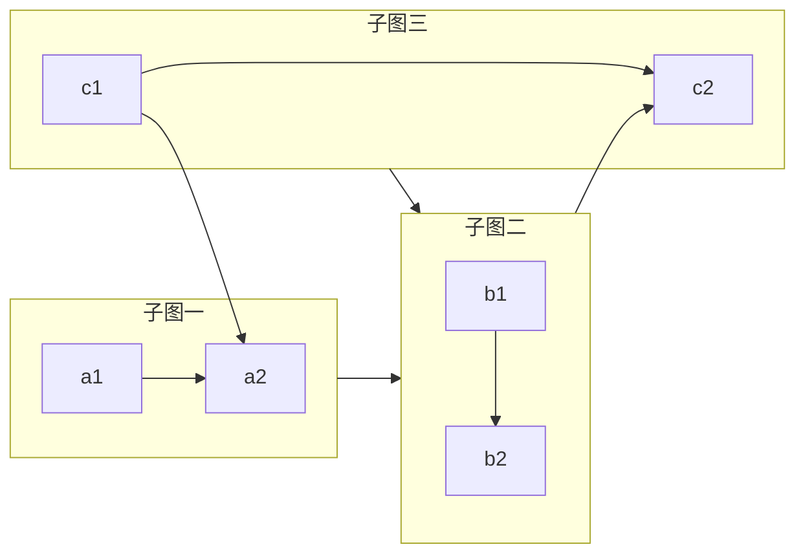

- 子图内可用 `direction` 单独设置方向，生效条件分三种情况（11.13.0 与 12.2.0 实测）：**子图与子图之间连线**（端点是子图 ID）时生效；**子图内的节点被外部节点直接连入或连出**时被忽略、子图继承父图方向（官方文档的已知限制）；**子图内节点之间没有任何连线**时，v11（dagre）里它只决定"同一个 rank 沿哪条轴排"——`TB` 让卡片横排、`LR` 让卡片竖排；v12 默认 ELK 则把这类节点一律纵向分层，基本不受 `direction` 影响。
- 最后一种最反直觉：无连线节点都落在同一个 rank，**与声明方向垂直**的那条轴才决定排列。要让几张互不相连的卡片稳定成列，用不可见连线钉住顺序：

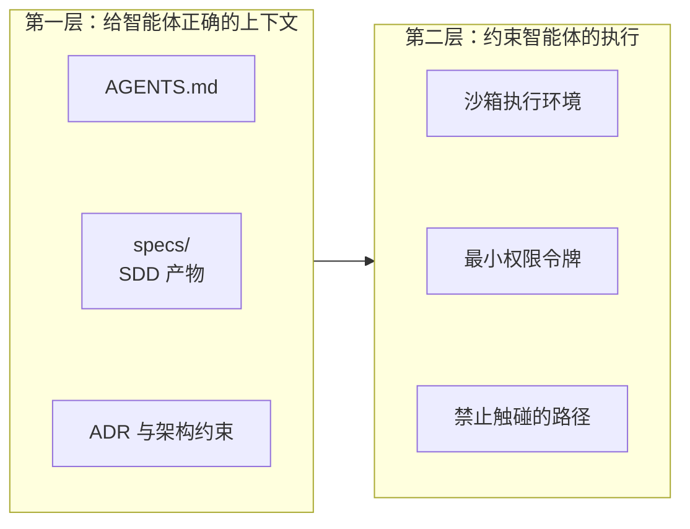

图解：两层的 `direction TB` 配上 `A1 ~~~ A2 ~~~ A3` 这样的不可见链后，卡片按声明顺序竖排；可见箭头仍只连两个子图。去掉这几条 `~~~` 后仍写 `direction TB`，卡片会变成横排——这正是"方向与排列相反"的那条规则。这种写法在 11.13.0 与 12.2.0 上结果一致。

- v12 起默认布局引擎由 dagre 换成 ELK，无连线节点不再共享 rank 而是纵向分层，同一段代码在 v11 与 v12 下观感可能变化；跨版本分发的图**别依赖引擎的默认摆放**。
- v11.17.0+ 支持用 `@{ view: collapsed }` 把子图折叠成一个节点。
- **避免**过度嵌套子图，dagre 布局容易出现连线交叉混乱。

### 布局控制与顺序微调

Mermaid 的布局由布局引擎自动计算（v11.x 默认 dagre，v12 默认 ELK），**代码书写顺序不等于最终位置**。同一份代码可能因以下因素产生不同布局：

- 宿主内置的 mermaid.js **引擎版本**不同（大版本间默认引擎也可能换，见上节）；
- 图**方向**（TB/LR）不同；
- 连线**两端节点的书写顺序**（端点调换）不同。

"拉长边""调换端点顺序"能改变布线，但效果依赖版本，属于经验性调整而非稳定契约。

**典型问题：无依赖子图的排列顺序不确定。** 当两个子图之间没有任何连线时，布局引擎把它们视为平级、断开的独立单元，左右顺序由紧凑算法与子图规模决定。下面的图会出现"方案二跑到方案一左边"：

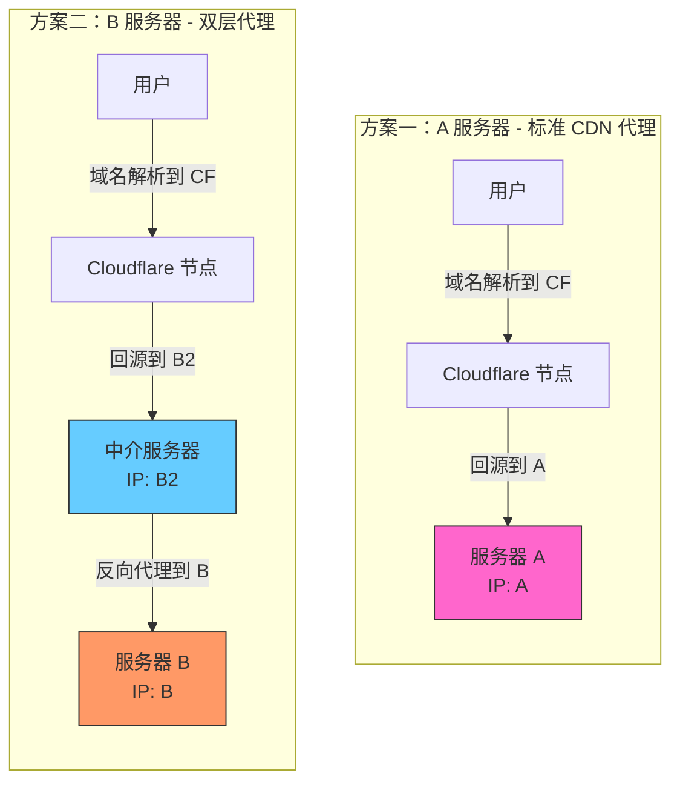

原因：

- 两个子图之间没有连线，缺乏先后关联，谁左谁右在很大程度上由内部节点数量与连线长度计算得出；
- "方案一"只有 2 个节点，"方案二"有 3 个节点、链路更长结构更高，引擎为让整体画布趋近合理宽高比，会把更复杂的子图排在左侧起始位置。

修复：用**不可见连线**建立顺序约束（`S1 ~~~ S2` 强制"方案一"在"方案二"左侧）：

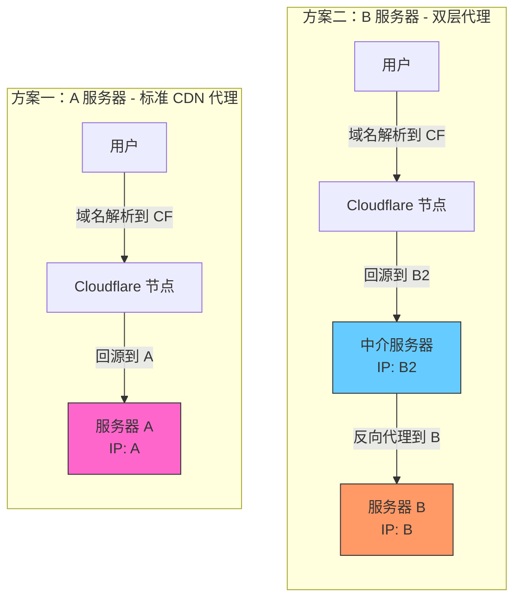

常用微调手法汇总：

| 手法           | 写法               | 效果与限制                                     |
| -------------- | ------------------ | ---------------------------------------------- |
| 不可见连线     | `S1 ~~~ S2`        | 强制两个子图/节点的相对顺序；不渲染线条        |
| 加长边         | `A ---> B`         | 让目标跨更多层级，拉开间距                     |
| 子图 direction | `direction TB`     | 决定 rank 方向；子图被外部节点连入/连出时失效；层内无连线时同 rank 节点沿垂直轴排列（`TB` 横排、`LR` 竖排） |
| 端点顺序调整   | `e---c` 改 `c---e` | 影响布线走向，效果依版本而异                   |

### 样式与交互

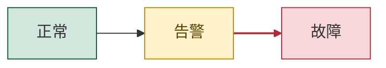

| 语法                           | 作用                                                | 示例                                        |
| ------------------------------ | --------------------------------------------------- | ------------------------------------------- |
| `classDef 类名 样式`           | 定义可复用样式类                                    | `classDef warn fill:#fff3cd,stroke:#d39e00` |
| `classDef default 样式`        | 修改所有节点的默认样式                              | `classDef default fill:#f8f9fa`             |
| `class ID1,ID2 类名`           | 应用样式类                                          | `class fix,rollback warn`                   |
| `ID:::类名`                    | 定义节点时内联应用                                  | `A["告警"]:::warn`                          |
| `style ID 样式`                | 单个节点的一次性样式                                | `style A stroke-width:3px`                  |
| `linkStyle 序号 样式`          | 连线样式，序号从 0 起按定义顺序计数                 | `linkStyle 0 stroke:#d33`                   |
| `linkStyle default 样式`       | 影响全部连线                                        |                                             |
| `click ID "URL" "提示" _blank` | 点击跳转（新标签页）                                | 依赖 `securityLevel: loose`，GitHub 等平台不支持 |

**推荐**用 `classDef` 加 `class` 统一管理语义样式（危险、成功、外部系统等），**避免**到处写 `style`。`linkStyle` 依赖连线顺序，图一改序号就错位，**尽量少用**。

**颜色写死十六进制值的隐患**：在暗色主题下可能不可读。能用主题变量（见"配置、主题与外观"）就不要逐个 `style`；颜色不要承担唯一的信息传达功能。

### 流程图陷阱

- **标签里有括号却没加引号**：`A[调用f(x)]` 会解析失败，应写成 `A["调用f(x)"]`。
- **节点 ID 带中文**：大多数版本可以用，但**推荐 ASCII ID 加中文标签**，降低各类解析器的风险。
- **节点名末尾空格**：会导致节点引用不正确（见"通用语法规则"）。
- **小写 `end`、`o`/`x` 开头的 ID**：见"保留字与 ID 命名"。

### 示例：CI/CD 发布流程

**场景**：团队用 GitHub Actions 做持续集成。代码推送后先检查，通过后构建镜像、推送到镜像仓库，再部署到预发环境做冒烟测试，最后发布到生产或回滚。

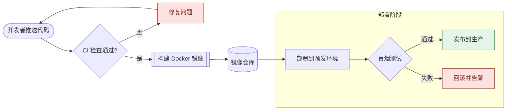

图解：

- 起点用体育场形表示，"CI 检查通过?"与"冒烟测试"两处判断用菱形，"构建 Docker 镜像"用子程序形表示"调用一段构建流程"，"镜像仓库"用圆柱表示存储。
- "修复问题"连回起点形成**回环**，表达"修复后重新推送"。
- 子图"部署阶段"内写了 `direction TB`，但由于外部节点"镜像仓库"直接连到了子图内的"部署到预发环境"，**这个方向设置会被忽略**，子图沿用全局 `LR`——这正好演示了前面的规则。想让它生效，可改成让连线指向子图本身（`reg --> deploy`）。
- `classDef` 定义了 `danger` 和 `ok` 两个语义样式，失败路径和成功终点一眼可辨。

## 时序图 sequenceDiagram

**时序图**（Sequence Diagram）是 UML 中描述**对象之间按时间顺序交互**的图表，展示参与者（Participants）如何通过消息传递协作完成某个功能。核心价值：

- 清晰描述系统中**谁**在**何时**向**谁**发送了**什么**消息；
- 帮助理解复杂业务流程的调用链路；
- 是接口设计、系统架构讨论的高效沟通工具。

### 时序图与流程图的分工

**流程图**回答的是"事情**怎么做**"，描述**步骤与逻辑**；**时序图**回答的是"**谁**在**什么时候**跟**谁**说了**什么**"，描述**交互与协作**。

用同一个场景——**用户下单**——分别用两种图表达。流程图视角（关注步骤逻辑）：

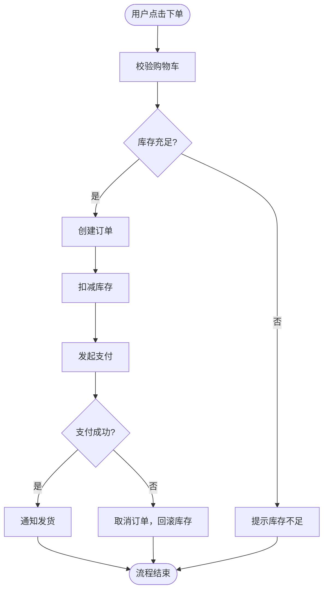

时序图视角（关注交互协作）：

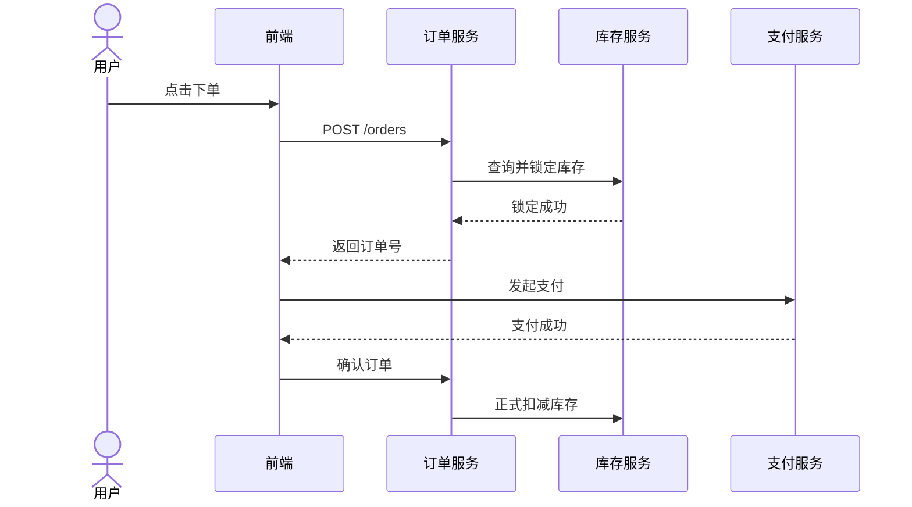

两张图描述的是**同一个业务**，但揭示的信息完全不同：流程图让你看清决策分支，时序图让你看清服务间的调用关系。

核心维度对比：

| 对比维度     | 流程图               | 时序图                         |
| ------------ | -------------------- | ------------------------------ |
| **核心问题** | 怎么做？逻辑是什么？ | 谁和谁交互？顺序是什么？       |
| **时间轴**   | 无显式时间轴         | **从上到下**是明确的时间顺序   |
| **参与者**   | 不强调"谁"在执行     | 明确区分每个参与方             |
| **边界**     | 描述单一流程内部     | 描述多个系统/角色之间          |
| **分支表达** | 强，菱形判断框直观   | 弱，`alt`/`opt` 嵌套后可读性下降 |
| **并发表达** | 较弱                 | 强，`par` 块天然支持           |
| **消息内容** | 不关注               | 可以标注具体的消息/参数        |
| **调用方向** | 单向流动             | 双向（请求+响应）自然呈现      |

擅长场景对比：

| 场景                         | 首选     | 原因                               |
| ---------------------------- | -------- | ---------------------------------- |
| 业务审批流程（请假、报销）   | 流程图   | 重点是步骤和判断条件               |
| 算法逻辑、代码执行路径       | 流程图   | 重点是分支和循环                   |
| 前后端接口联调               | 时序图   | 重点是谁调用谁、参数和响应         |
| 微服务调用链路分析           | 时序图   | 重点是服务间依赖和顺序             |
| 用户操作 SOP（标准作业流程） | 流程图   | 重点是操作步骤                     |
| 登录认证、OAuth 流程         | 时序图   | 涉及多方（客户端、服务端、第三方） |
| 异常处理与错误恢复           | 两者结合 | 流程图理清分支，时序图理清责任方   |
| 数据库事务流程               | 时序图   | 需要体现应用与数据库的来回交互     |

### 基础结构

最简单的序列图由参与者声明和消息构成：

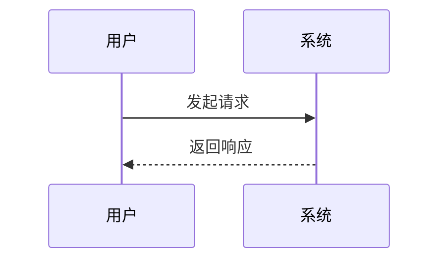

- 第一行声明图表类型 `sequenceDiagram`；
- 可选地声明参与者（`participant` 或 `actor`）；
- 之后按时间从上到下书写消息交互。

### 参与者

| 语法                                  | 含义                                               |
| ------------------------------------- | -------------------------------------------------- |
| `participant A`                       | 普通参与者（矩形框）                               |
| `actor U`                             | 人类角色（小人图标），适合表示人                   |
| `participant API as 订单服务`         | `API` 是 ID，`订单服务` 是显示名                   |
| `box 颜色 分组名` 至 `end`            | 把多个参与者框成一组，比如区分"内部系统"和"第三方" |
| `create participant X` / `destroy X`  | 在流程中途创建或销毁参与者（v10.3+）               |

- 参与者名含空格时**必须**用别名：`participant S as API Server`。
- **声明顺序就是从左到右的排列顺序**。**最佳实践**是在图的开头统一显式声明全部参与者，明确控制布局顺序，避免按首次出现顺序排布导致混乱。

### 消息箭头

消息格式：`发送方 箭头 接收方: 消息文本`。

| 语法               | 线型 | 箭头     | 语义                            |
| ------------------ | ---- | -------- | ------------------------------- |
| `A->B`             | 实线 | 无箭头   | 简单连接（少用）                |
| `A-->B`            | 虚线 | 无箭头   | 简单返回（少用）                |
| `A->>B`            | 实线 | 实心箭头 | **同步调用/请求**               |
| `A-->>B`           | 虚线 | 实心箭头 | **异步响应/返回值**             |
| `A-xB` / `A--xB`   | 实/虚 | ×箭头    | **消息丢失/失败**               |
| `A-)B` / `A--)B`   | 实/虚 | 开放箭头 | **异步消息**（fire-and-forget） |
| `<<->>` / `<<-->>` | 双向 | 双箭头   | 双向通信（v11+）                |

**实际使用建议**：日常使用中，`->>` 表示请求/调用，`-->>` 表示响应/返回，这两种组合覆盖 90% 的场景；`-)` 用于消息队列、事件推送等异步场景；严格遵循这一惯例，读者会形成稳定的阅读预期。

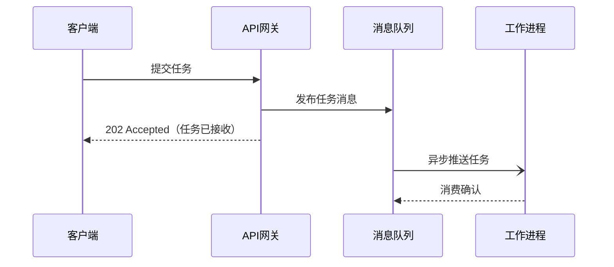

### 自调用消息

参与者可以向自身发送消息，表示内部处理逻辑：

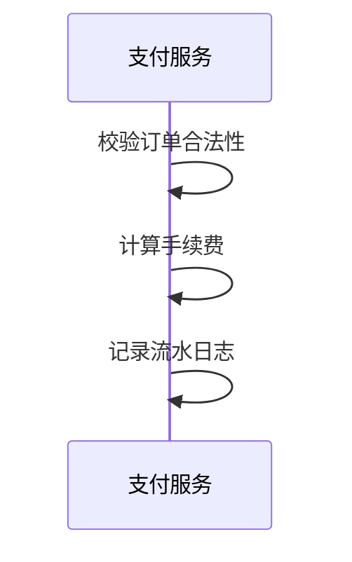

**滥用自调用**会使图变得复杂；自调用应只表示关键内部步骤。

### 激活框

激活框（Activation Bar）是参与者生命线上的**矩形细条**，表示该参与者**正在处理消息、处于活跃状态**。**必须成对**，否则报错。

方式一：在消息后加 `+` / `-`（`+` 激活接收方，`-` 结束激活）：

```mermaid
sequenceDiagram
    客户端->>+服务端: 请求数据
    服务端->>+数据库: 执行查询
    数据库-->>-服务端: 返回结果
    服务端-->>-客户端: 响应数据
```

方式二：用 `activate 服务端` 与 `deactivate 服务端` 两条语句手动标注。

激活框可以嵌套（上面的例子中"服务端"在等待"数据库"期间保持激活），直观展示调用栈深度，是展示同步阻塞调用链的利器。

### 注释（Note）

| 语法              | 位置             |
| ----------------- | ---------------- |
| `Note left of X`  | X 的左侧         |
| `Note right of X` | X 的右侧         |
| `Note over X`     | 跨越 X 正上方    |
| `Note over X, Y`  | 跨越 X 和 Y 之间 |

```mermaid
sequenceDiagram
    participant 客户端
    participant 服务端

    Note over 客户端, 服务端: TLS 握手阶段
    客户端->>服务端: ClientHello
    Note left of 客户端: C/S 时序
    Note right of 服务端: 服务端选择加密套件
    服务端-->>客户端: ServerHello + 证书
    客户端->>服务端: 密钥交换
    Note over 客户端, 服务端: 加密通信开始
```

### 控制结构

| 关键字                              | 用途                       |
| ----------------------------------- | -------------------------- |
| `loop 条件` 至 `end`                | 循环                       |
| `alt 条件` / `else` 至 `end`        | 条件分支（互斥，if/else）  |
| `opt 条件` 至 `end`                 | 可选流程（只有 if）        |
| `par 描述` / `and` 至 `end`         | 并行执行                   |
| `critical 描述` / `option` 至 `end` | 临界区（带可选异常处理）   |
| `break 描述` 至 `end`               | 中断当前流程               |
| `rect rgb(r, g, b)` 至 `end`        | 背景高亮区域（不影响逻辑） |

控制块可嵌套，都以 `end` 结束。逐个示例：

`loop` — 循环：

```mermaid
sequenceDiagram
    participant 客户端
    participant 服务端

    loop 每隔30秒心跳检测
        客户端->>服务端: ping
        服务端-->>客户端: pong
    end
```

`alt` / `else` — 互斥分支：

```mermaid
sequenceDiagram
    actor 用户
    participant 认证服务

    用户->>认证服务: 提交用户名+密码

    alt 密码正确
        认证服务-->>用户: 返回 Token
    else 密码错误且未超限
        认证服务-->>用户: 提示密码错误
    else 连续失败超过5次
        认证服务-->>用户: 账号锁定30分钟
    end
```

`opt` — 可选流程（满足条件才执行）：

```mermaid
sequenceDiagram
    participant 订单服务
    participant 通知服务

    订单服务->>订单服务: 创建订单
    opt 用户开启了短信通知
        订单服务->>通知服务: 发送下单成功短信
    end
```

`par` / `and` — 并行：

```mermaid
sequenceDiagram
    participant 主服务
    participant 邮件服务
    participant 短信服务
    participant 推送服务

    主服务->>主服务: 订单完成

    par 并行通知
        主服务->>邮件服务: 发送邮件
    and
        主服务->>短信服务: 发送短信
    and
        主服务->>推送服务: App推送
    end
```

`break` — 中断，常用于错误处理：

```mermaid
sequenceDiagram
    participant 客户端
    participant 服务端

    客户端->>服务端: 请求接口

    break 请求频率超过限制
        服务端-->>客户端: 429 Too Many Requests
    end

    服务端-->>客户端: 200 正常响应
```

### 自动编号 autonumber

在 `sequenceDiagram` 声明下方加入 `autonumber`，自动为每条消息添加序号，便于文档引用（"第 7 步的签名校验"）。技术文档、API 设计说明中**推荐开启**。

### 时序图文本中的特殊字符

- **分号 `;` 是语句分隔符**，消息文本里的分号**必须**写成 `#59;`；`#` 写成 `#35;`。小技巧：先统一写普通 `;`，写完后统一替换为 `#59;`。
- 消息文本中**第一个 `:` 之后的内容都是文本**，因此文本里再出现 `:` 没有问题。
- 消息文本里的换行用 `<br/>`。
- 时序图**不支持**流程图的 `classDef` 那套样式，外观主要靠主题变量控制。

```mermaid
sequenceDiagram
    participant B as 浏览器
    participant S as 服务器

    B->>S: GET /login (首次请求，无 Cookie)
    S-->>B: 200 OK + Set-Cookie: session=abc123#59; HttpOnly#59; Secure
    Note over B: 浏览器保存 Cookie
    B->>S: GET /dashboard (自动携带 Cookie: session=abc123)
    S-->>B: 200 OK (识别用户，返回个人数据)
```

图解：响应头里的两个分号都用 `#59;` 转义；若直接写 `;`，后半句会被当成新语句导致报错。

### 综合实战：订单支付与异步回调

**场景**：用户在电商前端点击支付。订单服务请求支付网关创建支付单并返回收银台链接，支付结果通过**异步回调**通知；超时没支付则由定时任务关闭订单。

```mermaid
sequenceDiagram
    autonumber
    actor U as 用户
    participant FE as 前端
    box rgb(232, 240, 254) 内部系统
        participant API as 订单服务
        participant DB as 数据库
    end
    participant PAY as 支付网关
    U->>FE: 点击"立即支付"
    FE->>+API: POST /orders/{id}/pay
    API->>+PAY: 创建支付单
    PAY-->>-API: 返回收银台链接
    API-->>-FE: 200 OK (pay_url)
    FE->>U: 跳转收银台
    alt 用户完成支付
        PAY-)API: 异步回调 notify
        API->>API: 校验签名#59; 幂等检查
        API->>DB: 更新订单为已支付
        API--)PAY: 返回 success
    else 支付超时
        API->>DB: 定时任务关闭订单
    end
    Note over FE,API: 前端轮询订单状态<br>直到进入终态
```

图解：

- `autonumber` 给每条消息编号，方便评审时引用。
- `box` 把订单服务和数据库框成"内部系统"，和外部支付网关区分开。
- `FE->>+API` 与 `API-->>-FE` 成对出现，画出订单服务的处理区间；嵌套的 `+`/`-` 表示同步调用支付网关期间订单服务仍在处理中。
- 回调用 `-)` 表示**异步**，和同步请求 `->>` 在语义上区分开。

### 综合实战：用户登录完整流程

以下示例综合运用 `rect` 视觉分层、嵌套 `alt`/`opt`、激活框与自调用：

```mermaid
sequenceDiagram
    autonumber
    actor U as 用户
    participant F as 前端 SPA
    participant G as API 网关
    participant A as 认证服务
    participant D as 用户数据库
    participant C as Redis 缓存

    U->>F: 输入账号密码，点击登录

    rect rgb(240, 248, 255)
        Note over G, A: 认证流程
        F->>+G: POST /auth/login
        G->>+A: 转发登录请求

        A->>C: 查询失败次数
        C-->>A: 返回计数

        alt 失败次数 >= 5
            A-->>G: 403 账号已锁定
            G-->>F: 403
            F-->>U: 提示：账号已锁定，请30分钟后重试
        else 正常流程
            A->>+D: SELECT * FROM users WHERE email=?
            D-->>-A: 用户记录

            opt 用户不存在
                A-->>G: 401 用户名或密码错误
            end

            A->>A: bcrypt 校验密码

            alt 密码错误
                A->>C: 失败次数 +1，设置TTL
                A-->>G: 401 用户名或密码错误
                G-->>F: 401
                F-->>U: 提示：账号或密码错误
            else 密码正确
                A->>C: 清除失败计数
                A->>A: 生成 JWT（Access + Refresh Token）
                A-->>-G: 200 + Token Pair
                G-->>-F: 200 + Token Pair
                F->>F: 存储 Token 至 localStorage
                F-->>U: 跳转至首页
            end
        end
    end
```

### 常见错误与最佳实践

| 错误                        | 说明                                  | 正确做法                                  |
| --------------------------- | ------------------------------------- | ----------------------------------------- |
| 参与者名含空格未加别名      | `participant API Server` 会解析出错   | 改用别名：`participant S as API Server`   |
| 消息文本含分号未转义        | 后半句被当成新语句                    | 用 `#59;`                                 |
| 嵌套块未正确关闭            | `alt` 缺少 `end`                      | 每个控制块都必须有对应的 `end`            |
| 激活符号不成对              | `+`/`-` 数量不匹配报错                | `activate` 与 `deactivate` 严格成对       |
| 滥用自调用                  | 大量自调用使图变得复杂                | 自调用只表示关键内部步骤                  |
| 过度细化                    | 把所有代码逻辑都画进去                | 聚焦**关键交互**，细节用文字补充          |

最佳实践：

- **一张序列图只描述一个场景或一个用例**，不要面面俱到；参与者较多时图会很宽，**控制在 6 个以内**，否则考虑拆图。
- **统一声明参与者**：在图的顶部声明所有角色，控制从左到右的排列顺序。
- **善用 `autonumber`**：作为技术文档配图时开启自动编号，方便正文引用特定步骤。
- **用 `rect` 做视觉分层**：流程较长时，用 `rect` 将相关步骤归组，提升可读性。
- **虚线表示返回**：`->>` 请求、`-->>` 响应的惯例保持一致。
- **别名保持简短**：别名建议用 1-2 个大写字母，如 `U`、`FE`、`DB`，减少图源码的视觉噪音。

## 状态图 stateDiagram-v2

**必须**用 `stateDiagram-v2`，不要用旧版 `stateDiagram`。

| 语法                            | 含义                                  |
| ------------------------------- | ------------------------------------- |
| `[*] --> S`                     | 初始状态指向 S（`[*]` 在箭头右侧则是终止） |
| `S1 --> S2: 事件`               | 带事件标签的转换                      |
| `state "显示名" as S`           | **ID 与显示名分离**，推荐中文场景使用 |
| `S : 描述`                      | 单行为状态加描述                      |
| `state S { ... }`               | 复合状态（嵌套子状态机）              |
| `--`                            | 写在复合状态内部，分隔并发区域        |
| `state C <<choice>>`            | 选择节点（条件分支）                  |
| `state F <<fork>>` / `<<join>>` | 并发分叉与汇合                        |
| `note right of S` 至 `end note` | 多行注释；也可单行 `note left of X: 文本` |
| `direction LR`                  | 图方向                                |

### 示例：订单状态机

**场景**：电商订单从创建到完成或关闭的完整生命周期，包括超时关闭和退款分支。

```mermaid
stateDiagram-v2
    state "待支付" as Pending
    state "已支付" as Paid
    state "已发货" as Shipped
    state "已完成" as Done
    state "退款中" as Refunding
    state "已关闭" as Closed
    [*] --> Pending: 创建订单
    Pending --> Paid: 支付回调成功
    Pending --> Closed: 超时或用户取消
    Paid --> Shipped: 仓库出库
    Paid --> Refunding: 申请退款
    Refunding --> Closed: 退款成功
    Shipped --> Done: 确认收货
    Done --> [*]
    Closed --> [*]
    note right of Pending
        超时时间 30 分钟
        由定时任务扫描关闭
    end note
```

图解：所有状态都用 `state "中文名" as 英文ID` 声明，转换语句里只写英文 ID。这样**既能显示中文，又避免中文 ID 在某些解析器版本里出问题**，代码中的 ID 还能与后端枚举（`PENDING`、`PAID`）对应。"已关闭"有两个入口（超时取消、退款成功），图里一目了然。

## 类图 classDiagram

### 成员与可见性

| 符号              | 含义                                                         |
| ----------------- | ------------------------------------------------------------ |
| `+`               | public（公有）                                               |
| `-`               | private（私有）                                              |
| `#`               | protected（受保护）                                          |
| `~`               | package / internal（包级）                                   |
| 方法名后缀 `*`    | 抽象方法                                                     |
| 方法名后缀 `$`    | 静态成员                                                     |
| `List~OrderItem~` | **泛型**，用 `~` 代替尖括号（渲染为 `List<OrderItem>`）      |
| `<<interface>>`   | 类注解，也可写 `<<abstract>>`、`<<enumeration>>`、`<<service>>` |

方法以 `()` 区分，返回类型写在方法之后（如 `+total() Decimal`）。

### 关系

关系符号含 `|` 字符，为避免与表格语法冲突，用列表说明：

- `A <|-- B`：**继承**（Inheritance），B 继承 A。
- `A <|.. B`：**实现**（Realization），B 实现接口 A。
- `A *-- B`：**组合**（Composition），B 的生命周期依附于 A。
- `A o-- B`：**聚合**（Aggregation），B 可以独立存在。
- `A --> B`：**关联**（Association）。
- `A ..> B`：**依赖**（Dependency），比如方法参数里用到了 B。
- `A -- B` / `A .. B`：实线或虚线连接，无特定语义。
- **多重性**（Cardinality）：写在类名两侧的引号里，如 `Order "1" *-- "1..*" OrderItem`。
- **关系标签**：末尾加 `: 文本`。

### 示例：支付渠道的策略模式

**场景**：订单系统要接入支付宝、微信支付等多个渠道。用**策略模式**定义统一的 `PaymentChannel` 接口，订单由多个订单项组合而成。

```mermaid
classDiagram
    direction LR
    class PaymentChannel {
        <<interface>>
        +pay(order Order) PayResult
        +refund(orderId String) bool
    }
    class Alipay {
        -String appId
        +pay(order Order) PayResult
        +refund(orderId String) bool
    }
    class WechatPay {
        -String mchId
        +pay(order Order) PayResult
        +refund(orderId String) bool
    }
    class Order {
        +String id
        +Decimal amount
        +List~OrderItem~ items
        +total() Decimal
    }
    class OrderItem {
        +String sku
        +int quantity
    }
    PaymentChannel <|.. Alipay
    PaymentChannel <|.. WechatPay
    Order "1" *-- "1..*" OrderItem : 包含
    PaymentChannel ..> Order : 依赖
```

图解：`<<interface>>` 标明接口，两个渠道用虚线空心三角（`<|..`）表示**实现**；订单和订单项是**组合**关系（实心菱形），多重性是"1 对 1..*"；接口方法以 `Order` 为参数，所以是**依赖**（虚线箭头）。

补充规则：

- 类名不能含空格；需要中文显示名时用 `class Foo["显示名"]`。
- 支持 `namespace 名 { ... }` 分组。

## 实体关系图 erDiagram

### 关系语法

形式：`实体A 左基数--右基数 实体B : "关系描述"`。基数标记含 `|`，同样用列表说明（读法是"从这一端看另一端"）：

- `|o` 或 `o|`：零或一（Zero or one）。
- `||`：恰好一（Exactly one）。
- `}o` 或 `o{`：零或多（Zero or more）。
- `}|` 或 `|{`：一或多（One or more）。
- 中间用 `--` 表示**识别关系**（Identifying，实线，弱实体）；用 `..` 表示**非识别关系**（Non-identifying，虚线）。
- 例如 `USER ||--o{ ORDERS : "下单"` 读作：一个用户下零到多个订单，一个订单恰好属于一个用户。

### 属性

形式：`类型 字段名 键 "注释"`

| 部分     | 含义                                                 |
| -------- | ---------------------------------------------------- |
| `类型`   | 比如 `bigint`、`varchar`，Mermaid 不做校验，只是展示 |
| `字段名` | 列名                                                 |
| `键`     | `PK`、`FK`、`UK`，可以组合，比如 `PK, FK`            |
| `"注释"` | 可选，**中文说明推荐放在这里**                       |

### 示例：订单库表设计

```mermaid
erDiagram
    USERS ||--o{ ORDERS : "下单"
    ORDERS ||--|{ ORDER_ITEMS : "包含"
    PRODUCTS ||--o{ ORDER_ITEMS : "被购买"
    ORDERS ||--o| PAYMENTS : "对应"
    USERS {
        bigint id PK
        varchar phone UK "手机号"
        datetime created_at
    }
    ORDERS {
        bigint id PK
        bigint user_id FK
        decimal amount "订单金额"
        varchar status "PENDING / PAID / CLOSED"
    }
    ORDER_ITEMS {
        bigint id PK
        bigint order_id FK
        bigint product_id FK
        int quantity
    }
    PRODUCTS {
        bigint id PK
        varchar name
        decimal price
    }
    PAYMENTS {
        bigint id PK
        bigint order_id FK, UK
        varchar channel "alipay / wechat"
    }
```

图解：`ORDERS ||--o| PAYMENTS` 表示一个订单**至多**一条支付记录，对应 `PAYMENTS` 表 `order_id` 字段上的 `FK, UK` 约束。`status` 的注释列出取值，正好和前面状态图的英文 ID 呼应。实体名用全大写是 ER 图的常见惯例，也能避开 `ORDER` 这类 SQL 保留字。

## 甘特图 gantt

| 指令                    | 含义                                |
| ----------------------- | ----------------------------------- |
| `title`                 | 标题                                |
| `dateFormat YYYY-MM-DD` | **输入**日期的解析格式（day.js 语法） |
| `axisFormat %m-%d`      | 坐标轴的**显示**格式（d3 时间格式） |
| `excludes weekends`     | 排除周末，也可以列出具体日期        |
| `section 名称`          | 分组                                |
| `todayMarker off`       | 关闭"今天"标记线                    |
| `tickInterval 1week`    | 控制坐标轴刻度间隔                  |

任务行形式：`任务名 :标签, 任务ID, 开始, 时长或结束`

| 字段         | 含义                               | 取值                                                                 |
| ------------ | ---------------------------------- | -------------------------------------------------------------------- |
| `标签`       | 可选，可组合                       | `done` 已完成、`active` 进行中、`crit` 关键路径、`milestone` 里程碑 |
| `任务ID`     | 可选，供其他任务用 `after ID` 引用 | 如 `design`                                                          |
| `开始`       | 日期或依赖                         | `2025-03-03` 或 `after design`（也支持 `until`）                     |
| `时长或结束` | 持续时间或结束日期                 | `3d`、`2w`、`4h` 或 `2025-03-10`                                     |

**注意**：`dateFormat` 管输入，`axisFormat` 管输出，两者**不要混淆**。任务名含 `:` 时要加引号。

```mermaid
gantt
    title 订单模块 v2 迭代计划
    dateFormat YYYY-MM-DD
    axisFormat %m-%d
    excludes weekends
    section 设计
    需求评审      :done, req, 2025-03-03, 2d
    技术方案      :done, design, after req, 3d
    section 开发
    订单状态机    :active, sm, after design, 5d
    支付回调      :cb, after design, 4d
    section 测试与发布
    联调测试      :crit, it, after sm, 3d
    正式上线      :milestone, release, after it, 0d
```

图解：`after` 建立依赖关系，Mermaid 会自动排期；`excludes weekends` 让 5 天工期跨过周末；"联调测试"标为 `crit`，用于突出关键路径。

## 其他常用图型速览

### 饼图 pie

```mermaid
pie showData
    title 缺陷来源分布
    "需求理解偏差" : 42
    "编码错误" : 30
    "环境配置" : 18
    "其他" : 10
```

`showData` 在图例中显示原始数值；标签**必须**加引号；数值为正数，按比例自动换算成百分比。

### Git 分支图 gitGraph

```mermaid
---
config:
  gitGraph:
    mainBranchName: main
---
gitGraph
    commit id: "init"
    branch develop
    checkout develop
    commit id: "feat: order api"
    branch feature-payment
    checkout feature-payment
    commit id: "feat: alipay"
    checkout develop
    merge feature-payment id: "merge payment"
    checkout main
    merge develop tag: "v1.0.0"
```

关键语句：`commit`（可带 `id:`、`tag:`、`type: HIGHLIGHT|REVERSE|NORMAL`）、`branch`、`checkout`（或 `switch`）、`merge`、`cherry-pick id:`；`gitGraph LR:` / `gitGraph TB:` 控制方向。图示为 Git Flow 简化版：功能分支合入 `develop`，再从 `develop` 合入 `main` 并打标签。**推荐**分支名用字母、数字和连字符；`/` 等字符在部分版本里可能解析出错（待核实）。

### 思维导图 mindmap

```mermaid
mindmap
  root((Mermaid))
    结构类
      flowchart
      classDiagram
      erDiagram
    行为类
      sequenceDiagram
      stateDiagram-v2
    计划类
      gantt
      timeline
    数据类
      pie
      xychart-beta
```

- 层级**完全由缩进决定**，缩进必须一致（全部空格，不能 Tab 与空格混用）。
- 根节点和分支可用 `[]`、`()`、`(())`、`))((`、`{{}}` 等流程图形状；`::icon(fa fa-book)` 添加图标。
- 2025 年下半年的插件版本新增了思维导图的 tidy-tree 布局选项。

### 时间线 timeline

```mermaid
timeline
    title Mermaid 发展简史（节选）
    2014 : 项目诞生
    2022 : GitHub 原生支持 Mermaid
    2023 : v10 发布 : 支持 Markdown 字符串
    2024 : v11 发布 : 新形状语法 / 手绘风格 / ELK 布局
```

每行 `时间 : 事件 : 事件`，多个事件用 `:` 分隔；`section` 可分段。

### 象限图 quadrantChart

```mermaid
quadrantChart
    title 技术债优先级
    x-axis "修复成本低" --> "修复成本高"
    y-axis "影响小" --> "影响大"
    quadrant-1 "规划处理"
    quadrant-2 "立即处理"
    quadrant-3 "顺手修复"
    quadrant-4 "观察"
    "慢查询": [0.30, 0.80]
    "日志缺失": [0.20, 0.40]
    "架构重构": [0.90, 0.90]
```

坐标取值 0 到 1；**象限编号**：`quadrant-1` 右上、`quadrant-2` 左上、`quadrant-3` 左下、`quadrant-4` 右下（容易记反）。

### XY 图 xychart-beta

```mermaid
xychart-beta
    title "月度订单量与退款量"
    x-axis ["1月", "2月", "3月", "4月", "5月", "6月"]
    y-axis "数量（单）" 0 --> 1200
    bar [820, 930, 1010, 980, 1100, 1180]
    line [60, 72, 65, 80, 77, 90]
```

`bar` 与 `line` 可同时出现；暂不支持图例与多 Y 轴，复杂数据图表建议用专门的图表库。

### 用户旅程 journey

```mermaid
journey
    title 用户下单旅程
    section 浏览
      搜索商品: 5: 用户
      查看详情: 4: 用户
    section 下单
      填写地址: 2: 用户
      支付: 3: 用户, 支付系统
```

每行 `任务: 评分(1-5): 参与者列表`。

### v11 新增/beta 图型

不确定宿主内核版本时，可先渲染一次 `info` 查看：

```mermaid
info
```

这些图型**在 GitHub 等宿主上大概率不可用**，适合在 mermaid.live、Typora/Obsidian 新版、自建文档站或 `mmdc` 导出时使用。此外，这类新图型对标签、标题等字段的词法限制比主图型严格，**中文标签先实测再用**（architecture 的标题、sankey 的 CSV 节点均有实测限制，见对应小节）。

架构图 `architecture-beta`（内置图标集：`cloud`、`database`、`disk`、`internet`、`server`，可通过注册 iconify 图标包扩展）：

ASCII 标题写法（**跨版本安全**，推荐）：

```mermaid
architecture-beta
    group api(cloud)[API]

    service db(database)[Database] in api
    service disk1(disk)[Storage] in api
    service disk2(disk)[Storage] in api
    service server(server)[Server] in api

    db:L -- R:server
    disk1:T -- B:server
    disk2:T -- B:db
```

中文标题写法（仅在新内核可用，见下方注意）：

```mermaid
architecture-beta
    group api(cloud)["API层"]

    service web(server)["Web服务"] in api
    service db(database)["数据库"] in api
    service cache(disk)["缓存"] in api

    web:R --> L:db
    web:L --> R:cache
```

注意：`group`/`service` 方括号里的标题在部分宿主内核上**不接受中文**。实测一例自报 mermaid 11.13 的渲染环境对中文标题报词法错误（`unexpected character: [`），而官方 npm 内核 11.4.0、11.13.0、11.17.0、12.2.0 实测均支持中文标题——说明该宿主的内核构建与官方 npm 版存在差异（内置了更旧的词法器或版本号未如实反映实际内核）。**跨版本分发的文档建议标题用 ASCII**。

| 语法片段                           | 含义                                                         |
| ---------------------------------- | ------------------------------------------------------------ |
| `group 组ID(图标)[标题]`           | 分组，比如一个 VPC                                           |
| `service 服务ID(图标)[标题] in 组ID` | 服务节点                                                   |
| `db:L -- R:server`                 | `db` 的左侧（L）连到 `server` 的右侧（R）；方向取 `T`、`B`、`L`、`R` |

块图 `block-beta`（需要**手工控制网格布局**时）：`columns N` 定义列数，`:N` 表示跨列，`space` 占位。

```mermaid
block-beta
    columns 3
    A["前端"] B["API 网关"] C["业务服务"]
    D[("数据库")]:3
    A --> B
    B --> C
    C --> D
```

报文图 `packet-beta`（网络协议头字段）：

```mermaid
packet-beta
    title TCP 报文头（节选）
    0-15: "源端口"
    16-31: "目的端口"
    32-63: "序列号"
```

看板 `kanban`：

```mermaid
kanban
  todo["待办"]
    t1["编写 ER 图"]
    t2["补充时序图"]
  doing["进行中"]
    t3["评审流程图"]@{ assigned: "张三", priority: "High" }
  done["已完成"]
    t4["确定图型规范"]
```

桑基图 `sankey-beta`（主体是 CSV 三列：来源、去向、数值）：

```mermaid
sankey-beta
traffic_source,search_engine,500
traffic_source,social_media,300
search_engine,signup,120
social_media,signup,90
```

注意：实测 mermaid 12.2.0（`mmdc` 12.0）下 sankey 的 CSV 节点标签**不支持中文**（加引号同样失败），需用 ASCII 标签；其他版本以实际渲染为准。

## 配置、主题与外观

### 配置分层

配置自上而下逐层覆盖，**越靠后作用范围越小、优先级越高**：

1. 库内置默认配置；
2. 站点级配置（`mermaid.initialize()` 设置的 siteConfig）；
3. 单图指令 `%%{init}%%`（**自 v10.5.0 起已弃用**）；
4. 单图 frontmatter 的 `config`（**优先级最高**）。

官方文档说明，frontmatter 可以覆盖除安全相关配置以外的全部配置，站点管理员设置的 `securityLevel` 等安全项不会被单图篡改。

**实践建议**：写文档只用 frontmatter；只有维护老文档或目标平台版本低于 10.5 时，才把 `%%{init}%%` 作为兼容手段。旧文档里常见的 `%%{init: { 'theme': 'dark' } }%%` 写法即属此类，社区教程提到它在部分渲染器里已不能正常工作，**避免**在新文档中使用。

### frontmatter 写法（推荐）

**必须**放在代码块的**最开头**，用 `---` 包裹：

```mermaid
---
title: 主题定制示例
config:
  theme: base
  themeVariables:
    primaryColor: "#e8f0fe"
    primaryBorderColor: "#1a73e8"
    primaryTextColor: "#202124"
    lineColor: "#5f6368"
  flowchart:
    curve: linear
---
flowchart LR
    A["请求"] --> B["网关"] --> C["服务"]
```

| 字段                    | 含义               | 说明                                                         |
| ----------------------- | ------------------ | ------------------------------------------------------------ |
| `title`                 | 图标题             | 显示在图的上方                                               |
| `config.theme`          | 主题               | `default`、`neutral`（适合打印）、`dark`、`forest`、`base`   |
| `config.themeVariables` | 主题变量           | 如 `primaryColor`、`lineColor`、`fontFamily`、`fontSize`；**只有 `theme: base` 时才完全生效**；颜色**必须用十六进制**并加引号 |
| `config.flowchart` 等   | 按图类型细分的配置 | 比如 `curve`（连线曲线：`basis`、`linear`、`step`、`monotoneX`）、`htmlLabels`、`sequence.mirrorActors` |
| `config.look`           | 外观风格           | v11 起支持 `classic` 和 `handDrawn`（手绘风）                |
| `config.layout`         | 布局引擎           | `dagre`（v11.x 默认）、`elk`（**v12.0.0 起默认并内置于主包**；11.x 需渲染端加载 `@mermaid-js/layout-elk`，否则无效或报错）；GitHub 等宿主只认内置引擎 |
| `config.securityLevel`  | 安全级别           | 只能由宿主在 `initialize` 中设置（见下文）                   |

YAML 注意事项：缩进只用空格；`#` 开头的颜色值**必须加引号**，否则 YAML 会把 `#` 后面当成注释。

手绘风格示例：

```mermaid
---
title: 手绘风格示例
config:
  look: handDrawn
  theme: forest
  flowchart:
    curve: basis
---
flowchart LR
    A["需求"] --> B["设计"] --> C["开发"] --> D["发布"]
```

两点提醒：

- 官方主题文档提到，近期版本中若干图类型的**默认主题/外观已调整**；希望恢复旧外观时，在 frontmatter 里显式写 `theme: default` 和 `look: classic`。
- GitHub 会忽略你的主题设置并强制使用随亮暗模式切换的中性主题，因此**公开 README 中不要依赖颜色传达关键信息**。

`flowchart.htmlLabels` 设为 `false` 时标签用纯 SVG 文本而不是 `foreignObject`，**导出到 Inkscape、draw.io、LaTeX 等工具时更稳**，但不支持 Markdown 字符串。

### 安全级别 securityLevel

由站点配置决定，单图无法覆盖：

| 值           | 含义                                     |
| ------------ | ---------------------------------------- |
| `strict`     | 默认值，转义 HTML 标签，禁用点击回调     |
| `antiscript` | 允许 HTML 但移除脚本                     |
| `loose`      | 允许点击回调与 HTML，**有 XSS 风险**     |
| `sandbox`    | 在沙箱 iframe 中渲染，最安全，但交互受限 |

**推荐**：渲染用户提交内容的场景（评论区、Wiki）**必须保持 `strict` 或 `sandbox`**。

## 中文与特殊字符注意事项

| 问题                                 | 现象                                      | 解决方案                                                     |
| ------------------------------------ | ----------------------------------------- | ------------------------------------------------------------ |
| 标签含 ASCII 括号、冒号等            | 解析报错                                  | **双引号包裹标签**                                           |
| 标签内需要显示双引号                 | 引号提前闭合                              | 用 `#quot;`                                                  |
| 时序图消息含分号                     | 后半句被当成新语句                        | 用 `#59;`                                                    |
| 文本含 `#`                           | 被当成实体编码开头                        | 用 `#35;`                                                    |
| `\n` 不换行                          | 原样显示 `\n`                             | 用 `<br>` 或 Markdown 字符串                                 |
| 中文 ID                              | 个别图类型或旧版本解析异常                | **ASCII ID 加中文标签**；状态图用 `state "中文" as ID`       |
| `mmdc` 在 Linux 或 Docker 中渲染中文 | 显示方框（豆腐块）或文字溢出              | 安装中文字体，如 Debian/Ubuntu 的 `fonts-noto-cjk`           |
| SVG 导出后跨机器显示                 | SVG **不内嵌字体**，缺字体的机器布局错位  | 跨机器稳定展示时导出 PNG，或在 SVG 中显式指定常见中文字体族  |
| 中文长标签撑宽节点                   | 文字溢出边框、布局拥挤                    | 用 `<br>` 主动断行，或用 Markdown 字符串自动换行；适当增大 `fontSize` |
| 中文全角标点                         | 一般正常                                  | 全角括号（）、全角冒号（：）可以直接用，不会触发语法         |
| architecture-beta 的 `[标题]` 用中文 | 部分宿主报词法错误（一例自报 11.13 的环境实测失败；官方 11.4+ 内核实测正常） | 跨版本文档用 ASCII 标题                                      |
| sankey-beta 的 CSV 节点标签用中文    | 解析报错（实测 mermaid 12.2.0）           | 用 ASCII 标签；其他版本以实际渲染为准                        |
| 文件编码                             | 带 BOM 时首行关键字可能识别失败（经验性） | **推荐 UTF-8 无 BOM**；跨 Windows 协作时配置 `.editorconfig` 统一 `charset = utf-8` 和 `end_of_line = lf` |

浏览器内渲染（GitHub、Typora、VS Code 等）一般没有中文问题，字体由系统提供；问题集中在服务器端导出场景（见"导出静态图与自动化"）。安装字体之外，也可通过 `mmdc -C` 传入 CSS 显式指定字体：

```css
/* cjk.css：通过 mmdc -C cjk.css 传入 */
svg, .nodeLabel, .edgeLabel, .label, text, foreignObject div {
  font-family: "Noto Sans CJK SC", "Microsoft YaHei", "PingFang SC", sans-serif;
}
```

Windows 下用 Git 协作时，`core.autocrlf` 会让换行在 LF 与 CRLF 之间转换。Mermaid 解析器一般能容忍 CRLF，但为了让 diff 干净、各平台渲染一致，**推荐**在仓库的 `.gitattributes` 中加入 `*.mmd text eol=lf`。

## 工具链与导出

### 编辑与预览

- **Mermaid Live Editor**（[mermaid.live](https://mermaid.live)）：官方在线编辑器，实时预览、导出 SVG/PNG，**排错首选**；国内访问通常可用，速度视网络而定。
- **VS Code**：内置 Markdown 预览需配合扩展（见"渲染环境与版本兼容"的平台表）。
- **Typora、Obsidian**：所见即所得，适合写个人笔记。

### 何时需要导出

- 目标平台不支持 Mermaid（Word、PPT、邮件、部分 Wiki、打印）。
- 需要把图嵌入不受控的 HTML 页面。
- CI 中生成图并检查语法错误。

### 命令行 mermaid-cli（mmdc）

`mmdc` 是官方命令行工具（npm 包 `@mermaid-js/mermaid-cli`），把 `.mmd` 文件或 Markdown 中的 Mermaid 代码块**预渲染成静态图片**，基于 Puppeteer 驱动无头 Chromium。

基本形式：`mmdc -i 输入 -o 输出 [选项]`

| 参数        | 含义                                                         | 示例                         |
| ----------- | ------------------------------------------------------------ | ---------------------------- |
| `-i` / `-o` | 输入/输出文件；输入为 `-` 时读标准输入；**扩展名决定输出格式**（无法推断时用 `-e` 显式指定）；输入 `.md` 时输出新的 Markdown，代码块被替换成图片引用 | `-i flow.mmd -o flow.svg`    |
| `-e`        | 显式指定输出格式 `svg\|png\|pdf`                             | `-e png`                     |
| `-t`        | 主题                                                         | `-t neutral`                 |
| `-b`        | 背景色，`transparent` 为透明                                 | `-b white`                   |
| `-w` / `-H` | 画布宽、高（像素）                                           | `-w 1600`                    |
| `-s`        | 缩放倍数，**导出 PNG 时提高清晰度**                          | `-s 2`                       |
| `-c`        | Mermaid 配置 JSON 文件                                       | `-c mermaid.json`            |
| `-C`        | 额外 CSS 文件（**指定中文字体常用**）                        | `-C cjk.css`                 |
| `-p`        | Puppeteer 配置 JSON（指定本机浏览器路径等）                  | `-p puppeteer.json`          |

（参数以 `mmdc -h` 为准。）

常用调用方式：

- 免安装临时运行：`npx -p @mermaid-js/mermaid-cli mmdc -i flow.mmd -o flow.svg`
- 全局安装：`npm install -g @mermaid-js/mermaid-cli`
- Docker（不污染本机，**适合 CI**）：`docker run --rm -u "$(id -u):$(id -g)" -v "$PWD":/data minlag/mermaid-cli -i flow.mmd -o flow.svg`；官方镜像为 `ghcr.io/mermaid-js/mermaid-cli/mermaid-cli`，国内拉取 `ghcr.io` 可能需要代理或镜像站，且**官方镜像默认不含中文字体**。

### 国内网络环境

`mmdc` 依赖 Puppeteer，安装时会下载 Chrome。默认下载源在国外，**这是国内安装失败最常见的原因**。

**方案一：npm 镜像加 Chrome 镜像**（推荐无代理时使用；镜像变量名以 npmmirror 文档为准）：

- `*nix`（bash/zsh）：
  - `npm config set registry https://registry.npmmirror.com`
  - `export PUPPETEER_DOWNLOAD_BASE_URL=https://cdn.npmmirror.com/binaries/chrome-for-testing`
- Windows PowerShell：
  - `npm config set registry https://registry.npmmirror.com`
  - `$env:PUPPETEER_DOWNLOAD_BASE_URL="https://cdn.npmmirror.com/binaries/chrome-for-testing"`

**方案二：跳过下载，复用本机 Chrome 或 Chromium**：

- 设置环境变量 `PUPPETEER_SKIP_DOWNLOAD=true` 后再安装。
- 新建 `puppeteer.json`，用 `-p puppeteer.json` 传给 `mmdc`：

```json
{
  "executablePath": "/usr/bin/chromium",
  "args": ["--no-sandbox"]
}
```

`executablePath` 在 Windows 上通常是 `C:\\Program Files\\Google\\Chrome\\Application\\chrome.exe`（JSON 中反斜杠要转义），macOS 上通常是 `/Applications/Google Chrome.app/Contents/MacOS/Google Chrome`。`--no-sandbox` 只**建议在容器内**使用。

**方案三：走本地代理**（比如 mihomo 默认混合端口 `7890`）：

- `*nix`：`export HTTPS_PROXY=http://127.0.0.1:7890 HTTP_PROXY=http://127.0.0.1:7890`
- Windows PowerShell：`$env:HTTPS_PROXY="http://127.0.0.1:7890"; $env:HTTP_PROXY="http://127.0.0.1:7890"`
- Windows cmd：`set HTTPS_PROXY=http://127.0.0.1:7890`
- 只给 npm 设置：`npm config set proxy http://127.0.0.1:7890` 与 `npm config set https-proxy http://127.0.0.1:7890`

**生产或 CI 环境部署在国外服务器时**，直接用官方源即可，**推荐固定 mermaid-cli 版本**保证可复现。

### 批量渲染脚本

**场景**：仓库 `diagrams/` 目录下存放多个 `.mmd` 源文件，需要在本地或 CI 中一键批量导出，并保留目录结构。脚本已用 `bash -n` 做语法检查，并用模拟的 `npx` 测试了参数解析、含空格的文件名和错误分支。

```bash
#!/usr/bin/env bash
# render-mermaid.sh - 批量将 .mmd 文件渲染为 SVG/PNG/PDF（基于 @mermaid-js/mermaid-cli）
#
# 用法:
#   ./render-mermaid.sh [-s 源目录] [-o 输出目录] [-f svg|png|pdf] [-t 主题] [-b 背景] [-c 配置文件] [-v 版本]
#
# 选项:
#   -s DIR    源目录，递归查找 *.mmd（默认: ./diagrams）
#   -o DIR    输出目录（默认: ./dist/diagrams）
#   -f FMT    输出格式: svg | png | pdf（默认: svg）
#   -t THEME  主题: default | neutral | dark | forest | base（默认: default）
#   -b COLOR  背景色，如 white、transparent、'#F0F0F0'（默认: transparent）
#   -c FILE   Mermaid 配置 JSON（可选，对应 mmdc -c）
#   -v VER    mermaid-cli 版本（默认: latest，建议在 CI 中固定版本）
#   -h        显示帮助
#
# 环境变量:
#   PUPPETEER_CONFIG  Puppeteer 配置 JSON 路径（对应 mmdc -p，可用于指定系统 Chrome）
#
# 示例:
#   ./render-mermaid.sh -s docs -o public/img -f png -b white
set -euo pipefail

src_dir="./diagrams"
out_dir="./dist/diagrams"
format="svg"
theme="default"
background="transparent"
config_file=""
cli_version="latest"

usage() { awk 'NR > 1 && /^#/ { sub(/^# ?/, ""); print; next } NR > 1 { exit }' "$0"; }

while getopts ":s:o:f:t:b:c:v:h" opt; do
  case "$opt" in
    s) src_dir="$OPTARG" ;;
    o) out_dir="$OPTARG" ;;
    f) format="$OPTARG" ;;
    t) theme="$OPTARG" ;;
    b) background="$OPTARG" ;;
    c) config_file="$OPTARG" ;;
    v) cli_version="$OPTARG" ;;
    h)
      usage
      exit 0
      ;;
    :)
      echo "错误: 选项 -$OPTARG 需要参数" >&2
      exit 2
      ;;
    \?)
      echo "错误: 未知选项 -$OPTARG" >&2
      usage >&2
      exit 2
      ;;
  esac
done

case "$format" in
  svg | png | pdf) ;;
  *)
    echo "错误: 不支持的格式 '$format'" >&2
    exit 2
    ;;
esac

if ! command -v npx >/dev/null 2>&1; then
  echo "错误: 未找到 npx，请先安装 Node.js (建议 LTS 版本)" >&2
  exit 1
fi

[ -d "$src_dir" ] || {
  echo "错误: 源目录不存在: $src_dir" >&2
  exit 1
}

extra_args=()
[ -n "$config_file" ] && extra_args+=(-c "$config_file")
[ -n "${PUPPETEER_CONFIG:-}" ] && extra_args+=(-p "$PUPPETEER_CONFIG")

count=0
failed=0
while IFS= read -r -d '' file; do
  rel="${file#"$src_dir"/}"
  target="$out_dir/${rel%.mmd}.$format"
  mkdir -p "$(dirname "$target")"
  echo "渲染: $file -> $target"
  if npx --yes -p "@mermaid-js/mermaid-cli@${cli_version}" mmdc \
    -i "$file" -o "$target" -t "$theme" -b "$background" ${extra_args[@]+"${extra_args[@]}"} </dev/null; then
    count=$((count + 1))
  else
    echo "失败: $file" >&2
    failed=$((failed + 1))
  fi
done < <(find "$src_dir" -type f -name '*.mmd' -print0)

echo "完成: 成功 $count 个，失败 $failed 个"
[ "$failed" -eq 0 ]
```

设计要点：

- `find -print0` 配合 `read -d ''`，可以**安全处理含空格的文件名**。
- `</dev/null` 防止 `npx` 吞掉循环的标准输入，避免漏处理文件。
- `${extra_args[@]+...}` 写法兼容 macOS 自带的 bash 3.2：在 `set -u` 下空数组也不会报错。
- 有任何文件失败时返回非零，**CI 能感知失败**。
- **跨平台**：Linux、macOS 直接运行；Windows 用 Git Bash 或 WSL 运行。原生 PowerShell 里单次渲染可直接 `npx -p @mermaid-js/mermaid-cli mmdc -i flow.mmd -o flow.svg`。

### 其他渲染服务

- **Kroki**：开源、可自托管的统一图表渲染服务，支持 Mermaid、PlantUML 等，适合在内网文档站或 CI 中集中渲染，避免每台机器都装 Chromium。
- **mermaid.ink**：在线把 Mermaid 编码进 URL 返回图片，适合临时分享；依赖第三方可用性，不适合生产文档，国内访问不稳定。

## 综合示例：一份订单模块设计文档怎么配图

前文的流程图（CI/CD、订单业务流程）、时序图（支付回调）、类图（支付渠道）、状态图（订单状态机）、ER 图（库表）、甘特图（迭代计划）其实是**同一个订单模块**的不同视角。实际写设计文档时，每个视角选**最匹配的图类型**，而不是一张大图塞进所有信息，并按"流程 → 交互 → 状态 → 模型 → 计划"的顺序组织，读者能从业务到实现逐层深入。

其中"业务流程"视角关注分支与异常路径：

```mermaid
flowchart TD
    start(["用户提交订单"]) --> validate{"参数校验通过？"}
    validate -- 否 --> err1["返回 400<br>提示缺失字段"]
    validate -- 是 --> stock{"库存充足？"}
    stock -- 否 --> err2["返回 409<br>库存不足"]
    stock -- 是 --> lock["预扣库存"]
    lock --> pay["创建支付单"]
    pay --> wait{"30 分钟内支付？"}
    wait -- 是 --> paid["订单状态：已支付"]
    wait -- 否 --> release["释放库存"] --> cancel["订单状态：已取消"]
    paid --> ship[("写入发货队列")]
    ship --> finish(["结束"])
    cancel --> finish

    classDef error fill:#f8d7da,stroke:#b02a37,color:#58151c
    classDef ok fill:#d1e7dd,stroke:#0f5132,color:#0a3622
    class err1,err2 error
    class paid,finish ok
```

讲解：判断节点用菱形并以"？"结尾；异常出口用统一的 `error` 样式类而不是逐个 `style`；结束节点 ID 用 `finish` 而不是 `end`；中文标签全部加引号，其中的全角冒号和 `<br>` 都不需要转义。

文档内各图的组织关系与**跨图一致性约束**：

```mermaid
flowchart TD
    doc["订单模块设计文档"] --> ctx["背景与目标"]
    doc --> arch["架构视角"]
    doc --> beh["行为视角"]
    doc --> data["数据视角"]
    doc --> plan["交付视角"]
    arch --> c1["classDiagram<br>支付渠道策略"]
    beh --> s1["sequenceDiagram<br>支付与回调"]
    beh --> s2["stateDiagram-v2<br>订单状态机"]
    data --> e1["erDiagram<br>库表关系"]
    plan --> g1["gantt<br>迭代排期"]
    plan --> f1["flowchart<br>发布流程"]
    s2 -.->|"状态枚举一致"| e1
    s1 -.->|"回调触发状态转换"| s2
```

图解：

- 虚线标出**跨图一致性约束**：状态图源码中的英文 ID（`Pending`、`Paid`，即图中显示的"待支付""已支付"）要和 ER 图中 `status` 字段的取值对应；时序图里的"支付回调"就是状态图中"待支付 → 已支付"这条转换的触发事件。评审时可以逐条核对这些约束，**图本身就成了设计一致性的检查清单**。
- 所有图都以文本形式存放在 Markdown 里，跟代码一起评审（PR diff 可读）、一起演进。这正是 Mermaid 相对于截图类工具的核心价值。

## 实战案例：网络拓扑与计算图

以下案例来自实际笔记，演示多子图、样式与复合连线的综合用法。

双路由器三网络拓扑（子图表示网段，路由器用圆柱节点，子图 ID 直接作为连线端点）：

```mermaid
flowchart LR
    subgraph net1["网络1"]
        Net1["Net1"]<-->H1["H1"] & H2["H2"]
    end
    subgraph net2["网络2"]
        Net2["Net2"]<-->H3["H3"]
    end
    subgraph net3["网络3"]
        Net3["Net3"]<-->H4["H4"]
    end
    net1<-->R1[("R1")]<-->net2<-->R2[("R2")]<--->net3
```

集线器/交换机/路由器混合系统（演示 `style` 上色与多类型设备混合拓扑，不同形状区分设备类型）：

```mermaid
flowchart LR
    S[["switch"]]<-->H("hub") & H1["H1:192.168.2.2"] & H2["H2:192.168.3.3"]
    style H fill:#f9f,stroke:#93,stroke-width:1px
    style S fill:#fd926e,stroke:#93,stroke-width:1px
    H<-.->H3["H3:192.168.3.251"] & H4["H4:192.168.3.252"]
    R2[("R2")]<-->S & R1[("R1")]
    R1<--> InternetS(["InternetS"])
    style R2 fill:#fdf26e,stroke:#93,stroke-width:1px
    R2<-->Net(["Net:201.1.1.0/24"])<-->DNS("DNS server:201.1.1.1")
```

计算图（演示在同一张图里叠加正向实线边与反向虚线边两组关系）：

```mermaid
flowchart LR
    a_num --->|2|x1
    apple --->|100|x1(("x"))
    x1 -->|200| p1(("+"))
    pear --->|150|x2(("x"))
    p_num --->|3|x2
    x2 -->|450| p1
    p1 -->|650|x3(("x"))
    tax ----->|1.1|x3
    x3 -->|715|price
    price-..->|1|x3
    x3-..->|650|tax
    x3-..->|1.1|p1
    p1-..->|1.1|x1
    p1-..->|1.1|x2
    x1-..->|110|a_num
    x1-..->|2.2|apple
    x2-..->|3.3|pear
    x2-..->|165|p_num
```

说明：原例以 `+1` 作节点 ID，本稿统一改为 `p1`；正向边表达"数量×单价→小计→求和→乘税率→总价"，反向虚线边补了一组回溯数值。

操作系统设备分配流程（SDT、DCT、PCB 分别为系统设备表、设备控制表、进程控制块）：

```mermaid
flowchart LR
    A["SDT"] --查找--> B(["DCT"])
    B --"设备状态(status)"--- C{"busy?"}
    D("挂到PCB任务队列")
    E["计算本次分配安全性"]
    C -->|yes| D
    C -->|no| E
    F("执行分配")
    G{"save?"}
    E --> G
    G -->|yes| F
    G -->|No| D
```

## 替代方案

| 方案                        | 特点                                     | 适用场景                       |
| --------------------------- | ---------------------------------------- | ------------------------------ |
| **Mermaid**                 | Markdown 生态原生支持最广，零部署        | 文档内嵌、README、日常设计文档 |
| **PlantUML**                | UML 图最完备，需要 Java 或服务端渲染     | 严格 UML 建模、大型时序图      |
| **D2**                      | 现代语法，布局与样式更强，需要单独的 CLI | 精美的架构图                   |
| **Graphviz（DOT）**         | 老牌图布局引擎，可控性强                 | 依赖图、自动生成的图           |
| **draw.io（diagrams.net）** | 图形界面拖拽，像素级控制                 | 对外演示、复杂排版             |

**选型建议**：文档内嵌、团队协作的首选是 **Mermaid**；对布局、美观有高要求时，考虑 D2 或 draw.io；严格 UML 场景考虑 PlantUML。Mermaid 是自动布局，**做不到像素级控制**，这类需求请直接改用 draw.io 等工具。

## 最佳实践清单

**必须**：

- 语言标识符用小写 `mermaid`；一块一图；第一行声明图类型。
- 含特殊字符的标签用双引号包裹；时序图消息里的分号写成 `#59;`；引号内的引号写 `#quot;`。
- 新语法上线前用 `info` 确认目标平台的 Mermaid 版本；**在目标宿主上实际渲染确认**，不要只在 mermaid.live 上通过。
- 不用小写 `end` 作节点 ID；`activate`/`deactivate` 成对；分组块都以 `end` 收尾。
- frontmatter 放在代码块最开头，`#` 开头的颜色值加引号。
- 渲染不受信任的内容时保持 `securityLevel: strict` 或 `sandbox`。

**推荐**：

- **ASCII ID 加中文标签**；状态图用 `state "中文" as ID`。
- 一张图聚焦一个问题，节点数控制在约 20 个以内，时序图参与者控制在 6 个以内，超过就拆分或用子图。
- 用 `classDef` 定义语义样式，少用 `style` 和 `linkStyle`。
- 配置用 frontmatter，不用已弃用的 `%%{init}%%`。
- 面向 GitHub 的文档优先用经典稳定语法；`-beta` 图和 v11.3+ 新形状留给版本可控的文档站。
- 对外交付物用 `mmdc` 预渲染，并固定 CLI 版本；`.mmd` 源文件与图片一起纳入版本控制，CI 中用 `mmdc` 渲染并当作语法检查。
- 仓库里配置 `*.mmd text eol=lf`，统一换行风格。
- 流程图宽屏用 `LR`、长流程用 `TD`；跨版本要求观感一致时显式声明布局引擎（v11 写 `layout: dagre` 是默认，v12 要回到 dagre 排布须显式写）。

**可以**：

- 用 `~~~` 不可见连线、加长连线 `--->`、端点顺序调整微调布局。
- 用 `htmlLabels: false` 提高 SVG 在 Inkscape、draw.io、LaTeX 等工具中的兼容性。
- 在可控环境里尝试 `look: handDrawn`（草图风格，适合方案讨论阶段）。
- 先用 AI 工具生成初稿，再人工校对语义与语法。

**避免**：

- 依赖 `click` 回调、工具提示等交互（多数宿主禁用）。
- 追求像素级对齐（改用 draw.io/Excalidraw/PlantUML 等）。
- 在面向 GitHub 的 README 里使用 beta 图型与 Markdown 字符串。
- 在节点文本中直接写 `"`、`|`、`;`、`#` 而不转义。
- 过度嵌套子图（dagre 布局容易出现连线交叉混乱）。

## 排错流程

出现"Syntax error in text"或图不渲染时，按下面的决策链排查：

```mermaid
flowchart TD
    err["渲染失败或效果异常"] --> live{"在 mermaid.live 中正常?"}
    live -->|是| ver["目标平台版本过旧<br>用 info 确认, 回退到经典语法"]
    live -->|否| msg["阅读报错行号"]
    msg --> chk1{"标签含特殊字符?"}
    chk1 -->|是| fix1["加双引号或实体编码"]
    chk1 -->|否| chk2{"使用了保留字或歧义 ID?"}
    chk2 -->|是| fix2["改名: end 改 End, 避免 o/x 开头"]
    chk2 -->|否| chk3{"frontmatter 或缩进问题?"}
    chk3 -->|是| fix3["检查首行位置、YAML 缩进与引号"]
    chk3 -->|否| chk4{"图过大或渲染缓慢?"}
    chk4 -->|是| fix4["拆图或拆子图<br>检查节点与边数量"]
    chk4 -->|否| bisect["二分注释掉一半语句定位问题行"]
```

图解：**第一步永远是放进官方 Live Editor 对比**。Live Editor 正常而平台报错，基本就是版本问题；两边都报错，再按"特殊字符、保留字、配置格式、规模"的顺序排查，最后用二分注释法定位。

## 参考与来源

**时效说明**：本文语法与版本信息综合自模型既有知识与 2025 年下半年的联网检索，2026-10 又按 11.13.0、11.16.1、11.17.2、12.0.0、12.2.0 逐版本实渲染核对过布局相关结论；成稿于 2026-10。版本相关内容以所用渲染端的实际版本（`info` 命令）与官方文档为准。

| 来源                                                         | 类型               | 用途                                                         |
| ------------------------------------------------------------ | ------------------ | ------------------------------------------------------------ |
| [mermaid.js.org 流程图语法](https://mermaid.js.org/syntax/flowchart.html) | 官方文档           | v11.3.0+ 新形状语法、icon/image 形状、v11.17.0+ 可折叠子图   |
| [GitHub 仓库 docs/config/directives.md](https://github.com/mermaid-js/mermaid/blob/develop/docs/config/directives.md) | 官方源码文档       | 指令自 v10.5.0 起弃用，改用 frontmatter 的 `config`          |
| [官方配置文档](https://mermaid.js.org/config/configuration.html) | 官方               | 配置分层：默认配置、siteConfig、frontmatter、指令            |
| [官方博客](https://mermaid.js.org/news/blog.html)            | 官方               | 2025 年 Treemap（beta）、ER 图可视化编辑器                   |
| [Mermaid 官方帮助中心语法参考](https://mermaid.js.org/intro/syntax-reference.html) | 官方支持站         | 用 `info` 查看版本；小写 `end` 与 `o`/`x` 开头节点的陷阱；architecture 示例 |
| [时序图语法（中文镜像）](https://docs.min2k.com/zh/mermaid/syntax/sequenceDiagram.html) | 文档镜像           | 时序图各元素的中文参照                                       |
| [时序图实体转义（镜像文档）](https://emersonbottero.github.io/mermaid-docs/syntax/sequenceDiagram.html)、[Discussion #6104](https://github.com/orgs/mermaid-js/discussions/6104) | 文档镜像与官方社区 | `#59;`、`#35;` 等实体编码                                    |
| [freeCodeCamp 流程图教程](https://www.freecodecamp.org/news/use-mermaid-javascript-library-to-create-flowcharts/) | 社区教程           | v11 形状语法里冒号后的空格问题、指令在部分渲染器失效         |
| [GitHub 上的 Mermaid 示例 Gist](https://gist.github.com/ChristopherA/bffddfdf7b1502215e44cec9fb766dfd) | 社区               | GitHub 的支持限制（图标、链接）                              |
| [Mermaid 官方站点（旧版）](https://mermaid-js.github.io/mermaid/#/) | 官方               | 综合入门                                                     |

## 待确认事项

以下内容未能溯源或依版本而异，使用前请复核：

- GitHub 单个 mermaid 代码块约 50KB 的上限（单一来源，未核实）。
- `mindmap`、`timeline` 的引入版本号（v9.3+ 的说法未逐条核实）。
- v11.4 前后的边命名与动画语法（`A e1@--> B`）的确切版本。
- `gitGraph` 分支名含 `/` 的解析问题。
- `radar-beta`、`treemap-beta` 在各宿主的支持范围。
- 文件带 BOM 时首行关键字识别失败的说法（经验性）。
- 各平台内置 Mermaid 版本动态变化，用时以 `info` 现查；语雀、飞书等国内平台对各图型的支持细节未核实。
- Puppeteer 国内镜像变量名与路径（`PUPPETEER_DOWNLOAD_BASE_URL` 的取值）以 npmmirror 当前文档为准。
- "拉长边""端点调换"等布局微调手法的效果依引擎版本而异，属经验性结论。
