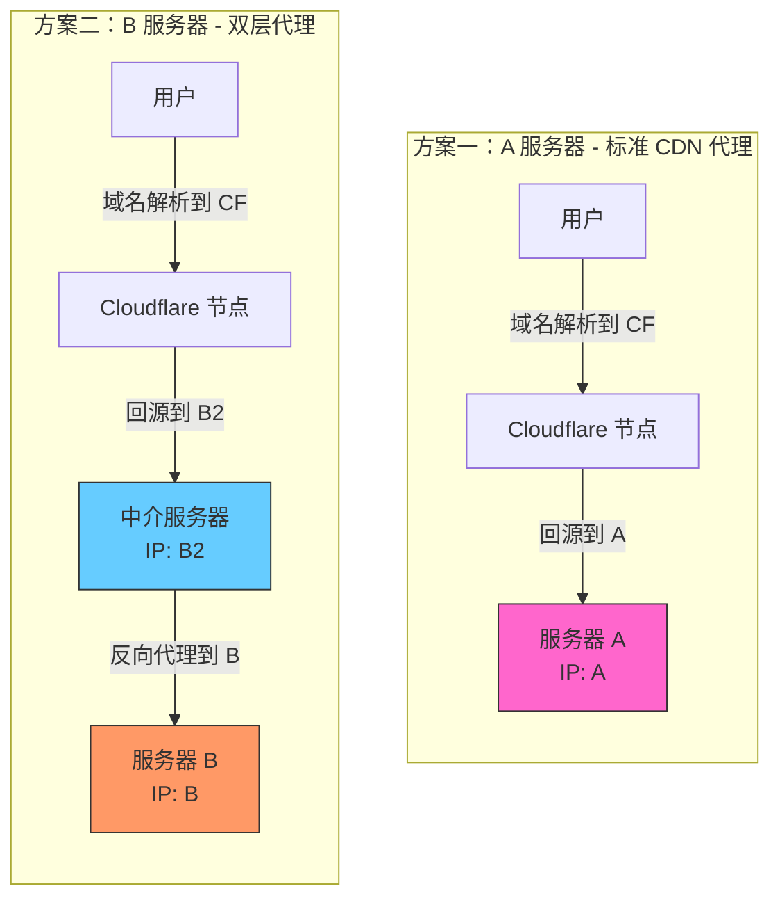
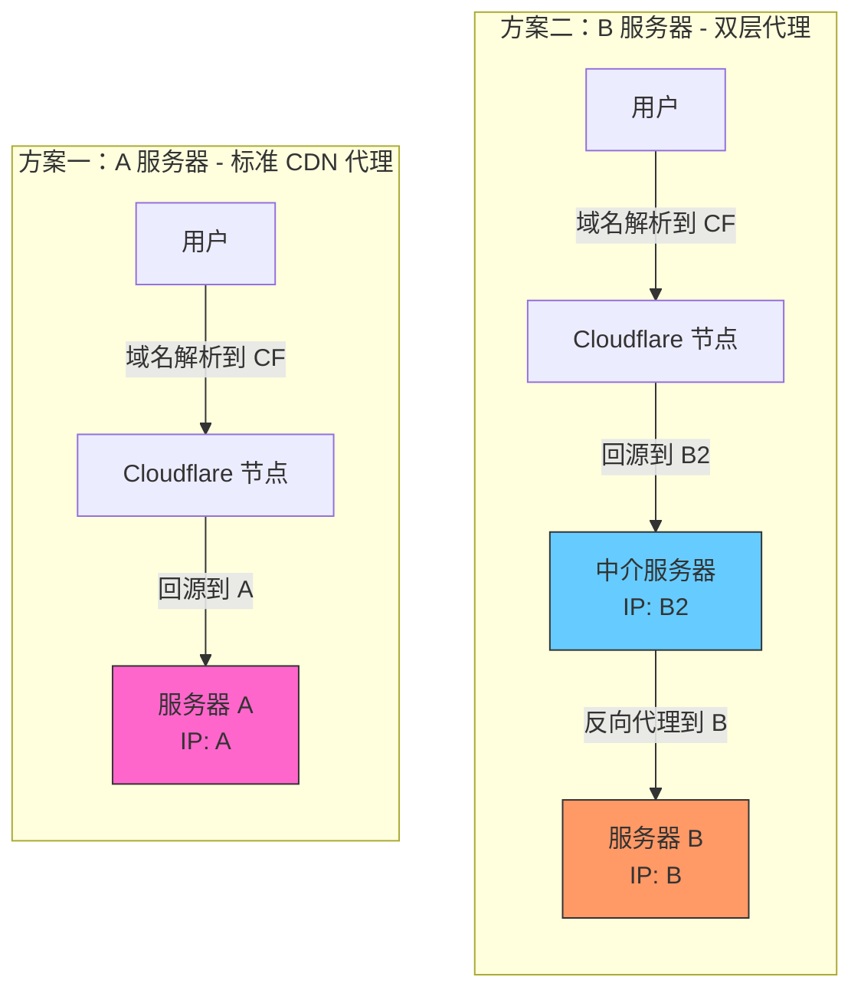

[toc]

在 Mermaid 流程图中，子图（`subgraph`）的排列顺序以及它们在画布上的左右/上下位置，主要由 **Mermaid 渲染引擎（通常是 dagre 布局引擎）的内部算法自动计算决定**，而不是单纯依赖你在代码里编写它们的先后顺序。

### 问题案例

下面这张图，导致“方案二”跑到“方案一”左边

核心原因有以下几点：

### 1. 代码中没有定义子图之间的依赖关系

在你的 Mermaid 代码中，`方案一` 和 `方案二` 是两个完全独立的 `subgraph`，它们之间没有任何连线（线索）相连。

- 对于布局引擎来说，这两个子图是平级的、断开的独立节点。
- 引擎在布局时，会尝试以最节省空间、最紧凑的方式把它们拼在画布上。由于缺乏明确的先后关联，谁在左、谁在右在很大程度上是随机或由内部节点数量、连线长度计算出来的。

### 2. 节点数量和连线长度（权重差异）

- **方案一：** 只有 2 个节点（User1 -> CF1 -> A），连线较少。
- **方案二：** 有 3 个节点（User2 -> CF2 -> B2 -> B），链路更长，整体结构更“高”。

布局引擎在处理这类没有关联的独立子图时，往往会优先放置结构更复杂或更高的元素，或者在计算边界时为了让整体画布更趋近于一个合理的宽高比（矩形），而对调了它们的左右顺序。在这个例子中，复杂的“方案二”被优先排在了左侧起始位置。

### 修复方案

