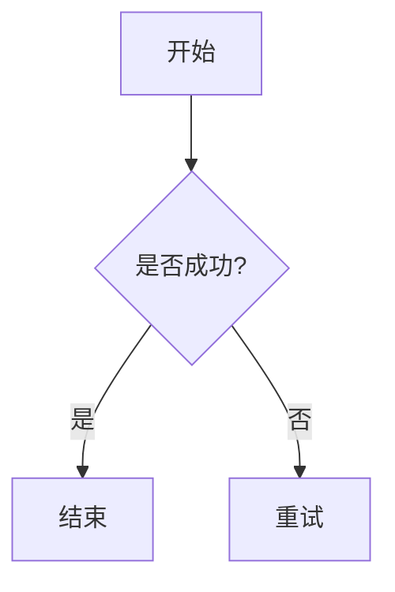

[toc]

在 Mermaid 中添加注释非常简单。就像在很多编程语言中一样，注释的作用是为代码提供说明，而**不会被渲染**到最终的图表中。

------

##  注释的基本语法

Mermaid 使用双连字符 `%%` 来表示注释。

注释行不应该和其他结点在同一行,否则会出错.

### 示例代码

代码段

```

graph TD
    %% 这是一条注释，不会显示在图中
    A[开始] --> B{"是否成功?"}
    B -- 是 --> C[结束]
    B -- 否 --> D[重试]
```

------



