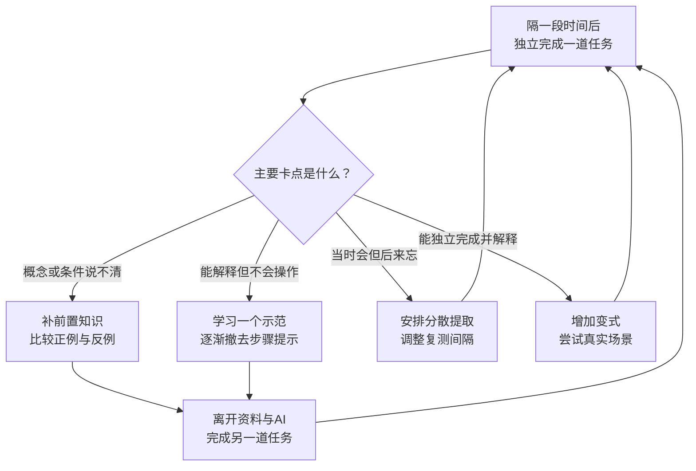

[toc]

## 先把最重要的结论讲清楚

如果只记住几条，请优先记住：

- **用延迟后的独立表现判断学会，不用熟悉感、笔记数量、观看时长判断。**
- **先查前置知识，再决定是不是需要更努力。**缺一块基础，可能让后续每一步都很吃力。
- **阅读和听讲是输入，提取、解释、解题、操作和创作才提供可检查的学习证据。**
- **把练习分散到不同时间，并根据错误调整下一次练什么。**
- **新手可以先看示范，但支持应逐渐撤掉；熟手则要增加独立解决新问题的机会。**
- **让AI增加你的练习与反馈，不要让它替代你本来需要练习的思考。**
- **纠正旧习惯不必推倒重来：一次替换一个行为，用几周的实际表现检验。**

## 为什么有人学得快，有人学得慢？

### 先区分“表现好”与“学得好”

至少应区分下面四件事：

| 维度                  | 你真正要问的问题                     | 常见误判                         |
| --------------------- | ------------------------------------ | -------------------------------- |
| **当下表现**          | 现在有资料、有提示时，能否完成？     | 跟着老师或AI做出来，就认为掌握了 |
| **保持**（Retention） | 隔几天后，还能否想起来、做出来？     | 当晚会做，就认为以后都会         |
| **迁移**（Transfer）  | 换题目、换条件、换场景，还能否使用？ | 只会熟悉题型，却以为理解了原理   |
| **独立性**            | 撤掉答案、步骤和AI后，还剩多少能力？ | 把工具的能力记在自己账上         |

这不是纯粹的概念区分。Deslauriers等在大学物理课堂实验中发现，主动学习条件下的学生实际学得更多，却可能觉得自己学得更少。也就是说，**学习时的流畅感、轻松感，并不总能准确反映学习效果。**参见。

所以，比较两个人的学习效率，不能只比较“用了几个小时”，还要比较：**开始时会什么、得到什么帮助、最后独立做成什么，以及过多久仍然会。**

### 日常所见的差距，通常需要从这些方面排查

下表是一个诊断框架，不是各因素贡献大小的排行榜。

| 可能的差异                 | 为什么看起来像“学得更快”                                     | 对自己的启示                                         |
| -------------------------- | ------------------------------------------------------------ | ---------------------------------------------------- |
| **已有知识与经验**         | 新内容能接到已有知识上，不必每个概念都从零处理               | 找出关键前置知识，不要只重复看当前章节               |
| **知识组织方式**           | 不只是记住零散事实，而是掌握概念之间的关系、适用条件         | 学“为什么、何时用、何时不用”                         |
| **基础加工能力与语言条件** | 阅读、理解表达、注意控制等条件不同，会影响同一材料的处理成本 | 调整材料难度、表达形式与支持程度，不急着给自己贴标签 |
| **练习与反馈质量**         | 同样一小时，有人在纠正弱点，有人在重复已经会的部分           | 关注有效练习机会，而不是单纯累计时长                 |
| **自我监测与调节**         | 能及时发现“我只是觉得懂了”，并调整策略                       | 用小测、作品和操作结果校准判断                       |
| **学习机会与状态**         | 指导质量、可支配时间、干扰和睡眠条件不同                     | 优化条件，不把所有困难解释为自律不足                 |

已有知识既可能帮助理解，也可能因错误观念或固有框架妨碍新学习。美国国家科学院的对这种双重作用有系统讨论。

这里还有一个重要但容易被过度解读的研究发现：

- Koedinger等在特定的计算机辅助练习环境中发现，学生的**初始水平差异很大，而按练习机会计算的学习速率差异相对较小**。这些系统提供了针对性练习、反馈与按需解释。参见。**这不能推导为“所有人在任何任务上都一样快”。**
- 另一项提醒：**已有知识与最终成绩的相关，不等于它与新增学习量的相关**；不同任务中，已有知识对新学习的影响差异很大。

最实用的结论是：**不要从“我现在比别人差”，直接跳到“我的学习能力不可改变”。先检查起点、任务和支持条件。**

## 高效学习应该做到什么？

### 把目标写成“可观察的能力”，而不是活动清单

“看完一本书”“听完课程”“整理好笔记”，可以是过程目标，但不足以作为掌握标准。

我建议把目标改写成下面这种形式：

| 学习目标   | 不够清楚的写法   | 更可检查的写法                                     |
| ---------- | ---------------- | -------------------------------------------------- |
| 记忆事实   | 熟悉核心概念     | 不看资料，正确说出概念及其关键条件                 |
| 理解概念   | 理解加权平均     | 能解释为什么有些百分比不能直接平均，并举出例外条件 |
| 掌握技能   | 学会一种分析方法 | 在未见过的同类任务中独立选择并完成方法             |
| 写作与判断 | 提高表达能力     | 根据明确标准完成作品，解释主要取舍，并根据反馈修改 |

**目标决定练习形式。**如果目标是口语交流，只背词卡不够；如果目标是独立编程，只阅读代码不够；如果目标是分析和写作，只记住术语也不够。不要期待一种学习动作包办所有能力。

### 把“反复输入”改成“输入后提取”

**提取练习**（Retrieval Practice），就是在不看答案的情况下，从记忆中主动找出知识，或者调用它完成任务。

可采用一个简单做法：

1. 阅读或听讲一个适量单元。
2. 合上资料，回答几个关键问题、解释主要意思，或者做一道对应任务。
3. 对照可靠材料，找出遗漏和错误。
4. 修正后，稍后再试，而不是只把正确答案看一遍。

适合的问题包括：

- 核心结论是什么？
- 它为什么成立？
- 适用条件是什么？
- 它与容易混淆的概念有什么区别？
- 给一个新例子，我能否使用它？

Yang等的支持提取练习对课堂学习的总体益处，同时发现反馈、测验形式、材料匹配等都会影响结果；2026年的课堂元分析也得到总体支持。**这里的“小测”主要是学习工具，不是为了给自己制造高压考试。**

两个实施边界尤其重要：

- **不是完全不会，也必须硬想很久。**如果缺少基本理解，先看解释或示范，再尝试。
- **不是默默感觉“我能想起来”。**初期尽量写出、说出或实际操作，让判断有依据。

### 把学习分散到不同时间，而不是只在同一天重复

**间隔练习**（Spaced/Distributed Practice），是把一定量的学习分散到不同时间，而不是全部集中完成。

一个可以试用、但并非“科学最优”的安排是：

| 时间     | 主要动作                     |
| -------- | ---------------------------- |
| 初学当天 | 理解基本内容，做一次独立尝试 |
| 隔一天   | 不看资料，回忆或做少量任务   |
| 再隔几天 | 复测，重点处理不稳定部分     |
| 一两周后 | 混入旧内容，检查保持与迁移   |

**间隔要根据表现和使用期限调整，没有适合所有人的固定日程。**

- 总能轻松答对：可以减少重复或适当拉开间隔。
- 大量答错：先检查是否理解，再考虑缩短间隔。
- 内容很重要、将长期使用：不能只复习到一次考试结束。

把跨天提取与重新掌握结合起来，研究中常称为**跨时段再学习**（Successive Relearning）。参见。它强调的不只是“隔天看一眼”，而是**隔一段时间重新尝试提取，必要时再次学到能够正确完成。**

### 新手先获得适当指导，再逐渐撤掉支持

高效学习不等于“一开始就完全独立摸索”。

对于结构较清楚的技能，可以这样安排：

1. **看完整示范**：理解步骤与理由。
2. **补全缺失步骤**：由自己完成一部分。
3. **独立完成同类任务**：不再照着范例。
4. **处理变式与新场景**：判断什么时候应该使用该方法。

这叫**支持渐退**（Fading/Scaffolding）。Renkl的与Booth等的都讨论了这一路径。需要注意，其较成熟的证据主要来自数学等结构化问题，不能直接保证对所有开放式创作同样有效。

**看例题时，重点不是把步骤抄下来，而是解释：**

- 为什么要做这一步？
- 如果条件改变，哪一步需要改变？
- 这个方法为什么适用，而另一个方法不适用？

这也是**自我解释**（Self-explanation）的核心。通俗地“讲给别人听”可以成为一种实施方式，但关键是解释是否正确、是否揭示关系，而不是给方法冠上一个知名人物的名字。

### 让反馈改变下一次练习，而不是只告诉你对错

有效反馈应帮助你回答三个问题：

- **哪里不对？**
- **为什么可能不对？**
- **下一次要怎样验证已经改正？**

例如，“这道题错了，正确答案是6.5%”通常还不够。更有用的是：“你把两个分母不同的百分比直接平均了；下一题先写出各部分的分子和分母，再决定如何合并。”

反馈元分析表明，反馈并不是效果一致的单一干预，其作用明显受**信息内容**影响。参见；提取练习的课堂元分析也把纠正性反馈列为重要条件之一。

因此，错题记录可以很短：

| 错误表现             | 暂定原因             | 验证是否改正               |
| -------------------- | -------------------- | -------------------------- |
| 看答案就懂，独立不会 | 步骤选择没有掌握     | 换一道同类题，不看步骤完成 |
| 总混淆两个概念       | 边界与适用条件不清楚 | 比较正例、反例及临界情况   |
| 当天会，隔天忘       | 保持不稳定           | 隔天和几天后再次提取       |

**不要只收藏错误；要安排一次能证明错误已被纠正的任务。**

### 在需要“辨别用哪种方法”时，使用交错练习

**交错练习**（Interleaved Practice），是把相关但不同类型的问题混合起来，让自己不仅练“怎么做”，还练“该选哪种方法”。

例如：

- 集中练习：连续十道题都用同一个公式。
- 交错练习：混合几类题，不提前告诉你该用什么公式。

它**不是一边学数学一边刷消息，也不是频繁切换不相关的课程**。

交错练习的效果依材料而变。发现，它在部分分类与数学任务中有效，但对说明性文本、词语等材料不能一概推荐；2026年的真实课堂元分析也发现，其效果受反馈条件影响。

实践上建议：

- **先达到基本理解，再混合容易混淆的类型。**
- 做题前先说：“我判断这是哪一类，依据是什么？”
- 不要因为交错后当场正确率下降，就立刻认定方法无效；也不要反过来认为，越混乱越有效。

### 用结果校准自我判断，并保护基本学习条件

**元认知**（Metacognition），可以简单理解为：知道自己目前会什么、不会什么，并据此调节学习。

一个低成本做法是：答题前标注“很有把握／不确定／不会”，然后对照实际结果。尤其关注**“很有把握但答错”**的内容，因为它们不容易被你主动复习。

学习策略干预的支持元认知指导的价值，但也提醒测验设计会影响估计效果。不要只学一套“自我管理术”，却不检查具体知识和技能是否改善。

此外，两条基本条件值得保护：

- **减少无关任务并行。**课堂笔记本多任务实验发现，无关活动会损害学习表现；这不等于电子设备本身有害。参见。
- **不要长期用牺牲睡眠换学习时间。**NIH的以及均支持睡眠不足会影响相关认知与记忆表现；具体研究的效应大小仍有局限。

**专注时段不必迷信固定分钟数。**可以用计时帮助开始和休息，但最终仍要看任务完成质量、疲劳程度和可持续性。

## 应该避免什么？

### 避免把辅助动作当成学习完成

下面是建议采用的替换方式，不是说左栏动作一律无用。

| 容易形成的习惯           | 风险所在                     | 更好的替换                           |
| ------------------------ | ---------------------------- | ------------------------------------ |
| 一遍遍重读、划线         | 缺少独立提取与应用的证据     | 保留必要阅读，增加闭卷回忆和任务     |
| 反复整理漂亮笔记         | 主要在加工文档，而非验证能力 | 先尝试解释，再整理暴露出的缺口       |
| 收藏大量课程和文章       | 资源增长不等于能力增长       | 一个主线资源，配合练习与少量查缺资料 |
| 只做熟悉题型             | 可能依赖题型提示             | 加入未标类型的混合题与变式           |
| 一错就看完整答案         | 没有机会定位自己卡在哪一步   | 先辨认卡点，必要时只取一个提示       |
| 为了“深度学习”无限硬扛   | 可能只是缺基础、缺指导       | 补前置知识、看示范或缩小任务         |
| 用连续打卡代替效果检查   | 记录了执行，却没记录学会多少 | 同时记录延迟表现与独立程度           |
| 不断寻找更好的方法和工具 | 调整系统挤占实际学习         | 先运行一个简单方案，再根据结果修改   |

Dunlosky等的综述与后续都提示：**重读、划线、总结等不能简单说“毫无效果”，但不宜成为唯一主力；需要看你怎样使用它们，以及用什么标准测量结果。**

### 避免几个流行但不可靠的简化说法

**“我是视觉型／听觉型学习者，所以只能用对应方式。”**

个人偏好可以影响体验，但不足以证明“按偏好匹配教学就学得更好”。与均未支持这种常见的匹配主张。**应该根据内容与任务选表达方式，而不是用类型标签限制自己。**

**“只要感觉困难，就是在有效学习。”**

不对。适当的提取、辨别和独立尝试可能增加困难，但缺少必要知识、材料表达混乱、任务过载也会让人困难。**困难是否值得，要由后续表现验证，而不是由痛苦程度验证。**

**“坚持21天，习惯就一定形成。”**

没有这样的统一期限。经典的及都显示明显的个体与行为差异。**这些证据主要来自健康行为，也不能直接换算成学习习惯需要多少天。**

## AI时代有什么新的注意事项？

### 最关键的新问题：你在优化“完成任务”，还是“获得能力”？

两者都可以是合理目标，但不能混为一谈。

| 当前目标             | 合理的AI角色                     | 应检查什么                           |
| -------------------- | -------------------------------- | ------------------------------------ |
| **尽快完成真实工作** | 检索、草拟、计算辅助、格式处理   | 最终结果是否正确、可追溯、符合要求   |
| **训练自己的能力**   | 解释、示范、出题、提示、反馈     | 撤掉AI后，自己还能完成多少           |
| **提高人机协作能力** | 协助比较方案、发现漏洞、验证结果 | 能否发现AI错误，能否独立承担关键判断 |

**如果一项能力正是你的学习目标，就不能把练习这项能力的机会全部外包。**但这不意味着所有步骤都要亲自做，也不意味着永远不准使用工具。

### 研究结果不是“AI一定好”或“AI一定坏”

下面列出几项具有代表性的研究，说明为什么必须看使用方式与测量标准。

**表中具体人数、比例和研究日期以对应原文为单一来源，不视为已被多组独立重复验证的量化共识。**

| 主要发现                                                     | 不能忽略的边界                                               |
| ------------------------------------------------------------ | ------------------------------------------------------------ |
| 普通答案型AI提高练习时表现，但撤掉AI后，该组成绩比未使用组低约**17%**；强调教师设计提示的辅导版本缓解了负面影响 | 这是特定高中数学环境；17%是相对下降，不是下降17个百分点；不能据此断言所有AI使用都损害学习。 |
| 面向教学专门设计的AI辅导，在两次课的研究中取得更高后测成绩，并使用较少学习时间；纳入分析的学生为194人 | 主要反映短期、特定内容的效果，不能直接外推到长期保持、复杂综合判断或任意聊天机器人。 |
| 整体练习方案带来小幅数学成绩收益，但学生很少深入使用对话辅导 | 对照不是“完全相同平台、只去掉AI”，因此不能把全部收益归因于AI本身。**工作论文，非本文核实过的同行评审定稿。** |
| 涉及2,379名本科生；提供工具没有改善成绩，部分分析中成绩较低，课程平台参与减少 | 工具实际使用率较低；成绩与平台行为不是独立能力的完整测量。作者也强调，技术接入不等于教学整合。**工作论文。** |

这些研究支持的稳妥判断是：

> **AI是否促进学习，不能只看它的回答能力，也要看它把学习者带入了什么活动：尝试、解释、纠错和复测，还是直接获取并提交答案。**

这是对不同研究的综合推断，不是某一项实验已经证明的普遍定律。

### 推荐把AI用于这些环节

以下是基于上述证据设计的使用建议，不保证某一句提示词本身就能产生教学效果。

| 环节 | 推荐用法                               | 应避免的用法                         |
| ---- | -------------------------------------- | ------------------------------------ |
| 入门 | 解释术语、补前置知识、给一个清晰示范   | 让AI生成庞大路线图，然后一直不开始   |
| 练习 | 一次一题，先由你作答，再给提示和反馈   | 题目和完整答案同时摆在眼前           |
| 理解 | 让它比较相近概念、提出反例，再由你判断 | 只接受它给出的流畅比喻，不检查准确性 |
| 纠错 | 提交自己的思路，请它定位错误步骤       | 让它直接重做，你只看最后答案         |
| 复习 | 根据你确认过的材料生成问题，覆盖薄弱点 | 把AI自动生成的全部卡片都加入复习     |
| 检验 | 定期离开AI完成新任务                   | 用“与AI聊了多久”衡量掌握程度         |

可以使用这样的提示：

> 请作为业务统计教练，帮助我学习“合并转化率为什么不能随便平均”。如果我缺少基础，先给简短解释和一个示范。之后每次只给一道题，在我回答前不要展示完整答案。反馈时指出具体错误与原因；我卡住时先给一个小提示。最后换一组条件，检查我能否独立判断。事实性解释请区分教材依据、推断和不确定之处。

**提示词不是强制约束，也不是正确性保证。**如果AI提前泄露答案，换一道未见过的题；如果解释存疑，回到可靠教材、原始资料或可执行的检验。

### 必须保留核验与独立测评

AI可能自信地生成错误内容。将这种现象列为重要风险；则强调以人为中心、教育适用性与数据隐私。

实践中建议守住几条底线：

- **关键事实打开原始来源核对。**有引用名称，不代表引用真实或支持该结论。
- **再问一次、换个模型，不等于独立取证。**最终仍要核对证据或实际结果。
- **数值问题用可靠计算核验，技能问题用实际任务核验。**
- **不要把敏感个人信息、未授权工作资料和他人隐私直接作为学习材料上传。**
- **同时保留两条成绩线：无AI独立能力，以及允许AI时的人机协作能力。**

不应从这些短期或特定环境研究中，推断“使用AI会永久让人变笨”；同样，也不能从一次不错的AI辅导体验推断“自己已经学会了”。

## 一个综合案例：学习“为什么百分比不能随便平均”

下面是**为讲解设计的虚构案例，不是真实学习者实验**；其中算术已用计算器核验。

### 场景与目标

你在做业务分析，需要合并两个渠道的转化率。约定：

- 两个渠道的访客互不重叠；
- 统计周期与转化定义一致；
- 每位访客最多计一次转化。

| 渠道 | 访客数 | 转化人数 | 转化率 |
| ---- | -----: | -------: | -----: |
| A    |    100 |       20 |    20% |
| B    |    900 |       45 |     5% |

直接平均两个百分比，得到12.5%；但总体转化率应为：

**总转化人数65 ÷ 总访客数1,000＝6.5%。**

学习目标不应只是“记住这道题是6.5%”，而应是：

**能够识别合并比例时的分子、分母和统计口径，并解释什么时候可以直接平均百分比。**

### 怎样把方法串起来？

| 阶段               | 具体做什么                                         | 检验点                                       |
| ------------------ | -------------------------------------------------- | -------------------------------------------- |
| **诊断前置知识**   | 解释20%在这里是什么意思，分子和分母分别是什么      | 是否真正理解比例                             |
| **学习示范**       | 看清为什么要先合并人数，而不是先平均比率           | 能否解释每一步                               |
| **提取与自我解释** | 关掉资料，向同事解释12.5%为什么不对                | 不只是复述答案                               |
| **概念辨析**       | 思考：如果两个渠道访客数相同，直接平均是否成立？   | 是否理解权重与边界                           |
| **变式练习**       | A改为900名访客、180人转化；B改为100名访客、5人转化 | 比例仍为20%和5%，总体却变为18.5%，能否解释？ |
| **间隔复测**       | 几天后换数据，再混入“求单个渠道比率”和“求总体比率” | 是否能先判断该做什么                         |
| **AI辅助**         | 由AI指出你解释中的漏洞，但不替你完成所有判断       | 你能否核验AI反馈                             |
| **独立迁移**       | 再处理一份新报表，先检查去重与统计口径             | 能否迁移到真实工作                           |

这个案例的关键不在于题目难，而在于：

**同一个概念，要经历“理解示范—独立提取—辨别边界—处理变式—延迟再用”，才有较充分的掌握证据。**

如果你连“比例”都没有理解，应该先补基础；如果只是过几天忘了，就优先调整间隔提取；如果计算会做但不会检查统计口径，就需要迁移练习。**不同问题，不该一律用“再看一遍课程”处理。**

## 发现过去的学习方式不好，怎样纠正？

### 先做审计，不要先做自我否定

选一个近期真实学习任务，回看几次学习记录：

- 时间实际花在哪里？
- 哪些部分是自己独立完成的？
- 隔几天还能做多少？
- 错误是否重复出现？
- AI和资料替你完成了哪些关键步骤？

把内容分成三类：

| 当前状态           | 建议                                 |
| ------------------ | ------------------------------------ |
| **已经能独立完成** | 保留，减少无必要重复，用抽查维持     |
| **有提示才会**     | 重点训练，逐渐减少提示               |
| **基础仍不懂**     | 补前置知识或重新选择讲解，不急着加量 |

**不要把所有旧知识从头重学，也不要把所有旧习惯一次性推翻。用表现决定保留什么、替换什么。**

### 一次替换一个具体动作

与其要求自己“以后高效学习”，不如设置可执行的替换：

| 旧行为                     | 新行为                             |
| -------------------------- | ---------------------------------- |
| 一读不懂就继续往下看       | 停下来写出具体不懂的术语或关系     |
| 每次学习结束都继续整理笔记 | 留出几分钟，不看资料解释关键内容   |
| 做错后只抄正确答案         | 写一句错误原因，再做一道对应变式   |
| 卡住就让AI完整重做         | 先提交自己的尝试，请求一个提示     |
| 只安排新内容               | 在日程中给旧内容留一个复测位置     |
| 中断一天就认为计划失败     | 下一次从最小任务恢复，不补偿性熬夜 |

稳定情境中的重复，有助于行为逐渐自动化；但形成速度差异明显，而且习惯不是维持行为的唯一条件。相关依据见与。这里把它用于学习安排，是实践迁移建议，不是已经验证的固定学习处方。

### 根据卡点分流，而不是统一加倍用功

**示意图候选登记与筛选：**

| 候选           | 图类型与对应内容         | 三关判断                                                   |
| -------------- | ------------------------ | ---------------------------------------------------------- |
| 通用学习步骤   | 线性流程图，对应前述方法 | 主要重复列表，且无分支，**不画**                           |
| 错误诊断与复测 | 分支反馈图，对应习惯纠正 | 有分支与循环；表达不同错误对应不同处理；节点适量，**保留** |

这张图强调：**复测失败不是统一的“能力差”，而是重新诊断的入口。**多个问题可能同时存在，优先处理更上游的缺口；例如，概念尚不理解时，单纯增加记忆卡片未必解决问题。

### 用四周建立一个可检查的起步方案

下面的时间安排是执行模板，**不是保证四周养成习惯或取得固定提升的实验结论**。

| 阶段                              | 主要任务                                           | 应留下什么                       |
| --------------------------------- | -------------------------------------------------- | -------------------------------- |
| **第1周：建立基线与一个替换动作** | 前两天做适量独立测试；此后每次学习结束增加简短提取 | 哪些会、哪些靠提示、哪些基础缺失 |
| **第2周：加入间隔**               | 把重要内容安排到后续几天复测                       | 延迟后仍不稳定的内容             |
| **第3周：改善反馈与独立性**       | 针对重复错误练习，逐渐减少步骤提示，适量加入混合题 | 错误是否减少，提示是否减少       |
| **第4周：检查迁移与成本**         | 用同目标、近似难度的新任务测试，回顾全部投入       | 是否值得保留、调整或停止当前做法 |

建议每周只记录几项：

- **总投入时间**：包括挑资料、写提示词、整理与查错。
- **延迟后的独立表现**。
- **新任务表现**：不是只重做已经看过答案的题。
- **需要多少提示**。
- **高把握但答错的内容**。
- **执行负担与疲劳是否可接受**。

对于记忆任务，可以随机抽查事先学过的项目；对于技能任务，则要加入未见过的同类题或真实操作。不同形式不能机械地用同一张测验评价。

**如果学习时暂时感觉更慢，但几天后的独立表现更好，可能值得保留新方法；如果持续完全做不出来，应先降难度、补基础或增加指导，而不是把困难本身当成进步。**

### 最小可执行版本

如果你现在不想建立复杂系统，可以先试这个十分钟版本：

1. **两分钟**：不看资料，回忆上次最重要的内容。
2. **六分钟**：完成一个小任务，检查并纠正一个错误。
3. **两分钟**：写下下一次复测什么、何时开始。

分钟数只是便于启动。更重要的是，**每次都留下一个可检查的结果，以及下一次明确的动作。**

如果长期存在显著影响学习与生活的困难，不必只在“方法”和“意志力”之间寻找答案。可以向教师、学习支持人员或合格专业人士寻求帮助，不要凭网络清单自行下诊断。

### 哪些结论更稳，哪些仍应保留判断？

| 结论                                     | 本轮证据判断                                             |
| ---------------------------------------- | -------------------------------------------------------- |
| 提取与间隔练习值得作为长期学习的基础方法 | **较稳健**，有多项研究与综述支持，但具体实施仍需匹配目标 |
| 新手需要适当指导，并逐渐增加独立性       | **较成熟，但任务有边界**，结构化技能证据更充分           |
| 交错练习优于所有集中练习                 | **不能成立**，材料、任务与反馈条件影响明显               |
| 学习策略和自我调节可以训练               | **总体支持**，但不能保证固定幅度或所有人相同收益         |
| AI能否促进学习                           | **取决于设计、行为与测量方式，仍在快速发展**             |
| 长期使用AI对独立能力的多年影响           | **本轮证据不足以作普遍判断**                             |

这里的“多来源支持”不等于所有底层样本彼此独立：**不同元分析可能纳入部分相同研究，不能把每篇综述都算作一次全新的实验复现。**

### 未充分覆盖的部分

若继续研究，优先关键词是：`AI tutoring delayed retention transfer longitudinal`、`Chinese adult self-regulated learning intervention`、`fading guidance open-ended skills`、`generative AI learning independent assessment`。

**校验说明：**正文引用使用了本轮实际打开的页面或原文副本；部分出版商入口被拦截时，改用可取得的论文原文。Mermaid图做了人工语法检查，但没有可用渲染器，因此未实际渲染。四周方案与十分钟模板是综合设计建议，未在真实学习者上做实验验证。

---

