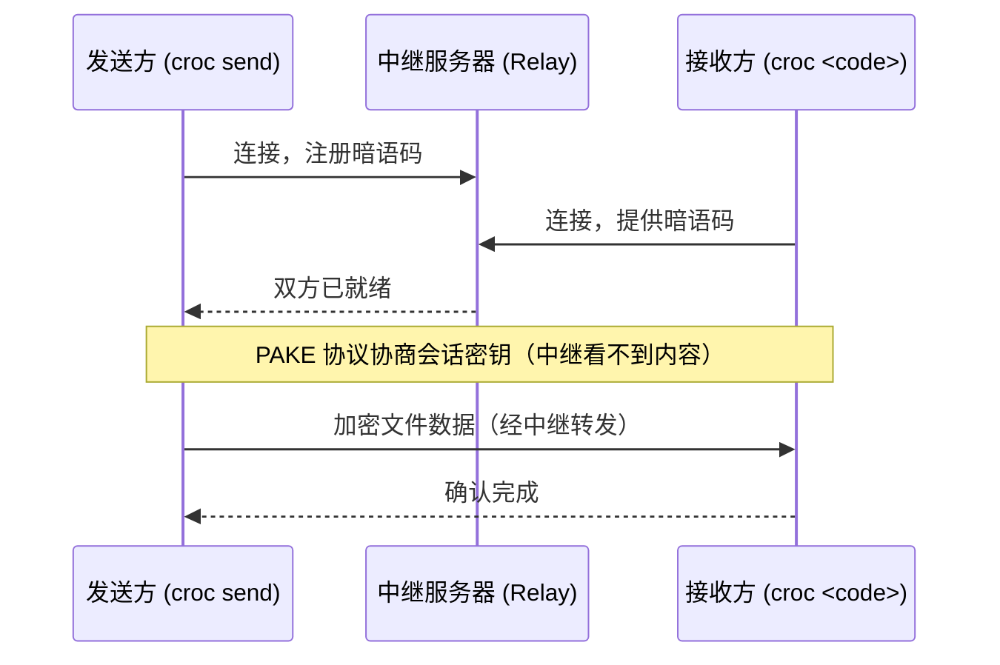

[toc]


## 文件临时传输方案全景指南

文件传输场景多种多样，核心矛盾往往在于：**传输是临时的、一次性的**，却不得不借助聊天工具（微信/QQ 限速/限大小）、邮件（附件限制）或 U 盘（插拔麻烦）这些"重"方案。本文系统梳理各类临时传输利器，覆盖局域网内传、跨网 P2P、Web 链接分享和 CLI 终端传输四大场景，兼顾国内外和跨平台需求。

---

### 场景与工具全景图

先通过一张决策图，快速确定你的场景：


---

### 分类详解

#### 局域网直传工具（无需公网）

这是速度最快、最私密的方式——数据全程在本地网络流转，不经过任何第三方服务器。

##### LocalSend（推荐首选）

LocalSend 是一款开源 App，通过局域网直接传输文件，支持 Windows、macOS、Linux、Android 和 iOS。它提供加密的点对点文件和消息共享，完全不需要互联网，也不涉及云端或外部服务器。

LocalSend 是开源项目，所有版本均免费，传输速度快，在局域网内的体验完全碾压微信、QQ。

**优势一览：**

| 特性           | 说明                                           |
| -------------- | ---------------------------------------------- |
| 跨平台         | Windows / macOS / Linux / Android / iOS 全支持 |
| 无中转服务器   | 数据不出局域网，隐私有保障                     |
| 无文件大小限制 | 仅受本地网络速度约束                           |
| 免费开源       | MIT 许可，无广告无付费墙                       |
| 无需账号       | 同网络下自动发现设备                           |

**典型场景**：手机拍了一段 4K 视频，要传到 Windows 电脑里剪辑。两端装好 LocalSend，打开 App，手机端选择文件点击电脑图标，几秒内传完，画质完全无损，不需要扫码不需要登录。

**下载**：
- 官网：[localsend.org](https://localsend.org)
- GitHub：[localsend/localsend](https://github.com/localsend/localsend)
- 国内访问 GitHub 不畅时，可通过 [gh-proxy.com](https://gh-proxy.com) 加速 Release 下载，例如将原 Release URL 前拼接 `https://gh-proxy.com/` 即可。

---

##### PairDrop（浏览器版，免安装）

使用方法极简：双方设备打开 `pairdrop.net`，同网络下自动发现彼此；不同网络时可通过 6 位数字配对码连接。它是 Snapdrop 的继任者。

对于不能安装任何东西的场景（如借用他人设备）这是最佳选择；但如果需要稳定的局域网传输，LocalSend 更可靠。

> **注意**：原版 Snapdrop（snapdrop.net）已出售，社区不再推荐使用，推荐改用 PairDrop。

**使用流程：**
1. 双方同一 WiFi 下，分别打开浏览器访问 [pairdrop.net](https://pairdrop.net)
2. 页面自动展示对方设备图标，点击即可发送

**局限性**：依赖本地网络自动发现机制，部分路由器或防火墙可能阻断连接，用户反映偶有"找不到设备"的情况。

---

#### CLI P2P 跨网传输工具（推荐技术用户）

这类工具适合需要穿越 NAT/防火墙、在任意两台机器之间传文件的场景，双方都有终端即可。

##### croc（★ 强烈推荐）

croc 是一个开源跨平台 CLI 工具，可以在任意两台计算机之间端对端加密传输文件和目录。不需要端口转发、不依赖云服务、不需要注册。发送方一条命令生成暗语码，接收方输入同一暗语码，就完成了。

截至本文写作时，croc 在 GitHub 上拥有超过 37,000 颗 star，是近年来最实用的 CLI 工具之一。

**核心特性：**

croc 的核心优势包括：全程端对端加密（使用 **PAKE** 协议，即密码认证密钥交换）；通过中继服务器辅助穿透 NAT 和防火墙；支持**断点续传**；跨平台（Windows、macOS、Linux、BSD）；无需开放端口和配置防火墙。

**基本用法：**

```bash
# 发送文件（发送方执行）
croc send file.txt
# 输出示例：Code is: 5-piano-mama-baby
# 接收方执行（输入上面的暗语码）
croc 5-piano-mama-baby
```

```bash
# 发送多个文件或目录
croc send file1.pdf file2.jpg folder/

# 自定义暗语码（方便记忆）
croc send --code mysecret document.pdf

# 发送纯文本（不需要文件）
croc send --text "Hello from the other computer"

# 通过管道发送（适合脚本场景）
cat database.sql | croc send
```

**字段说明：**

| 字段 / 参数         | 含义                             |
| ------------------- | -------------------------------- |
| `send`              | 子命令：发送模式                 |
| `--code mysecret`   | 自定义暗语码，替换随机生成的码   |
| `--text "..."`      | 发送文本内容而非文件             |
| `--relay host:port` | 指定使用的中继服务器地址         |
| `croc <code>`       | 接收模式，填写发送方输出的暗语码 |

**工作原理图：**



> 中继服务器仅负责建立连接通道，**无法解密数据**，加密在两端之间完成。

**自建中继（适合企业/隐私敏感场景）：**

croc 使用中继服务器来帮助穿越 NAT/防火墙，可以使用默认的公共中继，也可以自建中继来完全掌控数据路径。

```bash
# 在服务器上启动中继（需开放 TCP 9009-9013 端口）
croc relay --ports 9009,9010-9013

# 或用 Docker 快速启动（更推荐，方便管理）
docker run -d \
  -p 9009-9013:9009-9013 \
  -e CROC_PASS='your-relay-password' \
  --name croc-relay \
  schollz/croc:latest relay

# 发送方指定自建中继
croc --relay yourserver.com:9009 send file.txt

# 接收方同样指定中继
croc --relay yourserver.com:9009 5-piano-mama-baby
```

默认端口范围为 9009-9013；自定义端口时，Docker 端口映射、主机防火墙、云安全组规则和 croc 启动参数必须完全一致。

**croc 的局限：**

双方都需要安装 croc，没有基于浏览器的接收端。在高速局域网上，由于加密和中继的开销，速度会略低于原生 scp/rsync；但在普通互联网连接下，这个差距几乎可以忽略。

**安装方式：**

```bash
# macOS（Homebrew）
brew install croc

# Linux（curl 一键安装）
curl https://getcroc.schollz.com | bash

# Windows（Scoop）
scoop install croc

# Windows（Chocolatey）
choco install croc

# 或直接从 GitHub Releases 下载静态二进制文件（无依赖）
```

国内访问 GitHub Releases 缓慢时，同样可以用 `gh-proxy.com` 包裹下载链接加速。

---

##### magic-wormhole（Python 生态，croc 的前辈）

magic-wormhole 使用端对端的 PAKE 协议在互联网上两点之间创建加密传输通道，借助一个汇合服务器（rendezvous server）完成连接。

用户反映 croc 的用户体验比 magic-wormhole 更流畅；croc 的优势还在于提供 Windows 预编译二进制，而 magic-wormhole 在安装上需要 Python 环境，门槛略高。

> 对于新用户，推荐直接选 **croc**，无需纠结。magic-wormhole 更多是 Python 生态的选项。

---

#### Web 链接型临时分享（无需对方有 CLI）

这类方案适合**给非技术用户发文件**：你上传文件，对方拿到链接就能下载，链接有效期后自动失效。

##### Wormhole.app（★ 互联网临时分享推荐）

Wormhole 支持最大 10GB 的文件，全程端对端加密，链接会**自动过期**，确保文件不会永久留存在网上。

- 官网：[wormhole.app](https://wormhole.app)
- 无需注册，打开即用
- 链接过期时间通常为 24 小时
- 适合：发给不懂技术的用户、跨公司发大文件

> **注意**：wormhole.app 是商业服务（Proprietary），不同于开源的 magic-wormhole CLI 工具，两者同名但不同产品。

---

##### transfer.sh（CLI 上传，生成 URL）

transfer.sh 是一个简单、快速的命令行文件共享服务，允许上传最大 10GB 的数据，保存 14 天。

**⚠️ 重要注意**：公共服务 transfer.sh 已于 2020 年 9 月 30 日停止运营。但它的开源代码仍然可以**自托管**部署。

目前社区中可用的类似替代服务：

| 服务                           | 文件大小    | 有效期         | 特点                  |
| ------------------------------ | ----------- | -------------- | --------------------- |
| [oshi.at](https://oshi.at)     | 不限        | 180 天         | 匿名上传，CLI 友好    |
| [temp.sh](https://temp.sh)     | 2GB         | 3 天           | CLI 上传，支持 ShareX |
| [0x0.st](https://0x0.st)       | 512MB       | 动态           | 极简风格，curl 一行   |
| [file.io](https://www.file.io) | 2GB（免费） | 单次下载后删除 | 阅后即焚              |

**CLI 上传示例（以 0x0.st 为例）：**

```bash
# 上传文件并得到下载链接
curl -F 'file=@yourfile.zip' https://0x0.st

# 对方拿到链接直接浏览器打开下载即可
```

---

#### 国内方案（重点）

考虑到国内网络环境，对于访问境外服务不稳定的场景，以下国内方案更实用：

| 工具                        | 类型      | 文件大小                  | 有效期                     | 特点                                         |
| --------------------------- | --------- | ------------------------- | -------------------------- | -------------------------------------------- |
| **奶牛快传**（CowTransfer） | Web       | 免费 10GB                 | 自定义                     | 无需注册，上传下载不限速，画质无损           |
| **MuseTransfer**            | Web       | 不限（在线）/ 5GB（离线） | 在线实时 / 24小时+10次下载 | 无客户端，无需注册，极简风格                 |
| **AirPortal（空投快传）**   | Web + App | 不限速                    | 有效期可设                 | 干净无限速，体验流畅                         |
| **皮皮直连**                | Web P2P   | 不限（在线P2P）           | 双方同时在线               | 点对点，不经服务器存储                       |
| **缤纷快传**                | Web       | 大文件                    | 实时传                     | 类 WeTransfer 国内替代，基于对象存储即传即收 |

**MuseTransfer** 在线传输单次最大 64T（局域网互传首选）；离线模式单次最大 5GB，云端保存 24 小时 + 支持 10 次下载（异地互传首选）。无需下载客户端，甚至无需注册，打开网页即可全速传输。

**奶牛快传（CowTransfer）** 无需注册即可传文件，上传下载不限速，支持传视频、音频、图片等各类文件，提供 10GB 免费云盘空间。

---

### 综合对比与选型速查


| 工具             | 场景                     | 是否需安装 | 有无大小限制     | 端对端加密     | 国内可用           | 开源 |
| ---------------- | ------------------------ | ---------- | ---------------- | -------------- | ------------------ | ---- |
| QQ/wechat        | 私密内容                 | 是         | 通常无           | 是             | 是                 | 否   |
| **LocalSend**    | 局域网，日常高频         | 需安装 App | 无               | 是             | 是                 | ✅    |
| **PairDrop**     | 局域网，临时借用设备     | 仅需浏览器 | 无               | 是（WebRTC）   | 是（可自托管）     | ✅    |
| **croc**         | 跨网P2P，技术用户        | 需安装CLI  | 无               | 是（PAKE）     | 需要代理或自建中继 | ✅    |
| **Wormhole.app** | 跨网，给非技术用户发链接 | 无需安装   | 10GB             | 是             | 访问可能受限       | ❌    |
| **奶牛快传**     | 国内大文件分享           | 无需安装   | 免费10GB         | 否（中转存储） | ✅ 国内优化         | ❌    |
| **MuseTransfer** | 国内极简分享             | 无需安装   | 在线不限/离线5GB | 否             | ✅                  | ❌    |
| **transfer.sh**  | CLI生成URL，自托管       | 仅需 curl  | 可配置           | 可选           | 自托管即可         | ✅    |

---

对于不可公开的内容(例如链接,内部应用),qq这类通讯工具也不错,国内网路下载快速,登录扫码即可,手续简单,不暴露.

### 场景化推荐总结

**手机 ↔ 电脑（同一 WiFi）**
→ **LocalSend**，装一次终身受益，速度和隐私双赢。

**两台电脑跨网（都能用终端）**
→ **croc**，一条命令，加密穿墙，支持断点续传。

**临时给朋友/同事发大文件（对方不懂技术）**
→ 国内用户：**奶牛快传** 或 **MuseTransfer**；国际场景：**Wormhole.app**。

**公司设备，不能装 App，借用他人电脑**
→ **PairDrop**（pairdrop.net），打开浏览器即用，用完即走。

**服务器之间传日志/构建产物（脚本化）**
→ **croc**（可 pipe stdin）或 **自托管 transfer.sh**（curl 一行命令）。

croc 的核心功能包括一键发送并生成暗语码（或自定义 `CROC_SECRET`）、目录自动压缩解压、多文件传输、发送纯文本、二维码分享以及可选的自建中继；典型使用场景包括笔记本到服务器传文件、不借助云存储传大型资产、在 CI 脚本中嵌入安全传输等。

---

> **知识截止日期**：2026 年 9 月。croc 主仓库（schollz/croc）截至本文搜索时仍处于活跃维护状态（3 天内有提交），LocalSend 同样持续更新。公共 transfer.sh 服务已停止，请勿依赖其公共实例。