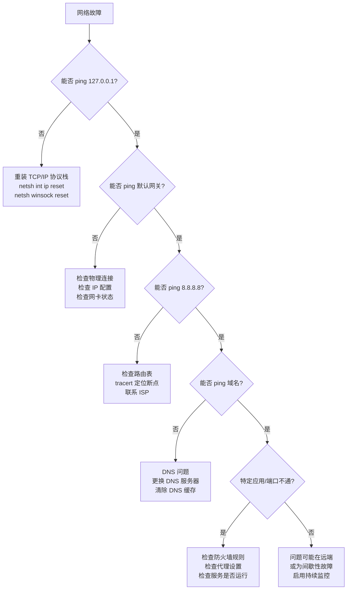

[toc]


# Windows 系统网络故障排查

## 概述

网络故障排查是一个系统性的诊断过程，核心思路是沿着网络通信的分层模型（OSI 或 TCP/IP），从底层向上逐层排除问题。这种方法避免了盲目猜测，能高效定位故障根因。


## 排查前的基本认知

### TCP/IP 分层模型与排查对应关系

| 层次       | 功能              | 常见故障现象                 | 关键排查工具                    |
| ---------- | ----------------- | ---------------------------- | ------------------------------- |
| 物理层     | 电信号/光信号传输 | 完全无连接、网卡灯不亮       | 设备管理器、物理检查            |
| 数据链路层 | 本地网络帧传输    | 能看到网络但无法通信         | `getmac`、`arp`                 |
| 网络层     | IP 寻址与路由     | 能 ping 网关但不能 ping 外网 | `ping`、`tracert`、`route`      |
| 传输层     | 端到端连接        | 能 ping 通但应用连不上       | `netstat`、`Test-NetConnection` |
| 应用层     | 具体服务协议      | 浏览器报错、DNS 解析失败     | `nslookup`、`curl`              |

### 关键原理

**子网与网关**：同一子网内的设备直接通信（通过 ARP 获取 MAC 地址），跨子网通信必须经过网关（路由器）。如果网关配置错误，本地网络正常但无法访问外部网络。

**DNS 解析**：域名必须先解析为 IP 地址才能建立连接。DNS 故障的典型表现是 ping IP 地址正常，但浏览器无法打开网页。

**防火墙与端口**：即使网络连通，防火墙规则可能阻止特定端口的流量。Windows Defender 防火墙对入站流量默认拒绝。

------

## 物理层与连接状态检查

### 快速确认网络适配器状态

```powershell
# 查看所有网络适配器状态
Get-NetAdapter

# 输出示例：
# Name           InterfaceDescription          Status       LinkSpeed
# ----           --------------------          ------       ---------
# Ethernet       Realtek PCIe GbE Controller   Up           1 Gbps
# Wi-Fi          Intel Wi-Fi 6 AX201          Disconnected
```

状态含义：

| Status       | 含义       | 处理方式                             |
| ------------ | ---------- | ------------------------------------ |
| Up           | 正常连接   | 继续排查上层                         |
| Disconnected | 物理断开   | 检查网线/Wi-Fi 连接                  |
| Disabled     | 被禁用     | `Enable-NetAdapter -Name "Ethernet"` |
| Not Present  | 硬件未识别 | 检查设备管理器/驱动                  |

### 重置网络适配器

当适配器状态异常时，重启适配器往往能解决瞬态问题：

```powershell
# 禁用后重新启用（等效于拔插网线）
Restart-NetAdapter -Name "Ethernet"

# 如果上面不生效，手动禁用再启用
Disable-NetAdapter -Name "Wi-Fi" -Confirm:$false
Start-Sleep -Seconds 3
Enable-NetAdapter -Name "Wi-Fi"
```

### 检查驱动程序

```powershell
# 查看网卡驱动信息
Get-NetAdapterAdvancedProperty -Name "Ethernet" | Select-Object DisplayName, DisplayValue

# 通过设备管理器命令行检查有问题的设备
pnputil /enum-devices /problem
```

------

## 网络层配置检查

### 查看完整 IP 配置

```powershell
# 传统命令（信息最全面，包含 DHCP 租约、DNS 后缀等）
ipconfig /all

# PowerShell 方式（结构化输出，便于脚本处理）
Get-NetIPConfiguration -Detailed
```

需要关注的关键字段：

| 字段            | 正常值示例        | 异常信号                                      |
| --------------- | ----------------- | --------------------------------------------- |
| IPv4 Address    | 192.168.1.100     | 169.254.x.x（APIPA 地址，表示 DHCP 获取失败） |
| Subnet Mask     | 255.255.255.0     | 与网络规划不匹配                              |
| Default Gateway | 192.168.1.1       | 为空或不可达                                  |
| DNS Servers     | 8.8.8.8 / 公司DNS | 为空或指向错误地址                            |
| DHCP Enabled    | Yes               | 静态配置时应为 No                             |

### APIPA 地址问题

当你看到 `169.254.x.x` 地址时，说明设备无法从 DHCP 服务器获取地址。排查步骤：

```powershell
# 释放并重新获取 DHCP 地址
ipconfig /release
ipconfig /renew

# 如果仍然失败，检查 DHCP Client 服务是否运行
Get-Service -Name Dhcp | Select-Object Status, StartType
```

常见原因：DHCP 服务器不可达、DHCP 地址池耗尽、网线/Wi-Fi 实际未连通。

### 查看与管理路由表

```powershell
# 查看路由表
route print

# PowerShell 方式
Get-NetRoute -AddressFamily IPv4 | Format-Table -AutoSize

# 添加静态路由（访问 10.0.0.0/8 网段走特定网关）
route add 10.0.0.0 mask 255.0.0.0 192.168.1.254 -p

# 删除路由
route delete 10.0.0.0
```

路由表核心概念：当数据包要发送到某个目标 IP 时，系统从路由表中找到最匹配（最长前缀匹配）的条目，将数据包发往对应的网关。`0.0.0.0` 目标代表默认路由，即"其他所有地址"的出口。

------

## 连通性测试

### ping — 基础连通性

```powershell
# 测试到网关的连通性
ping 192.168.1.1

# 持续 ping（排查间歇性丢包）
ping -t 192.168.1.1

# 指定数据包大小（排查 MTU 问题，1472 + 28字节头 = 1500 MTU）
ping -f -l 1472 192.168.1.1
```

**系统性 ping 测试策略**（从近到远）：


| 测试目标                 | 失败说明的问题                     |
| ------------------------ | ---------------------------------- |
| `ping 127.0.0.1`         | TCP/IP 协议栈本身损坏              |
| `ping 本机IP`            | 网卡配置或绑定异常                 |
| `ping 默认网关`          | 本地网络不通（物理层或数据链路层） |
| `ping 8.8.8.8`           | 路由问题或 ISP/上游网络故障        |
| `ping www.microsoft.com` | DNS 解析问题（前一步成功的前提下） |

### tracert — 路由追踪

```powershell
# 追踪到目标的完整路径
tracert 8.8.8.8

# 不做 DNS 反向解析（更快）
tracert -d 8.8.8.8
```

输出解读：

```
 1    <1 ms    <1 ms    <1 ms   192.168.1.1        ← 本地网关
 2     5 ms     4 ms     5 ms   10.0.0.1           ← ISP 第一跳
 3    12 ms    11 ms    12 ms   72.14.236.216      ← 中间路由
 4     *        *        *      Request timed out. ← 该节点不响应 ICMP（不一定是故障）
 5    15 ms    14 ms    15 ms   8.8.8.8            ← 目标到达
```

关键判断：如果从某一跳开始全部超时且最终目标不可达，问题很可能在该跳或其上游。单独某一跳超时但后续正常，通常只是该路由器禁用了 ICMP 响应。

### pathping — 综合路径分析

`pathping` 结合了 `tracert` 和 `ping` 的功能，先追踪路径，再对每一跳进行统计性丢包分析：

```powershell
# 综合路径质量分析（需要等待约 25 秒/跳）
pathping 8.8.8.8
```

适合排查间歇性丢包问题，能精确定位丢包发生在哪一跳。

### Test-NetConnection — 现代化综合测试

PowerShell 的 `Test-NetConnection` 是最推荐的综合排查工具：

```powershell
# 基础连通性测试
Test-NetConnection -ComputerName 8.8.8.8

# 测试特定端口（替代 telnet 测试端口）
Test-NetConnection -ComputerName www.microsoft.com -Port 443

# 详细诊断信息
Test-NetConnection -ComputerName 10.0.0.5 -Port 3389 -InformationLevel Detailed

# 路由追踪
Test-NetConnection -ComputerName 8.8.8.8 -TraceRoute
```

输出示例：

```
ComputerName     : www.microsoft.com
RemoteAddress    : 23.35.228.100
RemotePort       : 443
InterfaceAlias   : Ethernet
TcpTestSucceeded : True
```

`TcpTestSucceeded: False` 表示端口不可达，可能原因：目标服务未运行、防火墙阻止、路由不通。

------

## DNS 故障排查

### 症状识别

DNS 问题的典型表现：能 ping 通 IP 地址（如 `8.8.8.8`），但无法通过域名访问任何网站。

### nslookup — DNS 查询诊断

```powershell
# 基本查询
nslookup www.microsoft.com

# 指定 DNS 服务器查询（绕过本地 DNS 测试）
nslookup www.microsoft.com 8.8.8.8

# 查询特定记录类型
nslookup -type=MX example.com
nslookup -type=AAAA example.com
```

### Resolve-DnsName — PowerShell DNS 工具

```powershell
# 查询 A 记录
Resolve-DnsName -Name www.microsoft.com -Type A

# 查询并指定 DNS 服务器
Resolve-DnsName -Name www.microsoft.com -Server 8.8.8.8

# 查看 DNS 缓存
Get-DnsClientCache | Where-Object { $_.Entry -like "*microsoft*" }
```

### DNS 缓存管理

```powershell
# 查看本地 DNS 缓存
ipconfig /displaydns

# 清除 DNS 缓存（解决缓存了错误记录的问题）
ipconfig /flushdns

# PowerShell 方式
Clear-DnsClientCache
```

### hosts 文件检查

恶意软件或错误配置可能修改 hosts 文件，导致域名解析到错误地址：

```powershell
# 查看 hosts 文件内容
Get-Content C:\Windows\System32\drivers\etc\hosts | Where-Object { $_ -notmatch '^\s*#' -and $_ -ne '' }
```

正常的 hosts 文件应该只有注释行（以 `#` 开头）或你明确添加的条目。

### DNS 配置修改

```powershell
# 将 DNS 服务器改为公共 DNS（临时绕过企业 DNS 问题）
Set-DnsClientServerAddress -InterfaceAlias "Ethernet" -ServerAddresses ("8.8.8.8","8.8.4.4")

# 恢复为 DHCP 自动获取
Set-DnsClientServerAddress -InterfaceAlias "Ethernet" -ResetServerAddresses
```

------

## 防火墙排查

### Windows Defender 防火墙状态

```powershell
# 查看防火墙各配置文件状态
Get-NetFirewallProfile | Select-Object Name, Enabled

# 临时禁用防火墙用于测试（确认后记得重新启用）
Set-NetFirewallProfile -Profile Domain,Public,Private -Enabled False

# 重新启用
Set-NetFirewallProfile -Profile Domain,Public,Private -Enabled True
```

### 查找阻止特定连接的规则

```powershell
# 查看所有阻止入站的规则
Get-NetFirewallRule -Direction Inbound -Action Block -Enabled True |
    Select-Object DisplayName, Profile

# 查看特定端口的规则
Get-NetFirewallRule -Direction Inbound -Enabled True |
    Where-Object { ($_ | Get-NetFirewallPortFilter).LocalPort -eq 3389 } |
    Select-Object DisplayName, Action

# 查看最近被防火墙阻止的连接（需要先启用日志）
Get-Content C:\Windows\System32\LogFiles\Firewall\pfirewall.log -Tail 50
```

### 启用防火墙日志

```powershell
# 启用防火墙丢弃数据包的日志记录
Set-NetFirewallProfile -Profile Domain,Public,Private -LogBlocked True -LogFileName "C:\Windows\System32\LogFiles\Firewall\pfirewall.log"
```

### 创建允许规则

```powershell
# 允许特定端口入站（例如开放 Web 服务）
New-NetFirewallRule -DisplayName "Allow HTTP" -Direction Inbound -Protocol TCP -LocalPort 80 -Action Allow

# 允许特定程序
New-NetFirewallRule -DisplayName "Allow MyApp" -Direction Inbound -Program "C:\Apps\myapp.exe" -Action Allow
```

------

## 端口与连接状态分析

### netstat — 查看活动连接

```powershell
# 查看所有活动连接和监听端口（含进程 ID）
netstat -ano

# 只看监听状态的端口
netstat -ano | findstr "LISTENING"

# 查看特定端口被哪个进程占用
netstat -ano | findstr ":8080"
```

### PowerShell 方式查看连接

```powershell
# 查看所有 TCP 连接（含进程名）
Get-NetTCPConnection | Select-Object LocalAddress, LocalPort, RemoteAddress, RemotePort, State, OwningProcess |
    ForEach-Object {
        $_ | Add-Member -NotePropertyName ProcessName -NotePropertyValue (Get-Process -Id $_.OwningProcess -ErrorAction SilentlyContinue).ProcessName -PassThru
    } | Format-Table -AutoSize

# 查看谁在监听 443 端口
Get-NetTCPConnection -LocalPort 443 -State Listen

# 查看所有 ESTABLISHED 连接
Get-NetTCPConnection -State Established
```

### TCP 连接状态含义

| 状态        | 含义                   | 排查意义                           |
| ----------- | ---------------------- | ---------------------------------- |
| LISTEN      | 等待连接               | 服务正在运行并等待客户端           |
| ESTABLISHED | 已建立连接             | 正常通信中                         |
| TIME_WAIT   | 连接已关闭，等待超时   | 大量出现可能表示连接泄漏           |
| CLOSE_WAIT  | 远端已关闭，本地未关闭 | 应用程序未正确关闭连接             |
| SYN_SENT    | 已发送连接请求         | 大量出现表示目标不可达或防火墙阻止 |

------

## 网络重置与修复

### 逐级重置策略

当常规排查无法解决问题时，可以按影响范围从小到大进行重置：

```powershell
# 第一级：清除 DNS 缓存和 NetBIOS 缓存
ipconfig /flushdns
nbtstat -R

# 第二级：重置 Winsock 目录（修复套接字层损坏）
netsh winsock reset

# 第三级：重置 TCP/IP 协议栈
netsh int ip reset

# 第四级：完全重置网络（Windows 10/11，会删除所有网络适配器并重装）
# 这是最彻底的方式，需要重启
netsh int ip reset
netsh winsock reset
ipconfig /release
ipconfig /flushdns
ipconfig /renew
```

以上第二级和第三级操作需要重启计算机才能生效。

### Windows 设置中的网络重置

Windows 10/11 提供了图形化的完全网络重置：

设置 → 网络和 Internet → 高级网络设置 → 网络重置

此操作会移除所有网络适配器并重新安装，所有网络设置恢复默认。这是解决疑难网络问题的最后手段。

------

## Wi-Fi 专项排查

### 查看 Wi-Fi 连接信息

```powershell
# 查看当前 Wi-Fi 连接详情
netsh wlan show interfaces

# 查看可用网络
netsh wlan show networks mode=bssid

# 查看已保存的 Wi-Fi 配置
netsh wlan show profiles
```

### 常见 Wi-Fi 问题

| 问题                    | 可能原因                   | 解决方案                   |
| ----------------------- | -------------------------- | -------------------------- |
| 连接后显示"无 Internet" | DHCP 失败或 DNS 问题       | 忘记网络后重连，检查 DNS   |
| 频繁断连                | 信号弱、驱动问题、电源管理 | 禁用网卡电源管理、更新驱动 |
| 无法看到特定 SSID       | 5GHz 不支持、信道问题      | 检查网卡支持的频段         |
| 连接速度慢              | 信道拥挤、距离远           | 切换频段、靠近 AP          |

### 禁用 Wi-Fi 网卡电源管理

Wi-Fi 断连的常见原因是 Windows 为省电关闭了网卡：

```powershell
# 禁用网卡电源管理（需要管理员权限）
$adapter = Get-NetAdapter -Name "Wi-Fi"
$device = Get-PnpDevice | Where-Object { $_.FriendlyName -eq $adapter.InterfaceDescription }
# 之后在设备管理器中：网卡属性 → 电源管理 → 取消"允许计算机关闭此设备以节约电源"
```

### 删除并重新连接 Wi-Fi

```powershell
# 删除已保存的 Wi-Fi 配置（解决认证/密码变更问题）
netsh wlan delete profile name="NetworkName"

# 生成 Wi-Fi 诊断报告
netsh wlan show wlanreport
# 报告保存在 C:\ProgramData\Microsoft\Windows\WlanReport\wlan-report-latest.html
```

------

## 代理与 VPN 排查

### 检查代理设置

```powershell
# 查看系统代理配置
Get-ItemProperty -Path "HKCU:\Software\Microsoft\Windows\CurrentVersion\Internet Settings" |
    Select-Object ProxyEnable, ProxyServer, ProxyOverride

# netsh 方式查看 WinHTTP 代理
netsh winhttp show proxy
```

### 代理问题排查流程


### 清除代理设置

```powershell
# 禁用系统代理
Set-ItemProperty -Path "HKCU:\Software\Microsoft\Windows\CurrentVersion\Internet Settings" -Name ProxyEnable -Value 0

# 重置 WinHTTP 代理
netsh winhttp reset proxy
```

### VPN 连接问题

```powershell
# 查看已配置的 VPN 连接
Get-VpnConnection

# 查看 VPN 连接的路由（是否为全隧道模式）
Get-VpnConnection | Select-Object Name, SplitTunneling

# 如果 VPN 连接后无法访问本地网络，检查是否启用了分割隧道
Set-VpnConnection -Name "MyVPN" -SplitTunneling $true
```

------

## 高级诊断工具

### 网络事件日志

```powershell
# 查看最近的网络相关事件
Get-WinEvent -LogName "Microsoft-Windows-NetworkProfile/Operational" -MaxEvents 20 |
    Select-Object TimeCreated, Message

# 查看 DHCP 客户端事件
Get-WinEvent -LogName "Microsoft-Windows-Dhcp-Client/Admin" -MaxEvents 10

# 查看 DNS 客户端事件
Get-WinEvent -LogName "Microsoft-Windows-DNS-Client/Operational" -MaxEvents 10
```

### 数据包捕获

Windows 内置了数据包捕获功能（无需安装 Wireshark）：

```powershell
# 开始捕获（管理员权限）
netsh trace start capture=yes tracefile=C:\temp\nettrace.etl maxsize=512

# 停止捕获
netsh trace stop

# 捕获的 .etl 文件可以用 Microsoft Network Monitor 或转换后用 Wireshark 打开
```

对于更精细的分析，推荐安装 Wireshark 或使用 `pktmon`（Windows 10 2004+）：

```powershell
# pktmon — 内置包监控工具
pktmon start --capture --comp all -f C:\temp\pktmon.etl

# 停止
pktmon stop

# 转换为 pcapng 格式（可用 Wireshark 打开）
pktmon etl2pcap C:\temp\pktmon.etl -o C:\temp\capture.pcapng
```

### 网络统计信息

```powershell
# 查看网络接口统计（丢包、错误等）
Get-NetAdapterStatistics -Name "Ethernet"

# netstat 协议统计
netstat -s

# 查看 TCP 重传等问题
Get-NetTCPConnection | Group-Object State | Select-Object Count, Name | Sort-Object Count -Descending
```

------

## 常见场景速查

### 场景：能上 QQ 但打不开网页

这是经典的 DNS 故障表现。QQ 等即时通讯软件内置了服务器 IP 地址，不依赖 DNS；而浏览器必须通过 DNS 解析域名。

```powershell
# 验证：直接 ping IP 是否正常
ping 8.8.8.8

# 验证：DNS 解析是否失败
nslookup www.baidu.com

# 修复：更换 DNS 服务器
Set-DnsClientServerAddress -InterfaceAlias "Ethernet" -ServerAddresses ("223.5.5.5","119.29.29.29")
ipconfig /flushdns
```

### 场景：网络时断时续

```powershell
# 持续 ping 并记录时间戳
ping -t 8.8.8.8 | ForEach-Object { "{0} - {1}" -f (Get-Date -Format "HH:mm:ss"), $_ }

# 检查网卡是否有大量错误或丢弃
Get-NetAdapterStatistics | Select-Object Name, ReceivedUnicastPackets, ReceivedPacketErrors, OutboundPacketErrors
```

常见原因：网线接触不良、Wi-Fi 信号不稳定、网卡驱动问题、IP 地址冲突。

### 场景：局域网内无法访问共享

```powershell
# 检查网络发现和文件共享是否启用
Get-NetFirewallRule -DisplayGroup "File and Printer Sharing" | Select-Object DisplayName, Enabled, Action

# 检查 SMB 服务状态
Get-Service -Name LanmanServer, LanmanWorkstation | Select-Object Name, Status

# 检查目标机器的 SMB 端口是否可达
Test-NetConnection -ComputerName 192.168.1.50 -Port 445

# 检查网络配置文件（必须为 Private 才能发现其他设备）
Get-NetConnectionProfile | Select-Object Name, NetworkCategory
```

### 场景：远程桌面连接失败

```powershell
# 检查目标机器 RDP 端口
Test-NetConnection -ComputerName 192.168.1.100 -Port 3389

# 检查本机是否启用了远程桌面
Get-ItemProperty -Path "HKLM:\System\CurrentControlSet\Control\Terminal Server" -Name fDenyTSConnections

# 检查 NLA（网络级别认证）设置
Get-ItemProperty -Path "HKLM:\System\CurrentControlSet\Control\Terminal Server\WinStations\RDP-Tcp" -Name UserAuthentication
```

------

### 场景:网络ip和网络配置文件类型发生变化导致部分程序断网

具体案例分析和排查另见它文.

## 排查流程总结



## 最佳实践

- **从下往上排查**：始终从物理层开始，逐层向上。跳过底层直接排查应用层是最常见的效率陷阱。
- **隔离变量**：每次只改变一个配置，观察效果后再进行下一步。同时修改多项会让你