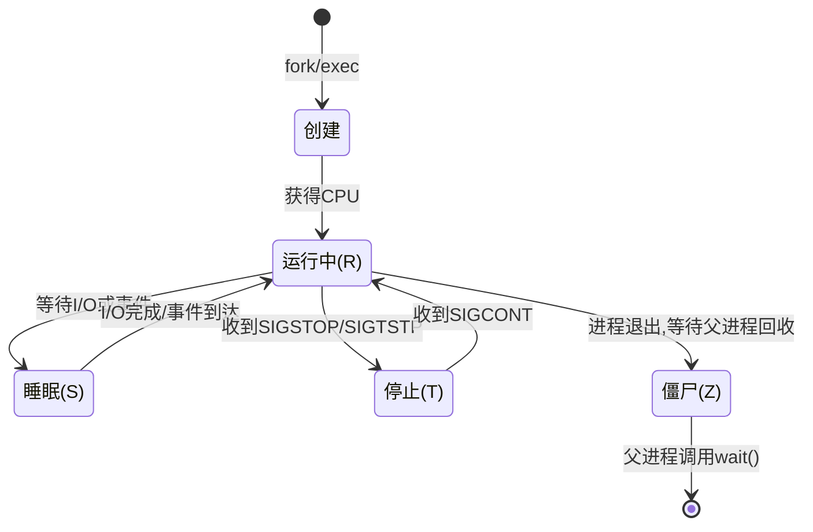
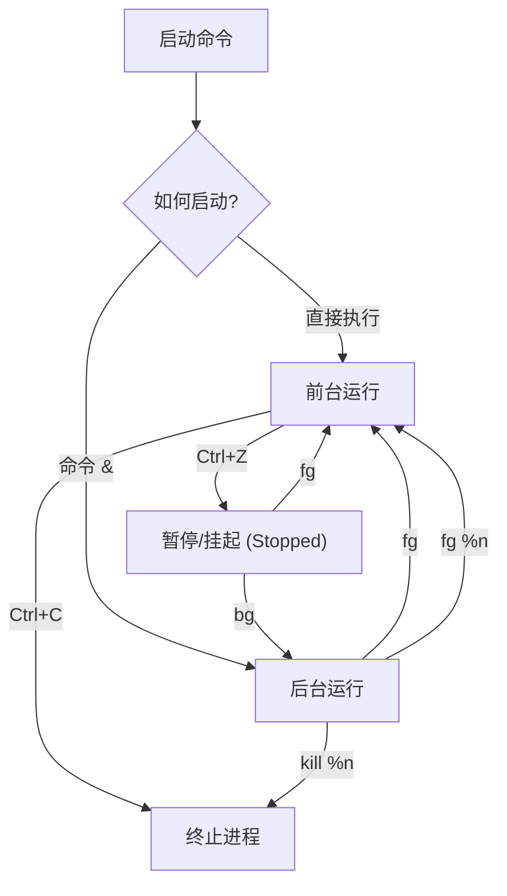
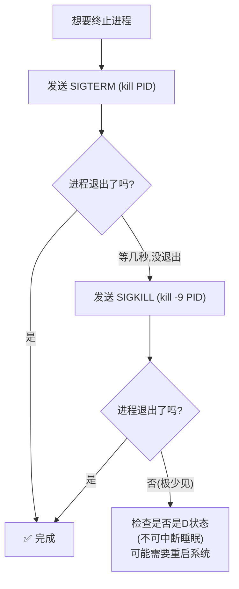

[toc]


## 基础知识


**进程**是**程序**在**内存中运行**的**实例**。每个进程都由一个称为**进程标识符** **(PID)** 的数字标识。

每个进程都有自己**私有的内存区域**，其他进程无法访问该区域。进程将自身的变量和其他数据存储在这个区域内。

内核会跟踪所有这些进程，并在***进程表***中存储一些关于它们的**基本元数据**。

然而，在大多数情况下，每个进程都是自主的，在其内核授予的权限范围内运行。**一旦进程启动，除了挂起（暂停）或终止它之外，很难对其进行任何操作** 。

内核存储的元数据包括**进程“名称”和“命令行”**。这些信息并**不可靠**；

- 进程的“名称”取决于你**运行它时指定的参数**，可能与**程序的文件名**没有任何关系。（在某些系统中，运行中的进程还可以更改自身名称。例如，sendmail 就使用这种方式来显示其状态。）
- 因此，在操作进程时，你***必须***知道它的**进程 ID (PID,ProcessID)** 才能对其进行任何可靠的操作。
- 总之,通过**名称**查找进程极其**不可靠**。


## 核心概念

###  什么是进程？

进程是**正在运行的程序的实例**。当你在 Bash 中执行一条命令时，系统会创建一个进程来完成这项工作。

每个进程都拥有：

| 属性       | 说明                         | 示例                   |
| ---------- | ---------------------------- | ---------------------- |
| **PID**    | 进程唯一标识符（Process ID） | `1234`                 |
| **PPID**   | 父进程 ID（Parent PID）      | `1230`                 |
| **UID**    | 运行该进程的用户 ID          | `1000`                 |
| **状态**   | 进程当前的运行状态           | 运行、睡眠、停止、僵尸 |
| **优先级** | 进程获得 CPU 时间的优先程度  | `NI=0`（默认）         |

###  进程的生命周期



###  前台进程 vs 后台进程

| 特性              | 前台进程             | 后台进程             |
| ----------------- | -------------------- | -------------------- |
| **启动方式**      | 直接执行命令         | 命令末尾加 `&`       |
| **终端占用**      | ✅ 占用终端，阻塞输入 | ❌ 不占用终端         |
| **Ctrl+C 可中断** | ✅ 是                 | ❌ 否                 |
| **输出**          | 直接显示在终端       | 也会显示（可能混乱） |
| **典型场景**      | 交互式操作           | 长时间运行的任务     |

---

## 查看进程

###  常用查看命令对比

| 命令     | 用途                | 特点                       |
| -------- | ------------------- | -------------------------- |
| `ps`     | 查看进程快照        | 静态，一次性输出           |
| `top`    | 实时监控进程        | 动态刷新，交互式           |
| `htop`   | 增强版 top          | 彩色界面，更直观（需安装） |
| `pgrep`  | 按名称/条件搜索进程 | 只输出 PID，适合脚本       |
| `pstree` | 树状显示进程关系    | 直观展示父子关系           |

###  `ps` 命令详解

```bash
# 查看当前终端的进程
ps

# 查看所有进程（最常用的两种风格）
ps aux          # BSD 风格（无横杠）
ps -ef          # UNIX/System V 风格

# 查看特定用户的进程
ps -u username

# 自定义输出列
ps -eo pid,ppid,user,%cpu,%mem,stat,cmd --sort=-%cpu

# 查看进程树
ps -ejH
ps axjf
```

**`ps aux` 输出解读：**

```
USER       PID %CPU %MEM    VSZ   RSS TTY    STAT START   TIME COMMAND
root         1  0.0  0.1 169516 13092 ?      Ss   09:00   0:02 /sbin/init
alice     3456  2.1  1.5 524680 61440 pts/0  Sl   10:15   1:30 /usr/bin/python3 app.py
```

| 列        | 含义                                   |
| --------- | -------------------------------------- |
| `USER`    | 进程所有者                             |
| `PID`     | 进程 ID                                |
| `%CPU`    | CPU 使用率                             |
| `%MEM`    | 内存使用率                             |
| `VSZ`     | 虚拟内存大小（KB）                     |
| `RSS`     | 实际内存使用（KB）                     |
| `TTY`     | 关联终端（`?` 表示无终端，即守护进程） |
| `STAT`    | 进程状态                               |
| `COMMAND` | 启动命令                               |

**STAT 状态码含义：**

| 状态码 | 含义       | 说明                        |
| ------ | ---------- | --------------------------- |
| `R`    | Running    | 正在运行或在运行队列中      |
| `S`    | Sleeping   | 可中断的睡眠（等待事件）    |
| `D`    | Disk sleep | 不可中断的睡眠（通常是I/O） |
| `T`    | Stopped    | 被信号停止                  |
| `Z`    | Zombie     | 僵尸进程，已终止但未被回收  |
| `s`    | 小写 s     | 会话首领（Session leader）  |
| `l`    | 小写 l     | 多线程                      |
| `+`    |            | 前台进程组成员              |
| `<`    |            | 高优先级                    |
| `N`    |            | 低优先级                    |

###  `top` / `htop` 实时监控

```bash
# 启动 top
top

# 常用交互快捷键（在 top 界面内）：
# q     - 退出
# k     - 杀死进程（输入 PID）
# M     - 按内存排序
# P     - 按 CPU 排序
# 1     - 显示每个 CPU 核心
# h     - 帮助

# htop（更现代的替代品，需安装）
sudo apt install htop   # Debian/Ubuntu
sudo dnf install htop   # Fedora/RHEL
htop
```

###  `pgrep` 按名称查找进程

```bash
# 查找名为 nginx 的进程 PID
pgrep nginx

# 显示完整命令行
pgrep -a nginx

# 查找特定用户的进程
pgrep -u alice python

# 列出进程名和 PID
pgrep -l ssh
```

---

## 前台与后台进程管理

###  核心操作流程



###  实操演示

```bash
# ① 启动一个前台进程
sleep 300

# ② Ctrl+Z 暂停它
# 输出: [1]+  Stopped     sleep 300

# ③ 查看所有后台作业
jobs
# 输出: [1]+  Stopped     sleep 300

# ④ 将暂停的作业放到后台继续运行
bg %1
# 输出: [1]+ sleep 300 &

# ⑤ 直接启动一个后台进程
sleep 600 &
# 输出: [2] 12345

# ⑥ 查看所有作业
jobs -l
# 输出:
# [1]  11111 Running    sleep 300 &
# [2]- 12345 Running    sleep 600 &

# ⑦ 将后台作业调回前台
fg %1

# ⑧ Ctrl+C 终止前台进程
```

###  `jobs` 命令详解

```bash
jobs        # 列出当前 shell 的所有作业
jobs -l     # 同时显示 PID
jobs -r     # 只显示运行中的作业
jobs -s     # 只显示已停止的作业
```

**作业标识符：**

| 标识符       | 含义                            |
| ------------ | ------------------------------- |
| `%1`         | 作业编号 1                      |
| `%+` 或 `%%` | 当前作业（最近一个后台/暂停的） |
| `%-`         | 上一个作业                      |
| `%string`    | 命令以 string 开头的作业        |
| `%?string`   | 命令包含 string 的作业          |

```bash
# 示例
fg %1           # 将作业 1 调到前台
bg %2           # 让作业 2 在后台继续运行
kill %1         # 终止作业 1
fg %sleep       # 将以 "sleep" 开头的命令调到前台
fg %?app.py     # 将包含 "app.py" 的命令调到前台
```

---

## 信号（Signal）与进程控制

###  什么是信号？

信号是操作系统向进程发送的**异步通知**，用于通知进程某个事件已发生。可以理解为"拍一下进程的肩膀，告诉它该做什么"。

###  常用信号一览

| 信号编号 | 信号名    | 快捷键   | 含义                           | 能否被捕获 |
| -------- | --------- | -------- | ------------------------------ | ---------- |
| `1`      | `SIGHUP`  | —        | 终端挂断/重新加载配置          | ✅          |
| `2`      | `SIGINT`  | `Ctrl+C` | 中断进程（礼貌请求退出）       | ✅          |
| `3`      | `SIGQUIT` | `Ctrl+\` | 退出并生成 core dump           | ✅          |
| `9`      | `SIGKILL` | —        | **强制杀死**（无法捕获）       | ❌          |
| `15`     | `SIGTERM` | —        | 终止进程（默认信号，优雅退出） | ✅          |
| `18`     | `SIGCONT` | —        | 继续已停止的进程               | ✅          |
| `19`     | `SIGSTOP` | —        | **强制停止**（无法捕获）       | ❌          |
| `20`     | `SIGTSTP` | `Ctrl+Z` | 终端停止（可捕获的暂停）       | ✅          |

> 📌 **记住这个优先级**：先尝试 `SIGTERM`(15) → 不行再用 `SIGKILL`(9)

###  `kill` 命令

```bash
# 语法
kill [-signal] PID

# 发送默认信号 SIGTERM（优雅终止）
kill 12345

# 发送 SIGKILL（强制杀死）
kill -9 12345
kill -KILL 12345
kill -SIGKILL 12345    # 三种写法等价

# 发送 SIGHUP（通常用于重载配置）
kill -1 12345
kill -HUP 12345

# 查看所有可用信号
kill -l

# 杀死作业
kill %1
```

###  `killall` 和 `pkill`

```bash
# killall：按进程名杀死所有匹配进程
killall nginx
killall -9 python3

# pkill：按模式匹配杀死进程（更灵活）
pkill -f "python3 app.py"    # -f 匹配完整命令行
pkill -u alice               # 杀死用户 alice 的所有进程
pkill -STOP -u alice         # 暂停用户 alice 的所有进程
```

###  终止进程的最佳实践流程



> ⚠️ **为什么不要直接用 `kill -9`？**
> - `SIGTERM` 允许进程清理资源（关闭文件、释放锁、保存数据）
> - `SIGKILL` 是暴力终止，可能导致数据损坏、临时文件残留、锁未释放

---

## `nohup` 与后台长期任务

###  问题：终端关闭，进程也死了？

默认情况下，当你关闭终端时，终端会向其所有子进程发送 `SIGHUP` 信号，导致进程被终止。

###  解决方案对比

| 方法      | 命令示例               | 适用场景                 | 现代推荐度 |
| --------- | ---------------------- | ------------------------ | ---------- |
| `nohup`   | `nohup cmd &`          | 简单的一次性任务         | ⭐⭐⭐        |
| `disown`  | 先 `cmd &` 再 `disown` | 忘记加 nohup 的补救      | ⭐⭐         |
| `screen`  | `screen -S name`       | 需要重新连接的交互式任务 | ⭐⭐⭐        |
| `tmux`    | `tmux new -s name`     | 同 screen，更现代        | ⭐⭐⭐⭐⭐      |
| `systemd` | 编写 .service 文件     | 生产环境的守护进程       | ⭐⭐⭐⭐⭐      |

###  `nohup` 用法

```bash
# 基本用法：输出默认写入 nohup.out
nohup long_running_script.sh &

# 自定义输出重定向（最佳实践）
nohup ./my_task.sh > output.log 2>&1 &

# 记录 PID 方便后续管理
nohup ./my_task.sh > output.log 2>&1 &
echo $!     # $! 是最近一个后台进程的 PID
echo $! > /tmp/my_task.pid   # 保存 PID 到文件
```

###  `disown` 补救措施

```bash
# 场景：已经在后台运行了，但忘了加 nohup
./long_task.sh &
# [1] 56789

# 补救：从 shell 的作业表中移除，不再受 SIGHUP 影响
disown %1

# 或者移除所有后台作业
disown -a

# 如果进程还在前台运行：
# 1. Ctrl+Z 暂停
# 2. bg 放到后台
# 3. disown 脱离终端
```

---

## 实用技巧与最佳实践

###  等待后台进程完成

```bash
# 启动多个后台任务
task1.sh &
PID1=$!

task2.sh &
PID2=$!

task3.sh &
PID3=$!

# 等待所有后台任务完成
wait $PID1 $PID2 $PID3
echo "所有任务已完成"

# 或者等待所有后台任务
wait
echo "全部完成"

# 获取退出状态
task.sh &
wait $!
echo "退出码: $?"
```

###  子shell 与进程替换

```bash
# 子shell（在子进程中执行，不影响当前 shell）
(cd /tmp && tar czf backup.tar.gz .)
pwd    # 仍然在原来的目录

# 管道中的每个命令都是独立进程
cat file.txt | grep "error" | wc -l
# 这里创建了 3 个进程，通过管道连接

# 查看当前 shell 的 PID
echo $$

# 查看最近后台进程的 PID
echo $!
```

###  常用特殊变量

| 变量       | 含义                              | 示例                    |
| ---------- | --------------------------------- | ----------------------- |
| `$$`       | 当前 shell 的 PID                 | `echo $$` → `3456`      |
| `$!`       | 最近一个后台进程的 PID            | `sleep 10 & echo $!`    |
| `$?`       | 上一个命令的退出码                | `echo $?` → `0` (成功)  |
| `$BASHPID` | 当前 bash 进程的 PID（含子shell） | 在子shell中与 `$$` 不同 |

```bash
# $$ vs $BASHPID 的区别
echo "Shell PID: $$"                     # 主 shell PID
(echo "子shell \$\$: $$")               # 仍显示主 shell PID
(echo "子shell BASHPID: $BASHPID")      # 显示子 shell 的真实 PID
```

###  使用 `trap` 捕获信号

```bash
#!/bin/bash
# 优雅退出示例

# 定义清理函数
cleanup() {
    echo "正在清理临时文件..."
    rm -f /tmp/my_app_*.tmp
    echo "清理完成，退出"
    exit 0
}

# 捕获 SIGTERM 和 SIGINT 信号
trap cleanup SIGTERM SIGINT

# 捕获脚本退出事件（无论什么原因退出都执行）
trap 'echo "脚本结束"' EXIT

echo "程序运行中 (PID: $$)，按 Ctrl+C 退出..."

# 模拟长时间运行
while true; do
    echo "工作中... $(date)"
    sleep 5
done
```

---

## 综合实战示例

###  并行处理文件并等待完成

```bash
#!/bin/bash
# 并行压缩当前目录下的所有 .log 文件

PIDS=()

for file in *.log; do
    [ -f "$file" ] || continue
    echo "正在压缩: $file"
    gzip "$file" &
    PIDS+=($!)       # 记录每个后台进程的 PID
done

echo "等待所有压缩任务完成..."
for pid in "${PIDS[@]}"; do
    wait "$pid"
    echo "进程 $pid 完成，退出码: $?"
done

echo "✅ 所有文件压缩完成"
```

###  超时控制

```bash
#!/bin/bash
# 方法 1：使用 timeout 命令（推荐）
timeout 10 ./slow_command.sh
if [ $? -eq 124 ]; then
    echo "命令超时"
fi

# 方法 2：手动实现超时
./slow_command.sh &
PID=$!

sleep 10 &
TIMER=$!

# 等待任一完成
wait -n $PID $TIMER 2>/dev/null

if kill -0 $PID 2>/dev/null; then
    # slow_command 仍在运行，说明是计时器先到
    echo "超时，终止进程"
    kill $PID
else
    # slow_command 已完成，取消计时器
    kill $TIMER 2>/dev/null
    echo "命令正常完成"
fi
```

###  监控进程是否存活

```bash
#!/bin/bash
# 简单的进程守护脚本

APP="./my_server.sh"

while true; do
    if ! pgrep -f "$APP" > /dev/null; then
        echo "$(date): 进程未运行，正在重启..."
        nohup $APP >> /var/log/my_server.log 2>&1 &
    fi
    sleep 30
done
```

---

## 速查总结

### 快捷键速查

| 快捷键   | 作用                               |
| -------- | ---------------------------------- |
| `Ctrl+C` | 发送 `SIGINT`，中断前台进程        |
| `Ctrl+Z` | 发送 `SIGTSTP`，暂停前台进程       |
| `Ctrl+\` | 发送 `SIGQUIT`，退出并 core dump   |
| `Ctrl+D` | 发送 EOF（不是信号），关闭标准输入 |

### 命令速查

| 需求         | 命令                          |
| ------------ | ----------------------------- |
| 后台运行     | `cmd &`                       |
| 查看作业     | `jobs -l`                     |
| 恢复到前台   | `fg %n`                       |
| 后台继续运行 | `bg %n`                       |
| 优雅终止     | `kill PID`                    |
| 强制终止     | `kill -9 PID`                 |
| 按名终止     | `killall name` / `pkill name` |
| 按名查找     | `pgrep -a name`               |
| 断线保活     | `nohup cmd &`                 |
| 等待后台完成 | `wait PID`                    |
| 捕获信号     | `trap 'handler' SIGNAL`       |
| 查看进程树   | `pstree -p`                   |

💡 **给新手的建议**：

> 1. 先熟练使用 `ps aux | grep xxx`、`Ctrl+C`、`Ctrl+Z`、`bg`、`fg`
> 2. 养成使用 `SIGTERM` 优先于 `SIGKILL` 的习惯
> 3. 长期任务优先考虑 `tmux`/`screen` 而非 `nohup`
> 4. 生产环境的守护进程应使用 `systemd` 管理，而非脚本循环
