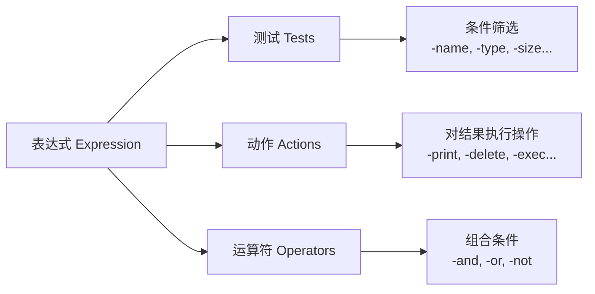
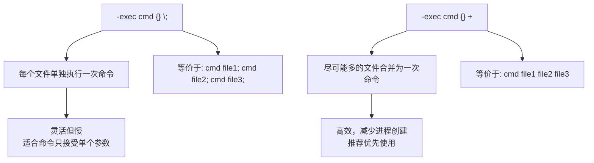
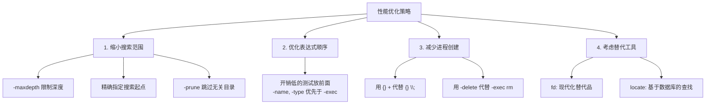

[toc]

# Linux `find` 命令完全指南

## 一、概述

`find` 是 Linux 下最强大的文件搜索工具，它从指定目录出发，**递归遍历目录树**，根据用户定义的条件匹配文件，并可对结果执行操作。

### 核心思维模型

```bash
find [搜索起点...] [表达式]
```

其中**表达式**由三大要素组成：



> **核心原理**：`find` 对目录树中的每一个文件/目录，**从左到右依次评估表达式**。
>
> 表达式的**每个部分**返回 `true` 或 `false`，最终决定是否对该文件执行动作。这就是为什么**参数顺序很重要**。

---

## 二、基本语法速查

| 组成部分               | 说明                      | 示例                                |
| ---------------------- | ------------------------- | ----------------------------------- |
| **搜索起点**           | 一个或多个目录路径        | `.` `/home` `/var/log`              |
| **测试（Test）**       | 筛选条件，返回 true/false | `-name "*.log"`                     |
| **动作（Action）**     | 对匹配文件执行的操作      | `-print`、`-delete`、`-exec`        |
| **运算符（Operator）** | 逻辑组合多个条件          | `-and`、`-or`、`-not`、`()`         |
| **选项（Option）**     | 控制 find 自身行为        | `-maxdepth`、`-mindepth`、`-follow` |

---

## 三、搜索条件详解

### 3.1 按名称搜索

| 条件              | 说明                                     | 示例                           |
| ----------------- | ---------------------------------------- | ------------------------------ |
| `-name pattern`   | 文件名匹配（**区分大小写**），支持通配符 | `find . -name "*.txt"`         |
| `-iname pattern`  | 文件名匹配（**不区分大小写**）           | `find . -iname "*.JPG"`        |
| `-path pattern`   | 匹配完整路径                             | `find . -path "*/src/*.java"`  |
| `-regex pattern`  | 用正则匹配完整路径                       | `find . -regex ".*\.\(c\|h\)"` |
| `-iregex pattern` | 正则匹配（不区分大小写）                 | `find . -iregex ".*\.jpe?g"`   |

#### 通配表达式陷阱

`-name` 的参数包含通配符 `*`、`?`、`[]` 时必须**加引号**(也就是阻止shell(比如bash)展开通配符),否则会被 Shell 提前展开。

`-name`最终接受到的参数可能就不是原来的样子,可能导致`-name`的选项参数不是一个而是很多个,这通常不是我想要的。

`find`命令的`-name`可以理解通配表达式字符串，解释通配符的任务应该交给`find`而不应该被shell执行.

> ```bash
> # ❌ 错误：Shell 会展开 *.txt
> find . -name *.txt
> 
> # ✅ 正确：引号保护通配符
> find . -name "*.txt"
> ```

### 3.2 按类型搜索

| `-type` 参数 | 含义           | 说明   |
| :----------: | -------------- | ------ |
|     `f`      | 普通文件       | 最常用 |
|     `d`      | 目录           |        |
|     `l`      | 符号链接       |        |
|     `b`      | 块设备         | 如磁盘 |
|     `c`      | 字符设备       | 如终端 |
|     `p`      | 命名管道(FIFO) |        |
|     `s`      | 套接字(Socket) |        |

```bash
# 只查找目录
find /var -type d -name "log"

# 只查找普通文件
find . -type f -name "*.conf"

# 查找损坏的符号链接
find . -xtype l
```

### 3.3 按大小搜索

**大小单位说明**：

| 后缀 | 含义            | 说明 |
| :--: | --------------- | ---- |
| `c`  | 字节(byte)      |      |
| `k`  | KiB (1024 字节) |      |
| `M`  | MiB (1024 KiB)  |      |
| `G`  | GiB (1024 MiB)  |      |

**前缀含义**（这是 `find` 中数值参数的通用规则）：

|     前缀      | 含义       | 示例                         |
| :-----------: | ---------- | ---------------------------- |
|     `+n`      | 大于 n     | `-size +100M` → 大于 100 MiB |
|     `-n`      | 小于 n     | `-size -1k` → 小于 1 KiB     |
| `n`（无前缀） | 恰好等于 n | `-size 0` → 空文件           |

```bash
# 查找大于 500MB 的文件
find / -type f -size +500M

# 查找空文件
find . -type f -empty

# 查找空目录
find . -type d -empty
```

### 3.4 按时间搜索

`find` 中有三组时间戳：

| 属性                            |   按天   | 按分钟  | 含义                                           |
| ------------------------------- | :------: | :-----: | ---------------------------------------------- |
| **修改时间**(Modification time) | `-mtime` | `-mmin` | 文件**内容**最后被修改的时间                   |
| **访问时间**(Access time)       | `-atime` | `-amin` | 文件最后被读取的时间                           |
| **状态变更时间**(Change time)   | `-ctime` | `-cmin` | 文件**元数据**（权限、所有者等）最后变更的时间 |

> **`+n` / `-n` / `n` 在时间中的精确含义**（以 `-mtime` 为例）：
>
> ```
> 时间轴（天）：  现在  1天前  2天前  3天前  4天前
>               |------|------|------|------|
> 
> -mtime 0  →  [0, 1) 天前修改  → 24小时内
> -mtime 1  →  [1, 2) 天前修改
> -mtime +1 →  ≥2 天前修改（严格大于1个完整24h周期）
> -mtime -1 →  <1 天前修改（即不到24小时）
> ```

```bash
# 最近 7 天内修改过的文件
find . -type f -mtime -7

# 超过 30 天未访问的文件
find . -type f -atime +30

# 最近 10 分钟内修改的文件
find . -type f -mmin -10

# 比 reference.txt 更新的文件
find . -type f -newer reference.txt
```

### 3.5 按权限和所有者搜索

| 条件          | 说明                             | 示例                                |
| ------------- | -------------------------------- | ----------------------------------- |
| `-perm mode`  | 权限**精确等于** mode            | `-perm 0755`                        |
| `-perm -mode` | 权限中**至少包含** mode 的所有位 | `-perm -0111`（所有人都有执行权限） |
| `-perm /mode` | 权限中**包含 mode 的任意一位**   | `-perm /0111`（任何人有执行权限）   |
| `-user name`  | 属于指定用户                     | `-user root`                        |
| `-group name` | 属于指定组                       | `-group www-data`                   |
| `-nouser`     | 没有有效用户（孤儿文件）         | 常用于安全审计                      |
| `-nogroup`    | 没有有效组                       | 常用于安全审计                      |

```bash
# 查找全局可写文件（安全审计）
find / -type f -perm -0002

# 查找 SUID 程序（安全审计）
find / -type f -perm -4000

# 查找属于已删除用户的文件
find /home -nouser
```

> **`-perm` 的三种模式理解**：
> ```
> 文件实际权限: rwxr-xr-- (0754)
> 
> -perm 0754   → 精确匹配 0754 ✅
> -perm -0754  → 实际权限是否包含所有 0754 的位？ ✅
> -perm -0755  → 实际权限包含所有 0755 的位？ ❌ (缺少 other 的 x)
> -perm /0001  → 任意人有 x 权限？ ✅ (owner 有 x)
> ```

### 3.6 按深度控制

| 选项          | 说明              | 示例                                   |
| ------------- | ----------------- | -------------------------------------- |
| `-maxdepth n` | 最多搜索 n 层深度 | `-maxdepth 1` 只搜索当前目录           |
| `-mindepth n` | 从第 n 层开始匹配 | `-mindepth 2` 跳过当前目录和一级子目录 |

> ⚠️ `-maxdepth` 和 `-mindepth` 是**全局选项**，必须放在其他测试/动作**之前**。

```bash
# 只在当前目录查找（不递归）
find . -maxdepth 1 -type f -name "*.sh"

# 只查找第 2 层及以下
find . -mindepth 2 -name "*.conf"
```

---

## 四、逻辑运算符

### 4.1 运算符一览

| 运算符     | 简写 | 说明                           |
| ---------- | ---- | ------------------------------ |
| `-and`     | `-a` | 逻辑与（**默认行为**，可省略） |
| `-or`      | `-o` | 逻辑或                         |
| `-not`     | `!`  | 逻辑非                         |
| `( expr )` |      | 分组（需转义括号）             |

> **短路求值**：和大多数编程语言一样：
> - `-and`：左边为 false 则不评估右边
> - `-or`：左边为 true 则不评估右边

### 4.2 运算符优先级（从高到低）

|  优先级   | 运算符                |
| :-------: | --------------------- |
| 1（最高） | `( )` 分组            |
|     2     | `!` / `-not`          |
|     3     | `-and` / `-a`（默认） |
| 4（最低） | `-or` / `-o`          |

### 4.3 组合条件实例

```bash
# 查找 .jpg 或 .png 文件
find . -type f \( -name "*.jpg" -o -name "*.png" \)

# 查找非 .log 文件
find . -type f ! -name "*.log"

# 查找大于 10MB 且 30 天未修改的文件
find . -type f -size +10M -mtime +30

# 复杂组合：查找 .py 或 .js 文件，但排除 node_modules 目录
find . \( -name "*.py" -o -name "*.js" \) ! -path "*/node_modules/*"
```

> ⚠️ **括号必须转义**：`\( \)` 或 `'(' ')'`，因为圆括号在 Shell 中有特殊含义。

---

## 五、执行动作

### 5.1 动作一览

| 动作                 | 说明                         | 示例                           |
| -------------------- | ---------------------------- | ------------------------------ |
| `-print`             | 打印文件路径（**默认动作**） | 每行一个结果                   |
| `-print0`            | 以 null 字符分隔输出         | 配合 `xargs -0` 处理特殊文件名 |
| `-ls`                | 以 `ls -l` 格式显示          | 查看详细信息                   |
| `-delete`            | 删除匹配的文件               | **危险操作，先 -print 确认！** |
| `-exec cmd {} \;`    | 对每个文件执行命令           | `{}` 代表当前文件路径          |
| `-exec cmd {} +`     | 尽可能多个文件一次性传给命令 | 类似 xargs，效率更高           |
| `-execdir cmd {} \;` | 在文件所在目录中执行命令     | 更安全，避免路径竞争           |
| `-ok cmd {} \;`      | 同 `-exec`，但每次执行前确认 | 交互式，适合谨慎操作           |

### 5.2 `-exec` 的两种形式详解



```bash
# \; 形式：每个文件执行一次 chmod
find . -type f -name "*.sh" -exec chmod +x {} \;

# + 形式：所有文件一次性传给 chmod（推荐，更高效）
find . -type f -name "*.sh" -exec chmod +x {} +

# 将每个 .bak 文件移动到 /tmp（只能用 \; 因为命令中 {} 不在末尾）
find . -name "*.bak" -exec mv {} /tmp/ \;

# 交互式删除（每个文件都询问）
find . -name "*.tmp" -ok rm {} \;
```

### 5.3 配合 `xargs`

```bash
# 基本用法（文件名无特殊字符时）
find . -name "*.log" | xargs wc -l

# ✅ 最佳实践：处理含空格/特殊字符的文件名
find . -name "*.log" -print0 | xargs -0 wc -l

# 限制每次传递的参数数量
find . -name "*.jpg" -print0 | xargs -0 -n 10 convert_images

# 并行执行（GNU xargs）
find . -name "*.gz" -print0 | xargs -0 -P 4 gunzip
```

> **`-exec {} +` vs `xargs` 的选择**：
>
> | 特性           |   `-exec {} +`    |        `xargs`        |
> | -------------- | :---------------: | :-------------------: |
> | 处理特殊文件名 |    ✅ 自动安全     | 需要 `-print0` + `-0` |
> | 并行执行       |         ❌         |      ✅ `-P` 参数      |
> | 灵活的参数位置 | ❌ `{}` 必须在最后 |       ✅ `-I {}`       |
> | 管道组合       |         ❌         |           ✅           |
> | 额外进程开销   |        无         |  有（但通常可忽略）   |

---

## 六、排除目录（`-prune`）

`-prune` 是 `find` 中最容易困惑的特性。它的作用是：**当 `find` 遍历到某个目录时，阻止进入该目录**。

### 工作原理


### 使用模式

```bash
# 排除 .git 目录
find . -path "./.git" -prune -o -type f -name "*.py" -print

# 排除多个目录
find . \( -path ./node_modules -o -path ./.git -o -path ./vendor \) \
       -prune -o -type f -name "*.js" -print
```

> ⚠️ **关键细节**：使用 `-prune` 时，`-print` 必须**显式写出**。如果省略，被 prune 的目录本身也会被打印出来（因为 `-prune` 返回 true）。

### `-prune` 的固定套路

```bash
find [起点] [排除条件] -prune -o [真正的搜索条件] -print
#           ↑排除部分↑         ↑    ↑实际搜索部分↑
#                              或
```

翻译成伪代码：
```
对每个文件:
  if (匹配排除条件):
      跳过（不进入该目录）
  else:
      if (匹配搜索条件):
          打印
```

---

## 七、实用场景与经典用例

### 7.1 日常文件管理

```bash
# 1. 查找并删除所有 .DS_Store 文件（macOS 残留）
find . -name ".DS_Store" -delete

# 2. 查找重复的大文件（大于 100MB）
find / -type f -size +100M -exec ls -lhS {} + 2>/dev/null

# 3. 查找最近 24 小时修改过的文件
find . -type f -mtime 0

# 4. 查找并统计各类型文件数量
find . -type f | sed 's/.*\.//' | sort | uniq -c | sort -rn | head -20

# 5. 查找空目录并删除
find . -type d -empty -delete
```

### 7.2 权限与安全审计

```bash
# 1. 查找全局可写文件（排除 /proc 和 /sys）
find / \( -path /proc -o -path /sys \) -prune \
       -o -type f -perm -0002 -print

# 2. 查找 SUID/SGID 程序
find / -type f \( -perm -4000 -o -perm -2000 \) -exec ls -l {} +

# 3. 查找无主文件
find / -nouser -o -nogroup 2>/dev/null

# 4. 修复目录和文件权限
find /var/www -type d -exec chmod 755 {} +
find /var/www -type f -exec chmod 644 {} +
```

### 7.3 磁盘清理

```bash
# 1. 查找大文件 TOP 20
find / -type f -exec du -h {} + 2>/dev/null | sort -rh | head -20

# 2. 删除 30 天前的日志文件
find /var/log -name "*.log" -type f -mtime +30 -delete

# 3. 清理旧的 core dump 文件
find / -name "core" -type f -size +1M -mtime +7 -delete

# 4. 查找指定时间范围内的文件（2024年1月的文件）
find . -type f -newermt "2024-01-01" ! -newermt "2024-02-01"
```

### 7.4 开发场景

```bash
# 1. 项目中搜索代码（排除依赖目录）
find . \( -path ./node_modules -o -path ./.git -o -path ./vendor \) \
       -prune -o -type f \( -name "*.js" -o -name "*.ts" \) -print \
       | xargs grep -l "TODO"

# 2. 查找所有 Python 文件并统计行数
find . -name "*.py" -type f -exec cat {} + | wc -l

# 3. 批量替换文件中的字符串
find . -name "*.conf" -type f -exec \
    sed -i 's/old_server/new_server/g' {} +

# 4. 查找最近修改的源码文件
find src/ -name "*.java" -mmin -60

# 5. 为所有 shell 脚本添加执行权限
find scripts/ -name "*.sh" -type f ! -perm -0100 -exec chmod +x {} +
```

### 7.5 文件备份与同步

```bash
# 1. 查找修改过的文件并打包
find /etc -type f -mtime -1 -print0 | tar czf /backup/etc-changes.tar.gz --null -T -

# 2. 复制目录结构（不复制文件）
find src/ -type d -exec mkdir -p dest/{} \;

# 3. 同步特定类型的文件
find . -name "*.pdf" -newer /tmp/last_sync -exec cp {} /backup/pdfs/ \;
```

---

## 八、性能优化

### 8.1 优化原则



### 8.2 性能对比

| 场景     | 慢 ❌                       | 快 ✅                               | 原因                         |
| -------- | -------------------------- | ---------------------------------- | ---------------------------- |
| 删除文件 | `-exec rm {} \;`           | `-delete`                          | 避免为每个文件 fork 进程     |
| 批量操作 | `-exec cmd {} \;`          | `-exec cmd {} +`                   | 合并执行，减少进程数         |
| 排除目录 | `! -path "*/dir/*"`        | `-path ./dir -prune -o ... -print` | prune 直接跳过，不遍历子内容 |
| 组合条件 | `-exec test ... \;` 放前面 | `-name` / `-type` 放前面           | 文件名/类型检查是 O(1)       |

```bash
# ❌ 慢：每个文件启动一个 rm 进程
find . -name "*.tmp" -exec rm {} \;

# ✅ 快：find 内置删除
find . -name "*.tmp" -delete

# ✅ 快（替代方案）：合并参数
find . -name "*.tmp" -exec rm {} +
```

### 8.3 现代替代工具对比

| 特性             | `find` |     `fd`     |    `locate`     |
| ---------------- | :----: | :----------: | :-------------: |
| 实时搜索         |   ✅    |      ✅       | ❌（依赖数据库） |
| 速度（大目录树） |   中   | 快（多线程） |      极快       |
| 默认忽略 .git    |   ❌    |      ✅       |       N/A       |
| 正则语法         | POSIX  |     默认     |    简单通配     |
| 内置操作         |  丰富  |     基本     |       无        |
| 预装             |   ✅    |      ❌       |     通常是      |
| 复杂条件组合     | ✅ 强大 |     有限     |        ❌        |

```bash
# fd 的等价用法（供参考）
fd "\.py$"                    # find . -name "*.py"
fd -e jpg -e png              # find . -name "*.jpg" -o -name "*.png"
fd -H -I "config"             # 包含隐藏文件和 gitignore 忽略的文件
```

---

## 九、最佳实践总结

### ✅ 推荐做法

```bash
# 1. 删除前先预览
find . -name "*.bak" -print        # 先看看会删什么
find . -name "*.bak" -delete       # 确认后再删除

# 2. 始终使用 -print0 + xargs -0 处理文件名
find . -type f -print0 | xargs -0 grep "pattern"

# 3. 使用 {} + 代替 {} \; 提升性能
find . -name "*.log" -exec gzip {} +

# 4. 使用 -maxdepth 限制不必要的递归
find /var/log -maxdepth 2 -name "*.log"

# 5. 用 -prune 排除目录而非 ! -path
find . -path ./node_modules -prune -o -name "*.js" -print

# 6. 重定向错误（避免权限拒绝的噪音）
find / -name "myfile" -type f 2>/dev/null
```

### ❌ 常见错误

```bash
# 1. 忘记引号 → Shell 展开通配符
find . -name *.txt           # ❌
find . -name "*.txt"         # ✅

# 2. -delete 放在条件之前 → 删除所有文件！
find . -delete -name "*.tmp" # ❌ 极其危险！
find . -name "*.tmp" -delete # ✅

# 3. -prune 时忘记 -print → 被 prune 的目录也会输出
find . -path ./.git -prune -o -name "*.py"        # ❌ 会输出 .git
find . -path ./.git -prune -o -name "*.py" -print # ✅

# 4. -exec 忘记 \; 或 + 结尾
find . -name "*.sh" -exec chmod +x {}      # ❌ 语法错误
find . -name "*.sh" -exec chmod +x {} \;   # ✅

# 5. -maxdepth 位置错误
find . -name "*.log" -maxdepth 2   # ⚠️ 会警告，应放在条件之前
find . -maxdepth 2 -name "*.log"   # ✅
```

---

## 十、速查备忘表

```bash
# ─── 基础搜索 ──────────────────────────────
find . -name "*.py"                        # 按名称
find . -type f                             # 按类型
find . -size +100M                         # 按大小
find . -mtime -7                           # 7天内修改
find . -user alice                         # 按用户
find . -perm 0644                          # 按权限

# ─── 组合条件 ──────────────────────────────
find . -name "*.js" -o -name "*.ts"        # 或
find . -type f ! -name "*.log"             # 非
find . -type f -size +1M -mtime +30        # 与（默认）

# ─── 执行操作 ──────────────────────────────
find . -name "*.tmp" -delete               # 删除
find . -name "*.sh" -exec chmod +x {} +    # 批量执行
find . -name "*.log" -exec gzip {} \;      # 逐个执行
find . -type f -print0 | xargs -0 cmd      # 安全管道

# ─── 高级技巧 ──────────────────────────────
find . -path ./.git -prune -o -print       # 排除目录
find . -maxdepth 1 -type f                 # 不递归
find . -newer ref_file                     # 比较时间
find . -samefile hardlink_target           # 查找硬链接
find . -printf "%s %p\n" | sort -rn        # 自定义输出格式
```

---

> 📖 **继续学习**：`man find` 是最权威的参考。GNU findutils 的在线手册提供了更多高级用法和边界情况说明：[GNU Findutils Manual](https://www.gnu.org/software/findutils/manual/html_mono/find.html)