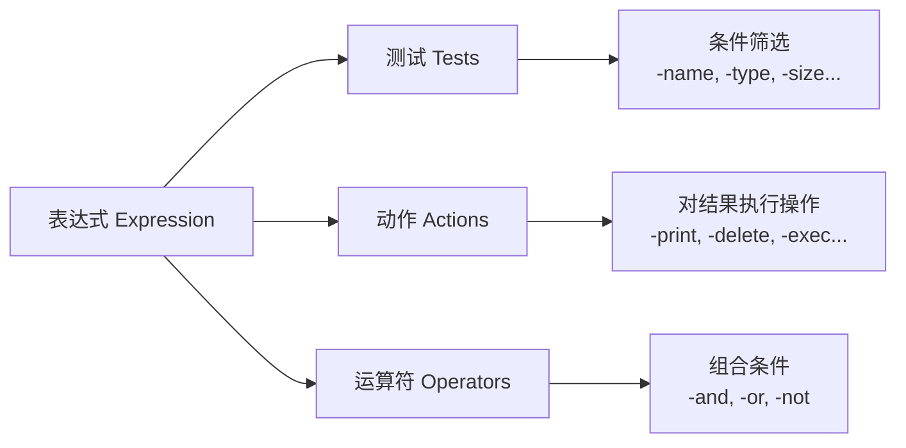
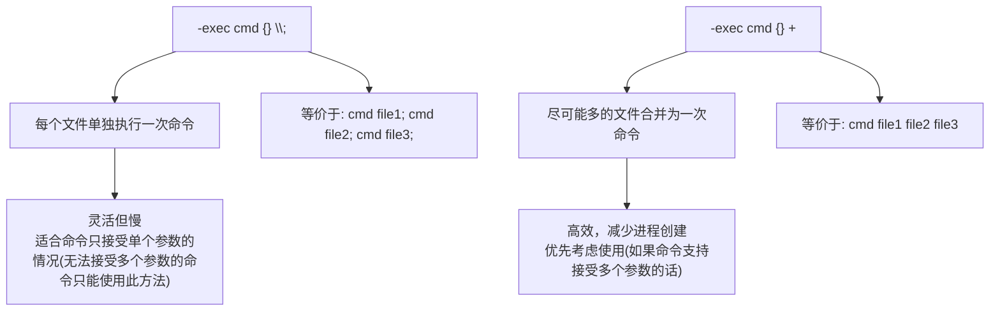
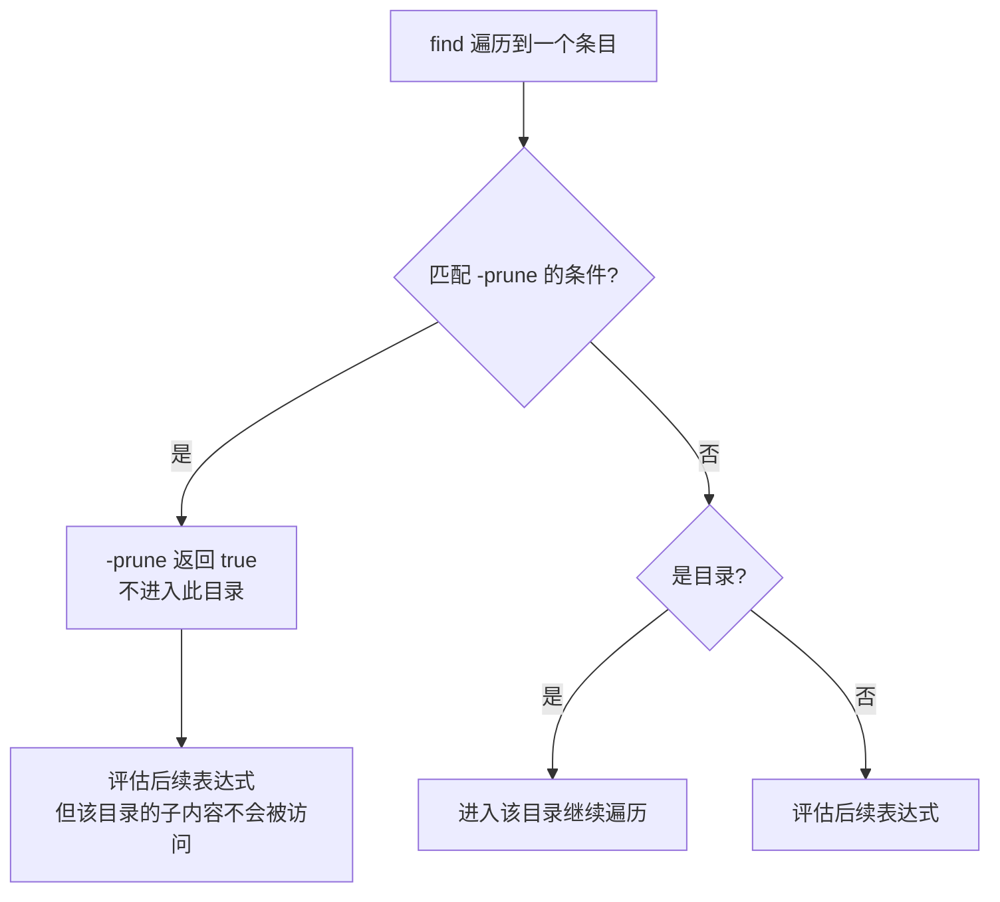
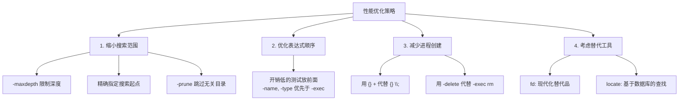

[toc]

# Linux `find` 命令完全指南

## 一、概述

`find` 是 Linux 下最强大的文件搜索工具，它从指定目录出发，**递归遍历目录树**，根据用户定义的条件匹配文件，并可对结果执行操作。

`find` 命令属于 Linux/Unix 系统中最复杂、功能最强大的命令之一。初学者在使用find时容易犯错,尤其是编写复杂搜索表达式时.

- **非线性语法**：大多数命令的参数顺序不那么严格，但 `find` 的参数（谓词）是有顺序逻辑的，甚至支持 **逻辑运算**（与 `-a`、或 `-o`、非 `!`）。
- **自身实现逻辑**：它不仅能找文件，还能直接对找到的文件执行后续操作（通过 `-exec` 或 `-delete`），这涉及到进程的调用。
- **性能差异**：不同的写法在扫描大规模磁盘时的性能表现完全不同。

### 核心思维模型

```bash
find [搜索起点...] [表达式]
```

其中**表达式**由三大要素组成：



> **核心原理**：`find` 对目录树中的每一个文件/目录，**从左到右依次评估表达式**。
>
> 表达式的**每个部分**返回 `true` 或 `false`，最终决定是否对该文件执行动作。这就是为什么**参数顺序很重要**。

在 `find` 命令的三个要素中，**最灵活且最核心的是：Tests（测试条件）**。

虽然 Operators（操作符）负责逻辑组合，Action（动作）负责结果处理，但 `find` 之所以被称为“搜索神器”，正是因为它拥有极其丰富且细致的 **Tests** 维度。

**Tests** 决定了 `find` 的“触手”能伸多远。它不只是简单的“按文件名查找”，而是能深入到文件系统的元数据（Metadata）中。

1. 极高的灵活性（多维度筛选）

你可以像拼积木一样，利用 Tests 描述出几乎任何复杂的需求：

- **按时间偏移**：`find -mtime -1`（过去 24 小时修改过的）。
- **按权限状态**：`find -perm /u+s`（查找带有 SUID 权限的文件，常用于安全审计）。
- **按空间占用**：`find -size +100M -size -500M`（查找 100M 到 500M 之间的文件）。
- **按文件类型**：`find -type l`（只找软链接）。

2. 它是 Action 的前提

没有精准的 Tests，Action 就是盲目的。比如你想清理日志，Tests 帮你精确定位到“30天前修改、后缀名为 .log、且大于 50MB”的文件，此时一个 `-delete` 动作才具有生产价值。

三者的协作关系（逻辑大脑）

如果把 `find` 比作一个执行任务的机器人：

- **Tests (测试条件)**：是机器人的**眼睛**，负责识别目标（“是不是红色的？”“重不重？”）。
- **Operators (操作符)**：是机器人的**逻辑大脑**（`-a` 与, `-o` 或, `!` 非），负责组合条件（“找红色的 **且** 重量超过 5kg 的”）。
- **Actions (动作)**：是机器人的**手**，负责处理结果（打印、删除、执行脚本）。

---

## 二、基本语法速查

| 组成部分               | 说明                      | 示例                                |
| ---------------------- | ------------------------- | ----------------------------------- |
| **搜索起点**           | 一个或多个目录路径        | `.` `/home` `/var/log`              |
| **测试（Test）**       | 筛选条件，返回 true/false | `-name "*.log"`                     |
| **动作（Action）**     | 对匹配文件执行的操作      | `-print`、`-delete`、`-exec`        |
| **运算符（Operator）** | 逻辑组合多个条件          | `-and`、`-or`、`-not`、`()`         |
| **选项（Option）**     | 控制 find 自身行为        | `-maxdepth`、`-mindepth`、`-follow` |

---

### shell特殊字符

分两方面介绍

#### 元字符回顾

在 **Bash shell** 中，元字符（metacharacters）是具有**特殊语法意义**的字符，用于控制命令解析、重定向、通配、进程控制等行为。

A character that, when unquoted, separates words. A metacharacter is a `space`, `tab`, `newline`, or one of the following characters: '|', '&', ';', '(', ')', '<', or '>'. 

一个字符，当未被引用时，用于分隔单词。元字符是 `space` 、 `tab` 、 `newline` ，或者是以下字符之一：' | '、' & '、' ; '、' ( '、' ) '、' < ' 或 ' > '。

| **字符**  | **名称**       | **主要功能说明**                                             |
| --------- | -------------- | ------------------------------------------------------------ |
| `|`       | 管道符         | 构成**管道**(pipeline),一个 `pipeline` 是由一个或多个命令组成的序列 |
| `&`       | **后台运行**   | 在命令末尾使用，使命令在后台异步执行。                       |
| `;`       | **命令分隔符** | 在同一行执行多个命令，按顺序排列。                           |
| `<`       | **输入重定向** | 改变命令的标准输入源（从文件读取）。                         |
| `>`       | **输出重定向** | 改变命令的标准输出（覆盖写入文件）。                         |
| `(` `)`   | **子 Shell**   | 在子 Shell 环境中运行括号内的命令组。                        |
| `space`   | **空格**       | 分隔命令名和参数。                                           |
| `tab`     | **制表符**     | 同空格，通常用于自动补全或分隔。                             |
| `newline` | **换行符**     | 提交并执行当前命令行。                                       |

`control operator` 

> A `token` that performs a control function. It is a `newline` or one of the following: '||’, '&&’, '&’, ';’, ';;’, ';&’, ';;&’, '|’, '|&’, '(’, or ')’.

 一个执行控制功能的符号。它可以是 `newline` 或以下之一：' ||', ' &&', ' &', ' ;', ' ;;', ' ;&', ' ;;&', ' |', ' |&', ' (', 或 ' )'。

## 三、搜索条件详解

### 3.1 按名称搜索

| 条件              | 说明                                     | 示例                           |
| ----------------- | ---------------------------------------- | ------------------------------ |
| `-name pattern`   | 文件名匹配（**区分大小写**），支持通配符 | `find . -name "*.txt"`         |
| `-iname pattern`  | 文件名匹配（**不区分大小写**）           | `find . -iname "*.JPG"`        |
| `-path pattern`   | 匹配完整路径                             | `find . -path "*/src/*.java"`  |
| `-regex pattern`  | 用正则匹配完整路径                       | `find . -regex ".*\.\(c\|h\)"` |
| `-iregex pattern` | 正则匹配（不区分大小写）                 | `find . -iregex ".*\.jpe?g"`   |

#### 通配表达式陷阱

`-name` 的参数包含通配符 `*`、`?`、`[]` 时必须**加引号**(也就是阻止shell(比如bash)展开通配符),否则会被 Shell 提前展开。

`-name`最终接受到的参数可能就不是原来的样子,可能导致`-name`的选项参数不是一个而是很多个,这通常不是我想要的。

`find`命令的`-name`可以理解通配表达式字符串，解释通配符的任务应该交给`find`而不应该被shell执行.

> ```bash
> # ❌ 错误：Shell 会展开 *.txt
> find . -name *.txt
> 
> # ✅ 正确：引号(单引号或双引号)保护通配符
> find . -name "*.txt"
> ```

### 3.2 按类型搜索

**`-type`**：检查文件**本身**的类型。如果是一个链接，它就告诉你这是个链接（`l`）。

**`-xtype`**：**解引用（Dereference）**检查。它会跳过链接本身，去看看链接背后的“真身”是什么。

| `-type` 参数 | 含义           | 说明   |
| :----------: | -------------- | ------ |
|     `f`      | 普通文件       | 最常用 |
|     `d`      | 目录           |        |
|     `l`      | 符号链接       |        |
|     `b`      | 块设备         | 如磁盘 |
|     `c`      | 字符设备       | 如终端 |
|     `p`      | 命名管道(FIFO) |        |
|     `s`      | 套接字(Socket) |        |

| **参数**       | **如果目标是“指向文件的链接”** | **如果目标是“指向目录的链接”** | **如果链接断开了（死链接）** |
| -------------- | ------------------------------ | ------------------------------ | ---------------------------- |
| `-type l`      | 匹配（它是链接）               | 匹配（它是链接）               | 匹配                         |
| **`-xtype f`** | **匹配**（真身是文件）         | 不匹配                         | 不匹配                       |
| **`-xtype d`** | 不匹配                         | **匹配**（真身是目录）         | 不匹配                       |
| **`-xtype l`** | 不匹配                         | 不匹配                         | **匹配**（见下文解释）       |

如果链接是**有效**的：`-xtype` 检查它指向的目标类型。

如果链接是**断开**的（死链接）：`-xtype` 会表现得像 `-type` 一样，检查链接本身。

与 `-L` 参数的配合

当你使用了 `-L`（跟随符号链接）选项时，`-type` 和 `-xtype` 的行为会**互换**：

在 `-L` 模式下：`-type` 检查目标，`-xtype` 检查链接本身

`find` 命令在处理 `-xtype` 时，会尝试**彻底追踪（Follow）**链接链，直到找到那个“非链接”的真实目标

```
-xtype c
              The same as -type unless the file is a symbolic link.  For
              symbolic links: if the -H or -P option was specified, true
              if the file is a link to a file of type c; if the -L option
              has been given, true if c is `l'.  In other words, for
              symbolic links, -xtype checks the type of the file that
              -type does not check.  If a symbolic link is broken
              (because the thing it points to does not exist or the link
              points to itself) then -xtype will behave the same as
              -type
```

**-xtype c** 除非文件是符号链接（symbolic link），否则其作用与 `-type` 相同。

**对于符号链接：**

- 如果指定了 `-H` 或 `-P` 选项（即不追踪链接）：如果该链接指向的文件类型是 *c*，则返回真（true）。
- 如果指定了 `-L` 选项（即追踪链接）：如果类型 *c* 是 `l`（即符号链接本身），则返回真。

**换句话说：** 对于符号链接，`-xtype` 检查的是 `-type` **不检查**的那个部分。

**特殊情况：** 如果符号链接是**损坏的**（因为指向的目标不存在，或者链接指向了它自己），那么 `-xtype` 的行为将变得与 `-type` 完全一致。

```bash
mkdir real_dir          # 创建真实目录 d
ln -s real_dir t1       # 创建链接 t1 -> d
ln -s t1 a              # 创建链接 a -> t1

# 此时运行：
find a -xtype d         # 结果：a (匹配，因为最终指向目录)
find a -xtype l         # 结果：空 (不匹配，因为链接是通的)

# 如果删除 real_dir：
rmdir real_dir
find a -xtype l         # 结果：a (匹配！因为链接断了)
```


```bash
# 只查找目录
find /var -type d -name "log"

# 只查找普通文件
find . -type f -name "*.conf"

# 查找损坏的符号链接
find . -xtype l
```

### 3.3 按大小搜索

`-size n` 选项指定基于文件大小的测试规则

**大小单位说明**：

| 后缀 | 含义            |
| :--: | --------------- |
| `c`  | 字节(byte)      |
| `k`  | KiB (1024 字节) |
| `M`  | MiB (1024 KiB)  |
| `G`  | GiB (1024 MiB)  |

> 说明:以KiB和KB的区别为例
>
> 这两个单位的区别在于**进制**的不同：**KB** 是基于 10 进制的，而 **KiB** 是基于 2 进制的。

虽然在日常生活中（比如 Windows 的显示或口语中）大家经常混用，但在计算机科学和严谨的硬件规格中，它们的定义是有严格区分的。

| **单位** | **全称** | **进制 (Base)** | **具体数值 (Bytes)** | **常用领域**                        |
| -------- | -------- | --------------- | -------------------- | ----------------------------------- |
| **KB**   | Kilobyte | $10^3$          | $1,000$              | 硬盘容量、网络带宽、国际单位制 (SI) |
| **KiB**  | Kibibyte | $2^{10}$        | $1,024$              | 操作系统内存、缓存、Linux 内核统计  |

**前缀含义**（这是 `find` 中数值参数的通用规则）：

|     前缀      | 含义       | 示例                         |
| :-----------: | ---------- | ---------------------------- |
|     `+n`      | 大于 n     | `-size +100M` → 大于 100 MiB |
|     `-n`      | 小于 n     | `-size -1k` → 小于 1 KiB     |
| `n`（无前缀） | 恰好等于 n | `-size 0` → 空文件           |

```bash
# 查找大于 500MB 的文件
find / -type f -size +500M

# 查找空文件
find . -type f -empty

# 查找空目录
find . -type d -empty
```

### 3.4 按时间搜索


`find` 中有三组时间戳：

| 属性                            |   按天   | 按分钟  | 含义                                           |
| ------------------------------- | :------: | :-----: | ---------------------------------------------- |
| **修改时间**(Modification time) | `-mtime` | `-mmin` | 文件**内容**最后被修改的时间                   |
| **访问时间**(Access time)       | `-atime` | `-amin` | 文件最后被读取的时间                           |
| **状态变更时间**(Change time)   | `-ctime` | `-cmin` | 文件**元数据**（权限、所有者等）最后变更的时间 |

这几个选项名中的第一个字母`m,a,c`分被表示`modify,access,change`.

基本的时间单位有天和分钟,小时不是基本时间单位(通过乘以60可以模拟按小时);

其中,后缀`time`是按天,后缀`min`是按分钟

Test: **-mtime** n

True if the file was last accessed (or its status changed, or it was modified) n*24 hours ago. The number of 24-hour periods since the file's timestamp is always rounded down; therefore 0 means “less than 24 hours ago”, 1 means “between 24 and 48 hours ago”, and so forth. Fractional values are supported but this only really makes sense for the case where ranges ('+n' and '-n') are used. 

如果文件上次访问（或其状态更改，或其文件被修改）是在 n天(n * 24 小时)前，则返回 true。

> 换句话说,如果把文件上次访问(修改)时间点距离当前时间的天数记为`t`天,且`int(t)==n`,那么对于`-mtime n`可以命中此文件.
>
> 也就是时间往更早的时间偏移,误差不超过1天(24小时)

自文件时间戳以来经过的 24 小时周期数始终向下取整；因此，0 表示“不到 24 小时前”，1 表示“24 到 48 小时前”，依此类推。

支持小数，但这仅在使用范围（' +n ' 和 ' -n '）时才有意义,如果是`n`,则相当于小数被截断(丢弃)。

借助时间轴来描述和理解时间选项:

**`+n` / `-n` / `n` 在时间中的精确含义**（以 `-mtime` 为例）：

其中

- `n`,这种情况下理解为距现在`[n,n+1)`个时间单位之前被访问

- `+n`,距离现在`n+1`及以上个时间单位(`+n`表示大于`n`,而满足此条件的最小整数为`n+1`)
- `-n`,距离现在`n`以内个时间单位

例如

- -mtime 0  →  [0, 1) 天前修改  → 24小时内(例如某个文件在当前时间点之前的0.5天(12小时)时间点发生了修改,则会命中)
- -mtime 1  →  [1, 2) 天前修改
- -mtime +1 →  ≥2 天前修改（严格大于1个完整24h周期）
- -mtime -1 →  <1 天前修改（即不到24小时）

```bash
# 最近 7 天内修改过的文件
find . -type f -mtime -7

# 超过 30 天未访问的文件
find . -type f -atime +30

# 最近 10 分钟内修改的文件
find . -type f -mmin -10

# 比 reference.txt 更新的文件
find . -type f -newer reference.txt
```

### 3.5 按权限和所有者搜索

`-perm`(permission)

我们要把数字拆解成二进制的“开关”来看

> 在 Linux 权限体系中，权限位实际上是由 **4 位八进制数** 组成的，而不仅仅是常见的 3 位。
>
> 最左边的第一位代表 **特殊权限位 (Special Bits)**。它的构成如下：
>
> - **4**: SUID (Set User ID)
> - **2**: SGID (Set Group ID)
> - **1**: Sticky Bit (粘滞位)
> - **0**: 表示没有任何特殊权限（普通文件/目录）。

| 条件          | 说明                             | 示例                                    |
| ------------- | -------------------------------- | --------------------------------------- |
| `-perm mode`  | 权限**精确等于** mode            | `-perm 0755`                            |
| `-perm -mode` | 权限中**至少包含** mode 的所有位 | `-perm -0111`（至少所有人都有执行权限） |
| `-perm /mode` | 权限中**包含 mode 的任意一位**   | `-perm /0111`（任何人有执行权限）       |
| `-user name`  | 属于指定用户                     | `-user root`                            |
| `-group name` | 属于指定组                       | `-group www-data`                       |
| `-nouser`     | 没有有效用户（孤儿文件）         | 常用于安全审计                          |
| `-nogroup`    | 没有有效组                       | 常用于安全审计                          |

假设我们以 `644` 为基准：

- **`-perm -644` (逻辑与/AND)**：
  - 要求：所有者有 `rw`，小组有 `r`，其他人有 `r`。
  - 结果：`755` (rwxr-xr-x) 会被匹配，因为它“覆盖”了 `644`。如果某个文件是`600` 则不会被匹配。
- **`-perm /644` (逻辑或/OR)**：
  - 要求：满足以下任意条件之一即可:所有者(owner)有 `r` 或 `w`，或者小组有 `r`，或者其他人有 `r` 即可。
  - 结果：权限为 `004` (-------r--) 的文件也会被匹配。


```bash
# 查找全局可写文件（安全审计）
find / -type f -perm -0002

# 查找 SUID 程序（安全审计）
find / -type f -perm -4000

# 查找属于已删除用户的文件
find /home -nouser
```


### 3.6 按深度控制

| 选项          | 说明              | 示例                                   |
| ------------- | ----------------- | -------------------------------------- |
| `-maxdepth n` | 最多搜索 n 层深度 | `-maxdepth 1` 只搜索当前目录           |
| `-mindepth n` | 从第 n 层开始匹配 | `-mindepth 2` 跳过当前目录和一级子目录 |

> ⚠️ `-maxdepth` 和 `-mindepth` 是**全局选项**，必须放在其他测试/动作**之前**。

```bash
# 只在当前目录查找（不递归）
find . -maxdepth 1 -type f -name "*.sh"

# 只查找第 2 层及以下
find . -mindepth 2 -name "*.conf"
```

---

## 四、逻辑运算符

### 4.1 运算符一览

| 运算符     | 简写 | 说明                                                         |
| ---------- | ---- | ------------------------------------------------------------ |
| `-and`     | `-a` | 逻辑与（**默认行为**，可省略）                               |
| `-or`      | `-o` | 逻辑或                                                       |
| `-not`     | `!`  | 逻辑非                                                       |
| `( expr )` |      | 分组（需转义括号,也就是在shell中要写成`\(expr\)`,否则`()`可能会被解释为创建子进程） |

> bash中的圆括号 `( )`：子 Shell (Subshell)
>
> 当你把命令放在圆括号中时，Bash 会创建一个**子进程**（Subshell）来执行这些命令。

**短路求值**：和大多数编程语言一样：

> - `-and`：左边为 false 则不评估右边
> - `-or`：左边为 true 则不评估右边

### 4.2 运算符优先级（从高到低）

|  优先级   | 运算符                   |
| :-------: | ------------------------ |
| 1（最高） | `( )` 分组               |
|     2     | `!` / `-not`(单目运算符) |
|     3     | `-and` / `-a`（默认）    |
| 4（最低） | `-or` / `-o`             |

### 4.3 组合条件实例

```bash
# 查找 .jpg 或 .png 文件
find . -type f \( -name "*.jpg" -o -name "*.png" \)

# 查找非 .log 文件
find . -type f ! -name "*.log"

# 查找大于 10MB 且 30 天未修改的文件
find . -type f -size +10M -mtime +30

# 复杂组合：查找 .py 或 .js 文件，但排除 node_modules 目录
find . \( -name "*.py" -o -name "*.js" \) ! -path "*/node_modules/*"
```

⚠️ **括号必须转义**：`\( \)` 或 `'(' ')'`，因为圆括号`(expr)`在 Shell 中有特殊含义。
如果你想找“所有的图片”或者“所有的文档”，并对它们统一执行某个动作，就需要用到括号。

| **需求场景** | **逻辑表达式**                                | **结果**                                        |
| ------------ | --------------------------------------------- | ----------------------------------------------- |
| **无括号**   | `-name "*.txt" -o -name "*.pdf" -print`       | 仅打印 PDF，TXT 虽然会被找到但不会触发 `-print` |
| **有括号**   | `\( -name "*.txt" -o -name "*.pdf" \) -print` | TXT 和 PDF 都会被找到并打印                     |

---

## 五、执行动作

| 特性 / 模式        | -exec ... \;                                                 | -exec ... +                                                  | xargs (配合 -0)                                              |
| ------------------ | ------------------------------------------------------------ | ------------------------------------------------------------ | ------------------------------------------------------------ |
| 执行机制           | 逐个文件启动进程                                             | 合并参数后启动进程                                           | 管道传递，合并参数启动进程                                   |
| 执行效率           | 慢 (I/O 和 CPU 切换开销大)                                   | 快(命令支持多参数时)                                         | 快(命令支持多参数时)                                         |
| 并行处理           | 不支持                                                       | 支持 (`-P` 参数)                                             | 不支持                                                       |
| 空白分隔符安全处理 | 原生支持，很安全                                             | 需配合 `-0` 使用                                             | 原生支持，很安全                                             |
| 核心优点           | **逻辑严密**：每个文件独立处理，互不干扰。支持交互式确认（`-ok`）。 | **原生高效**：无需管道转换，直接在 `find` 内部完成参数合并，极其安全。 | **并发王者**：支持多进程并行（`-P`），处理海量数据时速度最快。 |
| 用场景             | 1. **低频/少量文件**：如修改几个配置文件的权限。 2. **需要人工介入**：使用 `-ok` 代替 `-exec` 可以在删除前逐一确认。 | 1. **大规模只读/删除操作**：如 `grep` 搜索成千上万个文件的内容。 2. **脚本编写**：因为它处理带空格的文件名最稳健。 | 1. **高负载任务**：如图片压缩、视频转码等耗时操作。 2. **复杂管道流**：当文件名需要经过 `sed` 或 `sort` 处理后再执行时。 |
| 典型命令           | `find /etc -name "*.conf" -exec chmod 644 {} \;`             | `find . -type f -name "*.log" -exec rm {} +`                 | `find . -name "*.jpg" -print0 | xargs -0 -P 4 -n 10 convert` |

> 这里的命令支持多参数,指的是像`rm`这样可以同时指定多个文件的命令
>
> 如果命令(用法)应该是一次接受指定数量的参数,则使用`-n`来指定.

| 场景         | 推荐                         | 原因                     |
| ------------ | ---------------------------- | ------------------------ |
| 简单逐个操作 | **`-exec \;`**               | 写法最简，无需关心分隔符 |
| 需要并行加速 | **`xargs -P`**               | `-exec` 无并行能力       |
| 可批量化操作 | **`-exec +`** 或 **`xargs`** | 减少 fork 次数           |
| 非 find 来源 | **`xargs`**                  | `-exec` 只能配合 find    |

### 5.1 动作一览

| 动作                 | 说明                         | 示例                                         |
| -------------------- | ---------------------------- | -------------------------------------------- |
| `-print`             | 打印文件路径（**默认动作**） | 每行一个结果                                 |
| `-print0`            | 以 null 字符分隔输出         | 配合 `xargs -0` 处理特殊文件名               |
| `-ls`                | 以 `ls -l` 格式显示          | 查看详细信息                                 |
| `-delete`            | 删除匹配的文件               | **危险操作，先 -print 确认！**               |
| `-exec cmd {} \;`    | 对每个文件执行命令           | `{}` 代表当前文件路径,理解为占位符(匿名变量) |
| `-exec cmd {} +`     | 尽可能多个文件一次性传给命令 | **类似 xargs，效率更高**                     |
| `-execdir cmd {} \;` | 在文件所在目录中执行命令     | 更安全，避免路径竞争                         |
| `-ok cmd {} \;`      | 同 `-exec`，但每次执行前确认 | 交互式，适合谨慎操作                         |

前4个选项是最基础的操作,后面的形式扩展了find可用的动作.

`cmd`表示要执行的命令

`{}` 是占位符，代表当前找到的文件。

> 在powershell中,类似的角色通常表示为`$_`

`\;` 是必须的，用来告诉 `find` 命令到此结束。**反斜杠不能少**，否则 `;` 会被 Shell 解释为命令分隔符。

`find`命令的`-exec`这类选项需要读取一个分号`;`来表明action语句的结束,而shell会解释`;`导致`find`无法接收到此`;`号,为了避免shell解释`;`,需要使用`\;`阻止shell解释,而传递给`find`命令时就能得到`;`

### 5.2 `-exec` 的两种形式详解



并不是所有命令都支持多参数

虽然 `find` 帮你解决了参数长度问题，但你调用的 `cmd` 必须能接受多个文件名作为参数。

- **适用**：`rm`, `cp`, `mv`, `ls`, `grep`（它们都可以处理 `cmd file1 file2 ...`）。
- **不适用**：某些只能接收单一目标的自定义脚本。

尽管`-exec cmd {} +`在cmd支持多个参数,`find`查找到的文件可能很多, 也不需要担心参数过多的限制

> `Argument list too long`通常发生在 Shell 尝试扩展通配符（如 `rm *`）时。
>
> 而 `find ... {} +` 内部有一套智能机制来规避这个限制。
>
> 当你使用 `+` 结尾时，`find` 命令的行为如下：
>
> 1. **分批处理**：`find` 会获取系统允许的最大命令行参数长度（由内核参数 `ARG_MAX` 决定）。
> 2. **动态构建**：它会尽可能多地将文件名填入命令缓冲区，直到接近上限。
> 3. **多次调用**：如果文件总数超过了单次命令的长度上限，`find` 会自动将任务拆分为**多次调用**。
>    - 例如：如果有 100 万个文件，`find` 可能会分 50 次执行 `cmd`，每次携带 2 万个参数。

#### 用例

```bash
# \; 形式：每个文件执行一次 chmod
find . -type f -name "*.sh" -exec chmod +x {} \;

# + 形式：所有文件一次性传给 chmod（推荐，更高效）
find . -type f -name "*.sh" -exec chmod +x {} +

# 将每个 .bak 文件移动到 /tmp（只能用 \; 因为命令中 {} 不在末尾）
find . -name "*.bak" -exec mv {} /tmp/ \;

# 交互式删除（每个文件都询问）
find . -name "*.tmp" -ok rm {} \;

# 将文件重命名(备份),这类用法无法批量传参优化,使用-exec ...\;是最直观的方法,但是如果要并行执行,则使用xargs (配合-I和-P)
find . -type f -name "*.txt" -exec mv {} {}.bak \;
```


### 5.3 配合 `xargs`

```bash
# 基本用法（文件名无特殊字符时）
find . -name "*.log" | xargs wc -l

# ✅ 最佳实践：处理含空格/特殊字符的文件名
find . -name "*.log" -print0 | xargs -0 wc -l

# 限制每次传递的参数数量
find . -name "*.jpg" -print0 | xargs -0 -n 10 convert_images

# 并行执行（GNU xargs）
find . -name "*.gz" -print0 | xargs -0 -P 4 gunzip
```

> **`-exec {} +` vs `xargs` 的选择**：
>
> | 特性           |   `-exec {} +`    |        `xargs`        |
> | -------------- | :---------------: | :-------------------: |
> | 处理特殊文件名 |    ✅ 自动安全     | 需要 `-print0` + `-0` |
> | 并行执行       |         ❌         |      ✅ `-P` 参数      |
> | 灵活的参数位置 | ❌ `{}` 必须在最后 |       ✅ `-I {}`       |
> | 管道组合       |         ❌         |           ✅           |
> | 额外进程开销   |        无         |  有（但通常可忽略）   |

---

## 六、排除目录（`-prune`）

`-prune` 是 `find` 中最容易困惑的特性。它的作用是：**当 `find` 遍历到某个目录时，阻止进入该目录**。

### 工作原理



### 使用模式

```bash
# 排除 .git 目录
find . -path "./.git" -prune -o -type f -name "*.py" -print

# 排除多个目录
find . \( -path ./node_modules -o -path ./.git -o -path ./vendor \) \
       -prune -o -type f -name "*.js" -print
```

> ⚠️ **关键细节**：使用 `-prune` 时，`-print` 必须**显式写出**。如果省略，被 prune 的目录本身也会被打印出来（因为 `-prune` 返回 true）。

### `-prune` 的固定套路

```bash
find [起点] [排除条件] -prune -o [真正的搜索条件] -print
#           ↑排除部分↑         ↑    ↑实际搜索部分↑
#                              或
```

翻译成伪代码：
```
对每个文件:
  if (匹配排除条件):
      跳过（不进入该目录）
  else:
      if (匹配搜索条件):
          打印
```

---

## 七、实用场景与经典用例

### 7.1 日常文件管理

```bash
# 1. 查找并删除所有 .DS_Store 文件（macOS 残留）
find . -name ".DS_Store" -delete

# 2. 查找重复的大文件（大于 100MB）
find / -type f -size +100M -exec ls -lhS {} + 2>/dev/null

# 3. 查找最近 24 小时修改过的文件
find . -type f -mtime 0

# 4. 查找并统计各类型文件数量
find . -type f | sed 's/.*\.//' | sort | uniq -c | sort -rn | head -20

# 5. 查找空目录并删除
find . -type d -empty -delete
```

### 7.2 权限与安全审计

```bash
# 1. 查找全局可写文件（排除 /proc 和 /sys）
find / \( -path /proc -o -path /sys \) -prune \
       -o -type f -perm -0002 -print

# 2. 查找 SUID/SGID 程序
find / -type f \( -perm -4000 -o -perm -2000 \) -exec ls -l {} +

# 3. 查找无主文件
find / -nouser -o -nogroup 2>/dev/null

# 4. 修复目录和文件权限
find /var/www -type d -exec chmod 755 {} +
find /var/www -type f -exec chmod 644 {} +
```

### 7.3 磁盘清理

```bash
# 1. 查找大文件 TOP 20
find / -type f -exec du -h {} + 2>/dev/null | sort -rh | head -20

# 2. 删除 30 天前的日志文件
find /var/log -name "*.log" -type f -mtime +30 -delete

# 3. 清理旧的 core dump 文件
find / -name "core" -type f -size +1M -mtime +7 -delete

# 4. 查找指定时间范围内的文件（2024年1月的文件）
find . -type f -newermt "2024-01-01" ! -newermt "2024-02-01"
```

### 7.4 开发场景

```bash
# 1. 项目中搜索代码（排除依赖目录）
find . \( -path ./node_modules -o -path ./.git -o -path ./vendor \) \
       -prune -o -type f \( -name "*.js" -o -name "*.ts" \) -print \
       | xargs grep -l "TODO"

# 2. 查找所有 Python 文件并统计行数
find . -name "*.py" -type f -exec cat {} + | wc -l

# 3. 批量替换文件中的字符串
find . -name "*.conf" -type f -exec \
    sed -i 's/old_server/new_server/g' {} +

# 4. 查找最近修改的源码文件
find src/ -name "*.java" -mmin -60

# 5. 为所有 shell 脚本添加执行权限
find scripts/ -name "*.sh" -type f ! -perm -0100 -exec chmod +x {} +
```

### 7.5 文件备份与同步

```bash
# 1. 查找修改过的文件并打包
find /etc -type f -mtime -1 -print0 | tar czf /backup/etc-changes.tar.gz --null -T -

# 2. 复制目录结构（不复制文件）
find src/ -type d -exec mkdir -p dest/{} \;

# 3. 同步特定类型的文件
find . -name "*.pdf" -newer /tmp/last_sync -exec cp {} /backup/pdfs/ \;
```

---

## 八、性能优化

### 8.1 优化原则



### 8.2 性能对比

| 场景     | 慢 ❌                       | 快 ✅                               | 原因                         |
| -------- | -------------------------- | ---------------------------------- | ---------------------------- |
| 删除文件 | `-exec rm {} \;`           | `-delete`                          | 避免为每个文件 fork 进程     |
| 批量操作 | `-exec cmd {} \;`          | `-exec cmd {} +`                   | 合并执行，减少进程数         |
| 排除目录 | `! -path "*/dir/*"`        | `-path ./dir -prune -o ... -print` | prune 直接跳过，不遍历子内容 |
| 组合条件 | `-exec test ... \;` 放前面 | `-name` / `-type` 放前面           | 文件名/类型检查是 O(1)       |

```bash
# ❌ 慢：每个文件启动一个 rm 进程
find . -name "*.tmp" -exec rm {} \;

# ✅ 快：find 内置删除
find . -name "*.tmp" -delete

# ✅ 快（替代方案）：合并参数
find . -name "*.tmp" -exec rm {} +
```

### 8.3 现代替代工具对比

| 特性             | `find` |     `fd`     |    `locate`     |
| ---------------- | :----: | :----------: | :-------------: |
| 实时搜索         |   ✅    |      ✅       | ❌（依赖数据库） |
| 速度（大目录树） |   中   | 快（多线程） |      极快       |
| 默认忽略 .git    |   ❌    |      ✅       |       N/A       |
| 正则语法         | POSIX  |     默认     |    简单通配     |
| 内置操作         |  丰富  |     基本     |       无        |
| 预装             |   ✅    |      ❌       |     通常是      |
| 复杂条件组合     | ✅ 强大 |     有限     |        ❌        |

```bash
# fd 的等价用法（供参考）
fd "\.py$"                    # find . -name "*.py"
fd -e jpg -e png              # find . -name "*.jpg" -o -name "*.png"
fd -H -I "config"             # 包含隐藏文件和 gitignore 忽略的文件
```

---

## 九、最佳实践总结

在 `find` 命令中，`expression`（表达式）的**书写顺序非常关键**，因为 `find` 是从左到右**顺序求值**的。它遵循一套类似于编程语言的“短路逻辑”（Short-circuit logic）。

理解这个顺序，不仅能帮你写出正确的命令，还能大幅提升搜索效率。

------

### 1. 核心规则：从左到右，短路求值

`find` 在处理每一个文件时，会按照你写的顺序逐一检查条件：

- **-a (AND/与):** 默认逻辑。如果左边的条件为**假**，右边的条件就不再看（直接跳过该文件）。
- **-o (OR/或):** 如果左边的条件为**真**，右边的条件就不再看。
- **Action (动作):** 如 `-print`, `-exec`, `-delete` 也是表达式的一部分。只有当它们左边的所有条件都满足时，动作才会执行。

------

### 2. 建议的书写结构

为了效率和逻辑清晰，建议遵循以下顺序：

**[路径] [过滤/排除条件] [搜索匹配条件] [执行动作]**

#### 第一步：排除法（越早越好）

如果你想跳过某些大型目录（如 `.git` 或 `node_modules`），必须把它们放在最前面。

```bash
# 正确：先看到 .git 目录就 prune（剪枝/跳过），再找内容
find . -path "./.git" -prune -o -name "*.js" -print
```

*如果把 `-name` 放在 `-prune` 前面，`find` 还是会去扫描整个 `.git` 目录。*

#### 第二步：高过滤性条件优先

将最可能排除掉大量文件的条件放在左边。

- **效率高：** `-type f` (只找文件), `-mindepth 2`
- **效率低：** `-name` (字符串匹配), `-mtime` (检查索引节点)

```bash
# 推荐：先确定是文件，再检查名字，最后看修改时间
find . -type f -name "*.log" -mtime -7
```

#### 第三步：动作放在最后

所有的“动作”(action)类参数（`-print`, `-ls`, `-exec`）都应该放在条件的末尾，否则它们可能会在条件还没过滤完时就触发。

------

### 3. 优先级：AND 优先于 OR

由于两个测试表达式之间默认`-and`链接(可以省略不写),如果省略不写,需要注意优先级以及小心避免逻辑错误

在没有任何括号的情况下，`find` 会先结合 `-a`。

假设`A,B,C,D`都是Test表达式

| **表达式**    | **实际逻辑含义**            |
| ------------- | --------------------------- |
| `A B -o C D`  | `(A -and B) -or (C -and D)` |
| `A -o B -a C` | `A -or (B -and C)`          |

不过考虑到在shell中,find使用括号需要转移,所以为了书写方便很多时候采用的是简写形式

**案例分析：**

如果你想找“名为 a.txt 或 b.txt”且“大小大于 1k”的文件：

- ❌ **错误：** `find . -name a.txt -o -name b.txt -size +1k`
  - *逻辑变成了：(名为 a.txt) OR (名为 b.txt 且 大于 1k)。结果是 a.txt 无论多大都会被搜出来。*
- ✅ **正确：** `find . \( -name a.txt -o -name b.txt \) -size +1k`

------

### 4. 总结：避坑指南

1. **路径永远在最前：** `find /path/to/search ...`
2. **`-prune` 必须在 `-o` 之前：** 用于跳过目录。
3. **动作（Action）是条件满足后的结果：** 比如 `-delete` 如果放错位置，可能会删掉你不想删的文件。
4. **复杂逻辑必加括号：** 只要出现了 `-o`，建议配合 `\( \)` 明确优先级。

###  推荐做法示例

```bash
# 1. 删除前先预览
find . -name "*.bak" -print        # 先看看会删什么
find . -name "*.bak" -delete       # 确认后再删除

# 2. 始终使用 -print0 + xargs -0 处理文件名
find . -type f -print0 | xargs -0 grep "pattern"

# 3. 使用 {} + 代替 {} \; 提升性能
find . -name "*.log" -exec gzip {} +

# 4. 使用 -maxdepth 限制不必要的递归
find /var/log -maxdepth 2 -name "*.log"

# 5. 用 -prune 排除目录而非 ! -path
find . -path ./node_modules -prune -o -name "*.js" -print

# 6. 重定向错误（避免权限拒绝的噪音）
find / -name "myfile" -type f 2>/dev/null
```

常见错误写法

```bash
# 1. 忘记引号 → Shell 展开通配符
find . -name *.txt           # ❌
find . -name "*.txt"         # ✅

# 2. -delete 放在条件之前 → 删除所有文件！
find . -delete -name "*.tmp" # ❌ 极其危险！
find . -name "*.tmp" -delete # ✅

# 3. -prune 时忘记 -print → 被 prune 的目录也会输出
find . -path ./.git -prune -o -name "*.py"        # ❌ 会输出 .git
find . -path ./.git -prune -o -name "*.py" -print # ✅

# 4. -exec 忘记 \; 或 + 结尾
find . -name "*.sh" -exec chmod +x {}      # ❌ 语法错误
find . -name "*.sh" -exec chmod +x {} \;   # ✅

# 5. -maxdepth 位置错误
find . -name "*.log" -maxdepth 2   # ⚠️ 会警告，应放在条件之前
find . -maxdepth 2 -name "*.log"   # ✅
```

---

## 十、速查备忘表

```bash
# ─── 基础搜索 ──────────────────────────────
find . -name "*.py"                        # 按名称
find . -type f                             # 按类型
find . -size +100M                         # 按大小
find . -mtime -7                           # 7天内修改
find . -user alice                         # 按用户
find . -perm 0644                          # 按权限

# ─── 组合条件 ──────────────────────────────
find . -name "*.js" -o -name "*.ts"        # 或
find . -type f ! -name "*.log"             # 非
find . -type f -size +1M -mtime +30        # 与（默认）

# ─── 执行操作 ──────────────────────────────
find . -name "*.tmp" -delete               # 删除
find . -name "*.sh" -exec chmod +x {} +    # 批量执行
find . -name "*.log" -exec gzip {} \;      # 逐个执行
find . -type f -print0 | xargs -0 cmd      # 安全管道

# ─── 高级技巧 ──────────────────────────────
find . -path ./.git -prune -o -print       # 排除目录
find . -maxdepth 1 -type f                 # 不递归
find . -newer ref_file                     # 比较时间
find . -samefile hardlink_target           # 查找硬链接
find . -printf "%s %p\n" | sort -rn        # 自定义输出格式
```

---

> 📖 **继续学习**：`man find` 是最权威的参考。GNU findutils 的在线手册提供了更多高级用法和边界情况说明：[GNU Findutils Manual](https://www.gnu.org/software/findutils/manual/html_mono/find.html)