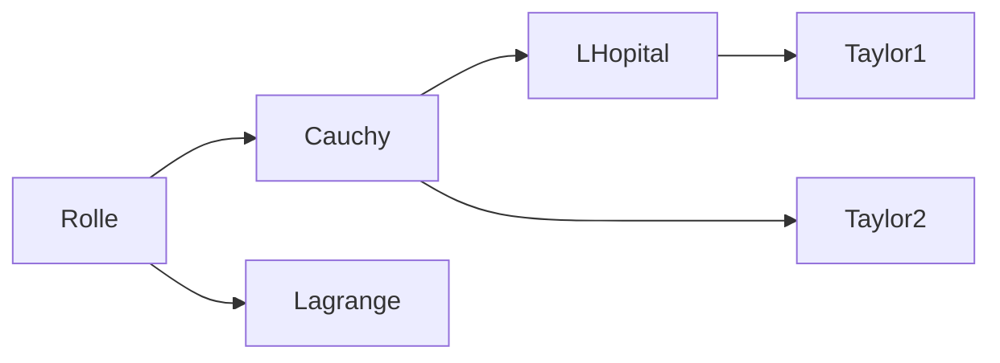

[toc]

## abstract

- 微分应用中的最基础定理:费马引理
- 微分中值定理是导数应用的理论基础
  - Rolle定理
  - Largrange中值定理;有限增量定理
  - Cauchy中值定理`*`

- 微分中值定理的关系:
  - Rolle中值定理推出Lagrange中值定理和Cauchy中值定理

## 费马引理

- 设函数$f(x)$在点$x_0$的某个邻域$U(x_0)$内有定义,并且在$x_0$处可导
  - 若$\forall{x\in{U}(x_0)}$,有$f(x)\leqslant{f(x_0)}$(或$f(x)\geqslant{f(x_0)}$),即$x=x_0$是一个**极值点**则$f'(x)=0$
- 证明:(以$f(x)\leqslant{x_0}$情形为例,另一情形类似)
  - 设$x\in{U(x_0)}$时,$f(x)\leqslant{f(x_0)}$,则对于
    - $x=x_0+\Delta{x}\in{U(x_0)}$,有$f(x)\leqslant{f(x_0)}$,即$f(x)-f(x_0)\leqslant{0}$
  - 从而当$\Delta{x}>0$时,$\frac{f(x)-f(x_0)}{\Delta{x}}\leqslant{0}$;当$\Delta{x}<0$,$\frac{f(x)-f(x_0)}{\Delta{x}}\geqslant{0}$
  - 根据函数$f(x)$在$x_0$可导以及极限的保号性,得
    - $f'(x_0)=f_{+}'(x_0)$=$\lim\limits_{\Delta{x}\to{0^{+}}}{\frac{f(x)-f(x_0)}{\Delta{x}}}\leqslant{0}$
    - $f'(x_0)=f_{-}'(x_0)$=$\lim\limits_{\Delta{x}\to{0^{-}}}{\frac{f(x)-f(x_0)}{\Delta{x}}}\geqslant{0}$
  - 所以$0\leqslant f'(x_0)\leqslant0$,即$f'(x)=0$
- 费马引理的简述为函数在可导区间内的**极值点处的导数为0**
- 导数为0的点称为**驻点**

## 罗尔定理

- 若函数$f(x)$满足
  1. **闭**区间$[a,b]$上**连续**
  2. **开**区间$(a,b)$内**可导**
  3. 区间端点处的函数值**相等**($f(a)=f(b)$)
- 则$(a,b)$内至少有一点$\xi(\xi\in(a,b))$,使得$f'(\xi)=0$
- Note:
  - 区间端点处**不要求可导**,但是区间端点处的函数值要求**相等**
  - 这显然是一个关于导数的定理
- 证明
  - 由条件(1)和闭区间上连续函数**最值定理**,$f(x)$在**闭区间**$[a,b]$上必定能取得$f(x)$的最值(最小值$m$,和最大值$M$)
  - 当$M=m$时,$f(x)$在$[a,b]$上总取相同的数,因此其导数为0,$(\forall{x}\in(a,b))$,有$f'(x)=0$
  - $M>m$时,由条件(3),设$f(a)=f(b)=k$,显然$m,M$至少有一个不等$k$,不妨设$M\neq{f(a)}$(即$M>k$);那么**开区间**$(a,b)$内有一点$\xi$使得$\xi$满足$f(\xi)=M$,
  - 因此从而$\forall{x\in[a,b]}$,总有$f(x)\leqslant{f(\xi)=M}$,再有**费马引理**,$f'(\xi)=0$
  - Note:前面的工作在说明可导极值点存在于开区间$(a,b)$内,最有由费马引理得证

## 拉格朗日中值定理(微分中值定理)

- Largrange定理是Rolle定理改进和推广的结果,它取消了Rolle定理的第一个条件,并调整了结论,具有重要地位,称为**微分中值定理**
- 若函数$f(x)$满足:
  1. 在开区间$[a,b]$上连续
  2. 在开区间$(a,b)$内可导
- 那么在$(a,b)$内至少有一点$\xi(a<\xi<b)$,使得等式$f(b)-f(a)=f'(\xi)(b-a)$`(0)`成立
  - 其中等式(0)可以变形为$\frac{f(b)-f(a)}{b-a}$=$f'(\xi)$`(0-1)`
  - 若记$\Delta{x}=b-a$;$y=f(x)$,$\Delta{y}=f(b)-f(a)$,则(0)写成$\Delta{y}=f'(\xi)\Delta{x}$`(0-2)`的形式,该公式是$\mathrm{d}y=f'(x)\Delta{x}$的增强版本(另见有限增量定理)
- Note:
  - 公式(0)也叫lagrange中值公式
  - 定理中的闭区间两端点内置$\xi$可能是**变量**,例如都是关于$a$,的函数$(a=a(x),b=b(x))$,
    - 此时结论为$a(x)<\xi(x)<b(x)$内至少有一点$\xi$满足$\frac{f(b(x))-f(a(x))}{b(x)-a(x)}$=$f'(\xi(x))$
    - 通过构造合适的闭区间,可以被用来推导许多结论和不等式

### 分析

- 定理的结论形如通过点$A(a,f(a)),B(b,f(b))$两点的直线的点斜式方程
- 定理的几何意义:
  - 将定理的结论改写为直线斜率的形式(0-1)式
  - $f'(\xi)$为曲线上的点$C(\xi,f(\xi))$处的**切线斜率**,该切线平行于弦$AB$
  - 若连续曲线$y=f(x)$在**弧$AB$**上除端点外**处处具有不垂直于$x$轴的切线**,则弧上至少有一点$C$,使得曲线在点$C$处的**切线**平行于**弦$AB$**
- Rolle定理中端点弦$AB$是平行于$x$轴的,定理中的$C$点的切线斜率为0,也平行于$x$轴,从而也满足Largrange定理(特殊情况)

### 证明

- Largrange定理的证明可以基于Rolle定理进行,为此需要构造一个能够运用Rolle定理且和Largrange定理的函数相关的**辅助函数**
- 辅助函数的构造可以启发于Largrange定理的几何解释:
  - 弦$AB$所在直线可以解释为斜率为$k=\frac{f(b)-f(a)}{b-a}$`(0-3)`,过点$A(a,f(a))$的直线,即为$y-f(a)=k(x-a)$,变形为$y=L(x)$的形式:$y=f(a)+k(x-a)$
  - 基于直线方程(一次函数)$y=L(x)$,和函数$f(x)$,构造**辅助函数**$\phi(x)=f(x)-L(x)$=$f(x)-f(a)-k(x-a)$`(1)`,这是描述两曲线$f(x)$和$L(x)$间的差值$y$轴方向上的差值的函数,与$f(x)$密切相关,且其重要特点是端点处两曲线重合,两端点处差值都为0,这符合Rolle定理的运用条件
- 由辅助函数(1)容易验证其满足$\phi(a)=\phi(b)$的条件,且$\phi(x)$在$[a,b]$内连续,在$(a,b)$内可导,可运用Rolle定理
- 由$\phi'(x)=f'(x)-k$`(2)`和Rolle定理,$(a,b)$内至少有一点$\xi$,使得$\phi'(\xi)=0$,即$f'(\xi)-k=0$,得$k=f'(\xi)$,所以(0-1)成立,就有(1)成立

### 有限增量定理

- 设,$x_1=x+\Delta{x}$且$x,x_1\in[a,b]$
  - 若$\Delta{x}>0$,则$x<x_1$,公式(0)在区间$[x,x_1]$上可改写为$f(x_1)-f(x)=f'(x+\theta{\Delta{x}})\cdot\Delta{x}$,$\theta\in(0,1)$`(3)`,即对$\xi$改写为$x+\theta\Delta{x}$的形式
    - 因为$\theta\in(0,1)$,$\theta\Delta{x}\in(0,\Delta{x})$,若令$\xi=x+\theta\Delta{x}$,则$\xi\in(x,x+\Delta{x})$
  - 若$\Delta{x}<0$,则$x>x_1$,公式(0)在区间$[x_1,x]$上同样可以改写为(3)
- 若记$f(x)=y$,则:$\Delta{y}$=$y_1-y$=$f(x_1)-f(x)$,从而式(3)可以写成$\Delta{y}=f'(x+\theta\Delta{x})\cdot{\Delta{x}}$,$\theta\in(0,1)$`(3-1)`,本质上还是$\Delta{y}=f'(\xi)\Delta{x}$
  - 这个表达式形似微分公式$\mathrm{d}y=f'(x)\cdot{\Delta{x}}$,而$\mathrm{d}y\to{\Delta{y}}(\Delta{x}\to{0})$($\mathrm{d}y$是$\Delta{y}$在$|\Delta{x}|$很小时的近似值
  - 公式(3-1)却给出了增量$\Delta{y}$的导数和自变量增量(微分)的准确表达式,且$|\Delta{x}|$不必取很小的值,只要是个**有限增量**即可,因此式(3-1)被称为**有限增量公式**
  - 这个公式可以从几何中得到直观的解释,同样是曲线线性化,将闭区间$[a,b]$内部的某个子闭区间$[x,x_1]$再次应用Largrange的结果;从而将某两点的函数差值(增量)转换为某个线性函数两点函数值的差值(增量)来计算
- 上述结论称为有限增量定理,其基本原理来自于Largrange中值定理
- 在某些问题中,当自变量$x$取得有限增量$\Delta{x}$而需要函数增量的准确表达式时,此定理十分有用

### Largrange定理和恒零导数

- 导数恒为0的函数是常数函数
- 具体地:若$f(x)$在区间$I$上连续,$I$内(不取端点)可导且**导数恒为0**(即,$\forall{x}\in{I},f'(x)=0$),则$f(x)$在区间$I$上是一个**常数**
- 证明:设$x_1,x_2\in{I}$,设$x_1<x_2$,由式(0)得$f(x_2)-f(x_1)$=$f'(\xi)(x_2-x_1)$,$(\xi\in(x_1,x_2))$
  - 由$f'(\xi)=0$,得$f(x_2)-f(x_1)=0$,从而$f(x_2)=f(x_1)$
  - 即任意两点的函数值都相等,得任意自变量都是取同一个函数值,所以$f(x)$是一个常数

### 例

- 证明当$x>0$时,不等式$\frac{x}{1+x}<\ln(1+x)<0$
  - 令$f(t)=\ln(t+1)$`(0)`,则$f(t)$在区间$[0,x]$上满足Largrange中值定理的条件,则有式`(1)`:$f(x)-f(0)$=$f'(\xi)(x-0)$,$\xi\in(0,x)$
  - $f(0)=0$,$f'(t)=\frac{1}{1+t}$`(2)`;(0),(2)代入(1)化简得$f(x)=\frac{1}{1+\xi}x$,从而$\ln(1+x)$=$\frac{1}{1+\xi}x$`(3)`
  - 由$\xi\in(0,x)$,所以式(3)可以被放大和缩小在范围:$\frac{x}{1+x}<\frac{x}{1+\xi}<x$`(4)`,将(3)代入(4),得证$\frac{x}{1+x}<\ln(1+x)<0$,$(x>0)$

## 其他微分中值定理

- [柯西中值定理](http://t.csdnimg.cn/swN5r)(基本中值定理)
- [泰勒中值定理](https://editor.csdn.net/md/?articleId=125585940)(进阶zhong'zhi)

## 用微分中值定理来解决问题

- 为了使用微分中值定理推导某些结论或解决某些问题,往往需要构造一个符合某个微分中值定理的函数(即,构造满足条件的辅助函数)
- 罗尔中值定理:基本的中值定理

  - 条件最为苛刻,但是可以用来证明拉格朗日中值定理
    - 通过构造满足罗尔中值定理条件的辅助函数,将问题化归为罗尔中值定理能够解决的情形
    - 从而得到更具一般性的结论

### 三个定理的共同条件👺

- Rolle 中值定理和Lagrange中值定理以及Cauchy中值定理都要求被研究的对象在给定闭区间$[a,b]$内连续,并且在相应的开区间$(a,b)$内可导
- 闭区间$[a,b]$内连续且开区间$(a,b)$内可导指区间端点$a,b$处分别只能保证有右导数$(f_{+}'(a))$和左导数$(f_{-}'(b))$,而一个点处导数存在要求左右导数都存在且相等,因此两个条件要分别指明,而不能用闭区间内可导来代替

### 利用微分中值定理证明不等式

- 利用$\xi$所处的区间$(a,b)$来构造不等式,以便使用对应的微分中止定理来证明一些不等式,区间$[a,b]$中的端点$a,b$可以是变量(譬如区间$[a,x]$)
- 再将需要证明范围的函数$f(x)$使用一个包含$\xi$以及区间的端点$a,b$构造出不等式

## 微分中值定理推导关系

- 其中Lagrange,cauchy中值定理处于核心位置
- 具体应用中,Lagrange中值定理经常被用来证明不等式

