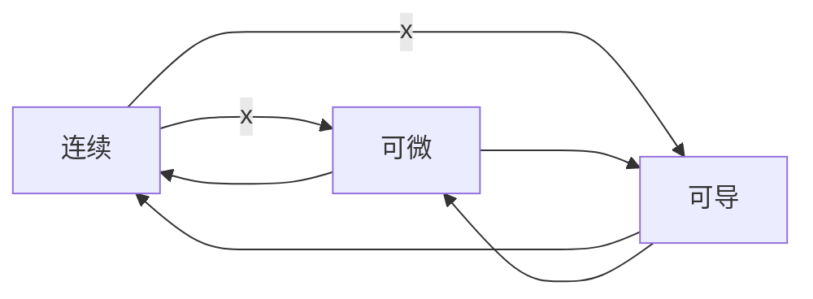

# 连续@可导@可微

## 一元函数

- 一元函数中
  - 可导可以推出连续和可微
  - 可微可以推出连续和可导
  - 连续推不出可到,也推不出可微

## 多元函数

- 可导推不出连续也推不出可微

  - 因为多元函数可导是指,一阶偏导存在

  - 多元函数的偏导数是利用一元函数定义的

    - $$
      f'_{x}(x_0,y_0)=\lim\limits_{x\to{x_0}}\frac{f(x,y_0)-f(x_0,y_0)}{x-x_0}
      \\
      f'_{y}(x_0,y_0)=\lim\limits_{y\to{y_0}}\frac{f(x_0,y)-f(x_0,y_0)}{y-y_0}
      $$

    - 其动点$(x,y_0)或(x_0,y)$是沿着x(或者y)轴方向趋近于$(x_0,y_0)$,它只与点$(x_0,y_0)$邻域内的过该点且平行于两坐标轴的十字方向(仅两个方向)函数值有关

  - 多元函数的连续和可微都是用重极限定义的

    - $$
      \lim\limits_{(x,y)\to{(x_0,y_0)}}f(x,y)=f(x_0,y_0)
      \\f(x,y)-f(x_0,y_0)=A(x-x_0)+B(y-y_0)+o(\rho)
      $$

    - 其动点$(x,y)$是以任意方向趋近于$(x_0,y_0)$,它域点$(x_0,y_0)$领域内函数值(所有方向)有关

- 至于可微是可以推出可导和连续的,这一点和一元函数的情况是一样的

## 小结

- 连续是(相较于可导/可微)最弱的条件
  - 在一元函数和多元函数中,都是既无法推出可导也无法推出可微
- 可导相对于可微又弱一些
  - 在一元函数中,可导可以推出连续和可微
  - 但在多元函数中既无法推出连续,也无法推出可微
- 可微是很强的条件
  - 无论是一元函数还是多元函数,都可以同时推出连续和可导
- 二元函数中,如果一阶偏导都**存在且连续**,能够推出可微
  - 但是可微无法推出二元函数的两个一阶偏导都存在且**连续**

### 可微的必要条件

- 如果$z=f(x,y)$在点(x,y)处可微,则该函数在点(x,y)处的偏导数$\frac{\partial{z}}{\partial{x}},\frac{\partial{z}}{\partial{y}}$都必定存在(但是偏导数不一定连续)
- 但是如果两个偏导数都来连续,则必定可微

### 可微的充分条件

- 如果函数$z=f(x,y)$的偏导数$\frac{\partial{z}}{\partial{x}},\frac{\partial{z}}{\partial{y}}$在点$(x,y)$处连续,则函数$z=f(x,y)$在该点可微

### 例2

- 

- 计算要点:

  - f(0)是单独定义(f(0)=0)

  - 在还未区分左右极限(导数)之前,可以先进行化简

  - 基于这个化简后的表达式进行进一步的区分左右,会使得计算更加简练

  - 对于形如:

  - $$
    oringin=\lim_{f(x)\rightarrow \infin}\frac{f(x)}{f(x)+n}=\frac{1}{1+\frac{n}{f(x)}}
    \\即,通过分子分母同时除以f(x),将表达式中的f(x)集中起来(从两处变为一处),
    \\使得极限更加清晰(\frac{n}{f(x)}\rightarrow0(f(x)\rightarrow\infin))
    \\origin=1
    $$

    

### 连续vs可导

- 可导的条件比连续苛刻
  - 可导必然连续,连续不一定可导(特别是分段han'shu)

## 导数运算

- 例子

- 该函数有重要特点在于,有一个x参与乘法运算

- 而
  $$
  f(x)=x\cdot \varphi(x)
  \\
  f'(x)=1\cdot \varphi(x)+x\cdot \varphi'(x)
  \\如果x=0,(即求f'(0)),那么有
  \\f'(0)=\varphi(0)+0\cdot \varphi(0)=\varphi(0)
  $$
  

