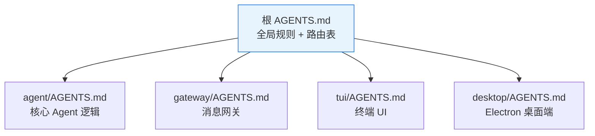
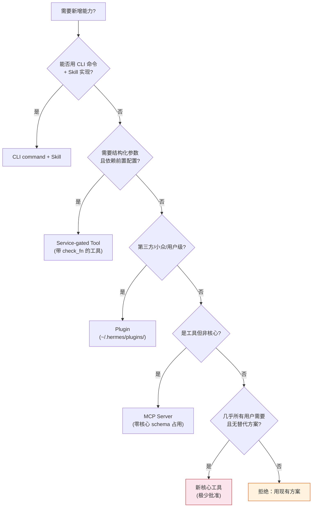

[toc]

## abstract

参考 https://github.com/NousResearch/hermes-agent/blob/main/AGENTS.md 和 https://github.com/openclaw/openclaw/blob/main/AGENTS.md 这类成熟项目的agents.md 对于开发者有哪些可借鉴之处?

## 什么是 `AGENTS.md`

`AGENTS.md` 是放置在代码仓库中、**面向 AI 编码助手(AI Coding Agent)** 的指令文件。它的作用类似于 `.editorconfig` 之于编辑器、`.eslintrc` 之于 Linter——只不过受众是 AI。两个项目都展示了如何用这个文件**约束和引导** AI 助手在项目中正确地工作。

---

## 整体结构对比

| 维度                                 | **Hermes Agent** (NousResearch)                              | **OpenClaw** (openclaw/openclaw)                             |
| ------------------------------------ | ------------------------------------------------------------ | ------------------------------------------------------------ |
| **文件组织**                         | 根文件只保留全局通用规则；每个子目录有自己的 `AGENTS.md`（建议约 8k 字符），由路由表(routing table)索引 | 编辑 canonical `AGENTS.md` 文件；新增的文件需要附带一个 `CLAUDE.md` 符号链接(symlink) |
| **项目定位描述**                     | 描述 Hermes 是一个跨 CLI、消息网关(Telegram/Discord/Slack 等约 20 个平台)、TUI 及 Electron 桌面应用共享同一 agent core 的个人 AI 代理 | 定位为"The AI that really does things. Any OS. Any Platform." |
| **命名规范(Naming Convention)**      | 无显式声明                                                   | 明确区分：产品名用 `OpenClaw`，CLI/包/配置名用 `openclaw`，用户侧集成统一称 `plugins`，使用美式英语(American English) |
| **缺陷修复流程(Bug-fix Workflow)**   | 要求先读原始意图(`git log -p -S`)再限制行为，找到既修复问题又保留功能的方案 | 要求通过实际入口重现缺陷，读完受影响的模块/调用方/测试/历史；恢复被移除的路径前先用 `git log -p -S` 检查移除原因，因为隔离可能是有意为之 |
| **新功能决策树(Feature Decision)**   | 给出了从"CLI 命令 + Skill"到"Plugin"再到"MCP server"最后到"新核心工具"的 5 级决策梯度，只有在"几乎每个用户都需要、且 terminal/MCP 无法实现时"才允许添加核心工具 | 简洁地要求"选择能吸收变更的现有代码、插件或已维护方案"       |
| **插件边界(Plugin Boundary)**        | 通过 MCP 和 `~/.hermes/plugins/` 隔离                        | 插件只使用 `openclaw/plugin-sdk/*` 的公开契约和清单元数据(manifest metadata)，禁止访问核心内部或其他插件的私有文件；依赖遵循运行时所有权(runtime ownership) |
| **状态存储规范(Storage Convention)** | 无显式声明（但实际用 SQLite）                                | 明确要求状态和缓存使用 SQLite，禁止新增 JSON/JSONL/sidecar 存储；数据库访问使用 Kysely，原始 SQL 仅限 schema/migration/bootstrap |
| **配置迁移(Config Migration)**       | 无显式声明                                                   | 凡使现有配置失效的变更必须包含对应的迁移(migration)；启动时可调用已批准的 Doctor 转换，但禁止添加独立的兼容性读取器 |
| **安全红线(Hard Prohibition)**       | 禁止未经 opt-in 控制的出站遥测(outbound telemetry)/使用归因(usage attribution) | 禁止未经用户明确确认就发送任何消息(iMessage/email/SMS 等)    |

---

## 可借鉴的核心实践

### 分层文件组织——"根文件 + 子目录文件"模式

这是 **Hermes Agent** 最突出的架构设计。根 `AGENTS.md` 只保留全局通用指令,每个子目录维护自己的 `AGENTS.md`（约 8k 字符）,通过尾部路由表进行索引,且有脚本能动态交付最多 32k 的上下文并在超限时截断首尾并给出警告。

**对开发者的启示：** 大型代码库不应把所有规则塞进一个文件,而应像代码模块化一样,按领域拆分 AI 指令文件,用"根 → 子"的树形结构降低单文件体积与 AI 的上下文压力。

### 明确的命名与术语规范

OpenClaw 在文件开头第一句就规定了命名层次：产品名 `OpenClaw`、CLI/包/配置名 `openclaw`、用户侧集成统一称 `plugins`、语言选用 American English。

**对开发者的启示：** AI 助手在生成代码、注释、文档时会**高频产出命名**。如果不在 `AGENTS.md` 中统一,就会产生 `openClaw` / `OpenClaw` / `open_claw` 的混乱。用一句话约束,收益极高。

### 缺陷修复的"先考古、后动手"原则

两个项目不约而同地强调同一条纪律：

- Hermes 要求"在限制行为之前先读原始意图(`git log -p -S`)，找到既修复 bug 又保留功能的方案"
- OpenClaw 要求"在恢复一个已被移除的路径之前，先用 `git log -p -S <symbol>` 检查它被移除的原因：隔离可能是有意为之,退役的别名可能意味着迁移已完成"

**对开发者的启示：** AI 编码助手最常见的"帮倒忙"就是**无脑恢复被有意删除的代码**。在 `AGENTS.md` 中写入"先查 Git 历史再动手"这类工作流约束,是防止 AI 引入回归(Regression)的关键手段。

### 新功能准入的"决策梯度"

Hermes 定义了 5 个级别的功能准入——从"CLI 命令 + Skill"到"Service-gated Tool"到"Plugin"到"MCP Server"再到"新核心工具"。核心工具的准入条件最严格：必须对几乎所有用户有用,且无法通过 terminal、文件操作或 MCP server 实现(如 `terminal`、`read_file`、`web_search`、`browser_navigate`)。

这可以用下面的决策流程图来理解：

**对开发者的启示：** 在 `AGENTS.md` 中给出**清晰的功能准入梯度**,能防止 AI（以及人类贡献者）在核心层随意添加功能。这本质上是**架构决策记录(ADR, Architecture Decision Record)** 的压缩版。

### 插件边界与依赖隔离

OpenClaw 严格要求插件只使用 `plugin-sdk/*` 的公开契约和 manifest 元数据,禁止访问核心内部或其他插件的私有文件,依赖严格遵循运行时所有权。

**对开发者的启示：** AI 助手在实现功能时倾向于走**最短路径**——直接 import 内部模块比走 SDK 更快。如果不在 `AGENTS.md` 中画出**不可跨越的边界线**,AI 生成的代码会频繁违反架构分层。

### 存储与数据规范

OpenClaw 明确规定状态和缓存必须使用 SQLite,禁止新增 JSON/JSONL/sidecar 存储。文件仅用于用户制品(artifacts)、导入导出、附件、日志、备份或外部工具契约。数据库访问使用 Kysely ORM,原始 SQL 仅限 schema、migration、bootstrap 等少数场景。

**对开发者的启示：** AI 最喜欢的做法之一是"写个 JSON 文件存一下"。如果项目有统一的存储策略,必须在 `AGENTS.md` 中明确禁止 AI 偏离。

### 配置迁移即代码

OpenClaw 要求任何使现有配置失效的变更都必须包含匹配的迁移脚本,启动时可调用已批准的 Doctor 转换,但禁止添加独立的兼容性读取器。

**对开发者的启示：** 这条规则防止 AI 在修改配置 schema 时忘记写迁移,也防止出现"多个地方各自兼容旧格式"的**兼容性代码蔓延(compatibility code sprawl)** 问题。

### 安全红线——不可协商的禁令

| 项目                    | 安全红线                                                     |
| ----------------------- | ------------------------------------------------------------ |
| Hermes                  | 禁止未经 opt-in 的出站遥测/使用归因                          |
| OpenClaw (nix-openclaw) | 禁止内联脚本(NO INLINE SCRIPTS EVER)；禁止未经用户确认发送任何消息 |

**对开发者的启示：** `AGENTS.md` 中必须有一个**"绝对禁止"** 清单。AI 不懂"这样做政治上不正确"或"这会让用户恐慌",只有显式的禁令才能阻止它。

### 符号链接兼容多工具

OpenClaw 要求新增的 `AGENTS.md` 文件都附带一个 `CLAUDE.md` 符号链接。

**对开发者的启示：** 不同的 AI 编码工具（Claude Code、Codex、Hermes 等）可能识别不同的指令文件名。用 **symlink** 做兼容是零成本方案,避免维护多份内容相同的文件。

---

## 编写 `AGENTS.md` 的实践清单

基于两个成熟项目的共性模式,总结出以下**编写清单**,开发者可按需裁剪：

| 板块             | 核心问题                          | 示例做法                            |
| ---------------- | --------------------------------- | ----------------------------------- |
| **项目概览**     | AI 需要知道"我在哪个项目、做什么" | 一句话定位 + 架构简图               |
| **命名与术语**   | 产品名 vs 代码名 vs 文档名        | 用表格列出正确/错误写法             |
| **文件组织**     | 根文件 vs 子目录文件的职责分界    | 根文件只放全局规则,附路由表         |
| **功能准入**     | 新代码放在哪一层                  | 决策梯度(从轻到重)                  |
| **缺陷修复流程** | 动手前必须做什么                  | 先重现、先查 `git log`、先读调用链  |
| **边界与隔离**   | 哪些模块/目录不可跨越引用         | 列出 SDK 公开接口 vs 私有内部       |
| **存储规范**     | 状态存哪里、用什么格式            | 明确 SQLite/文件/环境变量的适用场景 |
| **迁移规范**     | 破坏性变更如何处理                | "改 schema 必须附 migration"        |
| **安全红线**     | 绝对禁止的行为                    | 禁遥测、禁未确认发送、禁内联脚本    |
| **多工具兼容**   | 如何让不同 AI 工具都能读到指令    | symlink (`CLAUDE.md` → `AGENTS.md`) |

---

## 总结

这两份 `AGENTS.md` 的共同智慧可以浓缩为一个核心理念：

> **把原本只存在于团队成员脑中的"不成文规矩"——架构边界、命名惯例、修复流程、安全红线——以 AI 可消费的格式显式写下来。**

人类新成员可以通过 Code Review 和 Slack 问答逐渐学会这些规矩,但 **AI 没有社会化学习的过程**,它的全部"规矩"来源就是上下文窗口中的文本。`AGENTS.md` 本质上就是**把隐性知识(Tacit Knowledge)转化为显式约束(Explicit Constraint)** 的工程实践,越成熟的项目,这份文件越像一部精炼的**架构决策手册**。