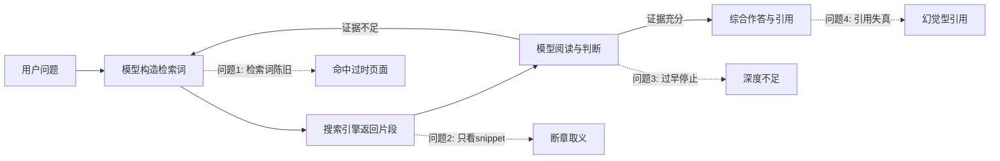
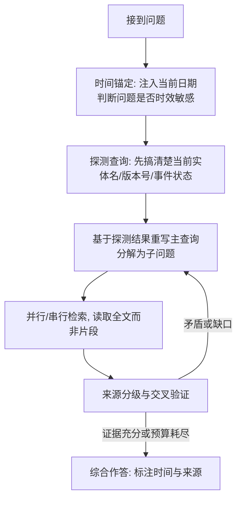

[toc]


## 搜索过程与证据来源

| 分类         | 实际使用的查询                                               | 命中的关键来源                                               | 结论要点                                                     |
| ------------ | ------------------------------------------------------------ | ------------------------------------------------------------ | ------------------------------------------------------------ |
| 问题诊断     | LLM knowledge cutoff stale search queries temporal grounding | Firecrawl博客（约4个月前）                                   | 将Agent幻觉分为**陈旧数据型**与**虚构补全型**，实时检索对两者均有缓解作用 |
| 时效性基准   | FreshQA benchmark time-sensitive questions                   | [arXiv 2310.03214 FreshLLMs](https://arxiv.org/abs/2310.03214)（Google，2023） | 提出**FreshQA动态基准**，覆盖快变知识与**错误前提**两类问题  |
| 训练方法     | Search-R1 reinforcement learning search engine               | [arXiv 2503.09516 Search-R1](https://huggingface.co/papers/2503.09516)（2025-03） | 用RL让模型在推理中**自主生成多条查询**，7B模型提升26%        |
| 深度浏览基准 | BrowseComp benchmark browsing agents                         | [OpenAI BrowseComp](https://openai.com/index/browsecomp/)（2025-04） | 1266道题；"browsing alone is not sufficient"，需要策略性推理与路径选择 |
| 工具工程     | Anthropic writing tools for agents                           | [Anthropic Engineering: Writing effective tools for agents](https://www.anthropic.com/engineering/writing-tools-for-agents)（2025-09）、[Building Effective Agents](https://www.anthropic.com/engineering/building-effective-agents) | 工具命名空间、**返回有意义的上下文**、**token效率**、错误信息引导 |

**时间锚定说明**：搜索结果页面时效显示BrowseComp（2025年4月发布）距今约540天、Search-R1（2025年3月）距今约569天，据此推断**当前时间约为2026年秋季**。我的训练知识截止大约在2025年初，这意味着下文凡标注"（训练知识）"的工具与产品信息未经本轮搜索核实，可能已有变动。

---

## 问题诊断：为什么"联网了"仍然答不好

联网搜索是一个由模型驱动的闭环：模型根据先验知识**构造查询**，搜索引擎返回**片段（snippet）**，模型**阅读、判断、决定是否继续**，最终**综合作答**。每个环节都可能失效，而且失效会沿链条传播。



### 问题一：检索词与训练数据挂钩，和当下脱节

这是您提到的核心痛点，根源在于**模型的"世界状态"冻结在训练截止日**。具体表现：

- **实体命名陈旧**：模型记忆中"最新版本"是训练时的版本，于是搜索`GPT-4 Turbo 定价`而不知道早已迭代多代；搜索`Next.js 14 app router`而当前主版本已更新。搜索引擎会忠实地返回那些旧版本的页面，形成"**自我印证的陈旧闭环**"。
- **"最新"一词的陷阱**：模型在查询中写`latest`或`最新`，但搜索引擎的"最新"由索引时间和SEO决定，常返回几年前标题含"最新"的文章。
- **时间感缺失**：如果系统提示没有注入当前日期，模型会默认"现在"就是训练截止时间，于是把一年前的事件当作"刚发生"，或者把带年份的查询写错年份。
- **错误前提**：FreshQA论文明确把"包含错误前提、需要被反驳的问题"列为单独类别。模型若把过时事实当作前提直接搜索，就会被引导到错误方向而非纠正前提。

### 问题二：搜索深度不足

OpenAI的BrowseComp基准专门测量"定位难以找到、相互纠缠的信息"的能力。其官方结论之一是：仅有浏览能力并不够，模型还需要**策略性推理、识别相关搜索路径、解读检索内容**。实际工程中深度不足的典型表现：

- **单查询单跳**：只发一条查询、只看前几条结果就作答。多跳问题（"X公司最新产品的默认模型是哪家训练的"）需要先确定X的最新产品，再查该产品的模型信息，再查训练方。
- **只读片段不读全文**：搜索引擎的snippet通常只有一两百字，且往往是页面开头或SEO摘要，与问题真正相关的段落（例如配置项的默认值）根本不在片段内。
- **过早满足**：第一条结果"看起来对"就停止，缺少**交叉验证**。
- **预算不透明**：Agent不知道自己还有几次搜索机会，要么过于保守，要么把配额浪费在同义重复的查询上（本次对话我自己就踩到了并发限流）。

### 问题三：来源质量与结果污染

- **SEO农场与AI生成内容**：大量低质聚合页面在排名上超过官方文档，而且这些页面本身可能是由LLM基于陈旧知识生成的，形成"模型喂模型"的污染循环。
- **区域与语言偏差**：英文查询几乎看不到国内方案；中文查询则容易被营销号淹没。
- **上下文污染**：把十几条搜索结果原文塞进上下文后，模型的注意力被无关内容稀释，Anthropic工具设计指南中强调工具返回应**优化token效率**、只返回有意义的上下文，正是针对此问题。

### 问题四：引用与综合阶段的失真

即便检索正确，模型在综合时也可能把A来源的数字安到B来源头上、把"某文章说X"写成"X是事实"、或者给出根本不存在的URL。这类"引用幻觉"在用户看不到检索过程时尤其危险。

---

## 原理：把搜索当作"假设检验"而不是"查字典"

高质量Agent搜索的本质是一个**探测—修正—深入**的循环，而不是"问题到答案"的一次映射。Search-R1的研究思路很有启发性：它让模型通过强化学习学会在逐步推理中自主生成多条查询并与实时检索交互，而不是依赖人工写死的提示流程。这说明**查询的生成本身是需要被优化的决策**，而非问题的简单改写。



这张图里最关键、也最常被忽略的是**探测查询（Probe Query）**这一步：在真正搜索问题本身之前，先用一条便宜的查询校准"现在是什么情况"，用搜索结果替换模型脑中陈旧的实体名，再进入主查询。

---

## 技巧体系

### 技巧一：时间锚定（Temporal Anchoring）

**目标**：让模型在"现在是什么时候"这件事上不再依赖训练记忆。

| 手段                       | 做法                                                         | 示例                                                         |
| -------------------------- | ------------------------------------------------------------ | ------------------------------------------------------------ |
| **系统提示注入日期**       | 每次会话在system prompt中写入当前日期，并明确告知"你的训练知识可能已过时" | `今天是2026-10-15。你的知识截止于较早时间，凡涉及版本、价格、人事、政策，必须以搜索结果为准。` |
| **查询带年份**             | 对时效敏感问题，查询词中加当前年份（或当前与上一年两个变体） | `Python 包管理工具 对比 2026`，而不是`最新 Python 包管理工具` |
| **禁用"最新"类模糊词**     | 把`latest`/`最新`替换为具体年月或版本号探测                  | 先搜`Node.js current release schedule`得到版本号，再搜`Node.js 24 breaking changes` |
| **利用页面时效元数据**     | 搜索工具若返回`page_age`/发布日期，让模型优先阅读近期页面，并对老页面做降权 | 本次搜索结果中的`"page_age": "540 days ago"`就是这样的信号   |
| **用结果反推当前时间**     | 当系统没有注入日期时，让模型从多个页面的相对时效中推断"现在"大致是何时 | 我在上文正是据此推断当前约为2026年秋                         |
| **搜索引擎的时间过滤参数** | 多数搜索API提供`freshness`/`time_range`/`days`参数，对新闻类问题设为近一周或近一月 | 如Brave的`freshness=pw`（训练知识，参数名请核对当前文档）    |

**辨析**：注入日期解决的是"模型知道现在是何时"，但并不能让模型知道"这段时间发生了什么"。后者必须靠**探测查询**。两者缺一不可。

### 技巧二：检索词工程（Query Engineering）

**探测查询先行**。面对"X的最新版本有什么新特性"这类问题，不要直接搜索，而是分两步：

- 探测：`X release notes`、`X changelog`、`X GitHub releases`，目的只是拿到**当前版本号与发布日期**。
- 主查询：用探测到的版本号替换问题中的"最新"，再去搜索具体特性。

**查询分解（Decomposition）**。多跳问题拆成有依赖关系的子问题，前一个子问题的答案成为后一个查询的参数。这与Search-R1所训练的"推理中自主生成多条查询"是同一思路，只是用提示工程手工实现。

**多语言与同义词覆盖**。同一概念至少准备中英两套关键词，加上社区用语：

| 维度             | 示例                                                         |
| ---------------- | ------------------------------------------------------------ |
| 中英互译         | `检索增强生成` / `RAG` / `retrieval-augmented generation`    |
| 官方名与社区昵称 | `Model Context Protocol` / `MCP` / `MCP server`              |
| 竞品发现         | `[实体名] alternative`、`[实体名] vs`、`[实体名] 替代`、`[实体名] 对比` |
| 反向验证         | `[实体名] limitations`、`[实体名] criticism`、`[实体名] 踩坑`、`[实体名] 缺点` |

**站点限定与排除**。善用搜索引擎语法把流量导向权威来源：`site:docs.python.org`、`site:github.com`、`site:arxiv.org`、`-site:csdn.net`（视需要）。对国内方案，`site:github.com 中文`或直接中文站点限定往往更有效。

**避免同义重复**。多条查询应覆盖不同的信息维度（官方文档、基准评测、社区讨论、批评文章），而不是把同一句话换三种说法。配额有限时这一点尤其重要。

### 技巧三：控制搜索深度与迭代

**宽后窄策略**。第一轮用较宽泛的查询建立"地图"（有哪些实体、哪些是新兴的），第二轮针对第一轮**新发现的词**定向深入。这是迭代搜索的真正意义：**后一轮的关键词来自前一轮的结果，而非一开始就能想到的词**。

**明确停止条件**。在提示中给出可操作的判定规则，而不是让模型凭感觉：

- 至少两个**相互独立**的可信来源给出一致结论；
- 或者已达到搜索预算上限，此时**如实声明覆盖不足**，而不是硬答。

**预算显式化**。告知模型本次可用的搜索次数（例如`最多8次`），并要求它先列出搜索计划再执行。BrowseComp的经验表明，高难度问题需要"persistence and depth"，但工程上必须用预算把这种坚持约束在可控范围内。

**读全文**。把"搜索"和"抓取"分成两个工具：搜索工具返回标题、URL、片段、时效；抓取工具（如Jina Reader、Firecrawl一类，训练知识）把目标页面转换为Markdown正文。模型根据片段**挑选2到3个最值得读的页面**再抓取全文，而不是全部读或都不读。

### 技巧四：来源分级与交叉验证

把来源分为层级，并要求模型在回答中标注：

| 层级     | 来源类型                                                     | 典型用途                     |
| -------- | ------------------------------------------------------------ | ---------------------------- |
| **一级** | 官方文档、官方博客、标准组织、论文原文、GitHub仓库README/Release | 版本、参数、定价、API行为    |
| **二级** | 知名第三方评测平台、维护活跃的聚合站、主流技术媒体           | 对比、趋势、新兴事物线索     |
| **三级** | 社区论坛（Reddit、HN、V2EX、知乎）、个人博客                 | 踩坑经验、真实体验、前沿讨论 |
| **慎用** | 无署名聚合页、明显SEO农场、AI批量生成内容                    | 仅作线索，不作依据           |

**交叉验证规则**：关键数字（版本号、价格、日期）必须有一级来源或两个独立二级来源支撑；只有单一来源时在回答中明示"仅一处来源提及"。

**错误前提处理**：当搜索结果与问题前提矛盾时（如用户问"X为什么停止维护了"但搜索显示X刚发新版），模型应先指出前提问题，再继续回答。FreshQA把这类问题单独成类，正说明它在实践中足够常见且容易出错。

### 技巧五：工具层设计

Anthropic的工具设计指南给出了几条与搜索直接相关的原则，我结合搜索场景解读如下：

- **工具描述即提示词**。搜索工具的description里应写明：何时该用（时效敏感、版本、价格、人事）、何时不该用（稳定的概念性知识）、查询词应具体并带时间锚点。
- **返回有意义的上下文而非原始数据**。返回结构化字段（`title`、`url`、`published_at`、`snippet`、`source_type`），而非整页HTML。
- **优化token效率**。默认返回5到8条，提供`max_results`参数；片段长度可控；全文抓取单独成工具。
- **错误信息要有引导性**。该指南提到工具截断与错误响应能引导Agent走向更省token的行为。例如限流时返回`"剩余配额0，请基于已有结果作答并声明覆盖不足"`，而不是裸露的HTTP 429。
- **命名空间**。`web_search`、`web_fetch`、`news_search`边界清晰，避免模型混淆。

一个搜索工具的参数设计示意（JSON Schema片段）：

```json
{
  "name": "web_search",
  "description": "搜索互联网获取最新信息。用于时效敏感问题（版本、价格、新闻、人事）。查询应具体、含关键实体与年份，避免使用'最新'等模糊词。每次会话最多调用8次。",
  "input_schema": {
    "type": "object",
    "properties": {
      "query": {"type": "string", "description": "2到6个关键词，含具体实体名与时间锚点"},
      "time_range": {"type": "string", "enum": ["day", "week", "month", "year", "any"], "description": "按发布时间过滤，新闻类用week，版本类用year"},
      "include_domains": {"type": "array", "items": {"type": "string"}, "description": "限定站点，如 docs.python.org"},
      "max_results": {"type": "integer", "default": 6}
    },
    "required": ["query"]
  }
}
```

字段说明：

| 字段              | 含义         | 注意点                                                       |
| ----------------- | ------------ | ------------------------------------------------------------ |
| `query`           | 检索词       | 过长的自然语言句子在多数引擎上效果差于关键词组合             |
| `time_range`      | 发布时间过滤 | 不同供应商参数名不同（`freshness`、`days`、`time_range`），需在工具内做适配 |
| `include_domains` | 白名单站点   | 对官方文档类问题极有效，但会漏掉社区线索，宜与无限定查询配合 |
| `max_results`     | 返回条数     | 条数越多上下文越脏，宽探测用多、精查用少                     |

### 技巧六：评测与回归

没有评测的优化是盲目的。可用的公开基准与自建方法：

| 基准                                      | 侧重                           | 适用                               |
| ----------------------------------------- | ------------------------------ | ---------------------------------- |
| **FreshQA**（Google，2023，持续更新答案） | 快变知识、错误前提             | 检验时间锚定与前提纠错能力         |
| **BrowseComp**（OpenAI，2025-04，1266题） | 难找、多跳、需持续浏览         | 检验搜索深度与策略                 |
| **SimpleQA**（训练知识）                  | 短事实问答与校准               | 检验引用准确与"不知道就说不知道"   |
| **自建回归集**                            | 业务相关的时效问题，答案带日期 | 每次改提示词或换搜索供应商后跑一遍 |

自建回归集的实用做法：收集20到50个"答案会随时间变化"的问题（当前版本号、当前负责人、当前价格），人工标注答案与标注日期，定期更新，并记录Agent的**搜索次数、是否读全文、是否交叉验证**等过程指标，而不只看最终正确率。

---

## 基础设施选型（含国内方案）

以下信息主要来自训练知识，本轮搜索未能逐一核实，**使用前请查阅各家当前文档**。

| 类别               | 方案                                                         | 特点                                        | 国内可用性                                  |
| ------------------ | ------------------------------------------------------------ | ------------------------------------------- | ------------------------------------------- |
| 面向LLM的搜索API   | Tavily                                                       | 为Agent设计，返回精炼片段，支持搜索深度参数 | 需代理或海外部署                            |
| 面向LLM的搜索API   | Exa                                                          | 神经检索，擅长语义化与"相似页面"发现        | 同上                                        |
| 通用搜索API        | Brave Search API                                             | 独立索引，有免费额度，支持时效过滤          | 同上                                        |
| 通用搜索API        | SerpAPI等SERP代理                                            | 复用主流引擎结果，语法丰富                  | 同上                                        |
| 国内搜索API        | 博查、智谱Web Search、百度/阿里云相关搜索服务                | 中文索引好，国内直连                        | 直连可用                                    |
| 自托管元搜索       | SearXNG                                                      | 开源、免费、聚合多引擎、可私有部署          | 可部署在海外VPS供国内调用                   |
| 页面抓取转Markdown | Jina Reader（`r.jina.ai/`前缀）、Firecrawl                   | 把网页转为LLM友好的正文                     | Jina有国内节点可用性较好；Firecrawl可自托管 |
| 模型厂商内置搜索   | Anthropic的web search工具、OpenAI的搜索工具、Perplexity Sonar | 省去自建，但可控性较弱                      | 需代理                                      |

**选型权衡**：

- **可控性优先**（需要站点限定、时间过滤、自定义来源分级）：自建`web_search`+`web_fetch`两件套，底层接Brave/Tavily或SearXNG。
- **省事优先**：直接用模型厂商内置的搜索工具，但要通过系统提示补上时间锚定与探测查询的策略。
- **中文为主**：至少接一路国内搜索API，否则国内方案与中文社区线索几乎不可见。

**网络环境提醒**：生产环境在海外服务器时，国外API直连即可；国内开发测试环境需要本地代理（如mihomo）。Linux/macOS通常通过`HTTP_PROXY`/`HTTPS_PROXY`环境变量生效，Windows下PowerShell需用`$env:HTTPS_PROXY = "http://127.0.0.1:7890"`设置，且部分Python HTTP库对系统代理的读取行为不同，建议在代码中显式传入代理配置。无代理条件下访问GitHub原始文件可考虑gh-proxy一类镜像前缀（可用性随时变化，请自行核实）。

**非ASCII字符提醒**：部分抓取工具对中文页面的编码探测不稳，返回乱码时优先检查`Content-Type`与`<meta charset>`；SearXNG等自托管方案中文分词与结果质量依赖所聚合的引擎，宜加入百度/必应中文源。

---

## 可直接使用的系统提示模板

```markdown
当前日期：{{current_date}}。你的训练知识有截止日期，涉及版本号、价格、人事、政策、产品状态的内容一律以搜索结果为准。

搜索规则：
1. 本次最多调用 web_search {{N}} 次、web_fetch {{M}} 次。先列出搜索计划再执行。
2. 时效敏感问题先做"探测查询"确认当前实体名/版本号，再用探测结果重写主查询。
3. 查询使用具体关键词并带年份，禁止使用"最新""latest"等模糊词。
4. 每个信息维度（官方文档、评测对比、社区讨论、批评文章）至少一条独立查询，不要重复同义查询。
5. 对关键结论挑选最相关的 2 到 3 个页面用 web_fetch 读全文，不要只依赖片段。
6. 关键数字需一级来源或两个独立来源支撑；仅单一来源时在回答中明示。
7. 发现搜索结果与问题前提矛盾时，先指出前提问题。
8. 回答中标注每条结论的来源 URL 与页面日期；预算耗尽而证据不足时如实声明，并列出建议的下一轮搜索词。
```
