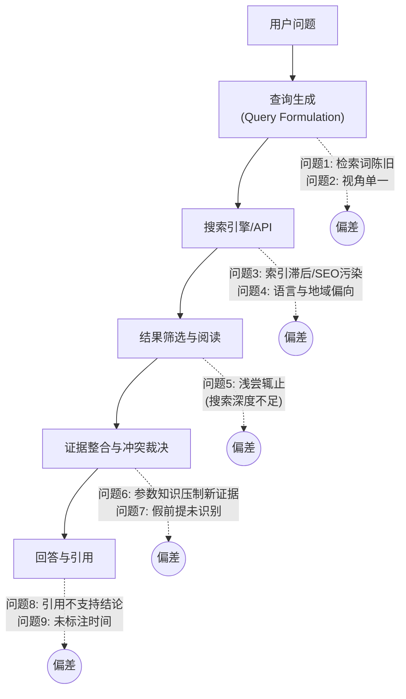
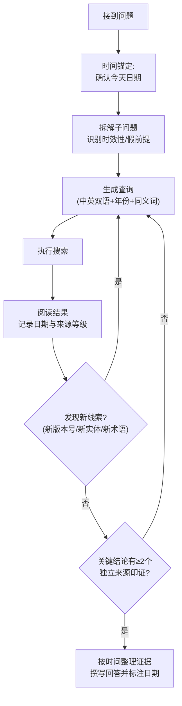

[toc]


- 修改api/sdk相关代码反复错时,考虑联网,并且默认联网,毕竟模型训练的内容往往和最新版本api有脱节.
- 请求测试运行,可以向用户申请和确认处于测试功能正确性的目的而需要测试运行,尤其是对于反复改错的代码,而不是你自己认为改对了(不可靠也不可信),实践是检验正确性的唯一标准.


## 问题全景：为什么"联网了也答不好"

先说结论：**联网只解决"能拿到信息"，解决不了"会不会问、问得深不深、敢不敢信新信息"**。问题分布在检索流水线的每个环节，整体结构如下：



图的读法：主干是一次联网问答的标准流水线，虚线标出每个环节典型的失效方式。下面逐个说明。

### 问题一：检索词陈旧（时间锚点漂移）

这是你最关心的问题，也是**最隐蔽、危害最大的一类**。模型生成查询词时，依赖的是训练数据里的"世界状态"：

- **年份惯性**：模型默认"今年"是训练数据截止的那一年，于是会写出 `best LLM 2024` 这样的查询。
- **版本号惯性**：用户问"最新的 Claude 模型"，模型直接去搜它记得的那个版本号，搜索结果自然围着旧版本打转，**旧信息反过来"证实"了旧认知**，形成闭环。
- **实体盲区**：训练截止后才出现的产品、项目、术语，模型根本想不到去搜，属于"不知道自己不知道"（unknown unknowns）。

**本轮就有一个真实例子**：我开始规划时，按习惯把"年份锚定"设成 2025。看到 FreshLLMs（2023 年 10 月发布）的页面时间显示约 1045 天前，才推算出现在大约是 2026 年年中。**如果不主动做这一步推算，我的所有"最新"查询都会差一年**。

### 问题二：参数知识压制检索证据（知识冲突）

模型拿到了新信息，却**不相信**。常见表现：

- 搜索结果写着"X 3.0 已发布"，模型回答"据我所知最新是 2.5，3.0 的信息可能不准确"。
- 把新事实当成"传闻"或"可能是虚构的"。

学术上这叫**知识冲突**（Knowledge Conflict），也就是**参数化知识**（Parametric Knowledge，权重里记住的）和**上下文知识**（Contextual Knowledge，检索进来的）之间的冲突。原因是模型训练时被强化了"不要轻信不可靠信息"，可这种警惕放错了地方。

### 问题三：假前提无法识别

FreshLLMs 论文的评测发现，**无论模型大小，所有模型在快速变化的知识和含假前提的问题上都表现吃力**（[arXiv 2310.03214](https://arxiv.org/abs/2310.03214)）。**假前提**（False Premise）指问题本身就基于错误事实，比如"某某公司第二次上市后股价如何"，而它根本没有二次上市。联网模型容易顺着前提去搜、去编，不会先质疑前提。

### 问题四：搜索深度不足（一搜即答）

这是第二大顽疾。OpenAI 的 **BrowseComp** 评测说明得很清楚：

| 配置                                      | BrowseComp 准确率 |
| ----------------------------------------- | ----------------- |
| GPT-4o（不联网）                          | 0.6%              |
| GPT-4o（开启浏览）                        | 1.9%              |
| Deep Research（专门训练的持续浏览 Agent） | 51.5%             |

数据来源：[OpenAI BrowseComp 官方页](https://openai.com/index/browsecomp/)，以及 [Galileo 的解读](https://galileo.ai/blog/what-is-browsecomp-openai-benchmark-web-browsing-agents)。BrowseComp 共 1,266 道题，需要多跳推理才能找到答案。OpenAI 的结论是：**光有浏览能力不够**，做好这个评测需要"坚持"和"浏览深度"。论文还指出 **准确率会随测试时计算量**（Test-time Compute，也就是愿意多搜多想的程度）**平滑上升**，没有推理和策略，单纯接入工具的提升很小（[论文 PDF](https://arxiv.org/pdf/2504.12516)）。

换句话说：**"开了联网"和"会联网搜索"差了一个数量级。**

### 问题五：结果源质量与偏向

这部分属于经验总结：
- **SEO 内容农场和过时转载**：聚合站转载旧文章后改了发布日期，看起来是"新的"。
- **摘要片段截断**：搜索 API 返回的 snippet 只是页面的一小段，关键限定条件（如"仅限 Beta"）可能被截掉。
- **无日期页面**：官方文档常常不标注更新时间，无法判断是否过时。
- **语言和地域偏向**：英文查询基本找不到国内方案，中文查询又容易落到低质量的搬运站。

### 问题六：效率与预算浪费

- 重复搜索语义相同的查询。
- 一次铺开大量并发查询，触发配额或限流。**本轮的执行过程就是例证**：10 条并发被整体拒绝，逐条执行反而成功了 5 条。
- 用高成本模式（如深度搜索）处理简单事实题。

---

## 核心原理：从"检索一次"到"检索循环"

理解问题后，改进方向就清楚了：把**线性的一次性检索**改成**有反馈的循环**，也就是 **Agentic Search**（智能体式搜索）。其思想来自 **ReAct**（Reasoning + Acting，推理和行动交替）范式。



图的读法：
- **时间锚定**放在最前面，是整个循环的基础。
- **"发现新线索"** 这个判断让后一轮查询**由前一轮的结果驱动**，而不是事先想好的词。这正是解决"不知道自己不知道"的关键。
- **交叉验证**是退出条件，防止只凭单一来源就下结论。

学术界已经用强化学习把这个循环训练进模型。**Search-R1** 让大模型在逐步推理中**自主生成（多个）搜索查询**并实时检索。训练时用"检索 token 掩码"（Retrieved Token Masking）保持稳定，只对模型自己生成的 token 做梯度更新。在 7 个问答数据集上，相对当时最优基线提升了 26%（Qwen2.5-7B）、21%（Qwen2.5-3B）和 10%（LLaMA3.2-3B）（[arXiv 2503.09516](https://arxiv.org/pdf/2503.09516)，COLM 2025；[GitHub](https://github.com/PeterGriffinJin/Search-R1)）。这说明**"何时搜、搜什么、搜几次"本身是可以学会的能力**。在用不了专门训练的模型时，就靠提示词和工程手段来补足。

---

## 技巧体系：七类可落地的方法

下面按"能大幅提升效果"的程度排序，**前三类收益最大**。

### 技巧一：时间锚定（解决检索词陈旧）

**原则：永远不要让模型"以为"今天是哪天，要明确告诉它，或让它自己推算出来。**

| 手段               | 做法                                                   | 示例                                                         |
| ------------------ | ------------------------------------------------------ | ------------------------------------------------------------ |
| **注入当前日期**   | 在系统提示词里写入真实日期（由程序动态生成）           | `今天是 2026-07-15。你的训练数据可能落后于此日期一年以上。`  |
| **从结果反推日期** | 拿不到系统时间时，用搜索结果的页面时间或最新新闻推算   | 本轮用 FreshLLMs 的页面时间推出现在是 2026 年                |
| **查询追加年份**   | 时效性问题的查询里显式带上当前年份                     | `vector database comparison 2026`                            |
| **版本号探测**     | **先搜"最新版本是什么"，再搜具体问题**，避免预设版本号 | 先搜 `Node.js release schedule`，确认当前 LTS 版本号后再搜它的特性 |
| **用时间过滤参数** | 调用 API 的时间范围参数，而不是只在查询文本里写年份    | Tavily 的 `time_range="month"`                               |

其中**版本号探测**最容易被忽视、效果也最好。举个完整例子：

- 用户问："最新的 Python 有哪些新特性？"
- **错误做法**：模型记得 3.12，直接搜 `Python 3.12 new features`，答了一个过时版本。
- **正确做法**：
  - 第一步搜 `Python latest stable release 2026` 或 `python.org downloads`，从结果中读出当前稳定版号。
  - 第二步用读出的版本号搜 `Python 3.x what's new`，优先 `docs.python.org`。
  - 回答时注明"截至某日期，最新稳定版为 3.x"。

需要提醒一点：**时间过滤不等于发布日期证明**。OpenClaw 的 Tavily 集成文档明确提醒，`time_range` 过滤并不能证明发布日期，时效性敏感的流程仍要核实来源（[OpenClaw 文档](https://docs.openclaw.ai/tools/tavily)）。

### 技巧二：迭代扩词（解决深度不足和未知盲区）

**原则：后一轮查询必须来自前一轮结果里的新词。**

具体流程：
- **第一轮（宽）**：用通用描述词搜，目的是"摸地形"，不是找答案。例如 `AI agent web search API comparison 2026`。
- **提取新线索**：从标题和摘要中抽出**没见过的**产品名、版本号、术语、人名。例如结果里出现了某个你没听过的 API 名字。
- **第二轮（窄）**：针对新线索定向搜，比如 `[新产品名] docs`、`[新产品名] vs Tavily`。
- **收敛条件**：连续一轮没有新线索，并且关键结论都有交叉验证，就停止。

**判断标准**：如果多轮搜索的关键词全是第一轮之前就能想到的，那只是把一次搜索拆成几次，不是真正的迭代。

### 技巧三：证据整理与冲突裁决（解决知识冲突）

FreshPrompt 论文的消融实验给出了两条可直接使用的结论（[Hugging Face 论文页](https://huggingface.co/papers/2310.03214)）：
- **检索证据的数量和顺序**都显著影响答案正确性。论文的做法是**把证据按时间从旧到新排列，最新的放在最靠近问题的位置**。
- **要求模型给出简洁直接的回答**能减少幻觉。

FreshPrompt 这种简单的少样本提示方法，效果超过了 Self-Ask 等检索增强提示方法，也超过了 Perplexity.AI 等商业系统（[ACL Anthology](https://aclanthology.org/2024.findings-acl.813/)）。这说明**不改模型，只改证据的组织方式，就有明显收益**。

冲突裁决的规则（经验做法，建议写进系统提示词）：

| 冲突类型             | 裁决规则                                             |
| -------------------- | ---------------------------------------------------- |
| 搜索结果 vs 模型记忆 | **以有日期且来源可靠的搜索结果为准**，记忆只作为线索 |
| 新来源 vs 旧来源     | 优先新的，但要确认"新"是真实发布日期，而不是转载时间 |
| 官方 vs 第三方       | 规格参数以官方为准，实际体验和问题以社区或评测为准   |
| 无法裁决             | **在回答中明确列出分歧**，不要强行给出单一结论       |

### 技巧四：查询工程（提升单次命中率）

| 模式             | 用途               | 示例                                                         |
| ---------------- | ------------------ | ------------------------------------------------------------ |
| **中英双语**     | 覆盖国内外方案     | `RAG 框架 推荐` 和 `RAG framework comparison` 各搜一次       |
| **`site:` 定向** | 直达一手来源       | `site:docs.anthropic.com web search`（具体是否支持取决于搜索后端） |
| **竞品发现**     | 发现替代方案       | `Tavily alternative`、`Tavily vs Exa`                        |
| **反向验证**     | 发现问题和改进方案 | `Deep Research limitations`、`[产品] criticism`              |
| **社区用语**     | 找到真实讨论       | 中文用"踩坑""平替"，英文用 `gotcha`、`issue`                 |
| **假前提检查**   | 先验证前提         | 先搜"X 是否发生过"，再搜"X 的影响"                           |

**分类独立**是重要原则：不要用一个大而全的查询覆盖多个子问题，那样每个子问题都只能拿到浅层结果。

### 技巧五：来源分级与交叉验证

建议按以下等级标记每条证据（经验做法）：
- **A 级（一手）**：官方文档、官方博客、论文原文、代码仓库的 Release 记录。
- **B 级（权威二手）**：主流技术媒体、专业评测平台、论文聚合站（如 Hugging Face Papers、alphaXiv）。
- **C 级（社区）**：论坛、Reddit、知乎、V2EX、GitHub Issues。**内容新但需要验证**，往往是新兴事物的最早线索。
- **D 级（低可信）**：内容农场、无署名搬运站。只作线索，不作依据。

**关键结论至少需要两个独立来源**，其中最好有一个 A 级。

### 技巧六：预算与效率控制

| 场景                         | 推荐策略                                         |
| ---------------------------- | ------------------------------------------------ |
| 简单事实题（"X 最新版本号"） | 1 到 2 次查询，浅层模式，定向官方站点            |
| 对比选型                     | 每个候选 1 到 2 次，加竞品和反向验证查询         |
| 深度调研                     | 宽查询摸地形，新词驱动 2 到 3 轮，设置总配额     |
| 配额紧张                     | **逐条执行，不要大批并发**；先跑优先级最高的分类 |

以 Tavily 为例，`search_depth` 默认是 `basic`，**改为 `advanced` 积分消耗翻倍**（第三方解读：[morphllm](https://www.morphllm.com/tavily)），所以应当按问题难度选择。

### 技巧七：输出规范

- **标注日期**："截至 2026 年 7 月"。
- **标注来源**：每个关键事实附链接。
- **标注置信度和知识截止时间**：说清楚哪些是检索到的，哪些来自模型记忆。
- **简洁直接**：FreshPrompt 已证明这样能减少幻觉。

---

## 工具和参数参考

### Claude web search tool（官方）

Anthropic API 提供服务端搜索工具，示例中的工具类型为 `web_search_20250305`（[Claude 官方文档](https://platform.claude.com/docs/en/agents-and-tools/tool-use/web-search-tool)）。2026 年可能有更新的版本号，本轮没有核实。

| 参数              | 含义                 | 说明                                                         |
| ----------------- | -------------------- | ------------------------------------------------------------ |
| `max_uses`        | 单次请求最多搜索几次 | 超出后返回 `max_uses_exceeded` 错误；**这是硬约束**，软性引导靠系统提示词 |
| `allowed_domains` | 只允许这些域名的结果 | 不要带 `https://` 前缀                                       |
| `blocked_domains` | 屏蔽这些域名         | **和 `allowed_domains` 只能二选一**（据 [Google Cloud 文档](https://docs.cloud.google.com/gemini-enterprise-agent-platform/models/partner-models/claude/web-search)） |
| `user_location`   | 本地化搜索结果       | 包含 `type`（`approximate`）、`city`、`region`、`country`、`timezone` |

官方文档特别说明，**何时触发搜索可以通过系统提示词引导**：可以鼓励模型多搜，也可以让它倾向直接回答。另外，组织管理员必须先在 Console 中启用这个工具。

### Tavily Search API（面向 Agent 的第三方 API）

参数来自 [Tavily 官方文档](https://docs.tavily.com/documentation/api-reference/endpoint/search) 和 [langchain-tavily 仓库](https://github.com/tavily-ai/langchain-tavily)：

| 参数                                  | 取值                                              | 含义                                                 |
| ------------------------------------- | ------------------------------------------------- | ---------------------------------------------------- |
| `search_depth`                        | `basic`（默认）、`advanced`、`fast`、`ultra-fast` | 搜索深度；`advanced` 相关性更高但更慢、更贵          |
| `topic`                               | `general`、`news`、`finance`                      | 切换不同的索引类别；时效性新闻用 `news`              |
| `time_range`                          | `day`、`week`、`month`、`year`                    | 从当前日期往前的时间范围                             |
| `start_date` / `end_date`             | 日期字符串，如 `2026-01-01`                       | 精确的日期区间                                       |
| `max_results`                         | 1 到 20，默认 5                                   | 返回结果数                                           |
| `chunks_per_source`                   | 默认 3                                            | 每个页面返回多少片段，控制阅读深度                   |
| `include_raw_content`                 | 布尔值                                            | 返回清洗后的全文；**需要细读时再开**，否则浪费 token |
| `include_domains` / `exclude_domains` | 域名数组                                          | 域名白名单和黑名单                                   |
| `auto_parameters`                     | 布尔值                                            | 根据查询意图自动配置参数，手动设置的值优先           |

**辨析**：`time_range` 和 `start_date`/`end_date` 都用来限定时间。前者是**相对**范围（"最近一个月"），适合追新；后者是**绝对**区间，适合查某个时间段的历史事件。

### 国内方案（本轮未核实）

国内有博查（Bocha）Web Search API、智谱和通义等平台提供的联网搜索工具，适合在国内网络环境下直接调用、覆盖中文内容。**本轮搜索配额用完，没能核实这些产品的参数和价格**，建议下一轮专门查。

---

## 实践方案

### 方案 A：系统提示词模板（适合任何支持联网的 Agent）

```markdown
## 联网搜索规则

- 今天是 {{CURRENT_DATE}}。你的训练数据可能落后于此日期一年或更久。凡涉及"最新/当前/今年"的问题，必须先搜索，不得依赖记忆。
- 生成查询时：时效性问题追加当前年份；不要预设版本号，先搜索"最新版本"再搜具体问题；同时使用中文和英文查询。
- 搜索结果与你的记忆冲突时，以有日期且来源可靠的结果为准，不要把新信息当作"可能虚构"。
- 每轮搜索后检查是否出现了你不认识的新产品、版本号或术语；若有，针对它们做下一轮搜索。
- 回答前确认：关键结论至少有两个独立来源，并检查问题是否含有错误前提。
- 回答中标注信息日期和来源链接，并说明哪些内容来自搜索、哪些来自你的已有知识。
```

模板中的占位符：
- `{{CURRENT_DATE}}`：由调用方程序在每次请求时动态填入真实日期，格式建议用 ISO 8601（如 `2026-07-15`）。**不要硬编码**，否则时间锚定会随时间失效。

### 方案 B：最小检索循环脚本

我写了 `fresh_search.py`（已通过 `py_compile` 语法检查，已作为附件导出）。由于沙箱不能上网，**没有做真实调用测试**。脚本实现了三件事：

- **时间锚定**：问题里含"最新""latest"等词时自动追加当前年份。
- **迭代扩词**：从上一轮结果标题中提取新的版本号和专有名词，生成下一轮查询。
- **证据排序**：按发布日期从旧到新排列，最新的放在最后，对应 FreshPrompt 的结论。

用法和参数：

| 参数            | 默认值  | 含义                             |
| --------------- | ------- | -------------------------------- |
| `question`      | 必填    | 要查询的问题                     |
| `--rounds`      | 2       | 最多迭代几轮；没有新词时提前结束 |
| `--time-range`  | 无      | `day`、`week`、`month`、`year`   |
| `--depth`       | `basic` | `advanced` 更准但积分消耗翻倍    |
| `--max-results` | 5       | 每次查询的结果数                 |

运行前需要 `pip install tavily-python`，并设置 API 密钥。**国内网络访问 Tavily 和 Anthropic API 通常需要代理**：

- Linux / macOS：`export HTTPS_PROXY=http://127.0.0.1:7890`（端口以你的 mihomo 配置为准）
- Windows PowerShell：`$env:HTTPS_PROXY="http://127.0.0.1:7890"`
- Windows CMD：`set HTTPS_PROXY=http://127.0.0.1:7890`

生产环境部署在海外服务器时不需要代理。

### 方案 C：普通用户在聊天界面里的技巧

如果你用的是 ChatGPT、Claude、Kimi 这类聊天产品，不能改系统提示词，也可以在提问时这样写：

- **告诉它日期**："今天是 2026 年 7 月 15 日，请搜索……"
- **禁止依赖记忆**："不要用你的已有知识回答版本号，先搜索确认。"
- **要求先探测**："先查清目前最新版本是什么，再回答它的新特性。"
- **要求标注**："每个结论附来源链接和发布日期。"
- **要求追查新词**："如果搜索中出现你不认识的产品名，继续搜它。"

---

## 遗漏审计

本轮只完成了 5 条搜索，以下类别**覆盖不足**，建议下一轮补上：

| 遗漏类别       | 建议搜索词                                                   |
| -------------- | ------------------------------------------------------------ |
| 国内搜索 API   | `博查 Web Search API 文档`、`智谱 web search 工具 参数`、`通义 联网搜索 API` |
| 竞品发现       | `Tavily alternative 2026`、`Exa vs Tavily vs Jina`、`Perplexity Sonar API` |
| 2026 年新进展  | `deep research agent 2026`、`BrowseComp leaderboard 2026`、`BrowseComp-ZH` |
| 反向验证       | `deep research hallucinated citations`、`AI search engine citation accuracy study` |
| 时间推理研究   | `LLM temporal awareness benchmark`、`knowledge conflict RAG parametric context` |
| 抓取和全文阅读 | `Claude web fetch tool`、`Jina Reader API`、`Firecrawl`      |
| 开源方案       | `open source deep research agent GitHub`、`SearXNG LLM agent` |

---

## 总结

**问题出在哪里**：大模型联网搜索答得不好，主要原因在使用方式，而不是联网本身。最常见的是：

- **检索词陈旧**：模型默认今年还是训练截止那一年，并预设版本号，结果搜回来的旧信息反过来又"证实"了旧认知。
- **不信新证据**：搜到了新信息，却按记忆把它当成传闻（知识冲突）。
- **一搜即答**：OpenAI 的 BrowseComp 评测里，GPT-4o 开启浏览只从 0.6% 提到 1.9%，专门训练的 Deep Research 能到 51.5%，差距超过一个数量级。

**最有效的三个技巧**：

- **时间锚定**：明确注入当前日期；先搜"最新版本是什么"，再搜具体问题。
- **迭代扩词**：下一轮查询必须来自上一轮结果里出现的新名词、新版本号。
- **证据整理**：按时间从旧到新排列证据，冲突时以有日期、来源可靠的结果为准，关键结论至少两个独立来源。FreshPrompt 论文证明，光改证据的组织方式就有明显收益。

