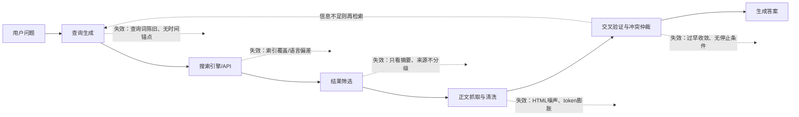
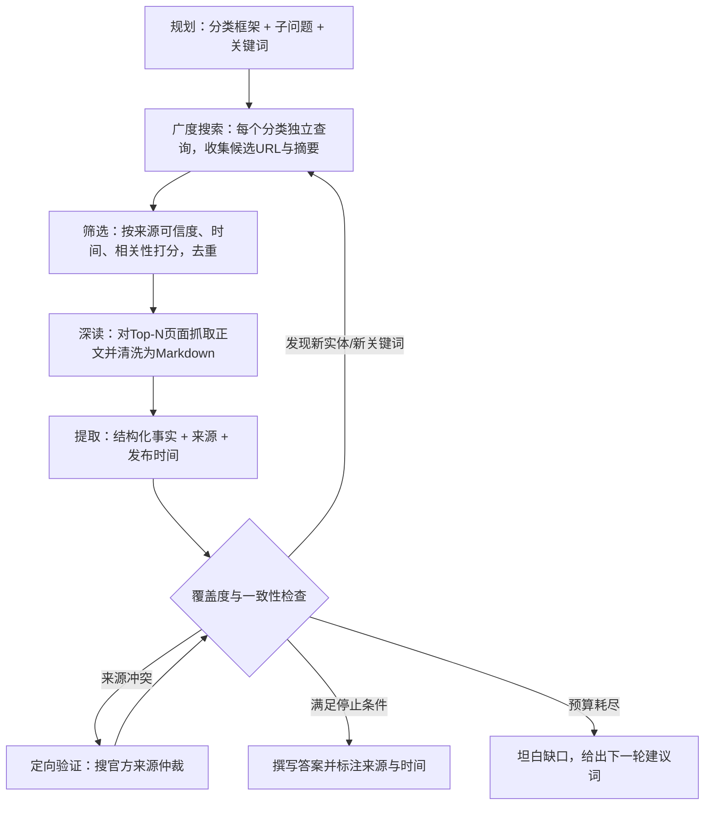
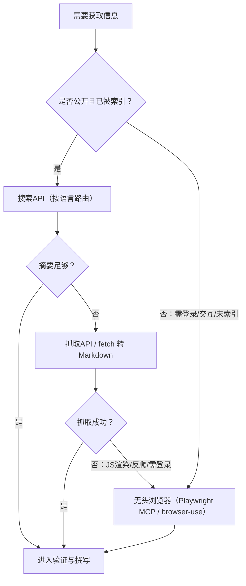

[toc]


---

## 问题定性：为什么"联网了"仍然答不好

把"联网搜索"看成一个函数调用是最常见的误解。它实际上是一个**检索（Retrieve）—阅读（Read）—验证（Verify）—再检索**的闭环，任何一环出问题都会让最终答案不可用。下面按失效环节归类：

| 失效模式                                | 表现                                                         | 根因                                                        |
| --------------------------------------- | ------------------------------------------------------------ | ----------------------------------------------------------- |
| **检索词锚定在训练数据**（Stale Query） | 问"最新的Python版本"，模型搜"Python 3.12"（它记忆中的最新版） | 模型用训练时的世界观生成查询，查询本身已过期                |
| **时间盲区**（Temporal Blindness）      | 问"今年"时，模型按训练截止年份理解"今年"                     | 系统提示词未注入当前日期；模型不知道"现在"是何时            |
| **搜索深度不足**（Shallow Search）      | 只做一次搜索、只看前3条摘要就作答                            | 没有多跳（multi-hop）机制，没有"搜索—阅读全文—再搜索"的循环 |
| **摘要截断**（Snippet Truncation）      | 摘要说"规则已变更"，但变成了什么没说                         | 只拿SERP摘要不抓正文                                        |
| **索引覆盖与语言偏差**                  | 中文时效信息用英文引擎搜不到                                 | 单一引擎、单一语言                                          |
| **过早收敛/确认偏差**                   | 第一条结果说什么就信什么                                     | 缺乏来源冲突检测与交叉验证                                  |
| **来源不分级**                          | 把SEO农场文章与官方文档同等对待                              | 没有可信度权重与时间权重                                    |
| **上下文膨胀**                          | 塞入几万token的HTML噪声，模型反而"看不见"关键句              | 没有内容清洗（Markdown化、去导航/广告）                     |
| **重复检索与超时**                      | 同一查询换几个词反复搜，直到配额耗尽                         | 缺少停止条件与预算管理（本轮我自己就撞上了配额上限）        |

用一张图表示这些失效点在链路中的位置：



---

## 核心技巧：让搜索可用的工程方法

### 时间锚定（Temporal Grounding）——必须做

这是性价比最高的一条。**必须在系统提示词中注入当前日期**（含年月日，最好注明时区），并且**明确告诉模型其知识截止日期早于当前日期**。例如在系统提示词中写入：当前日期为`2026-xx-xx`，你的训练知识截止于2025年初，任何涉及"最新、现在、今年、近期"的问题都必须通过搜索获取，并且查询中应包含当前年份。

效果上的差异非常直观：

- 未锚定：用户问"Bing搜索API还能用吗"，模型基于记忆回答"可以，通过Azure订阅"，搜索时也用`Bing Search API pricing`这种中性词，命中的多是旧文档。
- 锚定后：模型搜`Bing Search API retirement 2026`、`Bing Search API 替代方案`，能够发现微软已在2025年8月停用该API（这一点来自我的训练知识，需要你核实；值得注意的是，本轮检索到的SegmentFault横评仍把Bing列为可选项，说明**第三方文章本身也会过期**）。

### 查询改写（Query Rewriting）——应该做

模型生成的第一版查询往往不是最优的，应当由Agent（或一个轻量的改写步骤）系统性地扩展：

| 策略           | 做法                                            | 示例（原问题："哪个搜索API适合AI Agent"） |
| -------------- | ----------------------------------------------- | ----------------------------------------- |
| **年份锚定**   | 每个主题至少一条带当前年份的变体                | `search API for AI agents 2026`           |
| **分解子问题** | 复杂问题拆为可独立检索的子问题                  | 定价 / 延迟 / 免费额度 / 中文覆盖 各一条  |
| **竞品发现**   | `[实体] alternative`、`vs`、`competitor`        | `Tavily alternatives`、`Exa vs Tavily`    |
| **反向验证**   | `[实体] limitations`、`criticism`、`deprecated` | `Tavily pricing criticism`                |
| **多语言**     | 中英双语各搜一次，再按语言路由引擎              | `搜索API 大模型 对比 2026`                |
| **站点定点**   | 对权威聚合站或官方文档限定站点                  | `site:github.com searxng json api`        |
| **术语别名**   | 社区用语与正式名并用                            | `web search tool` 与 `grounding`          |
| **去陈旧化**   | 显式排除旧版本或旧年份                          | `-2023 -2024`（部分引擎支持）             |

**避免**：一次搜索塞入多个概念的长句（引擎会退化为关键词匹配，返回泛泛之谈）；**避免**用模型记忆中的版本号作为查询词（例如把"最新版"翻译成某个具体旧版本）。

### 搜索深度控制：广度探索 → 定点深读 → 迭代

一个可靠的搜索Agent应当区分三个阶段，而不是"搜一次、看摘要、作答"：



几个关键的工程规则：

- **必须设置预算与停止条件**：最大搜索次数、最大抓取页数、最大token；达到后停止并**诚实汇报缺口**，而不是用残缺信息硬写。本轮我的做法就是这一规则的实践。
- **应该让后一轮查询基于前一轮发现的新词**：例如从横评文章中发现了Parallel AI、Cloudflare AI Gateway Web Search、七牛云百度搜索这些我训练知识中没有的实体，下一轮应该定向搜它们，而不是重复搜已知概念。
- **应该把"摘要"与"正文"分开计费**：先用便宜的搜索拿摘要做筛选，只对最有价值的少数页面付出抓取与token成本。Firecrawl的博客给出了一个量化参考：直接把原始HTML丢给模型平均每页约38,000 token，清洗为Markdown后约2,800 token（来源：[Vellum博客](https://www.vellum.ai/blog/best-web-search-apis-and-mcps-for-ai-agents)引用的Firecrawl数据），**十倍以上的差距**直接决定了你的Agent能"读"多少页。

### 结果处理：分级、时间过滤与冲突仲裁

- **来源分级**：官方文档/官方博客/仓库Release > 权威媒体与知名测评平台 > 主流社区（知乎、V2EX、Hacker News、Reddit）> 个人博客/内容农场。给每条结果一个可信度权重，而不仅看排名。
- **时间过滤**：对时效性问题，优先按发布时间排序，并把**页龄**显式呈现给模型（本轮我在打印结果时就输出了`page_age`字段，这让我立刻识别出哪些横评是最近几天的）。多数AI原生搜索API都支持`days`或日期范围参数，应当在工具封装中暴露它。
- **冲突仲裁**：同一事实出现矛盾时（例如本轮两份来源对Perplexity Deep Research的评分一个是70、一个是26.9，见[Eden AI横评](https://www.edenai.co/post/best-deep-research-apis)），**不要取平均，也不要选第一条**，而是回到官方来源或更新的来源做定向验证，并在答案中注明分歧。
- **去重**：同一内容在多个聚合站转载是常态，按URL规范化和正文相似度去重，节省token。

### 工具封装与提示词：一个可复用的骨架

以下Python示例演示了一个"带时间锚定、查询扩展、时间过滤与去重"的搜索工具封装（以Tavily风格的参数为例，可替换为任何提供商）。

```python
import datetime as dt
import hashlib

CURRENT_YEAR = dt.date.today().year

def expand_queries(question: str, entities: list[str]) -> list[str]:
    """把一个问题扩展为一组互补的查询；年份锚定 + 竞品发现 + 反向验证。"""
    qs = [f"{question} {CURRENT_YEAR}"]
    for e in entities:
        qs += [f"{e} alternatives {CURRENT_YEAR}", f"{e} limitations criticism"]
    return list(dict.fromkeys(qs))  # 去重且保持顺序

def search_tool(query: str, days: int | None = 365, max_results: int = 8) -> list[dict]:
    """调用搜索提供商；days 为时效窗口（天），None 表示不限。"""
    raw = provider.search(query=query, days=days, max_results=max_results)  # 伪代码
    seen, out = set(), []
    for r in raw:
        key = hashlib.md5(r["url"].split("?")[0].lower().encode()).hexdigest()
        if key in seen:
            continue
        seen.add(key)
        out.append({
            "title": r["title"],
            "url": r["url"],
            "published": r.get("published_date"),   # 显式暴露时间给模型
            "snippet": r["content"][:500],          # 摘要截断，正文另行抓取
        })
    return out

SYSTEM_PROMPT = f"""今天是 {dt.date.today().isoformat()}（Asia/Shanghai）。
你的训练知识截止于更早的时间，涉及“最新/当前/今年/近期”的问题必须先搜索再回答。
搜索时在查询中包含年份 {CURRENT_YEAR}；对关键结论至少交叉验证两个独立来源；
回答中标注来源 URL 与发布时间；若预算耗尽仍有缺口，明确说明缺口而不是猜测。"""
```

字段与占位符说明：

| 名称          | 含义                                                         |
| ------------- | ------------------------------------------------------------ |
| `days`        | 时效窗口。时效性问题设为30到365；历史性问题设为`None`。不同提供商参数名不同（Tavily为`days`，Exa为`startPublishedDate`，Brave为`freshness`） |
| `max_results` | 单次返回条数。广度阶段取8到10，深读阶段只对其中2到3条抓正文  |
| `published`   | 发布时间。必须透传给模型，否则模型无法判断陈旧与否           |
| `snippet`     | 摘要。仅用于筛选，**不要**直接据此作答                       |
| `provider`    | 任意搜索提供商的客户端对象，下一节对比                       |

---

## 第三方搜索提供商对比

### 五类产品形态

综合本轮检索到的多份2026年横评（[parallel.ai](https://parallel.ai/articles/the-honest-2026-comparison-web-search-apis-for-ai-agents)、[Firecrawl](https://www.firecrawl.dev/blog/best-search-tools-for-agents)、[Vellum](https://www.vellum.ai/blog/best-web-search-apis-and-mcps-for-ai-agents)），市场已明显分化为五类，**选型第一步是搞清你需要的是哪一类**：

| 类型                | 返回什么                                     | 代表                                        | 适合                               |
| ------------------- | -------------------------------------------- | ------------------------------------------- | ---------------------------------- |
| **SERP代理类**      | 搜索引擎原始结果（标题、链接、摘要）         | Serper、SerpAPI、SearchAPI                  | 需要Google结果质量、价格敏感       |
| **AI原生搜索类**    | 清洗后的结构化结果，可附带正文片段或合成答案 | Tavily、Exa、Brave Search API、Parallel     | Agent工具调用的主力                |
| **搜索+抓取一体类** | 直接返回每个结果页的Markdown全文             | Firecrawl、Jina（Search + Reader）          | RAG、研究型流水线                  |
| **合成答案类**      | 一段带引用的成文答案                         | Perplexity Sonar                            | 想省掉自建检索链路，不在意延迟     |
| **模型内置工具类**  | 模型自行决定何时搜、搜几次                   | OpenAI `web_search`、Anthropic `web_search` | 已绑定某模型厂商，追求最少集成工作 |
| **自托管元搜索**    | 聚合多个引擎的结果，JSON输出                 | SearXNG                                     | 免费、可控、无配额焦虑             |

### 国外主流提供商横评

| 提供商                               | 特点                                                         | 价格参考（本轮来源）                                         | 需要注意                                                     |
| ------------------------------------ | ------------------------------------------------------------ | ------------------------------------------------------------ | ------------------------------------------------------------ |
| **Tavily**                           | 被多篇横评称为Agent搜索的事实标准，响应结构干净，带可选合成答案，LangChain等生态原生集成 | 基础搜索约$8/1k，按credit计费（高级搜索计2个credit）         | 自主Agent高频调用时credit消耗快                              |
| **Exa**                              | 神经/语义检索，返回结构化页面数据与`highlights`关键段        | AN Score评测中得分最高（8.7）                                | 评测指出对高度具体的技术/代码类查询，语义检索有时不如关键词检索稳定；`highlights`应视为提示而非事实；配额用尽直接429无降级 |
| **Brave Search API**                 | 独立索引、隐私优先、价格质量均衡，需在产品中注明来源         | 中等                                                         | webscraft横评称其于2026年2月无预警取消了免费计划             |
| **Serper**                           | 直取Google SERP，便宜、错误可预测                            | 约$1/1k起                                                    | 依赖Google；横评提到Google在2025年12月起诉了同类的SerpAPI，此类服务存在**持续性风险** |
| **Firecrawl**                        | `/search`一次调用返回全文Markdown，省去单独抓取              | 每月1,000免费credit；标准档$83/月含100K credit；延迟约1.3秒  | 价格偏高；旧版deep research端点已废弃                        |
| **Jina**                             | Search与Reader API，Reader返回完整Markdown                   | 新用户赠1000万token，Search每次固定起步1万token，平均延迟约2.5秒（SegmentFault横评） | 按token计费模型需评估                                        |
| **Perplexity Sonar**                 | 合成答案带内联引用                                           | 基准测试中平均延迟11秒以上                                   | 不适合用户等待的同步场景；深度研究版本在不同第三方基准上的评分差异极大 |
| **Parallel AI**                      | 面向企业研究，强调证据支撑的输出                             | 本轮未获价格                                                 | 新兴，社区验证较少                                           |
| **OpenAI / Anthropic 内置搜索**      | 模型自主决定搜索次数，无需自建链路                           | 均为$10/1k次，**另加**检索内容按输入token计费；OpenAI对部分小模型按固定8,000 token计费一次搜索，搜索上下文上限128K | 一次请求可能触发多次计费搜索，**实际成本高于标价**；无法独立替换检索层 |
| **Cloudflare AI Gateway Web Search** | 2025年10月新增，默认提供商Ceramic.ai                         | 最低档约$0.25/1k（digitalapplied对比）                       | 新兴，本轮未深入核实                                         |

一个重要的横评结论是**计量单位不统一**——"每次搜索、每次查询、每个prompt、每个credit"是四种不同的东西，[digitalapplied的对比](https://www.digitalapplied.com/blog/web-search-apis-for-ai-agents-compared-2026)给出的建议是用你自己的真实流量去测算，而不是比标价。

### 国内提供商

国内Agent必须认真对待的事实是：**Tavily、Exa、Brave的索引对中文内容覆盖有限**，中文时效信息（政策、国内产品发布、中文社区讨论）需要国内引擎。本轮检索到的国内可用选项：

| 提供商                         | 底层/特点                                                    | 免费额度（来源）                     | 适合                  |
| ------------------------------ | ------------------------------------------------------------ | ------------------------------------ | --------------------- |
| **博查（Bocha）Web Search**    | 面向AI的中文网页搜索API，侧重中文，文档与开发者计划相对完善（博客园指南） | 未获具体数据                         | 中文为主的通用Agent   |
| **秘塔搜索API**                | 学术与中文深度检索见长，提供API Server与MCP Server           | 约100K免费token（博客园指南）        | 快速验证、学术类      |
| **腾讯云联网搜索（搜狗）**     | 与DeepSeek等模型集成，合规稳定                               | 未获具体数据                         | 腾讯云生态            |
| **七牛云百度搜索**             | 百度索引，按token计费                                        | 新用户300万token（SegmentFault横评） | 中文新闻、国内站点    |
| **智谱 web search工具**        | BigModel平台内置的搜索工具（基于我的训练知识，本轮未核实现状） | 未获                                 | 已用GLM系列模型的项目 |
| **阿里云IQS / 百度千帆AI搜索** | 云厂商提供的搜索组件（训练知识，本轮未核实）                 | 未获                                 | 对应云生态            |

SegmentFault横评给出的实践建议我认为是正确的：**按查询语言路由**——中文查询走百度/博查类国内引擎，英文查询走Tavily/Exa/Serper，这样既保证覆盖又控制成本。

### 自托管方案：SearXNG

对于偏好免费、开源、可控的读者，**SearXNG**（开源元搜索引擎）是值得优先评估的选项：它聚合Google、Bing、DuckDuckGo、百度等多个引擎，开启JSON输出后即可作为Agent工具。最小化部署要点（基于我的训练知识，配置键名请以官方文档为准）：

```yaml
# docker-compose.yml 片段
services:
  searxng:
    image: searxng/searxng:latest
    ports:
      - "8080:8080"
    volumes:
      - ./searxng:/etc/searxng
    environment:
      - SEARXNG_BASE_URL=http://localhost:8080/
```

```yaml
# ./searxng/settings.yml 关键项
search:
  formats:
    - html
    - json        # 必须开启，否则 /search?format=json 返回 403
server:
  limiter: false  # 内网 Agent 调用时关闭限流器，公网暴露则务必开启
```

调用方式为`GET /search?q=关键词&format=json&time_range=year&language=zh-CN`，其中`time_range`可取`day`、`month`、`year`，是实现时间过滤的关键参数。

需要留意的边界：SearXNG抓取的是引擎的HTML页面，**上游引擎会反爬**（Google尤其严格），高频调用会被限速或封禁；国内服务器访问Google类引擎需要代理，可在`settings.yml`中为`outgoing.proxies`配置`http://127.0.0.1:7890`之类的本地代理（mihomo等），Windows与Linux的配置方式在此处一致，因为是容器内的应用层代理。

---

## 无头浏览器与CDP：是另一条思路，但定位是"兜底"

**本节基于我的训练知识（约2025年上半年），本轮未能联网核实工具的最新版本与排名，请以各项目仓库为准。**

### 为什么需要浏览器

搜索API的根本局限是**只能拿到索引过的、公开的、静态可抓的内容**。以下场景它无能为力：

- 需要登录或会话的内容（内部系统、付费墙后的文章）；
- 重度JavaScript渲染、无服务端输出的页面；
- 需要交互才能得到的结果（筛选器、分页、表单提交、站内搜索）；
- 搜索引擎尚未索引的"几分钟前"的内容；
- 需要截图/视觉核实的场景。

### 主要工具形态

| 方案                                             | 形态                                              | 特点                                        | 适合                             |
| ------------------------------------------------ | ------------------------------------------------- | ------------------------------------------- | -------------------------------- |
| **Playwright MCP**（微软）                       | MCP服务器，暴露浏览器操作为工具                   | 基于可访问性树而非截图，token效率高；跨平台 | 让Claude、Cursor等直接操作浏览器 |
| **Chrome DevTools MCP**（Google，2025年9月发布） | 基于CDP的MCP服务器                                | 能读性能面板、网络请求、控制台，调试能力强  | 开发调试、抓接口                 |
| **browser-use**                                  | Python库 + Agent框架                              | 把浏览器交互封装为高层动作，社区活跃        | 自动化任务型Agent                |
| **Stagehand**（Browserbase）                     | 在Playwright之上的AI层，`act`/`extract`/`observe` | 自然语言指令与确定性代码混合                | 抓取+交互流水线                  |
| **Browserbase / Steel**                          | 云端托管浏览器                                    | 免维护、带代理与反检测                      | 生产环境规模化                   |
| **直接用CDP**                                    | `chrome --remote-debugging-port=9222`自行驱动     | 最底层最灵活，工程量最大                    | 特殊需求                         |

### 用浏览器"去搜索引擎页面搜"是否可行

技术上可行，但**不推荐作为主路径**，原因：

- **反爬与验证码**：Google、百度对无头浏览器识别成熟，稍高频率即触发验证，成功率不稳定；
- **成本结构差**：一次浏览器搜索通常数秒到十几秒、占用CPU与内存、产出的DOM文本噪声极大，而一次搜索API调用几百毫秒、输出干净JSON；
- **合规**：违反引擎服务条款，生产环境风险高；
- **非ASCII显示**：无头环境缺中文字体时截图会出现方块（tofu），Linux容器需安装`fonts-noto-cjk`等字体包，这是国内读者容易踩的坑。

合理的定位是：**搜索API负责"发现"，抓取API（Firecrawl/Jina/自建fetch）负责"读取"，浏览器只在前两者失败或需要交互时兜底**。



---

## 推荐架构与综合示例

### 分层检索架构

- **第一层（发现）**：双引擎路由。英文走Tavily或Exa（或自托管SearXNG），中文走博查/七牛云百度搜索；均开启时间过滤并透传发布时间。
- **第二层（读取）**：对Top-N结果用Jina Reader或Firecrawl抓正文；若自建，用`trafilatura`类库把HTML转Markdown再喂模型。
- **第三层（兜底）**：Playwright MCP处理需要交互或反爬的页面。
- **横切能力**：日期注入、查询扩展、预算控制、来源分级、冲突仲裁、结果缓存（同一查询24小时内复用，大幅节省成本）。

### 综合示例：回答"Brave Search API现在还有免费层吗"

这是一个典型的、训练数据会给出错误答案的时效问题（我的记忆是"有，每月2,000次"）。按上述方法走一遍：

- **时间锚定**：系统提示告知当前为2026年；模型意识到自己记忆可能过期。
- **查询扩展**：`Brave Search API free tier 2026`、`Brave Search API pricing change`、`Brave Search API alternatives 2026`（竞品发现，预防性地寻找替代）。
- **广度搜索**：命中若干2026年的横评，其中一篇（页龄2天）声称Brave在2026年2月取消了免费计划。
- **来源分级与验证**：这是第三方博客的说法，可信度中等；应当定向搜官方来源，例如`site:brave.com search api pricing`，或抓取Brave官方定价页正文做仲裁。本轮我因配额耗尽未能完成这一步，因此在正文中我用了"横评称"这种措辞而不是陈述为事实——**这就是验证不足时应有的表达方式**。
- **答案撰写**：给出结论、来源、发布时间，并注明验证程度。

### 网络环境说明

- 国外搜索API的端点在国内直连通常可达，但**抓取第三层的目标站点（GitHub、Google Docs等）常需代理**。*nix下`export HTTPS_PROXY=http://127.0.0.1:7890`；Windows PowerShell下`$env:HTTPS_PROXY="http://127.0.0.1:7890"`；Python的`httpx`/`requests`会自动读取这些变量，Node的`fetch`则需要`undici`的`ProxyAgent`或`GLOBAL_AGENT`类方案，不要默认它会读环境变量。
- 无代理时抓取GitHub原始文件可用镜像代理包裹原链接（如`gh-proxy`类服务），但这类服务可用性波动，生产环境不要依赖。
- 生产环境部署在国外服务器时，反而是**国内引擎的API可能有地域限制或延迟**，需要实测。

---

## 评估：没有测试集就没有改进

**本节基于训练知识。** 公开基准方面，OpenAI的BrowseComp（2025年4月发布）专门衡量"难以找到但易于验证"的多跳浏览能力，是当前衡量搜索Agent深度的代表性基准；此外还有GAIA、SimpleQA（事实性）等。但对你自己的Agent，更重要的是**自建一个小型时效性测试集**：

- 收集30到50个"训练数据必然过期"的问题（版本号、价格、是否停服、谁是现任、最近发布），并记录**标准答案与标准来源**。
- 指标：答案正确率、引用来源是否为最近N天内、平均搜索次数、平均token、P95延迟、"诚实说不知道"的比例。
- **每次调整提示词或更换提供商都回归一遍**，这比任何横评都可靠。

---

## 最佳实践清单

- **必须**：在系统提示词注入当前日期与知识截止声明；为搜索工具暴露并透传发布时间；设置搜索/抓取/token预算与停止条件；预算耗尽时诚实汇报缺口。
- **应该**：按语言路由引擎；查询带年份变体；对核心实体做`alternative`与`limitations`查询；摘要仅用于筛选，结论基于正文；关键结论至少两个独立来源；来源分级并优先官方；结果缓存。
- **可以**：对研究型任务使用搜索+抓取一体API（Firecrawl/Jina）减少链路；对不在意延迟的批处理用合成答案类API；自托管SearXNG控制成本；用Playwright MCP作为兜底。
- **避免**：一次长句查询覆盖多个概念；把模型记忆中的版本号写进查询；直接把原始HTML喂给模型；用无头浏览器高频访问搜索引擎页面；把标价当成实际成本（模型内置搜索的token附加费用常被忽视）；信任单一横评中的具体数字（本轮就观察到不同来源对同一产品评分差异数倍）。

