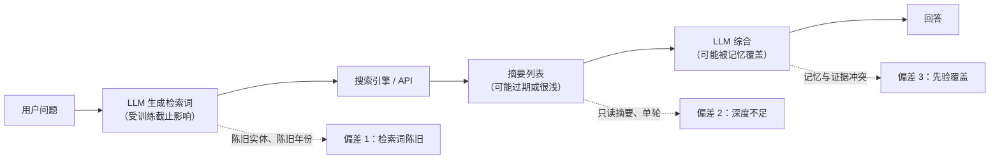
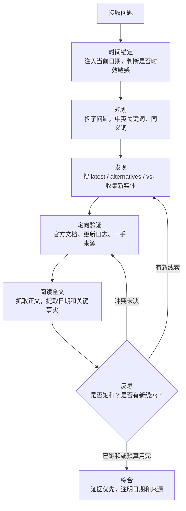
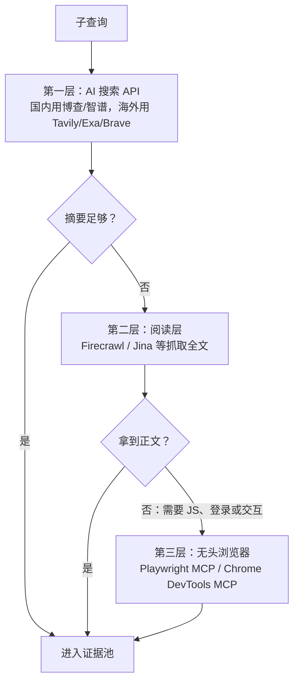

[toc]


## 自省与说明

- **身份**：我是 Anthropic 开发的 Claude 系列模型，具体版本无法从环境中确认。
- **工具**：Python/Bash 沙箱（不能直接上网），加一个 `web_search` 搜索函数。它**只返回结果摘要，不能用无头浏览器打开页面**，也没有给出明确的次数上限。
- **本轮实际搜索情况**（搜索深度 a）：
  - 第一次并发 16 条查询，**直接触发服务端限额**。
  - 改为串行后成功 **5 条**：搜索 API 横评、Bing API 退役、Google CSE 关停、博查、智谱。
  - 第 6 条（浏览器 MCP 对比）**再次触发上限**，于是停止搜索。
- **因此有一处证据不足**：浏览器 / CDP 那一节**本轮没有联网核实**，来自我的已有知识，文中会标注【未核实】。
- **时间基准**：从搜索结果的 `page_age` 推算，**资料检索时间约为 2026 年 10 月前后**（推算值）。价格等数据以各厂商最新官网为准。

## 先看一个真实案例

本次调研本身就是一个很好的例子。假设 Agent 收到问题“现在给 Agent 接哪个搜索 API 最好？”，只依赖训练记忆生成检索词，它很可能搜 `best search API 2024 Bing Web Search API`。

- [Microsoft 已于 2025 年 8 月 11 日退役 Bing Search API](https://www.firecrawl.dev/blog/bing-search-api-alternatives)。[公共端点现在返回 HTTP 410 Gone](https://cloro.dev/blog/bing-search-api-key/)。
- 官方替代品 Grounding with Bing Search [不是改名后的旧接口，它把网页上下文直接交给 AI Agent 去生成回答](https://www.itechguides.com/microsoft-killing-bing-search-api-later-this-year-in-ai-shift/)。
- Google 的 Custom Search JSON API [2025 年已停止接受新客户，并于 2026 年 1 月宣布将在 2027 年 1 月 1 日停用](https://www.octoparse.com/blog/google-official-search-api)。

这样搜出来的结果会出现三种情况：

- **方向陈旧**：查询本身锚定在一个已经消失的实体上。
- **结果过期**：命中 2024 年的老测评，拿不到 2026 年的新格局。
- **先验压过证据**：即使搜到了“已退役”的信息，模型也可能被自己的记忆带偏。

这正是用户提到的“联网了也答不好”的典型机制。

## 问题诊断

### 核心原理：检索词由模型生成，所以继承了模型的过时认知

联网搜索并不是“把问题原样丢给搜索引擎”，而是 **LLM 先生成检索词（Query Formulation）**，再去搜索。检索词从模型参数里来，参数冻结在 **训练数据截止（Knowledge Cutoff）** 那一刻。所以：

- **搜到什么，取决于先想到什么。** 模型不知道的新实体（新产品、新版本、新政策），它一开始就想不到去搜。
- **联网只能纠正“已知实体的新状态”，很难发现“未知的新实体”**，除非专门设计“发现”这一步。



图中有三个偏差注入点：**生成检索词时、阅读结果时、综合回答时**。后面每条技巧都对应其中一个或几个。

### 常见问题清单

| 问题                                   | 表现                                           | 根因                     | 对应的注入点 |
| -------------------------------------- | ---------------------------------------------- | ------------------------ | ------------ |
| **缺少时间锚定**（Temporal Grounding） | 查询带旧年份，比如在 2026 年搜 “2024 best”     | 模型不知道“今天”是哪天   | 偏差 1       |
| **实体陈旧**（Stale Entity）           | 搜已退役的产品或旧版本号                       | 参数知识里只有旧实体     | 偏差 1       |
| **只读摘要**（Snippet-only）           | 根据一两句摘要下结论，漏掉限制条件             | 没有抓取全文             | 偏差 2       |
| **搜索深度不足**                       | 一轮搜索就作答，不追踪新线索                   | 没有反思和迭代循环       | 偏差 2       |
| **查询过宽或合并**                     | 一条宽泛查询覆盖多个子问题，结果被头部内容占满 | 没有拆分子问题           | 偏差 1       |
| **语言与区域偏差**                     | 只用英文搜索，漏掉国内方案（比如博查）         | 查询语言单一             | 偏差 1       |
| **来源质量与利益偏差**                 | 把厂商自家对比页当中立评测                     | 没有给来源分级           | 偏差 2 / 3   |
| **先验覆盖**（Knowledge Conflict）     | 搜到“已停用”，回答里仍推荐                     | 记忆和证据冲突时偏向记忆 | 偏差 3       |
| **索引延迟**                           | 最近几天的事件搜不到                           | 引擎抓取有滞后           | 外部限制     |
| **效率与限流**                         | 并发过多被限流，或重复搜索浪费配额             | 没有预算和节流           | 工程问题     |

最后一条在本次调研中**亲身遇到**：16 条查询一次性并发，直接触发服务端限额。

## 改进技巧体系（最佳实践）

### 总体工作流



这张图的关键在于两个回环：

- **发现 → 反思 → 发现**：解决“不知道自己不知道”。每一轮用上一轮新出现的实体名作为下一轮的检索词。
- **验证 → 反思 → 验证**：解决“来源冲突”。遇到矛盾时回到一手来源。

### 必须做

- **必须注入当前日期，并要求模型据此改写查询。** 智谱官方的 Web Search 示例就在 `search_prompt` 里写了“今天的日期是2025年4月11日”，并要求“引用来源日期”（[智谱开放文档](https://docs.bigmodel.cn/cn/guide/tools/web-search)）。这是最便宜、收益最高的一招。
- **必须让检索证据优先于参数记忆。** 在系统提示词中明确：搜索结果与自身记忆冲突时，以更新、更权威的来源为准，并说明冲突。
- **时效敏感问题必须先“发现”再“验证”。** 不要假设记忆中的产品名或版本号仍然是最新的。先用 `[领域] latest 2026`、`[实体] alternatives`、`[实体] vs` 这类查询收集当前实体，再逐个深入。
- **必须读取关键来源的全文**，而不是只看摘要。限制条件、价格例外、生效日期往往藏在正文里。

### 应该做（推荐）

- **查询要多样化**：中英双语、同义词或别名、社区用语，比如“联网搜索 / Grounding / SERP API”。国内方案（博查、智谱）基本只能通过中文查询发现。
- **按子问题分别搜索**：每个分类至少一条独立查询。
- **做反向验证**：搜 `[实体] limitations / criticism / retired / deprecated`。批评文章和迁移指南常常能带出新竞品，本次正是通过 Bing 退役相关文章发现了 cloro、Valyu 等新名字。
- **对来源分级**：
  - 一手来源：官方文档、更新日志、公告。
  - 中立评测：第三方基准测试。
  - 社区讨论：比如 LINUX DO、GitHub Issues，新鲜但需要核实。
  - 厂商对比页：**有利益相关**。例如 [Exa 自己的对比页称 Exa 在人物、公司、论文查询上首位命中率远高于 Tavily](https://exa.ai/alternatives/tavily)，引用时应注明这是厂商自测。
- **核对日期**：利用结果的发布时间、`page_age`、API 的 recency 过滤参数（如智谱的 `search_recency_filter`）。
- **设定停止条件**：新一轮搜索不再出现新实体，或者达到预算，就收敛。

### 可以做

- **陈旧年份守卫**：用代码兜底，见下面的示例。
- **按场景选引擎**：语义发现类用 Exa，通用 RAG 用 Tavily，需要独立索引用 Brave，国内中文内容用博查或智谱。
- **缓存与去重**：URL 级缓存，同一会话内不重复抓取。

### 避免做

- **避免一次性大量并发**：先探测配额，再串行或小批量执行，失败时指数退避。
- **避免用一条宽泛查询覆盖所有分类。**
- **避免把搜索 API 的“答案模式”当作事实。** 比如 Perplexity Sonar 这类返回合成答案的服务，答案本身也可能出错，关键结论仍要回到原始来源。
- **避免在查询里硬编码具体年份或版本号**，除非用户的问题本身指定了。

### 示例：陈旧年份守卫（已在沙箱测试）

这个小工具在 Agent 发出查询前做一次检查：如果问题是时效敏感的，而查询里的年份早于今年，就生成两条替代查询，一条替换成今年，一条去掉年份。去掉年份是为了召回标题里不写年份的新页面。

```python
"""Query guard: detect and fix stale year anchors in agent-generated search queries."""
from __future__ import annotations

import re
from datetime import date

YEAR_RE = re.compile(r"\b(20[0-9]{2})\b")
TIME_WORDS = ("latest", "best", "current", "new", "today", "now",
              "最新", "目前", "现在", "当前", "推荐", "最好")


def is_time_sensitive(question: str) -> bool:
    q = question.lower()
    return any(w in q for w in TIME_WORDS)


def guard_query(query: str, question: str, today: date | None = None) -> list[str]:
    """Return 1-2 queries: the stale year is replaced by the current year,
    and a year-free variant is added so fresh pages without a year are still recalled."""
    today = today or date.today()
    years = [int(y) for y in YEAR_RE.findall(query)]
    if not is_time_sensitive(question) or not years or max(years) >= today.year:
        return [query]
    fixed = YEAR_RE.sub(str(today.year), query)
    no_year = re.sub(r"\s{2,}", " ", YEAR_RE.sub("", query)).strip()
    return [fixed, no_year]
```

主要变量和函数：

| 名称         | 含义                                               |
| ------------ | -------------------------------------------------- |
| `question`   | 用户原始问题，用来判断是否时效敏感                 |
| `query`      | LLM 生成的检索词，也就是要检查的对象               |
| `today`      | 当前日期。测试时可以注入固定值，生产环境取系统时间 |
| `TIME_WORDS` | 时效敏感触发词，可按业务扩充                       |
| 返回值       | 一到两条查询。不需要改写时原样返回                 |

测试结果：

- 问题“目前最好的 Agent 搜索 API 是什么?”配上查询 `best web search API for LLM agents 2024 Bing API`，在 2026 年 10 月 1 日改写为两条：`... 2026 Bing API` 和去掉年份的版本。
- 问题“Python 3.8 发布说明”**不是时效敏感问题**，查询原样保留，不会误改。

**这个守卫有明确的边界**：它能修年份，**修不了陈旧实体**（`Bing API` 仍然留在查询里）。陈旧实体只能靠“发现”步骤解决，这也是“发现”必须是独立步骤的原因。

### 示例：系统提示词片段

```markdown
## 联网搜索规则
- 今天的日期：{{today}}。你的训练数据可能早于今天；涉及“最新/目前/推荐”的问题，默认你的记忆已过时。
- 先发现后验证：先用 “<领域> latest {{year}}”“<实体> alternatives / vs / deprecated” 收集当前实体，再针对每个实体查官方来源。
- 每个子问题单独搜索；中文主题同时使用中英文关键词。
- 对关键来源抓取全文；记录每条事实的发布日期与来源。
- 搜索结果与你的记忆冲突时，以更新、更权威的来源为准，并在回答中说明冲突。
- 停止条件：连续一轮没有新实体或新事实，或达到 {{budget}} 次搜索。
- 厂商自家对比页须标注为“厂商自测”。
```

占位符说明：

| 占位符             | 含义                                       |
| ------------------ | ------------------------------------------ |
| `{{today}}`        | 由宿主程序注入的完整日期，比如 2026-10-01  |
| `{{year}}`         | 当前年份，用于查询模板                     |
| `{{budget}}`       | 单个任务的搜索次数上限，同时也是防限流措施 |
| `<领域>`、`<实体>` | 由模型在运行时填入的话题和实体名           |

## 第三方搜索提供商

### 主要提供商特点

| 提供商                        | 定位                              | 特点                                                         | 参考价格（以官网为准）                                  | 来源                                                         |
| ----------------------------- | --------------------------------- | ------------------------------------------------------------ | ------------------------------------------------------- | ------------------------------------------------------------ |
| **Tavily**                    | 为 Agent 设计的通用搜索           | 返回经过清洗的片段；`search_depth` 参数确实影响质量；集成生态好 | 免费每月 1,000 次；按量约 $8 / 千次，套餐 $5–7.5 / 千次 | [stork](https://www.stork.ai/blog/best-web-search-apis-for-ai-applications-2026)、[DEV](https://dev.to/supertrained/exa-vs-tavily-vs-serper-vs-brave-search-for-ai-agents-an-score-compariso)、[Exa 对比页](https://exa.ai/alternatives/tavily) |
| **Exa**                       | 神经语义搜索                      | 自有索引，按语义检索；支持找相似；有 fast / auto / deep 模式；可按发布日期、域名、类别过滤 | 约 $7 / 千次，含正文                                    | [stork](https://www.stork.ai/blog/best-web-search-apis-for-ai-applications-2026)、[AIMultiple](https://aimultiple.com/agentic-search) |
| **Brave Search API**          | 独立索引的传统搜索                | 不依赖 Google / Bing；延迟低；注重隐私；**没有语义模式，不返回全文** | 约 $5 / 千次                                            | [Exa 对比页](https://exa.ai/alternatives/brave-search-api)、[DEV](https://dev.to/supertrained/exa-vs-tavily-vs-serper-vs-brave-search-for-ai-agents-an-score-compariso) |
| **Serper / SerpAPI**          | Google 等引擎的结果页（SERP）抓取 | 结果与 Google 一致；SerpAPI 覆盖 80 多个引擎，提供地图、航班、购物等端点 | Serper 偏便宜                                           | [webscraft](https://webscraft.org/blog/search-api-dlya-ai-agentiv-scho-obirayut-rozrobniki-i-de-pomilyayutsya) |
| **Perplexity Sonar**          | 返回带引用的合成答案              | 省去自己做综合，但可控性较低                                 | —                                                       | [stork](https://www.stork.ai/blog/best-web-search-apis-for-ai-applications-2026) |
| **Firecrawl**                 | 搜索加抓取                        | 擅长把网页转成干净的 Markdown；常作为阅读层                  | —                                                       | [Firecrawl](https://www.firecrawl.dev/blog/bing-search-api-alternatives) |
| **博查 Bocha**                | 国内 AI 搜索 API                  | 国内备案，不需要代理；提供官方 MCP Server；自称 DeepSeek 官方联网搜索供应方、承接国内 60% 以上 AI 应用的联网请求（**厂商自述**） | 有免费资源包                                            | [GitHub](https://github.com/bochaai/bocha-search-mcp)、[CSDN](https://blog.csdn.net/weixin_42531752/article/details/149629925) |
| **智谱 Web Search**           | 国内搜索加问答                    | 三层服务：基础检索、对话内搜索、搜索智能体；可选自研引擎或第三方（搜狗、夸克）；有域名过滤和时效过滤 | `search_pro` 曾被社区报道为约 3 分钱一次                | [智谱文档](https://docs.bigmodel.cn/cn/guide/tools/web-search)、[LINUX DO](https://linux.do/t/topic/491906) |
| **Grounding with Bing**       | 微软官方继任者                    | 绑定 Azure AI Foundry Agent 平台，**不能直接替换旧 API**     | 比旧 API 贵                                             | [itechguides](https://www.itechguides.com/microsoft-killing-bing-search-api-later-this-year-in-ai-shift/) |
| **Google CSE JSON API**       | 旧有官方接口                      | 每天免费 100 次，之后 $5 / 千次，每天上限 1 万次；**2027 年 1 月 1 日停用** | —                                                       | [Octoparse](https://www.octoparse.com/blog/google-official-search-api) |
| **SearXNG**（自建）【未核实】 | 开源元搜索引擎                    | 免费、可私有部署，聚合多个引擎；稳定性取决于上游引擎是否封禁 | 服务器成本                                              | 已有知识                                                     |
| **Jina Reader**【未核实】     | 阅读层                            | 在 URL 前加前缀即可获得适合 LLM 阅读的正文                   | 有免费额度                                              | 已有知识                                                     |

### 第三方评测结论

- **AIMultiple 的 8 个 API 基准测试**：Brave 是唯一稳定优于 Tavily 的 API，差距约 1 分且在统计上显著；Tavily 排第五，Agent Score 为 13.67，响应约 998ms（[AIMultiple](https://aimultiple.com/agentic-search)）。
- **DEV 社区按 20 个执行维度打分**：Exa 8.7，Tavily 8.6，Serper 8.0，Brave 7.1，Perplexity 6.8（[DEV](https://dev.to/supertrained/exa-vs-tavily-vs-serper-vs-brave-search-for-ai-agents-an-score-compariso)）。
- 两份评测对 Brave 的排名相反，**说明评测维度决定结论**：AIMultiple 偏重结果相关性，DEV 偏重 Agent 使用体验（结构化输出、错误信息等）。选型时应该用自己的问题集做小规模测试。

### 选型建议

- **通用 Agent 或 RAG**：首选 Tavily，接入成本最低。
- **研究型、语义发现**（论文、公司、人物）：Exa。
- **需要独立索引、低延迟、大量调用**：Brave。
- **需要与 Google 结果完全一致**（SEO、电商、地图）：Serper 或 SerpAPI。
- **国内生产环境、中文内容**：博查或智谱，不需要代理，合规性更好。
- **预算为零或重视隐私**：自建 SearXNG，再配一个阅读层。
- **避免在新项目里依赖** Bing Search v7 或 Google CSE JSON API。

## 浏览器、CDP 方案与综合对比

本节关于具体工具的描述**本轮没有联网核实【未核实】**，来自我的已有知识，请以各项目仓库为准。

### 浏览器方案是什么

**无头浏览器（Headless Browser）** 是没有界面的真实浏览器。**CDP（Chrome DevTools Protocol）** 是程序控制 Chrome 的底层协议。Agent 通过它们像人一样打开页面、执行 JavaScript、点击和翻页。常见形态：

- **Playwright MCP**（微软）：以 **MCP（模型上下文协议）** 服务的形式暴露浏览器操作，常用无障碍树快照（Accessibility Snapshot）代替截图，节省 token。
- **Chrome DevTools MCP**（Chrome 团队）：基于 CDP，除了浏览，还能检查网络请求、做性能分析。
- **browser-use** 等 Agent 框架：把“观察页面 → 决定动作 → 执行”的循环封装好。
- **Puppeteer / Playwright 脚本**：写死流程，确定性最高。

### 它是否是一种好思路

是，但它是**补充，不是替代**。

**适合用浏览器的场景**：

- 页面需要 JavaScript 渲染才能看到内容。
- 需要登录态（比如内部系统、已付费的数据库）。
- 需要交互（筛选、翻页、填表）。
- 搜索 API 覆盖不到的站点内搜索（比如某些论坛、电商站点的站内搜索）。

**它的代价**：

- **慢、贵**：每一步都要把页面状态送给 LLM，token 消耗比调用搜索 API 高很多。
- **反爬风险**：用无头浏览器直接搜 Google，很容易遇到验证码或封禁。
- **合规风险**：要遵守目标网站的服务条款和 robots 协议。
- **运维复杂**：需要维护浏览器环境；在 Windows 和 Linux 上，无头模式和字体（包括中文字体缺失导致的乱码）需要分别处理。

### 方案综合对比

| 方案                               | 新鲜度     | 深度             | 成本             | 速度 | 可控性 | 部署难度 | 最适合               |
| ---------------------------------- | ---------- | ---------------- | ---------------- | ---- | ------ | -------- | -------------------- |
| 模型内置搜索                       | 中         | 低–中            | 包含在模型费用中 | 快   | 低     | 无       | 快速问答             |
| AI 搜索 API（Tavily、Exa、博查等） | 高         | 中               | 低               | 快   | 中–高  | 低       | 默认主力             |
| SERP API（Serper、SerpAPI）        | 高         | 低（只有结果页） | 低               | 快   | 高     | 低       | 需要 Google 一致结果 |
| 自建 SearXNG                       | 中–高      | 低               | 很低             | 中   | 高     | 中       | 零预算、私有部署     |
| 阅读层（Firecrawl、Jina 等）       | 取决于 URL | 高               | 低–中            | 中   | 高     | 低       | 抓取全文             |
| 无头浏览器 / CDP                   | 高         | 很高             | 高               | 慢   | 中     | 高       | 渲染、登录、交互     |
| Deep Research 类智能体             | 高         | 很高             | 高               | 很慢 | 低     | 无–中    | 长篇调研报告         |

### 推荐架构：分层降级



原则是**能用便宜的层解决，就不升级到贵的层**。大约八成的问题第一层加第二层就够了（这是经验判断，不是测量数据）。浏览器只留给少数确实需要的页面。

## 综合示例：用这套方法回答“现在给 Agent 接哪个搜索 API？”

1. **时间锚定**：注入日期 2026-10。问题包含“现在”，判定为时效敏感。陈旧年份守卫把 2024 改成 2026，并生成一条不带年份的变体。
2. **规划**：拆成三个子问题：主流 API 横评、官方 API 的生命周期、国内方案。
3. **发现**：搜 `Tavily vs Exa vs Brave Search API 2026`，结果中出现了记忆里没有的新名字：Linkup、Olostep、Nimble。
4. **反向验证**：搜 `Bing Search API retired`，确认 Bing v7 已在 2025-08-11 退役；同时发现 Google CSE 将于 2027-01-01 停用，这条是先前没想到要搜的。
5. **补充中文**：用中文搜“博查 / 智谱 联网搜索”，找到国内可直接使用的方案。
6. **来源分级**：Exa 的对比页标注为“厂商自测”；AIMultiple 和 DEV 的两份评测结论不一致，在回答中说明原因（评测维度不同）。
7. **综合**：给出按场景划分的推荐，每条事实附带来源和日期。

这七步对应了前面的四类偏差：第 1 步修正年份，第 3、4 步修正陈旧实体，第 6 步处理来源质量，第 7 步让证据优先于记忆。

## 网络环境与跨平台注意事项

- **国内直连**：博查、智谱都有国内备案，可以直接使用。
- **海外 API**（Tavily、Exa、Brave 等）：国内能否直连**本轮没有核实**。不稳定时可以通过本地代理（比如 mihomo）访问。
- **代理设置分平台**：
  - Linux / macOS：`export HTTPS_PROXY=http://127.0.0.1:7890`
  - Windows PowerShell：`$env:HTTPS_PROXY="http://127.0.0.1:7890"`
  - Windows CMD：`set HTTPS_PROXY=http://127.0.0.1:7890`
  - 端口以代理软件的实际配置为准。
- **生产环境在海外服务器**时，可以直接使用海外 API；如果业务需要国内中文内容，可以同时接入博查或智谱作为补充。
- **无头浏览器中文显示**：Linux 服务器上需要安装中文字体（比如 Noto CJK），否则截图和渲染结果里中文会变成方块。

