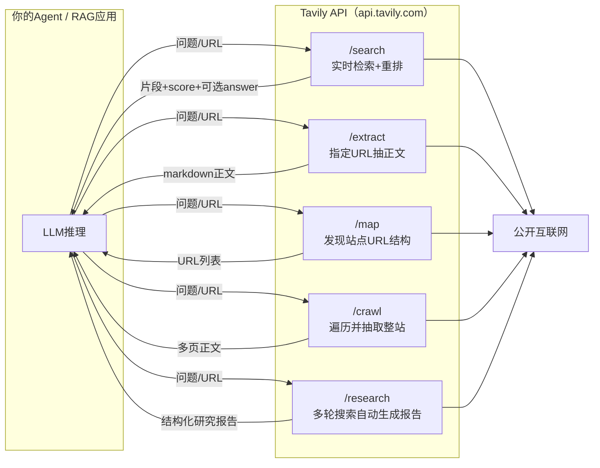
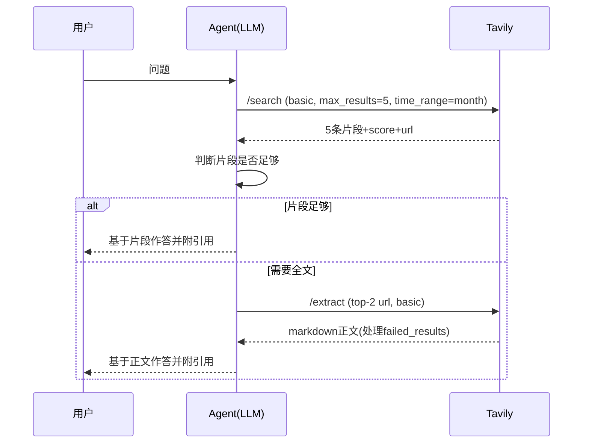
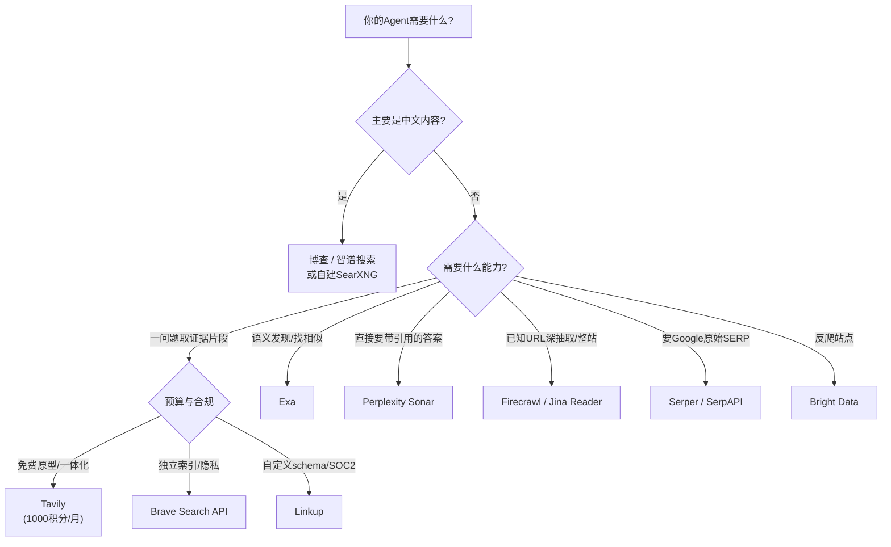

[toc]


## tavily服务信息来源与可信度说明

| 来源类型            | 具体来源                                                     | 用途                                         |
| ------------------- | ------------------------------------------------------------ | -------------------------------------------- |
| 官方                | tavily.com/product、tavily.com/blog（"Tavily 101"、"7 Best Exa Alternatives"）、docs.tavily.com（Crawl教程） | 端点定义、Research API、SDK用法              |
| 第三方定价聚合/测评 | morphllm.com/tavily、coldiq.com、usagepricing.com、aitrendtool.com、therundown.ai | 免费额度、套餐价格、速率限制（多源交叉一致） |
| 竞品视角            | exa.ai/alternatives/tavily、firecrawl.dev博客、parallel.ai、nimbleway.com | 替代方案与差异化（注意立场偏向）             |
| 训练知识（未核实）  | 参数名、国内方案、部分竞品免费额度                           | 标注"需核实"                                 |

---

## Tavily是什么：面向AI Agent的"网络访问层"

Tavily官方对自身的定位是**AI Agent的网络访问层（web access layer）**：通过一个API让Agent完成**搜索（search）、抽取（extract）、爬取（crawl）、站点映射（map）和研究（research）**，输出格式针对**RAG与Agent工作流**优化（来源：tavily.com/product；"Tavily 101"博文）。

与传统搜索API（如SerpAPI返回Google结果页的结构化数据）的核心区别在于：

- **返回的是"可供LLM直接阅读的内容"**而不仅是链接列表：每条结果附带与查询相关的正文片段（`content`）和相关性分数（`score`），可选返回整页正文。
- **做了面向LLM的重排与清洗**：一次调用背后Tavily会聚合多个来源、去噪、重排，开发者无需自建"搜索→抓取→清洗"流水线。
- **所有端点共用一个积分（credit）计量体系**，计费可预测。



### 端点全景

| 端点        | 适用场景                            | 主要输出                                       | 积分消耗（参考）                         |
| ----------- | ----------------------------------- | ---------------------------------------------- | ---------------------------------------- |
| `/search`   | 针对一个问题获取最新网页证据        | 排序后的来源、片段、分数，可选AI生成的简短答案 | basic 1积分，advanced 2积分              |
| `/extract`  | 已知URL，需要干净正文               | markdown或纯文本正文                           | 约每5个URL 1积分（advanced翻倍，需核实） |
| `/map`      | 需要某域名的可发现URL结构，不抽正文 | URL列表                                        | 低（按页数计，需核实）                   |
| `/crawl`    | 遍历并抽取一个站点或子目录          | 映射结果+每页正文                              | 按页数计（需核实）                       |
| `/research` | 一句话发起端到端深度研究            | 研究报告/结构化JSON                            | **动态，4到250积分**                     |

> 端点定义来自anygen.io整理的Tavily文档摘要与官方产品页；积分消耗中"search basic 1/advanced 2"与"research 4到250"来自morphllm与coldiq的定价整理，extract/map/crawl的具体折算以官方"Credits & Pricing"文档页为准。

---

## 各端点详解与参数说明

### `/search`：Agent搜索的主力端点

典型调用（Python SDK `tavily-python`）：

```python
import os
from tavily import TavilyClient

client = TavilyClient(api_key=os.environ["TAVILY_API_KEY"])

resp = client.search(
    query="Rust 2024 edition 相比 2021 edition 的主要变化",
    search_depth="advanced",      # basic=1积分, advanced=2积分，后者召回更深、片段更相关
    topic="general",              # general | news | finance
    max_results=5,                # 返回条数上限（通常0-20）
    include_answer=True,          # 让Tavily附带一个LLM生成的简短答案
    include_raw_content=False,    # True时每条结果附整页正文（token开销大）
    include_domains=["doc.rust-lang.org", "blog.rust-lang.org"],
    time_range="year",            # day | week | month | year
)

print(resp.get("answer"))
for r in resp["results"]:
    print(f'{r["score"]:.2f}  {r["title"]}  {r["url"]}')
    print("   ", r["content"][:200].replace("\n", " "))
```

参数逐项说明（参数名基于我对官方文档的记忆，**本轮未能联网核实**，使用前请对照docs.tavily.com的API Reference）：

| 参数                                  | 含义                               | 实践建议                                                     |
| ------------------------------------- | ---------------------------------- | ------------------------------------------------------------ |
| `query`                               | 自然语言查询                       | 必填；Agent场景下由LLM生成，建议限制长度（官方有上限，约400字符） |
| `search_depth`                        | `basic`或`advanced`                | **默认用basic省积分**；需要高相关片段（如事实核查）再用advanced |
| `topic`                               | `general`/`news`/`finance`         | `news`会偏向新闻源并支持`days`参数限定最近N天                |
| `max_results`                         | 返回条数                           | Agent场景3到5条通常足够，过多会撑爆上下文                    |
| `include_answer`                      | 是否附带AI摘要答案                 | 快速问答可开；严肃场景建议关闭，由你自己的LLM基于`results`作答，便于控制引用 |
| `include_raw_content`                 | 是否返回整页正文                   | 默认关；需要全文时**更推荐先search再对top-k调用extract**，更可控 |
| `include_domains` / `exclude_domains` | 域名白名单/黑名单                  | 对企业场景很关键，可把检索限定在权威站点                     |
| `time_range` / `days`                 | 时间窗口                           | 时效性问题（版本发布、价格）必须加                           |
| `include_images`                      | 是否返回图片                       | 多模态场景用                                                 |
| `chunks_per_source`                   | advanced模式下每个来源返回的片段数 | 控制上下文体积                                               |
| `country`                             | 地区倾向                           | 对本地化结果有帮助，对中文内容改善有限                       |

返回结构中需要辨析的三个字段：

- `content`：**与查询相关的片段**（已裁剪），不是整页；
- `raw_content`：整页正文，仅在`include_raw_content=True`时出现；
- `score`：Tavily内部相关性评分（0到1），**仅用于同一次调用内排序比较**，不要跨查询比较阈值。

### `/extract`：已知URL的正文抽取

```python
urls = [r["url"] for r in resp["results"][:3]]
ext = client.extract(urls=urls, extract_depth="basic", format="markdown")

for page in ext["results"]:
    print(page["url"], len(page["raw_content"]), "chars")
for failed in ext.get("failed_results", []):
    print("failed:", failed["url"], failed.get("error"))
```

- `extract_depth="advanced"`会处理更多动态内容和表格，积分翻倍。
- **务必处理`failed_results`**：反爬、登录墙、超时都会落入这里，Agent不能假设每个URL都抽取成功。

### `/map`与`/crawl`：站点级抽取

官方文档示例（docs.tavily.com的Crawl教程）展示了带路径过滤和自然语言指令的爬取：

```python
response = client.crawl(
    url="https://docs.tavily.com",
    max_depth=2,                                  # 从起始URL向下的链接深度
    limit=50,                                     # 页数上限，控制积分
    select_paths=["/documentation/.*", "/sdk/.*"],   # 只进入匹配正则的路径
    exclude_paths=["/changelog/.*"],
    instructions="Find pages about Search and Extract endpoints",  # 自然语言引导
    extract_depth="advanced",
)
for page in response["results"]:
    print(page["url"], len(page["raw_content"]))
```

`map`与`crawl`的关系：**map只发现URL不抽正文，crawl等于map加extract**。官方"Tavily 101"博文同样展示了`client.map(url="tavily.com", instructions="find only the developer docs")`这类用指令过滤的用法。推荐做法是**先map拿URL清单，让LLM或规则筛选后再extract**，比直接crawl省积分且可控。

### `/research`：Agent-in-a-Box

官方把它称为完整的"Agent-in-a-Box"：给定一个查询，它执行多轮迭代搜索、对数据进行推理、支持多Agent协作与去重，返回结构化JSON或综合报告（来源：Tavily 101博文）。代价是积分消耗动态变化（第三方整理为**4到250积分/次**），**免费用户应谨慎调用**，几次深度研究就能耗尽月度额度。

---

## 免费用户能用什么（重点）

多个独立来源（morphllm、coldiq、usagepricing、aitrendtool、therundown）对免费层的描述一致：

| 项目         | 免费层（Researcher计划）                                     |
| ------------ | ------------------------------------------------------------ |
| 月度额度     | **1,000 API积分/月**                                         |
| 是否需信用卡 | **不需要**                                                   |
| 额度重置     | 每月1日重置（aitrendtool注明"无论何时开始计费"）             |
| 速率限制     | **开发密钥100请求/分钟**；生产密钥1,000请求/分钟需付费计划或开通按量付费（morphllm） |
| 可用端点     | 公开资料表明所有端点共用同一积分池，即免费层可调用search/extract/crawl/map（research的可用性建议在控制台核实） |
| 支持         | 邮件支持                                                     |
| 学生         | 另有"Free for students"项目（usagepricing）                  |

1,000积分能做什么（coldiq给出的换算）：约**1,000次basic搜索，或500次advanced搜索，或约5,000个URL抽取**，或三者混合。

付费层概览（美元，按量付费每积分0.008美元）：

| 计划          | 月费 | 积分/月 | 折合每积分        |
| ------------- | ---- | ------- | ----------------- |
| Researcher    | 0    | 1,000   | -                 |
| Pay As You Go | 按量 | 不含    | 0.008             |
| Project       | 30   | 4,000   | 0.0075            |
| Bootstrap     | 100  | 15,000  | 约0.0067          |
| Startup       | 220  | 38,000  | 约0.0058          |
| Growth        | 500  | 100,000 | 0.005             |
| Enterprise    | 定制 | 定制    | 含自定义速率与SLA |

**免费用户的实践建议**：

- **必须**：把API密钥放在服务端环境变量中，不要暴露在浏览器端代码（anygen整理的官方指引也强调这一点）。
- **应该**：默认`search_depth="basic"`、`max_results`控制在5以内；需要全文时用"search后对top-k做extract"，而非`include_raw_content=True`全量返回。
- **可以**：在控制台观察积分消耗曲线，为Agent设置每会话调用上限。
- **避免**：在免费层频繁调用`/research`，或把Tavily当作全站爬虫使用。

---

## SDK、框架与MCP集成

以下集成方式来自训练知识，包名以官方文档为准（本轮未能核实）：

| 集成方式                                  | 包/入口                                                   | 说明                                                         |
| ----------------------------------------- | --------------------------------------------------------- | ------------------------------------------------------------ |
| Python SDK                                | `pip install tavily-python`                               | `TavilyClient`同步、`AsyncTavilyClient`异步                  |
| JavaScript SDK                            | `npm i @tavily/core`                                      | `tavily({apiKey})`                                           |
| LangChain                                 | `pip install langchain-tavily`                            | 提供`TavilySearch`、`TavilyExtract`等工具类                  |
| LlamaIndex / CrewAI / OpenAI Agents SDK等 | 各自的tool封装                                            | 官方product页提到"partner marketplaces and agent-native platforms" |
| MCP服务器                                 | `npx -y tavily-mcp@latest`（本地）；官方另提供远程MCP端点 | 供Claude Desktop、Cursor、Cline等MCP客户端直接调用           |
| 低代码平台                                | Dify、Coze、n8n等均有Tavily节点/插件                      | 对国内读者友好                                               |

LangChain Agent接入示例（训练知识）：

```python
from langchain_tavily import TavilySearch

search_tool = TavilySearch(
    max_results=5,
    topic="general",
    search_depth="basic",
)
# 将search_tool加入你的Agent工具列表，LLM按需调用
```

MCP客户端配置示例（Claude Desktop / Cursor的`mcp.json`风格）：

```json
{
  "mcpServers": {
    "tavily": {
      "command": "npx",
      "args": ["-y", "tavily-mcp@latest"],
      "env": { "TAVILY_API_KEY": "tvly-你的密钥" }
    }
  }
}
```

### 一个综合示例：免费层上的"搜索-抽取-作答"Agent循环

场景：一个技术问答机器人，用户问"某开源库最新版本的破坏性变更"，要求引用来源。



```python
import os
from tavily import TavilyClient

client = TavilyClient(api_key=os.environ["TAVILY_API_KEY"])

def gather_evidence(question: str, need_fulltext: bool = False) -> list[dict]:
    """返回[{url, title, text}]，优先用片段，必要时抽全文。积分：1 + (0或1)"""
    sr = client.search(query=question, search_depth="basic",
                       max_results=5, time_range="month")
    evidence = [{"url": r["url"], "title": r["title"], "text": r["content"]}
                for r in sr["results"]]
    if need_fulltext and evidence:
        top_urls = [e["url"] for e in evidence[:2]]
        ex = client.extract(urls=top_urls, extract_depth="basic", format="markdown")
        full = {p["url"]: p["raw_content"] for p in ex["results"]}
        for e in evidence:
            if e["url"] in full:
                e["text"] = full[e["url"]][:8000]   # 截断，保护上下文窗口
    return evidence

if __name__ == "__main__":
    ev = gather_evidence("LangGraph 最新版本 breaking changes", need_fulltext=True)
    for e in ev:
        print(e["title"], e["url"], len(e["text"]))
    # 之后把ev拼进提示词交给你的LLM生成带引用的回答
```

这个例子把三个要点串起来：**用basic搜索省积分、用extract按需补全文、用截断保护上下文**；一次问答通常只消耗1到2积分，免费层每月可支撑数百次问答。

### 国内网络环境注意事项

- `api.tavily.com`在国内通常可以直连，但稳定性因地区和运营商而异；不稳定时通过本地代理（如mihomo）访问。SDK基于`httpx`/`requests`，**会读取环境变量代理**：
  - Linux/macOS：`export HTTPS_PROXY=http://127.0.0.1:7890`
  - Windows PowerShell：`$env:HTTPS_PROXY="http://127.0.0.1:7890"`
  - Windows cmd：`set HTTPS_PROXY=http://127.0.0.1:7890`
- 生产部署在国外服务器时无需上述配置。
- **中文内容覆盖是Tavily的相对弱项**（其索引偏英文网络），中文检索场景应评估下文的国内方案。
- Tavily返回的markdown正文为UTF-8，中文显示无问题；但`content`片段的截断可能落在中文词中间，拼接时注意。

---

## 批评与局限（反向验证）

来自竞品对比页与第三方测评的观点（注意竞品页面有立场）：

- **非独立索引**：Brave强调自身拥有超过350亿页的独立索引，而Tavily属于"聚合+重排"层（nimbleway）。这意味着Tavily结果质量受上游影响，且不适合需要"原始SERP元数据"的场景（parallel.ai建议此类需求选Brave）。
- **输出结构不可自定义**：Exa的对比页指出Linkup支持按你定义的schema输出，且所有计划都有SOC 2 Type II，而Tavily缺少这两点（这是Exa方的表述，请自行核实Tavily当前的合规状态）。
- **Research端点积分不可预测**：4到250积分的波动使账单难以预估（coldiq）。
- **免费层速率限制100 RPM**仅适合开发，生产密钥需付费（morphllm）。
- **语义检索不是强项**：需要"找相似内容/语义发现"的场景，Exa的embedding索引更合适（nimbleway）。
- **深度抽取能力弱于专业爬虫**：JavaScript重度渲染、分页、反爬站点，Firecrawl与Bright Data更强（Tavily自己的博文也承认这一分工）。

---

## 同类替代服务全景

### 国外方案

| 服务                                    | 类型                    | 差异化                                                       | 免费额度（需核实）                        | 适合场景                          |
| --------------------------------------- | ----------------------- | ------------------------------------------------------------ | ----------------------------------------- | --------------------------------- |
| **Exa**                                 | 神经/语义搜索+内容+研究 | 基于embedding的独立索引，擅长"找相似"和语义发现；每千次搜索约7美元含内容 | 新用户赠送约10美元额度                    | 语义发现、相似文章、学术/技术内容 |
| **Brave Search API**                    | 独立索引的传统搜索      | 超过350亿页独立索引、隐私优先、零数据保留选项、完整结果元数据 | 历史上提供每月约2,000次免费（近期有调整） | 需要独立索引、隐私合规            |
| **Linkup**                              | 面向LLM的检索           | 自定义输出schema、来源控制、私有索引/BYOC、全计划SOC 2       | 有少量月度免费额度                        | 企业合规、结构化输出              |
| **Perplexity Sonar**                    | 带引用的生成式答案API   | 直接返回合成答案与内联引用                                   | 无免费层（充值使用）                      | 面向终端用户的问答产品            |
| **Firecrawl**                           | 抓取/爬取/抽取          | JS渲染、分页、整站转markdown，开源可自托管                   | 一次性约500积分                           | 已知URL深度抽取、整站入库         |
| **Jina Reader / s.jina.ai**             | URL转markdown与搜索     | `r.jina.ai/URL`极简用法，开源                                | 新密钥赠送较大token额度                   | 轻量抽取、快速原型                |
| **Serper**                              | Google SERP API         | 快、便宜（约每千次1美元级）                                  | 一次性约2,500次                           | 需要Google原始结果                |
| **SerpAPI**                             | 多引擎SERP API          | 覆盖Google/Bing/百度等几十个引擎                             | 每月约100次                               | 多引擎SERP数据                    |
| **Bright Data**                         | SERP+Web Unlocker       | 代理网络突破反爬                                             | 试用额度                                  | 反爬站点、历史网页数据            |
| **Parallel**                            | 搜索+抽取+研究          | 与Exa类似的一体化                                            | 有试用                                    | 一体化研究Agent                   |
| **Nimble / Olostep / LLMLayer**         | 新兴一体化平台          | 各有侧重（SERP、抽取、全栈）                                 | 不一                                      | 评估候选                          |
| **Google Programmable Search JSON API** | 传统搜索                | Google结果，但返回仅为片段                                   | 每天100次                                 | 低频、Google结果                  |
| **SearXNG（自托管）**                   | 开源元搜索              | 完全免费、无密钥、聚合多引擎，Open WebUI/Dify/Perplexica原生支持 | 无限制（取决于上游反爬）                  | 国内自建、成本敏感、隐私          |
| **ddgs（原duckduckgo-search）**         | 非官方库                | 免费无密钥                                                   | 易被限流                                  | 玩具项目，**避免用于生产**        |

补充：微软已于2025年8月停止Bing Search API的公开服务（训练知识），曾依赖它的方案需要迁移，这也是Tavily/Exa/Brave等近年增长的背景之一。

### 国内方案（训练知识，本轮未能核实，请以各官网为准）

| 服务                                      | 说明                                                         | 计费（大致）                       |
| ----------------------------------------- | ------------------------------------------------------------ | ---------------------------------- |
| **博查（Bocha）Web Search API**           | 国内最接近Tavily定位的独立产品，返回网页片段与摘要，支持时效过滤，中文覆盖好，Dify/Coze有插件 | 按次计费，新用户有赠送额度         |
| **智谱 Web Search API**                   | 智谱开放平台提供的搜索工具/搜索引擎API（有标准版、专业版及搜狗、夸克等多引擎选项），可独立调用，不绑定GLM模型 | 按次计费，部分引擎有免费或促销额度 |
| **百度智能云 / 千帆 搜索增强**            | 百度搜索能力，多以"模型联网插件"形式提供                     | 按次                               |
| **阿里云 IQS（信息查询服务）**            | 面向大模型的统一搜索API（通用搜索、新闻等）                  | 按次，有试用                       |
| **Kimi（Moonshot）`$web_search`内置工具** | 模型侧内置联网，不是独立搜索API                              | 按搜索次数与token                  |
| **通义千问 DashScope `enable_search`**    | 模型侧联网开关，不返回独立检索接口                           | 随模型计费                         |
| **秘塔 / 360 / 微信搜一搜等**             | 部分面向企业开放API                                          | 需咨询                             |

辨析：**"独立搜索API"（博查、智谱搜索、Tavily）**与**"模型内置联网"（Kimi、通义）**是两类东西。前者返回检索结果供任意LLM使用，适合自建Agent；后者把检索封装在模型调用内，省事但不可控、不可换模型。

### 选型决策图



**综合推荐**（面向国内开发者、免费优先）：

- **英文为主、快速起步**：Tavily免费层是目前**门槛最低的一体化方案**（无需信用卡、1,000积分/月、search+extract+crawl+map齐全），搭配LangChain/MCP即插即用。
- **中文为主**：优先评估博查与智谱搜索API；成本极度敏感或需要离线可控时自建SearXNG，并在Agent侧自己做抽取（可配Jina Reader或Firecrawl自托管）。
- **生产环境**：不要只接一家。建议把"搜索提供方"抽象成接口，**Tavily + Brave（或Exa）互为备份**，并对抽取单独接Firecrawl类服务。

---

