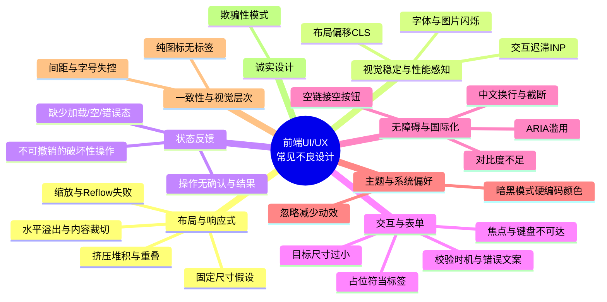
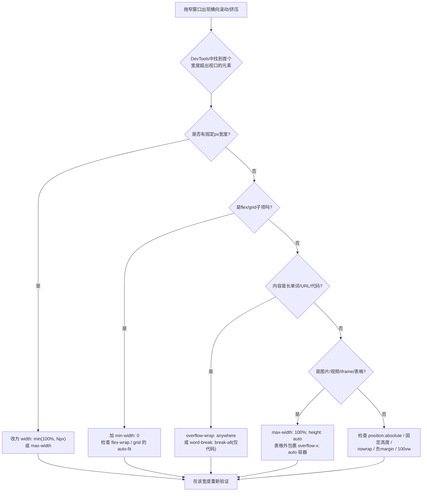
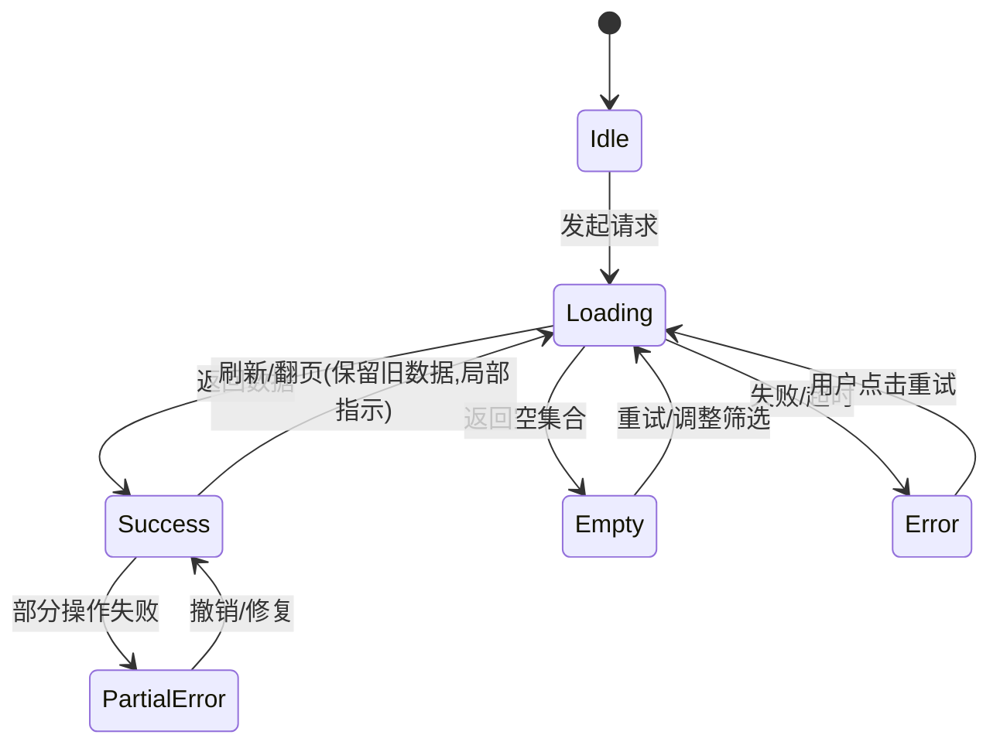
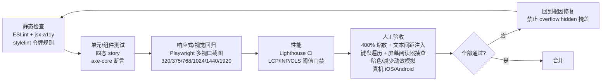

[toc]


## 信息获取情况与来源声明

**实际执行**:本轮按您指定的深度a(正常1轮)执行,但环境的搜索工具存在**单会话调用上限**,实际成功执行**5条查询**(并行与后续批次均被拒绝)。因此本文的联网核实覆盖了以下分类,其余分类依据我的训练知识(知识截止约2025年初)撰写,并在文末给出遗漏审计与下一轮搜索建议。

| 分类                                                         | 是否联网核实 | 主要来源                                                     |
| ------------------------------------------------------------ | ------------ | ------------------------------------------------------------ |
| 响应式布局溢出/挤压                                          | 是           | [FrontFixer: Fix responsive design not working](https://frontfixer.com/fix-responsive-design-not-working/)、[Common Responsive Design Mistakes](https://alexpierierodov.com/blog/common-responsive-design-mistakes)、[PixelFree Studio: Overflow Pitfalls](https://blog.pixelfreestudio.com/breaking-out-of-the-box-dealing-with-overflow-pitfalls-in-css/) |
| WCAG 2.2阈值(Reflow、文本间距、目标尺寸)                     | 是           | [WCAG 2.2 thresholds汇总](https://www.adacompliancepros.com/blog/wcag-22-new-criteria-thresholds)、[W3C WCAG2Mobile草案](https://w3c.github.io/matf/) |
| 可用性启发式(NN/g)                                           | 是           | [NN/g: 10 Usability Heuristics Applied to Complex Applications](https://www.nngroup.com/articles/usability-heuristics-complex-applications/) |
| Core Web Vitals阈值                                          | 是           | [corewebvitals.io](https://www.corewebvitals.io/core-web-vitals) 等 |
| 无障碍失败统计                                               | 是           | [WebAIM Million 2025](https://webaim.org/projects/million/2025)(官方报告) |
| 表单、暗黑模式/动效偏好、欺骗性设计、AI生成UI问题、中文社区视角 | 否(训练知识) | 文末列出补查关键词                                           |

本话题(UI/UX反模式)属于**相对稳定的知识领域**,核心规范(WCAG、Core Web Vitals、Nielsen启发式)已通过官方或准官方来源核实,因此我判断可以展开正文;但请将未联网核实部分视为"经验共识"而非"最新实证"。

---

## 全景:不良设计的分类框架

前端UI/UX问题可以按"用户感知链路"组织:先是**能不能看到完整内容**(布局),再是**页面稳不稳、快不快**(性能感知),然后是**知不知道系统在干什么**(状态反馈),**能不能顺利操作**(交互与表单),**所有人是否都能用**(无障碍与国际化),最后是**是否尊重用户**(诚实设计)。



下文对每一类采用统一结构:**问题现象、根因、正确做法(含示例)、验收要点**。验收要点以"可被开发者或coding agent机械执行"为目标。

---

## 布局与响应式:溢出、挤压与排版混乱

这是您举例的核心问题,也是**AI生成代码中最高频的缺陷之一**,因为模型往往只在一个"理想宽度"下想象界面。

### 问题现象

- **水平滚动条出现**:拖窄窗口后页面底部出现横向滚动条,或者右侧内容被裁掉。
- **挤压堆积**:多列卡片在中等宽度下既不换行也不缩小,文字被压成一列竖排、按钮文字折成两行、图标与文本错位。
- **重叠遮挡**:绝对定位或固定高度的元素在内容变多时压住下方内容。
- **内容过度拉伸**:在超宽屏(2560px以上)下文本行长超过100字符,阅读困难。
- **缩放失效**:浏览器放大到200%至400%时布局崩塌,或页面同时需要横向与纵向滚动。

### 根因分析

FrontFixer对此有一个精辟的总结:响应式失效通常是因为某一部分布局"拒绝收缩、换行、堆叠或尊重视口"。常见的刚性元素包括:**固定宽度容器(如`width: 1200px`)、永不堆叠的网格、永不换行的flex行、无法断开的长单词、缺少`max-width: 100%`的图片、触发过晚的媒体查询**。另一个常被忽视的根因是**缺少viewport meta标签**:移动浏览器会假定一个桌面宽度再整体缩小,导致文字极小、布局被压扁。

还有一个**极易被忽视但极其常见**的CSS机制:**flex与grid子项的`min-width`默认值是`auto`**,即子项的最小宽度等于其内容的最小内容宽度(min-content)。这意味着一个包含长URL、长英文单词或`white-space: nowrap`文本的子项**永远不会缩到比内容更窄**,从而把整个容器撑爆。FrontFixer也明确指出`min-width: 0`能让grid和flex子项停止强制溢出。



### 正确做法与示例

以下是一个"商品卡片列表"的健壮写法,场景:电商后台的商品网格,商品名可能是很长的中英文混排,图片尺寸不一,窗口会被用户任意拖动。

```css
/* 容器:自动决定列数,而不是硬编码3列 */
.product-grid {
  display: grid;
  grid-template-columns: repeat(auto-fill, minmax(min(100%, 240px), 1fr));
  gap: clamp(0.75rem, 2vw, 1.5rem);
}

/* 子项:允许收缩,阻止内容撑爆 */
.product-card {
  min-width: 0;            /* 关键:覆盖 min-width:auto */
  display: flex;
  flex-direction: column;
}

.product-card img {
  max-width: 100%;
  height: auto;
  aspect-ratio: 4 / 3;     /* 预留空间,避免加载时布局偏移 */
  object-fit: cover;
}

.product-title {
  overflow-wrap: anywhere; /* 长英文/URL可断行 */
  display: -webkit-box;
  -webkit-line-clamp: 2;   /* 最多两行,超出省略 */
  -webkit-box-orient: vertical;
  overflow: hidden;
}

/* 页面级:限制阅读行长,超宽屏不拉伸 */
.page {
  max-width: 80rem;
  margin-inline: auto;
  padding-inline: clamp(1rem, 4vw, 3rem);
}
```

上述代码中出现的关键字段逐项解释:

| 字段/占位符                                        | 含义                                                         | 常见混淆与辨析                                               |
| -------------------------------------------------- | ------------------------------------------------------------ | ------------------------------------------------------------ |
| `repeat(auto-fill, minmax(min(100%, 240px), 1fr))` | 列数由容器宽度自动计算,每列最小240px、最大平分;外层`min(100%, 240px)`保证容器窄于240px时不溢出 | `auto-fill`在空间富余时保留空轨道,`auto-fit`会把空轨道折叠使已有项拉伸;卡片列表通常用`auto-fill`以保持卡片宽度稳定 |
| `min-width: 0`                                     | 允许flex/grid子项收缩到比内容更窄                            | 默认值是`auto`而非`0`,这是溢出的头号隐形元凶;对纵向布局对应的是`min-height: 0` |
| `overflow-wrap: anywhere`                          | 在任意字符间断行以避免溢出,且会影响min-content计算           | `overflow-wrap: break-word`不参与min-content计算,在flex/grid中可能仍然溢出;`word-break: break-all`会粗暴打断所有单词,只适合代码或哈希值 |
| `aspect-ratio: 4 / 3`                              | 为尚未加载的图片预留固定比例空间                             | 与直接写`width`/`height`属性等效地防止CLS,但更适合流式宽度   |
| `-webkit-line-clamp: 2`                            | 多行截断显示省略号                                           | 必须配合`display: -webkit-box`与`-webkit-box-orient: vertical`;单行截断用`text-overflow: ellipsis`加`white-space: nowrap`加`overflow: hidden`三件套 |
| `clamp(min, preferred, max)`                       | 流体取值:下限、首选值(通常含`vw`)、上限                      | 首选值若不含视口单位则不会随窗口变化;用于字号时务必保证**浏览器缩放仍能放大**(避免纯`vw`字号导致用户缩放无效) |
| `margin-inline` / `padding-inline`                 | 逻辑属性,对应水平方向(书写模式相关)                          | 比`margin-left/right`更适合国际化(RTL语言自动翻转)           |

### 移动端视口特有陷阱

- **`100vh`在移动浏览器中偏高**:地址栏收起/展开会改变可视高度,导致底部按钮被遮挡。现代做法是**`100dvh`**(动态视口高度),并为旧浏览器保留`100vh`回退。
- **刘海屏安全区**:固定底栏需要`padding-bottom: env(safe-area-inset-bottom)`,并在viewport meta中加入`viewport-fit=cover`。
- **软键盘弹出**:固定定位的底部操作栏可能被键盘顶起或遮挡输入框,应测试表单在键盘弹出时的可见性。
- **横竖屏切换**:WCAG 1.3.4(Orientation)要求不得锁定单一方向,除非方向对功能是本质性的。

### 规范依据:Reflow与文本间距

WCAG 2.1/2.2的**1.4.10 Reflow(AA)**要求:**纵向滚动内容在320 CSS像素宽度下、横向滚动内容在256 CSS像素高度下,无需二维滚动即可呈现且不丢失内容或功能**,唯一例外是本质上需要二维布局的内容(如大型数据表、地图、图表)。320px对应的是桌面1280px宽度下放大400%的效果,因此这**本质上是一个缩放测试**。

**1.4.12 Text Spacing(AA)**要求:当用户将行高覆盖为字号的1.5倍、段落间距2倍、字间距0.12倍、词间距0.16倍时,内容不得丢失或被裁切。这意味着**固定高度的文本容器加`overflow: hidden`是违规高发区**。

### 验收要点

| 编号 | 验收项                                                       | 判定方法                                                     |
| ---- | ------------------------------------------------------------ | ------------------------------------------------------------ |
| L1   | 320px至2560px连续拖动窗口,**任何宽度**下无非预期横向滚动条   | DevTools响应式模式手动拖动;或`document.documentElement.scrollWidth <= window.innerWidth`脚本断言 |
| L2   | 桌面1280px下浏览器缩放至400%,内容单向滚动可读,功能完整       | 手动缩放,检查导航、表单、弹窗                                |
| L3   | 注入文本间距覆盖样式后无裁切、无重叠                         | 使用书签脚本或浏览器扩展注入1.4.12规定的间距                 |
| L4   | 使用**极端测试数据**:50字无空格英文、200字中文标题、空字符串、超长URL、极小/极大图片 | 在Storybook或测试页面中固定提供这类fixture                   |
| L5   | 无固定像素宽高的内容容器(允许用于图标、头像等本质固定的元素) | 代码审查:grep `width: \d+px`,逐个确认合理性                  |
| L6   | 所有flex/grid的可收缩子项显式声明`min-width: 0`或等效处理    | 代码审查/lint规则                                            |
| L7   | 表格在窄屏下有`overflow-x: auto`包裹容器或转为卡片式堆叠     | 320px宽度检查                                                |
| L8   | 移动端全屏布局使用`dvh`或等效方案,固定底栏考虑安全区         | 真机iOS Safari与Android Chrome验证                           |
| L9   | 包含正确的viewport meta:`<meta name="viewport" content="width=device-width, initial-scale=1">`,且**不禁止用户缩放** | 代码审查;`user-scalable=no`和`maximum-scale=1`视为缺陷       |
| L10  | 横竖屏切换后布局正常                                         | 真机或DevTools旋转                                           |

---

## 视觉稳定与性能感知:跳动、卡顿与闪烁

### 问题现象

- 页面加载过程中**内容突然下移**,用户正要点击的按钮被广告或图片顶走,误触。
- 点击按钮后**超过200ms无任何反应**,用户重复点击造成重复提交。
- 自定义字体加载后文字从系统字体**闪变**,行数变化引起整体跳动。
- 骨架屏形状与真实内容差异巨大,替换瞬间仍然跳动。

### 衡量标准

Google的Core Web Vitals给出了可量化阈值:**LCP(最大内容绘制)良好值小于2.5秒,INP(交互到下一次绘制)良好值小于200毫秒,CLS(累积布局偏移)良好值小于0.1,均以真实用户数据的第75百分位评估**。网络上有文章声称2025年CLS阈值已收紧到0.08,但这与Google官方web.dev文档不一致,本文**以0.1为准**,请以web.dev为最终依据。

| 指标 | 英文全称                  | 衡量什么             | 良好      | 待改进       | 差        |
| ---- | ------------------------- | -------------------- | --------- | ------------ | --------- |
| LCP  | Largest Contentful Paint  | 主要内容何时可见     | 小于2.5s  | 2.5s至4s     | 大于4s    |
| INP  | Interaction to Next Paint | 交互后多久有视觉响应 | 小于200ms | 200ms至500ms | 大于500ms |
| CLS  | Cumulative Layout Shift   | 非预期布局偏移总量   | 小于0.1   | 0.1至0.25    | 大于0.25  |

### 根因与正确做法

| 根因                                                 | 正确做法                                                     |
| ---------------------------------------------------- | ------------------------------------------------------------ |
| 图片/视频/iframe/广告位没有预留尺寸                  | 声明`width`/`height`属性或`aspect-ratio`;广告位用固定最小高度容器 |
| 动态插入内容(通知横幅、Cookie提示)顶在已有内容上方   | 在视口外(如固定定位)或预留位置插入;或只在用户交互后插入      |
| Web字体引起的FOUT/FOIT                               | `font-display: swap`配合`size-adjust`等字体度量覆盖,减少替换时的行高差异;预加载关键字体 |
| 主线程长任务阻塞交互反馈                             | 点击后**立即**给出视觉反馈(按钮按下态、禁用态、spinner),再执行耗时逻辑;拆分长任务 |
| 悬停时元素尺寸变化(如加粗、放大边框)引起相邻元素移动 | 用`transform: scale()`、`outline`或预留等宽的透明边框,不要改变占位尺寸 |
| 骨架屏与最终内容结构不匹配                           | 骨架屏复用真实组件的布局骨架,尺寸一致                        |

### 验收要点

| 编号 | 验收项                                                       | 判定方法                                                     |
| ---- | ------------------------------------------------------------ | ------------------------------------------------------------ |
| P1   | 关键页面Lighthouse实验室CLS小于0.1,且**在慢速3G节流下**仍小于0.1 | Lighthouse / PageSpeed Insights                              |
| P2   | 所有``、`<video>`、`<iframe>`具备尺寸属性或`aspect-ratio` | 代码审查或lint(如eslint-plugin-jsx-a11y不覆盖此项,需自定义规则) |
| P3   | 任何点击/提交在100ms内有可见反馈                             | 手动验证+Performance面板                                     |
| P4   | 悬停/焦点态不改变元素占位尺寸                                | 对交互元素逐个hover观察相邻元素                              |
| P5   | 字体加载前后文本不发生行数变化                               | DevTools禁用缓存并节流网络观察                               |

---

## 状态反馈缺失:用户不知道系统在干什么

Nielsen的十条可用性启发式自1994年提出至今仍是最广泛使用的评估框架,其中第一条就是**系统状态可见性(Visibility of System Status)**。NN/g指出这些启发式足够通用,从复杂领域应用到游戏、VR均适用。

### 必须覆盖的UI状态

一个数据驱动的视图至少有以下状态,**缺少任意一个都是缺陷**。典型的不良设计是:只实现了"有数据"状态;加载时白屏;请求失败时控制台报错但界面毫无提示;列表为空时显示一片空白或者残留骨架屏永远转圈。



| 状态      | 不良设计                                         | 正确做法                                                     |
| --------- | ------------------------------------------------ | ------------------------------------------------------------ |
| Loading   | 白屏;全局遮罩阻塞一切;200ms内闪现又消失的spinner | 300ms左右的延迟显示阈值避免闪烁;局部加载指示;骨架屏;翻页时保留旧内容 |
| Empty     | 空白区域;显示"暂无数据"四个字                    | 说明为什么空(无数据 vs 筛选无结果)、下一步能做什么(新建/清除筛选) |
| Error     | 吞掉异常;原样展示后端错误码或堆栈                | 用人话说明发生了什么、是否影响已保存数据、如何恢复;提供重试;保留用户已输入内容 |
| Success   | 操作后无任何提示;Toast 1秒即消失                 | 明确确认(Toast、行内状态、页面跳转);破坏性操作提供**撤销(Undo)**而不是事前反复确认 |
| 离线/弱网 | 请求静默失败                                     | 监听`navigator.onLine`与请求失败,给出离线提示并支持恢复后重试 |

### 验收要点

| 编号 | 验收项                                                       |
| ---- | ------------------------------------------------------------ |
| S1   | 每个异步视图在Storybook/测试中存在Loading、Empty、Error、Success四个故事(story) |
| S2   | 通过DevTools将接口设为失败/超时/慢速,界面均有明确提示且可恢复 |
| S3   | 破坏性操作(删除、覆盖、发送)有确认或撤销机制;确认框的主按钮文案是动词("删除")而非"确定" |
| S4   | 提交按钮在请求进行中禁用或显示进行态,**防止重复提交**        |
| S5   | 任何耗时超过1秒的操作有进度或估时提示;超过10秒可取消         |

---

## 表单与输入:最常见的转化杀手

(本节依据训练知识与NN/g长期研究共识,未在本轮联网核实。)

### 典型不良设计

| 不良设计                                                     | 为什么有害                                                   | 正确做法                                                     |
| ------------------------------------------------------------ | ------------------------------------------------------------ | ------------------------------------------------------------ |
| **用placeholder代替label**                                   | 输入后提示消失,用户忘记字段含义;屏幕阅读器支持不一致;对比度常不达标 | 始终使用可见的`<label for>`;placeholder只放示例格式          |
| 输入第一个字符就报错(过早校验)                               | 用户还没写完就被打断                                         | **失焦(blur)后校验,修正时实时消除错误**("late validation, early reward") |
| 提交后才在页面顶部统一列出错误                               | 用户需要来回滚动寻找出错字段                                 | 行内错误紧贴字段,配合`aria-describedby`;提交失败后焦点移动到第一个错误字段 |
| 错误文案只说"输入无效"                                       | 用户不知道怎么改                                             | 说明具体规则和示例:"手机号应为11位数字,如13800138000"        |
| 提交按钮在表单无效时禁用且无解释                             | 用户不知道为什么不能提交                                     | 允许点击并展示错误,或禁用时给出原因                          |
| 密码规则在出错后才告知                                       | 反复试错                                                     | 规则预先展示,实时打勾                                        |
| 日期/手机/验证码使用普通文本框                               | 移动端弹出错误键盘                                           | 使用`type="tel"`、`inputmode="numeric"`、`autocomplete="one-time-code"`等 |
| 刷新或错误后清空所有已填内容                                 | 用户重复劳动                                                 | 保留输入;WCAG 2.2新增**3.3.7 Redundant Entry(A)**要求减少重复输入 |
| 中国场景:强制英文标点、不接受带空格的银行卡号、身份证末位X大小写敏感 | 本地化失败                                                   | 输入时宽松解析、提交时标准化                                 |

### 验收要点

| 编号 | 验收项                                                       |
| ---- | ------------------------------------------------------------ |
| F1   | 每个输入控件有可见且程序关联的label(`<label for>`或`aria-labelledby`) |
| F2   | 错误信息紧邻字段、文字具体可操作、颜色之外另有图标或文字标识 |
| F3   | 校验时机:blur后触发,修正后即时清除;提交时焦点跳转到首个错误  |
| F4   | 移动端各字段弹出正确键盘类型;支持浏览器自动填充(`autocomplete`属性正确) |
| F5   | 提交失败不丢失任何已输入内容                                 |
| F6   | 仅用键盘(Tab/Shift+Tab/Enter/Space/方向键)可完成整个表单     |

---

## 交互与导航:焦点、目标尺寸与控制权

### 典型不良设计

- **移除焦点轮廓**:`*:focus { outline: none }`是键盘用户的灾难。正确做法是用`:focus-visible`提供清晰样式,WCAG 2.2新增的**2.4.11 Focus Not Obscured(AA)**还要求获得焦点的元素不能被固定头部/底部完全遮挡。
- **目标尺寸过小**:WCAG 2.2新增的**2.5.8 Target Size (Minimum)(AA)**要求可点击目标至少**24×24 CSS像素**,有间距(Spacing)、等效(Equivalent)、行内(Inline)、用户代理控制、本质性五类例外。移动端的实践建议更高(Apple HIG建议44pt,Material建议48dp)。
- **仅靠悬停暴露功能**:触屏设备没有hover;操作按钮只在hover时出现等于对移动用户隐藏。
- **劫持滚动**:自定义平滑滚动、全屏翻页滚动、在滚轮上做横向滚动,破坏用户预期与辅助技术。
- **拖拽是唯一方式**:WCAG 2.2的**2.5.7 Dragging Movements(AA)**要求拖拽操作提供单指针替代(如上下移动按钮)。
- **模态框问题**:焦点未困于框内、Esc不能关闭、背景可滚动、关闭后焦点不回到触发元素、移动端弹窗高度超过视口无法滚到底部按钮。
- **破坏浏览器后退**:SPA路由不更新URL、弹窗/抽屉状态未入历史栈导致后退直接离开页面,或反过来后退需要点很多次。
- **无限滚动没有出口**:页脚永远够不到,无法回到特定位置,刷新后丢失位置。
- **自动播放、自动轮播**:WCAG 2.2.2要求超过5秒的自动移动内容可暂停/停止/隐藏。

### 验收要点

| 编号 | 验收项                                                       |
| ---- | ------------------------------------------------------------ |
| I1   | 全站Tab遍历,焦点顺序符合视觉顺序,焦点样式清晰可见,无焦点陷阱(模态框除外且可Esc退出) |
| I2   | 所有可点击目标至少24×24 CSS像素(移动端优先44×44),相邻目标有足够间距 |
| I3   | 任何仅在hover时出现的操作,在触屏上有等效可达方式             |
| I4   | 模态框:焦点困于框内、Esc关闭、关闭后焦点返回触发元素、背景`inert`或不可滚动 |
| I5   | 浏览器前进/后退行为符合预期;可分享的状态体现在URL中          |
| I6   | 拖拽排序有键盘/按钮替代                                      |
| I7   | 轮播/自动播放可暂停,且不与用户正在进行的操作冲突             |

---

## 无障碍:数据证明的高频失败

WebAIM对100万首页的2025年度自动化检测显示:**94.8%的首页存在可检测的WCAG 2失败,平均每页51个错误**;而且**96%的错误集中在六类**,且这六类**五年来从未变化**。

| 失败类型         | 首页占比(2025) | 典型前端根因                         | 修复要点                                              |
| ---------------- | -------------- | ------------------------------------ | ----------------------------------------------------- |
| 低对比度文本     | 79.1%          | 浅灰占位文字、禁用态、品牌色上的白字 | 正文对比度至少4.5:1,大字与UI组件/图形至少3:1(1.4.11)  |
| 图片缺少替代文本 | 55.5%          | ``无`alt`;装饰图未声明`alt=""`  | 信息图写含义,装饰图`alt=""`,图标按钮用`aria-label`    |
| 表单缺少标签     | 48.2%          | placeholder当label;自定义组件未关联  | 见表单一节F1                                          |
| 空链接           | 45.4%          | `<a>`内只有图标或背景图              | 提供可见文本或`aria-label`,图标加`aria-hidden="true"` |
| 空按钮           | 29.6%          | 图标按钮无文字                       | 同上                                                  |
| 缺少文档语言     | 15.8%          | `<html>`无`lang`                     | `<html lang="zh-CN">`,混排段落用`lang`局部标注        |

WebAIM的结论是,仅解决这几类问题就能显著改善整体无障碍水平。

其他常见但自动化工具难以检测的问题:**ARIA滥用**(给`<div>`加`role="button"`却不处理键盘事件;原生`<button>`能解决的用`<div onclick>`)、**标题层级跳跃**(h2直接到h4,或为了样式用h1)、**仅用颜色传达信息**(红绿区分状态而无文字/图标)、**动态内容变化不播报**(Toast缺少`aria-live`)、**跳转到主内容链接缺失**。

### 验收要点

| 编号 | 验收项                                                       | 工具                                 |
| ---- | ------------------------------------------------------------ | ------------------------------------ |
| A1   | axe DevTools / Lighthouse Accessibility无严重和重要级别问题  | axe-core(可集成到Playwright/Cypress) |
| A2   | 文本对比度至少4.5:1,UI组件边框/图标至少3:1                   | 浏览器DevTools颜色拾取器显示对比度   |
| A3   | 所有图片/图标按钮/图标链接有可访问名称                       | axe;屏幕阅读器(NVDA/VoiceOver)抽查   |
| A4   | `<html lang>`正确;标题层级连续;地标(`<main>`、`<nav>`等)存在 | HTML审查                             |
| A5   | 用屏幕阅读器完成一条核心任务路径(如注册、下单)               | NVDA+Firefox 或 VoiceOver+Safari     |
| A6   | 优先使用原生语义元素,ARIA仅在无原生等价物时使用(**"No ARIA is better than bad ARIA"**) | 代码审查                             |

---

## 文字、字体与国际化:中文场景的特殊问题

(本节依据训练知识。)

国外组件库与AI生成代码常以英文为默认假设,中文环境下易出现以下问题:

| 问题                                                         | 现象                                                | 正确做法                                                     |
| ------------------------------------------------------------ | --------------------------------------------------- | ------------------------------------------------------------ |
| `word-break: break-all`全局应用                              | 英文单词被任意拆断                                  | 中文默认即可逐字换行;只对可能含长URL的区域用`overflow-wrap: anywhere` |
| 按钮/标签按英文长度设计固定宽度                              | 中文短、英文长(或翻译后德语更长),导致空旷或溢出     | 用内边距而非固定宽度;i18n测试时用伪本地化(拉长30%至50%)验证  |
| 字体栈不含中文字体                                           | 回退到宋体,与无衬线UI风格割裂;Windows下中文渲染发虚 | 字体栈包含`"PingFang SC", "Microsoft YaHei", "Noto Sans CJK SC"`等并以`sans-serif`收尾 |
| 中英文混排无间距、标点挤压                                   | 可读性差                                            | 可考虑`text-autospace`(新属性,兼容性需核实)或排版库;至少保证`line-height`不低于1.5 |
| 单行截断用`text-overflow: ellipsis`配合`direction: rtl`等技巧 | 中文显示错乱                                        | 用标准三件套;需要保留末尾(如文件扩展名)时用JS中间截断        |
| 日期格式`MM/DD/YYYY`、千分位与货币符号硬编码                 | 国内用户误读                                        | 用`Intl.DateTimeFormat`/`Intl.NumberFormat`与`navigator.language` |
| 竖排/全角字符未考虑                                          | 表格对齐错位                                        | 数字列使用`font-variant-numeric: tabular-nums`               |
| 字号过小                                                     | 中文笔画复杂,12px以下难以辨认                       | 正文不小于14px(移动端16px以上还能避免iOS聚焦输入框时自动缩放) |

### 验收要点

| 编号 | 验收项                                                       |
| ---- | ------------------------------------------------------------ |
| T1   | 用超长中文、超长英文、中英数字混排、emoji作为测试文案,无溢出、无错误断词 |
| T2   | Windows与macOS、Android与iOS下中文字体渲染一致可读           |
| T3   | 正文字号不小于14px,移动端输入框字号不小于16px                |
| T4   | 日期、数字、货币通过`Intl`或i18n库格式化,无硬编码格式        |

---

## 主题与系统偏好:暗黑模式与动效

(本节依据训练知识。)

- **硬编码颜色**:组件内直接写`#fff`、`#333`,在暗黑模式下出现白底白字或刺眼的纯白块。应使用**设计令牌(Design Tokens)**/CSS自定义属性,并用`color-scheme: light dark`让表单控件和滚动条随主题切换。
- **暗黑模式只做反色**:阴影在暗色下不可见、图片过亮、品牌色对比度崩塌。应为暗色单独调整层级(用亮度而不是阴影表现层级)、降低图片亮度(`filter: brightness(.8)`)、重新验证对比度。
- **主题闪烁(FOUC)**:首屏先渲染亮色再切换暗色。应在`<head>`内联脚本尽早读取偏好并设置`<html>`类名/属性。
- **忽略`prefers-reduced-motion`**:大幅位移、视差、自动轮播会引发前庭不适。应在该媒体查询下移除非必要动画,保留不透明度等轻微过渡。
- **忽略`prefers-contrast`与强制颜色模式**:Windows高对比度模式下自定义边框消失,需用`forced-colors`媒体查询与系统颜色关键字。

### 验收要点

| 编号 | 验收项                                                       |
| ---- | ------------------------------------------------------------ |
| M1   | DevTools模拟`prefers-color-scheme: dark`,全站无硬编码颜色残留,对比度重新达标 |
| M2   | 首屏无主题闪烁                                               |
| M3   | 模拟`prefers-reduced-motion: reduce`,大位移/视差/自动播放动画被移除或替换 |
| M4   | 代码中禁止直接使用颜色字面量(lint规则,如stylelint `color-no-hex`配合令牌白名单) |

---

## 一致性与视觉层次

(本节依据训练知识与通用设计系统实践。)

| 不良设计                                                     | 正确做法                                             |
| ------------------------------------------------------------ | ---------------------------------------------------- |
| 间距随手写:`margin: 13px`、`padding: 7px 11px`               | 使用4或8为基数的间距阶梯(spacing scale)              |
| 字号超过6种、字重随意                                        | 排版阶梯(type scale)限制为5至7档                     |
| 同一操作在不同页面用不同文案、图标、位置("删除"/"移除"/垃圾桶图标) | 组件库+文案规范;一致性是Nielsen第四条启发式          |
| 颜色含义不一致:红色既表示错误也表示"热门"                    | 语义色只用于语义;装饰色与语义色分离                  |
| 纯图标按钮无文字、无tooltip                                  | 关键操作图标加文字;次要图标提供tooltip与`aria-label` |
| 所有元素都"重要":多个主按钮、到处加粗、到处用品牌色          | 每屏一个主操作(primary),其余降级为secondary/ghost    |
| 行长过长(超过75字符)或过短                                   | 文本容器`max-width: 65ch`左右(中文约35至45字)        |
| 对齐基线混乱:图标与文字不居中、表格数字右对齐缺失            | 用flex对齐;数字列右对齐+等宽数字                     |

### 验收要点

| 编号 | 验收项                                                       |
| ---- | ------------------------------------------------------------ |
| C1   | 所有间距/字号/颜色来自令牌,无魔法数字(lint可检)              |
| C2   | 每屏主按钮不超过一个;按钮层级样式与语义一致                  |
| C3   | 相同操作在全站文案、图标、位置一致                           |
| C4   | 视觉回归测试(如Playwright截图比对、Chromatic)覆盖关键页面在三档宽度(375/768/1440)下的快照 |

---

## 诚实设计:避免欺骗性模式

(本节依据训练知识;欺骗性模式(Deceptive Patterns,旧称Dark Patterns)的权威参考为Harry Brignull维护的deceptivepatterns网站。)

这类问题不是技术缺陷而是**有意或无意的伦理缺陷**,coding agent在被要求"提高转化率"时很容易产出。国内《个人信息保护法》与工信部对App的整治通知也明确禁止其中多项。

| 模式                       | 表现                                                | 替代做法                              |
| -------------------------- | --------------------------------------------------- | ------------------------------------- |
| 羞辱式拒绝(Confirmshaming) | "不,我不想省钱"                                     | 中性文案"暂不需要"                    |
| 蟑螂屋(Roach Motel)        | 一键订阅、注销需打客服电话                          | 退出路径与进入路径同样容易            |
| 预勾选/默认同意            | 默认勾选营销邮件、自动续费                          | 默认不勾选;续费前提醒                 |
| 误导性层级                 | "同意"是醒目主按钮,"拒绝"是灰色小字甚至藏在二级页面 | 同意与拒绝视觉权重相当                |
| 伪紧迫/伪稀缺              | 假倒计时、"仅剩2件"                                 | 真实数据或不展示                      |
| 伪装广告/误触诱导          | 关闭按钮极小、广告伪装成系统提示                    | 关闭按钮达到目标尺寸要求,广告明确标识 |
| 隐藏成本                   | 结算最后一步才出现运费、手续费                      | 价格尽早透明                          |

### 验收要点

| 编号 | 验收项                                               |
| ---- | ---------------------------------------------------- |
| D1   | 任何同意/拒绝、订阅/退订的操作路径对称且视觉权重相当 |
| D2   | 无预勾选的非必要选项;无虚假倒计时/库存               |
| D3   | 关闭/跳过按钮达到目标尺寸要求且不伪装                |

---

## 面向coding agent的专项警示

基于对AI生成前端代码的常见观察(训练知识,未在本轮联网核实),coding agent最容易在以下方面出问题,**建议把这些写进项目的`AGENTS.md`或`CLAUDE.md`等代理指令文件**:

1. **只为单一宽度设计**:生成的布局在1440px下完美,在375px下崩塌。要求:每次产出布局代码必须同时考虑320px、768px、1440px三档并自述验证方式。
2. **用`<div>`代替语义元素**:`<div onClick>`当按钮、`<span>`当链接。要求:禁止在无充分理由时用非语义元素承载交互。
3. **过度使用固定尺寸和`overflow: hidden`掩盖溢出**:这是"治标"的典型。要求:溢出问题必须找到刚性元素根因,不得仅用`overflow: hidden`掩盖。
4. **省略状态**:只写happy path。要求:任何异步视图必须实现Loading/Empty/Error三态。
5. **硬编码颜色、间距与文案**:绕过设计令牌与i18n。要求:颜色/间距必须引用令牌;用户可见文案必须走i18n函数。
6. **移除焦点样式或禁用缩放**:为了"好看"加`outline: none`或`user-scalable=no`。要求:明确禁止。
7. **自造组件**而不用项目已有组件库:导致样式不一致。要求:优先复用已有组件,新建组件需说明理由。
8. **ARIA堆砌**:到处加`role`与`aria-*`,反而破坏可访问性。要求:优先原生语义;ARIA使用需对照WAI-ARIA Authoring Practices。

可以直接放入代理指令文件的一段约束示例(Markdown格式):

```markdown
## UI 产出硬性约束
- 布局必须在 320px 至 1920px 任意宽度下无横向溢出;flex/grid 可收缩子项必须声明 `min-width: 0`。
- 浏览器缩放至 400% 时内容仍可单向滚动阅读;禁止 `user-scalable=no`。
- 禁止 `outline: none` 除非同时提供 `:focus-visible` 替代样式。
- 可点击目标不小于 24×24 CSS 像素(移动端 44×44)。
- 颜色、间距、字号只能引用 `tokens.css` 中的自定义属性,禁止字面量。
- 所有图片/视频声明尺寸或 `aspect-ratio`;所有 `` 有 `alt`。
- 每个异步视图实现 Loading / Empty / Error / Success 四态。
- 表单字段必须有可见 `<label>`;错误信息行内显示且文字具体。
- 支持 `prefers-color-scheme` 与 `prefers-reduced-motion`。
- 用户可见文案走 i18n;测试文案包含 200 字中文与 50 字无空格英文。
- 提交代码前运行:`npm run lint && npm run test:a11y && npm run test:visual`。
```

---

## 验收流程总览



工具选型备注(均为免费/开源且跨平台):**axe-core**(可通过`@axe-core/playwright`集成)、**Lighthouse CI**、**Playwright**(多视口截图与`toHaveScreenshot`比对)、**stylelint**(令牌约束)、**eslint-plugin-jsx-a11y**、**Storybook**(四态故事与a11y插件)。国内网络环境下,Playwright浏览器下载可设置`PLAYWRIGHT_DOWNLOAD_HOST`指向镜像(如npmmirror的`https://npmmirror.com/mirrors/playwright`),npm依赖可用npmmirror源;Windows下注意Git的`core.autocrlf`避免快照文件因换行符差异被误判为变更。

---

## 遗漏审计与下一轮搜索建议

本轮仅完成5条查询,以下分类**未经联网核实**或仅部分覆盖。若您希望追加一轮,建议使用以下具有差异化价值的关键词(基于本轮结果中出现的新线索):

| 待补查方向                          | 建议搜索词                                                   | 说明                                                         |
| ----------------------------------- | ------------------------------------------------------------ | ------------------------------------------------------------ |
| W3C移动端WCAG适配(本轮发现的新线索) | `WCAG2Mobile MATF 2025 draft`、`WCAG 2.2 2.5.7 dragging movements examples` | W3C MATF草案近期仍在更新,可获取官方对移动端Reflow、目标尺寸的解释 |
| Core Web Vitals阈值争议             | `web.dev CLS threshold 0.1 official 2025`、`INP 98th percentile explained web.dev` | 核实"CLS收紧到0.08"的说法                                    |
| AI生成UI的实证质量研究              | `LLM generated frontend accessibility evaluation study`、`v0 bolt lovable UI quality accessibility audit`、`AI slop UI design patterns` | 寻找论文或评测,替代本文的经验判断                            |
| 欺骗性设计最新法规                  | `deceptivepatterns.org 2025`、`EU DSA dark patterns enforcement 2025`、`工信部 App 侵害用户权益 弹窗 关闭按钮 规范` | 国内外监管动态                                               |
| 表单UX最新研究                      | `Baymard checkout form usability 2025`、`NN/g form design errors inline validation` | 权威UX研究机构                                               |
| 新CSS能力对布局问题的消解           | `container queries anti-patterns 2025`、`text-autospace CSS Chinese browser support`、`CSS text-wrap balance pretty`、`interpolate-size animate height auto` | 现代CSS减少传统问题的新手段                                  |
| 中文社区视角                        | `前端 自适应 布局错乱 min-width 0 掘金`、`B端 表格 自适应 列宽 省略 最佳实践`、`移动端 100vh 键盘 遮挡 解决方案 2025` | 国内B端/移动端特有经验                                       |
| 设计系统与令牌实践                  | `design tokens W3C DTCG spec 2025`、`Ant Design Arco Design dark mode token` | 国内开源设计系统的做法                                       |

---

## 信息来源与知识截止

- **联网核实来源**(访问于本轮对话):[WebAIM Million 2025](https://webaim.org/projects/million/2025)(官方统计);[WCAG 2.2 success criteria thresholds](https://www.adacompliancepros.com/blog/wcag-22-new-criteria-thresholds)(对WCAG原文阈值的整理,阈值本身与W3C规范一致);[W3C WCAG2Mobile草案](https://w3c.github.io/matf/);[NN/g Usability Heuristics Applied to Complex Applications](https://www.nngroup.com/articles/usability-heuristics-complex-applications/);[corewebvitals.io](https://www.corewebvitals.io/core-web-vitals);[FrontFixer](https://frontfixer.com/fix-responsive-design-not-working/)、[Common Responsive Design Mistakes](https://alexpierierodov.com/blog/common-responsive-design-mistakes)、[PixelFree Studio](https://blog.pixelfreestudio.com/breaking-out-of-the-box-dealing-with-overflow-pitfalls-in-css/)(实践类文章,用于归纳现象与根因)。
- **训练知识部分**:表单UX、暗黑模式/动效偏好、一致性、欺骗性模式、AI生成代码观察、中文排版与国内网络环境建议,知识截止约**2025年初**;其中CSS属性兼容性(如`text-autospace`、`100dvh`)请在使用前通过caniuse或MDN再次核实。
- **自查结论**:本轮为"正常调研(深度a)",非深度调研,因此未触发"搜索不足即停止"的硬性约束;但由于工具配额限制导致实际查询数少于计划,我已在文中逐节标注核实状态,并给出补查关键词供您发起下一轮。