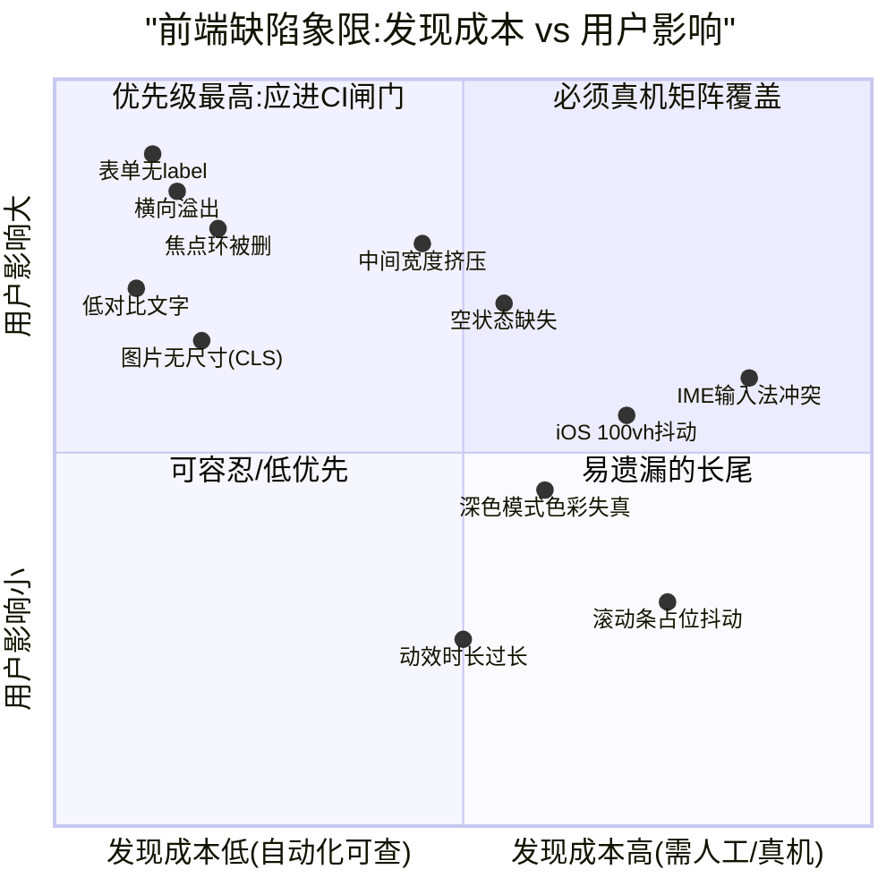
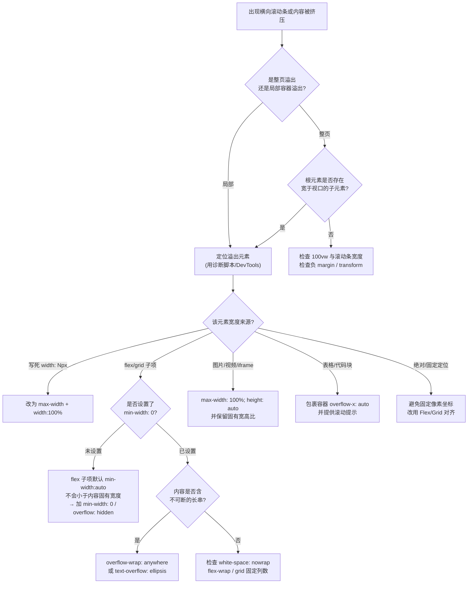
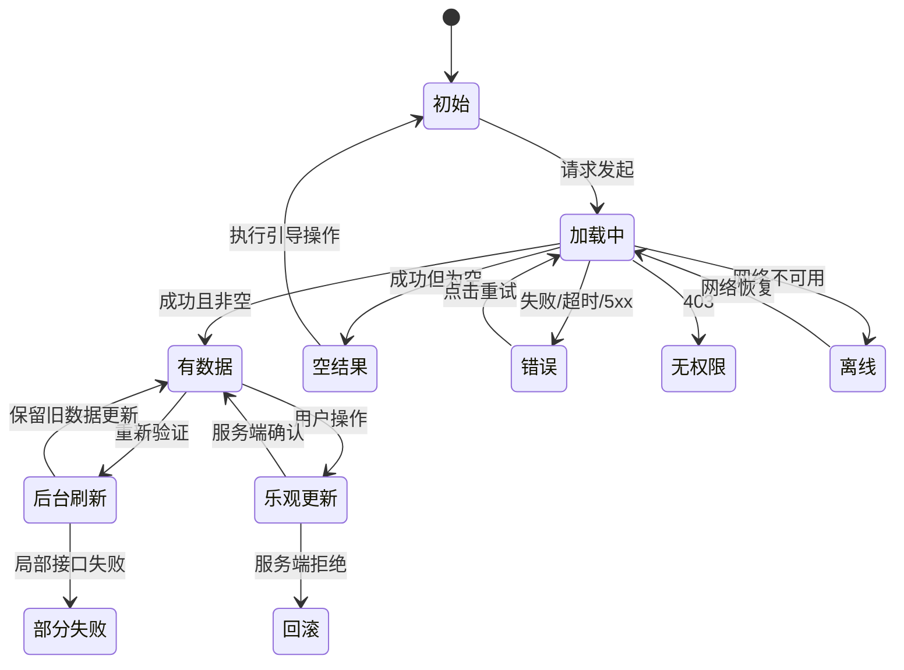
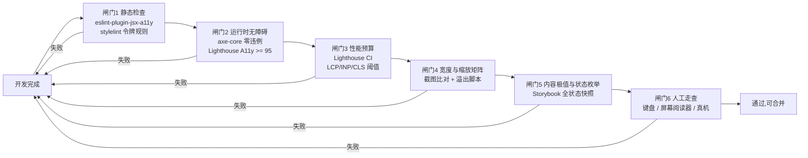

**自报家门**:我是Claude(Anthropic开发的AI助手),具体版本号我无法从内部确定。本环境可用工具为`web_search`联网搜索(上一轮实测**单轮约5次调用上限**)、bash与Python沙箱(本话题用不上)。按你的设定搜索深度为a(1轮),我会并行发出高价值查询,之后不再迭代。

**任务一句话**:我将以"**资深前端质量工程师兼设计评审(Design QA)负责人**"的角色,面向中文IT读者,系统盘点Web前端UI/UX的**不良设计与常见缺陷**,并为每一类给出**可执行的验收要点**。

**本轮搜索计划**(分类框架):响应式布局崩坏(溢出/横向滚动/挤压)、无障碍年度缺陷统计(WebAIM Million)、表单与结算可用性实证(Baymard)、布局偏移(CLS)成因、以及面向AI生成界面的常见视觉缺陷。

正在检索,请稍候。搜索已返回。正在提取关键数据(WebAIM Million统计、WCAG 1.4.10 Reflow、CLS成因、表单实证)。核心数据已获取。尝试补充第二批查询(深色模式缺陷、移动端触控问题、设计评审清单),若配额耗尽我会明确说明。搜索配额已确认耗尽(**本轮实际可用5次,已全部用完**,第二批3条查询被环境拒绝)。好消息是本话题属于**稳定且有实证数据支撑**的领域,5条查询恰好覆盖了最硬的证据层:WebAIM Million 2025无障碍缺陷统计、WCAG 1.4.10 Reflow、响应式失效根因、CLS成因(2025 Web Almanac数据)、Baymard结算可用性实证、以及AI生成界面的缺陷特征。未核实部分我会在文末明确标注。下面展开完整正文。

---

## 阅读指引与缺陷分类框架

本文把前端UI/UX缺陷整理为**十一个类别**,每条缺陷给出统一的四要素:**现象(Symptom)、根因(Root Cause)、复现方法(Reproduction)、验收要点(Acceptance Criteria)**。每条缺陷带有编号(如`L-03`),便于直接写进缺陷模板、Issue标签或`AGENTS.md`给coding agent作为自检清单。

编号前缀的含义如下表,这是全文的索引:

| 前缀 | 类别(中/英)                        | 核心关注                         | 可自动化程度        |
| ---- | ---------------------------------- | -------------------------------- | ------------------- |
| `L`  | 布局与响应式(Layout & Responsive)  | 宽度变化下的溢出、挤压、堆积     | 中(可脚本检测溢出)  |
| `C`  | 内容鲁棒性(Content Resilience)     | 极端长度、空值、多语言、极值数据 | 低(需构造测试数据)  |
| `S`  | 状态覆盖(State Coverage)           | 加载/空/错误/离线/权限           | 低(需Storybook枚举) |
| `V`  | 视觉稳定性与体感(Visual Stability) | CLS、INP、滚动卡顿               | 高(Lighthouse/RUM)  |
| `A`  | 无障碍(Accessibility)              | 对比度、语义、键盘、焦点         | 高(axe-core)        |
| `F`  | 表单与数据录入(Forms)              | 校验、标签、自动填充、提交       | 中                  |
| `N`  | 导航与状态同步(Navigation)         | URL、后退、滚动恢复              | 中(E2E)             |
| `I`  | 交互反馈与动效(Interaction)        | 反馈时延、动画、误触             | 低                  |
| `D`  | 视觉与审美塌陷(Design Craft)       | 层级、间距、色彩、深色模式       | 中(视觉回归)        |
| `P`  | 跨平台与环境差异(Platform)         | 浏览器/OS/缩放/滚动条/IME        | 低(需真机矩阵)      |
| `G`  | AI生成代码特有缺陷(Generated)      | 同质化、脆弱交互、规范失效       | 中                  |

先用一张图建立整体认知:**缺陷的严重度与发现成本往往成反比**——最容易被忽略的恰恰是最便宜就能发现的。



对这张图的说明:**左上象限(自动化可查且影响大)是最不可原谅的缺陷**——表单无标签、低对比度、图片无尺寸、焦点环被删,这四类用`axe-core`加Lighthouse几秒就能查出,却恰恰是全网违例率最高的问题。右上象限需要建立**真机与窗口尺寸矩阵**才能发现,是本文重点补足的部分。右下象限可以在项目成熟后再收敛。

---

## 类别L:布局与响应式崩坏(最高频、用户示例所指)

这是你举例的"拖动窗口宽度导致堆积、挤压、排版混乱"所在的类别,也是实践中返工最多的一类。

### 核心原理:响应式失效的真正机制

FrontFixer的那篇排障文章把根因总结得很准:响应式失效通常是因为布局中**某个部分拒绝收缩、换行、堆叠或尊重视口**,真正的修复是找到那个**强迫小屏执行桌面行为的刚性元素**,而不是再加一个媒体查询。它列举的刚性来源包括:写死宽度的容器、永不换行的flex行、过宽的子元素、缺失的视口设置、以及触发时机太晚的断点。

换句话说,**媒体查询数量多不等于响应式做得好**。404 Marketing那份排障清单也指出一个很实用的判断信号:**只要看到横向滚动条,哪怕只有一点点,就说明有东西溢出了**;并且当CSS里充满`!important`覆盖、布局在多个断点都崩坏时,问题已不是小修小补能解决的。

下面这张决策树是我在实际排障中使用的顺序,建议直接作为团队SOP:



### L类缺陷明细

**`L-01` 固定宽度容器(Fixed-width container)**

- **现象**:窗口变窄时页面出现横向滚动,内容被截断在视口之外。
- **根因**:容器使用`width: 1200px`而非`max-width: 1200px`。TestParty的WCAG 1.4.10指南把这列为首要常见错误,明确指出应改用`max-width`以便容器在需要时收缩。
- **复现**:把浏览器窗口从2560px连续拖到320px,观察是否出现横向滚动条。
- **验收要点**:全站搜索CSS中的`width:\s*\d{3,}px`,除图标、固定尺寸媒体容器外不应存在;布局容器一律`width: 100%; max-width: <N>px; margin-inline: auto`。

**`L-02` Flex/Grid子项的最小内容尺寸溢出(`min-width: auto`陷阱)**

这是**最隐蔽、最高频、也最值得单独讲清楚**的一条,大量"文字冲出卡片""侧边栏把主内容挤出屏幕"都源于此。

- **现象**:一个`display: flex`的行,里面有一个长文本或长表格的子项;明明给了`overflow: hidden`或`text-overflow: ellipsis`却不生效,整行把父容器撑破。
- **根因**:根据CSS Flexbox规范,**flex子项的`min-width`/`min-height`初始值是`auto`而不是`0`**,这意味着子项不会收缩到小于其"自动最小尺寸"(约等于内容的固有最小宽度,如最长单词、最宽表格列)。Grid子项同理,`minmax(auto, 1fr)`中的`auto`也是这个含义,所以`1fr`实际是`minmax(auto, 1fr)`而非`minmax(0, 1fr)`。
- **复现**:在卡片标题里放一段超长英文单词或一个长URL,缩小窗口。
- **修复**:

```css
/* Flex 子项:允许收缩到比内容更小 */
.flex-child {
  min-width: 0;           /* 关键:解除自动最小尺寸 */
  overflow: hidden;       /* 配合省略号 */
  text-overflow: ellipsis;
  white-space: nowrap;
}

/* Grid 轨道:用 minmax(0, 1fr) 代替 1fr */
.grid {
  display: grid;
  grid-template-columns: minmax(0, 1fr) minmax(0, 2fr);
}

/* 纵向场景同理 */
.flex-column-child { min-height: 0; }
```

- **验收要点**:凡是含有可能超长文本的flex/grid子项,必须显式声明`min-width: 0`(或`min-inline-size: 0`);代码评审时把`1fr`默认改为`minmax(0, 1fr)`列为规范。

**`L-03` 不可断长串溢出(Unbreakable strings)**

- **现象**:长URL、Linux路径、Base64片段、API密钥、无空格的英文标识符、长产品型号把容器撑破。TestParty指南明确把长URL与不可断字符串列为Reflow常见违例,建议用`word-break`或`overflow-wrap: break-word`允许换行(对应WCAG技术C33)。FrontFixer也列出长URL、代码片段、产品名、标签、按钮文字作为典型"顽固内容",并指出`white-space: nowrap`写在卡片标题上是经典的破坏性代码。
- **中文语境的特别提示**:中文无词间空格,浏览器可在任意汉字间断行,所以**纯中文很少溢出**;真正的风险在**中英混排**与**长串数字/代码**。此时不要用`word-break: break-all`(会把英文单词中间粗暴切断,可读性极差),应使用:

```css
.prose {
  overflow-wrap: anywhere;   /* 仅在必要时在任意位置断开 */
  word-break: normal;        /* 保持中西文各自的正常断行规则 */
  line-break: strict;        /* 中文行首行尾禁则(避免标点在行首) */
}
```

- **验收要点**:准备一条标准测试字符串(例如一个120字符无空格的URL加一段中英混排文案),注入到所有文本槽位(标题、标签、按钮、表格单元格、面包屑、通知、tooltip)后做宽度扫描。

**`L-04` 媒体元素未约束**

- **现象**:用户上传的大图把布局撑破;`<iframe>`视频在窄屏溢出。
- **根因**:缺少全局基线样式。FrontFixer把"图片没有`max-width: 100%`"列为典型刚性来源。
- **修复基线**(建议写入`reset.css`):

```css
img, video, canvas, svg, iframe, embed, object {
  display: block;
  max-width: 100%;
}
img, video { height: auto; }  /* 注意与 L-05/V-01 的冲突,见下 */
```

- **验收要点**:注入一张4000×3000的图片和一个16:9的第三方iframe到各内容区,做宽度扫描。

**`L-05` `height: auto`与`width: auto`全局规则破坏宽高比(与CLS耦合)**

这条值得特别警醒,因为它是"做对了HTML却依然出问题"的典型。corewebvitals.io的CLS排障指南直接点名:要警惕CSS里的`width: auto`,**这一条声明会覆盖浏览器基于`width`/`height`属性的宽高比计算,即使HTML里正确写了尺寸也会引发布局偏移**;它提到在数十个站点上见过这种情况——开发者在标记里什么都做对了,却被一条全局规则`img { width: auto; height: auto; max-width: 100% }`全盘推翻。

- **正确基线**:

```css
img {
  max-width: 100%;
  height: auto;   /* 保留:配合 HTML 的 width/height 属性,浏览器会用 aspect-ratio 占位 */
}
/* 不要写 img { width: auto } */
```

- **验收要点**:在Chrome DevTools中检查首屏图片,确认计算后存在有效的`aspect-ratio`;Lighthouse"Image elements do not have explicit width and height"审计项为通过。

**`L-06` 视口单位在移动端的抖动(`100vh`问题)**

- **现象**:iOS Safari或Android Chrome中,全屏布局(登录页、抽屉、底部固定操作栏)在地址栏收起/展开时高度跳变,底部按钮被浏览器UI遮挡或出现莫名滚动。
- **根因**:`100vh`取的是**大视口(Large Viewport)**高度,不随动态浏览器UI变化。
- **修复**:使用动态视口单位。`dvh`(Dynamic)随UI实时变化,`svh`(Small)为UI完全展开时的最小高度,`lvh`(Large)等价于传统`100vh`。

| 单位          | 含义                            | 典型用途                                 |
| ------------- | ------------------------------- | ---------------------------------------- |
| `lvh` / `lvw` | 大视口:浏览器UI收起时的尺寸     | 等价于旧`vh`,一般不主动用                |
| `svh` / `svw` | 小视口:浏览器UI全部展开时的尺寸 | **保证内容不被遮挡**(固定底栏、全屏表单) |
| `dvh` / `dvw` | 动态视口:随UI变化实时更新       | 全屏容器高度,但注意会引起重排            |

```css
.full-screen {
  min-height: 100svh;              /* 安全:UI展开时也不被遮挡 */
  min-height: 100dvh;              /* 渐进增强 */
  padding-bottom: env(safe-area-inset-bottom); /* iPhone home indicator */
}
```

- **验收要点**:在真实iOS Safari与微信内置浏览器中,滑动页面使地址栏收起再展开,确认固定底栏不被遮挡、内容不跳动;检查刘海屏安全区(`env(safe-area-inset-*)`)已处理。

**`L-07` 断点(Breakpoint)位置错误与"中间宽度挤压"**

- **现象**:手机(375px)和桌面(1440px)都正常,但**平板竖屏(768px)、分屏(960px)、笔记本窄窗(1180px)出现三列挤成一列半、卡片内文字折成七八行、表格列重叠**。这正是你所说的"堆积、挤压"的典型区间。
- **根因**:断点按设备型号设定(`768`/`1024`),而非按**内容崩坏的真实宽度**设定。FrontFixer把"断点激活太晚"列为失效原因之一。
- **正确做法**:**基于内容设断点**——连续拖动窗口,记录布局开始难看的精确宽度,就在那里设断点。另外优先使用**容器查询(Container Queries)**,让组件依据自身容器宽度而非视口宽度响应,这从根本上解决了"同一个卡片放在侧栏和主区需要两套样式"的问题:

```css
.card-wrap { container-type: inline-size; container-name: card; }

@container card (min-width: 24rem) {
  .card { grid-template-columns: 8rem 1fr; }  /* 容器够宽才横向排布 */
}
```

- 优先使用**内在布局(Intrinsic Layout)**,让布局自己适应、少用断点:

```css
/* 自动换行的卡片网格:无需任何媒体查询 */
.auto-grid {
  display: grid;
  grid-template-columns: repeat(auto-fit, minmax(min(18rem, 100%), 1fr));
  gap: 1.5rem;
}
/* 注意 min(18rem, 100%):防止在窄于 18rem 的容器中溢出 */
```

- **验收要点**:执行**宽度连续扫描**(见文末验收方法),在320、360、390、414、480、600、768、834、1024、1180、1280、1440、1920、2560这组宽度上逐一截图比对;特别审查`768`至`1100`这个"被遗忘区间"。

**`L-08` `flex-wrap`缺失与网格固定列数**

- **现象**:导航项、标签组、筛选条在窄屏挤成一条压扁的行,文字互相重叠。
- **根因**:`display: flex`默认`flex-wrap: nowrap`;`grid-template-columns: repeat(3, 1fr)`在任何宽度都保持三列。TestParty指南提到用Flexbox(技术C31)让卡片自然换行,在320px宽度下垂直堆叠而不产生横向溢出。
- **验收要点**:凡是元素数量不固定的横向排布(标签、面包屑、按钮组、筛选器),必须声明`flex-wrap: wrap`并设置`gap`;固定列数网格必须有降列的断点或改用`auto-fit`。

**`L-09` `overflow: hidden`裁切内容(高缩放下尤其致命)**

- **现象**:放大页面或内容变长后,文字下半截消失、下拉菜单被父容器切掉、工具提示不可见。
- **根因**:为了"防止溢出"而对容器加`overflow: hidden`。TestParty指南指出这会在高缩放下裁切内容,属于**WCAG失败条件F102的直接违例**,必须保证内容在布局变化后仍然可见可访问。
- **辨析**:`overflow: hidden`用于**裁切装饰**(如圆角卡片内的背景图)是合理的;用于**包含正文或可交互元素**则是缺陷。需要滚动时用`overflow: auto`,需要省略号时用`text-overflow`,需要浮层逃逸时用Popover API或Portal渲染到`body`。
- **验收要点**:在浏览器缩放200%与400%下走查全站;所有浮层组件(下拉、tooltip、日期选择器)在靠近视口边缘时能自动翻转位置且不被裁切。

**`L-10` 固定定位元素抢占空间与遮挡**

- **现象**:粘性头部在400%缩放下占掉大半屏幕;锚点跳转后标题被固定头部盖住;键盘Tab到的元素藏在固定头部之后。
- **根因**:TestParty指南明确提到,在400%缩放下占据视口高度30%的固定头部会使内容几乎无处可放,建议在窄屏用媒体查询解除固定(对应技术C34)。遮挡焦点元素还直接违反WCAG 2.2的2.4.11 Focus Not Obscured。
- **修复**:

```css
html { scroll-padding-top: var(--header-h); }  /* 锚点与焦点滚动预留 */

@media (max-height: 30rem), (max-width: 48rem) {
  .site-header { position: static; }           /* 空间紧张时解除固定 */
}
```

- **验收要点**:用键盘从页首Tab到页尾,确认每个焦点元素完整可见;点击目录锚点后标题不被遮挡。

**`L-11` `100vw`与滚动条宽度导致的意外溢出**

- **现象**:桌面端(尤其Windows)出现约15px的横向滚动条;页面在有/无纵向滚动条的页面间切换时内容左右跳动。
- **根因**:在存在纵向滚动条的经典布局中,`100vw`包含滚动条宽度,而`100%`不包含,故`width: 100vw`的元素会宽出约滚动条宽度。此外**Windows与Linux默认使用占位式滚动条,macOS默认使用覆盖式滚动条**,导致该缺陷常常"只在Windows上出现",国内读者在Windows开发反而更容易发现,但在macOS开发的团队极易遗漏。
- **修复**:

```css
html { scrollbar-gutter: stable; }  /* 始终预留滚动条槽,消除跳动 */
.full-bleed { width: 100%; }        /* 通栏用 100% 而非 100vw */
```

- 若确需通栏突破父容器,使用现代的"full-bleed"技法而非`100vw`加负`margin`:

```css
.content { 
  display: grid;
  grid-template-columns: 1fr min(65ch, 100%) 1fr;
}
.content > * { grid-column: 2; }
.content > .full-bleed { grid-column: 1 / -1; }
```

- **验收要点**:在Windows Chrome/Edge上验证无横向滚动;在打开模态框(通常会锁定`body`滚动)时确认背景内容不发生水平位移。

**`L-12` 文本容器写死高度**

- **现象**:用户放大字体或切换语言后,文字被盒子切掉半行。
- **根因**:为了"对齐好看"给卡片或按钮写`height: 48px`。这违反WCAG 1.4.12 Text Spacing(用户调整行高到1.5倍、段距2倍、字距0.12em时内容不得丢失)。
- **修复**:一律使用`min-height`配合`padding`与`align-items: center`。
- **验收要点**:注入文本间距测试样式(将`line-height`设为`1.5`、`letter-spacing`设为`0.12em`、`word-spacing`设为`0.16em`、段落`margin-bottom`设为`2em`),确认无内容丢失。可用社区的Text Spacing书签脚本一键验证。

**`L-13` 缺少或错误的视口元标签**

- **现象**:移动端呈现为缩小的桌面页面,文字极小。
- **根因**:缺少`<meta name="viewport">`。404 Marketing把"缺失视口元标签"列为十大响应式问题之一。
- **正确写法**:`<meta name="viewport" content="width=device-width, initial-scale=1">`。
- **反面写法**:`user-scalable=no`或`maximum-scale=1`会禁止用户缩放,**违反WCAG 1.4.4 Resize Text**,低视力用户直接被挡在门外。
- **验收要点**:在移动端双指放大能正常工作;Lighthouse的"`[user-scalable="no"]` is used"审计项通过。

**`L-14` 表格与宽数据的响应式处理缺失**

- **现象**:数据表在手机上把页面撑到3倍宽;或为了塞进屏幕而把列宽压到每列显示两个字。
- **辨析**:WCAG 1.4.10 Reflow对**需要二维布局的内容有豁免**。TestParty指南明确列出豁免项:图像、地图、图表、视频、游戏、数据表格、演示文稿,以及操作内容时工具栏必须保持可见的界面;并强调该标准针对的是**内容本身**,而非确实需要固定尺寸的个别UI组件。
- **因此表格的正确做法不是强行堆叠,而是**:

```html
<!-- 可滚动区域必须可键盘聚焦并有无障碍语义 -->
<div class="table-scroll" tabindex="0" role="region" aria-label="订单数据表格">
  <table><!-- ... --></table>
</div>
```

```css
.table-scroll { overflow-x: auto; -webkit-overflow-scrolling: touch; }
/* 关键列固定,避免横向滚动后失去上下文 */
.table-scroll th:first-child { position: sticky; left: 0; background: var(--color-bg-surface); }
```

- **验收要点**:横向滚动容器可用键盘(Tab进入后方向键滚动);有视觉提示(渐变遮罩或滚动条常显)告知用户可横向滚动;移动端优先考虑"卡片化"视图切换而非压缩列宽。

---

## 类别C:内容鲁棒性缺陷(用假数据开发的必然代价)

这一类缺陷的共同根源是:**开发时用的是完美长度的占位数据**。

| 编号   | 缺陷                                 | 现象与根因                                                   | 验收要点                                                     |
| ------ | ------------------------------------ | ------------------------------------------------------------ | ------------------------------------------------------------ |
| `C-01` | 超长文本未处理                       | 用户名"张"和"欧阳建国国际贸易有限责任公司上海分公司"排版差异巨大;Lorem ipsum长度均匀掩盖了问题 | 为每个文本槽位准备**最短/典型/最长**三组数据;最长值取业务允许的字段上限 |
| `C-02` | 空值与缺省未处理                     | 头像加载失败成破图;价格为`null`渲染出"¥null";可选字段为空导致标签孤立悬挂 | 所有可空字段定义缺省呈现(占位头像、短横线、隐藏整行)         |
| `C-03` | 数量极值未处理                       | 列表0条时一片空白,10000条时页面卡死;购物车数量99+未处理显示成三位数撑破气泡 | 测试0/1/2/典型/上限/超限六档;计数徽标做`99+`截断             |
| `C-04` | 数字与金额未格式化                   | 跳动的计时器/价格(非等宽数字);千分位缺失;浮点误差显示`19.990000000000002` | 使用`Intl.NumberFormat`;表格与计时器用`font-variant-numeric: tabular-nums`;金额用整数分存储 |
| `C-05` | 日期时间本地化缺失                   | 后端返回UTC直接展示;`2026/3/5`在不同地区被理解为3月5日或5月3日 | 用`Intl.DateTimeFormat`按`zh-CN`格式化;跨时区产品显式标注时区 |
| `C-06` | 国际化文案膨胀                       | 中文"保存"两字按钮在德语变成`Speichern`、俄语更长,按钮文字折行或溢出 | 按钮用`min-width`而非固定宽度;以**中文长度的1.8倍**作为西文布局余量预算 |
| `C-07` | 截断后无法查看全文                   | 长标题被省略号截断,用户无法得知完整内容                      | 截断元素必须提供tooltip、`title`属性或展开交互;**纯装饰性截断除外** |
| `C-08` | 富文本/用户生成内容(UGC)未做样式隔离 | 用户粘贴的HTML带内联样式破坏页面;超宽图片、超大标题          | 富文本容器使用`all: revert`加作用域样式重置;服务端消毒(Sanitize) |
| `C-09` | 中文排版细节缺失                     | 中文用`<em>`显示为机械倾斜的伪斜体;正文行高1.4过于拥挤;中西混排无间距 | 中文正文行高**1.6至1.8**;`em`映射为加粗或变色;`text-align`不用`justify` |
| `C-10` | emoji与特殊字符破坏布局              | 用户昵称含emoji导致行高跳变;零宽字符与组合字符导致截断出现乱码方块 | 行高用固定值而非`normal`;截断按**字形簇(grapheme cluster)**而非码点,用`Intl.Segmenter` |

**一个完整的现实例子**:某SaaS后台的"项目卡片"组件,开发时用的数据是项目名"示例项目"、成员3人、更新于"2小时前"。上线后出现三个叠加故障:(1)某客户项目名为"2026年度华东区渠道合作伙伴数字化转型实施项目(第二阶段)",47个字,卡片标题折成4行,把下方的成员头像组推出卡片;(2)该项目有62名成员,头像组未做`+N`折叠,横向溢出;(3)新建的项目"更新于"字段为`null`,渲染成"更新于 Invalid Date"。三个问题的根因都是`C-01`、`C-03`、`C-02`,且本可在开发阶段用一组极值Fixture一次性暴露。

---

## 类别S:状态覆盖缺陷

界面不是"一个样子",而是**一组状态**。遗漏状态是中小团队与AI生成代码最普遍的质量缺口。



对这张图的说明:三条最常被漏掉的路径是——**后台刷新必须保留旧数据**(否则列表每次轮询都闪回骨架屏,这是"页面一直在闪"的根源);**乐观更新必须有回滚路径**(否则用户以为点赞成功,刷新后消失,信任崩塌);**部分失败必须可表达**(仪表盘上8个卡片中1个接口挂了,不应整页报错,也不应静默显示0)。

| 编号   | 缺陷                            | 典型表现                                                 | 验收要点                                                     |
| ------ | ------------------------------- | -------------------------------------------------------- | ------------------------------------------------------------ |
| `S-01` | 空状态(Empty State)缺失或无引导 | 新用户首次进入看到一片空白或仅一行"暂无数据"             | 空状态必须含:说明为何为空、下一步主要操作按钮、可选的示例数据或导入入口 |
| `S-02` | 空状态与错误状态混淆            | 接口500也显示"暂无数据",用户以为自己没数据               | 区分"无结果""筛选后无匹配""加载失败""无权限"四种文案与操作   |
| `S-03` | 无限加载指示                    | spinner转到天荒地老,无超时、无重试                       | 所有请求设置超时(建议15至30秒);超时后转为错误态并提供重试    |
| `S-04` | 错误态无恢复路径                | 只有一行红字"操作失败"                                   | 错误必须含:发生了什么、可能原因、**可点击的恢复操作**、必要时错误码便于客服定位 |
| `S-05` | 骨架屏(Skeleton)与真实布局不符  | 骨架是3行等高块,真实内容是2行加一张图,加载完成后二次跳动 | 骨架尺寸必须与真实内容的最常见形态一致;更稳妥的做法是用**尺寸确定的占位容器**而非花哨骨架 |
| `S-06` | 全局遮罩式加载                  | 任何操作都弹出全屏遮罩,界面完全不可用                    | 加载指示**局部化**:按钮内联spinner、列表区域骨架、顶部细进度条 |
| `S-07` | 重复提交未防护                  | 用户连点"提交订单"产生多笔订单                           | 提交后立即禁用并置loading态;后端配合幂等键(Idempotency Key)  |
| `S-08` | 离线与弱网未处理                | 断网后界面毫无反应,用户反复点击                          | 监听`navigator.onLine`与请求失败,给出离线横幅;表单草稿本地暂存 |
| `S-09` | 权限态未设计                    | 无权限按钮直接隐藏导致用户困惑,或可点击但点了报错        | 无权限优先**禁用并说明原因**(tooltip),而非静默隐藏;完全不相关的功能才隐藏 |
| `S-10` | 乐观更新无回滚                  | 开关切换后界面已变,服务端失败但界面不恢复                | 失败必须回滚UI并给出明确提示;高风险操作(付款、删除)**不使用乐观更新** |

---

## 类别V:视觉稳定性与体感缺陷

### 布局偏移(CLS)

corewebvitals.io的排障指南给出了一个关键洞察:CLS是表现最好的核心指标,据2025 Web Almanac全球有72%的网站通过CLS,但**大多数开发者在自己机器上根本看不到CLS问题**——偏移发生在首次访问者的慢速连接上,而开发者用预热缓存在DevTools里检查时一切正常,这正是CLS难以调试的原因。它还指出CLS问题可能是**特定设备或特定屏幕尺寸**才出现的,不同于LCP和INP主要受算力与网速影响。

| 编号   | 缺陷                        | 根因与数据                                                   | 验收要点                                                     |
| ------ | --------------------------- | ------------------------------------------------------------ | ------------------------------------------------------------ |
| `V-01` | 图片/视频/iframe无尺寸      | 这是全网CLS的**第一成因**;2025 Web Almanac报告**62%的移动端页面至少有一张未设尺寸的图片** | 所有``、`<video>`、`<iframe>`带`width`/`height`属性;Lighthouse相关审计通过 |
| `V-02` | 全局`width: auto`抵消宽高比 | 见`L-05`;CSS规则覆盖浏览器的宽高比计算                       | 审查全局`img`规则,确保未声明`width: auto`                    |
| `V-03` | Web字体切换偏移             | 回退字体与Web字体度量不同,加载完成时文字重排;2025 Web Almanac显示**仅11%的页面预加载Web字体** | 使用`font-display: optional`或`swap`配合`size-adjust`/`ascent-override`;关键字体`<link rel="preload">`;**中文Web字体体积巨大,正文优先系统字体栈** |
| `V-04` | 动态注入内容撑开布局        | 公告横幅、Cookie同意条、广告位、推荐模块在首屏渲染后插入     | 预留固定高度占位;横幅采用覆盖层而非插入文档流                |
| `V-05` | 动画布局属性                | corewebvitals.io指出**动画布局属性的CSS过渡是隐蔽的CLS成因**,它们只在加载阶段产生偏移,极难复现 | 只动画`transform`与`opacity`;禁止对`width`/`height`/`top`/`margin`做过渡 |
| `V-06` | 加载后偏移(Post-load CLS)   | web.dev文档说明:滚动时懒加载内容加载引起的偏移会被计入;**单页应用(SPA)中超过500毫秒宽限期的交互过渡**是加载后CLS的常见成因 | 懒加载区块预留高度;SPA路由切换在500ms内完成首屏绘制,或用View Transitions API |
| `V-07` | 仅在真机/慢网出现的偏移     | 开发机缓存预热掩盖问题                                       | **验收必须在禁用缓存加网络节流(Slow 4G)下硬刷新**;并以真实用户监控(RUM)数据为准,而非仅看实验室数据 |

一个可直接粘贴到控制台的**偏移源定位脚本**:

```js
// 监听并打印所有非用户触发的布局偏移及其责任元素
new PerformanceObserver((list) => {
  for (const entry of list.getEntries()) {
    if (entry.hadRecentInput) continue;           // 排除用户交互引起的合理偏移
    console.group(`CLS +${entry.value.toFixed(4)}  累计需人工汇总`);
    for (const src of entry.sources ?? []) {
      console.log(src.node, {
        from: src.previousRect.toJSON(),
        to: src.currentRect.toJSON(),
      });
    }
    console.groupEnd();
  }
}).observe({ type: 'layout-shift', buffered: true });
```

脚本字段说明:

| 字段                                   | 含义                                                  |
| -------------------------------------- | ----------------------------------------------------- |
| `entry.value`                          | 本次偏移的得分(影响区域比例乘以距离比例)              |
| `entry.hadRecentInput`                 | 偏移前500ms内是否有用户输入;为`true`时该偏移不计入CLS |
| `entry.sources`                        | 造成偏移的元素列表,**这是定位问题的关键**             |
| `src.previousRect` / `src.currentRect` | 该元素偏移前后的位置与尺寸矩形                        |
| `buffered: true`                       | 补回观察器注册之前已发生的条目,否则会漏掉首屏偏移     |

### 交互响应性(INP)与滚动流畅度

| 编号   | 缺陷             | 现象                                                         | 验收要点                                                     |
| ------ | ---------------- | ------------------------------------------------------------ | ------------------------------------------------------------ |
| `V-08` | 长任务阻塞主线程 | 点击后界面冻结数百毫秒,连hover都不响应                       | 单个任务不超过50ms;重计算移入Web Worker;用`scheduler.yield()`让出主线程 |
| `V-09` | 长列表未虚拟化   | 渲染3000行表格后滚动卡顿、输入延迟                           | 超过约100至200个DOM密集项启用虚拟滚动(如TanStack Virtual)    |
| `V-10` | 输入即触发重计算 | 搜索框每敲一个字就发请求并全量重渲染                         | 输入防抖(Debounce)约300ms;使用`startTransition`降级非紧急更新 |
| `V-11` | 滚动监听做重活   | `scroll`事件里读取`offsetTop`引发强制同步布局(Layout Thrashing) | 改用`IntersectionObserver`;若必须监听则`passive: true`加`requestAnimationFrame`节流 |
| `V-12` | 昂贵视觉效果滥用 | 大面积`backdrop-filter`、巨大`box-shadow`模糊半径、`filter: blur`导致滚动掉帧,低端Android尤甚 | 限制毛玻璃面积;阴影模糊半径控制在合理范围;用`will-change`须谨慎并及时移除 |
| `V-13` | 交互前无即时反馈 | 点击"保存"后800ms才有变化,用户以为没点上                     | 点击后**100ms内**必须有视觉反馈(按钮按下态加loading),再执行耗时逻辑 |

**反馈时延预算**(可直接作为验收标准):

| 响应时间   | 应有处理                                        |
| ---------- | ----------------------------------------------- |
| 100ms以内  | 直接变化,**不显示任何加载指示**(显示反而闪烁)   |
| 100至300ms | 用过渡动画掩盖,不显示spinner                    |
| 300ms至1s  | **延迟约300ms后**显示轻量局部指示               |
| 1至10s     | 骨架屏或进度条,保持其他区域可操作,提供取消      |
| 超过10s    | 显示百分比进度与预计时间,允许离开并在完成后通知 |

---

## 类别A:无障碍缺陷(有权威年度统计,最值得作为硬闸门)

WebAIM Million 2025年度报告(对全球前100万主页的自动化检测)给出的数据是本节最硬的依据:**检测到50,960,288个独立无障碍错误,平均每页51个**,较2024年的每页56.8个下降10.3%;**页面元素数量在过去6年增长了61%**,**全部主页元素中有4.1%存在可检测的无障碍错误,相当于残障用户每浏览24个元素就会遇到一次障碍**。DesignRush对该报告的解读补充了两个结论:**94.8%的主页存在可检测的WCAG 2 A/AA失败**(2024年为95.9%),以及**仅六类反复出现的问题就占了全部无障碍错误的96%**,并指出**页面复杂度上升与ARIA用量增加都与错误数量升高强相关**。

这意味着:**修好六类问题就解决了绝大部分无障碍债务**,性价比极高。

| 编号   | 缺陷                         | 全网出现率(WebAIM 2025)                                   | 现象与根因                                                   | 验收要点                                                     |
| ------ | ---------------------------- | --------------------------------------------------------- | ------------------------------------------------------------ | ------------------------------------------------------------ |
| `A-01` | 低对比度文字                 | **79.1%的主页**,平均每页29.6处(较2024年的34.5处下降14.4%) | 浅灰正文、灰底灰字的次级说明、品牌色上的白字                 | 正文对比度≥4.5:1,大号文字(约24px常规或18.66px粗体以上)≥3:1;**在设计令牌层预先验证色对** |
| `A-02` | 图片缺替代文本               | **55.5%的主页**                                           | `alt`缺失,或写成文件名`IMG_2026.jpg`                         | 信息性图片写有意义的`alt`;装饰性图片写`alt=""`;功能性图片(图标按钮)描述**动作**而非外观 |
| `A-03` | 表单输入无标签               | **48.2%的主页**                                           | 用placeholder当标签;只有图标的搜索框                         | 每个控件有可编程关联的名称:`<label for>`、`aria-label`或`aria-labelledby` |
| `A-04` | 空链接                       | **45.4%的主页**                                           | `<a>`里只有一个装饰性SVG或背景图,无文本                      | 链接必须有可访问名称;图标链接加视觉隐藏文本或`aria-label`    |
| `A-05` | 空按钮                       | **29.6%的主页**                                           | 关闭按钮只有一个`×`图形;汉堡菜单无名称                       | 同上;`×`若用字符,仍需`aria-label="关闭"`且该字符应`aria-hidden` |
| `A-06` | 缺少文档语言                 | **15.8%的主页**                                           | `<html>`无`lang`                                             | `<html lang="zh-CN">`;中英混排页面对异语段落加`lang`         |
| `A-07` | ARIA滥用                     | 报告指出ARIA用量增加与错误数正相关                        | 给原生`<button>`加`role="button"`;`aria-hidden`套在可聚焦元素上;指向不存在ID的`aria-labelledby` | 遵循**"没有ARIA胜过错误的ARIA"**;优先原生HTML元素            |
| `A-08` | 焦点不可见                   | —                                                         | `outline: none`或Tailwind的`outline-none`未提供替代          | 用`:focus-visible`提供至少3:1对比、周长2px以上的焦点环;**禁止删除而不替换** |
| `A-09` | 非语义交互元素               | —                                                         | `<div onClick>`当按钮:不可Tab聚焦、无角色、空格/回车无效     | 可点击元素一律用`<button>`或`<a>`;自定义组件遵循WAI-ARIA APG模式 |
| `A-10` | 键盘陷阱与焦点管理缺失       | —                                                         | 模态框打开后焦点留在背景;关闭后焦点跳回页首;Esc无效          | 浮层打开时移入焦点、限制Tab循环、关闭后**返回触发元素**      |
| `A-11` | 仅用颜色传递信息             | —                                                         | 表单错误只变红边框;图表仅靠颜色区分系列                      | 颜色之外增加图标、文字、形状或纹理                           |
| `A-12` | 点击目标过小                 | —                                                         | 16px的图标按钮;密集排列的操作链接                            | ≥24×24 CSS像素(WCAG 2.2的2.5.8 AA);触屏布局建议≥44px         |
| `A-13` | 标题层级跳跃                 | —                                                         | 为了字号好看从`<h1>`直接跳到`<h4>`;整页只有`<div class="title">` | 标题层级连续且唯一`<h1>`;用CSS控制字号而非选择标题级别       |
| `A-14` | 跳转链接缺失                 | —                                                         | 键盘用户每次都要Tab过50个导航项才能到正文                    | 提供"跳到主内容"链接(默认视觉隐藏、获得焦点时显现)           |
| `A-15` | 动态内容无播报               | —                                                         | 表单提交成功的toast、搜索结果数量变化,屏幕阅读器用户完全不知道 | 使用`aria-live="polite"`区域或`role="status"`/`role="alert"` |
| `A-16` | 忽略`prefers-reduced-motion` | —                                                         | 前庭功能障碍用户被视差与大位移动画引起眩晕                   | 在该媒体查询下关闭位移、缩放、视差,保留不透明度变化          |

**国内合规提示**:除WCAG外,国内还有国家标准GB/T 37668-2019《信息技术 互联网内容无障碍可访问性技术要求与测试方法》,面向政府、金融、教育、公共服务类项目时应额外核对(此条基于我的训练知识,本轮未联网核实)。

---

## 类别F:表单与数据录入缺陷(有大样本实证)

Baymard Institute(16年大样本结算流程可用性测试)的数据非常适合作为警示依据:他们发现**结算的设计与流程经常是用户在结算过程中放弃购物车的唯一原因**,并且**70%的电商用户在加入购物车后放弃购买**。几条具体的实证结论:

- **62%的站点没有把"游客结算"(Guest Checkout)作为最醒目的选项**;测试中多位参与者在只看到"新客户"与"老客户"两个选项后,错误地以为自己必须注册账号。
- **无关字段造成的代价是可量化的**:这些字段导致参与者不必要地与完全无关的字段交互,使完成结算的时间延长**5%至30%**。
- **必填手机号引发放弃**:参与者倾向于跳过"电话号码"字段以避免提供这一个人信息,结果因该字段必填而收到错误提示;大规模测试一致显示用户对隐私与保密性存在顾虑。
- **"地址第二行"(Address Line 2)是意外的障碍**:**71%的站点没有把它折叠到一个链接之后**;测试中参与者在此处停滞、填入错误信息,或者只是盯着这个字段发愣却从未填写任何内容。
- 其他可用性差距:**48%的站点未使用"送达日期"而使用"配送时效"**,迫使用户自行研究、计算乃至猜测何时能收到货;**83%的站点未把截单时间做成倒计时**,导致部分参与者在快速扫视时把静态的截单时间误认成预计送达日期;**97%的站点未在购物车数量修改上使用按钮或按钮加开放文本框的组合**。

把这些实证转成缺陷清单:

| 编号   | 缺陷                   | 现象与根因                                                   | 验收要点                                                     |
| ------ | ---------------------- | ------------------------------------------------------------ | ------------------------------------------------------------ |
| `F-01` | placeholder充当标签    | 输入内容后提示消失,用户忘记此字段含义;placeholder对比度通常不合规;自动填充后标签彻底不可见 | **必须有持久可见的`<label>`**;placeholder只用于格式示例(如`如:138****0000`) |
| `F-02` | 过早校验               | 用户刚输入第一个字符就报"邮箱格式错误"                       | **失焦(blur)后校验单字段,提交时汇总**;错误出现后随输入即时消除 |
| `F-03` | 错误信息无可操作性     | "输入不合法""Validation failed"                              | 说明具体规则与修复方式:"密码需至少8位且包含数字";错误**紧贴字段**并用`aria-describedby`关联、设`aria-invalid="true"` |
| `F-04` | 提交后错误位置不明     | 长表单提交失败,顶部一行红字,用户不知哪个字段错了             | 焦点移到**第一个错误字段**,或提供顶部错误摘要(每条可点击跳转) |
| `F-05` | 禁用提交按钮代替校验   | 按钮灰着,用户点击毫无反馈,也不知道缺什么                     | **允许点击并展示错误**;若必须禁用,须同时说明原因             |
| `F-06` | 字段过多与无关字段     | 依据Baymard,无关字段使完成时间延长5%至30%                    | 逐字段质询"不要它能否完成业务";非必要字段折叠或移到后续步骤  |
| `F-07` | 敏感字段无谓必填       | 手机号强制必填引发放弃(Baymard实证)                          | 敏感信息尽量选填;必填时**说明用途**("仅用于配送员联系")      |
| `F-08` | 易困惑的可选字段未折叠 | "地址第二行"使用户停滞(71%站点未折叠)                        | 低频可选字段折叠到"添加门牌号/公司名"链接之后                |
| `F-09` | 自动填充(Autofill)失效 | 浏览器与密码管理器无法识别字段,用户手动输入10个字段          | 正确设置`autocomplete`(如`email`、`tel`、`street-address`、`postal-code`、`one-time-code`、`new-password`);移动端设置`inputmode`与`type` |
| `F-10` | 阻止粘贴               | 密码框、验证码框禁用粘贴,密码管理器用户被迫手输              | **禁止**`onpaste="return false"`;对应WCAG 2.2的3.3.8 Accessible Authentication |
| `F-11` | 提交失败丢失用户输入   | 页面刷新后表单清空,用户需重填                                | 失败时保留全部输入;长表单本地草稿(`localStorage`)自动暂存    |
| `F-12` | 多步表单无法返回修改   | 只能前进不能后退,或后退后数据丢失                            | 支持回退且数据保留;对应WCAG 2.2的3.3.7 Redundant Entry       |
| `F-13` | 输入时强行格式化干扰   | 输入银行卡号时光标被自动跳到末尾;删除空格时无法删除          | 格式化需处理光标位置;或在失焦时格式化                        |
| `F-14` | `type="number"`副作用  | 鼠标滚轮意外修改数值;前导零丢失;手机号被当数字处理           | 数量类用`type="number"`并`onWheel`阻止;**手机号、卡号、验证码用`type="text"`加`inputmode="numeric"`** |
| `F-15` | 破坏性操作确认草率     | "确定要删除吗?"加"确定/取消",用户不知删的是什么              | 确认文案**写明对象与后果**("将永久删除项目 Alpha 及其 32 个文件");确认按钮文案用动词("删除");**优先提供撤销(Undo)而非事前确认** |
| `F-16` | 中文输入法(IME)冲突    | 拼音输入过程中按回车选词,却触发了表单提交或搜索              | 监听`compositionstart`/`compositionend`,组合输入期间不响应回车与即时搜索;**这是中文场景特有且极常见的缺陷** |
| `F-17` | 省市区/日期选择器难用  | 三级联动下拉在移动端极难操作;日期必须手输`YYYY-MM-DD`        | 地址支持粘贴整段自动解析;日期提供选择器同时**允许键盘输入**(纯选择器对熟练用户是降速) |
| `F-18` | 必填标识不清           | 全部字段都标`*`或全都不标                                    | 少数必填时标必填,少数可选时标"(选填)";不要只靠红色星号(对应`A-11`) |

---

## 类别N:导航与状态同步缺陷

| 编号   | 缺陷                 | 现象与根因                                                   | 验收要点                                                     |
| ------ | -------------------- | ------------------------------------------------------------ | ------------------------------------------------------------ |
| `N-01` | URL不反映界面状态    | 筛选了5个条件、翻到第3页、打开了详情抽屉,刷新后全部复原;无法把结果分享给同事 | 筛选、排序、分页、Tab、打开的详情都应编码进URL查询参数或路径 |
| `N-02` | 浏览器后退行为异常   | 关了模态框却退出整个页面;后退回到的是列表顶部而非原位置      | 后退必须按用户心智预期工作;浮层可选择入栈(移动端推荐)        |
| `N-03` | 滚动位置不恢复       | 从第200条列表项进详情,返回后回到列表顶部                     | 列表到详情往返必须恢复滚动位置;新页面滚动到顶部              |
| `N-04` | 当前位置不明         | 导航无高亮;多层级页面无面包屑;浏览器标签页标题全站相同       | 导航项加`aria-current="page"`加视觉高亮;`<title>`随路由变化;深层页提供面包屑 |
| `N-05` | 桌面端滥用汉堡菜单   | 1920px宽屏上导航藏在三条线里,增加一次不必要的点击            | 空间允许时**平铺显示导航**;汉堡菜单是窄屏妥协而非默认设计    |
| `N-06` | 无限滚动的副作用     | 页脚永远点不到;刷新后回不到原位置;无法得知总量               | 关键页脚信息不要只放页脚;提供"加载更多"按钮或分页兜底;显示总数与当前进度 |
| `N-07` | 模态框嵌套与层级混乱 | 模态框里又弹模态框;`z-index`打到999999还被遮挡               | **一次只开一层**;需要多层时改用抽屉或独立页面;建立`z-index`令牌层级表 |
| `N-08` | 深链接不可用         | 分享的链接打开后要求登录,登录后跳到首页而非原目标            | 登录重定向保留`returnUrl`;未登录状态可预览公开内容           |
| `N-09` | 外部链接无提示       | 点击后在当前标签页跳走,或意外新开数十个标签                  | 新窗口打开须告知(图标加`aria-label`);`target="_blank"`必配`rel="noopener noreferrer"` |
| `N-10` | 404与错误页是死胡同  | 纯文字"404",无搜索框、无返回路径                             | 错误页提供搜索、首页链接、相近内容推荐                       |

---

## 类别I:交互反馈与动效缺陷

| 编号   | 缺陷                     | 现象与根因                                                   | 验收要点                                                     |
| ------ | ------------------------ | ------------------------------------------------------------ | ------------------------------------------------------------ |
| `I-01` | hover-only功能           | 列表行的"编辑/删除"按钮只在鼠标悬停时出现,触屏设备完全无法发现与使用 | 所有hover显露的功能在触屏上必须有替代入口;用`@media (hover: hover)`区分 |
| `I-02` | 动效时长过长             | 400ms以上的下拉展开,高频操作时拖慢全局节奏                   | 微交互100至150ms;中等元素200至250ms;大面积300至400ms;**UI过渡超过500ms几乎总是太慢** |
| `I-03` | 缓动曲线不当             | 用`linear`做位移动画,机械生硬                                | 进入用ease-out(快起慢停),退出用ease-in;标准曲线如`cubic-bezier(0.2, 0, 0, 1)` |
| `I-04` | 动画阻塞交互             | 动画播放期间点击无响应,必须等播完                            | 动画可被中断;新交互立即接管                                  |
| `I-05` | 滚动劫持与过度视差       | 滚一格跳一屏;内容随滚动大幅位移导致晕动                      | 保留原生滚动;视差幅度克制并尊重`prefers-reduced-motion`      |
| `I-06` | 自动轮播与自动播放       | 用户正在读第二屏时自动切到第三屏;有声视频自动播放            | 轮播必须可暂停、可手动控制、不自动循环播放超过5秒(WCAG 2.2.2);媒体默认静音且不自动播放 |
| `I-07` | toast承载关键信息        | 重要错误用3秒消失的toast呈现,用户没看见                      | toast仅用于**成功确认与可忽略的提示**;错误与需要决策的信息内联展示或用对话框 |
| `I-08` | toast堆叠与遮挡          | 批量操作弹出20个toast铺满屏幕,遮住操作按钮                   | 同类toast合并计数;限制同时显示数量;避开主要操作区            |
| `I-09` | 破坏性操作与常规操作相邻 | "保存"与"删除"紧挨着,误触代价高                              | 按Fitts定律,破坏性操作与主操作间距加大或分离到不同区域;配合撤销 |
| `I-10` | 无撤销机制               | 误删后数据永久消失,只能联系客服                              | 低风险破坏性操作提供**撤销(Undo)toast**(5至10秒);高风险提供回收站 |
| `I-11` | 拖拽是唯一操作方式       | 排序、调整只能拖拽,键盘与辅助技术用户无法完成                | 必须提供单指针替代(上移/下移按钮、输入序号);对应WCAG 2.2的2.5.7 Dragging Movements |
| `I-12` | 快捷键冲突与无法发现     | 自定义快捷键覆盖了浏览器的Ctrl+F;或有快捷键但没人知道        | 不覆盖浏览器与辅助技术保留键;提供快捷键帮助面板(通常`?`键);支持关闭 |
| `I-13` | 自动聚焦滥用             | 页面一打开就聚焦到搜索框,导致移动端键盘弹出遮挡内容、屏幕阅读器跳过页面介绍 | 仅在"该页面唯一目的就是输入"时使用`autofocus`(如登录页、搜索页) |
| `I-14` | 鼠标悬停触发不可逆操作   | 悬停即发请求、悬停即展开大面板,误触频繁                      | 悬停触发需延迟(约150至300ms);不可逆操作绝不用悬停触发        |

---

## 类别D:视觉与审美塌陷

### AI生成界面的"统一面孔"问题(有观察依据)

standardbeagle的2025年回顾对这一现象有相当贴切的描述:AI生成的界面开始显得异常雷同——紫色渐变、Inter字体、圆角卡片、柔和阴影、整齐的三列网格,你不需要水印就能识别出来。文章同时指出更严重的问题不在配色而在质量:**微软的无障碍评估显示,在典型提示条件下(即多数团队实际使用这些工具的方式),表现最好的模型也仅约三分之一的情况通过WCAG标准,大多数模型失败的频率远高于此**,具体表现为不可访问的导航、键盘支持损坏、角色错误、ARIA属性缺失。它还引用Nielsen Norman Group在2025年初的评估:当时没有专门的设计类AI工具被专业UX设计师认真使用,产出快但泛化、上下文稀薄、用户需求基本被忽略。

这为"给coding agent定规范"提供了直接的论据:**不约束的AI产出不仅同质化,而且无障碍合格率只有约三分之一**。

| 编号   | 缺陷                   | 现象                                                         | 验收要点                                                     |
| ------ | ---------------------- | ------------------------------------------------------------ | ------------------------------------------------------------ |
| `D-01` | 视觉层级不清           | 一屏多个同等醒目的主按钮;标题与正文字号差距不足              | **每屏一个视觉焦点、一个primary按钮**;标题至少是正文的1.5倍字号 |
| `D-02` | 间距不成体系(魔法数字) | 同类卡片间距分别是13px、15px、18px;层级关系靠不可预测的数值  | 4pt/8pt网格;间距档位固定为4/8/12/16/24/32/48/64;用stylelint禁止字面值 |
| `D-03` | 间距层级区分不足       | 标签与输入框间距10px,字段组之间12px,视觉上无法分组           | 相邻层级间距差**至少1.5倍**;遵循格式塔接近性原则             |
| `D-04` | 对齐失准               | 图标与文字基线不齐;卡片内容左边缘差2px;表单标签参差          | 建立统一的对齐基线;图标尺寸绑定行高(16/20/24);数字右对齐     |
| `D-05` | 色彩过载               | 每个区块一个强调色;多个高饱和色并置                          | 中性灰打底,**主色用量通常不超过界面的10%**;语义色仅用于状态  |
| `D-06` | 渐变与特效滥用         | 渐变文字、渐变按钮、满屏玻璃拟态(Glassmorphism)              | 禁止文字渐变(对比度无法验证);毛玻璃限定小面积且提供不透明回退 |
| `D-07` | 圆角与阴影不统一       | 同页出现4px、6px、10px、16px圆角;所有卡片都加重阴影导致全部"浮起" | 圆角不超过3档;阴影不超过3级;阴影色带色相而非纯黑;**阴影表示层级,不是装饰** |
| `D-08` | 边框与阴影叠用         | 卡片同时有1px边框加明显阴影,视觉脏乱                         | 分隔层次用边框或阴影**其一**                                 |
| `D-09` | 字号档位过多           | 全站出现13/14/15/16/17/18/20/22px八种正文级字号              | 全站字号不超过6至7档;建立比例刻度(1.2或1.25)                 |
| `D-10` | 图标库混用             | Font Awesome、Material Icons、自绘SVG混排,线宽与风格不一致   | **只允许一个图标库**;统一线宽与尺寸                          |
| `D-11` | 卡片套卡片             | 为了"有层次"把一切都包进卡片,出现三层嵌套边框                | 卡片嵌套不超过一层;内部分组用间距与分隔线                    |
| `D-12` | 用假数据排版           | Lorem ipsum长度均匀,掩盖真实内容的参差                       | **禁止用Lorem ipsum验收**;用真实或真实长度的中文数据         |
| `D-13` | 标题装饰滥用           | 每个标题前加emoji;大量使用装饰性图形                         | emoji不用于界面结构(屏幕阅读器会逐个朗读);装饰元素加`aria-hidden="true"` |
| `D-14` | 模板化同质             | "Hero区加三列图标卡片加客户评价加CTA"的流水线落地页;紫蓝渐变 | 在`DESIGN.md`中明确禁止清单(见下节),并限定调色板             |

### 深色模式(Dark Mode)专项缺陷

(本小节基于我的训练知识,本轮未能联网核实具体数值。)

| 编号   | 缺陷                     | 现象与根因                                                   | 验收要点                                                     |
| ------ | ------------------------ | ------------------------------------------------------------ | ------------------------------------------------------------ |
| `D-15` | 纯黑底纯白字             | `#000`配`#fff`对比度过高(21:1),在暗环境下产生光晕(Halation),长时间阅读疲劳;OLED上纯黑与内容边界过硬 | 背景用`#121212`量级的深灰,正文用约`#E6E6E6`而非纯白          |
| `D-16` | 简单反转颜色             | 把浅色模式的色值直接取反,饱和色在深底上刺眼、品牌色失真      | 深色模式需**独立的色阶**:降低饱和度、提高明度;主色在深底上通常要调亮 |
| `D-17` | 阴影失效导致层级丢失     | 深色背景上黑色阴影不可见,卡片与背景分不开                    | 深色模式用**背景明度差**表达层级(表面越高越亮),而非阴影      |
| `D-18` | 图片与插图未适配         | 白底透明PNG的logo在深底上变成白块;截图刺眼                   | 提供深色版资源,或用`<picture>`配合`prefers-color-scheme`;必要时降低图片亮度 |
| `D-19` | 主题切换闪白(FOUC)       | 页面加载瞬间先显示浅色再跳成深色                             | 在`<head>`内用阻塞的内联脚本尽早设置主题类;声明`color-scheme: light dark`;设置`<meta name="theme-color">`按模式切换 |
| `D-20` | 只做跟随系统而无手动切换 | 用户想在白天用深色却无法选择                                 | 提供三态选择:跟随系统/浅色/深色,并持久化                     |

---

## 类别P:跨平台与环境差异缺陷(国内场景重点)

这一类在国内项目中尤其高发,因为**用户终端与网络环境的离散度远高于欧美**。

| 编号   | 缺陷                         | 环境差异                                                     | 验收要点                                                     |
| ------ | ---------------------------- | ------------------------------------------------------------ | ------------------------------------------------------------ |
| `P-01` | 滚动条占位差异               | **Windows/Linux默认占位式滚动条(约15至17px),macOS默认覆盖式**;在macOS开发的团队看不到由此引起的溢出与居中偏移 | `html { scrollbar-gutter: stable }`;避免`100vw`;**在Windows上做一轮验收** |
| `P-02` | 中文字体回退差异             | 同一份`font-family`在Windows(微软雅黑)、macOS(苹方)、Linux(Noto Sans CJK)、Android(思源)下的字宽、行高、字重观感差异明显,固定宽度按钮在一处刚好一处折行 | 字体栈覆盖四类系统:`system-ui, -apple-system, "PingFang SC", "Microsoft YaHei", "Noto Sans CJK SC", sans-serif`;按钮用`min-width`留余量;至少在Windows与macOS各验收一轮 |
| `P-03` | iOS输入框聚焦自动缩放        | iOS Safari在输入框`font-size`小于16px时聚焦会自动放大整页,且不会缩回 | 所有`input`/`textarea`/`select`的`font-size`不小于16px(视觉上需要更小时用`transform: scale`变通) |
| `P-04` | 安全区域未处理               | 刘海屏/灵动岛/底部手势条遮挡内容                             | 使用`viewport-fit=cover`配合`env(safe-area-inset-*)`         |
| `P-05` | 微信内置浏览器差异           | 微信的"字体大小"设置会放大页面文字打乱布局;iOS微信不支持部分新API;下拉露出黑底 | 布局用相对单位并容忍1.3倍字号;`-webkit-text-size-adjust: 100%`在部分场景可抑制;关键功能做能力检测与降级 |
| `P-06` | 国产浏览器内核版本落后       | 部分Android国产浏览器与WebView内核较旧,容器查询、`:has()`、`dvh`、`oklch`等特性缺失 | 对新CSS特性使用`@supports`渐进增强;明确浏览器支持矩阵(Browserslist)并配置PostCSS降级 |
| `P-07` | 系统缩放与浏览器最小字号     | Windows常见125%/150%系统缩放;用户在浏览器设置了最小字号或默认字号18px | 布局用`rem`而非`px`定义字号与间距,使其随用户设置缩放;在125%与150%下验收 |
| `P-08` | 高DPI下的1px边框             | 在2x/3x屏上1px物理边框显得过粗或消失                         | 用`0.5px`配合`@media (min-resolution: 2dppx)`或`transform: scaleY(0.5)`技法 |
| `P-09` | 第三方资源在国内不可达       | Google Fonts、CDN上的字体与图标、`unpkg`、Gravatar头像在国内加载超时,导致页面长时间无字体或图标全缺 | **所有字体与图标自托管**;第三方资源设置超时与回退;若生产部署在国外服务器,仍需评估国内用户的访问路径 |
| `P-10` | 换行符与编码引发的跨平台差异 | 团队在Windows与`*nix`混合开发,`CRLF`/`LF`不一致造成diff噪音;脚本在Linux不可执行;非UTF-8编码的CSV/HTML在另一平台乱码 | 仓库配置`.gitattributes`声明`* text=auto eol=lf`;源文件统一UTF-8无BOM;`.editorconfig`统一缩进与换行 |
| `P-11` | 打印样式缺失                 | 用户打印或导出PDF时出现深色背景吞墨、导航占满首页、内容被截断 | 提供`@media print`样式:隐藏导航与浮层、强制浅色、`break-inside: avoid`防止表格与卡片被跨页切断 |
| `P-12` | 触屏与鼠标混合设备           | 二合一笔记本既有触屏又有鼠标,`@media (pointer: coarse)`判断失准导致hover功能丢失 | 用`@media (hover: hover)`判断悬停能力而非指针精度;功能不依赖单一输入方式 |

**关于`P-10`的具体说明**:这是跨平台协作中最廉价也最常被忽视的治理动作。推荐在仓库根目录放入:

```gitattributes
# .gitattributes:统一文本文件在仓库中以 LF 存储
* text=auto eol=lf
# 二进制资源不做转换
*.png binary
*.woff2 binary
# Windows 专用脚本保留 CRLF
*.bat text eol=crlf
*.ps1 text eol=crlf
```

字段说明:

| 字段        | 含义                                                         |
| ----------- | ------------------------------------------------------------ |
| `text=auto` | 让Git自动判定文件是否为文本,是则在提交时规范化换行           |
| `eol=lf`    | 检出到工作区时也使用`LF`,确保`*nix`脚本可直接执行            |
| `binary`    | 等价于`-text -diff`,禁止换行转换与差异比较                   |
| `eol=crlf`  | 针对必须使用`CRLF`才能正确执行的Windows批处理与PowerShell脚本 |

---

## 类别G:AI生成代码特有的缺陷与规范失效

uxplanet那篇关于`DESIGN.md`的文章指出了一个值得重视的现象:很多团队创建了`DESIGN.md`并接入Claude Code或其他编码代理,却只看到微小改善——生成的界面可能用对了品牌色,但布局仍然泛化、组件依旧不一致、移动端行为难以预测;**根本原因是文件中的信息以AI代理无法可靠应用的形式呈现**。文章提到Google Labs把`DESIGN.md`定义为**设计系统的纯文本表示**,而第一位常见错误正是**写成了情绪板(mood board)而不是设计规范**。

| 编号   | 缺陷                 | 现象                                                 | 对策                                                         |
| ------ | -------------------- | ---------------------------------------------------- | ------------------------------------------------------------ |
| `G-01` | 规范写成情绪板       | "我们的风格是现代、简洁、有呼吸感、值得信赖"         | 换成可执行的数值与枚举:间距档位、字号档位、十六进制色值、组件状态列表 |
| `G-02` | 规范无优先级与强制力 | 规则混在一起,agent自行取舍                           | 用**MUST/SHOULD/NEVER**三级标注,并声明冲突时的优先顺序       |
| `G-03` | 规范不可验证         | 没有任何检查手段,违规无感                            | 每条硬规则绑定一个检查器(stylelint规则、axe规则、ESLint规则、视觉回归基线) |
| `G-04` | 无障碍合格率低       | 微软评估显示典型提示下最佳模型约三分之一通过WCAG     | 把`axe`零违例设为CI闸门,而不是靠提示词祈祷                   |
| `G-05` | 同质化视觉           | 紫色渐变、Inter、圆角卡片、柔和阴影、三列网格        | 在规范中**明确禁止清单**并限定调色板与字体                   |
| `G-06` | 脆弱交互             | 浮层不关闭、焦点不回归、键盘不可达、移动端行为未定义 | 禁止自造交互组件,强制基于无头组件库(Radix/React Aria)或成熟国内库 |
| `G-07` | 响应式只做两档       | 只写了手机与桌面两套样式,中间宽度崩坏                | 规范中要求**宽度连续扫描**通过,并优先使用容器查询与内在布局  |
| `G-08` | 状态只实现成功路径   | 只有"有数据"一种状态                                 | 规范中枚举必须实现的状态集合(见类别S)                        |
| `G-09` | 令牌被绕过           | 组件里直接写`#2563eb`、`13px`                        | stylelint规则禁止颜色与间距字面值                            |
| `G-10` | 声称完成但未验证     | agent在视觉"看起来差不多"时宣布完成                  | 在任务指令中**定义"完成"的客观标准**(见文末验收闸门)         |

---

## 验收方法论:把上述缺陷变成可执行的检查流程

### 验收闸门总览



对这张图的说明:**闸门1至3应完全自动化并阻断合并**,它们覆盖了全网96%的无障碍错误来源与绝大多数性能问题,成本极低。**闸门4与5是本文重点补充的部分**,也是多数团队的空白;它们需要少量基础设施投入(Playwright加截图比对、Storybook状态枚举)但收益巨大。**闸门6不可省略**,因为焦点顺序是否合理、文案是否说人话、空状态是否有引导,自动化无法判断。

### 验收动作一:宽度连续扫描(针对类别L)

这是解决你所举例子的标准手法。**不是在几个断点截图,而是连续拖动**,因为缺陷常常出现在断点之间。

推荐的测试宽度矩阵:

| 宽度              | 代表场景                                               |
| ----------------- | ------------------------------------------------------ |
| 320px             | WCAG 1.4.10 Reflow的基准宽度(等效于1280px在400%缩放下) |
| 360 / 390 / 414px | 主流Android与iPhone竖屏                                |
| 480px             | 大屏手机横屏、小窗模式                                 |
| 600 / 768px       | 平板竖屏、桌面分屏                                     |
| 834 / 1024px      | 平板横屏                                               |
| 1180 / 1280px     | 笔记本、窄窗口(**最易被忽略**)                         |
| 1440 / 1920px     | 主流桌面                                               |
| 2560px以上        | 宽屏(检查内容是否被拉伸到无法阅读)                     |

配套的**溢出元素定位脚本**(粘贴到控制台即可):

```js
// 找出所有造成横向溢出的元素,并在页面上高亮标记
(function findOverflow() {
  const docWidth = document.documentElement.clientWidth;
  const offenders = [];
  document.querySelectorAll('*').forEach((el) => {
    const rect = el.getBoundingClientRect();
    if (rect.width === 0) return;                 // 跳过不可见元素
    if (rect.right > docWidth + 1 || rect.left < -1) {
      offenders.push({ el, right: Math.round(rect.right), left: Math.round(rect.left) });
      el.style.outline = '2px solid red';
      el.style.outlineOffset = '-2px';
    }
  });
  console.table(offenders.map((o) => ({
    tag: o.el.tagName.toLowerCase(),
    cls: o.el.className?.toString().slice(0, 40),
    left: o.left, right: o.right, viewport: docWidth,
  })));
  console.log(`视口宽度 ${docWidth}px,发现 ${offenders.length} 个溢出元素(已用红框标记)`);
})();
```

脚本关键点说明:

| 要素                                   | 说明                                                         |
| -------------------------------------- | ------------------------------------------------------------ |
| `document.documentElement.clientWidth` | 使用`clientWidth`而非`window.innerWidth`,**它不包含滚动条宽度**,这样才能正确判断是否真的溢出(对应`L-11`) |
| `rect.right > docWidth + 1`            | 容差1px,避免亚像素舍入造成的误报                             |
| `rect.left < -1`                       | 同时捕捉向左溢出(常见于负`margin`与`transform`)              |
| `rect.width === 0`                     | 跳过隐藏元素,减少噪音                                        |
| `outlineOffset: -2px`                  | 用内描边,避免高亮本身引起新的溢出                            |

**注意该脚本的局限**:它找出的是"溢出的元素",但真正的罪魁祸首常常是其**父级**(例如父级是不换行的flex行)。定位到溢出元素后,仍需沿DOM向上查找刚性来源,这正是前文那张决策树的用途。

自动化版本(Playwright,可进CI):

```js
// tests/overflow.spec.js —— 在多个宽度下断言无横向溢出
import { test, expect } from '@playwright/test';

const WIDTHS = [320, 360, 390, 480, 600, 768, 834, 1024, 1180, 1280, 1440, 1920];
const PAGES = ['/', '/products', '/checkout', '/dashboard'];

for (const path of PAGES) {
  for (const width of WIDTHS) {
    test(`${path} @ ${width}px 无横向溢出`, async ({ page }) => {
      await page.setViewportSize({ width, height: 900 });
      await page.goto(path, { waitUntil: 'networkidle' });

      // 断言1:文档不产生横向滚动
      const hasHScroll = await page.evaluate(
        () => document.documentElement.scrollWidth > document.documentElement.clientWidth + 1
      );
      expect(hasHScroll, '页面出现横向滚动条').toBe(false);

      // 断言2:列出具体溢出元素,便于定位
      const offenders = await page.evaluate(() => {
        const w = document.documentElement.clientWidth;
        return [...document.querySelectorAll('*')]
          .filter((el) => {
            const r = el.getBoundingClientRect();
            return r.width > 0 && (r.right > w + 1 || r.left < -1);
          })
          .slice(0, 10)
          .map((el) => `${el.tagName.toLowerCase()}.${el.className?.toString().slice(0, 30)}`);
      });
      expect(offenders, `溢出元素:${offenders.join(', ')}`).toHaveLength(0);
    });
  }
}
```

参数说明:

| 参数                            | 含义与调整建议                                               |
| ------------------------------- | ------------------------------------------------------------ |
| `WIDTHS`                        | 测试宽度列表;**项目初期可只取320/768/1180/1440四档**以控制用时,稳定后再扩展 |
| `PAGES`                         | 关键页面路径;应覆盖最复杂的页面(数据表、长表单、仪表盘)而非仅首页 |
| `height: 900`                   | 视口高度;另建议单独加一组`height: 400`的矮视口用例,检查固定头部占高问题(`L-10`) |
| `waitUntil: 'networkidle'`      | 等待网络空闲,确保异步内容已注入;若页面有长轮询需改用显式等待选择器 |
| `scrollWidth > clientWidth + 1` | 1px容差;若仍有误报可放宽到2px,但不要超过2px以免漏检          |

### 验收动作二:缩放与文本间距矩阵(针对WCAG 1.4.4/1.4.10/1.4.12)

TestParty的指南解释了为什么这项必须做:**低视力用户经常把浏览器内容放大到200%、300%甚至400%**;如果布局不重排,他们就被迫为了读每一行而横向滚动,这是一种令人疲惫、迷失方向的体验,会使内容实际上无法使用。

| 检查项             | 操作                                                         | 通过标准                                              |
| ------------------ | ------------------------------------------------------------ | ----------------------------------------------------- |
| 文本缩放200%       | 浏览器`Ctrl`加`+`至200%                                      | 无内容丢失、无功能丧失、无横向滚动(豁免内容除外)      |
| 内容重排400%       | 把窗口设为1280×1024后缩放到400%(等效320px宽)                 | 内容单列呈现,仅需纵向滚动                             |
| 矮视口             | 窗口高度设为400px                                            | 固定头部不占超过视口高度的合理比例;内容可达           |
| 文本间距           | 注入`line-height: 1.5`、`letter-spacing: 0.12em`、`word-spacing: 0.16em`、段落`margin-bottom: 2em` | 无裁切、无重叠                                        |
| 仅键盘             | 拔掉鼠标,Tab遍历全流程                                       | 每步焦点可见、顺序合理、可完成核心任务、Esc可退出浮层 |
| 浏览器默认字号24px | 浏览器设置中调大默认字号                                     | 布局随之放大(说明用了`rem`而非`px`)                   |

### 验收动作三:内容极值与状态枚举

建议在Storybook中为每个组件建立**固定的极值Story集合**,并接入视觉回归:

| Story名称                                               | 数据特征                              | 检查目标               |
| ------------------------------------------------------- | ------------------------------------- | ---------------------- |
| `Minimal`                                               | 所有可选字段为空,文本最短             | 布局不塌陷、无孤立标签 |
| `Typical`                                               | 真实业务数据                          | 基准视觉               |
| `Maximal`                                               | 所有文本取字段上限,含中英混排与长URL  | `C-01`、`L-03`         |
| `Pathological`                                          | 无空格长串、emoji、零宽字符、极大数字 | `C-10`、`L-02`         |
| `Loading` / `Empty` / `Error` / `Offline` / `Forbidden` | 各状态                                | 类别S                  |
| `DarkMode`                                              | 深色主题                              | `D-15`至`D-19`         |
| `Zoom400`                                               | 视口320px                             | `L-07`、`L-09`         |
| `ReducedMotion`                                         | 开启减少动效偏好                      | `A-16`                 |

### 工具链对照表

| 层面         | 工具                                                         | 覆盖的缺陷类别         | 国内可得性                                         |
| ------------ | ------------------------------------------------------------ | ---------------------- | -------------------------------------------------- |
| 静态检查     | `eslint-plugin-jsx-a11y`(React)、`eslint-plugin-vuejs-accessibility`(Vue) | `A-02`至`A-09`部分     | npm镜像可装                                        |
| 样式规范     | `stylelint`加`stylelint-declaration-strict-value`            | `D-02`、`D-09`、`G-09` | 同上                                               |
| 运行时无障碍 | `axe-core`、`@axe-core/playwright`、`@axe-core/react`、Storybook的`addon-a11y`、`pa11y-ci` | 类别A主体              | 同上                                               |
| 浏览器插件   | axe DevTools、WAVE、Lighthouse、ARC Toolkit                  | 开发期自查             | 需代理或从镜像安装                                 |
| 性能         | Lighthouse CI、`web-vitals`库(采集真实用户数据)              | 类别V                  | 开源自托管                                         |
| 视觉回归     | Playwright截图比对(免费自托管)、Chromatic、Argos             | 类别D、L               | Playwright推荐,无需外网服务                        |
| 真机         | BrowserStack/LambdaTest(付费);或**自建真机矩阵**             | 类别P                  | 国内建议自备Windows加macOS加iOS加低端Android各一台 |
| 对比度       | WebAIM Contrast Checker、Figma插件、`culori`库做CI校验       | `A-01`                 | WebAIM站点可直接访问                               |

**网络环境提示**:上述工具均通过npm安装,建议配置国内镜像以提升速度:`npm config set registry https://registry.npmmirror.com`。Playwright下载浏览器内核时可设置`PLAYWRIGHT_DOWNLOAD_HOST=https://cdn.npmmirror.com/binaries/playwright`。若需从GitHub获取规范文件或工具,有代理时在`*nix`执行`export HTTPS_PROXY=http://127.0.0.1:7890`(端口依你的mihomo配置),Windows PowerShell为`$env:HTTPS_PROXY="http://127.0.0.1:7890"`;无代理时可用镜像前缀包裹原始链接(例如`https://gh-proxy.com/`加原URL,可用性请以实测为准)。

---

## 交付物:可直接粘贴给coding agent的验收清单

把下面这段放进`AGENTS.md`或`DESIGN.md`的"Definition of Done"章节,配合前文编号便于追溯。

```markdown
## Definition of Done (UI)

### Blocking (MUST, CI enforced)
- [ ] No horizontal overflow at any of: 320/360/390/480/600/768/834/1024/1180/1280/1440/1920 px.  [L]
- [ ] Content reflows at 320px-equivalent (1280px @ 400% zoom), single column, no 2D scrolling. [L-07]
- [ ] axe-core reports 0 violations on every route and every component state.                   [A]
- [ ] All text >= 4.5:1 contrast (large text >= 3:1); UI borders/icons >= 3:1.                   [A-01]
- [ ] Every form control has a programmatic label; placeholder is NOT the label.                 [A-03,F-01]
- [ ] Every link/button has an accessible name; icon-only controls have aria-label.              [A-04,A-05]
- [ ] <html lang> is set correctly.                                                             [A-06]
- [ ] :focus-visible ring present on all focusables, never obscured by sticky elements.          [A-08,L-10]
- [ ] No div/span with onClick acting as a control.                                              [A-09]
- [ ] All /<video>/<iframe> have width+height (or aspect-ratio); no global img{width:auto}. [V-01,V-02]
- [ ] Lighthouse: Accessibility >= 95; CLS <= 0.1; LCP <= 2.5s; INP <= 200ms (throttled, cold cache). [V]
- [ ] No hardcoded colors/spacings/font-sizes/radii/durations in components; tokens only.        [D-02,G-09]

### Blocking (NEVER)
- [ ] NEVER outline:none without a :focus-visible replacement.                                  [A-08]
- [ ] NEVER user-scalable=no or maximum-scale=1.                                                [L-13]
- [ ] NEVER fixed width on layout containers (use max-width).                                   [L-01]
- [ ] NEVER white-space:nowrap on user-generated text.                                          [L-03]
- [ ] NEVER overflow:hidden on containers holding text or interactive content.                   [L-09]
- [ ] NEVER disable the submit button as the validation mechanism.                               [F-05]
- [ ] NEVER block paste on any input.                                                           [F-10]
- [ ] NEVER expose functionality only on :hover.                                                [I-01]
- [ ] NEVER animate width/height/top/left/margin; transform+opacity only.                       [V-05]
- [ ] NEVER nest modals; NEVER use window.alert/confirm/prompt.                                 [N-07]
- [ ] NEVER gradient text, NEVER emoji in headings, NEVER full-screen glassmorphism.             [D-06,D-13]

### Required states (each async view)
- [ ] loading / empty / error / forbidden / offline / partial-failure / success-with-stale-data.  [S]
- [ ] Empty state includes an explanation and a primary next action.                              [S-01]
- [ ] Error state includes a retry or recovery action.                                            [S-04]
- [ ] Background refresh keeps previous data; no skeleton flash.                                  [S]

### Required content fixtures (each component)
- [ ] Minimal / Typical / Maximal / Pathological (long unbreakable string, emoji, huge numbers).  [C]

### Manual checks (reviewer signs off)
- [ ] Keyboard-only walkthrough of the primary flow; focus returns correctly after each overlay.  [A-10]
- [ ] Zoom 200% and 400%; text-spacing bookmarklet; 400px-tall viewport.                          [L-12]
- [ ] Windows (scrollbar gutter) + macOS; iOS Safari (16px inputs, safe-area, dvh).               [P]
- [ ] Chinese IME: composing pinyin + Enter must not submit the form.                             [F-16]
- [ ] Dark mode: no pure black/white, elevation readable, no FOUC on load.                        [D-15..D-19]
```

清单中占位符与阈值的解释:

| 项                                            | 取值依据                                                     |
| --------------------------------------------- | ------------------------------------------------------------ |
| `320px`                                       | WCAG 1.4.10 Reflow的基准,等效于1280px视口在400%缩放下的可用宽度 |
| `4.5:1` / `3:1`                               | WCAG 1.4.3与1.4.11的AA阈值                                   |
| `CLS <= 0.1` / `LCP <= 2.5s` / `INP <= 200ms` | Google核心网页指标(Core Web Vitals)的"良好"阈值,按第75百分位评估 |
| `Accessibility >= 95`                         | Lighthouse无障碍分;该分数只反映可自动检测项,**不等于合规**,故仍需人工走查 |
| `throttled, cold cache`                       | 必须在网络节流与禁用缓存下测量,否则如corewebvitals.io所述,开发机环境会掩盖CLS问题 |
| `1180px`                                      | 笔记本窄窗口,实践中最易崩坏且最易被遗漏的宽度                |
| `400px-tall viewport`                         | 矮视口,用于暴露固定头部占高问题                              |

---

## 优先级建议:如果只能做三件事

考虑到WebAIM的数据显示**六类反复出现的问题占了全部无障碍错误的96%**,以及溢出类缺陷的检测成本极低,我的排序建议是:

1. **接入`axe-core`到CI并把零违例设为合并闸门**。这一步直接消灭低对比、缺`alt`、无`label`、空链接、空按钮、缺`lang`这六类问题,覆盖面最大、成本最低。
2. **接入宽度扫描测试**(前文Playwright脚本,初期只取4档宽度)。这一步消灭你所举例的"拖动窗口导致堆积挤压"类缺陷,并顺带发现大量`min-width: auto`与固定宽度问题。
3. **建立组件的极值与全状态Story**并接入截图比对。这一步消灭"用假数据开发"带来的所有长尾缺陷,也是防止AI生成代码只实现成功路径的唯一有效手段。

这三件事之后再逐步补充真机矩阵、深色模式专项与性能预算。

---

## 知识依据与截止说明

**本轮联网核实的内容**(检索日期以本次对话为准,共5次查询):

- **WebAIM Million 2025报告**(webaim.org官方页面与DesignRush的解读):错误总量50,960,288与每页51个均值、同比下降10.3%、页面元素6年增长61%、4.1%元素含错误(1/24)、六类WCAG失败的出现率(低对比79.1%、缺alt 55.5%、缺表单标签48.2%、空链接45.4%、空按钮29.6%、缺文档语言15.8%)、每页平均29.6处低对比(同比降14.4%)、94.8%主页存在A/AA失败(2024年为95.9%)、六类问题占全部错误96%、复杂度与ARIA用量同错误数正相关。
- **WCAG 1.4.10 Reflow**(TestParty 2025指南):320px基准、二维内容豁免清单、五类常见错误(固定宽度容器、固定像素绝对定位、不可断长串、`overflow: hidden`裁切属F102违例、固定头部占高)、相关技术编号C31/C33/C34、低视力用户200%至400%缩放的实际体验。
- **响应式失效根因**(404 Marketing十大问题清单、FrontFixer排障文章):刚性元素理论、固定宽度容器、不换行flex行、缺失视口标签、断点触发太晚、长URL与`white-space: nowrap`、图片缺`max-width: 100%`、"看到横向滚动条即有溢出"的判断法、需要重做的信号(含CSS充满`!important`)。
- **CLS成因与调试**(corewebvitals.io排障指南引用2025 Web Almanac、web.dev官方`optimize-cls`文档):全球72%站点通过CLS、开发机环境掩盖问题、设备与屏幕尺寸相关性、未设尺寸图片为第一成因且62%移动页面至少有一张、CSS全局`width: auto`覆盖宽高比计算、仅11%页面预加载Web字体、动画布局属性是隐蔽成因、加载后偏移与SPA过渡超500毫秒宽限期。
- **表单与结算可用性实证**(Baymard Institute的两篇研究文章):16年测试积累、结算设计常为放弃的唯一原因、70%加车后放弃、62%站点未突出游客结算及由此产生的误解、无关字段使完成时间延长5%至30%、必填手机号引发的放弃与隐私顾虑、Address Line 2的71%数据与用户停滞表现、48%未用送达日期、83%未做截单倒计时、97%未用按钮改数量。
- **AI生成界面的缺陷特征**(standardbeagle 2025回顾、UX Planet关于`DESIGN.md`的文章):紫色渐变与Inter字体等同质化特征、微软评估中最佳模型在典型提示下约三分之一通过WCAG、NN/g 2025年初关于设计类AI工具未被专业设计师认真使用的评估、Google Labs对`DESIGN.md`的定义、"写成情绪板而非规范"与"信息形式无法被agent可靠应用"的诊断。

**未能联网核实、依据训练知识撰写的内容**(请按需自行核对最新状态):CSS Flexbox的`min-width: auto`机制与`minmax(0, 1fr)`写法;`dvh`/`svh`/`lvh`的语义与浏览器支持现状;`scrollbar-gutter`、容器查询、`:has()`、`oklch`、`text-autospace`的支持度;深色模式的全部具体数值建议(`#121212`等);动效时长与缓动曲线的推荐区间;反馈时延预算的分档;WCAG 2.2各条款编号与级别(与上一轮对话核实的内容一致,本轮未重复验证);GB/T 37668-2019;微信内置浏览器与国产浏览器内核的具体行为;`P-03`中iOS 16px阈值;各npm镜像与Playwright镜像地址的当前可用性;Storybook、Playwright、stylelint等工具的最新API。

**知识截止**:我的训练知识截止约在2025年上半年;本轮联网核实的数据来自2025至2026年发布的材料(WebAIM Million 2025、2025 Web Almanac、Baymard 2025研究)。涉及"最新进展"的部分请以官方文档为准。

**本轮局限的坦白**:本轮搜索深度为a(1轮),且环境实际只允许5次查询并已用尽,因此我**没有进行迭代搜索**。以下几条在第一轮结果中浮现、但我未能深入核实的线索,建议你在下一轮对话中定向检索(它们与已覆盖内容有明显差异化):

- `2025 Web Almanac accessibility chapter`与`2025 Web Almanac CSS chapter`——本轮多处数据转引自此,直接读原始章节可获得更多一手缺陷统计(如`!important`使用率、容器查询采用率)。
- `Microsoft AI accessibility evaluation WCAG LLM benchmark`——standardbeagle提到的微软评估,原始报告值得找出,可量化"AI生成界面的无障碍合格率"。
- `Google Labs DESIGN.md specification`——UX Planet提到Google Labs对`DESIGN.md`有正式定义,官方文档可能提供模板。
- `WCAG 1.4.10 techniques C31 C33 C34`——本轮出现的技术编号,W3C原文含完整的代码范例。
- `INP debugging long animation frames LoAF API`——本轮未覆盖的INP诊断新API,是2024年后出现的关键工具。
- `interaction to next paint common anti-patterns React`以及`View Transitions API layout shift`——SPA特有的体感缺陷,本轮仅触及。
- `deceptive patterns enforcement 2025 EU DSA fines`——不良设计的法规后果,与"警示开发者"的目的直接相关。