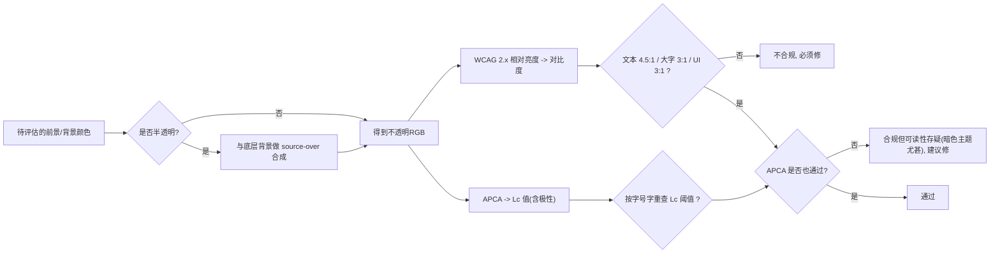
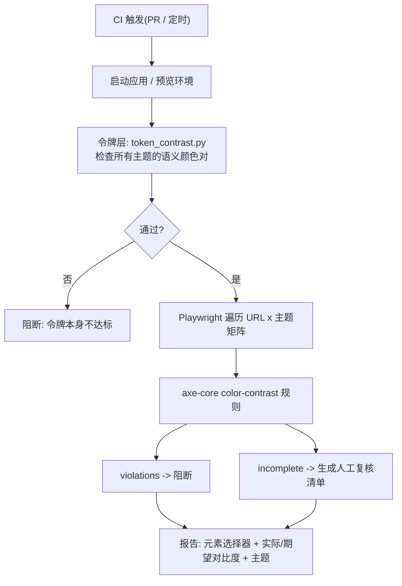

[toc]


我先简短自报家门,再执行搜索,然后给出正文。

**自省**:我是Claude(Anthropic的模型),具体版本号我不确定。本环境可用工具:联网搜索(本轮按"正常"等级执行1轮,我会在一次执行中并行发起多条查询)、Python/Bash沙箱(可用于验证脚本语法与逻辑,但沙箱无外网,无法真正安装npm包跑浏览器)。任务:我将以**前端无障碍(Accessibility, a11y)工程实践者/布道师**的角色,面向国内中文IT读者,系统讲解网页**颜色对比度可读性**的快速排查方法(脚本与工具链)与**主题切换场景下的配色最佳实践**。## 说明与依据

- **信息来源状态**:本轮联网搜索不可用(配额为零),正文基于我的既有知识(**知识截止约2025年初**),引用的规范依据为**WCAG 2.2**(W3C推荐标准,2023-10)、**WCAG 3.0工作草案**中的APCA、axe-core/Lighthouse/pa11y等工具的公开文档与CSS规范(`color-scheme`、`light-dark()`、`color-contrast()`、`prefers-contrast`、`forced-colors`)。文末列出了"可能已变化、建议核实"的条目及搜索关键词。
- **脚本已在沙箱实际运行验证**:Python令牌审计脚本的黑白对比度输出21.00:1、APCA Lc约106/-108,`#777`在白底上4.48:1(经典"差一点"案例),与公认值一致;两份JS脚本通过了`node --check`语法检查(沙箱无浏览器,未能端到端运行)。附件已导出:`token_contrast.py`、`tokens.css`、`pairs.json`、`axe-themes.spec.mjs`、`contrast-scan.js`。

## 先把规则讲清楚:什么叫"对比度合理"

### WCAG 2.x的对比度公式与阈值

WCAG 2.x定义的**对比度(contrast ratio)**是两种颜色**相对亮度(relative luminance)**之比:`(L1 + 0.05) / (L2 + 0.05)`,取值范围1:1(完全相同)到21:1(纯黑与纯白)。其中相对亮度由sRGB分量先做伽马线性化,再按`0.2126R + 0.7152G + 0.0722B`加权得到。关键阈值如下:

| 成功准则(Success Criterion)  | 等级 | 适用对象                                                     | 最低对比度          |
| ---------------------------- | ---- | ------------------------------------------------------------ | ------------------- |
| **1.4.3 Contrast (Minimum)** | AA   | 普通文本(正文、按钮文字、链接)                               | **4.5:1**           |
| 1.4.3 Contrast (Minimum)     | AA   | **大号文本**:≥24px,或≥18.66px且加粗(即18pt / 14pt bold)      | **3:1**             |
| **1.4.11 Non-text Contrast** | AA   | **非文本UI**:输入框边框、图标、焦点环、开关状态、图表关键部分 | **3:1**(与相邻颜色) |
| 1.4.6 Contrast (Enhanced)    | AAA  | 普通文本 / 大号文本                                          | 7:1 / 4.5:1         |

需要辨析的几个点:

- **豁免项**:禁用(`disabled`)控件、纯装饰性文字、Logo/品牌名中的文字**不要求**满足对比度。但"占位符(placeholder)文字"**不豁免**,这是最常见的失败点之一。
- **1.4.11针对的是"理解组件所必需"的视觉信息**:输入框如果只有边框标示边界,边框就要≥3:1;若有明显的填充背景区分,则边框可以不达标。
- **大号文本阈值是按CSS像素而非pt**:24px ≈ 18pt,18.66px ≈ 14pt。很多团队把"18px"误当作大号文本,其实18px普通字重仍需4.5:1。
- **半透明颜色**要先与底色合成再算。`rgba(0,0,0,0.12)`的边框压在白底上实际约等于`#e0e0e0`,对比度只有约1.3:1,这是暗色/亮色主题都常踩的坑(上文脚本运行结果中的`--color-border`就是这种情况)。

### WCAG 2.x公式的已知缺陷与APCA

WCAG 2.x公式**不考虑极性**(深字浅底与浅字深底得到相同的比值),但人眼对两者的感知并不对称:**暗色主题下同样的比值,实际可读性往往更差**;另外它对中等灰度、细字体的评价也不准确。**APCA(Advanced Perceptual Contrast Algorithm,高级感知对比度算法)**是WCAG 3.0工作草案中的候选算法,输出**Lc(Lightness contrast)**值(范围约-108到106,正负号表示极性),并把**字号和字重**纳入阈值查表:粗略地说,正文需要约**Lc 60**以上(对应14–16px常规字重大致要Lc 75–90),大标题Lc 45,非文本元素Lc 30。

必须明确的现状:**合规依据仍然是WCAG 2.x的4.5:1 / 3:1**,APCA目前是"更贴近感知的设计参考",不是法规要求(WCAG 3.0仍是草案)。推荐做法是**以WCAG 2.x为硬门槛,以APCA为暗色主题和灰色文字的辅助判据**,两者都过才放心。



## 快速排查方案总览

排查手段按"离代码的远近"可以分为四层,各层互补而不是替代关系:

| 层级             | 手段                                     | 速度            | 覆盖面                         | 典型工具                                                     | 适合场景                      |
| ---------------- | ---------------------------------------- | --------------- | ------------------------------ | ------------------------------------------------------------ | ----------------------------- |
| **设计令牌层**   | 对CSS变量/令牌文件做静态计算             | 秒级,无需浏览器 | 只覆盖"预定义的颜色对"         | 本文`token_contrast.py`、Style Dictionary自定义校验          | 建立主题系统时**预防**;PR门禁 |
| **浏览器交互层** | DevTools手工检查、控制台脚本、浏览器扩展 | 分钟级          | 当前页面、当前主题             | Chrome DevTools颜色拾取器与CSS Overview、`contrast-scan.js`、axe DevTools / WAVE扩展、Polypane | 开发中随手查、修复现有页面    |
| **自动化测试层** | 无头浏览器 + 规则引擎,遍历主题矩阵       | 每页数秒        | 渲染后的真实DOM,多主题、多视口 | **axe-core**(Playwright/Cypress/Jest集成)、**Lighthouse CI**、**pa11y-ci** | CI回归;批量扫描站点           |
| **设计工具层**   | 在设计稿阶段审查                         | 设计阶段        | 设计稿                         | Figma插件(Stark、Contrast、A11y - Color Contrast Checker)、TPGi **Colour Contrast Analyser(CCA)**桌面版、WebAIM Contrast Checker网页版 | 设计评审;产品/设计同学使用    |

**核心结论先行**:

- **必须**:把**axe-core的`color-contrast`规则**接入CI(通过Playwright或Lighthouse CI),并且对**每个主题分别跑一遍**。这是目前业界最成熟、误报最少的自动化方案。
- **应该**:在主题系统建立时,用**令牌层静态脚本**约束所有"语义颜色对",让问题在进入页面之前就被拦住。
- **可以**:用控制台脚本或浏览器扩展做临时排查;用APCA做暗色主题的加严检查。
- **避免**:只在亮色主题跑一次审计就认为通过;依赖人眼"看着还行"。

所有自动化工具都有共同的**盲区**:文字叠在**渐变、图片、视频、半透明毛玻璃**上时,工具无法确定背景色,axe会把它归为`incomplete`(需人工复核)而不是`violations`。这类位置只能人工检查,或在设计上避免(见最佳实践)。

## 方案一:设计令牌层静态审计(预防为主)

### 适用前提

你的项目用CSS自定义属性(或JSON令牌)定义了主题,例如`:root { --color-text: ... }`和`[data-theme="dark"] { --color-text: ... }`。这是现代主题切换的主流做法,也正是颜色问题"倍增"的地方:**每新增一个主题,所有颜色对都要重新验证**。

### 脚本`token_contrast.py`的用法

```bash
python3 token_contrast.py tokens.css --pairs pairs.json          # 表格输出, 失败则退出码 1
python3 token_contrast.py tokens.css --pairs pairs.json --apca   # 附带 APCA Lc 参考值
python3 token_contrast.py tokens.css --pairs pairs.json --level AAA --format json
```

参数说明:

| 参数            | 含义                                                         |
| --------------- | ------------------------------------------------------------ |
| `css`(位置参数) | 含主题变量的CSS文件;脚本会把每个`选择器 { ... }`块视为一个主题,以`:root`为基础并允许其他块覆盖 |
| `--pairs`       | JSON规则文件,每项含`fg`(前景变量名)、`bg`(背景变量名)、`kind`(`text` / `large-text` / `ui`) |
| `--level`       | `AA`(默认)或`AAA`                                            |
| `--root`        | 基础主题的选择器,默认`:root`                                 |
| `--apca`        | 附加输出APCA Lc,并在Lc低于参考阈值时给出提示(不影响退出码)   |
| `--warn-only`   | 仅告警,退出码恒为0(用于渐进接入)                             |

`pairs.json`中`kind`字段的取值与阈值对应关系:`text`→4.5:1(AAA 7:1);`large-text`→3:1(AAA 4.5:1);`ui`→3:1。

### 运行示例与解读

上文沙箱运行结果针对一套很典型的"亮色先行,暗色后补"令牌,暴露了几类真实问题:

- `--color-placeholder: #bbbbbb`在白底上只有**1.92:1**,占位符不豁免,这是最常见的违规。
- `--color-border: rgba(0,0,0,0.12)`合成后**1.32:1**,输入框如果只靠这条边框标识边界,违反1.4.11。
- 暗色主题下`--color-primary`**忘记换色**,仍用`#2563eb`,在`#0f172a`上只有**3.45:1**,APCA Lc仅-26——这正是"主题切换时颜色问题倍增"的典型案例:亮色下5.17:1是合格的,同一个变量在暗色下就不合格了。
- 暗色`--color-text-muted: #64748b`为3.75:1,**不达标**;而且即使调到刚好4.5:1,APCA也会提示偏低——**暗色主题下的次要文字要比亮色主题更亮一些才够**。

### 接入CI

在`pre-commit`或GitHub Actions/GitLab CI中加一步即可,脚本无第三方依赖:

```yaml
# .github/workflows/a11y-tokens.yml 片段
- name: Token contrast audit
  run: python3 scripts/token_contrast.py src/styles/tokens.css --pairs scripts/contrast-pairs.json --apca
```

**局限**:脚本只解析`#hex`、`rgb()`、`hsl()`与`var()`引用;若你的令牌使用`oklch()`、`color-mix()`、`light-dark()`,它会报"无法解析",这类颜色请交给浏览器层的工具(下文)。此外它只检查"你声明过的颜色对",**无法发现组件中临时写死的颜色**——那是方案三的职责。

## 方案二:浏览器端快速排查(修复现有页面)

### Chrome DevTools内置能力

- **颜色拾取器的对比度信息**:在Elements面板的Styles中点击任意`color`属性前的色块,拾取器会显示与当前背景的**对比度、AA/AAA是否通过**,并在色板上画出"达标分界线",拖动即可找到最近的达标色。在DevTools的实验设置(Experiments)中可开启**APCA**显示替代WCAG比值(该开关位置随版本变动,请以实际版本为准)。
- **CSS Overview面板**(通过"更多工具"打开):一键汇总整页的颜色使用情况,并单列**"Contrast issues"**,给出低对比度的文字/背景色对及元素数量——**排查现有页面最快的一招**。
- **渲染(Rendering)面板**:可以模拟`prefers-color-scheme: dark`、`prefers-contrast`、`forced-colors: active`以及**视觉缺陷模拟(模糊、各类色盲)**,切换后再用CSS Overview重新统计,就是"多主题快速审计"的手工版本。

### 浏览器扩展

- **axe DevTools**(Deque):规则引擎与CI中一致,扫描结果可定位元素并给出实际色值和期望比值。
- **WAVE**(WebAIM):有专门的"Contrast"标签页,直观。
- **Polypane**(付费浏览器,面向开发者):可并排显示亮/暗主题并实时标注对比度问题,对主题切换调试很顺手。

### 零依赖的控制台脚本`contrast-scan.js`

当你在一台没装扩展的机器上、或者审计的是内网/需登录的页面时,把`contrast-scan.js`整段粘贴到控制台即可。它遍历可见文本节点,向上合成背景色(支持半透明叠层),按字号/字重应用4.5:1或3:1阈值,失败元素**加红色描边**并`console.table`输出;切换主题后再执行一次即可对照两套结果。背景为渐变/图片时它标记为`unknown-bg`交由人工复核,和axe的行为一致。

它刻意不追求与axe同等的严谨(axe还会处理`position`叠层、`opacity`继承、`text-shadow`等),定位是**快速定位问题区域**,结论请用axe复核。也可以把它保存为DevTools的Snippet,或封装成书签脚本(bookmarklet)分发给测试同学。

## 方案三:自动化回归(axe-core + Playwright多主题矩阵)

### 为什么选axe-core

| 候选                            | 性质                                            | 对比度规则质量                                  | 多主题支持                                             | 评价                                     |
| ------------------------------- | ----------------------------------------------- | ----------------------------------------------- | ------------------------------------------------------ | ---------------------------------------- |
| **axe-core**(Deque,MPL-2.0开源) | 规则引擎,可嵌入任何浏览器自动化                 | 最成熟;会正确处理叠层、半透明、`incomplete`分类 | 由宿主(Playwright等)控制                               | **推荐作为核心引擎**                     |
| Lighthouse / Lighthouse CI      | Google的综合审计,其a11y部分**内部就是axe-core** | 同axe                                           | 可通过`emulatedMediaFeatures`等设置,但多主题需多次运行 | 适合"顺带"审计,独立使用不如直接用axe灵活 |
| pa11y / pa11y-ci                | 命令行包装,引擎可选**axe或HTML_CodeSniffer**    | 选axe时同上                                     | 通过`actions`脚本切换主题                              | 零代码、配置驱动,适合批量URL             |
| IBM equal-access checker        | IBM开源规则集                                   | 良好                                            | 需自行编排                                             | 可作第二意见                             |

### `axe-themes.spec.mjs`的设计要点

脚本已附在导出文件中,核心思路:

- **主题矩阵**同时覆盖两种切换机制:**跟随系统**用`page.emulateMedia({ colorScheme })`,**手动切换**则在加载后写入`data-theme`(请按你的实现改为class或`localStorage`);另加一个`forcedColors: "active"`用于检查强制颜色模式下页面是否还能用。
- 只启用`color-contrast`(AA)、`color-contrast-enhanced`(AAA,只告警不阻断)和`link-in-text-block`(正文中的链接仅靠颜色区分时要求与周围文字≥3:1)三条规则,跑得快;需要全量a11y审计时去掉`withRules`。
- **把`incomplete`也打印出来**。很多团队只看`violations`,结果渐变背景上的白字永远不会被发现。
- `violations[].nodes[].any[0].data`里包含axe算出的`fgColor`、`bgColor`、`contrastRatio`、`expectedContrastRatio`、`fontSize`、`fontWeight`,排错时直接可用。

```bash
npm i -D @playwright/test @axe-core/playwright
npx playwright install chromium
AUDIT_URLS="http://localhost:3000/,http://localhost:3000/settings" npx playwright test axe-themes.spec.mjs
```

国内网络下`npx playwright install`下载浏览器可能很慢,可设置`PLAYWRIGHT_DOWNLOAD_HOST`指向国内镜像(例如npmmirror提供的镜像,地址请以其当前文档为准),或在`*nix`下`export HTTPS_PROXY=http://127.0.0.1:7890`、Windows PowerShell下`$env:HTTPS_PROXY="http://127.0.0.1:7890"`走本地代理。



### pa11y-ci的配置式替代

不想写测试代码时,`pa11y-ci`用一个JSON就能批量扫描,主题切换通过`actions`完成:

```json
{
  "defaults": { "runners": ["axe"], "includeWarnings": true, "timeout": 30000 },
  "urls": [
    "http://localhost:3000/",
    {
      "url": "http://localhost:3000/",
      "actions": [
        "set field html[data-theme] to dark",
        "wait for element body to be visible"
      ]
    }
  ]
}
```

`actions`的语法较受限,复杂的切换逻辑(例如点击设置面板中的开关)可以写成`"click element #theme-toggle"`。如果切换逻辑依赖`localStorage`,pa11y的actions做不到,这时还是用Playwright。

## 最佳实践:预防不合理配色

### 用"语义令牌 + 主题覆盖"构建颜色系统

颜色系统分三层,**组件代码只允许引用语义层**:

| 层                           | 示例                                                         | 职责                      | 是否随主题变化                    |
| ---------------------------- | ------------------------------------------------------------ | ------------------------- | --------------------------------- |
| **原始色阶(primitive)**      | `--blue-600`、`--gray-50`                                    | 调色板,只描述"是什么颜色" | 否                                |
| **语义令牌(semantic)**       | `--color-text`、`--color-text-muted`、`--color-bg`、`--color-border-strong` | 描述"用在哪、做什么"      | **是**,每个主题各自映射到原始色阶 |
| **组件令牌(component,可选)** | `--button-primary-bg`                                        | 组件级细分                | 通常继承语义层                    |

这样做的直接好处是:**对比度审计的对象从"无限多的组件组合"收敛为"有限的语义颜色对"**,`pairs.json`就能写全;新增主题只需补一份映射并重跑脚本。

**必须避免**:组件里直接写`color: #999`或引用原始色阶`var(--gray-400)`——这种颜色在暗色主题下不会跟着变,是暗色主题"灰字糊成一片"的根源。可以用Stylelint的`declaration-property-value-allowed-list`或`scale-unlimited/declaration-strict-value`插件,强制`color`/`background-color`/`border-color`只能使用`var(--color-*)`。

### 利用现代CSS减少主题分叉

- **`color-scheme: light dark`**(应声明在`:root`):告诉浏览器页面支持两种配色,**表单控件、滚动条、画布默认色**会自动适配,避免"暗色主题里白色输入框刺眼"的半成品。
- **`light-dark(浅色值, 深色值)`**函数:在单条声明里同时给出两种主题的值,随`color-scheme`自动切换,2024年起已在主流浏览器可用(Chrome 123+、Firefox 120+、Safari 17.5+;精确版本请核实)。它让"忘了给暗色主题定义某个变量"这种错误在语法上更难发生。
- **`prefers-contrast: more`**:用户在系统中开启"增强对比度"时,应提供更高对比度的变体(例如把`--color-text-muted`提升到正文色)。
- **`forced-colors: active`**(Windows高对比度模式):系统会**覆盖**你的所有颜色,此时要用系统颜色关键字(`CanvasText`、`ButtonText`、`Highlight`等)保证焦点环、边框仍可见;对只靠`background-color`表达的状态(如选中项)要补`outline`或`border`,因为背景会被抹掉。

```css
:root {
  color-scheme: light dark;
  --color-bg: light-dark(#ffffff, #0f172a);
  --color-text: light-dark(#111827, #e2e8f0);
  --color-text-muted: light-dark(#6b7280, #94a3b8);  /* 暗色下要比"镜像"更亮 */
  --color-primary: light-dark(#2563eb, #60a5fa);     /* 暗色下用更浅一档的色阶 */
}
@media (prefers-contrast: more) {
  :root { --color-text-muted: var(--color-text); }
}
@media (forced-colors: active) {
  .card:focus-visible { outline: 2px solid Highlight; }
}
```

关于**`color-contrast()`函数**(让浏览器从候选色里自动挑对比度最高的):截至我的知识范围,它仍停留在实验/草案阶段,只有Safari曾在技术预览中实现,**不要在生产中依赖**;可用JS或构建期脚本实现同样的"自动挑色"。

### 暗色主题的特殊规则

暗色主题不是把亮色主题"反相"。经验规则:

- **不要用纯黑背景配纯白文字**。Material Design推荐的暗色表面是`#121212`一类的深灰,文字用约87%不透明度的白(`rgba(255,255,255,0.87)`),次要文字60%,这样既满足对比度又减轻"光晕(halation)"效应。但注意**不透明度文字在叠层表面上要重新验证**,合成后的颜色会变。
- **饱和色要降饱和、提亮度**:亮色主题的`blue-600`放到暗底上既对比度不足又"震动"刺眼,应切到`blue-400`/`blue-300`一档。这也是前面示例中`--color-primary`失败的修复方式。
- **用"海拔(elevation)"而非阴影区分层级**:暗色下阴影几乎不可见,越靠前的表面应越亮(`#121212` → `#1e1e1e` → `#2c2c2c`),并保证文字对每一层表面都达标——`pairs.json`应把`--color-text`对`--color-surface`、`--color-surface-raised`都列进去。
- **把APCA作为暗色主题的加严判据**:WCAG 2.x在暗色下偏宽松,APCA的极性感知能补上这个盲区。

### 使用感知均匀色彩空间生成色阶

如果你在重建调色板,**推荐在OKLCH(或OKLab)空间生成色阶**:同一亮度L下的不同色相在感知上亮度接近,于是"所有`*-600`色阶在白底上都约5:1"这种规律可以成立,极大简化多主题审计。HSL的L值没有这个性质(HSL中`L=50%`的黄色和蓝色实际亮度差异巨大),用HSL按百分比"调亮"往往会得到不达标的颜色。Radix Colors、Tailwind v4默认调色板等都已转向OKLCH;Chrome DevTools的拾取器也支持OKLCH。

### 不要让颜色成为唯一信息载体

WCAG 1.4.1(Use of Color)要求**不能仅靠颜色传达信息**:错误状态要配图标或文字,链接在正文中要有下划线(或与周围文字≥3:1且悬停时有非颜色提示),图表要配图例形状/纹理。这与对比度是两件事,但在排查"可读性"时经常一起暴露。可以在DevTools渲染面板中模拟**色盲(deuteranopia、protanopia、tritanopia)和模糊视觉**,快速发现这类问题。

### 必做清单

- **必须**:正文文本≥4.5:1,大号文本≥3:1,UI组件边界/图标/焦点环≥3:1;**每个主题分别验证**;占位符文字不豁免。
- **必须**:组件只引用语义令牌,禁止写死颜色;用Stylelint强制。
- **应该**:声明`color-scheme`,优先用`light-dark()`;暗色主题使用深灰而非纯黑,主色降饱和提亮。
- **应该**:令牌层脚本 + axe多主题矩阵双重门禁;`incomplete`结果纳入人工复核。
- **可以**:启用APCA作为加严参考;用OKLCH重建色阶;为`prefers-contrast: more`提供高对比变体。
- **避免**:文字直接压在图片/渐变上(若必须,加半透明遮罩或文字底板,并把合成后的颜色纳入审计);避免用透明度做"次要文字"而不复核叠层后的实际对比度;避免只在亮色主题下审计一次。

## 改进现有糟糕页面的步骤

1. **先量化**:用DevTools的CSS Overview(或`contrast-scan.js`)在**每个主题**下跑一遍,得到"颜色对 → 元素数"清单;按元素数量排序,**少数几对颜色通常覆盖了大部分违规**。
2. **溯源到变量**:对每个违规颜色,在Styles面板查看它来自哪个变量或哪条写死的规则。写死的颜色先改为语义令牌(这一步改动最大但一劳永逸)。
3. **修令牌而不是修组件**:在`:root`/主题块中调整语义令牌的值,用拾取器的"达标分界线"或`token_contrast.py`找到最近的达标色;原则是**尽量保持色相,只动亮度**,视觉改动最小。
4. **处理不可自动判断的位置**:文字压图片/渐变的区块,加`background: rgba(0,0,0,.5)`遮罩或文字底板,或改用`text-shadow`/描边(注意描边并不被WCAG公式计入,仅作为辅助)。
5. **建立回归**:把修复后的颜色对写入`pairs.json`,接入`axe-themes.spec.mjs`,防止再次退化。
6. **顺带处理非颜色问题**:链接下划线、错误提示图标、焦点可见性(`:focus-visible`),这些与对比度修复几乎总是同时出现。

