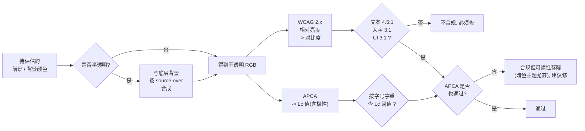
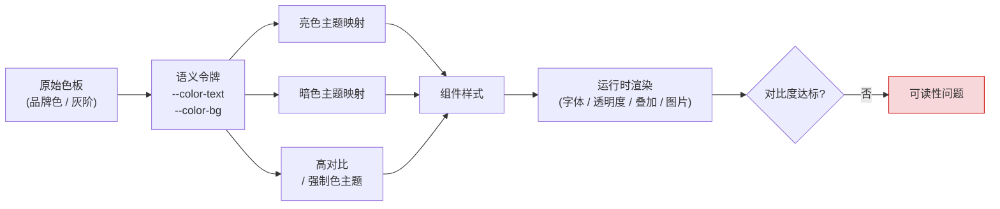
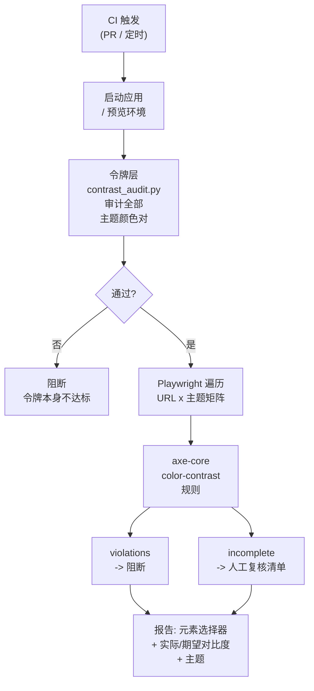
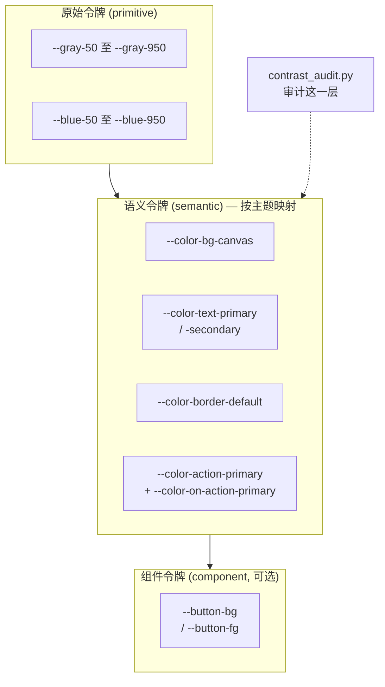

[toc]

**网页颜色对比度与可读性:排查工具链与主题切换配色实践**

本文面向需要同时维护亮色与暗色主题的前端团队,回答三个问题:对比度到底按什么标准判定、如何用脚本与浏览器工具快速查出问题、如何在主题系统里从源头避免不合理配色。内容覆盖 **WCAG 2.x** 阈值与 **APCA** 现状、四种排查层级的工具链,以及语义令牌、`light-dark()`、`contrast-color()` 等现代 CSS 能力的落地边界。

适用范围:面向网页与 Web 应用的文字、图标、边框与焦点指示器配色。不覆盖屏幕阅读器语义、键盘导航顺序等与颜色无关的无障碍项;这些通常与对比度问题同时暴露,发现时应一并处理。

文中脚本输出的示例数字来自作者环境的沙箱运行,对应的 `tokens.css` 与 `pairs.json` 未随文提供,复现方式见 **L1** 一节。

## 结论速览

- **合规底线是 WCAG 2.x AA**:正文 4.5:1、大号文本与非文本 UI 3:1,写进团队 Definition of Done。
- **每个主题必须独立验证**:不存在"亮色过了,暗色大概也行"。主题越多,需要逐一验证的颜色对越多。
- **CI 设两道闸**:令牌层静态审计 + 关键页面级 axe 多主题扫描;`incomplete` 结果必须进入人工复核清单。
- **APCA 只作加严参考**:WCAG 3 至今未定对比度算法,不能作为合规依据。
- **半透明颜色按合成结果判定**:`rgba`、`opacity`、`color-mix()` 的最终输出才是用户看到的颜色。
- **过时认知需更新**:`contrast-color()` 已于 2026-04 进入 Baseline 可用范围,不再是"仅实验实现、禁止生产使用"。

## 核心概念:对比度到底在量什么

### WCAG 2.x 对比度比值

当前具有法律与行业约束力的标准仍是 **WCAG 2.x**(2.2 版为 W3C 推荐标准)。它用**相对亮度(relative luminance)**计算两个颜色的**对比度比值(contrast ratio)**,公式为 `(L1 + 0.05) / (L2 + 0.05)`,取值范围 1:1(两色完全相同)到 21:1(纯黑对纯白)。其中相对亮度由 sRGB 分量先做伽马线性化,再按 `0.2126R + 0.7152G + 0.0722B` 加权得到。

| 成功标准(SC)                 | 级别 | 适用对象                                                     | 最低比值    |
| ---------------------------- | ---- | ------------------------------------------------------------ | ----------- |
| **1.4.3 Contrast (Minimum)** | AA   | 普通文本及文字图片                                           | **4.5:1**   |
| 1.4.3 Contrast (Minimum)     | AA   | 大号文本:≥24px,或 ≥18.66px 且加粗(即 18pt 或 14pt 粗体)      | **3:1**     |
| **1.4.11 Non-text Contrast** | AA   | UI 组件的识别性视觉信息(边框、焦点环、图标、开关状态)及有意义的图形 | **3:1**(对相邻颜色) |
| 1.4.6 Contrast (Enhanced)    | AAA  | 普通文本 / 大号文本                                          | 7:1 / 4.5:1 |

普通文本的定义是小于 18pt、或小于 14pt 粗体。上表有几处最常被误读的边界:

- **大号文本按 CSS 像素换算,不是 pt**:24px ≈ 18pt,18.66px ≈ 14pt。很多团队把"18px"当作大号文本,实际 18px 普通字重仍需 4.5:1。
- **豁免范围**:装饰性文字、Logo 或品牌名中的文字、禁用(inactive/disabled)控件不要求满足对比度。但**占位符(placeholder)文字不豁免**,这是最常见的失败点。
- **Logo 豁免有边界**:W3C 的限定是,若标志通常本可有足够对比度,作者只是选择以低对比度呈现,而非出于企业识别或品牌规范,则该低对比度呈现不豁免。
- **1.4.11 只管"识别组件所必需"的视觉信息**:输入框若仅靠边框标示边界,边框就要 ≥3:1;若有明显的填充背景区分,则边框可以不达标。字符类符号(如"X"关闭按钮、">"箭头)按非文本处理,刚过 3:1 即可。该条不适用于禁用态控件,但禁用控件的文字说明仍需让用户看清。
- **抗锯齿会让细线看起来更淡**:名义上达标而实际更深地低于阈值。边框、分隔线建议至少 1px 实色,并留出余量。
- **半透明颜色必须先与底色合成再算**:`rgba(0,0,0,0.12)` 的边框压在白底上约等于 `#e0e0e0`,对比度只有约 1.3:1。这是亮色与暗色主题都常踩的坑。

### APCA 与 WCAG 3:现状必须说清楚

WCAG 2.x 公式的公认缺陷是**不考虑极性**(深字浅底与浅字深底得到相同比值),而人眼对两者的感知并不对称:暗色主题下同样的比值,实际可读性往往更差;它对中等灰度与细字体的评价也不准确。设计实践中还常见"合格的色对读起来费劲、不合格的色对看着还行",尤其在暗色模式与橙、黄色相上。

**APCA(Advanced Perceptual Contrast Algorithm,高级感知对比度算法)**是候选替代方案。它不输出比值,而是输出 **Lc(Lightness Contrast)**分值,范围约 -108 到 +106,正负号表示极性,并把字号与字重纳入阈值查表。概略口径为:正文 Lc 75 起、优选 90,大标题与非文本元素阈值更低。**不同资料对同一字号的 Lc 门槛并不统一**,落地时以 APCA Readability Criterion 的 lookup table 为准。

标准化状态必须以 2026 年的公开材料为准:

- 视觉对比度相关内容已于 **2023 年 7 月**移出 WCAG 3 工作草案;当前工作草案(2026-09-10 版)仍写明"WCAG 3 采用的对比度算法尚待确定"。
- WCAG 3 仍是 Working Draft,路线图把候选推荐(Candidate Recommendation)指向 2027 年第四季度,正式推荐更晚。引用时应按"进行中的草案"对待,不得作为合规依据。
- APCA 自身独立发展为 ARC(APCA Readability Criterion)标准,处于公开草案阶段。
- 工具侧态度已变化:Chrome 149(2026-06)起,APCA 从 DevTools 的实验特性转为**普通设置项**(Settings > Preferences > Elements > Enable APCA contrast guidelines),默认仍使用 WCAG 2 算法,由用户自行切换。此前"实验开关位置随版本变动"的描述已过时。

**结论**:**合规判定以 WCAG 2.x 为准(必须),APCA 作为设计阶段的辅助参考(推荐,尤其在暗色主题)**。两者在深底浅字上经常分歧:一个色对 WCAG 可达 10:1,APCA 却提示偏弱;反之亦然。推荐做法是两者都过才放心。

### 现代 CSS 原生能力

- **`color-scheme`**:应声明在 `:root`,取值为 `light dark` 表示页面支持两种配色。声明后**表单控件、滚动条、画布默认色**会自动适配,避免"暗色主题里白色输入框刺眼"的半成品。它也是 `light-dark()` 生效的前提:层叠中必须同时包含 `light` 与 `dark` 两个关键字,若只设为 `light`,函数会静默解析为固定值。
- **`light-dark(浅色值, 深色值)`**:在单条声明里同时给出两种主题的值,随 `color-scheme` 自动切换。Baseline 2024 年 5 月起可用,支持底线为 Chrome 123、Edge 123、Firefox 120、Safari 17.5。它让"忘了给暗色主题定义某个变量"这类错误在语法层面更难发生。
- **`contrast-color()`**:接收一个颜色,返回与其对比度更高的黑或白。状态为 **Baseline Newly Available(2026-04-10)**,支持底线为 Chrome 147、Edge 147(2026-04)、Firefox 146(2025-12)、Safari 26(2025-09),预计 2028-10-10 达到 Widely Available。能力边界很明确:基线用法是"一色进、黑白出",返回值不是比值,也不是输入色的调和变体,它以 WCAG AA 普通文本 4.5:1 为目标;草案层面已扩展到"从候选色列表中挑选",Safari 另有算法选择关键字,两者都尚未进入跨浏览器基线。因此**中等亮度背景(中灰、中饱和蓝)可能黑白都不够**,这类品牌色应在令牌层调整,而不是指望运行时函数兜底。
- **`color-contrast()` 是早期提议名**:早期资料中的这个函数名已改称 `contrast-color()`,两者不要混用。基于旧资料写成的"该能力仍在实验阶段、不要用于生产"的结论,已被 2026 年的 Baseline 状态取代。
- **`prefers-contrast: more`**:用户在系统中开启"增强对比度"时,应提供更高对比度的变体,例如把次要文字提升为正文色。
- **`forced-colors: active`**(Windows 高对比度模式):系统会**覆盖**你的全部颜色,此时要用系统颜色关键字(`CanvasText`、`ButtonText`、`Highlight` 等)保证焦点环、边框仍可见;对只靠 `background-color` 表达的状态(如选中项)要补 `outline` 或 `border`,因为背景会被抹掉。

CSS 颜色函数的新写法同时给令牌审计带来新约束:`oklch()`、`color-mix()`、`light-dark()` 输出的颜色无法被只认 `#hex`、`rgb()`、`hsl()` 的静态脚本解析,这类令牌要交给浏览器层工具验证(见 **L1** 的局限)。

### 判定流程



图中的关键分支是**先合成、再判定**,以及**两套判据分别出结论**:WCAG 不达标属于必须修复的违规,WCAG 达标而 APCA 偏弱属于建议优化的可读性问题,两者不能混为一谈。

## 问题的全景:为什么主题切换会让颜色问题放大



图中每一层都可能引入问题,主题越多,组合爆炸越严重:

- **原始色板与语义令牌**:设计师给的暗色灰阶在亮色下够用、暗色下不够。人眼对深色背景上的浅色更敏感,WCAG 2 公式却是对称的。
- **主题映射**:某个主题漏定义了某个令牌,回落到另一主题的值,造成"文字与背景同色"。这类 **1:1 的灾难,axe 反而可能报不出来**(见 L2 的陷阱一)。
- **组件样式与运行时渲染**:半透明叠加、背景图片、渐变、Web 字体加载前后的字重差异、过渡动画中间态。

## 快速排查方案总览

按"投入成本与覆盖深度"分四个层级,建议**全部采用,而非四选一**:

| 层级             | 手段                                                         | 适用阶段         | 覆盖面                             | 成本 | 典型工具                                                     |
| ---------------- | ------------------------------------------------------------ | ---------------- | ---------------------------------- | ---- | ------------------------------------------------------------ |
| **L0 零安装**    | DevTools 取色器、CSS Overview、控制台粘贴脚本、浏览器扩展    | 现场排查、改造评估 | 单页单主题                         | 极低 | Chrome DevTools、`quick-contrast-console.js`、axe DevTools / WAVE、WebAIM 在线检查器、Polypane |
| **L1 令牌级**    | 对 CSS 变量或设计令牌做静态审计                              | 设计系统、PR 阶段 | 所有主题的语义配对,与页面无关      | 低   | `contrast_audit.py`、Style Dictionary 自定义校验             |
| **L2 页面级**    | Playwright + axe-core,遍历主题矩阵                           | CI、回归         | 真实渲染结果,多页多主题多视口      | 中   | **axe-core**(Playwright / Cypress / Jest 集成)、Lighthouse CI、pa11y-ci、`@axe-core/cli` |
| **L3 人工与辅助** | 色觉模拟、`prefers-contrast` 与强制色测试、真实用户          | 发布前、定期审计 | 自动化覆盖不了的部分               | 高   | DevTools 渲染面板、Figma 插件(Stark、Contrast)、TPGi CCA    |

**核心结论先行**:

- **必须**:把 axe-core 的 `color-contrast` 规则接入 CI(通过 Playwright 或 Lighthouse CI),并且**对每个主题分别跑一遍**。这是目前业界最成熟、误报最少的自动化方案。
- **应该**:在主题系统建立时,用令牌层静态脚本约束所有"语义颜色对",让问题在进入页面之前就被拦住。
- **可以**:用控制台脚本或浏览器扩展做临时排查;用 APCA 做暗色主题的加严检查。
- **避免**:只在亮色主题跑一次审计就认为通过;依赖人眼"看着还行"。

所有自动化工具都有共同的**盲区**:文字叠在渐变、图片、视频、半透明毛玻璃上时,工具无法确定背景色,axe 会把它归为 `incomplete`(需人工复核)而不是 `violations`。这类位置只能人工检查,或在设计上避免(见最佳实践)。

## L0:零安装的现场排查

**Chrome / Edge DevTools** 有三处可直接用:

- **取色器**:在 Elements 面板 Styles 中点击任意 `color` 属性前的色块,会显示与当前背景的对比度、AA/AAA 是否通过,并在色板上画出"达标分界线",拖动即可找到最近的达标色;顺带可直接比较 APCA 与 WCAG 两种口径。
- **CSS Overview 面板**:一键汇总整页颜色使用情况,并单列 **Contrast issues**,给出低对比度的文字与背景色对及元素数量。这是**排查现有页面最快的一招**。
- **渲染(Rendering)面板**:可模拟 `prefers-color-scheme: dark`、`prefers-contrast`、`forced-colors: active`,以及色盲(红色盲、绿色盲、蓝色盲)与模糊视觉。切换后重新看 CSS Overview,就是"多主题快速审计"的手工版本。

Firefox 的 Accessibility Inspector 提供 Check for issues → Contrast,可一键列出全页问题。

**浏览器扩展**:

- **axe DevTools**(Deque):规则引擎与 CI 中一致,扫描结果可定位元素并给出实际色值与期望比值。
- **WAVE**(WebAIM):有专门的 Contrast 标签页,直观。
- **Polypane**(付费浏览器):可并排显示亮色与暗色主题并实时标注对比度问题,主题切换调试很顺手。

**控制台脚本(`quick-contrast-console.js`)**:在没装扩展的机器上,或审计内网、需登录的页面时,把脚本整段粘贴到控制台即可。它遍历可见文本元素,读取 `getComputedStyle` 的 `color`,向上查找并合成第一个不透明背景(处理 `rgba` 叠加),按字号与字重应用 4.5:1 或 3:1 阈值,用 `console.table` 列出不达标项,并在页面上用红框标记可确认的问题、橙色虚线框标记背景含图片或渐变、需复核的元素,结果同时存入 `window.__contrastIssues`。切换主题后再粘贴一次即可对照两套结果。

它刻意不追求与 axe 同等的严谨(axe 还会处理 `position` 叠层、`opacity` 继承、`text-shadow` 等),定位是**快速定位可疑元素**,结论请用 axe 复核。也可以保存为 DevTools 的 Snippet,或封装成书签脚本分发给测试同学。

## L1:令牌级静态审计(推荐作为第一道闸)

### 适用前提

项目用 CSS 自定义属性(或 JSON 令牌)定义主题,例如 `:root { --color-text: ... }` 与 `[data-theme="dark"] { --color-text: ... }`。这是现代主题切换的主流做法,也正是颜色问题"倍增"的地方:每新增一个主题,所有颜色对都要重新验证,而令牌层审计不依赖页面、不依赖浏览器,所有主题的所有语义配对可一次算完。

### 用法

```bash
python contrast_audit.py --css tokens.css --pairs pairs.json --apca
# 自定义主题选择器(例如 Tailwind 的 class 策略):
python contrast_audit.py --css tokens.css --pairs pairs.json \
  --theme-selector "light=:root" --theme-selector "dark=.dark" --format json
```

参数与输入格式说明:

| 字段或参数        | 含义                                                                 |
| ----------------- | -------------------------------------------------------------------- |
| `--css`           | 一个或多个 CSS 文件,按顺序合并后解析 `--var: value` 声明             |
| `--pairs`         | 配对清单 JSON;每项含 `name`(显示名)、`fg`(前景)、`bg`(背景)、`kind` |
| `kind`            | `text`(4.5:1)、`large`(3:1)、`ui`(非文本 3:1)、`aaa`(7:1)             |
| `fg` 与 `bg`      | 可写变量名(`--color-text`)或字面量(`#fff`、`rgba(...)`、`hsl(...)`);支持 `var(--x, fallback)` 引用链 |
| `--theme-selector` | `主题名=选择器`,默认 `light=:root` 与 `dark=[data-theme="dark"]`;非首个主题默认继承首个主题的变量(模拟层叠覆盖),`--no-inherit` 可关闭 |
| `--apca`          | 附加输出 APCA Lc 参考值与参考阈值,**不参与通过判定**                |
| 退出码            | 任一配对任一主题不达标返回 1,可直接阻断 CI                         |

脚本只需要 Python 标准库,Windows、macOS、Linux 通用。若希望脚本承担更细的职责,可在上述基础上扩展三个开关:`--level AA|AAA`(按等级取阈值)、`--root <选择器>`(指定基础主题,默认 `:root`)、`--warn-only`(只告警、退出码恒为 0,用于渐进接入旧项目)。

### 输出示例与解读

对一套"亮色先行、暗色后补"的典型令牌,真实输出如下(节选):

| 主题  | 配对                          | 类型 | WCAG 比值 | 要求  | 结果     | APCA Lc             |
| ----- | ----------------------------- | ---- | --------- | ----- | -------- | ------------------- |
| light | 次要文字 / 卡片               | text | 3.17:1    | 4.5:1 | **FAIL** | +56.2               |
| light | 主按钮文字(白字配 `#3b82f6`)  | text | 3.68:1    | 4.5:1 | **FAIL** | -69.4               |
| light | 输入框边框(`rgba(0,0,0,.12)`) | ui   | 1.32:1    | 3:1   | **FAIL** | +15.6               |
| light | 占位符文字(`#bbbbbb` 配白底)  | text | 1.92:1    | 4.5:1 | **FAIL** | 未列出              |
| dark  | 链接 / 页面背景               | text | 10.39:1   | 4.5:1 | PASS     | -68.6(低于参考 75)  |
| dark  | 主按钮文字(白字配 `#60a5fa`)  | text | 2.54:1    | 4.5:1 | **FAIL** | -54.7               |
| dark  | 主色(亮色 `#2563eb` 未换色)   | text | 3.45:1    | 4.5:1 | **FAIL** | -26                 |

这组结果本身就是教科书式的案例:

- **白字配中饱和度蓝色主按钮**(`blue-500` 一类颜色)在亮色主题就不达标,暗色主题常见的"把主色调亮"做法(换成 `blue-400`)让它更糟;正确方向是暗色下改用**深色文字配浅主色**,或单独定义 `on-primary`。
- **12% 透明度的边框**离 3:1 差得很远。若输入框只靠这条边框标识边界,直接违反 1.4.11。
- **占位符 `#bbbbbb` 只有 1.92:1**。占位符不豁免,这是最高频的违规之一。
- **暗色主题的次要文字 `#64748b` 只有 3.75:1**,不达标;即使调到刚好 4.5:1,APCA 仍会提示偏低。**暗色主题的次要文字要比亮色主题更亮一档才够**。
- **暗色主题的链接 WCAG 高达 10:1、APCA 却认为偏弱**,正是两种算法在深底浅字上的典型分歧。

实现要点(便于自行扩展):半透明前景按 source-over 合成到背景后再算;APCA 按 `apca-w3` 0.1.9 的公开常量实现,已用文档参考值(如 `#888` 对 `#fff` 得 63.06 等四组)校验一致。

### 接入 CI

在 `pre-commit` 或 GitHub Actions、GitLab CI 中加一步即可,脚本无第三方依赖:

```yaml
# .github/workflows/a11y-tokens.yml 片段
- name: Token contrast audit
  run: python scripts/contrast_audit.py --css src/styles/tokens.css --pairs scripts/contrast-pairs.json --apca
```

**局限**:脚本只解析 `#hex`、`rgb()`、`hsl()` 与 `var()` 引用;令牌若用 `oklch()`、`color-mix()`、`light-dark()`,它会报"无法解析",这类颜色请交给浏览器层工具。此外它只检查"你声明过的颜色对",**无法发现组件中临时写死的颜色**——那是 L2 与治理规则的职责。

## L2:页面级自动化(axe-core + Playwright 多主题扫描)

### 为什么选 axe-core

Playwright 驱动真实浏览器,axe-core 是多数自动化可访问性检查器背后的开源规则引擎。不以 jsdom 方案替代的原因很直接:jest-axe 关闭了颜色对比度检查,它在 JSDOM 里无法工作;对比度、布局、缩放与焦点都需要真实渲染。

| 候选                            | 性质                                            | 对比度规则质量                                    | 多主题支持                                             | 评价                                     |
| ------------------------------- | ----------------------------------------------- | ------------------------------------------------- | ------------------------------------------------------ | ---------------------------------------- |
| **axe-core**(Deque,MPL-2.0)     | 规则引擎,可嵌入任何浏览器自动化                 | 最成熟;会正确处理叠层、半透明与 `incomplete` 分类 | 由宿主(Playwright 等)控制                              | **推荐作为核心引擎**                     |
| Lighthouse / Lighthouse CI      | Google 的综合审计,其 a11y 部分内部就是 axe-core | 同 axe                                            | 可通过 `emulatedMediaFeatures` 等设置,多主题需多次运行 | 适合"顺带"审计,不宜作为唯一闸门         |
| pa11y / pa11y-ci                | 命令行包装,引擎可选 axe 或 HTML_CodeSniffer     | 选 axe 时同上                                     | 通过 `actions` 脚本切换主题                            | 零代码、配置驱动,适合批量 URL            |
| IBM equal-access checker        | IBM 开源规则集                                  | 良好                                              | 需自行编排                                             | 可作第二意见                             |

### 脚本参数

`a11y-contrast-scan.mjs` 支持以下参数:

| 参数                   | 说明                                                         |
| ---------------------- | ------------------------------------------------------------ |
| `--url`                | 可重复,传入多个页面                                         |
| `--themes`             | 默认 `light,dark`                                            |
| `--switch`             | 主题切换方式:`media`(模拟 `prefers-color-scheme`,适合 `light-dark()` 方案)、`data-theme`(设置 `<html data-theme>`)、`class`(给 `<html>` 加类,Tailwind 习惯) |
| `--all-rules`          | 跑完整 WCAG 2.x A/AA 标签规则集;默认只跑 `color-contrast` 与 `link-in-text-block` |
| `--fail-on-incomplete` | 把 axe 的 `incomplete` 也视为失败(主题场景**强烈建议开启**,原因见下) |
| `--proxy`              | 如 `http://127.0.0.1:7890`,国内环境扫描境外部署的页面时使用  |
| `--out`                | 输出 JSON 报告                                               |

```bash
npm i -D @playwright/test @axe-core/playwright
npx playwright install chromium
node a11y-contrast-scan.mjs \
  --url http://localhost:3000/ --url http://localhost:3000/settings \
  --themes light,dark --switch media --fail-on-incomplete --out report.json
```

### axe 在主题场景下的两个关键陷阱

- **陷阱一:最严重的缺陷藏在 `incomplete` 而不是 `violations` 里**。一位作者发布了一个按钮,标签与自身背景同色——1:1,字面意义上不可读,且只在暗色模式出现;而流水线只断言 `violations`、丢弃 `incomplete`,CI 始终是绿的。失败模式在最坏的方向上不对称:4.3:1 是一个确定的违规,1:1 却可能是一个"待复核问题"。因此脚本把两类分开收集、都打印,并提供 `--fail-on-incomplete`。
- **陷阱二:时机**。要等 Web 字体切换完成,它们会改变对比度值;主题切换若带 `transition`,过渡中间态的颜色也会被取到。脚本应等待 `document.fonts.ready` 后再额外延时。

### 配置式替代与补充方案

不想写测试代码时,`pa11y-ci` 用一个 JSON 就能批量扫描,主题切换通过 `actions` 完成:

```json
{
  "defaults": { "runners": ["axe"], "includeWarnings": true, "timeout": 30000 },
  "urls": [
    "http://localhost:3000/",
    {
      "url": "http://localhost:3000/",
      "actions": [
        "set field html[data-theme] to dark",
        "wait for element body to be visible"
      ]
    }
  ]
}
```

`actions` 的语法较受限:复杂的切换逻辑(例如点击设置面板中的开关)可以写成 `"click element #theme-toggle"`;若切换逻辑依赖 `localStorage`,pa11y 的 actions 做不到,这时应改用 Playwright。

其余可用方案:`@axe-core/cli`(一行命令扫单个 URL)、Lighthouse CI(有 `color-contrast` 审计项,但主要用于评分)、Storybook 的 a11y addon(组件级,配合主题装饰器可做"组件 × 主题"矩阵)。

**CI 建议**:固定 axe 版本,并在独立 PR 中升级;不要长期用 `disableRules` 掩盖失败,优先对单个元素用 `exclude` 或快照模式。规则取舍上,`color-contrast`(AA)应阻断,`color-contrast-enhanced`(AAA)可只告警不阻断,`link-in-text-block` 用于正文中仅靠颜色区分的链接。

### 流水线形态



两道闸的分工在图里很清楚:令牌层拦"配色设计本身的错误",页面层拦"渲染结果与例外情形",后者产出的 `incomplete` 清单必须有人接手。

## L3:自动化覆盖不到的部分

必须人工复核的典型项:

- 文字叠加在图片、视频、渐变之上。
- 图标与图表(1.4.11 的图形对象)。
- 焦点指示器:WCAG 2.2 的 2.4.11(焦点不被遮挡,AA)与 2.4.13(焦点外观,AAA)。
- 占位符文字(placeholder)、`::selection` 与高亮状态。
- 打印样式。

辅助手段:DevTools 渲染面板的"模拟视觉缺陷"(色盲、模糊)、`prefers-contrast: more` 与 Windows 高对比度(`forced-colors: active`)模拟、真实用户测试。

## 预防为主的最佳实践

### 必须做(MUST)

- **以 WCAG 2.x AA 为合规底线**:正文 4.5:1,大号文本与 UI 组件 3:1,写进团队的 Definition of Done。
- **对比度检查进入 CI**:至少令牌级(L1)与关键页面级(L2)各一道,`color-contrast` 违规阻断合并。
- **每个主题都必须被独立验证**:不存在"亮色过了暗色大概也行"。
- **不要用颜色作为唯一信息载体**(WCAG 1.4.1):错误态要有图标或文字,正文中的链接要有下划线或与周围文字 ≥3:1 的色差并有非颜色提示,图表要有形状或纹理区分。
- **半透明值按最终合成结果验证**:`rgba`、`opacity`、`color-mix()` 的输出才是用户看到的颜色。

### 应该做 / 推荐做(SHOULD)

**用三层令牌结构,把颜色决策收敛到一个地方**:



| 层                           | 示例                                                         | 职责                      | 是否随主题变化                    |
| ---------------------------- | ------------------------------------------------------------ | ------------------------- | --------------------------------- |
| **原始色阶(primitive)**      | `--blue-600`、`--gray-50`                                    | 调色板,只描述"是什么颜色" | 否                                |
| **语义令牌(semantic)**       | `--color-text`、`--color-text-muted`、`--color-bg`、`--color-border-strong` | 描述"用在哪、做什么"      | **是**,每个主题各自映射到原始色阶 |
| **组件令牌(component,可选)** | `--button-primary-bg`                                        | 组件级细分                | 通常继承语义层                    |

关键规则:**组件只消费语义令牌,永远不直接写原始色或十六进制**;**每个"背景类"语义令牌都要配一个 `on-` 前缀的前景令牌**(Material Design 的 `on-primary` 命名思路),配对关系天然成为审计清单。这样做的直接好处是:对比度审计的对象从"无限多的组件组合"收敛为"有限的语义颜色对",`pairs.json` 就能写全;新增主题只需补一份映射并重跑脚本。

**必须避免**组件里直接写 `color: #999` 或引用原始色阶 `var(--gray-400)`:这种颜色在暗色主题下不会跟着变,是暗色主题"灰字糊成一片"的根源。可以用 Stylelint 的 `declaration-property-value-allowed-list`(或 `declaration-property-value-disallowed-list` 匹配十六进制与 `rgb(`)与 `scale-unlimited/declaration-strict-value` 插件,强制 `color`、`background-color`、`border-color` 只能使用 `var(--color-*)`。

**优先用 `light-dark()` 承载双主题值,并保留回退**:

```css
:root { color-scheme: light dark; }
:root {
  --color-bg-canvas: light-dark(#ffffff, #121212);
  --color-text-primary: light-dark(#1a1a1a, #e6e6e6);
  --color-text-secondary: light-dark(#5c5c5c, #a3a3a3); /* 两侧都 ≥ 4.5:1 */
  --color-primary: light-dark(#2563eb, #60a5fa);        /* 暗色下用更浅一档的色阶 */
}
/* 用户手动切换: 只改 color-scheme, 不重复定义令牌 */
[data-theme="light"] { color-scheme: light; }
[data-theme="dark"]  { color-scheme: dark; }

@media (prefers-contrast: more) {
  :root { --color-text-secondary: var(--color-text-primary); }
}
@media (forced-colors: active) {
  .card:focus-visible { outline: 2px solid Highlight; }
}
```

推荐流程是:在 `:root` 声明 `color-scheme: light dark` 并在 `<head>` 中加入对应 meta;用 `light-dark()` 定义设计令牌;把 `light-dark()` 令牌包进 `@supports` 块,并在块外提供 `prefers-color-scheme` 媒体查询回退。

**动态或用户自定义颜色用 `contrast-color()` 兜底,并用 `@supports` 渐进增强**:

```css
.badge {
  --bg: var(--user-brand-color, #2d5a27);
  background-color: var(--bg);
  color: #fff; /* 回退 */
}
@supports (color: contrast-color(red)) {
  .badge { color: contrast-color(var(--bg)); }
}
```

`@supports` 会优雅降级:不识别 `contrast-color()` 的浏览器整体跳过该块,保留回退声明。适用边界要记住:它只给黑或白、只保证 4.5:1,**中等亮度背景可能黑白都不够**——这类品牌色应在令牌层就被调整,而不是指望运行时函数。Safari 还支持 `contrast-color(var(--bg) max, white, black)` 这类扩展写法,其中 `max` 显式请求最大对比度算法,但该关键字不属于跨浏览器基线能力,不能作为唯一实现。

**在感知均匀色彩空间中生成色阶**:用 OKLCH(或 OKLab,均为 CSS 原生支持)而不是 HSL 生成灰阶与主色阶。同一"L"值下不同色相的实际亮度接近,因此"所有 `*-600` 在白底上都约 5:1"这类规律可以成立,可以按"步进差 ≥N 即满足某比值"的规则设计色阶,极大简化多主题审计;HSL 的 L 值没有这个性质(HSL 中 `L=50%` 的黄色和蓝色实际亮度差异巨大),按百分比"调亮"往往会得到不达标的颜色。Radix Colors 的 12 级色阶、Adobe Leonardo 的"按目标对比度生成颜色"、Tailwind v4 的默认色板都是这一思路的代表。国内设计系统(Ant Design、Arco Design、TDesign)也提供含暗色模式的算法化色板,暗色方案普遍采用"降低饱和度、提升明度"的策略,但**第三方色板只是起点,仍需按你的实际背景色审计**。

**暗色主题的专项规则**:

- **不要用纯黑背景配纯白文字**。过高的对比会引起光晕(halation)效应。常见做法是 `#121212` 附近的深灰表面配 `#e6e6e6` 附近的浅灰正文;Material Design 的做法是用约 87% 不透明度的白配次要文字 60%,但**不透明度文字在叠层表面上要重新验证**,合成后的颜色会变。
- **用"海拔(elevation)"而非阴影区分层级**:暗色下阴影几乎不可见,越靠前的表面应越亮(`#121212` → `#1e1e1e` → `#2c2c2c`),并保证文字对每一层表面都达标——`pairs.json` 应把 `--color-text` 对 `--color-surface`、`--color-surface-raised` 都列进去。
- **主色要去饱和并调亮,但不能只改一半**:亮色主题的 `blue-600` 放到暗底上既对比度不足又"震动"刺眼,应切到 `blue-400`/`blue-300` 一档;而调亮后的主色若继续配白字会更差,应改用**深色文字配浅主色**,或为暗色单独定义 `on-primary`。
- **尊重系统偏好**:为 `prefers-contrast: more` 提供增强版令牌;`forced-colors: active` 下改用系统颜色关键字,不要硬抗。
- **把 APCA 作为暗色主题的加严判据**:WCAG 2.x 在暗色下偏宽松,APCA 的极性感知能补上这个盲区。

### 可以做(MAY)

- 在设计阶段用 APCA(Lc)复核暗色主题的文字,作为比 WCAG 2 更贴近感知的参考。
- 用 Storybook 的主题装饰器加 a11y addon,对组件库做"组件 × 主题"矩阵测试。
- 在设计工具(Figma 的 Stark、Contrast 插件,TPGi CCA 桌面版,WebAIM 在线检查器)中做早期检查,把问题挡在设计稿阶段。
- 用 OKLCH 重建色阶;为 `prefers-contrast: more` 提供高对比变体。

### 避免做(AVOID)

- 用 `opacity` 表达"次要文字":它同时降低对比度且难以审计,应改用明确的语义色。
- 在组件内写 `#999`、`gray-400` 这类"看起来差不多"的直接色值。
- 把灰色占位符、帮助文字当成"反正不重要"而低于 3:1。
- 以"品牌色就是这样"为由豁免正文和按钮文字:豁免只针对 Logo 本身。
- 用 `disableRules(['color-contrast'])` 让 CI 变绿。
- 只在亮色主题下审计一次;或文字直接压在图片、渐变上而不加遮罩(若必须,加半透明遮罩或文字底板,并把合成后的颜色纳入审计)。
- 依赖人眼"看着还行"作为通过依据。

## 对现有糟糕页面的改造路线

1. **盘点**:对核心页面在每个主题下各跑一次 L2 扫描,输出 JSON,同时收集 `violations` 与 `incomplete`。现场可用 DevTools 的 CSS Overview 或 `quick-contrast-console.js` 快速摸底,得到"颜色对 → 元素数"清单;按元素数量排序,**少数几对颜色通常覆盖了大部分违规**。
2. **归因**:真实项目中九成失败通常集中在三五对颜色(如"次要灰字""主按钮""链接""边框")。用报告里的 `fgColor`、`bgColor` 字段聚合统计,而不是逐个元素修;同时回到 Styles 面板确认该颜色来自哪个变量或哪条写死的规则。
3. **抽取令牌**:先做"无行为改变"的重构——把硬编码值替换为 `var(--color-...)`,此时页面外观不变,但审计有了抓手。
4. **修正令牌值**:在 `:root` 或主题块中调整语义令牌,在色环上沿同一色相调整亮度直至达标(DevTools 取色器可直接拖到 AA 线),每改一次跑一次 `contrast_audit.py`。原则是**尽量保持色相、只动亮度**,视觉改动最小;修令牌而不是逐个改组件,一次改动覆盖所有引用。
5. **处理不可自动判断的位置**:文字压图片、渐变的区块,加 `background: rgba(0, 0, 0, 0.5)` 遮罩或文字底板,或改用 `text-shadow`、描边(注意描边不被 WCAG 公式计入,只能作辅助手段)。
6. **回归与治理**:把修复后的颜色对写入 `pairs.json`,把两个脚本接入 CI;用 Stylelint 规则禁止组件层再写直接色值;新主题的准入条件就是通过令牌审计。顺带处理非颜色问题:链接下划线、错误提示图标、焦点可见性(`:focus-visible`),这些与对比度修复几乎总是同时出现。

## 跨平台与网络环境注意事项

- **脚本运行**:`contrast_audit.py` 只用标准库,Windows 下 `python contrast_audit.py ...` 即可;Node 脚本为 ESM(`.mjs`),需 Node 18 及以上。Windows 下注意 `.mjs` 与 `.py` 文件保存为 UTF-8(无 BOM);如用 Git 同步,建议在 `.gitattributes` 中设置 `*.py text eol=lf` 与 `*.mjs text eol=lf`,避免 CRLF 干扰。
- **浏览器下载**:`npx playwright install chromium` 在国内可能很慢,可设置 `PLAYWRIGHT_DOWNLOAD_HOST` 指向国内镜像(如 npmmirror 提供的 Playwright 镜像,地址以其当前文档为准),或在 `*nix` 下 `export HTTPS_PROXY=http://127.0.0.1:7890`、Windows PowerShell 下 `$env:HTTPS_PROXY="http://127.0.0.1:7890"` 后再安装。
- **扫描境外页面**:使用脚本的 `--proxy` 参数;或在 CI(GitHub Actions 等)中直接运行,本就处于境外网络。
- **中文显示**:axe-core 的报告消息默认英文,官方提供 `locales/zh_CN.json`,可在 `axe.run` 配置中通过 `locale` 注入;控制台输出的中文在旧版 Windows cmd 下可能乱码,建议使用 Windows Terminal 或先执行 `chcp 65001`。

## 待确认事项

- **脚本未随文提供**:本文以 `contrast_audit.py`、`a11y-contrast-scan.mjs`、`quick-contrast-console.js` 为准;若团队持有的脚本命名或参数不同,按实际替换。`--level`、`--root`、`--warn-only` 三项是按能力需求提出的扩展建议,不是现有脚本已实现的参数。
- **示例输出无法复核**:文中的比值与 Lc 数值来自作者环境的沙箱运行,对应的 `tokens.css`、`pairs.json` 未随文提供;若要复现,需用相同令牌文件重跑。
- **APCA 阈值口径不一**:不同资料给出的正文 Lc 门槛在 60 至 90 之间,差异来自字号、字重与字体覆盖范围,落地时以 APCA Readability Criterion 的 lookup table 为准。
- **未逐条核实的条目**:Ant Design、Arco Design、TDesign 暗色色板的算法细节,Stylelint 社区 a11y 插件的维护现状,Radix Colors 当前版本的对比度承诺。这些仅作方向性建议,精确结论请查各自官方文档。
- **浏览器版本号时效性强**:`light-dark()`、`contrast-color()` 的支持版本会随发布推进,引用前请以 MDN 或 caniuse 的当前数据为准。
- **主题切换机制因项目而异**:示例用 `data-theme` 属性,若项目用 class、`localStorage` 或 CSS 媒体查询,需同步修改脚本的 `--switch` 取值与 `--theme-selector`。
- **待追踪方向**:用 `contrast-color()` 配合 `color-mix()`、OKLCH 在 CSS 内构建自校正配色系统的"算法化主题引擎",是 2026 年的新实践方向,尚无稳定的工程结论。

## 参考与依据

- [WCAG 2.2(W3C 推荐标准)](https://www.w3.org/TR/WCAG22/)
- [W3C Accessibility Guidelines (WCAG) 3.0 工作草案,2026-09-10](https://www.w3.org/TR/wcag-3.0/)
- [WCAG 3.0 发布历史](https://www.w3.org/standards/history/wcag-3.0/)
- [APCA 文档与常量](https://git.apcacontrast.com/documentation/)
- [MDN:`light-dark()`(Baseline 2024)](https://developer.mozilla.org/docs/Web/CSS/color_value/light-dark)
- [MDN:`contrast-color()`(Baseline 2026)](https://developer.mozilla.org/docs/Web/CSS/color_value/contrast-color)
- [web-features explorer:`contrast-color()` 支持矩阵](https://web-platform-dx.github.io/web-features-explorer/features/contrast-color)
- [Chrome DevTools 149:APCA 转为常规设置项](https://developer.chrome.com/blog/new-in-devtools-149)
- [web.dev:CSS color-scheme-dependent colors with light-dark()](https://web.dev/articles/light-dark)
- [axe-core 仓库与规则文档](https://github.com/dequelabs/axe-core)
- [pa11y-ci 配置与 actions 语法](https://github.com/pa11y/pa11y-ci)
